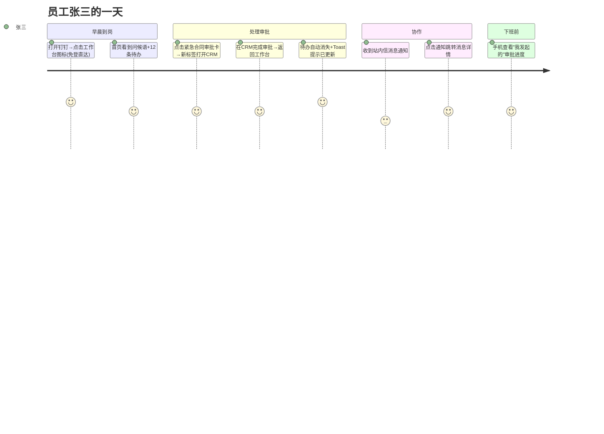
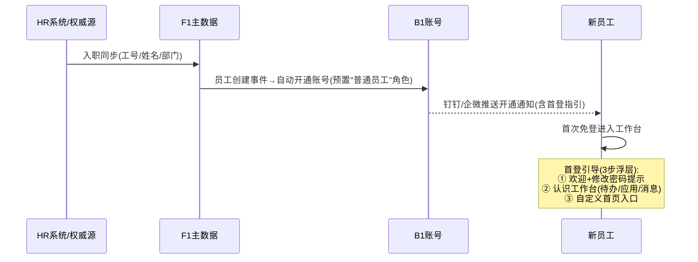

# 麓邦业务中台 UI/UX 设计文档

| 项目 | 内容 |
| --- | --- |
| 文档版本 | **v1.1**（同步 **Notion 暖色体系** + 决议 **#5b** + 页面地图扩充） |
| 编制角色 | 产品经理 / UI 设计师 |
| 上游文档 | 《麓邦业务中台产品PRD》（v1.1）《麓邦业务中台 V1.0 基座版详细设计》 |
| 文档状态 | 待确认事项已全部拍板（2026-09-22，见第十章），待设计评审 |
| 适用范围 | V1.0 基座版全部前端界面：工作台门户（A1/A4）、统一移动端（A2）、管理控制台、组件库（J1） |
| 用途 | 作为交互原型设计与前端开发的唯一设计依据；页面编号 `UI-xxx` 与 PRD 需求编号（如 A1-F01）双向映射 |

> **v1.1 本次更新（与已实现原型对齐，增量修改，不删既有内容）**：
> ① **第二章设计语言**：中性色阶由旧冷色（`#0F172A / #334155 / #64748B / #94A3B8 / #CBD5E1 / #E2E8F0 / #F1F5F9`）**整体切换为 Notion 暖色体系**，并说明「双轨制」（`--bmp-*` 为兼容别名）；
> ② 补**语义色第 3 条**（紧急/超时由品牌红承担，danger 收窄为错误/失败）；
> ③ 补 **Notion 压缩字距**与字体栈；
> ④ 补**多层低透明度阴影 + 细边框**；
> ⑤ 决议章节**新增 #5b**（页面驻留：受控内嵌 iframe）；
> ⑥ **3.4 页面地图**补新增页面（界面风格 Tab / 布局模板按角色配模板 + 嵌入卡片 / 应用卡片四 Tab + 域名白名单 / 应用运营看板）；
> ⑦ **5.3 工作台首页更新为 v2**（三栏 + AI 简报 + 意图流 + 紧迫度时间轴 + ⌘K）；
> ⑧ **5.6 移动端**补底部 Tab 全局导航 + 四屏。
> **⑨ 2026-10-21 晚**：管理端 **27 侧栏项**；**`portal-apps` 应用管理**（**＋ 上架应用**）与 **`portal-components` 首页组件管理**（卡片/嵌入/意图三 Tab）**拆页**；**移除** `portal-apps` 域名白名单 Tab（嵌入 host 随 I1；回调白名单仍在 `platform-capabilities` / 注册向导）。
> 需另见：《麓邦业务中台产品PRD》10.5（编号总表与变更记录）、6.1（详细功能需求）。

---

## 一、设计概述

### 1.1 设计目标

| 目标 | 度量 |
| --- | --- |
| **一站式**：员工在一个工作台完成 80% 日常入口动作 | 工作台日活 ≥70%（PRD 北极星） |
| **零学习成本**：新系统接入后用户无感（SSO+统一导航） | 首次使用无需培训即可找到待办与应用 |
| **可配置**：布局引擎支撑角色化首页，新卡片注册即上架 | 管理员配置角色首页 ≤30 分钟（A1-F02 验收） |
| **一致**：设计 Token + 组件库统一，管理端与门户同源 | 业务组件复用率 ≥80% |

### 1.2 设计范围（V1.0 页面清单总览）

| 端 | 页面组 | 数量 |
| --- | --- | --- |
| 统一登录 | 登录页、OIDC 授权页、忘记密码、MFA 验证 | 4 |
| 工作台门户（PC） | 首页（布局引擎，**重构版 v2**）、待办中心、消息中心、公告、应用中心、个人设置（**含界面风格 Tab**） | 6 |
| 统一移动端（钉钉/企微 H5） | 移动首页（**重构版 v2**）、移动待办、移动审批详情、消息卡片落地页、**移动四屏（底部 Tab）** | 4 + **1（UI-M-05）** |
| 管理控制台 | **8 组 / 26 侧栏项**（2026-10-21）：总览（**运营总览看板 `dashboard`**）、身份权限、主数据（含 **D2 文件管理 `file-admin`**）、门户运营（含 **AI 助手演示项**）、流程与表单、消息、审计、集成与网关；页面编号仍为 UI-C-01~17（**UI-C-17 图表区块挂载 `dashboard`**） | 16 + **1（UI-C-17）** |
| 组件库（J1） | 业务组件 12+（见第七章） | —— |
| **合计** | **v1.0 的 30 页 + v1.1 新增页 2（UI-C-17 / UI-M-05，编号顺延不重排）** | **30 + 2** |

> **v1.1 页面数说明**：`UI-C-17`（应用运营看板）与 `UI-M-05`（移动四屏）为本轮**新增页**；`UI-U-01`／`UI-C-10`／`UI-C-11`／`UI-A1-01`／`UI-M-01` 为**既有页增补**（编号不变）。「能力使用总览」「接入状态视图」为 `UI-C-10` 内区块，**不计页面数**。
>
> **2026-10-21 原型回写**：**UI-C-17（A1-F09）** 与平台 KPI **同页** — 侧栏「总览 → 运营总览看板」`dashboard`（**5 项 KPI 单行** + 四图表区块）；书签 `app-analytics` 重定向。`portal-ai-assistant` 为 **演示配置**（产品 V1.5 **不交付 B7**）。

### 1.3 设计原则

1. **任务优先**：待办与审批是最高频任务，一切导航为其让路（首屏必见待办卡）；
2. **状态可见**：任何异步操作有明确反馈（加载/成功/失败），任何数据有空态指引；
3. **一致复用**：同类操作用同类控件与文案；管理端一律左树右表/列表页范式；
4. **克制装饰**：企业工具属性，信息密度中等偏高，避免大留白营销风；
5. **可配置即产品**：布局引擎、卡片注册、权限指令驱动的界面差异全部配置化，不硬编码。

### 1.4 用户与场景速览

| 角色 | 高频场景 | 设计侧重 |
| --- | --- | --- |
| 普通员工 | 看待办、进应用、收消息 | 工作台首屏效率、移动免登 |
| 审批人/管理者 | 批量处理审批、看组织与目标 | 待办聚合、批量操作、移动审批 |
| 系统管理员 | 配权威源、管账号权限、审模板 | 管理端表单/向导/批量效率 |
| 运维/审计 | 查日志、看健康、追问题 | 检索组合筛选、详情抽屉、时间线 |

---

## 二、设计语言（Design Tokens）

> 基于 Element Plus 主题扩展，全部以 CSS 变量落地。**v1.1 起基准为「Notion 暖色体系」**（与已实现原型 `home-v2.html` / `sample-notion.html` / `assets/tokens.css` 对齐）。**仅提供浅色主题，不做暗色模式**（2026-09-22 决议 #3），但色彩全部走 Token，未来如需暗色只扩展 Token 层不改组件。

### 2.0 双轨制（v1.1 新增，先读本节再看 2.1）

设计 Token 采用**双轨制**，落地于 `prototype/assets/tokens.css`：

| 轨 | 变量前缀 | 角色 | 说明 |
| --- | --- | --- | --- |
| **第一轨（基准）** | `--canvas` / `--surface` / `--text-primary` / `--accent` … | **Notion 暖色体系事实基准** | 新页面、新组件一律使用；与 `home-v2.html` / `sample-notion.html` 内联变量同名 |
| **第二轨（兼容别名）** | `--bmp-*`（42 个） | **兼容别名：变量名保留、值指向第一轨** | 旧页面 11 页 + `common.css` 共 **1498 处**引用靠它继续工作 —— **零改动自动变暖色**，是「文档说一套、实现做一套」的根治手段 |

**原则**：① 变量名不改（保护存量引用）；② 值全部映射到暖色第一轨；③ 新代码优先用第一轨变量；④ **语义色（success/warning/danger）与渠道品牌色固定，不随风格变化**。

### 2.1 色彩系统

#### 2.1.1 基准色（第一轨 · Notion 暖色）

| Token | 值 | 用途 |
| --- | --- | --- |
| `--canvas` | `#ffffff` | **画布底**（页面最底 / 卡片底，纯白） |
| `--surface` | `#f6f5f4` | **区块 / 卡片底**（暖白，带黄褐底调） |
| `--surface-hover` | `#efedea` | 区块悬停 |
| `--surface-sunken` | `#f8f7f6` | 表头 / 浅陷底（比 surface 略亮） |
| `--dark-surface` | `#31302e` | 深色反衬底（Toast / 头像底 / 用户气泡） |
| `--text-primary` | `rgba(0,0,0,.95)` | 标题（暖黑） |
| `--text-body` | `#444444` | 正文常规 |
| `--text-secondary` | `#615d59` | 次要文字（暖灰 500） |
| `--text-weak` | `#a39e98` | 占位 / 弱化（暖灰 300） |
| `--line` | `1px solid rgba(0,0,0,.1)` | **细如耳语的边框（Notion 标识）** |
| `--line-color` | `rgba(0,0,0,.1)` | 细边框色值（供 `border-color` 使用） |
| `--border-strong` | `rgba(0,0,0,.18)` | 强化边框（hover / 聚焦） |
| `--accent` | `#C8161D` | 麓邦品牌红（主操作 / 链接 / 选中态 / **紧急超时语义**） |
| `--accent-warm` | `#dd5b00` | 暖橙（hover / 辅助强调 / 「本周待办」色条） |
| `--bmp-font-family`… | 见 2.2 | 字体栈 `Inter, -apple-system, "PingFang SC", sans-serif` |

> **重要用法——「白画布 + 暖白区块」（Notion 的正确用法）**：
> ① **页面最底（`body`）用纯白 `--canvas: #ffffff`**；
> ② **区块 / 卡片 / 表格这些「容器」用暖白 `--surface: #f6f5f4`**；
> ③ 因此**不要**写成「页面底应为暖白」——页面底是白的，暖白是**区块的底**。这一反直觉的用法正是 Notion 的视觉来源：白色画布上浮起一层暖白卡片。
> ④ 旧 `--bmp-bg-page` 指向 `--surface`（暖白），是为兼容旧页面把「整页底」当暖白用的历史实现；新页面请改用 `--canvas` 作页底、`--surface` 作区块底。

#### 2.1.2 品牌色 / 语义色（固定，不随风格变）

| Token | 值 | 用途 |
| --- | --- | --- |
| `--bmp-color-primary` | `#C8161D`（麓邦品牌红，**占位值**，精确色值待从 Logo 源文件/VI 手册提取后替换，仅改 `@bmp/theme` Token 包一处） | 主操作按钮、链接、导航选中态、品牌区 |
| `--bmp-color-primary-light` | `#FBECEC` | 悬停背景、选中标签底色 |
| `--bmp-color-primary-dark` | `#A51218` | 按钮 hover/active |
| `--bmp-color-success` | `#16A34A` | 成功、已通过、启用 |
| `--bmp-color-warning` | `#F59E0B` | 警告、临期待办 |
| `--bmp-color-danger` | `#F53F3F`（亮红） | **仅限错误与失败**（见下第 3 条） |
| `--bmp-color-info` | `#64748B` | 中性提示（**注意：此为语义色 info，注意力等级低，不作为正文/边框等中性色阶使用**） |
| 渠道品牌色 | 钉钉 `#1677FF`、企微 `#07C160` | 渠道标识（固定） |

**品牌红与 danger 红的区分规则（主色为红后的强制约束）**：

1. **职责分离**：primary 深红（`#C8161D`）只用于品牌与主操作（实心按钮、导航选中、链接）；danger 亮红（`#F53F3F`）**只用于「错误与失败」语义**（错误文字/图标、浅红底提示条、高危实心按钮）；
2. **形态区分**：错误反馈一律用「浅红底 `#FEF2F2` + 亮红字/边框」形态，禁止用实心品牌红表达错误，避免与主按钮混淆；
3. **【v1.1 新增 · 第 3 条】紧急 / 超时语义由品牌红 `#C8161D` 承担；danger 亮红收窄为「错误与失败」**：暖色体系下页面同时存在「品牌红（主操作）+ 亮红（错误）+ 暖橙（辅助）」时，若「紧急/超时」再用 danger 亮红，会出现**三种红打架**——同一屏难以分辨「这是主按钮 / 这是危险 / 这是紧急」。故明确划分：
   - **紧急 / 超时 / 临期 → 品牌红 `#C8161D`**（待办紧急圆点、超时文字「已超时 Xh」、时间轴「今天必须做」色条、Banner 紧急标签）；
   - **错误 / 失败 → danger 亮红 `#F53F3F`**（校验失败、提交失败、接口报错、降级卡错误标识）；
   - 该划分**不随主题色改变**（A1-F06 H2），紧急语义色恒定，避免「红色不再警示」；
4. **同屏规则**：同一视图内实心品牌红按钮与 danger 元素同现时，两者明度差已由色值保证，设计走查时逐页核验；
5. **大面积用红克制**：品牌红仅点缀使用（顶栏 Logo、主按钮、选中态），页面背景保持中性色（白画布 / 暖白区块），避免红色焦虑感。

**语义色规则**：待办紧急度 普通=info、重要=warning、**紧急/超时=品牌红 `#C8161D`**；账号状态 启用=success、停用=info、锁定=danger（亮红）；消息渠道用渠道品牌色（钉钉 `#1677FF`、企微 `#07C160`）。

### 2.2 字体排版

| Token | 规格 | 用途 |
| --- | --- | --- |
| 字体族 | **`Inter, -apple-system, "PingFang SC", sans-serif`**（`--font`；数字 `tabular-nums`） | 全局（**v1.1 更新**：栈首加入 `Inter`，与暖色体系一致） |
| `--bmp-font-h1` | 24px/32px, 600 | 页面大标题（少用） |
| `--bmp-font-h2` | 20px/28px, 600 | 模块标题 |
| `--bmp-font-h3` | 16px/24px, 600 | 卡片标题、弹窗标题 |
| `--bmp-font-body` | 14px/22px, 400 | 正文（默认） |
| `--bmp-font-caption` | 12px/18px, 400 | 辅助说明、时间戳 |
| `--bmp-font-number-lg` | 28px/36px, 600 | 数据卡大数字 |

**Notion 压缩字距（v1.1 新增，Notion 的排版标识之一）**：

| 层级 | 字距 | 说明 |
| --- | --- | --- |
| 大标题（H1 / 品牌区 slogan / 页面标题） | `letter-spacing: -.4px ~ -.5px`（超大标题可到 `-1.5px`） | **负字距**——大字收紧，是 Notion 的紧凑感来源 |
| 区块标题（H2/H3、分组标题） | `letter-spacing: -.25px` | 轻度收紧 |
| 卡片小标题 / 应用名 | `letter-spacing: -.2px` | 微收紧 |
| **徽标 / 角标 / 计数（badge）** | **`12px / 600 / letter-spacing: +0.125px`** | **系统内唯一的「正字距」**——小字微放开，避免拥挤 |

> **硬规则**：字号越大字距越负、字号越小（尤其 12px 徽标）用**正字距**。除徽标这一类 12px 徽章外，全站不再出现正字距；禁止标题使用正字距或徽标使用负字距。落地见 `sample-notion.html`（`.kbd` / `.badge-ai` / `.sec-note` 均为 `+0.125px`；`h1` 为 `-1.5px`，`h2/h3` 为 `-.25px`）。

### 2.3 间距、栅格与圆角阴影

- **间距**：4px 基准阶梯 `4/8/12/16/20/24/32`；卡片内边距 16px；区块间距 16px；页面边距 24px；
- **栅格**：24 栅格， gutter 16px；工作台卡片最小宽度 6 栅格（1/4 屏）；**v2 三栏为三个独立 24 栅格容器**（见 5.3）；
- **圆角**：`--bmp-radius-sm 4px`（按钮/输入）、`--bmp-radius-md 8px`（**卡片，Notion 主圆角**）、`--bmp-radius-lg 12px`（弹窗）；**胶囊 `--bmp-radius-pill 9999px`**（标签 / 搜索框 / 头像 / Tab 项）。**`--bmp-radius-btn` 由原 4px 调整为 8px**（贴近 Notion 的圆润按钮）；
- **阴影层级（Notion 多层低透明度，累计不透明度 ≤0.05）**——v1.1 由旧单层阴影升级：

  | Token | 值 | 用途 |
  | --- | --- | --- |
  | `--bmp-shadow-1` | `rgba(0,0,0,.04) 0 1px 3px, rgba(0,0,0,.02) 0 1px 2px` | 卡片静止 |
  | `--bmp-shadow-2`（`--shadow-soft`） | `rgba(0,0,0,.04) 0 4px 18px, rgba(0,0,0,.027) 0 2px 8px, rgba(0,0,0,.02) 0 .8px 3px` | 卡片悬浮 / 下拉 |
  | `--bmp-shadow-3`（`--shadow-lift`） | `rgba(0,0,0,.05) 0 8px 28px, rgba(0,0,0,.035) 0 3px 10px, rgba(0,0,0,.025) 0 1px 4px` | 弹窗 / 抽屉 / 浮层 |

  > **Notion 阴影哲学**：**多层、极低透明度、大模糊半径**——营造「纸片轻浮」而非「厚切投影」。**禁止单层高透明度阴影**（如 `0 12px 32px rgba(15,23,42,.16)` 为旧冷色写法，已废弃）。
- **细边框 `1px solid rgba(0,0,0,.1)`（`--line`）：Notion 的标识性元素**。卡片/区块/输入/顶栏分隔**优先用细边框界定**，阴影只作悬浮时的轻量补充；即「**静止靠边框、悬浮加淡影**」，禁止用重阴影替代边框；
- **图标**：统一 iconify 线性图标（20px 网格），管理端菜单图标 16px；禁用多风格混用。

---

## 三、信息架构与导航

### 3.1 产品端划分

```
麓邦业务中台
├── 工作台门户（PC，员工默认入口，A1）
├── 统一移动端（钉钉/企微 H5，A2）
├── 管理控制台（管理员/运维，独立域名路径 /console）
└── 组件库（嵌入存量系统与新系统，J1）
```

### 3.2 工作台门户导航（顶栏模式）

```
┌──────────────────────────────────────────────────────────────┐
│ [Logo] 麓邦业务中台   [首页] [待办(12)] [消息(3)] [应用]      │
│                                    [全局搜索🔍V1.5] [头像▾] │
└──────────────────────────────────────────────────────────────┘
```

- 顶栏一级导航固定 4 项：首页 / 待办 / 消息 / 应用（全局搜索 V1.5 上线时插入，位置预留）；
- 头像下拉：个人设置、切换角色视角（多角色用户）、退出登录（全局登出确认弹窗）；
- 待办与消息导航项带未读角标（实时 ≤30s，轮询 V1.0、WebSocket V1.5）。

### 3.3 管理控制台导航（左侧菜单模式）

> **2026-10-21 · 与原型 `CONSOLE_MENU` 对齐**：**8 组 / 27 侧栏项**；详表 `prototype/docs/menu-structure.md`。

```
┌────────────┬─────────────────────────────────────────────┐
│ 总览        │  面包屑：总览 / 运营总览看板（dashboard）     │
│  └ 运营总览看板（5 KPI + A1-F09 图表 · UI-C-17）          │
│ 身份与权限  │  账号 / 角色 / 权限点 / 会话 / 权限申请      │
│ 主数据      │  组织 / 人员 / 权威源向导 / 同步日志 / 文件管理│
│ 门户运营    │  应用管理(portal-apps) / 首页组件(三Tab) /   │
│             │  布局 / 角色订阅与意图 / 公告 / AI助手(演示)  │
│ 流程与表单  │  流程定义 / 审批矩阵 / 实例监控 / 委托代理    │
│             │  （workflow-designer 无侧栏，自定义页进入）   │
│ 消息管理    │  模板 / 渠道 / 记录（msg 单页三 Tab）         │
│ 审计中心    │  审计日志检索（audit）                        │
│ 集成与网关  │  能力目录 / 应用注册 / 事件订阅运维 / 网关路由│
│             │  （app-register-guide 内链，无侧栏）          │
└────────────┴─────────────────────────────────────────────┘
```

菜单按 `sys_permission`（type=menu）动态生成，权限不足菜单自动隐藏。

### 3.4 页面地图总表

> **v1.1 更新**：`UI-U-01` 增加「界面风格」Tab；**2026-10-21 晚** **`UI-C-10` 拆为两页**：`portal-apps` **应用管理**（**＋ 上架应用**）+ `portal-components` **首页组件三 Tab**（卡片 / 嵌入 / 意图；**无**域名白名单 Tab）；`UI-C-11` 增加「按角色配模板 + 嵌入卡片」；**新增 `UI-C-17 应用运营看板`**（**2026-10-21** 挂载 **`dashboard` 运营总览看板**，非独立「门户运营」菜单项）；`UI-A1-01 / UI-M-01` 标注「**重构版 v2**」；新增 `UI-M-05` 移动四屏。

| 页面 ID | 页面名称 | 路由 | 对应 PRD 需求 | 端 | 优先级 |
| --- | --- | --- | --- | --- | --- |
| UI-LOGIN-01 | 统一登录页（**v2 改造**：Notion 风格 + 钉钉扫码主推） | `/login` | B1-F02/F05、B1-F02-1/2/4 | 门户 | P0 |
| UI-LOGIN-02 | OIDC 授权确认页 | `/oauth2/consent` | B1-F02 | 门户 | P0 |
| UI-LOGIN-03 | 忘记密码/重置 | `/login/forgot` | B1-F05 | 门户 | P0 |
| UI-LOGIN-04 | MFA 验证页 | `/login/mfa` | B1-F04 | 门户 | P1（默认关） |
| UI-A1-01 | 工作台首页（**重构版 v2**：三栏 + AI 简报 + 意图流 + 紧迫度时间轴 + ⌘K） | `/home` | A1-F01/F02、A1-F02 演进 | 门户 | P0 |
| UI-A1-02 | 应用中心（含 AI 推荐 / 智能搜索） | `/apps` | A1-F01、A1-F05-3 | 门户 | P0 |
| UI-A1-03 | 消息中心 | `/messages` | A1-F03 | 门户 | P0 |
| UI-A1-04 | 公告列表/详情 | `/notices`、`/notices/:id` | A1-F04 | 门户 | P0 |
| UI-A4-01 | 统一待办中心 | `/todos` | A4-F01~F05 | 门户 | P0 |
| UI-U-01 | 个人设置（**首页布局** / **界面风格** / 通知偏好） | `/settings` | A1-F02、**A1-F06** | 门户 | P0 |
| UI-M-01 | 移动首页（**重构版 v2**：简报 + 意图胶囊 + 底部 Tab 导航） | 钉钉/企微 H5 `/m/home` | A2-F01/F02、A1-F02 演进 | 移动 | P0 |
| UI-M-02 | 移动待办列表 | `/m/todos` | A2-F03 | 移动 | P0 |
| UI-M-03 | 移动审批详情 | `/m/todos/:id` | A2-F03 | 移动 | P0 |
| UI-M-04 | 消息卡片落地页 | `/m/messages/:id` | A2-F04 | 移动 | P0 |
| **UI-M-05** | **移动四屏（底部 Tab 导航落地）**：待办中心 / 审批中心 / 消息中心 / 我的 | `/m/todos`、`/m/approval`、`/m/messages`、`/m/me` | **A2-F05、A2-F05-2** | 移动 | P0 |
| UI-C-01 | 账号管理 | `/console/accounts` | B1-F01/F06 | 管理 | P0 |
| UI-C-02 | 角色管理（含权限分配） | `/console/roles` | B2-F01 | 管理 | P0 |
| UI-C-03 | 权限点管理 | `/console/permissions` | B2-F02 | 管理 | P0 |
| UI-C-04 | 在线会话管理 | `/console/sessions` | B1-F07 | 管理 | P0 |
| UI-C-05 | 权限申请登记 | `/console/perm-applies` | B2-F04（V1.0 登记版） | 管理 | P1 |
| UI-C-06 | 组织管理（组织树） | `/console/orgs` | F1-F01/F05 | 管理 | P0 |
| UI-C-07 | 人员管理 | `/console/employees` | F1-F01 | 管理 | P0 |
| UI-C-08 | 权威源配置向导 | `/console/sync-source` | F1-F03 | 管理 | P0 |
| UI-C-09 | 同步日志 | `/console/sync-logs` | **F1-F03（产出）**、B3-F01/F02（口径） | 管理 | P0 |
| UI-C-10 | **应用管理**（`portal-apps`：外链 + 流程只读；**＋ 上架应用**）+ **首页组件管理**（`portal-components` **三 Tab**：卡片 / 嵌入 / 意图；嵌入 host 随 I1，**无**白名单 Tab） | `/console/portal/apps` · `/console/portal/components` | A1-F01/F02、**A1-F08-1~3**、A1-F02-7 | 管理 | P0 |
| UI-C-11 | 布局模板管理（**按角色配模板 + 嵌入卡片物料**） | `/console/portal/layouts` | A1-F02、**A1-F02-1~6** | 管理 | P0 |
| UI-C-12 | 公告管理（含 Banner 后台增强） | `/console/notices` | A1-F04、**A1-F04-1~5** | 管理 | P0 |
| UI-C-13 | 消息模板/渠道/记录 | `/console/msg/*` | D1-F01~F05 | 管理 | P0 |
| UI-C-14 | 审计日志检索 | `/console/audit/*` | E2-F01~F05 | 管理 | P0 |
| UI-C-15 | 网关路由管理 | `/console/gateway/routes` | E1-F01 | 管理 | P0 |
| UI-C-16 | **集成与网关域**（侧栏：`platform-capabilities` · `app-register` · `app-register-events` · `gateway`；**`app-register-guide` 无侧栏**） | `/console.html?page={key}` | **I1-F01、I1-F05、I1-F06、E1-F01、F1-F04、J3、J1-F04**；**B3-F03 离线**；~~J2-F05 在线 Tab~~ **非 V1.5** | 管理 | P0/P1 |
| **UI-C-17** | **应用运营看板（A1-F09 四区块）** — **挂载 `dashboard` 运营总览看板**（5 KPI + 图表） | `/console/portal/ops-dashboard`（canonical **`page=dashboard`**；alias `app-analytics`） | **A1-F09**（+ A1-F09-1~4） | 管理 | P1 |

> **注（本轮新增页面说明）**：`UI-C-17` 为**本轮新增页面**（应用运营看板，V1.5，与 A1-F05 埋点同批）；「**能力使用总览**」「**接入状态视图**」为 **UI-C-10 应用详情内的区块**（不新增页面 ID，避免页面地图膨胀）；移动端 `UI-M-05` 承载底部 Tab 的四屏落地，与既有 `UI-M-02`（移动待办列表）并存（`UI-M-02` 作为四屏中「待办中心」的视图细化）。

> **注（B3-F03 · 2026-10-20/21）**：**V1.5 无控制台组织对照页**；`B3-F03` 组织/账号映射走 **实施/连接器离线导入**。集成域侧栏为 **能力目录 → 应用注册 → 事件订阅运维 → 网关路由**；**`app-register-events` 双 Tab**（订阅与投递 / 事件流排查）。

---

## 四、核心交互规范

### 4.1 布局范式

| 范式 | 适用 | 结构 |
| --- | --- | --- |
| **工作台布局** | 门户首页 | 顶栏(56px) + 内容区(max-width 1440px 居中) + 卡片栅格 |
| **管理端列表页范式** | 全部管理页 | 筛选区(可折叠) + 操作栏(左主操作/右列设置) + 表格 + 分页；行内操作 ≤3 个，超出收「更多」 |
| **左树右表范式** | 组织管理、权限点 | 左树(280px 可折叠) + 右表 |
| **详情抽屉范式** | 日志详情、待办详情、人员详情 | 右侧 Drawer(640px)，不跳页，保留列表上下文 |
| **向导范式** | 权威源配置、应用注册 | 步骤条(3–5 步)，每步可校验，支持保存草稿 |

### 4.2 全局状态设计（所有页面必须覆盖）

| 状态 | 视觉 | 文案规则 |
| --- | --- | --- |
| 加载中 | 骨架屏（卡片/表格行形状），禁用全屏 loading > 300ms 才出现 spinner | —— |
| 空态 | 居中线性插图(120px) + 说明 + 引导操作按钮 | 「暂无待办，去应用中心看看」——空态必带下一步动作 |
| 错误态 | 插图 + 错误说明 + 「重试」按钮 | 展示错误码（如 `4404`）便于报障 |
| 无权限态 | 锁形插图 + 「无访问权限」+ 申请入口（跳权限申请登记） | 不暴露资源存在性 |
| 网络异常 | 顶部全局横幅（红色，可关闭）「网络连接异常，部分数据可能不是最新」 | 自动重连后消失 |
| 会话过期 | 弹窗「登录已过期」→ 确认后跳统一登录（保留 redirect） | 静默续期失败才弹出 |

### 4.3 反馈模式使用边界

| 模式 | 使用场景 | 时长/行为 |
| --- | --- | --- |
| Message（轻提示） | 操作成功/失败即时反馈 | 成功 2s 自动消失；失败 3s |
| Notification（通知） | 系统级通知、新待办到达（右上角） | 5s，可点击跳转 |
| Dialog（模态） | 高危操作确认（停用账号/强制下线/删除）、表单填写（字段 ≤8） | 必须显式关闭 |
| Drawer（抽屉） | 详情查看、长表单、配置面板 | 保留列表上下文 |
| 行内反馈 | 表单字段校验错误 | 失焦校验 + 提交时全量校验 |

**高危操作规范**：停用账号、强制下线、删除模板等操作，Dialog 中要求**输入对象名称或勾选确认**，按钮文案用具体动词（「停用账号」而非「确定」），危险按钮红色。

### 4.4 表单与表格交互规范

- 表单：标签右对齐（管理端）/顶部对齐（弹窗与移动端）；必填红星前置；错误提示在字段下方红色 12px；长表单分步骤或分区卡片；提交按钮 loading 态防重复；
- 表格：默认每页 10 条（可选 20/50/100）；排序仅服务端字段标注可排序；筛选区默认展示 ≤4 个高频条件，「更多筛选」展开；批量操作选中后底部浮出操作条；列设置记忆用户偏好（localStorage）；
- 时间显示：列表内相对时间（「5 分钟前」）+ hover 绝对时间；详情页绝对时间 `yyyy-MM-dd HH:mm`；
- 数字：千分位；金额带 ¥ 前缀右对齐。

### 4.5 权限交互（v-perm 指令）

| 策略 | 规则 |
| --- | --- |
| 按钮级 | 无权限默认**隐藏**；涉及「需要让用户知道功能存在」的场景用禁用+tooltip「无权限，可申请」 |
| 菜单级 | 无权限菜单不渲染（动态路由过滤） |
| 页面级 | 直接访问无权限路由 → 无权限态页（4.2） |
| 数据级 | V1.5 数据权限生效后，列表仅展示有权数据，不做前端脱敏占位 |

### 4.6 响应式与多端

| 断点 | 布局行为 |
| --- | --- |
| ≥1440px | 工作台内容区 max-width 1440 居中；管理端表格完整列 |
| 1024–1439px | 卡片栅格自动降列（6 栅格卡→8 栅格）；表格次要列隐藏 |
| <1024px | PC 端提示「建议在更大屏幕使用」，核心功能（待办/审批）保持可用 |
| 移动端 H5 | 375px 基准 vw 适配；钉钉/企微容器内全屏；安全区适配（底部 home indicator） |

### 4.7 可访问性与文案

- 对比度：正文 ≥4.5:1，大字 ≥3:1（WCAG AA）；
- 键盘：Tab 顺序按视觉流；弹窗焦点圈定；Esc 关闭抽屉/弹窗；
- 动效：≤200ms ease-out；尊重系统「减少动态效果」；
- 文案：动词开头（「新建角色」）；错误提示说明原因+解决方法，禁止仅「操作失败」；时间统一 24 小时制；
- 国际化：V1.0 仅中文，文案全部走 i18n key（为未来预留，禁止硬编码中文入组件）。


---

## 五、关键页面设计（线框 + 交互说明）

> 线框为低保真结构示意，高保真视觉由设计师基于 Design Tokens 产出；每页标注数据来源接口（对应 V1.0 详设第三章）。

### 5.1 UI-LOGIN-01 统一登录页（B1-F02/F05）

```
┌─────────────────────────────────────────────────────────┐
│        （左 60% 品牌区）      │   （右 40% 登录卡片）      │
│                              │  ┌───────────────────┐  │
│   麓邦业务中台                │  │ [密码登录][扫码登录] │  │
│   一个账号 · 一次登录 · 全系统  │  │                   │  │
│   （品牌插图/宣传语）           │  │  账号 [          ] │  │
│                              │  │  密码 [          ] │  │
│                              │  │  [图片验证码 出现条件见下]│
│                              │  │  □ 记住账号         │  │
│                              │  │  [   登  录      ] │  │
│                              │  │  忘记密码?          │  │
│                              │  │  ── 或 ──          │  │
│                              │  │  [钉钉] [企业微信]  │  │
│                              │  └───────────────────┘  │
└─────────────────────────────────────────────────────────┘
```

**交互规则**：
- 双 Tab：密码登录 / 扫码登录（扫码 Tab 展示钉钉、企微二维码，轮询扫码状态，文案「使用钉钉/企业微信扫码登录」）；
- 连续失败 3 次后追加图片验证码，失败 5 次锁定账号并提示「账号已锁定，请 30 分钟后重试或联系管理员」（B1-F05 策略）；
- 「记住账号」仅记忆用户名（禁止记忆密码，安全要求）；
- 登录成功：有 `redirect` 参数则跳回原地址，否则跳 `/home`；
- 第三方入口：点击后 302 至钉钉/企微 OAuth 授权页（连接器配置驱动，未启用的渠道不渲染按钮）；
- MFA 启用时（B1-F04 配置开启），密码通过后进入 UI-LOGIN-04。

### 5.2 UI-LOGIN-02 OIDC 授权确认页（B1-F02）

第三方应用（如新业务系统）发起授权时展示：

```
┌───────────────────────────┐
│   [应用图标] XX 系统        │
│   申请获得以下权限：         │
│   ✓ 获取你的基本信息（姓名、 │
│     工号、部门）            │
│   ✓ 获取你的联系方式         │
│   ─────────────────────   │
│   [ 拒绝 ]    [ 同意授权 ]  │
└───────────────────────────┘
```

- 展示申请方应用名称/图标（来自 `gov_app_register`）、请求的 scope 中文说明；
- 已授权过的应用二次授权时提示「你此前已授权过该应用」；
- 「同意授权」后回跳 `redirect_uri` 携带 code；「拒绝」回跳携带 `error=access_denied`。

### 5.3 UI-A1-01 工作台首页——布局引擎渲染（**重构版 v2**，A1-F01/F02、A1-F02 演进）

> **v1.1 更新**：本节由旧「卡片式首页（24 栅格）」**整体更新为 v2**（与已实现 `prototype/home-v2.html`、`prototype/mobile/home-v2.html` 对齐）。**页面编号 UI-A1-01 / UI-M-01 不变**（仅标注「重构版 v2」），避免改动页面地图、权限点与埋点 ID。
> **三纲领**：① 首页承担**判断**（AI 今日简报）；② 到达动作只需**一句话 / 一次点击**（意图流 + ⌘K）；③ **视觉权重随紧迫度衰减**（时间轴流三组四维衰减）。

**PC 首页骨架（v2 · 三栏）**：

```
┌──────────────────────────────────────────────────────────────┐
│ 顶栏 56px 毛玻璃 sticky：[Logo] 首页 待办(12) 消息(3) 应用  [⌘K 搜索] [🔔] [头像▾] │
├──────────────────┬──────────────────────────┬─────────────────┤
│  左栏（8/24）     │  中栏（主区，弹性）        │  右栏（8/24）    │
│ ┌ AI 今日简报 ──┐ │ ┌ 紧迫度时间轴流 ────────┐ │ ┌ 我的订阅 ────┐ │
│ │ 早上好，张三   │ │ │ ▎今天必须做（72px·红）  │ │ │ 华宇合同 ⏱   │ │
│ │ ① 合同审批临期 │ │ │ 合同审批 华宇 [立即处理]│ │ │ 目标复盘 📈   │ │
│ │ ② 报销待填 3 笔│ │ │ ▎本周待办（56px·暖橙）  │ │ │ + 管理订阅   │ │
│ │ 其余 9 件…     │ │ │ 报销审批 李四 [去处理]  │ │ └──────────────┘ │
│ └────────────────┘ │ │ ▎知悉即可（44px·无条）  │ │ ┌ 关注与动态 ──┐ │
│ ┌ 意图流 ────────┐ │ │ 公告知悉项 …           │ │ │ 公告/消息流  │ │
│ │ 🚀发起审批      │ │ └───────────────────────┘ │ └──────────────┘ │
│ │ 🧾查报销 …      │ │                          │ ┌ 本月速览 ────┐ │
│ └────────────────┘ │                          │ └──────────────┘ │
│ ┌ 全部应用 ──────┐ │                          │ ┌ 全部应用入口 ┐ │
│ └────────────────┘ │                          │ └──────────────┘ │
└──────────────────┴──────────────────────────┴─────────────────┘
                    ＋ 全局 AI 助手浮层（右下 FAB 展开）
```

**v2 三栏与时间轴流权重表（三组，四维同步衰减）**：

| 分组 | 判定 | 行高 | 标题字号 | 左侧色条 | 行内操作 |
| --- | --- | --- | --- | --- | --- |
| **今天必须做** | `urgency=2` 或 `overdue=true` 或 `remainHours ≤ 4` | 72px | 16px/600 | 3px **品牌红 `#C8161D`**（紧急语义由品牌红承担） | 实心主按钮「立即处理」 |
| **本周待办** | `remainHours ≤ 168` 且未落入上一组 | 56px | 15px/500 | 3px **暖橙 `#dd5b00`** | 文字按钮「去处理」（hover 现） |
| **知悉即可** | `urgency=0` 且 `remainHours > 24` | 44px | 14px/400 | 无（上边框细线） | 无按钮（整行可点） |

**布局引擎交互规则**（核心，A1-F02）：
1. 页面由 `portal_layout.template_json` 驱动渲染：解析 JSON → 按**栏（左/中/右）**排列卡片 → 每卡片加载注册的 card manifest（组件 + 数据接口）；**每栏为独立 24 栅格容器**（`LayoutGrid` 递归）；
2. 管理员在 UI-C-11 **为角色绑定 v2 三栏模板**；用户可在「个人设置 → 首页布局」中基于角色模板做个人微调（卡片显隐、栏内排序、栏内栅格 12/16/24），保存后写用户级覆盖配置（`user_override_json` 深合并，**cardId 集合不可增删**）；
3. **编辑模式**：个人设置中点「自定义首页」→ 首页进入编辑态：卡片出现拖拽手柄、显隐开关；**跨栏禁拖拽**（栏宽由模板层决定），栏内可拖拽/显隐/调栅格；「保存 / 恢复默认模板」双按钮；
4. 卡片加载失败降级：单卡片显示错误占位（「卡片加载失败 [重试]」），不影响其他卡片；
5. 时间轴流：按上述权重表三组四维同步衰减；超时项**不自动霸占首位**（以红色「已超时 Xh」标注 + 简报显式提一句被看见）；
6. **AI 简报**：结构固定四段（问候 → 判断句 → ①② 逐项 → 收尾句「其余 N 件」）；**必说 2–3 件、上限 3 件**；**诚实原则（强制）**：AI 不可用 / 超时 / 数据不足时**不生成判断文案、不显示 AI 徽标**，降级为模板句简报 + 小字「AI 暂不可用，已按待办时限排序」；
7. **⌘K 命令栏**（B6）：全局唤起，自然语言指令直达动作（打开应用 / 查待办 / 发起审批）；
8. **分组分工（避免重叠）**：**公告与消息不进时间轴流**，只在右栏「关注与动态」出现；时间轴流「知悉即可」只放**待办性质的知悉项**；首页顶部通知 Banner（A1-F07）**零占位**（无条目不渲染 DOM）；
9. 数据刷新：待办/消息角标 30s 轮询增量接口。

**布局引擎兼容（A1-F02 既有机制零变更）**：v2 新卡片（`ai-brief` / `intent-stream` / `urgency-stream` / `watch-list` / `my-subscriptions` / `all-apps`）以**新 cardId 注册进 `cardManifest`**；**硬规则：不删除任何既有 cardId**（`todo-list` / `notice-msg` / `birthday` / `data-metrics` / `frequent-apps` / `quick-stats`）——老用户 `user_override_json` 可能引用，删除会导致覆盖配置静默失效；新默认模板只改其 `visible / order`（收录于 `legacy` 区，`visible:false`）。

**断点**：`≥1440px` 三栏；`1024–1439px` 右栏折叠为吸底抽屉触发条（左 + 中双栏）；`<1024px` 沿用既有「建议更大屏幕」提示。

**数据来源**：`GET /v1/portal/home-config`（布局 JSON + 卡片清单）→ 各卡片独立取数：`GET /v1/todos?status=pending&top=5`、`GET /v1/messages/unread-count`、`GET /v1/apps/frequent`、`GET /v1/notices/top`、`GET /v1/portal/brief`（AI 简报，可降级）。

> **旧版说明（v1，保留供对照）**：v1 为旧「问候区 + 卡片栅格（待办 12 / 常用应用 12 / 消息公告 16 / 数据卡占位 8）」的 24 栅格卡片式首页。**v1 模板仍按旧逻辑平铺不报错**（向后兼容路径，见详设 `layout_json` v2 结构与 `legacy` 区），但**新默认渲染以 v2 三栏为准**。此后各小节线框（5.4/5.5 等）结构不变。

### 5.4 UI-A4-01 统一待办中心（A4-F01~F05）

```
┌──────────────────────────────────────────────────────────┐
│ 待办中心                                                  │
│ [待办(12)] [已办] [我发起的]        来源:[全部▾] 类型:[全部▾]│
│                                    紧急度:[全部▾] [搜索🔍] │
├──────────────────────────────────────────────────────────┤
│ □ ┌──────────────────────────────────────────────────┐   │
│   │ ●紧急 [CRM] 合同审批                    剩余 3小时 │   │
│   │ 华宇科技采购合同 ¥120,000 — 王经理提交              │   │
│   │ [去处理] [催办]                        09-22 10:15│   │
│   └──────────────────────────────────────────────────┘   │
│ □ ┌──────────────────────────────────────────────────┐   │
│   │ ○重要 [招聘系统] 简历初筛                          │   │
│   │ 前端工程师候选人 ×3 — 李四提交        已超时 2小时(红)│   │
│   │ [去处理] [催办]                        09-21 16:00│   │
│   └──────────────────────────────────────────────────┘   │
│ ┌ 底部浮条（勾选后出现）：已选 2 项  [批量催办] [标记已读] ┐│
└──────────────────────────────────────────────────────────┘
```

**交互规则**：
- 三视图 Tab：待办（默认）/ 已办（只读，显示处理结果与时间）/ 我发起的（显示进度：处理中/已完成/已撤回）；
- 排序：紧急度 > 剩余时间升序（临期/超时置顶）；
- 「去处理」：`jumpUrl` 新标签页打开源系统处理页；处理完成后源系统回调 `/todo/done`，列表通过轮询自动移除并 Toast「待办已更新」；
- 「催办」（A4-F04）：仅「我发起的」视图与超时待办可用；点击后向当前处理人发催办消息；24h 内同一待办催办去重，重复点击提示「今日已催办」；
- 超时提醒：`overdueHours` 到期前 2h 变红「剩余 X 小时」，超时后红色「已超时 Xh」；
- 批量操作：勾选 ≤50 条，支持批量催办（我发起的）；
- 空态：「太棒了，暂无待办」+ 引导去应用中心。

**数据来源**：`GET /v1/todos`（分页+筛选）、`POST /v1/todos/urge`、`GET /v1/todos/initiated`。

### 5.5 UI-A1-03 消息中心（A1-F03）

```
┌────────────┬─────────────────────────────────────────────┐
│ 全部 (15)   │  系统维护通知                     10:32  ●  │
│ 待办提醒 (6)│  尊敬的用户，系统将于本周六 22:00-24:00 维护…│
│ 审批结果 (4)│  [查看详情]                                  │
│ 公告 (3)    │  ─────────────────────────────────────────  │
│ 系统通知 (2)│  合同审批结果                     09:15      │
│             │  你提交的华宇科技合同已通过终审               │
│ [全部已读]  │                                             │
└────────────┴─────────────────────────────────────────────┘
```

- 左分类列表（带未读计数）+ 右消息流；未读红点，点击即已读（`POST /v1/messages/{id}/read`）；
- 「全部已读」需二次确认；分类已读支持右键/更多菜单；
- 公告类点击跳公告详情页；带 `jumpUrl` 的业务消息展示「查看详情」跳转源系统。

### 5.6 UI-M-01/02/03/05 移动端（钉钉/企微 H5，A2，**重构版 v2**）

> 载体决议（2026-09-22 #2）：钉钉与企微**双活**，两套连接器与 container 适配都实现；**交互原型与高保真仅以钉钉容器为准出稿**，企微差异（导航栏/免登 API）由 container 模块抹平，不单独出设计稿。

**免登流程**：容器内打开 → jsapi 获取免登码 → `POST /v1/auth/mobile-login` → 静默换取 JWT → 直达页面（全程无登录界面，失败时降级展示登录页）。

> **v1.1 更新**：移动端 v2 重构**移除旧「金刚区」**（4 宫格入口）时**只拆了旧导航、没补新导航**，导致移动端只有单屏、无跨页导航——本节**补齐底部 Tab 全局导航 + 配套四屏**（对应 PRD **A2-F05、A2-F05-1~4**）。**页面编号 UI-M-01/02/03/04 不变**（仅标注「重构版 v2」），新增 `UI-M-05` 承载四屏。

**移动首页（UI-M-01，v2）**：问候 + **AI 简报**（精简）+「**最要紧的一件事**」大卡 + 意图胶囊（横向滚动）+ 我的订阅 + 底部全局 Tab 导航。

```
┌───────────────────────┐
│ 早上好，张三      [🔔3] │   ← 44px 容器导航栏（钉钉提供）
│ 12 条待办 · 3 条未读    │
├───────────────────────┤
│ 🤖 AI 简报：合同审批临期 │   ← 精简简报（可降级为模板句）
│ ┌─── 最要紧的一件事 ──┐ │   ← 大卡（权重≥其余待办×1.5）
│ │ ●合同审批 华宇科技   │ │
│ │  剩余3小时 [立即处理]│ │
│ └───────────────────┘ │
│ 意图胶囊（横滑）         │   ← 取代旧金刚区：发起审批/查报销…
│ [发起审批][查合同][找人] │
│ 我的订阅（与 PC 同步）    │
│ 其余待办流（权重递减）    │
├───────────────────────┤
│ 📝待办  ✅审批  💬消息  👤我的 │ ← 底部 Tab 全局导航（5 项，含首页）
└───────────────────────┘
```

**底部 Tab 全局导航（A2-F05，本轮缺口补齐）**：

| Tab | 页面 | 未读角标 | 说明 |
| --- | --- | --- | --- |
| **首页** | UI-M-01 移动首页 | — | 默认 Tab |
| **待办** | 待办中心（三视图：待办/已办/我发起的） | 待办未读 | 与 PC 统一待办实时一致 |
| **审批** | 审批中心（站内项可同意/驳回，未接的跳转） | 审批未读 | |
| **消息** | 消息中心（消息 + 公告） | 消息未读 | |
| **我的** | 我的（个人信息 + 入口组，含「我的订阅」管理入口） | — | PC 的「应用」在移动端改为「我的」 |

- **五项与 PC 顶栏一一对应**（PC 顶栏：首页/待办/消息/应用；移动端：首页/待办/审批/消息/我的）；
- **未读角标**：待办 / 审批 / 消息带角标，**为 0 时不显示**（修复 flex 覆盖 `[hidden]` 的问题）；
- **触控 ≥44px**，含 `env(safe-area-inset-bottom)` 安全区；沿用 Notion Token。

**与底部行动栏的共存方案（A2-F05-3，v1.1 明确）**：

| 层 | 位置/层级 | 行为 |
| --- | --- | --- |
| 内容区（`.screen`） | `flex:1`，Tab 栏为 `.phone` 的 flex 兄弟节点 | 内容**天然不被 Tab 栏叠加**（比靠 padding 硬撑稳健） |
| **底部行动栏** | `bottom: var(--bottom-chrome)`，z30 | **改为「滚动后出现」**（阈值 `ACTION_SHOW_AT`），对最紧急项一键操作；回顶收起 |
| **底部 Tab 栏** | `bottom:0`（含安全区），z40 | 全局导航 |
| 抽屉（AI 对话 / 任务处理 / 全部应用） | z60 | 覆盖于两栏之上 |

- **层级优先级**：内容 < 行动栏(z30) < Tab 栏(z40) < 抽屉(z60)；**两栏不重叠**；
- **行动栏上移至 Tab 栏之上**（`--bottom-chrome = --tabbar-h + --home-ind-h + env(safe-area-inset-bottom)`），因行动栏为「滚动后出现」，不会与常驻 Tab 栏争夺视觉。

**移动四屏（UI-M-05，A2-F05-2）**：**待办中心**（三视图：待办/已办/我发起的）/ **审批中心**（站内项可同意/驳回）/ **消息中心**（消息 + 公告）/ **我的**（个人信息 + 入口组，含「我的订阅」管理入口）。四屏均沿用 Notion Token，**不照搬旧版配色**。

**移动审批详情（UI-M-03）**：标题 + 来源系统标签 + 发起人/时间 + 业务摘要（key-value 列表，源系统 push 时携带）+ 底部固定操作栏「去源系统处理」（跳 `jumpUrl`，V1.0 不在中台内直接审批）；**移动待办卡片操作区必须 ≥44px 触控高度**。

**消息卡片落地页（UI-M-04）**：钉钉/企微卡片「查看详情」的落地页，展示消息全文 + 业务跳转按钮，适配容器导航栏返回行为。

> **移动端四项能力同步（并入对应 A1 项）**：① 我的订阅（`localStorage` key `bmp_my_subscriptions` 与 PC 双向同步）；② 嵌入页面入口卡（A1-F08-5，移动端不渲染 iframe，改「页面入口卡」走新标签页语义）；③ 通知 Banner（A1-F07-2，不吸顶、无条目不占位）；④ 界面风格（A1-F06，主题色/圆角跨端同步，密度分端独立规则）。

### 5.7 管理控制台关键页

#### UI-C-01 账号管理（列表页范式）

- 筛选：用户名/姓名/工号/手机号（模糊）、状态、部门（OrgTreeSelect）、创建时间范围；
- 列：账号、姓名、工号、部门、状态标签（启用/停用/锁定）、最近登录、创建时间、操作（详情/重置密码/停用/强制下线）；
- 「新建账号」弹窗：用户名规则校验（4-32 位字母数字）、关联员工（EmployeeSelect 搜索选择）、初始角色多选、初始密码策略（随机生成+首登强制修改 / 手动设置）；
- 「重置密码」高危确认弹窗 → 生成随机密码 → 一次性明文展示 + 「复制并通过安全渠道发送」引导（关闭后不再可见）；
- 「强制下线」（B1-F07）：确认弹窗显示该账号当前会话数 → 强制后写审计日志；
- 详情抽屉：基本信息 + 角色列表 + 会话记录 + 登录历史（最近 10 次）。

#### UI-C-02 角色管理（左列表右详情）

- 左：角色列表（名称、编码、成员数、来源标签[系统预置/自建]）+ 新建按钮；
- 右：角色详情 Tab——基本信息 / 权限配置（**菜单树 + API 权限点双 Tab 树形勾选**，父子联动、半选态）/ 成员管理（添加/移除成员，EmployeeSelect 批量选择）；
- 系统预置角色（super_admin/普通员工等）禁止删除、编码只读；
- 权限保存后提示「已生效，在线用户将在下次请求时应用新权限」（缓存失效策略）。

#### UI-C-06/07 组织人员主数据（左树右表范式）

- 组织树：搜索定位、节点悬浮操作（新增下级/编辑/停用）；停用组织需校验「无下级组织且无在职人员」，否则阻断并列出原因；
- 人员列表：筛选（姓名/工号/状态/岗位）、列（工号、姓名、部门、岗位、任职状态、直属上级、同步来源标签）；
- 人员详情抽屉：基本信息 + 任职信息 + 账号绑定状态（有/无中台账号，支持「开通账号」快捷操作）+ 变更记录时间线；
- **权威源为「同步」时（默认），组织人员全部字段只读**，页面顶部横幅：「数据由 HR 系统每日同步，如需修改请在源系统操作 [查看权威源配置]」；仅当权威源=自建时开放编辑（F1-F03 规则）。

#### UI-C-08 权威源配置向导（3 步）

```
[1 选择来源] → [2 字段映射与同步策略] → [3 验证与启用]
```

- 步骤 1：来源类型卡片单选（钉钉 / 企业微信 / HR 系统 / 自建维护），选中后展示连接器配置表单（corpId/secret 或 HR 接口地址+凭证）；
- 步骤 2：字段映射表（源字段 ↔ 中台字段，必填映射标红星：姓名、工号、部门）；同步策略（频率：每日/每小时/实时回调；冲突规则：源覆盖/人工确认）；
- 步骤 3：连接测试（展示测试日志流式输出）→ 试拉取前 10 条预览 → 「启用」确认弹窗（提示：启用后中台组织人员数据将以该源为准，现有手工数据将被覆盖）；
- 切换权威源需 super_admin 权限 + 二次确认（F1-F03 高危规则）。

#### UI-C-09 同步日志

- 列：同步时间、来源、类型（全量/增量）、结果（成功/部分失败/失败）、统计（新增/更新/停用/异常数）、耗时、操作（详情）；
- 详情抽屉：失败明细表（字段级错误：源数据、期望格式、错误原因），支持导出 CSV；
- 失败日志红色高亮 + 顶部统计卡「近 7 日失败 X 次」，超阈值展示告警横幅。

#### UI-C-11 布局模板管理（布局引擎后台）

- 模板列表：名称、适用角色、状态、更新时间；
- 模板编辑器：**所见即所得**——画布实时渲染工作台首页缩略，右侧卡片物料面板（已注册 card manifest 列表）拖入画布；画布内卡片可拖拽排序、调整栅格宽度（6/8/12/16/24）、删除；保存时生成 `template_json`；
- 预览：按目标角色模拟渲染（用该角色成员数据脱敏预览）；
- 发布：绑定角色生效，提示影响用户数。

#### UI-C-13 消息模板管理

- 模板列表：编码、名称、渠道标签（钉钉/企微/站内信/邮件/短信）、状态（草稿/待审核/已启用/停用）、操作；
- 模板编辑器：左侧表单（标题、内容富文本/纯文本按渠道、变量插入面板——点击插入 `{{name}}` 类占位符、跳转链接）+ 右侧实时预览（按渠道分别预览钉钉卡片/站内信样式）；
- 发送测试：输入测试账号 → 实际下发一条测试消息；
- 审核流（D1-F04）：提交审核 → 状态「待审核」→ 审核人（消息管理员角色）通过/驳回（驳回必填原因）。

#### UI-C-14 审计日志检索

- 筛选组合：时间范围（快捷：今天/近7日/近30日/自定义）、操作人（EmployeeSelect）、操作类型（下拉多选：登录/权限变更/数据变更/高危操作）、来源系统、trace_id 精确查；
- 列：时间、操作人、类型标签、描述、来源 IP、结果、操作（详情）；
- 详情抽屉：请求快照（method/path/参数摘要，敏感字段自动打码）+ 变更前后 diff（数据变更类，JSON diff 高亮）+ trace_id（一键复制，用于链路排查）；
- 高危操作筛选预设入口：顶部快捷标签「仅看高危操作」；
- 导出：≤10000 条当前筛选结果导出 CSV（异步任务 + 完成后消息通知）。

#### UI-C-15 网关路由管理（E1 简版）

- 路由列表：路径前缀、目标服务、状态开关、限流配置、灰度百分比、操作（编辑/日志）；
- 编辑弹窗：路径、目标地址、超时、限流 QPS、灰度规则（按部门/按比例）；变更需确认并写审计；
- 路由连通性「测试」按钮：发起探测请求展示状态码与耗时。

#### UI-C-17 应用运营看板（**本轮新增页**，A1-F09）

> **对应 PRD 6.1.9 A1-F09（+ A1-F09-1~4）**；V1.5，与 A1-F05 埋点同批。**仅管理员可见**（挂菜单权限）。**2026-10-21**：侧栏入口 **「总览 → 运营总览看板」**（`dashboard`）；页首 **5 项 KPI 单行** + 本节四区块图表；**非**独立「门户运营」菜单项。

- **四区块**：① **应用调用量趋势**（按应用/时间，日/周/月粒度）② **活跃应用排名**（按周期活跃度排名，可下钻到 UI-C-10 应用详情「能力使用总览」）③ **中台能力使用分布**（SSO/权限/待办/消息/文件/工作流/通知）④ **异常下降告警**（阈值/环比触发，联动 D1 消息）；
- **三条硬边界（页内必须显式标注）**：
  1. **数据源复用 A1-F05 埋点通道**（`POST /v1/portal/behavior`），**不另起一套采集**；
  2. **不与 E2 审计混存**（页内标注「审计=合规留痕 / 埋点=产品分析，分库分权」）；
  3. **无数据态必须显示引导**：埋点未就绪/数据不足时显示引导（「数据采集中，预计 X 后可见」），**不留空白图表**（禁止空坐标轴/0 值假图）；
- **筛选**：时间范围 / 应用 / 能力维度；
- **UI-C-10 应用详情内区块（A1-F01-1~2）**：**能力使用总览**（七类能力每项标「是否启用 + 使用量 + 接入时间」）+ **接入状态视图**（七步 Checklist 完成态，复用既有数据）。


---

## 六、用户旅程与关键流程交互

### 6.1 员工每日工作旅程（核心旅程）



**交互要点**：免登无感（≤2s 直达首页）；待办处理后闭环可见（自动移除）；跨系统跳转永远新标签页，工作台上下文不丢失。

### 6.2 新员工入职旅程



**首登引导规范（Onboarding）**：首次进入 `/home` 触发 3 步浮层引导（Coach Mark 样式，高亮对应区域）；「跳过引导」常驻；完成后写用户标记不再展示；管理员账号首登额外引导至权威源配置向导。

### 6.3 员工离职旅程（安全闭环）

主数据「离职」事件 → 账号自动停用 + 全部会话强制下线 + 待办自动转交（提示管理员指定接收人）；管理员在 UI-C-01 看到状态变更记录；全程审计留痕。界面触点：账号列表状态变更动效提示、转交待办弹窗。

### 6.4 管理员配置旅程（实施期最高频）

```
注册应用(UI-C-16) → 配置权威源向导(UI-C-08) → 核对同步结果(UI-C-09)
→ 配置角色权限(UI-C-02) → 配置首页布局模板(UI-C-11) → 配置消息模板并审核(UI-C-13)
→ 配置网关路由(UI-C-15) → 冒烟验证(测试账号走 6.1 旅程)
```

**实施导航**：七步旅程各页直达链接仍须可达（可在接入文档 / 运维 Runbook 中维护 checklist）。**运营总览看板**（`dashboard`）原型为 **5 项 KPI + A1-F09 门户运营图表**（**不含**首屏 8 项 checklist 长列表；若需 checklist 可视化，V1.5 以实施文档或后续 OPS 页承载，**不阻塞** A1-F09 验收）。

### 6.5 存量系统用户首次 SSO 旅程

用户从工作台点击存量应用（如 CRM）→ 网关路由 → LegacyAuthFilter 检测无中台票据 → 302 统一登录（携带 redirect）→ 登录成功换一次性 ticket → 回跳 CRM 完成会话建立 → 展示 CRM 原界面。**用户感知：一次登录后所有系统直达**；CRM 侧仅见 Cookie 变化，界面无改造（V1.0 不强制换头）。

---

## 七、组件库设计（J1 · bmp-ui-components）

### 7.1 组件分层

| 层 | 内容 | 来源 |
| --- | --- | --- |
| L0 基础组件 | Button/Input/Table/Form/Dialog 等 | Element Plus 直接使用，仅注入主题 Token |
| L1 业务通用组件 | 下表 7.2 | **自研，发布 npm 包 `@bmp/components`** |
| L2 卡片组件 | 待办卡/消息卡/应用卡/数据卡（布局引擎物料） | 自研，注册进 card manifest |

### 7.2 L1 业务组件规格

| 组件 | 用途 | 关键 API |
| --- | --- | --- |
| `PermButton` | 权限按钮 | `v-perm="'system:account:create'"` 指令版 + 组件版；无权限隐藏/禁用（`disabled-mode` 属性切换） |
| `EmployeeSelect` | 员工选择器 | 远程搜索（姓名/工号/拼音）、多选、回显工号+姓名；`v-model` 为 employee_no 数组 |
| `OrgTreeSelect` | 组织树选择 | 懒加载组织树、搜索定位、含/不含停用节点开关 |
| `TodoCard` | 待办卡片 | props: todo 对象；紧急度圆点、剩余时间倒计时格式、去处理/催办 slots |
| `MsgBell` | 顶栏消息铃铛 | 未读角标、下拉最近 5 条、点击跳消息中心 |
| `AppNav` | 应用宫格/列表 | 应用图标懒加载、按频次排序、收藏置顶（V1.5） |
| `LayoutGrid` | 布局引擎渲染器 | props: `template_json`；解析栅格→渲染卡片→编辑模式（`editable`）支持拖拽/缩放/显隐 |
| `CardShell` | 卡片容器 | 统一卡片头（标题/更多/刷新）、加载骨架、错误降级占位 |
| `AuditTraceLink` | trace_id 链接 | 一键复制 + 跳转审计检索预填 |
| `StatusTag` | 状态标签 | 语义色映射（启用/停用/锁定/待审核…），统一全站状态视觉 |
| `HighRiskConfirm` | 高危确认弹窗 | 输入名称确认模式、危险按钮、审计说明文案 slot |
| `EmptyState` | 空态 | 插图类型（无数据/无权限/无结果/网络错误）+ 引导按钮 |
| `SearchFilterBar` | 筛选区 | 配置化字段、折叠/展开、URL query 双向同步（刷新保留筛选） |

### 7.3 组件设计约定

- 命名 `Bmp` 前缀（`BmpEmployeeSelect`）；props camelCase、events kebab-case；
- 全部组件支持主题 Token 注入，禁止硬编码色值；
- 每组件交付物：源码 + TypeScript 类型 + Storybook 示例 + README（含与设计稿映射截图）；
- 移动端组件独立子包 `@bmp/components-mobile`（Vant 基础 + 移动业务组件）。

---

## 八、前端工程规范（衔接 V1.0 详设）

### 8.1 工程结构（bmp-ui）

```
bmp-ui/
├── apps/
│   ├── portal/                 # 工作台门户（Vue3 + TS + Vite）
│   ├── console/                # 管理控制台
│   └── mobile/                 # 移动端 H5（钉钉/企微容器）
├── packages/
│   ├── components/             # @bmp/components（L1/L2 组件）
│   ├── components-mobile/      # @bmp/components-mobile
│   ├── utils/                  # @bmp/utils（request/auth/format）
│   └── theme/                  # @bmp/theme（Design Tokens、Element 主题包）
└── pnpm-workspace.yaml         # pnpm monorepo
```

技术栈锁定：Vue 3.4+ / TypeScript 5 / Vite 5 / Element Plus / Pinia / Vue Router 4 / pnpm；移动端 Vue3 + Vant（与 ADR-05 技术栈增益一致，不引入第二框架体系）。

### 8.2 路由与权限实现

- **动态路由**：登录后 `GET /v1/auth/me` 返回菜单权限 → `router.addRoute` 动态注册 → 无权限路由不存在（而非跳转拦截）；
- **路由守卫链**：白名单（/login）→ token 校验 → 权限加载完成校验 → 放行；`redirect` 全链路携带；
- **按钮权限**：`v-perm` 指令读取 Pinia `permissionStore.codes`，指令内做隐藏/禁用双模式；
- 401 统一处理：axios 拦截器 → 静默 refresh（并发请求挂起重放）→ 失败则弹窗跳登录。

### 8.3 布局引擎渲染协议（A1-F02 核心）

```json
// template_json 渲染协议（与详设 portal_layout 表对应）
{
  "version": 1,
  "cards": [
    { "cardId": "todo-list", "grid": 12, "order": 1, "visible": true,
      "props": { "top": 5 } },
    { "cardId": "frequent-apps", "grid": 12, "order": 2, "visible": true },
    { "cardId": "notice-msg", "grid": 16, "order": 3, "visible": true }
  ]
}
```

- **卡片注册机制（card manifest）**：每个 L2 卡片在 `cards/registry.ts` 注册 `{ cardId, name, component(异步), defaultProps, dataApi, minGrid, icon }`；管理端 UI-C-11 物料面板即读取该注册表——**新卡片 = 注册 manifest + 发布组件，零平台改造**（产品化关键）；
- 渲染流程：拉取 home-config → LayoutGrid 解析 → 异步加载卡片组件（懒加载分包，首屏仅加载 visible 卡片）→ CardShell 统一包裹加载/错误态；
- 用户级覆盖：`user_override_json` 与角色模板深合并（order/visible/grid 用户可改，cardId 集合不可增删）。

### 8.4 状态管理与 API 层约定

| Store | 职责 |
| --- | --- |
| `userStore` | 用户信息、token、登录态 |
| `permissionStore` | 菜单树、权限码集合、动态路由标记 |
| `layoutStore` | 首页模板 JSON、用户覆盖、编辑模式状态 |
| `todoStore` | 待办角标、轮询定时器（30s）、增量合并 |
| `msgStore` | 消息未读数、最近通知队列 |

API 层：统一 `request.ts`（axios 实例）——响应体 `{ code, data, msg }` 解包；业务错误码 → i18n 文案映射表；重复请求取消（AbortController）；列表页筛选参数与 URL query 同步（刷新/分享保留状态）。

### 8.5 移动端适配约定

- 钉钉 `dingtalk-jsapi` / 企微 `wx.agentConfig` 封装为 `@bmp/utils` 的 `container` 模块，统一免登、导航栏、扫码、选人 API；
- 免登失败降级链：容器免登 → 静默 OAuth → 登录页兜底；
- 触控规范：点击区 ≥44px；滑动操作（待办左滑催办）需提供按钮等价操作（可访问性）；
- 容器差异：钉钉/企微导航栏返回行为差异由 container 模块抹平，业务代码不感知载体。

---

## 九、原型交付计划

### 9.1 原型批次与优先级

| 批次 | 范围 | 页面 | 交付物 |
| --- | --- | --- | --- |
| **原型批 1（先行）** | 员工高频闭环 | UI-LOGIN-01、UI-A1-01、UI-A4-01、UI-A1-03、UI-M-01/02/03 | 高保真 + 可点击交互原型 |
| **原型批 2** | 管理端身份与主数据 | UI-C-01/02/03/04、UI-C-06/07/08/09 | 高保真 + 关键流程标注 |
| **原型批 3** | 运营与集成 | UI-C-10/11/12/13、UI-C-14/15/16、UI-A1-02/04、UI-U-01 | 高保真（布局编辑器为交互重点） |

低保真线框（本文档第五章）可直接作为原型批 1 的输入，设计师无需重新梳理结构。移动端页面（UI-M-01/02/03）原型以钉钉容器为准出稿（决议 #2）。

### 9.2 原型与设计交付规范

- 工具：Figma（推荐）或 Axure；组件基于 Element Plus 官方 Figma Kit 定制主题后使用，与 Design Tokens 一一对应；
- 命名：`BMP / {端} / {页面ID} {页面名} / {状态}`，如 `BMP / 管理端 / UI-C-08 权威源向导 / 步骤2-错误态`；
- 每页交付态覆盖：默认 / 加载 / 空 / 错误 / 无权限（对照 4.2 全局状态表）；
- 交互标注：跳转关系用 Figma Prototype 连线表达；复杂规则（布局引擎编辑模式、催办去重）附文字标注块；
- 设计走查：前端开发完成后设计师按原型逐页走查，走查清单含状态覆盖、Token 一致性、文案规范三项。

### 9.3 前端开发对接清单

| 对接项 | 负责方 | 依据 |
| --- | --- | --- |
| Design Tokens → `@bmp/theme` | 设计师 + 前端 | 第二章 |
| Figma 组件 → `@bmp/components` | 前端 | 第七章 |
| 页面开发 | 前端 | 第五章线框 + 接口映射 + PRD 验收标准 |
| 卡片 manifest 注册表 | 前端 | 8.3 |
| Mock 数据 | 前端（Apifox 依据接口契约生成） | 详设第三章 |

---

## 十、已确认决议（2026-09-22 拍板）

| # | 事项 | 决议 | 文档落点 |
| --- | --- | --- | --- |
| 1 | 麓邦品牌 VI | **Logo 红色，主色定为品牌红**（占位 `#C8161D`，精确色值待从 Logo 源文件/VI 手册提取）；danger 同步调为亮红 `#F53F3F` 并制定区分规则 | 2.1 色彩系统（含品牌红/danger 四条强制约束）；精确色值到位后仅替换 `@bmp/theme` Token 包一处，组件与原型不受影响 |
| 2 | 移动端主载体 | **钉钉与企微双活**：两套连接器/container 适配都实现；原型与高保真以钉钉为准出稿，企微不单出稿 | 5.6、8.5、9.1 |
| 3 | 暗色模式 | **不做暗色，仅浅色主题**（V1.5 也不列入）；色彩全走 Token，未来如需只扩 Token 层 | 第二章引言 |
| 4 | 英文 | **不需要**，V1.0 仅中文；i18n 架构保留（文案禁止硬编码入组件） | 4.7 |
| 5 | 存量系统跳转 | **新标签页**（避免 iframe 会话冲突），不用内嵌 | 5.4、6.5 |
| 6 | 布局引擎编辑权限 | **管理员配角色模板 + 用户可微调显隐/排序/栅格**（user_override_json 覆盖合并，cardId 集合不可增删） | 5.3、8.3 |
| **5b** | **页面驻留**（v1.1 新增，与 #5 **不冲突**） | **应用跳转仍新标签页（#5 不变）**；**页面驻留允许受控内嵌 iframe** | 5.3（首页页面嵌入）、6.1.6（PRD）、UI-C-10 嵌入页面卡片 Tab、UI-C-11 嵌入卡片物料 |

**决议 #5 与 #5b 的边界（v1.1 关键，避免误读为「推翻 #5」）**：

| 决议 | 场景 | 用户行为 | 结论 |
| --- | --- | --- | --- |
| **#5（保留）** | **应用跳转** | 点应用图标 → 去那个系统干活 | **仍用新标签页**，不改 |
| **#5b（新增）** | **页面驻留** | 把页面长期放首页看（大屏 / 驾驶舱 / 报表） | **允许受控内嵌（iframe）** |

> **#5 的顾虑（iframe 会话冲突）在 #5b 下可解**：嵌入页经 `POST /v1/auth/ticket/exchange`（一次性 ticket 换标准令牌，**5min TTL、one-time**）获得会话，**不共享 Cookie，不产生会话冲突**。
>
> **#5b 四条附加约束（必须实现，写入业务规则）**：
> 1. **必须走白名单**：只有「I1 应用注册」登记过的域名/URL 才允许嵌入（防钓鱼、防越权）；白名单外提示「该域名未在应用注册中登记，需管理员先上架」；
> 2. **必须有降级**：加载失败 / 超时 / 被目标页拒绝（`X-Frame-Options`）→ 显示友好降级（标题 + 「无法在首页内嵌显示」+ 「在新标签页打开」+ 「重试」），**不留白屏**；
> 3. **必须有加载态**：加载中显示骨架 + 「正在加载 XXX…」；
> 4. **不改变 #5**：应用**图标点击**（应用中心 / 我的订阅 / 意图流）**仍走新标签页**；移动端**不渲染 iframe**（改页面入口卡）。

**决议后续动作**：① 行政/品牌方提供 Logo 源文件或 VI 手册 → 设计师提取精确主色替换占位值（原型批 1 启动前完成，否则先用占位红出稿）；② 字体授权确认：当前方案使用系统字体（苹方/微软雅黑），无商用授权风险，如 VI 要求品牌字体需另行采购授权。

---

## 附录：文档体系位置

```
现状分析 → 范围界定 → 目标架构 → 建设方案汇总        （项目视角）
        → 产品规划（单企业版）→ PRD → V1.0 详细设计   （产品视角，可编码）
                → 本文档 UI/UX 设计                    （可原型、可前端开发）
```

下一步动作建议：① 按第九章批次 1 启动高保真原型（六项决议已全部拍板，无阻塞）；② 前端可并行搭建 bmp-ui monorepo 骨架与 `@bmp/theme` Token 包（品牌红占位值先行，精确色值到位后一处替换）；③ 唯一待补输入：Logo 源文件/VI 手册（提取精确主色与字体授权核验）。
