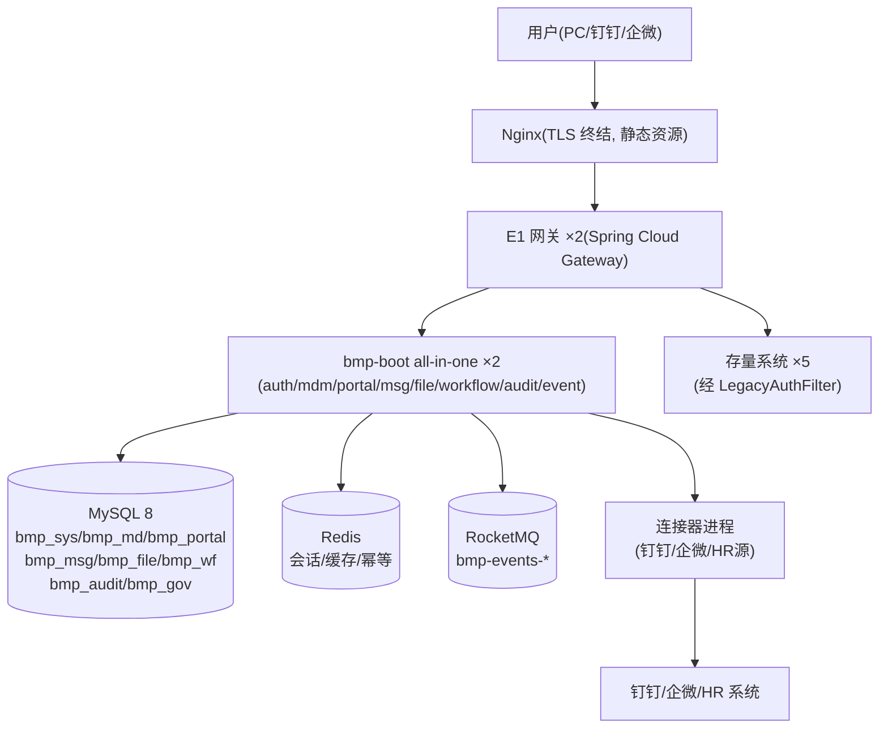

# 麓邦业务中台 V1.0 基座版详细设计

| 项目 | 内容 |
| --- | --- |
| 文档版本 | **v1.1**（同步布局引擎 v2 数据结构 + 嵌入页面卡片 + 行为埋点通道；详见第十四章修订说明） |
| 编制角色 | 架构师 / 研发负责人 |
| 上游文档 | 《麓邦业务中台产品PRD》第八章 V1.0、《麓邦企业业务中台产品规划方案（单企业版）》、《个性化与通知PRD》（A1-F05 埋点规划）、《页面嵌入与角色模板-规格简报》、《文档一致性同步与应用运营看板-规格简报》 |
| 文档状态 | 待技术评审 |
| 设计范围 | V1.0 基座版（M0–M3）：B1/B2(一期)/B3、F1(基础)、A1/A2/A4、D1(一期，含短信通道实接)、**D2(最小集：文件上传下载)**、**C1/C2/C3(工作流 MVP，简单审批子集 + C1-F06 全量开放接口，前移 V1.0)**、E2(基础)、E1(最小集)、J1(首批)、J2(权威源/渠道连接器)、交付工程包 |
| 设计原则 | 落地 ADR-08（单企业）、ADR-09（模块化单体）、ADR-10（内核/配置/定制隔离） |

---

## 一、V1.0 交付范围回顾

| 模块 | PRD 需求 | 交付说明 |
| --- | --- | --- |
| B1 IAM/SSO | B1-F01~F07 | 账号统一、OIDC SSO、认证适配层、密码策略、账号生命周期、MFA（开关默认关）、会话与令牌治理 |
| B2 权限（一期） | B2-F01/F02/F05 | RBAC 角色+菜单/按钮/接口权限；`/perm/check` 校验服务与 SDK；数据权限 V1.5 |
| B3 组织同步 | B3-F01~F03 | 组织/人员异动事件分发、账号映射 |
| F1 主数据（基础） | F1-F01~F05 | 组织/岗位/人员模型、编码、权威源连接器接入、事件分发、组织树查询 |
| A1 统一工作台 | A1-F01~F04 | 应用导航、布局引擎、站内信、公告 |
| A2 统一移动端 | A2-F01~F04 | 钉钉/企微双适配、免登、移动待办审批、消息卡片 |
| A4 统一待办 | A4-F01~F05 | `/todo/push` 接入契约、聚合三视图、跳转回写、催办、超时提醒 |
| D1 消息网关（一期） | D1-F01~F05 | 统一发送、模板、渠道（站内/邮件/钉钉/企微/**短信通道实接**）、策略、送达追踪 |
| D2 文件服务（最小集） | D2-F01 | **V1.0 前移**：统一上传返回 fileId、鉴权下载/预览 URL（供工作流发起表单 attachment 附件字段落地）；**D2-F02~F06（在线预览/版本/水印/文件权限/迁移工具）留 V1.5** |
| C1 工作流引擎（MVP） | C1-F01-1~F01-5/F01-7、C1-F02~F05、C1-F06（F06-1~F06-9）、C1-F07、C1-F08 | 流程定义与发布（模板化/JSON/**空白模板**）、审批矩阵、审批规则（顺序/条件分支/会签/或签/退回/撤回）、委托代理、超时提醒、流程实例与任务、审批留痕、**流程开放接口（工作流即服务）**；引擎选型一次到位（ADR-12） |
| C2 表单（MVP 子集） | C2-F01-1、C2-F01-3/F01-4/F01-5、C2-F04-1 | `formData` 结构化承载、发起表单定义 `formSchema`（9 种字段类型/列表式配置）、发起入口与填报（必填校验）、审批节点按 schema 只读展示；**完整表单引擎（拖拽设计器/联动显隐/字段级权限）留 V1.5** |
| C3 审批入口（基础） | C3-F01/F02/F03 | 统一审批视图（站内+跳转）、批量审批（基础）、移动端审批办理（中台自有流程） |
| E2 日志审计（基础） | E2-F01~F05 | 上报接口+SDK、登录/操作日志、检索、留存 ≥6 个月 |
| E1 网关（最小集） | E1-F01~F03 | 路由管理、统一鉴权、老系统认证适配（限流/灰度/目录 V2.0） |
| J1 SDK 首批 | J1-F01/F02 | 后端认证/权限/待办客户端；前端登录/权限指令/待办组件 |
| J2 连接器 | J2-F02/F03 | 权威源连接器（HR/钉钉/企微/自建）、渠道连接器 |
| 交付工程包 | —— | 部署包、Flyway 脚本、环境检查、安装向导 |

**明确不在 V1.0**：D2 非最小集部分（D2-F02 在线预览 / D2-F03 版本管理 / D2-F04 水印防盗链 / D2-F05 文件权限 / D2-F06 迁移工具，均 V1.5）、F2/G1/H1/A3/E1 完整版/I1（V2.0）、J3 完整版（V1.0 仅 Outbox 简化投递）。

> **口径更新说明**：① 原「C1/C2/C3（V1.5）」已按《工作流引擎（V1.0 纳入）增量 PRD》**前移 V1.0（简单审批 MVP 子集 + 开放接口）**，已正式列入上表「C1/C2/C3」三行；V1.5 保留 BPMN 完整版与 C2 完整表单引擎；② 原「D2（V1.5）」已按客户拍板**拆出最小集 D2-F01 前移 V1.0**（支撑工作流 attachment 附件字段），其余 D2 能力仍留 V1.5；③ D1 短信通道由「预留」改为「**实接**」。

---

## 二、工程结构（ADR-09 / ADR-10 落地）

### 2.1 三层代码库

```
bmp-platform/                    # 【产品内核】单仓库多模块 Maven（禁止出现任何客户名/客户逻辑）
├── bmp-dependencies/            # BOM：统一三方件版本
├── bmp-framework/               # 技术框架层（可复用 starter）
│   ├── bmp-common/              # 统一响应体/错误码/工具/常量
│   ├── bmp-starter-web/         # Web 基座：全局异常、日志 MDC、幂等过滤器
│   ├── bmp-starter-security/    # 令牌解析、身份上下文（UserContext）、@PermCheck 注解
│   ├── bmp-starter-mybatis/     # ORM、分页、字段加密 TypeHandler
│   ├── bmp-starter-redis/       # 缓存、分布式锁、幂等键
│   ├── bmp-starter-mq/          # 事件生产/消费封装（Outbox 读写）
│   └── bmp-starter-audit/       # E2 埋点 SDK：@AuditLog 注解 + 异步上报
├── bmp-server-auth/             # B1+B2+B3：身份/权限/组织同步（bmp_sys 库）
├── bmp-server-mdm/              # F1：主数据（bmp_md 库）
├── bmp-server-portal/           # A1+A4：工作台/待办/站内信/公告（bmp_portal 库）
├── bmp-server-msg/              # D1：消息网关（bmp_msg 库）
├── bmp-server-file/             # D2 最小集：文件上传下载（bmp_file 库；OSS/MinIO 为对象存储后端）
├── bmp-server-workflow/         # C1+C2+C3：工作流引擎（bmp_wf 库；芋道 Flowable 内核 + wf_ 扩展表）
├── bmp-server-audit/            # E2：审计（bmp_audit 库）
├── bmp-server-event/            # J3 简化版：Outbox 统一投递器（无独立库，读各域 outbox 表）
├── bmp-server-gateway/          # E1：Spring Cloud Gateway（含 LegacyAuthFilter）
├── bmp-boot/                    # 组装启动模块：all-in-one 单体（默认）/ 按模块拆分（profile 切换）
└── bmp-ui/                      # 前端：工作台应用 + bmp-ui-components 组件库（内部 npm）

bmp-connectors/                  # 【产品配置资产】连接器（独立仓库，故障隔离可独立进程）
├── connector-dingtalk/          # 钉钉：免登（SSO）/ 消息卡片（D12 后不作人员主数据源）
├── connector-wecom/             # 企微：同上
├── connector-hr-generic/        # 通用 HR 源：JDBC / REST 拉取 + 全量比对
├── connector-email/  connector-sms/   # 短信通道 V1.0 实接（服务商账号/签名/模板中台统一配置）
└── templates/                   # 消息模板包、布局模板包、接入 checklist 模板

bmp-project-lubon/               # 【项目定制】独立仓库（可依赖内核，内核禁依赖它）
├── lubon-legacy-adapter/        # 5 套存量系统适配器（待办拉取、账号映射初始化）
├── connector-perm-collect/      # 存量权限采集适配器（J2-F05，建议新增）：按 system_code 采集授权关系 → 归一 → 仲裁 → 导入
└── lubon-migration/             # 存量文件/数据迁移工具
```

### 2.2 部署形态（模块化单体）

| 形态 | 说明 | 适用 |
| --- | --- | --- |
| **all-in-one（默认）** | `bmp-boot` 单进程装载全部 bmp-server-* 模块，模块间本地方法调用 | dev/test/生产初期，运维最简 |
| 拆分部署 | `bmp-boot --profile=gateway,auth,portal,...` 按模块多进程，跨进程经 E1/Feign | 某模块负载突增时按需切换 |

**拆分触发条件**（ADR-09 约束）：模块独立伸缩需求、或团队并行开发产生合并冲突时，才拆分；不预设微服务。

### 2.3 内核隔离门禁（ADR-10 落地）

| 规则 | 实现 |
| --- | --- |
| 内核禁依赖定制/连接器 | `bmp-platform` 各 pom 禁止出现 `bmp-project-*`、`connector-*` 依赖；CI 依赖树检查（maven-enforcer） |
| 连接器/定制可依赖内核 | 只允许依赖 `bmp-framework` 与各 server 的 `*-api` 接口模块 |
| 模块间调用 | 同进程：注入 `XxxApi` 本地实现；跨进程：Feign。各 server 拆 `*-api`（接口+DTO）与 `*-biz`（实现） |
| 表前缀隔离 | 各域只读写本域前缀表；跨域数据只经 API/事件，禁止跨库 JOIN |

---

## 三、数据库设计

### 3.1 分库与通用约定

| 库 | 域 | 表前缀 | 服务 |
| --- | --- | --- | --- |
| `bmp_sys` | 身份与权限 | `sys_` | bmp-server-auth |
| `bmp_md` | 主数据 | `md_` | bmp-server-mdm |
| `bmp_portal` | 门户与待办 | `portal_` | bmp-server-portal |
| `bmp_msg` | 消息 | `msg_` | bmp-server-msg |
| `bmp_file` | 文件（**V1.0 最小集**） | `file_` | bmp-server-file |
| `bmp_wf` | 流程与表单（**C1/C2/C3，V1.0 MVP**） | `wf_` | bmp-server-workflow |
| `bmp_audit` | 审计 | `audit_` | bmp-server-audit |
| `bmp_gov` | 治理（V1.0 最小） | `gov_` | bmp-server-auth（代管应用注册） |

**通用约定**（全部表适用）：
- 主键 `id BIGINT`（雪花算法）；通用字段：`creator VARCHAR(64)`、`create_time DATETIME`、`updater VARCHAR(64)`、`update_time DATETIME`、`deleted TINYINT`（逻辑删除，默认 0）——下表不再重复列出；
- 不设 `tenant_id`（ADR-08 单企业）；未来多租户改造点＝统一增加租户列 + SQL 拦截器（已隔离在 MyBatis 拦截器层）；
- 字符集 `utf8mb4`；时间统一 `DATETIME`（东八区）；金额/枚举用 `TINYINT` + 字典表；
- 变更一律走 Flyway 脚本：`bmp-platform/db/migration/{库名}/V1.0.0__init.sql`。

### 3.2 核心表详细设计（12 张 + `sys_permission_migration` + `sys_org_mapping` 建议新增）

#### bmp_sys：`sys_account` 账号表（B1-F01）

| 字段 | 类型 | 说明 |
| --- | --- | --- |
| username | VARCHAR(64) UK | 唯一登录名（与工号一致或映射，策略可配） |
| password_hash | VARCHAR(100) | BCrypt |
| employee_id | BIGINT IDX | 关联 `md_employee.id`（唯一身份源锚点） |
| status | TINYINT | 0 停用 / 1 启用 / 2 锁定 |
| mfa_enabled | TINYINT | MFA 开关（默认 0） |
| pwd_changed_time / pwd_expire_time | DATETIME | 密码策略执行 |
| last_login_time / last_login_ip | DATETIME / VARCHAR(50) | 最近登录 |
| source | TINYINT | 来源：1 连接器同步 / 2 管理员建（需审批留痕）/ 3 紧急建号 / **4 中台自建（`custom` 权威源，**建议新增，待实施确认**；D12 配套）** |

> ⚠️ **字段名歧义提示 + 枚举口径（防实施踩坑）**：
> ① **同名不同义**：本表 `sys_account.source`（TINYINT，**账号来源/调用方**）与 `md_employee.source`（VARCHAR(20)，**权威源标识**，如 `custom`）**同名不同义，勿混**。D12 后权威源 = `custom` 时，`source=custom` 指 **`md_employee.source`**，**非**本表。
> ② **口径核对（已核 PRD，无冲突）**：`PRD:3876` 明言「**管理员手工建号属紧急通道**」、`PRD:3889` 标「**管理员紧急通道 ｜ `source=2/3` 时必填 reason/approver**」→ 即 **`2=管理员建` 与 `3=紧急建号` 同属「紧急通道」**（D14 规则 F3「不使用紧急通道（`source=2/3`）」**与此一致，非冲突**）。
> ③ **枚举增补（E 项裁定 = 方案 i，**建议新增，待实施确认**）**：D12 后权威源 = `custom`（自建维护，**无连接器**），**主路径建号（F1→B3→B1，非管理员手工）** 原落 `1 连接器同步` **标签已名不副实** → **补 `4 = 中台自建（custom 源）`**（主路径建号用 `4`，`1` 保留给未来连接器源回退）。**须同步 `PRD:3888` enum + `I2 数据标准`**（实施前统一）。
> ④ **`employee_type` ↔ `source` 联动（D14 维护账号）**：维护账号 `md_employee.employee_type=3`（维护）；其 `sys_account.source` **建议 = `4 中台自建`**（与普通员工同走主路径建号，**非紧急通道 2/3**）。即：**`employee_type` 表达「人是什么类型」（主数据侧），`source` 表达「账号怎么来的」（账号侧）——两者正交，无强绑定，仅维护账号的 `source` 建议同为 `4`**。

#### bmp_sys：`sys_role` / `sys_permission` / 关系表（B2-F01/F02）

- `sys_role`：`code UK`、`name`、`type`（1 内置不可删 / 2 自定义）、`status`、`data_scope_reserved`（V1.5 数据权限预留 JSON 列，V1.0 不读）；
- `sys_permission`：`code UK`、`name`、`type`（1 菜单 / 2 按钮 / 3 接口）、`parent_id`、`path`、`component`、`api_pattern`（如 `POST /v1/crm/contract/*`）、`sort`、`status`；
- `sys_user_role`：`account_id`、`role_id`（UK 联合）；
- `sys_role_permission`：`role_id`、`permission_id`（UK 联合）；
- 内置角色初始化：`super_admin` / `portal_admin` / `audit_viewer` / `普通员工`。

#### bmp_sys：`sys_session` 在线会话（B1-F07）

| 字段 | 类型 | 说明 |
| --- | --- | --- |
| account_id | BIGINT IDX | 账号 |
| token_jti | VARCHAR(64) UK | JWT jti（Redis 同步缓存，TTL=令牌有效期） |
| client_type | TINYINT | 1 PC / 2 钉钉 / 3 企微 |
| login_ip / user_agent | — | 登录环境 |
| login_time / expire_time | DATETIME | 会话窗口 |
| revoked | TINYINT | 全局登出/强制下线标记 |

#### bmp_sys：`sys_account_mapping` 账号映射（B3-F03）

`account_id`、`system_code`（存量系统标识：CRM/REC/OKR/KMS/DATA）、`local_username`（原系统账号）、`sync_status`、UK(system_code, local_username)——存量系统本地账号与统一账号的桥接，存量改造期按系统逐个补齐。

> **`system_code` 值域扩展（P6 裁定，`D12` 配套）**：值域由「5 套存量系统」**扩展为含 `dingtalk`**——`local_username` 对 `dingtalk` 行承载**钉钉 `unionId`/`userid`**（非「原系统账号」）。**用途**：`A2-F02` 移动免登链路（「换 unionId → `sys_account_mapping` 映射 `account_id`」）；**D12 后钉钉不作人员主数据源**，其 userid **不进 `md_employee`**（零改主数据表）。**取值口径**：免登与权限采集均按 `system_code` 精确查询，不混淆。

> **组织级映射见 `sys_org_mapping`**（`B3-F03` 组织映射部分，见下节）——本表管「**账号级**」映射（本地账号→`account_id`），`sys_org_mapping` 管「**组织级**」映射（本地组织编码→`md_org.id`），二者以 `system_code` 关联、同属 `B3-F03`「系统人员组织映射」（**同一编号内两块内容：账号映射 + 组织映射**）。

#### bmp_sys：`sys_org_mapping` 系统人员组织映射（B3-F03，**建议新增，待实施确认**）

> **功能点口径**：本表承载 **`B3-F03`「系统人员组织映射」的组织级映射部分**——登记「**接入系统的组织 A = 中台的组织 B**」。**背景**：现有体系仅有账号映射（`sys_account_mapping`），**组织/部门映射缺失**，此前靠七步 Checklist 第 3 步「存量系统本地表切只读缓存」变相实现，中台不掌握该应用的组织结构对应关系；本表补此缺口，接入序列第 2 步「业务系统权威源配置（**账号映射 + 组织映射**）」的落盘载体。
> **粒度**：**组织树级**（可跨级、可裁剪）——一条映射 = 一个源系统组织节点对应一个中台组织节点，**不要求逐级对齐**；支持「把源系统某子树整体映射到中台某节点」（前缀/默认归属方式覆盖）。

| 字段 | 类型 | 说明 |
| --- | --- | --- |
| system_code | VARCHAR(32) NOT NULL | 接入系统标识（CRM/REC/OKR/KMS/DATA） |
| source_org_code | VARCHAR(128) NOT NULL | 源系统组织编码**原文**（不做归一，保留追溯依据） |
| target_org_id | BIGINT **NULL** | 中台 `md_org.id`；**未映射 = NULL** |
| mapping_type | TINYINT NOT NULL DEFAULT 1 | 1 精确 / 2 前缀 / 3 默认归属 |
| sync_status | TINYINT NOT NULL DEFAULT 0 | 0 待映射 / 1 已映射 / 2 冲突 / 3 失败 |
| create_time / update_time | DATETIME | 创建/更新时间（**命名遵循 §3.1 通用约定**；`id` 雪花主键、`creator`/`updater`/`deleted` 等通用字段见 §3.1，**不单列**）。⚠️ **口径提示**：PRD 侧简化写作 `created_at`/`updated_at` 与 `id ... AUTO_INCREMENT`，**实施以本表 §3.1 口径为准**（雪花主键 + `create_time`/`update_time`） |

**索引与 UK**（**均为建议，待实施确认**）：
- **`uk_org`** `(system_code, source_org_code)`——**幂等键**（同系统同源组织编码唯一）；**`target_org_id` 允许 NULL**（利用 MySQL UK 对 NULL 不去重 → **未映射行不受幂等误判**），**禁加 `NOT NULL`**（实施红线）；
- `idx_target(target_org_id)` / `idx_status(sync_status)`（按中台组织反查、按状态筛选待办）。

**`mapping_type` 取值口径**：
- `1 精确`：`source_org_code` 精确等于源侧某组织编码 → 直映 `target_org_id`；
- `2 前缀`：`source_org_code` 为**前缀**，匹配源侧该前缀下多个组织（如 `DEPT-RD-` → 中台研发中心子树，可裁剪）；**同一 `system_code` 内允许多条前缀，匹配时「最长前缀优先」**（如 `/华东/销售` 优先于 `/华东`）；
- `3 默认归属`：源侧未命中任何精确/前缀规则时的**兜底归属**（如「未识别组织 → 中台总部/待归类」）；**每 `system_code` 最多一条**（UK 层面无法约束，写进规则，避免歧义）。

**解析优先级（与 §4.4bis 一致）**：**精确（1）> 前缀（2，最长优先）> 默认（3）**。

**与 `sys_account_mapping`（账号级）配对**：本表管**组织级**，`sys_account_mapping` 管**账号级**，二者以 `system_code` 关联、同属 `B3-F03`；权限迁移（`J2-F05`）归一链路中，账号侧查 `sys_account_mapping`、组织侧查 `sys_org_mapping`。

**边界（务必勿混）**：
- **vs `B2-F03` 数据权限（V1.5）**：`B2-F03` 管「**能看哪些数据**」（行级/组织范围）；本点管「**应用的组织结构怎么对应中台**」。**先映射后授权**——本点是数据权限的**前置映射基础**，非授权本身。
- **vs `B3-F01` 组织同步**：本点 = **静态映射登记**（配置即落库，不产生事件）；`B3-F01` = **动态事件分发**（组织/人员异动事件推送订阅方）。
- **vs `B3-F03` 原账号映射**：账号映射**成为本功能点的一个子块**（同一编号内两块内容：账号映射 + 组织映射）。
- **vs `F1-F03` 权威源接入**：`F1-F03` = **中台的源**（中台从哪取数，`md_sync_source` 配置）；本点 = **应用的映射**（应用怎么对应中台）。**两个层级，勿混**。

#### bmp_md：`md_org` 组织表（F1-F01/F02）

| 字段 | 类型 | 说明 |
| --- | --- | --- |
| org_code | VARCHAR(32) UK | 编码规则 `ORG-{一级码}-{流水}` |
| name / short_name | VARCHAR(100) | 名称 |
| parent_id | BIGINT IDX | 父组织（根为 0） |
| path | VARCHAR(500) IDX | 物化路径 `/0/1/15/`（子树查询用） |
| level | TINYINT | 层级 |
| leader_employee_id | BIGINT | 组织负责人 |
| effective_from / effective_to | DATETIME | 生效期（组织调整历史可溯） |
| status | TINYINT | 1 有效 / 0 已撤销 |
| source | VARCHAR(20) | 权威源标识 |

#### bmp_md：`md_employee` 人员表（F1-F01/F02）

| 字段 | 类型 | 说明 |
| --- | --- | --- |
| employee_no | VARCHAR(32) UK | 工号 `EMP-{年份}-{流水}` |
| name / mobile / email | — | 基本信息（mobile/email 加密存储） |
| account_id | BIGINT UK | 关联 sys_account（一比一） |
| org_id | BIGINT IDX | 所属组织 |
| position_id | BIGINT | 岗位 |
| emp_status | TINYINT | 1 待入职 / 2 在职 / 3 离职 / 4 退休 |
| **employee_type** | TINYINT NOT NULL DEFAULT 1 | **人员类型（建议新增，待实施确认；D14）**：1 正式 / 2 外包 / 3 **维护账号**；与 `emp_status` 正交（维护账号 `emp_status` 仍用「2 在职」，**不新增枚举值**） |
| entry_date / leave_date | DATE | 入离职日期 |
| source | VARCHAR(20) | 权威源标识 |

#### bmp_md：`md_sync_source` 权威源配置（F1-F03，J2 落地）

`source_type`（hr/dingtalk/wecom/custom）、`connector_code`、`field_mapping JSON`（源字段→标准字段映射规则）、`sync_mode`（全量比对/增量事件）、`cron`、`enabled`——权威源切换仅改此配置。

#### bmp_portal：`portal_todo` 待办表（A4-F01~F05）

| 字段 | 类型 | 说明 |
| --- | --- | --- |
| todo_key | VARCHAR(128) UK | 幂等键：`{source_system}:{biz_type}:{biz_id}`（重复推送幂等覆盖） |
| source_system | VARCHAR(20) IDX | 来源系统标识 |
| biz_type | VARCHAR(50) | 业务类型（合同审批/offer 审批/目标复盘…） |
| title / summary | VARCHAR(255) | 展示信息 |
| jump_url | VARCHAR(500) | 跳转原系统处理页 |
| callback_url | VARCHAR(500) | 完成回写回调（原系统提供） |
| assignee_account_id | BIGINT IDX | 处理人 |
| urgency | TINYINT | 1 普通 / 2 重要 / 3 紧急 |
| status | TINYINT IDX | 0 待办 / 1 已完成 / 2 已过期 |
| overdue_time | DATETIME | 超时时间（提醒调度依据） |
| done_time | DATETIME | 完成时间 |

#### bmp_msg：`msg_template` / `msg_channel` / `msg_send_record`（D1-F01~F05）

- `msg_template`：`template_code UK`、`name`、`channels`（适用渠道 CSV）、`content`（`{{变量}}` 占位）、`variables JSON`（变量声明）、`status`（0 草稿 / 1 已审核 / 2 已发布——未审核不可用）、`version`；
- `msg_channel`：`channel_type`（intranet/email/dingtalk/wecom/sms）、`config JSON`（AES 加密存密钥）、`enabled`、`priority`；
- `msg_send_record`：`msg_key UK`（幂等键，默认 `{业务事件键}:{receiver}`）、`template_code`、`channel_type`、`receiver`、`params JSON`、`send_status`（0 待发 / 1 已发 / 2 送达 / 3 失败）、`retry_count`、`fail_reason`、`send_time`、`delivered_time`——送达率统计与失败重试（≤2 次）依据。

#### bmp_audit：`audit_operation_log` 操作日志（E2-F03，按月分区）

| 字段 | 类型 | 说明 |
| --- | --- | --- |
| account_id / username | BIGINT / VARCHAR | 操作人（冗余用户名防账号删除后失溯） |
| system_code | VARCHAR(20) IDX | 来源系统（BMP/CRM/REC/…） |
| module / action | VARCHAR(64) | 模块与动作（如 `contract.update`） |
| target_type / target_id | VARCHAR(64) | 操作对象 |
| before_snapshot / after_snapshot | JSON | 变更前后摘要（敏感字段脱敏） |
| op_ip / op_time | — | 环境 |
| trace_id | VARCHAR(64) IDX | 链路追踪 ID |

> 登录日志 `audit_login_log`：account_id、login_type（密码/免登/适配票据）、client_type、ip、result、fail_reason、login_time——结构同上从简。
> 检索：V1.0 走 MySQL 复合索引 `(system_code, op_time)`、`(account_id, op_time)` + 月分区；Elasticsearch 全文检索 V1.5 增强。

#### 各域：`event_outbox` 事件发件箱（J3 简化版，bmp_md/bmp_portal/bmp_msg 内各一张）

| 字段 | 类型 | 说明 |
| --- | --- | --- |
| event_id | VARCHAR(64) UK | UUID（幂等键） |
| event_type | VARCHAR(64) IDX | 如 `md.employee.transferred` |
| aggregate_type / aggregate_id | VARCHAR(64) | 聚合类型与 ID |
| payload | JSON | 事件体（见 5.2） |
| published | TINYINT IDX | 0 未发布 / 1 已发布 |
| retry_count / next_retry_time | — | 失败重试（3 次后退避，超限人工队列） |

#### bmp_gov：`gov_app_register` 应用注册（I1 简版，接入评审产物）

`app_code UK`、`app_name`、`app_secret AES 加密`、`owner_account_id`、`grant_types`（client_credentials 等）、`status`（注册/启用/停用）、`review_record`、**`domain_whitelist`（JSON 数组，**建议新增，待实施确认**；`I1-F06`）**——应用未注册不得接入网关（红线联动）。

> **`domain_whitelist`（`I1-F06` 回调域名白名单，V1.0 最小集）**：JSON 数组，每项须 **https + 精确域名 / 受控前缀**；**禁 IP 直连与内网网段**（防 SSRF）。作为 `A4-F01`（`jumpUrl`/`callbackUrl`）与 `C1-F06`（`callbackUrl`）两处 V1.0 消费方**共用的唯一白名单来源**；服务端提供统一 `isWhitelisted(url)` 权威判定。**须 Flyway 增列**（V1.0）；原版本栏「V2.0 起必填」→ **改「V1.0 必填（最小集）」**。⚠️ 与 `UI-C-10` 的「嵌入域名白名单」（服务 `A1-F08` iframe 嵌入）**语义不同、勿混**。

#### bmp_sys：`sys_permission_migration` 存量授权关系迁移（J2-F05，**建议新增，待实施确认**）

> **来源**：架构师-2《增量UIUX与原型交互设计.md》**§13 定稿**（表名/字段/UK/状态机均照搬，勿重新设计）。**属过渡资产**（与 `J2-F04` 同族），随老系统改造完成转标准 OIDC/标准权限接口后**纳入下线计划**。

| 字段 | 类型 | 说明 |
| --- | --- | --- |
| system_code | VARCHAR(20) NOT NULL | 存量系统标识（CRM/REC/OKR/KMS/DATA，共 5 套） |
| local_username | VARCHAR(128) NOT NULL | **源侧账号原文**（追溯/对账）；`B3-F03` 归一依据之一 |
| account_id | BIGINT **NULL** | **由 `B3-F03`（`sys_account_mapping`）提供**；未归一 = NULL 且 `mapping_status=2` |
| source_perm_code | VARCHAR(128) NOT NULL | **源侧权限标识原文** |
| target_type | TINYINT NULL | 1 = 权限点（`sys_permission`）/ 2 = 角色（`sys_role`） |
| target_code | VARCHAR(128) **NULL** | 中台 `sys_permission.code` / `sys_role.code`；未命中 = NULL |
| mapping_status | TINYINT NOT NULL DEFAULT 0 | **0 待映射 / 1 已映射 / 2 未归一 / 3 无对应 / 4 冲突待仲裁 / 5 已导入 / 6 失败 / 7 已驳回**（**八态**；`7` 属终态） |
| mapping_source | TINYINT NULL | 1 = 配置规则自动 / 2 = 人工仲裁 |
| arb_reason | VARCHAR(255) NULL | **仲裁「依据」留痕**（`J2-F05` ⑤要求「裁决须留依据」） |
| arb_by | VARCHAR(64) NULL | 裁决人（与 E2 审计双写） |
| batch_id | VARCHAR(64) NOT NULL | 采集批次号（支持按批回滚/重跑） |
| collected_at / mapped_at / imported_at | DATETIME NULL | 阶段时间戳 |

**索引与 UK**（**均为建议，待实施确认**）：
- **`uk_idem`** `(system_code, account_id, target_type, target_code)`——**幂等键**（已归一且已映射后防重复导入）；**`account_id` / `target_code` 允许 NULL**（利用 MySQL UK 对 NULL 不去重 → 未归一/未命中行不受幂等误判），**禁加 `NOT NULL`**；
- **`uk_src`** `(system_code, local_username, source_perm_code)`——**源侧去重键**（防同源重复采集产生重复行）；
- `idx_batch(batch_id)` / `idx_status(mapping_status)`。

**状态机硬口径（H1，`J2-F05` ⑬）**：
- **完整性等式**：`源侧采集行数 ≡ 待映射(0) + 已映射(1) + 仲裁(2,3,4) + 已导入(5) + 失败(6) + 已驳回(7)`（**八态全覆盖，可 SQL 核对**）；**批次结束时 `待映射(0) = 0`**；
- **只增不减（V1.5）**：导入只写不删 `sys_user_role` / `sys_role_permission`，**不支持反向删权**；
- **不含任何凭证/密码字段**；采集凭证走 `gov_app_register`（AES 加密、不回显、不落日志）；
- **只读采集**（禁 DML）→ 归一（账号侧查 `B3-F03`）→ 映射（权限侧配置化规则）→ 人工仲裁（未归一/无对应/冲突，**不静默丢弃**）→ 经 **`B2-F01` 通道**导入。

### 3.3 其余表概览

| 表 | 关键字段 | 说明 |
| --- | --- | --- |
| sys_password_history | account_id, pwd_hash, changed_time | 密码历史限制 |
| sys_perm_apply | account_id, targets JSON, reason, status, approver | 权限申请（V1.0 线上登记，审批流 V1.5 接 C1） |
| sys_org_sync_log | event_id, entity, action, sync_status, retry_count | 组织同步可观测 |
| md_position | position_code UK, name, level | 岗位 |
| md_change_log | entity_type, entity_id, before/after JSON, source_event_id | 主数据变更留痕（I2 质量抽查依据） |
| portal_app | app_code UK, name, icon, url, sort, status | 应用中心（与 gov_app_register 联动：注册→自动上架） |
| portal_app_scope | app_id, scope_type(all/org/role), scope_value | 应用可见范围 |
| portal_card | card_code UK, name, component, data_api, default_size, **params JSON, multi BOOL** | 布局引擎卡片注册（**v1.1 升级**：支持嵌入页面卡片多实例，见 3.4） |
| portal_layout_template | role_id, **template_json** UK(role_id) | 角色默认布局（**v2 三栏结构**） |
| portal_user_layout | account_id UK, **layout_json（override）** | 个性化布局（覆盖 `order/visible/col`，**不含 params**） |
| **portal_behavior_event** | **account_id, event_type, target_id, ts, payload JSON** | **行为埋点事件（v1.1 新增，见 3.5；独立于 E2 审计）** |
| portal_notice / _scope / _read | title, content, publish_time, top, status / 范围 / 已读 | 公告 |
| portal_message | msg_key, receiver_account_id, category, title, content, read_status | 站内信 |
| event_subscriber | subscriber_code UK, event_types, push_type(mq/webhook), endpoint, status, **subscriber_secret AES 加密（建议新增，待实施确认）** | 事件订阅注册（存量系统/AI 中台）；`subscriber_secret` 为 Webhook 验签密钥（`I1-F05`/G-5，见下注） |
| file_object | file_id UK, biz_type, biz_id, file_name, file_size, mime_type, storage_key, sha256, uploader_account_id, status | **D2-F01（V1.0 最小集）**：文件元数据；物理对象存 OSS/MinIO（`storage_key` 指向），业务系统只拿 `file_id`；附件字段（工作流）仅存 fileId 数组 |

> **`event_subscriber.subscriber_secret`（`I1-F05` / G-5，建议新增，待实施确认）**：Webhook 验签密钥，取值口径 `X-BMP-Signature = HMAC-SHA256(body, subscriber_secret)`（见 §5.1）。规则：① **AES 加密存储**（DB 抽查无明文）；② 订阅方注册时由系统生成、**一次性明文展示**，**二次不可见**；③ **重置即失效** + `audit_operation_log` 留痕；④ V1.0 由 `F1-F04` 的 `POST /v1/md/subscribe` 承载（V1.5 迁 `J3-F02`）。

**流程与表单域核心表**（`bmp_wf` 库，C1/C2/C3，V1.0 MVP，共 **8 张 `wf_*` 核心表**，依据《工作流引擎（V1.0 纳入）增量 PRD》3.9 节；表名与《工作流引擎集成契约与前移评估》4.2 节一致）：

| 表 | 关键字段 | 说明 |
| --- | --- | --- |
| wf_process_def | def_key, name, version, def_type(TEMPLATE/JSON), def_json, status(草稿/已发布/停用), UK(def_key,version) | 流程定义与版本管理；`def_json` 内含 `formSchema`（发起表单定义，随 `def_key+version` 同版本锁定） |
| wf_process_instance | biz_key(UK), source_system, biz_type, biz_id, def_key, def_version, initiator_account_id, form_data, variables, status, callback_url, jump_url | 流程实例（业务映射）；`biz_key` 即幂等键（三段式）；`form_data` 结构由发起版本 `formSchema` 约束 |
| wf_task | instance_id, node_key, node_name, assignee_account_id, original_assignee_id, sign_mode, status, action, comment, overdue_time | 任务（待办来源）；内部推 A4 的 `todo_key` 为四段式 `{sourceSystem}:{bizType}:{bizId}:{nodeKey}`（前三段=bizKey） |
| wf_approval_record | instance_id, task_id, node_key, operator_account_id, action, comment, attachment(fileId 数组), op_time, proxy_flag, trace_id | 审批留痕（仅追加不可篡改，C1-F08）；附件仅存 fileId 数组（与 D2 同源） |
| wf_approval_matrix | matrix_code(UK), dimension(ORG/POSITION/AMOUNT), match_json, resolver_json, priority, status | 审批矩阵（审批人解析，C1-F02） |
| wf_instance_participant | instance_id, account_id, role(INITIATOR/APPROVER/CC/ADMIN), UK(instance_id,account_id,role) | 实例参与者可见性（V1.0 数据权限降级方案） |
| wf_delegate | principal_account_id, delegate_account_id, start_time, end_time, reason, status | 委托代理（C1-F04；到期自动失效） |
| wf_event_outbox | event_id(UK), event_type, aggregate_id, payload, published | 流程事件发件箱（复用 J3 投递器，见第五章） |

> **引擎原生表约定**：芋道内置工作流（Flowable 内核）的原生 `ACT_*` 表同置 `bmp_wf` 库，以 `business_key = bizKey` 与 `wf_process_instance` 关联；中台通用字段约定（`id/create_time/deleted` 等，见 3.1）**仅作用于 `wf_*` 扩展表，不改动 Flowable 原生表结构**。对外只暴露中台 API，业务系统不感知引擎内部实现（ADR-12）。
> **版本关系**：运行实例锁定 `def_version`，新版本仅对新实例生效；审批矩阵变更**不回溯**运行实例。

### 3.4 布局引擎 v2 数据结构（portal_card / portal_layout_template / portal_user_layout）

> **本次升级背景**：首页已重构为 **v2 三栏**（左简报+意图流 / 中紧迫度时间轴 / 右我的订阅+关注动态），并新增**嵌入页面卡片**（受控 iframe 内嵌，决议 #5b）。原 v1「24 栅格 + `{"grid":[...]}`」结构已不足以承载三栏语义与嵌入实例，故升级布局 JSON 结构；**代码实现先行，本节据实现回写同步**（对照 `prototype/home-v2.html` 的 `MOCK.layoutTemplateV2`，逐字段一致，见本章末核对表）。

#### 3.4.1 `portal_card` 卡片注册表（补字段）

| 字段 | 类型 | 说明 |
| --- | --- | --- |
| card_code | VARCHAR(64) UK | 卡片编码。普通卡片为稳定语义编码（如 `ai-brief` / `urgency-stream`）；**嵌入页面卡片采用 `embed:<唯一id>` 形式**（如 `embed:dashboard-1`） |
| name | VARCHAR(64) | 卡片名称 |
| component | VARCHAR(64) | 前端组件标识（嵌入卡片 = `iframe-embed`） |
| data_api | VARCHAR(128) | 数据接口 |
| default_size | VARCHAR(16) | 默认尺寸档（v2 语义下沉为 `col` + 栏宽，此列保留兼容） |
| **params** | **JSON，可空** | **卡片实例参数**。嵌入页面卡片：`{"url":"https://dashboard.lubon.local/ceo","title":"经营驾驶舱","height":360,"icon":"🖥"}`（另含 `demo` 供原型演示） |
| **multi** | **TINYINT(1)，默认 0** | **是否支持多实例**。为 1 时 `card_code` 采用 `embed:<唯一id>` 形式，同一应用可按角色配多个实例（如不同角色看不同看板） |

**为何 `card_code`（嵌入卡）必须唯一**：`portal_user_layout.layout_json` 的 override 按 **`cardId` 精确匹配**做深合并（`applyOverride` 逐项 `find(x => x.cardId === o.cardId)`）。若多个嵌入实例共用同一 `card_code`，则「拖拽 / 换栏 / 显隐 / 高度微调」会互相串改、无法各自独立持久化。故嵌入实例必须 `embed:<唯一id>`（如 `embed:dashboard-1`、`embed:dept-board-1`），保证多实例互不干扰。

> **注册机制（零平台改造）**：新卡片 = 注册进既有 `cardManifest`（`multi:true` 标记多实例能力），前端按 `component` 渲染。例：`{ cardId:"embed-page", name:"嵌入页面", minGrid:6, dataApi:"GET /v1/apps（白名单域名）", component:"iframe-embed（cardId: embed:<id>）", multi:true }`。

#### 3.4.2 `layout_json` / `template_json` 结构（升级为 v2 三栏）

**v1（旧，24 栅格，仅留作兼容识别）**：
```json
{ "grid": [ { "card":"todo", "w":6, "h":4, "x":0, "y":0 },
            { "card":"notice", "w":6, "h":2, "x":6, "y":0 } ] }
```

**v2（现，三栏，代码实现口径）**：
```json
{
  "version": 2,
  "cols": { "left": "m", "right": "m" },
  "cards": [
    { "cardId": "ai-brief",        "col": "left",   "order": 1, "visible": true },
    { "cardId": "embed:dashboard-1","col": "center","order": 2, "visible": true,
      "params": { "url": "https://dashboard.lubon.local/ceo", "title": "经营驾驶舱（领导视角）",
                  "height": 360, "icon": "🖥", "demo": "cockpit" } }
  ],
  "legacy": [
    { "cardId": "todo-list", "name": "待办卡片", "visible": false }
  ]
}
```

| 字段 | 取值 | 说明 |
| --- | --- | --- |
| `version` | `2` | 结构版本标记；渲染器据此选择三栏或旧平铺逻辑 |
| `cols` | `{ left, right }`，档位 `s`/`m`/`l` | 左右栏宽档位；**中栏（center）为弹性自适应，无档位**。对应 `COL_TIERS`（left 252/300/352px，right 248/288/336px） |
| `cards[].cardId` | 字符串 | 卡片编码（嵌入卡为 `embed:<唯一id>`），与 `portal_card.card_code` 对应 |
| `cards[].col` | `left` / `center` / `right` | **三栏语义**：left=左简报+意图流 / center=中紧迫度时间轴 / right=右我的订阅+关注动态 |
| `cards[].order` | 整数 | 栏内顺序（从 1 起） |
| `cards[].visible` | 布尔 | 是否展示 |
| `cards[].params` | JSON，可空 | **仅嵌入卡片实例携带**（url/title/height/icon），与模板层/实例存档同源 |
| `legacy[]` | 数组 | **既有 v1 cardId 保留区**（见下） |

**`legacy` 区的作用**：保留 v1 早已存在的 cardId（`todo-list` / `notice-msg` / `birthday` / `data-metrics` / `frequent-apps` / `quick-stats`）。原因：老用户的 `portal_user_layout.layout_json`（原 `bmp_user_override`）可能引用这些 id，**删除会导致覆盖配置失配**。故这些卡片**不参与三栏渲染**（渲染器仅渲染 `cards` 中 `col` 明确的项），仅用于**保住 cardId 存在、让 `applyOverride` 能命中**；默认 `visible:false`（升级后默认不展示）。override 命中 legacy 项时**只吸收 `visible`/`order`，不写 `col`**（避免误改三栏布局）。

**v1 向后兼容路径**：`version` 缺失或等于 `1`（仅有 `cards`、无 `cols`/`col`）时，渲染器按**旧逻辑平铺**（等价于单栏顺序渲染），不报错、不置灰；升级脚本可选做结构迁移（`grid` → `cards` 平铺 + `col:"center"`），迁移前老数据仍可读。

#### 3.4.3 `portal_user_layout` 个人覆盖（override）结构

个人微调仅允许改 **`order` / `visible` / `col`**（决议 #6：**cardId 集合不可增删**）。存储结构：

```json
{ "cards": [ { "cardId": "ai-brief", "order": 2, "visible": true, "col": "left" } ],
  "cols": { "left": "m", "right": "l" } }
```

| 关键点 | 说明 |
| --- | --- |
| **覆盖范围** | 仅 `cards[].{cardId, order, visible, col}` + `cols.{left,right}` |
| **不含 `params`** | **override 不含 `params`**——`params` 属**模板层 / 嵌入实例存档**（嵌入卡片实例含 `params` 单独落盘，如原型 `localStorage: bmp_embed_cards`；正式由后端按 `account_id` 存实例存档），override 与 params **分治**，避免改布局时误改卡片参数 |
| **合并算法** | 深合并：`template_json` 为基，override 逐 `cardId` 精确匹配覆盖；命中 `cards` → 覆盖 order/visible/col；命中 `legacy` → 仅覆盖 visible/order |
| **运行时合成** | `GET /v1/portal/home` 返回「角色模板 + 个人覆盖 + 嵌入实例存档」合并结果 |

> **字段名口径**：`portal_layout_template` 的角色模板列建议统一为 **`template_json`**（与实现一致），`portal_user_layout` 的个人覆盖列建议统一为 **`layout_json`（override）**；若沿用旧命名，需在合并时保持语义等价（详见第十四章待确认项）。

### 3.5 行为埋点事件表（portal_behavior_event，v1.1 新增）

> **用途**：服务 **A1-F05 千人千面**（应用排序自适应、推荐、时间轴同组加权）与**应用运营看板**（调用量趋势 / 活跃排名 / 能力分布）。**与 E2 审计日志严格分离**（见 4.9 边界）。

| 字段 | 类型 | 说明 |
| --- | --- | --- |
| account_id | BIGINT IDX | **行为主体（仅本人）**；与 `md_employee.id`/`sys_account.id` 对应 |
| event_type | VARCHAR(32) IDX | 事件类型（`app_open`/`todo_handle`/`intent_click`/`content_click`/`subscription_change`/`style_change`） |
| target_id | VARCHAR(128) | 目标标识（appId / todoKey / intentId / category / subscriptionId / theme） |
| ts | DATETIME IDX | 事件发生时间（东八区；趋势聚合与时段分布依据） |
| payload | JSON，轻量 | 事件附加信息（如 `todo_handle` 的 `remainHours`/`action`、`app_open` 的 `hour`），**字段白名单、禁止冗余** |
| creator / create_time / deleted | 通用字段 | 见 3.1 通用约定（写库时间 `create_time` 与事件时间 `ts` 区分：`ts` 为客户端上报的发生时刻） |

**通用约定（与 3.1 一致）**：主键 `id BIGINT`（雪花）；不设 `tenant_id`（ADR-08 单企业）；字符集 `utf8mb4`；时间 `DATETIME`（东八区）。

**分区与保留**：建议按月分分区；**保留期 90 天**（与 A1-F05 规划一致，产品分析用途，短于审计的 ≥6 个月），到期归档或清理。

> **工程结构落点**：埋点写库归 `bmp_portal` 库（`portal_` 前缀），由 **bmp-server-portal** 承接（A1 门户域）；接口 `POST /v1/portal/behavior` 见 4.9。

---

## 四、接口规格设计

### 4.1 API 全局约定

| 约定项 | 规范 |
| --- | --- |
| Base URL | `https://bmp.{企业域名}/v1/...`，一律经 E1 网关 |
| 统一响应体 | `{"code": 0, "data": {...}, "msg": "success"}`；`code=0` 成功；沿用芋道 CommonResult 风格 |
| 分页 | 请求 `pageNo`（默认 1）/`pageSize`（默认 10，上限 100）；响应 `{"list": [...], "total": 999}` |
| 认证 | `Authorization: Bearer {access_token}`；服务间调用可用 client_credentials 令牌或网关注入的内部签名 |
| 幂等 | 写操作必带业务幂等键（见各接口）；网关层幂等过滤器兜底 |
| 版本化 | 路径版本 `/v1/`；破坏性变更升 `/v2/` 并保留 v1 一个版本周期 |
| 错误码 | `{模块段}{序号}`：`1xxx` 通用、`2xxx` 认证权限、`3xxx` 主数据、`4xxx` 门户待办、`5xxx` 消息、`6xxx` 审计、**`7xxx` 工作流（C1，见 4.6ter）**、**`8xxx` 应用注册/凭证（I1，见 4.6quater）**；如 `2401` 令牌过期、`2101` 账号锁定、`7008` 表单校验失败、`8002` 回调域名未过白名单 |
| 时间格式 | `yyyy-MM-dd HH:mm:ss`（东八区）；ISO8601 可选参数 |

### 4.2 OIDC 认证端点（B1，标准协议）

| 端点 | 说明 |
| --- | --- |
| `GET /oauth2/authorize?response_type=code&client_id=&redirect_uri=&scope=openid&state=&code_challenge=` | 授权端点（授权码+PKCE） |
| `POST /oauth2/token`（grant_type=authorization_code / refresh_token / client_credentials） | 令牌端点 |
| `GET /oauth2/userinfo` | 用户信息（sub/employee_no/name/org/roles） |
| `GET /.well-known/openid-configuration` | 服务发现 |
| `POST /v1/auth/sso/logout` | 全局登出（吊销全部 jti 会话） |
| `POST /v1/auth/ticket/exchange` | 老系统适配：一次性 ticket 换标准令牌（网关 LegacyAuthFilter 配套） |

令牌模型：access_token = JWT（HS256/RS256，claims：`sub`=account_id、`emp`=employee_no、`org`=org_id、`roles`、`jti`、`iss`、`exp`），有效期 2h；refresh_token 7d；`jti` 与 `sys_session` 绑定实现强制下线。

### 4.3 权限校验（B2）

```
GET /v1/perm/check?permission=crm:contract:edit
→ {"code":0,"data":{"allowed":true,"permission":"crm:contract:edit"}}

POST /v1/perm/data-scope          # V1.5 数据权限，V1.0 预留
{"accountId":1024,"scopeDimension":"org"}
→ {"code":0,"data":{"scopeType":"DEPT_AND_CHILD","orgIds":[1,15,16]}}
```

SDK 用法（J1）：`@PermCheck("crm:contract:edit")` 注解 + 前端 `v-perm` 指令；校验结果本地缓存 60s。

### 4.4 主数据（F1）

| 接口 | 方法/路径 | 说明 |
| --- | --- | --- |
| 组织树 | `GET /v1/md/org/tree?rootId=&status=1` | 返回嵌套树（含 org_code/name/leader）；Redis 缓存 5min |
| 组织分页 | `GET /v1/md/org/page` | 管理端 |
| 人员分页 | `GET /v1/md/employee/page?orgId=&keyword=` | keyword 匹配工号/姓名 |
| 人员详情 | `GET /v1/md/employee/{id}` | 含组织路径 |
| 组织维护 | `POST/PUT /v1/md/org` | 走连接器同步时禁手工改（来源=连接器） |
| 人员维护 | `POST/PUT /v1/md/employee` | 同上 |
| 同步订阅 | `POST /v1/md/subscribe` | 注册 event_subscriber |

`GET /v1/md/org/tree` 响应示例：

```json
{"code":0,"data":{"id":1,"orgCode":"ORG-HQ-0001","name":"麓邦总部","level":1,
  "children":[{"id":15,"orgCode":"ORG-HQ-RD-0015","name":"研发部","level":2,"children":[]}]}}
```

### 4.4bis 系统人员组织映射（B3-F03，**建议新增，待实施确认**）

> 承载 `B3-F03`「系统人员组织映射」的**组织级映射**开放接口（账号级映射见 `sys_account_mapping`，接口沿用既有接入链路）；**复用 4.1 全局约定**（`/v1/` 版本化、统一响应体 `{code,data,msg}`、`Authorization: Bearer` 令牌、幂等键、分页）。接入序列**第 2 步「业务系统权威源配置（账号+组织映射）」**的接口落点。**先映射后授权**（映射为 `B2-F03` 数据权限前置，见 §3.2 边界）。

| 接口 | 方法/路径 | 说明 |
| --- | --- | --- |
| 组织映射查询 | `GET /v1/sync/org-mapping?systemCode=&syncStatus=&pageNo=&pageSize=` | 分页返回映射列表（含 `sourceOrgCode`/`targetOrgId`/`mappingType`/`syncStatus`）；`targetOrgId=null` 即未映射 |
| 组织映射登记/更新 | `POST /v1/sync/org-mapping` | 批量登记或更新映射；幂等键 `uk_org=(systemCode, sourceOrgCode)`；**`targetOrgId` 允许 null**（登记待映射行） |
| 组织映射删除 | `DELETE /v1/sync/org-mapping/{id}` | 逻辑删除（`deleted=1`）；不级联改动 `md_org` |
| 中台组织树（供映射选择） | `GET /v1/md/org/tree` | 复用 §4.4 `F1` 接口，作为 `targetOrgId` 取值来源 |

`POST /v1/sync/org-mapping` 请求示例：

```json
{
  "systemCode": "CRM",
  "items": [
    {"sourceOrgCode": "DEPT-SALES", "targetOrgId": 21, "mappingType": 1},
    {"sourceOrgCode": "DEPT-RD-", "targetOrgId": 15, "mappingType": 2},
    {"sourceOrgCode": "*", "targetOrgId": 1, "mappingType": 3}
  ]
}
```

规则：① `mapping_type` 语义见 §3.2（1 精确 / 2 前缀 / 3 默认归属），**同系统内叠加解析**（精确 > 前缀 > 默认）；② `sync_status` 由服务端维护（登记后 `0 待映射` → 命中中台组织 `1 已映射`）；③ **`target_org_id` 不设 `NOT NULL`**（幂等 ND 语义，见 §3.2）。

### 4.5 待办接入（A4，存量系统接入核心契约）

`POST /v1/todo/push`——存量系统推送待办（幂等键 `todo_key`）：

```json
// 请求
{
  "sourceSystem": "CRM",
  "bizType": "contract_approval",
  "bizId": "CT-2026-0918-001",
  "title": "【合同审批】华宇科技采购合同 ¥120,000",
  "summary": "销售部-张三 提交，待销售总监审批",
  "jumpUrl": "https://crm.lubon.example/contract/CT-2026-0918-001/approve",
  "callbackUrl": "https://crm.lubon.example/api/todo/callback",
  "assignees": [{"employeeNo": "EMP-2020-0031"}, {"employeeNo": "EMP-2019-0007"}],
  "urgency": 2,
  "overdueHours": 48
}
// 响应
{"code":0,"data":{"todoId":98765,"todoKey":"CRM:contract_approval:CT-2026-0918-001","accepted":true}}
```

规则：`assignees` 支持工号/账号/角色编码三种（B3 换算 account_id）；重复推送同 `todo_key` 幂等覆盖；完成后原系统回调或调 `POST /v1/todo/{todoId}/complete`。其余：`GET /v1/todo/list?view=todo|done|initiated`、`POST /v1/todo/{id}/remind`（催办）、超时扫描任务每小时调度提醒。

### 4.6 消息发送（D1）

`POST /v1/msg/send`：

```json
// 请求
{
  "msgKey": "bpm.instance.88231.completed",
  "templateCode": "APPROVAL_RESULT_NOTIFY",
  "receivers": [{"employeeNo": "EMP-2021-0110"}],
  "channels": ["intranet", "dingtalk"],
  "params": {"flowName": "合同审批", "result": "通过", "bizTitle": "华宇科技采购合同"}
}
// 响应
{"code":0,"data":{"recordIds":[3001,3002],"acceptedChannels":["intranet","dingtalk"]}}
```

规则：`channels` 缺省时按模板配置；`msgKey+receiver` 幂等（24h 去重窗口）；失败重试 ≤2 次后置 failed 并告警 I4。管理接口：`POST /v1/msg/template`（模板 CRUD+审核）、`GET /v1/msg/record`（发送记录与送达状态）。

**短信通道（V1.0 实接）**：`msg_channel` 中 `channel_type='sms'` 由「预留」改为「实接」；服务商账号/AccessKey/签名/模板在中台**统一配置**（`config` 字段 AES 加密存储），业务系统**不自建短信通道**、不持有服务商凭证，仅通过 `POST /v1/msg/send` 的 `channels:["sms"]` 使用；`connector-sms` 负责协议适配与回执解析，回执写回 `msg_send_record.send_status`。

### 4.6bis 文件上传下载（D2-F01，V1.0 最小集）

| 接口 | 方法/路径 | 说明 |
| --- | --- | --- |
| 上传 | `POST /v1/file/upload`（multipart） | 校验大小/类型 → 存对象存储 → 写 `file_object` → 返回 `fileId` |
| 取下载/预览 URL | `GET /v1/file/{fileId}/url` | 鉴权后返回带有效期临时 URL（默认 30 分钟）；权限校验对接 B2 |
| 删除 | `DELETE /v1/file/{fileId}` | 逻辑删除元数据；物理删除走异步回收 |

规则：文件一律经 D2 存取，业务系统**不得直连对象存储**；工作流发起表单 `attachment` 字段上传至 D2、仅存 `fileId` 数组（与 `wf_approval_record.attachment` 同源）；**在线预览/版本/水印/文件权限/迁移工具（D2-F02~F06）留 V1.5**。

### 4.6ter 工作流开放接口（C1-F06，V1.0）

本节为工作流「工作流即服务」开放接口规格，**复用 4.1 全局约定**（`/v1/` 版本化、统一响应体 `{code,data,msg}`、`Authorization: Bearer` 令牌、幂等键、分页），此处不重复定义。业务系统经 E1 网关调用，中台**只对外暴露 API**，不暴露引擎实现（ADR-12）。

**业务键口径**：`bizKey = {sourceSystem}:{bizType}:{bizId}`（**三段式**，与 A4 对外待办契约 `/v1/todo/push` 的 `todo_key` 一致）；工作流内部向 A4 推送的任务待办 `todo_key` 为**四段式** `{sourceSystem}:{bizType}:{bizId}:{nodeKey}`（前三段 = `bizKey`，第四段为节点键，属工作流→A4 内部约定，不改变 A4 对外三段式契约）。

| # | 功能 | 方法/路径 | 幂等键 | 说明 |
| --- | --- | --- | --- | --- |
| C1-F06-1 | 发起流程实例 | `POST /v1/workflow/instance` | `bizKey`（三段式） | 业务系统发起审批，返回 `instanceId` + 首个任务；发起人须锚定真实身份（防伪发起）；有 `formSchema` 时对 `formData` 执行必填校验，失败返回 `7008` |
| C1-F06-2 | 办理任务 | `POST /v1/workflow/task/{taskId}/complete` | `idempotencyKey` | 同意/驳回/加签/转办，含意见；**驳回意见必填**；办理人须为 assignee 或其代理人 |
| C1-F06-3 | 查询实例状态 | `GET /v1/workflow/instance/{instanceId}` | 只读 | 返回当前节点、已办/待办、审批记录、表单快照；按实例参与者权限可见 |
| C1-F06-4 | 按业务键查实例 | `GET /v1/workflow/instance?bizKey=&sourceSystem=` | 只读 | 业务系统用自身 `bizKey` 反查（推荐持久化 `instanceId` 但用 `bizKey` 兜底） |
| C1-F06-5 | 撤回 | `POST /v1/workflow/instance/{instanceId}/withdraw` | `idempotencyKey` | 仅限后续节点均未办理；不满足条件返回 `7007` |
| C1-F06-6 | 终止 | `POST /v1/workflow/instance/{instanceId}/terminate` | `idempotencyKey` | 发起人/管理员强制作废；**写留痕** |
| C1-F06-7 | 回调与事件（双通道） | 回调 HTTP（主）：状态变更定向 POST 至 `callbackUrl`；事件订阅（辅）：写 `wf_event_outbox` → J3 投递器 → MQ/Webhook | 回调按 `eventId`/`bizKey+status` 幂等 | 见下方「回调与事件」 |
| C1-F06-8 | SDK 与接入组件 | Java：`@StartWorkflow`/`@WorkflowCallback` 注解、`WorkflowClient`（Feign/本地双实现）；Vue3：`<ApprovalTimeline>`/`<ApprovalForm>`/`<TaskActionBar>`/`<MyApprovalList>` | — | 接入方仅需写 3 段代码（加注解发起、回调更新单据状态、配置 `client_id/secret`），零胶水代码 |
| C1-F06-9 | 接入验收与 Checklist | 「七步接入 checklist」第 5 步扩展为「工作流接入」子步骤：注册 `callbackUrl` → 引入 SDK → 加注解 → 联调 | — | 目标：业务系统嵌入对接 ≤2 人日（含联调） |

**实例状态枚举**：`status ∈ {RUNNING, APPROVED, REJECTED, WITHDRAWN, TERMINATED}`。

**错误码（7xxx 工作流段）**：

| 码 | 含义 |
| --- | --- |
| 7001 | 流程定义不存在 / 未发布 |
| 7002 | 实例已终止 / 已完成 |
| 7003 | 审批人解析失败 |
| 7004 | 无办理权限 |
| 7005 | 幂等键冲突 |
| 7006 | 条件分支无命中 |
| 7007 | 撤回条件不满足（存在已办理节点） |
| 7008 | 表单校验失败（`formSchema` 必填校验未通过，附缺失字段定位 `fields[]`） |

**回调与事件（双通道）**：① **回调 HTTP（主通道）**——状态变更定向 POST 至业务系统 `callbackUrl`；② **事件订阅（辅通道）**——流程事件写入 `wf_event_outbox` → **复用 J3 Outbox 投递器** → MQ / Webhook。复用 J3 规范：`X-BMP-Signature = HMAC-SHA256(body, secret)`、失败重试 3 次（间隔 1m/5m/30m）、超限转死信 + 管理端人工重放、消费方按 `eventId` 幂等（至少一次投递，不保证严格顺序）。`callbackUrl` 须在 I1 应用注册时登记并**白名单校验**、仅允许 https、防 SSRF（禁止内网地址与未登记域名）。V1.0 流程事件清单见 3.7.1（本文第五章）。

**发起请求/响应示例**：

```json
// 请求：POST /v1/workflow/instance
{
  "sourceSystem": "CRM",
  "bizType": "contract_approval",
  "bizId": "CT-2026-0918-001",
  "defKey": "contract_approval_v1",
  "initiator": { "employeeNo": "EMP-2020-0031" },
  "title": "【合同审批】华宇科技采购合同 ¥120,000",
  "formData": { "amount": 120000, "customer": "华宇科技", "deptId": 15 },
  "variables": { "amount": 120000, "deptId": 15 },
  "callbackUrl": "https://crm.lubon.example/api/workflow/callback",
  "jumpUrl": "https://crm.lubon.example/contract/CT-2026-0918-001/view"
}
// 响应
{
  "code": 0,
  "data": {
    "instanceId": 88231,
    "bizKey": "CRM:contract_approval:CT-2026-0918-001",
    "status": "RUNNING",
    "currentTasks": [
      { "taskId": 500112, "nodeName": "销售总监审批",
        "assignees": [{ "employeeNo": "EMP-2019-0007", "accountId": 1024 }] }
    ]
  },
  "msg": "success"
}
```

规则：重复 `POST /v1/workflow/instance` 同 `bizKey` 幂等（0 重复实例）；办理/撤回/终止同 `idempotencyKey` 幂等；服务间调用用 `client_credentials` 令牌，禁止透传用户令牌冒充他人。其余：`GET /v1/workflow/task/list?view=todo|done|initiated`（待办/已办/我发起）；管理端 `POST/PUT /v1/workflow/def`、`POST /v1/workflow/def/{id}/publish`（`defKey+version`）。

### 4.6quater 应用注册与凭证发放（I1-F01 / I1-F05 / I1-F06，V1.0 简版）

> **口径**：下列接口**除 `POST /v1/app/register`（PRD `:12747` 标「建议」）外均为本轮新增建议，待实施确认**。均复用 §4.1 全局约定（`/v1/`、`{code,data,msg}`、Bearer、幂等键）。对应 UI：`UI-C-16` 应用注册 / 回调白名单 / 权限迁移视图。

| # | 方法 + 路径 | 说明 | 功能点 |
| --- | --- | --- | --- |
| 1 | `POST /v1/app/register` | 注册应用 → 生成 `client_id` + **签发 `app_secret`（AES 加密存储）**；**`app_secret` 仅响应体一次性返回**（不落日志、不回显） | `I1-F01` / `I1-F05` |
| 2 | `POST /v1/app/{id}/toggle` | 应用启停（`status`：注册/启用/停用）；写审计 | `I1-F01` |
| 3 | `GET /v1/app/{id}/credential-sheet` | 生成 / 下载**《接入凭证单》**（含 `client_id`、**令牌端点**、鉴权方式、scope、**错误码表**、交付留痕编号）——**不含 `app_secret` 明文**（该行以「重置后获取」占位） | `I1-F05` |
| 4 | `POST /v1/app/{id}/secret/reset` | **重置 `app_secret`**：旧密钥**立即失效**、新密钥**一次性明文返回**；`highRisk` 语义（二次确认）+ `audit_operation_log` 留痕；支持「双密钥并行过渡窗口」（新旧的过渡期可配，参考 `D2-F04` 签名密钥轮换口径 `PRD:8423`） | `I1-F05` / G-6d |
| 5 | `POST /v1/app/{id}/whitelist` | 维护 `gov_app_register.domain_whitelist`（**增/改/删**回调域名；https + 精确域名/受控前缀，**禁 IP 直连与内网网段**） | `I1-F06` |
| 6 | `POST /v1/app/whitelist/check` | **统一白名单校验**（`isWhitelisted(url)` 权威判定；本地缓存 + 失效通知）——供 `A4-F01`（`jumpUrl`/`callbackUrl`）与 `C1-F06`（`callbackUrl`）**共用**（唯一来源，各消费方不得各自实现） | `I1-F06` / G-4 |

**请求 / 响应示例（#1 注册）**：

```json
// 请求：POST /v1/app/register
{ "appCode": "crm-web", "appName": "CRM 客户管理", "ownerAccountId": 1024,
  "grantTypes": ["client_credentials"], "scopes": ["profile","org","todo.push"],
  "callbackUrl": "https://crm.lubon.com/v1/callback", "idempotencyKey": "app-reg-crm-web-001" }
// 响应（app_secret 仅此一次返回）
{ "code": 0, "data": { "appId": 77, "clientId": "crm-web",
  "appSecret": "sk-xxxxxxxxxxxxxxxx", "secretHint": "仅此一次展示，关闭后不可再查看",
  "status": "注册" }, "msg": "success" }
```

**错误码（8xxx 应用注册/凭证段，建议）**：

| 码 | 含义 |
| --- | --- |
| 8001 | `app_code` 已存在（唯一冲突） |
| 8002 | 回调域名不在白名单 / 非 https / 内网 IP（SSRF 拦截，`I1-F06`） |
| 8003 | 应用不存在或已停用 |
| 8004 | `app_secret` 已重置（旧密钥失效，须用新密钥） |
| 8005 | 无应用管理权限（`gov:app:manage`） |
| 8006 | 幂等键冲突（重复注册） |

**凭证申领与令牌换取路径（`I1-F05`，面向接入方）**：注册 → **评审启用** → 生成《接入凭证单》（含令牌端点 `POST /oauth2/token` 与错误码表）→ **受控交付**（下载/打印 + 留痕）→ 接入方以 `client_credentials`/Basic 换 `access_token`（见 §4.2）。

### 4.7 审计上报（E2）

`POST /v1/audit/log`（批量 ≤100 条）：

```json
{
  "logs": [{
    "systemCode": "CRM",
    "accountId": 1024, "username": "EMP-2020-0031",
    "module": "contract", "action": "update",
    "targetType": "CONTRACT", "targetId": "CT-2026-0918-001",
    "before": {"amount": 100000}, "after": {"amount": 120000},
    "opIp": "10.8.2.31", "traceId": "a1b2c3d4"
  }]
}
```

规则：SDK `@AuditLog(module="contract", action="update")` 注解自动采集（含 before/after 反射摘要）；上报异步化（本地队列+批量刷盘），**审计失败不阻断业务**；上报接口供存量系统直接调用。

### 4.8 门户接口（A1）与网关管理（E1）

| 接口 | 说明 |
| --- | --- |
| `GET /v1/portal/home` | 返回当前用户布局（角色模板 + 个人覆盖 + 嵌入实例存档**深合并结果**，v2 三栏）与卡片数据引用 |
| `GET /v1/portal/apps` | 我的应用（按 portal_app_scope 过滤；支持按埋点累计的 `freq` 排序，见 4.10） |
| `POST /v1/portal/layout` | 保存个性化布局（override：`{cards:[{cardId,order,visible,col}], cols:{left,right}}`；**不含 params**） |
| `POST /v1/portal/card/register` | 卡片注册（管理端；嵌入卡片注册 `multi:true`，`card_code = embed:<id>`） |
| `POST /v1/portal/behavior` | **行为事件上报（v1.1 新增，见 4.9）** |
| `GET /v1/portal/messages?unread=true` / `POST /v1/portal/messages/read` | 站内信 |
| `POST /v1/portal/notice` / `GET /v1/portal/notices` | 公告发布与列表 |
| `POST /v1/gateway/route` | 路由注册（管理端：app_code → target_uri/strip_prefix/auth_policy） |
| `GET /v1/gateway/routes` / `POST /v1/gateway/route/{id}/toggle` | 路由查询与启停 |

**布局 JSON 结构（v2 三栏，v1.1 升级）**：

```json
{
  "version": 2,
  "cols": { "left": "m", "right": "m" },
  "cards": [
    { "cardId": "ai-brief",         "col": "left",   "order": 1, "visible": true },
    { "cardId": "urgency-stream",   "col": "center", "order": 1, "visible": true },
    { "cardId": "embed:dashboard-1","col": "center", "order": 2, "visible": true,
      "params": { "url": "https://dashboard.lubon.local/ceo", "title": "经营驾驶舱（领导视角）", "height": 360, "icon": "🖥" } }
  ],
  "legacy": [ { "cardId": "todo-list", "visible": false } ]
}
```

> **v1（旧）结构仅留兼容识别**：`{"grid":[{"card":"todo","w":6,"h":4,"x":0,"y":0}]}`（24 栅格）。`version` 缺失/为 1 时渲染器按旧逻辑平铺。结构细节与 override 合并规则见 3.4.2 / 3.4.3。

### 4.9 行为事件上报（A1-F05 埋点通道，v1.1 新增）

`POST /v1/portal/behavior`——**轻量行为埋点通道**，独立于 E2 审计。

```json
// 请求（单条或 ≤50 条批量）
{
  "events": [
    { "eventType": "app_open",         "targetId": "crm",              "ts": "2026-09-22 09:12:03" },
    { "eventType": "todo_handle",      "targetId": "CRM:contract_approval:CT-2026-0918-001",
      "ts": "2026-09-22 09:15:40", "payload": { "action": "complete", "remainHours": 12 } },
    { "eventType": "intent_click",     "targetId": "start-approval",   "ts": "2026-09-22 09:16:10" }
  ]
}
// 响应
{ "code": 0, "data": { "accepted": 3 }, "msg": "success" }
```

**6 类事件**（与 A1-F05 规划一致）：

| event_type | 含义 | target_id | payload（白名单） |
| --- | --- | --- | --- |
| `app_open` | 应用打开 | appId | `hour`（用于时段分布 S2） |
| `todo_handle` | 待办处理 | todoKey | `action`（complete/remind）、`remainHours`（时限剩余 S3） |
| `intent_click` | 意图流点击 | intentId | —— |
| `content_click` | 消息分类点击 | category | —— |
| `subscription_change` | 订阅变更 | subscriptionId | `op`（add/remove） |
| `style_change` | 风格切换 | theme/density/radius | —— |

**四条硬边界**（沿用既有结论）：

1. **独立于 E2 审计日志**——审计是**合规留痕（保留 ≥6 个月、仅追加不可篡改、权限受控）**，埋点是**产品分析（保留 90 天、权限不同、可清理）**，**不得混存于 `audit_*` 表**。
2. **仅采集本人行为，不做跨人画像**——`account_id` 为行为主体；不生成、不存储跨员工的关联画像/标签。
3. **埋点失败不得阻断页面主流程**——上报异步化 + **静默失败**（网络异常/接口不可用时不弹错、不阻塞渲染），前端本地队列兜底。
4. **采集合规告知后再开启**——须先完成员工告知（用途：优化个人工作台，不用于绩效）再开启采集；**关闭智能排序开关即停止采集**（A1-F05-5）。

> **错误码（4xxx 门户段）**：埋点上报建议新增 `4009 埋点事件类型非法`（event_type 不在白名单），或复用通用 `1400 参数错误`；**该错误不影响主流程**（前端静默吞掉）。

### 4.10 应用使用统计来源（服务「应用运营看板」，v1.1 新增）

> 面向 **V1.5「应用运营看板」**（与 A1-F05 埋点**同批**，共用 `POST /v1/portal/behavior`，**不另起采集通道**）。

| 统计项 | 数据来源 | 口径 |
| --- | --- | --- |
| 应用调用量趋势 | `portal_behavior_event`（`event_type='app_open'`）按 `ts` 日/周聚合 | 按 appId 分组计数、时间衰减 |
| 活跃应用排名 | 同上，按周期内 `app_open` 去重 `account_id` 计（活跃人数） | Top-N |
| 中台能力使用分布 | 埋点 + 既有能力调用统计（SSO/权限/待办/消息/文件/工作流/通知） | 各能力显式调用量 |
| 异常下降告警 | 调用量环比/同比监测 | 阈值触发 |

**与既有 `freq` 字段的关系**：`portal-apps` 页的 `freq`（应用近 30 天点击次数）**原为静态值（原型 MOCK 硬编码，如 CRM=32 / OA=28），改由埋点累计**——`freq = count(app_open WHERE appId=? AND ts >= now-30d)`。**该字段同时是**：① 应用中心「最近使用」排序依据；② A1-F05 千人千面的 **S1 信号（应用打开频次）**。故 `freq` 由「静态 → 埋点累计」的切换是**排序与看板的共同前置**。

**无数据态（硬要求）**：埋点未就绪 / 数据不足（如新上线、无 `app_open` 记录）时，应用运营看板**显示明确引导文案**（如「暂无足够行为数据，应用使用统计将在采集积累后展示」），**不得渲染空白图表**（不留空白坐标轴/空表格）。冷启动阈值与 A1-F05 一致（有效行为事件 < 20 条 或 使用 < 7 天 → 退化展示）。

---

## 五、事件设计（J3 V1.0 简化版）

### 5.1 投递机制

```
业务写入（同事务写 event_outbox / wf_event_outbox）
   → bmp-server-event 投递器（每 1s 扫描 unpublished，按 event_id 幂等）
   → MQ Topic: bmp-events-md / bmp-events-biz（按域分 Topic；流程域事件走 bmp-events-biz）
   → 订阅方消费：
      ① 内部订阅（bmp-server-auth 消费 md 事件驱动 B3→B1 账号联动）
      ② 存量系统：Webhook HTTP 推送（event_subscriber.endpoint，带签名重试）
      ③ 数据中台：消费或 T+1 全量对账兜底
```

- 投递语义：**至少一次**；消费方按 `event_id` 幂等；
- 失败处理：重试 3 次（间隔 1m/5m/30m）→ `published=2`（死信）→ 管理端人工重放；
- Webhook 签名：`X-BMP-Signature = HMAC-SHA256(body, subscriber_secret)`；**密钥来源**：`event_subscriber.subscriber_secret`（AES 加密存储，注册时一次性明文展示、二次不可见、重置即失效 + 审计留痕；`I1-F05`/G-5，见 §3.3 注）。

### 5.2 V1.0 事件清单与 payload

```json
// md.employee.transferred（人员转岗，B1/B2/存量系统联动消费）
{
  "eventId": "b7e2...9f",
  "eventType": "md.employee.transferred",
  "occurredAt": "2026-09-22 10:15:00",
  "source": "mdm",
  "data": {
    "employeeNo": "EMP-2020-0031", "accountId": 1024,
    "fromOrgId": 15, "toOrgId": 22,
    "fromOrgPath": "/0/1/15/", "toOrgPath": "/0/1/22/"
  }
}
// 其余：md.employee.created / md.employee.deactivated / md.org.changed / md.org.created
```

**流程域事件**（`wf.*`，C1/C2/C3 前移 V1.0 后纳入；命名 `域.对象.动作`，与 ADR-13 对齐）：

| 事件类型 | 触发时机 | 主要消费方 |
| --- | --- | --- |
| `wf.instance.started` | 流程实例创建 | 业务系统、数据中台 |
| `wf.task.created` | 新任务生成 | A4、D1 |
| `wf.task.completed` | 任务办理完成 | 业务系统 |
| `wf.instance.completed` | 流程全部通过结束 | 业务系统（回调更新单据状态）、BI |
| `wf.instance.rejected` | 流程被驳回 | 业务系统 |
| `wf.instance.withdrawn` | 流程被撤回 | 业务系统 |
| `wf.instance.terminated` | 流程被终止 | 业务系统 |

> 流程域事件经 `wf_event_outbox` 写入，**复用同一 J3 Outbox 投递器**（无独立基建）；事件体沿用 J3 事件信封（`eventId`/`eventType`/`occurredAt`/`source`/`data`）；至少一次投递，消费方按 `eventId` 幂等。

V1.0 事件范围 = **主数据域事件（`md.*`，驱动账号生命周期与组织同步，对应验收「异动同步 ≤10 分钟」）+ 流程域事件（`wf.*`，工作流前移 V1.0 后纳入）**；待办 / 消息域事件的完整订阅 V1.5 补齐。

---

## 六、认证与安全设计

### 6.1 OIDC 登录链路（标准系统）

工作台/新系统：`authorize（PKCE）→ 登录页（密码/可选 MFA）→ code → token（JWT）→ 业务 API 携带 Bearer`；钉钉/企微：免登码 → `/v1/auth/dingtalk/login`（连接器换 unionId → 映射 account_id）→ 签发标准 JWT。

### 6.2 老系统认证适配层（E1 LegacyAuthFilter）

```
用户访问老系统(经网关)
  → 网关校验无标准令牌但有老系统 Cookie/Session
  → 反代至老系统校验会话有效（调老系统校验接口，J2 适配器封装）
  → 有效：签发一次性 ticket（5min TTL，one-time）→ 老系统后端用 ticket 调 /v1/auth/ticket/exchange 换标准 JWT
  → 无效：302 重定向至统一登录页
```

约束：适配会话与标准 SSO 单点互信（一侧登出全下线）；适配层为过渡态，随系统改造转标准 OIDC 后下线。

### 6.3 安全设计要点

| 项 | 设计 |
| --- | --- |
| 密码 | BCrypt(cost=10)；策略：长度 ≥8、含三类字符、90 天有效、5 次错误锁 30min、近 3 次不可重用 |
| 令牌 | JWT 签名密钥 RS256（密钥对 Nacos 加密托管）；jti 可吊销；refresh 轮换 |
| 传输 | 全链路 HTTPS（Nginx TLS1.2+）；内部服务间 V2.0 起 mTLS |
| 敏感数据 | mobile/email 字段级 AES 加密（TypeHandler 统一）；日志脱敏（手机号/证件号打码） |
| 网关鉴权 | 统一 AuthFilter：验签 → jti 会话校验（Redis）→ `sys_permission.api_pattern` 接口权限匹配 → 注入 `X-User-Id/X-Emp-No/X-Org-Id` 透传 |
| 审计 | 全部管理端操作必埋点（starter-audit 强制扫描）；日志仅追加 |
| 备份 | MySQL 每日全量 + binlog 增量；恢复演练每季度 |

---

## 七、部署架构（V1.0）



| 项 | 规格（生产起步，按量扩） |
| --- | --- |
| 应用节点 | 4C8G ×2（Nginx 负载，无状态可水平扩） |
| 网关 | 2C4G ×2（高可用必需） |
| MySQL | 8C16G 主备；八库分域；审计表月分区；`bmp_wf` 含 Flowable `ACT_*` 原生表（资源占用需在 V1.0 部署规格中预留评估） |
| Redis | 4G 主备（哨兵） |
| MQ | RocketMQ 2 节点（或 RabbitMQ 3 节点镜像） |
| 环境 | dev / test / prod 三环境；配置全部 Nacos 托管，环境间仅 Nacos namespace 不同 |

---

## 八、交付工程包

| 交付物 | 内容 |
| --- | --- |
| 部署包 | dev：Docker Compose 一键起；prod：裸机 jar + systemd 脚本（或 K8s Helm 预留）；含 Nacos 初始配置导出 |
| 数据库脚本 | Flyway：`db/migration/{库}/V1.0.0__init.sql`（八库全量建表+内置数据：内置角色/卡片注册/初始模板/内置应用/预置审批模板含空白模板 `TPL_BLANK`） |
| 安装向导 | 初始化向导（命令行交互）：① 连接 MySQL/Nacos/Redis/MQ ② 执行 Flyway ③ 配置权威源（**D12 后默认「自建维护 `custom`」**；连接器源可选）并首次数据导入 ④ 创建超管账号 ⑤ **生成《接入凭证单》（受控交付）**——含 `client_id` / 令牌端点 / 鉴权方式 / 错误码表；**`app_secret` 仅一次性展示、凭证单不含明文**（对齐 `I1-F05`，原「导出 `client_id`/`secret`」作废） |
| 环境检查工具 | `bmp-doctor`：校验中间件连通、时钟同步、字符集、磁盘、端口清单输出报告 |
| **接入指南 + 示例工程**（**建议新增，待实施确认**；`J1-F04`） | 面向 V1.0 接入方的最小可用接入文档（SSO/OIDC、`client_id`/`secret` 获取与令牌换取、`/v1/todo/push`、`/v1/msg/send`、`@PermCheck`/`@AuditLog`、七步 Checklist 指引进）+ **2 个可运行示例工程**（CRM 合同审批 + 招聘 offer 审批）+ 只读 API 清单（§四导出）+ CHANGELOG（破坏性变更标注） |
| 版本说明 | CHANGELOG + 升级脚本清单（破坏性变更标注） |

---

## 九、V1.0 开发计划建议（WBS，12 周）

| 周 | 里程碑 | 关键任务 |
| --- | --- | --- |
| W1–W2 | 框架基线 | bmp-framework 全部 starter；八库 Flyway 初始化；CI 流水线（含 enforcer 内核隔离门禁）；bmp-ui 脚手架 |
| W3–W4 | 身份主数据线 | F1 模型+组织树；B3 同步；B1 账号/密码策略/会话；OIDC 三端点；J2 权威源连接器（钉钉优先） |
| W5–W6 | 权限门户线 | B2 RBAC+/perm/check+SDK；A1 应用导航/布局引擎/公告/站内信；A2 钉钉免登与消息卡片 |
| **W6–W10（并行）** | **工作流 MVP 线** | **依赖 B1/B2/F1，W6 起与门户/待办/网关线并行**：C1 流程定义（模板化/JSON/空白模板）+ 发布前校验（8 条）+ 状态机；C1-F02 审批矩阵；C1-F03 审批规则；C1-F04/F05 委托与超时；C1-F07 实例与任务 + 联动 A4 待办（`todo_key` 四段式）；C1-F08 留痕；C2-F01-1/3/4/5 表单承载与 `formSchema`；C3-F01/F02/F03 审批入口；**C1-F06 开放接口（1~9）**；首批建议 CRM 合同审批 + 招聘 offer 审批 |
| W7–W8 | 待办消息线 | A4 /todo/push 契约+聚合+回写+超时；D1 模板/渠道/发送/送达追踪（**短信通道实接**）；企微连接器；**D2-F01 文件上传下载（最小集：上传/URL/删除 + file_object 表）** |
| W9–W10 | 网关审计线 | E1 路由/鉴权/LegacyAuthFilter；E2 SDK+上报+检索；J3 Outbox 投递器；bmp-doctor |
| W10–W11 | 存量接入试点 | 2 套系统走七步 checklist 全流程（建议 CRM+招聘）；问题回写产品 |
| W12 | 验收发布 | 全链路冒烟（SSO→待办→消息→审计）；性能压测（待办聚合/权限校验达标）；V1.0 发布+运营看板上线 |

**分工建议**：后端 3 人（身份主数据线 / 门户待办消息线 / 网关审计线，工作流线由其后端资源并行挤出，工期紧时可作 V1.0.x 增量 + feature flag）+ 前端 1.5 人（工作台/组件库/移动端 H5，含发起表单动态渲染器）+ 实施 1 人（存量接入与权威源对接）；每线对齐 PRD 验收标准做演示评审。

---

## 十、遗留决策与开放问题

| # | 事项 | 状态 | 影响 |
| --- | --- | --- | --- |
| 1 | 组织人员权威源选型 | ✅ **已拍板（2026-10-16，D12 = 方案 C）**：**`custom`（自建维护）为权威源**；钉钉**退为 SSO 统一认证入口 + 组织初次导入**（`connector-dingtalk` 不再作人员主数据源）。**原「W3 前必须确认」要求已满足** | 中台完全掌握组织人员主数据（`md_sync_source.source_type=custom`）；钉钉/企微/HR 三源在本项目**不作为人员主数据源启用**。**⚠️ 其「工作流审批矩阵前置」关联仍成立**——C1-F02 按组织/岗位解析审批人，仍依赖 `custom` 源下**初次导入的组织/岗位数据完整性**（导入不全则审批人解析准确率无法达标，须实施关注） |
| 2 | 消息队列选型 RocketMQ vs RabbitMQ | 待技术评审定 | 影响部署包默认配置 |
| 3 | 钉钉/企微谁为主载体 | 待确认 | 仅影响 A2 默认配置与验收演示载体 |
| 4 | 存量系统账号初始化映射方案（首扫 vs 人工清单） | 实施时定 | 影响七步 checklist 第 3 步工作量 |
| 5 | MFA 是否 V1.0 启用 | 默认关闭（**开关默认关**；短信通道 V1.0 实接后，MFA 的短信方式具备可用条件，但 MFA 本身仍不默认开启） | 开关化，不影响交付 |
| 6 | 工作流引擎选型（建议芋道内置工作流 Flowable 内核 + `wf_` 扩展表） | **待客户拍板（最高优先）** | 一次选型到位（ADR-12）；需确认芋道版本是否含 BPM 模块，不含则退化为独立集成 Flowable 7.x（架构不变）；不一次到位 → V1.5 需重构 |
| 7 | `todo_key` 四段式（工作流→A4 内部约定）与 A4 对外三段式契约的兼容确认 | 待架构师 + A4 负责人确认 | 对外的 `bizKey` 三段式契约不变；A4 侧需支持 4 段键幂等/唯一性校验 |
| 8 | Flowable `ACT_*` 表资源占用在 V1.0 部署规格中的预留评估 | 待研发负责人确认 | 建议 4C8G×2 起复核，视实例量调整 |
| 9 | `B3-F03` 扩展为「**系统人员组织映射**」后的**收取口径**：`sys_org_mapping` 表名/字段/UK 是否按 §3.2 建议口径落地；组织映射与账号映射在**接入序列第 2 步**的登记界面与导入方式（手工登记 vs 源侧扫描） | 客户 + 实施确认（**建议新增，待实施确认**） | 表为**建议新增**（`bmp_sys`，编号仍为 `B3-F03`，不新增功能点编号，编号总表保持 129）；若确认，须补 Flyway `V1.0.0__init.sql` 建表脚本；`target_org_id` **禁加 `NOT NULL`**（见 §3.2） |

---

## 十一、本次修订说明（其一：客户拍板项落地）

> 依据客户对「对外能力」的两项拍板（**短信通道实接**、**文件服务迁移**），对本文做增量修订，不改变既有结构与章节。

| # | 修订位置 | 修订内容 |
| --- | --- | --- |
| 1 | 表头「设计范围」、第一章交付范围表 D1 行 | 短信由「预留」改为「**通道实接**」 |
| 2 | 第一章交付范围表 | 新增 **D2 文件服务（最小集）** 行（D2-F01 前移 V1.0） |
| 3 | 第一章「明确不在 V1.0」 | 由「C1/C2/C3（V1.5）、D2（V1.5）…」修正为「**D2 非最小集部分（F02~F06）** + F2/G1/H1/A3/E1 完整版/I1（V2.0）+ J3 完整版」；并补口径更新说明（C1/C2/C3 已前移） |
| 4 | 第二章 2.1 代码结构 | 新增 `bmp-server-file` 模块；`connector-sms/` 补注「V1.0 实接」 |
| 5 | 第三章 3.1 分库 | 新增 `bmp_file` 库（`file_` 前缀，bmp-server-file） |
| 6 | 第三章 3.3 其余表 | 新增 `file_object` 表（D2-F01 最小集） |
| 7 | 第四章接口 | 新增 4.6bis 文件上传下载接口（D2-F01）；4.6 补「短信通道 V1.0 实接」说明 |
| 8 | 第七章部署 | 部署图与 MySQL 规格由「6 库」→「**7 库**」（含 `bmp_file`） |
| 9 | 第八章交付工程包、第九章 WBS | 「6 库」→「7 库」；W7–W8 增加 D2-F01 任务 |
| 10 | 第十章遗留决策 | MFA 行补注「短信通道实接后 MFA 短信方式具备可用条件，MFA 本身仍默认关闭」 |

> **核对结论**：① `connector-sms/` 目录已在原代码结构中存在，与「短信实接」一致，仅补注说明；② `J2-F03 渠道连接器`（PRD）已含短信、与 D1-F03 口径一致，无需改；③ `I4 运维监控告警`整体排 V2.5，届时短信通道早已具备，无需调整版本；④ 数据权限相关（`sys_role.data_scope_reserved`、`POST /v1/perm/data-scope` 等）由架构师并行论证，本次不修订。

---

## 十二、本次修订说明（其二：工作流内容补齐）

> 依据《麓邦业务中台产品PRD-增量-工作流引擎（V1.0纳入）》3.7/3.9 节、工作流增量 PRD 技术一致性审查报告 **A10** 项、以及团队裁决口径（**ADR-12 引擎选型 / ADR-13 流程域命名**），对本文做增量修订。工作流前移 V1.0 发生于本文定稿之后，此前仅删除第一章「明确不在 V1.0」中的 C1/C2/C3、未同步补入「在」清单，本次补齐。**不改变既有结构与章节编号，仅新增条目与章节。**

| # | 修订位置 | 修订内容 | 依据 |
| --- | --- | --- | --- |
| 1 | 表头「设计范围」、第一章交付范围表 | 增加 **C1/C2/C3（工作流 MVP）** 并新增 **C1 工作流引擎（MVP）**、**C2 表单（MVP 子集）**、**C3 审批入口（基础）** 三行 | 增量 PRD 3.1~3.7；审查报告 A10① |
| 2 | 第二章 2.1 代码结构 | 新增 **`bmp-server-workflow/`** 模块（`bmp_wf` 库；芋道 Flowable 内核 + `wf_` 扩展表） | 增量 PRD 2.3 / ADR-12 |
| 3 | 第三章 3.1 分库分域表 | 新增 **`bmp_wf`** 库（`wf_` 前缀，bmp-server-workflow） | 增量 PRD 3.9 / ADR-13 |
| 4 | 第三章 3.3 其余表 | 新增 **8 张 `wf_*` 核心表**（`wf_process_def`/`wf_process_instance`/`wf_task`/`wf_approval_record`/`wf_approval_matrix`/`wf_instance_participant`/`wf_delegate`/`wf_event_outbox`）+ Flowable `ACT_*` 同库关联说明 | 增量 PRD 3.9；审查报告 A10③ |
| 5 | 第四章接口规格 | **新增 4.6ter 工作流开放接口（C1-F06，9 个子项）** + 7xxx 错误码 + 回调与事件双通道 + 发起请求/响应示例；4.1 错误码段补 `7xxx` | 增量 PRD 3.7 / 6（错误码） |
| 6 | 第五章事件设计 | 补充 **流程域事件（`wf.*` 7 个）**；事件范围由「只做主数据域事件」修正为「**主数据域事件 + 流程域事件**」；`wf_event_outbox` 复用同一 J3 投递器 | 增量 PRD 3.7.1；审查报告 A9/ADR-13 |
| 7 | 第七章部署架构 | 部署图 `bmp-boot` 组件列表补 **workflow**、MySQL 库列表补 `bmp_wf`；「7 库」→「**8 库**」（含 Flowable `ACT_*` 资源评估提示） | 团队裁决八库口径 |
| 8 | 第八章交付工程包 | Flyway「7 库」→「**8 库**」；内置数据补「预置审批模板含空白模板 `TPL_BLANK`」 | 增量 PRD 3.1（C1-F01-7） |
| 9 | 第九章 WBS | 新增 **W6–W10 工作流 MVP 线（并行）**；「7 库」→「8 库」；分工建议补工作流与发起表单渲染器 | 增量 PRD 5.1 / 7.2 R6 |
| 10 | 第十章遗留决策 | 第 1 项「组织人员权威源」补注**为工作流审批矩阵前置**（最高优先、W3 前确认）；新增引擎选型、`todo_key` 四段式兼容、Flowable 资源占用三项 | 增量 PRD 7.1（P1/P3/P7）/ 7.2 R9/R10 |

> **边界声明（不越界到 V1.5）**：本次仅纳入 **V1.0 = 简单审批 MVP 子集 + C1-F06 全量开放接口**。可视化 BPMN 设计器（C1-F01-6）、BPMN 全语法、C2 完整表单引擎（拖拽设计器/字段联动显隐/字段级权限/独立表单版本化）、B2-F03 数据权限接管实例可见性、节点级超时升级上级等**均留 V1.5**，未写入 V1.0。
> **术语口径**：办理鉴权偏离时统一表述为「访问范围超出授权 / 越权办理 0 通过」（不改变原意）。

---

## 十三、待确认项（工作流补齐后新增）

| # | 待确认项 | 责任方 | 时限 |
| --- | --- | --- | --- |
| 1 | `todo_key` 四段式（工作流→A4 内部约定）与 A4 对外三段式契约的兼容确认及 A4 侧 4 段键幂等/唯一性支持 | 架构师 + A4 负责人 | 技术评审时（不阻塞主线） |
| 2 | `wf_*` 8 张核心表与 Flowable `ACT_*` 表的 `business_key` 关联口径 | 架构师 | 技术评审时 |
| 3 | `7008 表单校验失败` 响应体结构与缺失字段定位（`fields[]`）与全局错误码规范对齐 | 架构师 + 研发 | 技术评审时 |
| 4 | 芋道版本是否含 BPM 模块（不含则退化独立集成 Flowable 7.x） | 客户 + 研发负责人 | M0 前 |
| 5 | 首批接入工作流业务系统（建议 CRM 合同审批 + 招聘 offer 审批） | 业务 | W6 前 |

---

## 十四、本次修订说明（其三：布局引擎 v2 与行为埋点通道同步，v1.0 → v1.1）

> **修订缘由**：首页已重构为 **v2 三栏 + 嵌入页面卡片**（决议 #5b），且千人千面（A1-F05）已规划**行为埋点**，但本文（详细设计）仍停留在 v1（24 栅格）且无埋点通道——**文档与已实现代码脱节**。本次据实现回写同步，**纯增量、不删除既有内容、不改章节编号**。
> 依据：《文档一致性同步与应用运营看板-规格简报》§2.2、《个性化与通知PRD》§2.2（埋点信号清单）/ D2 条、《页面嵌入与角色模板-规格简报》；实现对照：`prototype/home-v2.html`（`MOCK.layoutTemplateV2`）、`prototype/assets/pages-config.js`（角色模板库 `LAY_TEMPLATES`）。

| # | 修订位置 | 修订内容 |
| --- | --- | --- |
| 1 | 表头「文档版本」 | v1.0 → **v1.1**（注明同步内容） |
| 2 | 第三章 3.3 其余表 | `portal_card` 补 **`params` / `multi`**；新增 **`portal_behavior_event`** 行；`portal_layout_template` 列注 `template_json`、`portal_user_layout` 列注 override |
| 3 | 第三章 **新增 3.4** | 布局引擎 v2 数据结构（`portal_card` 补字段说明 / `layout_json` v2 三栏 / `legacy` 机制 / override 结构 / v1 兼容路径） |
| 4 | 第三章 **新增 3.5** | 行为埋点事件表 `portal_behavior_event`（字段 / 保留期 / 落点） |
| 5 | 第四章 4.8 | 门户接口表补 `POST /v1/portal/behavior`；`layout_json` 结构由旧 24 栅格**升级为 v2 三栏**并保留 v1 兼容说明 |
| 6 | 第四章 **新增 4.9** | 行为事件上报接口（`POST /v1/portal/behavior` + 6 类事件 + **4 条硬边界**） |
| 7 | 第四章 **新增 4.10** | 应用使用统计来源（服务应用运营看板：埋点聚合 / `freq` 字段关系 / 无数据态） |

### 14.1 文档 vs 代码逐字段核对表（`home-v2.html` `MOCK.layoutTemplateV2`）

| 字段路径 | 代码实测值（`home-v2.html`） | 文档结构（本文 3.4.2 / 4.8） | 一致 |
| --- | --- | --- | --- |
| `version` | `2` | `2` | ✅ |
| `cols.left` / `cols.right` | `"m"` / `"m"`（档位 `s`/`m`/`l`） | `{left:"m", right:"m"}`，档位 `s`/`m`/`l` | ✅ |
| `cards[].cardId` | 字符串（含 `embed:<id>`） | 字符串，含 `embed:<唯一id>` | ✅ |
| `cards[].col` | `"left"` / `"center"` / `"right"` | 三栏，取值一致 | ✅ |
| `cards[].order` | 整数 | 整数 | ✅ |
| `cards[].visible` | 布尔 | 布尔 | ✅ |
| `cards[].params` | 仅嵌入卡携带 `{url,title,height,icon,demo}` | 仅嵌入卡携带 `{url,title,height,icon}`（+demo 原型演示） | ✅ |
| `legacy[]` | `todo-list`/`notice-msg`/`birthday`/`data-metrics`/`frequent-apps`/`quick-stats`（`visible:false`） | 同 6 项，注「不参与三栏渲染、仅保 cardId」 | ✅ |
| override（`bmp_user_override`） | `{cards:[{cardId,order,visible,col}], cols:{left,right}}`（**无 params**） | 同结构，明确「不含 params」 | ✅ |
| `cardManifest` 嵌入项 | `{cardId:"embed-page", component:"iframe-embed（cardId: embed:<id>）", multi:true}` | `portal_card.multi=true` + `component=iframe-embed` | ✅ |

**代码侧附加发现（文档已吸收）**：① 嵌入卡 `params` 另含 `demo` 字段（原型演示用，正式环境不输出，文档以「另含 demo 供原型演示」注明，不列入正式字段）；② 后台模板页 `LAY_TEMPLATES` 的嵌入 `params` 另含 `type:"embed-page"`（模板侧冗余标记）；③ 嵌入实例存档独立落盘（原型 `localStorage: bmp_embed_cards`），与 override **分治**——文档 3.4.3 已按此口径说明。

> **结论**：文档 3.4.2 所示 v2 结构与 `home-v2.html` 的 `MOCK.layoutTemplateV2` **逐字段一致**（`version` / `cols` / `cards[].{cardId,col,order,visible,params}` / `legacy` 全覆盖，无缺项、无冲突）。

### 14.2 边界声明

1. 本次**仅改**《麓邦业务中台V1.0基座版详细设计.md》，**未改动** `UIUX设计文档.md` / `产品PRD.md` / `原型设计任务清单.md`（产品经理负责），**未改动** `prototype/` 下任何文件（工程师负责）；
2. **纯增量**：既有表（`portal_card` / `portal_layout_template` / `portal_user_layout`）与既有接口（4.8 门户接口）**全部保留**，仅补字段与说明；
3. 埋点通道**不排入 V1.0**（V1.0 范围已冻结）——本节为**数据模型与接口预留 + 与实现同步**，A1-F05 千人千面与应用运营看板均 **V1.5 与埋点同批**（详见《个性化与通知PRD》§7.1）。

### 14.3 待确认项（本轮新增）

| # | 待确认项 | 责任方 | 建议 |
| --- | --- | --- | --- |
| 1 | `portal_layout_template` 列名：沿用初稿 `layout_json` 还是统一为 **`template_json`**（与实现一致） | 架构师 + 研发 | 建议统一 `template_json`；`portal_user_layout` 列名统一为 `layout_json`（override）；若沿用旧名需保证语义等价 |
| 2 | 嵌入卡片 `params` 是否落 `portal_card`（单实例参数）还是 `portal_user_layout`/实例存档（多实例） | 架构师 | 建议：**模板层/实例存档承载 params**（多实例随实例走），`portal_card.params` 仅作**默认参数模板**，override 不含 params |
| 3 | 埋点事件保留期（90 天）与 E2 审计（≥6 个月）分离的**合规确认** | 客户 + 法务 | 采集前完成员工告知；保留期 90 天；关闭智能排序即停采 |
| 4 | `freq` 由静态值切换为埋点累计的**灰度切点**（无数据期排序退化） | 架构师 + 研发 | 建议与 A1-F05 冷启动阈值一致（<20 条事件 或 <7 天 → 固定排序） |
| 5 | 应用运营看板的**能力使用分布**数据源（纯埋点 vs 埋点 + 既有能力调用统计） | 产品 + 架构师 | 建议后者：SSO/权限等基础能力调用量宜由服务端统计，埋点补业务侧 |
