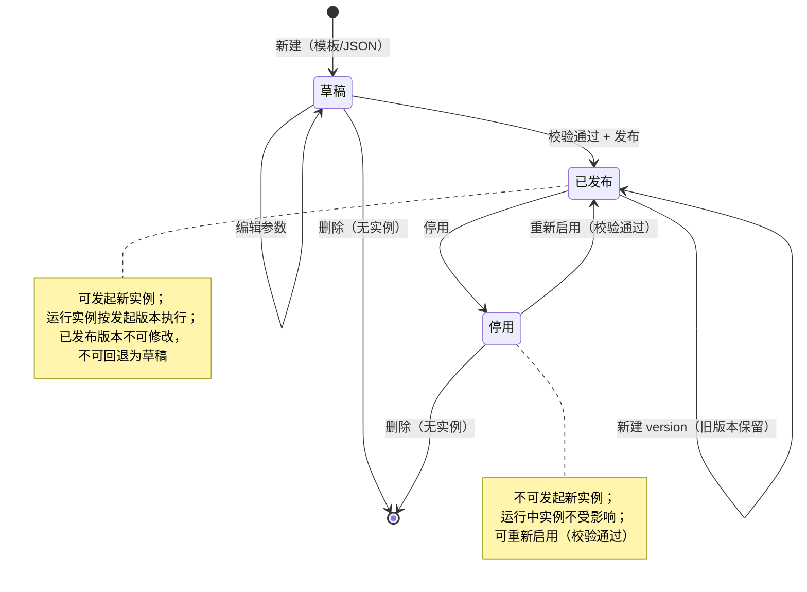
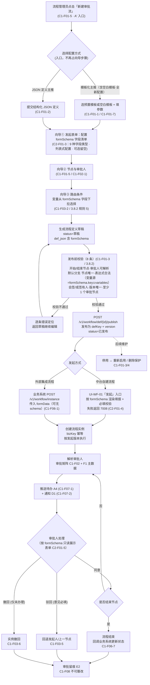
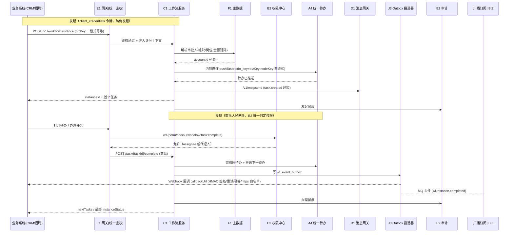

# 麓邦业务中台产品PRD · 增量：工作流引擎（V1.0 纳入）

| 项目 | 内容 |
| --- | --- |
| 文档性质 | 《麓邦业务中台产品需求文档（PRD）》**增量章节**，评审通过后并入主 PRD |
| 并入位置 | 主 PRD **第 6 章「产品详细功能需求」下新增 6.3「流程与表单模块（C1/C2/C3）」的增强版本**；同步修订 **第 2.4 章架构约束、第 2.5 章技术栈、第 3.3 章功能清单、第 5.3 章事件流、第 8 章版本发布计划、第 9 章依赖与风险** |
| 文档版本 | v1.2（增量；v1.1 新增「空白模板（全新配置）」C1-F01-7 与第 8 条发布前校验；**本次 v1.2 新增「发起表单定义（`formSchema`）」C2-F01-3 / C2-F01-4 / C2-F01-5，向导调整为 A′ 四步（配置方式上移「新建审批流」入口），新增 ADR-15 与错误码 7008；发布前校验仍为 8 条**） |
| 编制角色 | 产品经理 |
| 上游输入 | 主 PRD C1/C2/C3 既有编号与验收标准；《麓邦业务中台工作流引擎集成契约与前移评估》（架构 ADR-11/12/13）；《麓邦业务中台工作流能力现状核查与优先级建议》；《麓邦业务中台工作流增量PRD-技术一致性审查报告》 |
| 阅读对象 | 决策层、研发团队、实施交付团队、客户方业务与 IT 负责人 |
| 语言 | 中文 |
| 文档状态 | 待评审（含 P1–P4 前置拍板项） |

---

## 1. 章节定位说明

本文是主 PRD 的**增量章节**，将「工作流引擎」由规划能力正式纳入产品需求基线，作为可评审、可开发、可验收的正式章节内容。

| 项 | 说明 |
| --- | --- |
| 并入范围 | 主 PRD **第 6 章**新增 **6.3 流程与表单模块（C1/C2/C3）**（本文第 3 章为其功能点级正文）；主 PRD **第 4.4 章「统一审批流程（表单+工作流）」**沿用并细化为本文第 4 章两张图 |
| 功能编号 | **沿用既有 C1-F01~F06 / C2-F01~F04 / C3-F01~F02 编号与含义**；V1.0 新增的细粒度功能点使用 `C1-F0x-n` / `C2-F0x-n` 子编号；同时新增 `C1-F07`（流程实例与任务管理）、`C1-F08`（审批留痕与追溯）、`C3-F03`（移动端审批打通）三个不与既有编号冲突的新编号（衔接关系见第 8 章附录）；**v1.2 再新增 `C2-F01-3`（发起表单定义 `formSchema`）、`C2-F01-4`（发起入口与表单填报）、`C2-F01-5`（审批节点按 schema 只读展示）三个 C2 侧子编号** |
| 版本定位 | 工作流引擎**分两段交付**：**V1.0 交付「简单审批 MVP 子集 + 开放集成接口」**，**V1.5 交付「BPMN 完整版 + C2 完整表单引擎」**（见第 5 章） |
| 对外口径 | 工作流引擎对内是业务中台 L3 共享技术服务层的**自用能力**，对外是业务中台向其他业务系统供给的**开放能力**（「工作流即服务」） |
| 术语对齐 | 流程域命名统一为 **`bmp_wf` 库 + `wf_` 前缀**（主 PRD 第 2.5 章 `bpm_` 表述同步修订，见第 8 章附录） |
| 术语口径（强制） | ① 流程配置的可视化形态统一称「**可视化配置画布**」，**禁称「BPMN 设计器」**（后者特指 V1.5 `C1-F01-6`）；② 本次新增的表单能力统一称「**发起表单配置 / 表单定义（`formSchema`）**」，**禁称「表单设计器」**（后者特指 V1.5 `C2-F01-2` 拖拽式设计器） |

---

## 2. 模块概述

### 2.1 产品定位

工作流引擎（C1，配套表单 C2、审批入口 C3）位于产品七层模型的 **L3 共享技术服务层**，是业务中台的**中枢能力**，具备双重供给角色：

| 角色 | 说明 | 典型对象 |
| --- | --- | --- |
| **自用**（业务中台自用） | 业务中台自身的审批场景、以及接入中台的各业务系统，可直接使用中台工作流完成审批闭环 | 权限申请审批（B2-F04）、公告发布审批、表单审批应用、中台自身运营审批 |
| **对外供给**（工作流即服务） | 通过标准开放接口 + SDK + 回调/事件，将工作流能力**嵌入其他业务系统**，业务系统不感知引擎内部实现 | 存量 CRM（合同审批）、招聘系统（offer 审批）、目标系统（复盘审批）、KMS 等 |

### 2.2 产品目标

| # | 目标 | 现状 | 目标值 | 达成阶段 |
| --- | --- | --- | --- | --- |
| 1 | **流程配置周期缩短** | 流程配置依赖原系统研发排期，**周级** | **降至天级**（模板化配置 5 分钟建流程） | V1.0 |
| 2 | **审批能力统一收口** | 审批散落各系统，口径不一 | 中台统一引擎承载，**≥3 类简单审批流零代码配置并发布** | V1.0 |
| 3 | **对外集成低成本** | 各系统自建审批模块 | **业务系统嵌入对接 ≤2 人日** | V1.0 |
| 4 | **真实场景验证** | —— | **≥1 个真实审批场景由 C1 承载**（试点：CRM 合同审批 / 招聘 offer 审批） | V1.0 |
| 5 | **复杂流程能力补齐** | —— | BPMN 全语法、可视化设计器、完整表单引擎 | V1.5 |

### 2.3 与既有能力中心的依赖关系

工作流引擎不是孤立能力，其四条依赖链**均已在 V1.0 就绪**，属于「复用」而非「新增底座」：

| 依赖对象 | 依赖内容 | 依赖链 | V1.0 状态 |
| --- | --- | --- | --- |
| **B1 IAM/SSO** | 发起人/审批人身份锚定、OIDC 令牌、会话治理；防伪发起 | 身份 | ✅ 已就绪 |
| **B2 权限中心** | 办理任务接口权限 `workflow:task:complete` 统一判定；流程管理员角色内置；数据权限（V1.5 增强） | 鉴权 | ✅ 接口权限就绪；⚠️ 数据权限 V1.5 |
| **B3 组织同步** | 组织/人员异动事件，驱动审批矩阵解析数据刷新 | 数据 | ✅ 已就绪 |
| **F1 组织人员主数据** | 审批矩阵按组织/岗位解析审批人（**强依赖权威源**） | 数据 | ✅ 已就绪（准确性依赖 P1 拍板） |
| **A4 统一待办** | 任务推送、催办、超时提醒、完成回写（内部直连 `PortalTodoApi`） | 体验 | ✅ 已就绪 |
| **D1 消息网关** | 审批结果通知、超时提醒（**不自建发信通道**，短信同样经 D1 统一发送接口，中台统一配置短信服务商） | 通知 | ✅ 已就绪 |
| **D2 文件服务** | 审批意见附件、表单附件统一存取（只存 fileId） | 存储 | ✅ 已就绪（**D2-F01 上传下载已前移 V1.0**，附件字段依赖成立；D2-F02~F06 留 V1.5） |
| **E1 API 网关** | `/v1/workflow/**` 路由注册、统一鉴权、身份上下文注入 | 入口 | ✅ 已就绪 |
| **E2 日志审计** | 审批动作全程留痕（不可篡改、仅追加） | 合规 | ✅ 已就绪 |
| **J3 事件订阅中心** | 流程事件 → Outbox 投递器 → Webhook 回调/事件订阅 | 集成 | ✅ 已就绪（增量纳入扫描范围） |
| **J1 SDK/组件库** | Java 注解客户端 + Feign；Vue3 审批组件 | 集成 | ✅ 首批→V1.5 全量 |
| **I1 应用注册** | 业务系统 `app_code/app_secret`、`grant_types`（服务间 `client_credentials`）、`callbackUrl` 登记与白名单 | 集成 | ✅ 最小集就绪 |

> **依赖结论**：工作流 V1.0 前移**无架构级冲突**，唯一需新增的跨模块接口是 `PortalTodoApi`（工作流 → 待办）与网关 workflow 路由注册，均为增量。

### 2.4 架构约束（与既有 ADR 对齐）

| 编号 | 决策 | 对工作流的产品侧约束 |
| --- | --- | --- |
| ADR-11 | 工作流能力分段交付 | V1.0 只交付「简单审批 MVP 子集 + C1-F06 开放接口」，**不做** BPMN 全语法与可视化设计器 |
| ADR-12 | 引擎选型 | 引擎**可替换**，对外**只暴露中台 API**，业务系统不感知引擎内部实现（引擎细节属架构文档） |
| ADR-13 | 流程域命名 | 流程域统一 `bmp_wf` 库 + `wf_` 前缀 |
| ADR-07 | 跨边界流量经 E1 | 业务系统一律经网关访问工作流接口，禁止点对点直连 |
| **ADR-15（本次新增）** | **发起表单定义（`formSchema`）的归属与边界** | **① `formSchema` 并入 `wf_process_def.def_json`，与 `defKey + version` 同版本锁定**，V1.0 **不建独立表单中心/独立表/独立表单版本体系**；② V1.0 只交付「**静态字段清单 + 渲染 + 必填校验**」，**不做**拖拽式设计器、字段联动/显隐、字段级权限（均 V1.5 `C2-F01-2` / `C2-F02-1`）；③ V1.0 表单字段 `key` **可直接作为条件分支变量**（替代/增强既有 `variables`）；④ **两态兼容**：外部集成流程允许**无 `formSchema`**，此时按 `formData` key-value 降级平铺展示。**本 ADR 不改变 ADR-11**（能力集清单不变） |

---

## 3. 功能需求清单（功能点级）

> 说明：`版本`列中 **V1.0** = 本次纳入 V1.0 交付；**V1.5** = 保留 V1.5「流程版」。`C1-F0x-n` 为 V1.0 新增子编号，**不改变既有 `C1-F0x` 编号含义**。`C1-F01` 由主 PRD 的单一能力（可视化 BPMN 建模）扩展为**流程建模模块总项**，原 BPMN 设计器能力下沉为子项 `C1-F01-6`（V1.5），既有验收标准不变。未确认项标注「待确认」。

### 3.1 自用侧：流程配置与定义（C1-F01）

| 功能编号 | 功能名称 | 需求描述 | 业务规则 | 验收标准 | 版本 |
| --- | --- | --- | --- | --- | --- |
| **C1-F01** | 流程建模（模块总项） | 流程定义的创建、配置、发布、版本管理；V1.0 以「模板化 + JSON」两种方式配置，V1.5 提供可视化 BPMN 设计器 | 运行中实例按发起时版本执行；新版本仅对新实例生效 | ≥2 个审批场景由 C1 承载（V1.5）；V1.0 见各子项 | V1.0 子集 / V1.5 完整 |
| **C1-F01-1** | **模板化流程配置**（V1.0 主推） | 管理端从**预置审批模板**中选择（如「金额分级审批 2 级」「部门负责人 + 分管领导」），仅填空参数（节点名、审批人维度、金额阈值），保存为草稿或直接发布；**预置审批模板含「空白模板」（全新配置，无任何预置节点，见 C1-F01-7）** | 模板由产品内核预置、不可删除；参数必填校验；模板仅覆盖预置审批拓扑；**「空白模板」用于从零配置，选中后节点列表为空，需用户自行添加节点（清单见 C1-F01-7）** | 业务管理员**5 分钟内**完成一条简单审批流配置并发布 | V1.0 |
| **C1-F01-2** | **JSON 流程定义配置**（V1.0 主推，与模板并存） | 管理端通过配置界面或接口 `POST /v1/workflow/def`、`PUT /v1/workflow/def` 提交结构化 JSON 流程定义（节点数组 + 路由条件），系统校验通过后发布为 `defKey + version` | JSON 结构须符合定义规范；节点 `key` 唯一；条件表达式仅支持受限白名单语法；定义产物**可转译为 BPMN XML**（该转译为 V1.5 演进手段，非 V1.0 交付物） | 提交合法 JSON 定义 → 校验 → 发布成功，全过程 ≤10 分钟 | V1.0 |
| **C1-F01-3** | **流程定义发布与版本管理** | 流程定义状态管理：**草稿 → 已发布 → 停用 ↔ 重新启用**；发布接口 `POST /v1/workflow/def/{id}/publish`；支持版本递增（`defKey + version`）；发布前执行**发布前校验**（见 3.8.2） | UK(`defKey, version`) 全局唯一；**已发布版本不可修改**（如需修改须新建 `version`）；停用后不可发起新实例，运行中实例不受影响 | 版本管理准确率 100%；停用定义不再产生新实例 | V1.0 |
| **C1-F01-4** | **流程定义删除保护** | 仅当流程定义**无任何运行/历史实例**时才允许删除；存在实例时删除操作被拒绝并提示 | 删除为物理删除且需二次确认；删除动作上报 E2 | 删除保护拦截率 100%（存在实例时 0 误删） | V1.0 |
| **C1-F01-5** | **流程配置向导（基础配置界面）** | 管理端「新建审批流」向导（**A′ 四步**）：**① 发起表单（表单定义设计）→ ② 配置节点与审批人维度 → ③ 配置路由条件 → ④ 校验与发布预览**；「**配置方式**（模板化 / JSON 流程定义）」**上移至「新建审批流」入口**（新建时先选方式，选定后进入向导），**不再占用向导步骤位**（详见 3.8.1） | 向导步骤可回退重填；预览与最终定义一致；**步骤 1「发起表单」为可选配置**（外部集成流程可无 `formSchema`，见 C2-F01-3）；不提供拖拽画布（另见 `C1-F01-5` 可视化配置画布增量说明）；**形态方案 A**（配置方式留步骤 1 页头）保留为备选，与 A′ **可平滑切换**（仅入口位置差异） | 首次使用者无需培训即可完成配置（可用性测试通过） | V1.0 |
| **C1-F01-6** | 可视化 BPMN 设计器 | 拖拽画布 + BPMN 2.0 全语法（并行网关/多实例/子流程/自由流） | 设计器与 BPMN 定义版本管理；旧 JSON 定义可工具转译 | 业务管理员可拖拽编排复杂流程 | **V1.5** |
| **C1-F01-7** | **空白模板（全新配置）**（新增子项） | 预置审批模板中提供「**空白模板**」（编码 `TPL_BLANK`，模板列表**首位**）；选中后**清空所有预置节点**，由用户从零配置流程（支持列表视图或画布视图） | ①「空白模板」与其它预置模板**同属「模板化配置」档**（用列表式/画布式配节点），**非「JSON 流程定义」档**；② 选中后**节点列表置空、路由条件置空**；③ **画布视图保留 START→END 骨架**（开始/结束节点各 1 个，不可删除），避免初始即触发「缺开始/结束节点」阻断；④ 发布前**必须通过 3.8.2 第 8 条校验**（流程至少包含 1 个审批节点） | 「空白模板」可选中且节点被清空；从零配置一条含 **≥1 个审批节点**的流程并**成功发布** | V1.0 |

### 3.2 自用侧：审批矩阵与审批规则（C1-F02 / C1-F03）

| 功能编号 | 功能名称 | 需求描述 | 业务规则 | 验收标准 | 版本 |
| --- | --- | --- | --- | --- | --- |
| **C1-F02** | 审批矩阵 | 按组织/岗位/金额档位等维度自动解析审批人 | 矩阵变更**不影响运行实例**；解析顺序：节点指定人 → 岗位/角色 → 组织矩阵 | 审批人解析准确率 100% | V1.0（组织/岗位/金额三维） / V1.5（+角色/自定义） |
| **C1-F02-1** | 审批人解析规则配置 | 管理端配置矩阵规则：`dimension`（组织/岗位/金额）+ 匹配条件 + 解析规则（上级/岗位负责人/指定人）+ 优先级 | 规则按 `priority` 排序匹配；同一维度可配多条；规则保存即生效（不影响运行实例） | 规则配置准确、可命中预期审批人 | V1.0 |
| **C1-F02-2** | 审批人解析执行 | 流程实例到达节点时，按矩阵 + F1 主数据解析出 `accountId` 列表并生成任务 | 发起人 = 审批人时按「自动通过/上级代审」策略处理；解析结果记入参与者可见性 | 解析成功率 ≥99.5%；P95 解析耗时 <200ms | V1.0 |
| **C1-F02-3** | 解析失败兜底与告警 | 矩阵无匹配或主数据缺失时，回退至**兜底审批人**并触发**解析失败告警** | 兜底审批人按流程定义配置（默认流程管理员，见 3.10）；告警经 D1 通知流程管理员 | 解析失败 0 阻断（100% 有兜底）；告警触达率 ≥99% | V1.0 |
| **C1-F02-4** | 审批矩阵高级维度 | 增加角色/自定义字段维度解析 | 维度枚举扩展，兼容 V1.0 规则 | 覆盖复杂审批人解析场景 | **V1.5** |
| **C1-F03** | 审批规则 | 顺序多级审批、条件分支、会签/或签、退回、撤回 | 撤回仅限未办理节点；**驳回意见必填** | 规则引擎覆盖 100% 声明场景 | V1.0 |
| **C1-F03-1** | 顺序多级审批 | 按节点顺序逐级流转，上一节点全部通过后进入下一节点 | 节点可配单人/多人（会签或签）；支持节点抄送（知会） | 多级流转 100% 按定义执行 | V1.0 |
| **C1-F03-2** | 条件分支 | 按表单变量/业务变量路由（受限表达式白名单，如 `amount > 50000`） | 条件分支**必须有默认分支**（否则发布校验不通过）；无命中走默认分支 | 条件路由 100% 命中（0 无分支死锁） | V1.0 |
| **C1-F03-3** | 会签（全通过） | 同一节点多人审批，**全部同意**才通过 | 任一人驳回则节点驳回；会签进度可视化 | 会签结果判定准确率 100% | V1.0 |
| **C1-F03-4** | 或签（一票通过） | 同一节点多人审批，**任一人同意即通过** | 通过后其余任务自动取消（CANCELED）；首办人为实际审批人 | 或签结果判定准确率 100% | V1.0 |
| **C1-F03-5** | 退回 / 驳回（意见必填） | 审批人驳回流程，回退至发起人或上一节点；支持退回指定节点（可选） | **驳回意见必填**（缺失返回参数校验错误）；回退留痕 | 驳回意见校验覆盖率 100% | V1.0 |
| **C1-F03-6** | 撤回（仅未办理节点） | 发起人撤回流程实例 | **仅限后续节点均未办理**时撤回；不满足撤回条件（存在已办理节点）时返回 **7007 撤回条件不满足** | 撤回条件判定准确率 100% | V1.0 |

### 3.3 自用侧：流程实例、任务与留痕（C1-F07 / C1-F08）

| 功能编号 | 功能名称 | 需求描述 | 业务规则 | 验收标准 | 版本 |
| --- | --- | --- | --- | --- | --- |
| **C1-F07**（新增编号） | **流程实例与任务管理** | 流程实例全生命周期（发起 → 运行 → 完成/驳回/撤回/终止）；任务生成、办理、取消、转办、加签（基础）；实例状态与已办/待办查询（`GET /v1/workflow/task/list?view=todo\|done\|initiated`） | 实例 `bizKey` 全局唯一（幂等键）；运行实例按发起版本执行；**实例状态枚举** `status ∈ {RUNNING, APPROVED, REJECTED, WITHDRAWN, TERMINATED}`；任务 `todo_key` = `{sourceSystem}:{bizType}:{bizId}:{nodeKey}`（四段式，**前三段等于 `bizKey`**，第四段为节点键），此四段式为工作流向 A4 的**内部约定**，不改变 A4 对外 `/v1/todo/push` 三段式契约 | 实例状态机正确率 100%；重复发起幂等 0 重复实例 | V1.0 |
| **C1-F07-1** | 任务推送与联动待办 | 新任务生成后内部直连 A4 推送待办（`PortalTodoApi`），待办键 `todo_key` = `{sourceSystem}:{bizType}:{bizId}:{nodeKey}`，与流程业务键 `bizKey` **前缀一致**（前三段相同） | 任务与待办一一对应；任务完成自动完结对应待办；**A4 侧需支持 4 段键的幂等与唯一性校验**（技术评审确认项） | 待办推送成功率 ≥99.9%；推送延迟 ≤1 分钟 | V1.0 |
| **C1-F07-2** | 催办与结果通知 | 催办复用 A4 `/todo/{id}/remind`；审批结果（通过/驳回/超时）经 D1 `/msg/send` 通知 | 工作流**不自建发信通道**；通知模板 `APPROVAL_RESULT_NOTIFY` | 结果通知触达率 ≥99% | V1.0 |
| **C1-F07-3** | 转办 / 加签（基础） | 审批人将任务转办他人或加签（前置/后置） | 转办/加签均留痕；代理与转办关系可追溯 | 转办/加签动作留痕率 100% | V1.0（基础） / V1.5（高级策略） |
| **C1-F07-4** | 审批进度时间轴（前端） | 提供审批进度可视化（提交/审批/驳回/撤回节点时间轴） | 进度与实例状态实时一致 | 时间轴与实例状态一致性 100% | V1.0 |
| **C1-F08**（新增编号） | **审批留痕与追溯** | 完整记录发起/办理/驳回/撤回/终止/转办/矩阵变更等全部审批动作，写入 `wf_approval_record` 并异步上报 E2 | 留痕**仅追加、不可篡改**；记录操作人、动作、意见、附件、时间、是否代理、`trace_id`；**职责边界**：C1 负责产生留痕数据（`wf_approval_record`），E2 负责承载、检索与留存，非双写 | 审批动作留痕覆盖率 100%；可追溯至人 | V1.0 |

> **待办键一致性说明**：对外契约不变——流程业务键 `bizKey` 与 A4 对外待办契约 `/v1/todo/push` 均为**三段式** `{sourceSystem}:{bizType}:{bizId}`；工作流内部推送给 A4 的任务待办 `todo_key` 为**四段式**，即「前三段等于 `bizKey`，第四段为节点键」。A4 侧对 4 段键的幂等与唯一性支持为技术评审确认项（见第 8 章附录 8.5）。

### 3.4 自用侧：表单（C2）

> **v1.2 增量说明**：本次在既有 `C2-F01-1（formData 结构化承载）` 基础上，**新增 3 个子编号**——`C2-F01-3`（发起表单定义 `formSchema`）、`C2-F01-4`（发起入口与表单填报）、`C2-F01-5`（审批节点按 schema 只读展示表单）。**定位**：将 `C2-F01-1` 从「能承载 `formData`」补全为「**能定义 + 渲染 + 校验 + 展示**表单」，属 **V1.0 能力补全**（**不改变 ADR-11 能力集、非提前交付 V1.5 C2 完整表单引擎**，见 ADR-15）。V1.5 的拖拽式设计器（`C2-F01-2`）、字段联动/显隐（`C2-F02-1`）、表单-流程零代码贯通（`C2-F03`）**仍留 V1.5**。

| 功能编号 | 功能名称 | 需求描述 | 业务规则 | 验收标准 | 版本 |
| --- | --- | --- | --- | --- | --- |
| **C2-F01-1** | **formData 结构化承载（含表单定义 `formSchema`）** | V1.0 以结构化 `formData` JSON 承载表单数据（随流程实例存储），支持发起时传入、办理时展示、查询时快照返回；**并新增「表单定义 `formSchema`」**：流程定义内以字段清单（`key`/`label`/`type`/`required`/`options`/`sort`）描述发起表单，**发起时按 schema 渲染填报、办理时按 schema 只读展示** | 表单数据与流程实例强绑定；变更留痕；**附件一律存 D2（文件服务），`formData`/`wf_approval_record.attachment` 仅存 fileId 数组**，不重复建设存储；**不做拖拽式设计器**；**定义/实例分离**：`formSchema`（定义，随 `defKey+version` 走、发布后不可改）与 `formData`（实例值，随实例走）分离，表单定义变更**不影响历史实例数据**；**两态兼容**：外部集成流程**可无 `formSchema`**，此时按 `formData` key-value **降级平铺展示** | 表单数据随实例正确存储与回溯，0 丢失；**按 schema 渲染填报 + 必填校验生效** | V1.0 |
| **C2-F01-2** | 拖拽式表单设计器 | 拖拽设计、20+ 字段类型、布局/样式配置（C2-F01/F02 完整版） | 表单定义版本化；发布后才可填报 | 业务人员零代码建表单 | **V1.5** |
| **C2-F01-3** | **发起表单定义（`formSchema`）**（新增子项） | 流程定义内配置「发起表单」的**字段清单**，随流程定义版本发布；发起时以 `formSchema` 渲染填报页，办理时以 `formSchema` 只读渲染。**配置形态为「列表式字段配置」（增删 + 上下移排序 + 选中字段属性面板），非拖拽** | ① **落在 `wf_process_def.def_json`**（与 `defKey + version` 同版本锁定，**不新增表**）；② **字段类型仅 9 种**（见下方清单，**够用即止**，未列类型留 V1.5）；③ 字段 `key` 为该定义内唯一标识，**同时是 `formData` 的 key 与条件分支变量名**（与既有 `variables` 整合，见 3.8.2 规则 5）；④ `required=true` 字段须前端 + 服务端双校验；⑤ **发布后 `formSchema` 不可修改**，如需调整须新建 `version`；⑥ **列表式配置**（单列/两列布局取值），**不做拖拽设计器 / 字段联动显隐 / 字段级权限 / 独立表单版本化**（均 V1.5）；⑦ 与 V1.5 `C2-F01-2` **共享同一 `formSchema` 逻辑模型、同源升级、不返工** | 中台自建流程可经向导配置出 `formSchema` 并成功发布；字段类型与属性配置正确；字段 `key` 可作为条件分支变量被命中 | V1.0 |
| **C2-F01-4** | **发起入口与表单填报**（新增子项） | ① **UI-WF-01 流程定义管理**行内新增「**发起**」入口（**仅 `status=已发布` 可用**，草稿/停用置灰 + tooltip 原因），点击打开**按 `formSchema` 渲染的填报页**；② 业务系统经 `POST /v1/workflow/instance`（C1-F06-1）传入 `formData`（外部集成流程，可不带 schema）；③ 填报页提交时执行必填校验，**校验失败返回错误码 `7008 表单校验失败`** 并定位缺失字段 | ① 发起人须锚定真实身份（防伪发起）；② 幂等键 = `bizKey`（三段式）；③ 附件字段上传至 D2，仅存 `fileId`；④ **无 `formSchema` 的流程不展示「发起」入口**（提示「该流程由 {sourceSystem} 系统发起」）；⑤ 必填校验**前端 + 服务端双校验**（防绕过） | 中台自建流程可在 UI-WF-01 点击「发起」→ 填写 → 提交成功；**发起必填校验拦截率 100%**（含服务端拦截） | V1.0 |
| **C2-F01-5** | **审批节点按 schema 只读展示表单**（新增子项） | 审批节点（待办详情 / 审批中心办理弹窗 / 移动端审批页）**按 `formSchema` 结构化只读展示**表单数据（`label` + 类型化值 + 附件可下载）；**无 `formSchema` 时降级为 `formData` key-value 平铺展示** | ① **V1.0 审批人一律只读**，**不提供字段编辑态**（「审批人可编辑字段」属 V1.5 `C2-F02-1` 字段级权限）；② 历史实例按其**发起版本**的 `formSchema` 渲染（新增字段对历史实例显示为空或不显示）；③ 展示口径与 UI-WF-04 实例详情抽屉、UI-WF-06 审批中心、UI-WF-07 移动端一致 | 各审批节点**表单数据展示完整率 100%**；无 schema 流程展示不报错（降级可用） | V1.0 |
| **C2-F02-1** | 字段联动/显隐/校验 | 字段联动、显隐规则、数据校验（C2-F02 完整版） | 规则在表单定义侧配置、随定义版本生效 | 复杂表单规则覆盖 | **V1.5** |
| **C2-F03** | 表单-流程贯通（零代码） | 表单一键挂接工作流，零代码生成审批应用 | 表单字段可作为流程条件变量 | 零代码表单审批应用 ≥5 类（V1.5） | **V1.5** |
| **C2-F04-1** | 表单实例数据管理（基础） | 表单实例数据查询、导出（含水印）、权限控制（基础版） | 导出行为上报 E2；数据可见性随实例参与者权限 | 导出越权测试 0 泄漏 | V1.0（基础） / V1.5（完整） |

> **C2-F01-3 · 字段类型清单（V1.0 仅此 9 种，「够用即止」）**：
>
> | # | 类型 code | 名称 | 适用场景举例 | 可作为条件变量 |
> | --- | --- | --- | --- | --- |
> | 1 | `text` | 单行文本 | 合同名称、客户名称、供应商 | ✅（等值/包含） |
> | 2 | `textarea` | 多行文本 | 申请理由、事由、备注 | ✅（等值） |
> | 3 | `number` | 数字 | 天数、人数、数量 | ✅（大小比较） |
> | 4 | `amount` | 金额 | 合同金额、采购金额、报销金额、拟定年薪 | ✅（**核心**：金额分级审批） |
> | 5 | `date` | 日期 | 入职日期、开始日期 | ✅（日期比较） |
> | 6 | `datetime` | 日期时间 | 请假开始/结束时间 | ✅（日期比较） |
> | 7 | `select` | 下拉单选 | 合同类型、请假类型、费用类型、数据范围 | ✅（等值） |
> | 8 | `multiselect` | 多选 | 数据范围（多部门）、权限项 | ⚠️（仅等值，V1.0 不做集合运算） |
> | 9 | `attachment` | 附件 | 合同扫描件、发票、证明 | ❌ |
>
> **类型清单说明**：① **够用即止**——9 种已完整覆盖 V1.0 现有全部场景（合同/折扣/权限申请/请假/采购/Offer/报销）的 `formData` 全部字段；新增类型即新增控件 + 校验 + 展示分支，成本线性上升，**不建议贪多**；② **`RADIO`（单选）不作为独立类型**——与 `select` 同语义，**合并为 `select`**；未来若需区分控件外观，以 `select` 的 `display: radio|dropdown` 属性表达（非本次范围）；③ **`EMPLOYEE`（人员选择）留 V1.5**——发起人身份已由实例 `initiator_account_id` 天然承载，人员选择涉及主数据联动与权限，属 V1.5；④ 新增类型须走变更评审，避免边界滑坡（见 ADR-15）。
>
> **`formSchema` 结构（产品语义，技术字段细节以架构文档为准）**：`fields[]` 每项含 `key`（字段标识，英文，同定义内唯一，**兼作条件变量名**）、`label`（标签，中文，展示用）、`type`（9 种之一）、`required`（是否必填，默认否）、`placeholder`（输入提示）、`help`（字段说明）、`options[]`（`select`/`multiselect` 必填且非空）、`defaultValue`（静态默认值，可选）、`order`（排序）；顶层含 `layout`（`single` 单列 / `double` 两列，默认 `single`）。**不含**联动/显隐规则、字段级权限、动态默认值（均 V1.5）。

### 3.5 自用侧：审批入口（C3）

| 功能编号 | 功能名称 | 需求描述 | 业务规则 | 验收标准 | 版本 |
| --- | --- | --- | --- | --- | --- |
| **C3-F01** | 统一审批视图（V1.0 基础版） | 跨系统审批待办聚合：**站内审批**（已接 C1 的）+ **跳转审批**（未接 C1 的，A4 已具备）；统一审批操作界面 | 站内审批在站内完成；跳转审批跳原系统（带 SSO）处理并回写 | 审批人单点处理覆盖率 ≥80%（V1.5）；V1.0 站内 + 跳转均可用 | V1.0（基础） / V1.5（完整） |
| **C3-F02** | 批量审批（V1.0 基础版，可选） | 同类审批批量同意/驳回 | 批量操作**逐条生效并留痕**；驳回批量时意见必填 | 批量操作成功率 100%、逐条留痕 | V1.0（基础，可选） / V1.5（完整） |
| **C3-F03**（新增编号） | **移动端审批（中台自有流程）** | 移动端（钉钉/企微，A2-F03）直接办理中台自有流程任务：待办卡片点击直达站内审批页（免登），办理调用 `/v1/workflow/task/{id}/complete`；与 PC 端状态实时一致 | 移动审批动作与 PC 同源同权（走 B2 统一鉴权）；办理后待办即时消除 | 移动端办理中台自有流程任务成功率 ≥99%；移动/PC 状态一致性 100% | V1.0 |

### 3.6 自用侧：委托代理与超时提醒（C1-F04 / C1-F05）

| 功能编号 | 功能名称 | 需求描述 | 业务规则 | 验收标准 | 版本 |
| --- | --- | --- | --- | --- | --- |
| **C1-F04** | 委托代理 | 设定代理人 + 代理期（出差/休假场景）；期间新任务自动路由至代理人 | 记录实际处理人与委托关系（`proxy_flag`）；**到期自动失效** | 代理期任务路由准确率 100% | V1.0（建议进，性价比高） |
| **C1-F04-1** | 委托设置与生效 | 管理端/个人端设置委托关系（委托人、代理人、起止时间、事由） | 起止时间必填；同一时段委托关系可查；停用即时生效 | 委托设置准确率 100% | V1.0 |
| **C1-F04-2** | 代理期任务路由与留痕 | 代理期内新任务路由至代理人，实际办理人为代理人，留痕标注代理关系 | 代理期内原审批人任务全部路由；委托人与代理人均可见 | 代理期路由准确率 100%；留痕可区分代理 | V1.0 |
| **C1-F05** | 超时提醒 | 节点超时规则与自动提醒 | 超时升级至上级可选 | 超时提醒触达率 ≥99% | V1.0（基础，复用 A4） / V1.5（完整） |
| **C1-F05-1** | 节点超时与提醒（基础） | 推送待办时按节点 SLA 计算 `overdueHours`，复用 A4 `overdue_time` + 每小时超时扫描提醒 | **默认 `overdueHours = 48`（小时）**，可按业务类型映射覆盖（示例：合同审批 24h、offer 审批 24h、权限申请 48h、公告发布 72h），超时规则按业务类型/节点配置；提醒经 D1 触达 | 超时提醒触达率 ≥99%；未配置 SLA 时按默认 48h 生效 | V1.0 |
| **C1-F05-2** | 节点级超时规则与升级上级 | 节点级超时规则（时长/提醒方式/升级对象），超时自动升级至上级 | 升级对象可解析；升级动作留痕 | 超时升级准确率 100% | **V1.5** |

### 3.7 对外开放侧（C1-F06：工作流即服务）

| 功能编号 | 功能名称 | 需求描述 | 业务规则 | 验收标准 | 版本 |
| --- | --- | --- | --- | --- | --- |
| **C1-F06** | 流程开放接口（模块总项） | 发起/办理/查询 API，供业务系统嵌入；回调业务系统 | 回调失败重试；幂等 | 业务系统嵌入对接 ≤2 人日 | V1.0 |
| **C1-F06-1** | 发起流程实例 | `POST /v1/workflow/instance`：业务系统发起审批，返回 `instanceId` + 首个任务 | 幂等键 = `bizKey`（`{sourceSystem}:{bizType}:{bizId}`，三段式）；发起人须锚定真实身份（防伪发起）；**v1.2：若目标定义的 `def_json.formSchema` 存在，则对 `formData` 执行必填校验，校验失败返回 `7008 表单校验失败`；若不存在 schema（外部集成流程），则 `formData` 透传不校验** | 发起成功率 ≥99.9%；重复发起 0 重复实例；**有 schema 时必填校验拦截率 100%** | V1.0 |
| **C1-F06-2** | 办理任务 | `POST /v1/workflow/task/{taskId}/complete`：同意/驳回/加签/转办，含意见 | 幂等键 = `idempotencyKey`；**驳回意见必填**；办理人须为 assignee 或其代理人 | 办理成功率 ≥99.9%；越权办理 0 通过 | V1.0 |
| **C1-F06-3** | 查询实例状态 | `GET /v1/workflow/instance/{instanceId}`：返回当前节点、已办/待办、审批记录、表单快照 | 只读；按实例参与者权限可见 | 查询 P95 <200ms | V1.0 |
| **C1-F06-4** | 按业务键查实例 | `GET /v1/workflow/instance?bizKey=&sourceSystem=`：业务系统用自身 `bizKey` 反查 | 只读；`bizKey` 为三段式，与 A4 对外待办契约 `/v1/todo/push` 口径一致 | 反查准确率 100% | V1.0 |
| **C1-F06-5** | 撤回 | `POST /v1/workflow/instance/{instanceId}/withdraw` | 仅限未办理节点，不满足条件返回 **7007**；幂等键 = `idempotencyKey` | 撤回条件判定准确率 100% | V1.0 |
| **C1-F06-6** | 终止 | `POST /v1/workflow/instance/{instanceId}/terminate`：发起人/管理员强制作废 | 幂等键 = `idempotencyKey`；**写留痕** | 终止动作 100% 留痕 | V1.0 |
| **C1-F06-7** | 回调与事件（双通道） | ①**回调 HTTP（主通道）**：状态变更定向 POST 至业务系统 `callbackUrl`；②**事件订阅（辅通道）**：流程事件写入 `wf_event_outbox` → J3 Outbox 投递器 → MQ/Webhook | 复用 J3：HMAC-SHA256 签名、失败重试 3 次（1m/5m/30m）、死信人工重放、按 `eventId` 幂等；`callbackUrl` 须在 I1 应用注册时登记并**白名单校验**、仅允许 https、防 SSRF（见第 6 章）；V1.0 事件清单见 3.7.1 | 回调成功率 ≥99%；业务系统按 `eventId` 幂等 0 重复处理 | V1.0 |
| **C1-F06-8** | SDK 与接入组件 | **Java**：`@StartWorkflow`/`@WorkflowCallback` 注解、`WorkflowClient`（Feign/本地双实现）、回调端点自动注册+验签+幂等；**Vue3**：`<ApprovalTimeline>`/`<ApprovalForm>`/`<TaskActionBar>`/`<MyApprovalList>` 组件 | 业务系统仅需写 3 段代码（加注解发起、回调更新单据状态、配置 `client_id/secret`），无胶水代码 | 接入组件发布内部 npm/maven，版本化；接入方零 UI 开发 | V1.0 |
| **C1-F06-9** | 接入验收与 Checklist | 「七步接入 checklist」第 5 步（待办接入）扩展为「工作流接入」子步骤：注册 `callbackUrl` → 引入 SDK → 加注解 → 联调；配套可运行 demo | 提供接入文档与示例工程 | **业务系统嵌入对接 ≤2 人日**（含联调） | V1.0 |

#### 3.7.1 V1.0 流程事件清单

| 事件类型 | 触发时机 | 主要消费方 |
| --- | --- | --- |
| `wf.instance.started` | 流程实例创建 | 业务系统、数据中台 |
| `wf.task.created` | 新任务生成 | A4、D1 |
| `wf.task.completed` | 任务办理完成 | 业务系统 |
| `wf.instance.completed` | 流程全部通过结束 | 业务系统（回调更新单据状态）、BI |
| `wf.instance.rejected` | 流程被驳回 | 业务系统 |
| `wf.instance.withdrawn` | 流程被撤回 | 业务系统 |
| `wf.instance.terminated` | 流程被终止 | 业务系统 |

> **事件规则**：命名 `域.对象.动作`（与主 PRD 第 5.3 章一致）；事件体沿用 J3 事件信封（`eventId`/`eventType`/`occurredAt`/`source`/`data`）；**至少一次投递，不保证严格顺序**，消费方按 `eventId` 幂等、以 `instanceStatus` + `occurredAt` 收敛。

### 3.8 配置与发布侧（对应「自助配置审批流并发布使用」诉求）

工作流引擎支持业务管理员在**零代码/低代码**条件下完成「配置 → 校验 → 发布 → 运行 → 下线」全流程。本节为 C1-F01 与 C1-F01-3 的产品流程细化。

#### 3.8.1 配置与发布全流程

> **v1.2 变更（向导结构 A′）**：**「配置方式（模板化 / JSON 流程定义）」上移至「新建审批流」入口**——新建审批流时先选配置方式，选定后进入向导；**向导步骤条变为 4 步（① 发起表单 → ② 节点与审批人 → ③ 路由条件 → ④ 校验与发布）**，「发起表单」成为向导第 1 步。**仍保持 4 步**（不破坏既有「向导 4 步」裁决）。**备选方案 A**（配置方式留在向导步骤 1 页头，步骤 1 = 「配置方式与发起表单」）**保留**，与 A′ **实质相同、可平滑切换**（差异仅「配置方式放在新建入口还是步骤 1 页头」）。
>
> 下表「第 1 步」按 A′ 展开（含 `C2-F01-3` 发起表单设计）。

| 步骤 | 操作 | 角色 | 产品行为 | 对应功能编号 |
| --- | --- | --- | --- | --- |
| 0 入口（**A′ 新增**） | 在 UI-WF-01 点击「新建审批流」→ **选择配置方式**（模板化配置，含**空白模板** / JSON 流程定义） | 流程管理员 / 实施 | 选定方式后进入向导；`defKey` 与流程名称在入口或步骤 1 填写 | C1-F01-1 / C1-F01-2 / C1-F01-7 |
| 1 发起表单（**A′ 为向导第 1 步**） | **配置发起表单字段清单**（`formSchema`）：字段标签、字段 `key`、类型（9 种）、必填、占位符/说明、选项、排序、布局 | 流程管理员 | **列表式字段配置**（增删 + 上下移 + 选中字段属性面板），**非拖拽**；字段 `key` 将作为条件分支变量；**可留空**（外部集成流程无需表单定义） | **C2-F01-3** |
| 2 节点与审批人 | 配置节点、审批人维度、会签/或签、兜底审批人（模板化方式下规则同 C1-F01-1） | 流程管理员 / 实施 | 同既有设计（不受本次变更影响） | C1-F01-5 / C1-F02-1 |
| 3 路由条件 | 配置条件表达式与目标节点；**变量下拉从步骤 1 的表单字段动态生成**（`formSchema.fields[].key`），条件分支必须有默认分支 | 流程管理员 | 变量来源 = `formSchema.fields[].key` ∪ `variables`（见 3.8.2 规则 5） | C1-F03-2 / **C2-F01-3** |
| 4 校验与发布预览 | 触发**发布前校验（8 条）** + 查看**流程结构预览**、**审批人解析预览**、**表单预览** | 流程管理员 / 系统 | 按 3.8.2 规则集校验，返回逐条错误定位；校验通过后 `POST /v1/workflow/def/{id}/publish` 发布为 `defKey + version` | C1-F01-3 / **C2-F01-3** |
| 5 运行 | **中台自建流程**：由发起人经 UI-WF-01「发起」入口**按 `formSchema` 填写**并提交（必填校验，失败返回 `7008`）；**外部集成流程**：业务系统经 `POST /v1/workflow/instance` 传入 `formData` → 实例运行 → 审批人处理 | 发起人 / 审批人 / 系统 | 推送待办 A4、通知 D1、留痕 E2；**各审批节点按 `formSchema` 只读展示表单**；支持催办、委托、撤回 | C1-F07 / C1-F02 / C1-F03 / C1-F04 / **C2-F01-4 / C2-F01-5** |
| 6 下线 | 停用流程定义（可再启用） | 流程管理员 | `status=停用`；**新实例不可发起，运行中实例不受影响**；存在实例时不可删除 | C1-F01-3 / C1-F01-4 |

> **向导 4 步与生命周期六步的维度差异**：向导是「**用户配置操作**」的步进（4 步），3.8.1 生命周期是「**定义从创建到下线**」的宏观阶段（6 步），**二者非同一维度、不冲突**（详见 UIUX 增量设计 5.8 节映射表）。

#### 3.8.2 发布前校验规则（P0，共 8 条，缺一不可）

> **本次增量（v1.2）**：**校验条数仍为 8 条，不新增第 9 条**。仅将**第 5 条「变量已声明」的声明来源**由「`variables`」**扩展为「`formSchema.fields[].key` ∪ `variables`」**（**不改变条数、不改变规则编号与含义**）。依据：**两态兼容**——外部集成流程允许**无 `formSchema`**（此时其变量仍由 `variables` 声明），故不可强制「必须有表单定义」。步骤 4 可另设「**信息项**」软提示（非校验项，不阻断发布）。

| # | 校验规则 | 不通过的后果 |
| --- | --- | --- |
| 1 | 必须存在**开始节点**与**结束节点** | 拒绝发布，定位缺失节点 |
| 2 | 所有审批节点的**审批人可解析**（矩阵规则存在且可命中，或指定了兜底审批人） | 拒绝发布，定位不可解析节点 |
| 3 | **条件分支必须有默认分支**（`default=true`） | 拒绝发布，定位无默认分支的网关 |
| 4 | 节点 `key` 唯一，无孤立节点（不可达节点） | 拒绝发布，定位重复/孤立节点 |
| 5 | 条件表达式符合**受限白名单语法**，变量已声明（**声明来源 = `formSchema.fields[].key` ∪ `variables`**） | 拒绝发布，定位非法表达式或未声明变量 |
| 6 | 会签/或签节点至少配置 1 个审批人 | 拒绝发布，定位空节点 |
| 7 | 版本唯一性约束 **UK(`defKey`, `version`)** 成立（同 `defKey` 允许新增 `version`） | 拒绝发布，提示版本冲突 |
| **8（v1.1 新增）** | **流程至少包含 1 个审批节点**（`type=APPROVAL` 的节点数 ≥1，否则与「审批流」语义不符） | 拒绝发布，提示「流程至少需要 1 个审批节点」并定位节点配置区 |

> **「信息项」软提示（v1.2 新增，非校验项）**：步骤 4 建议展示灰底 ℹ️ 提示「**中台自建流程建议至少配置 1 个发起表单字段**」。**不阻断发布**，不计入 8 条硬校验，避免抬高验收口径（见 5.3 第 6 项「发布前校验拦截率 100%（8 条规则）」保持不变）。

#### 3.8.3 流程定义状态机

> **状态迁移约束**：
> 1. **已发布 → 草稿：禁止**。已发布版本不可修改、不可回退为草稿；如需修改须**新建 `version`**（原版本保留，运行实例沿用其发起版本）。
> 2. **停用 → 已发布（重新启用）**：需重新通过发布前校验（3.8.2）；启用后新实例可发起，历史实例不受影响。
> 3. 删除仅在**无任何实例**时允许（草稿、停用均适用），已发布版本需先停用再删除。

### 3.9 数据模型（流程域 `bmp_wf` 库 / `wf_` 前缀）

V1.0 MVP 涉及 **8 张 `wf_*` 核心表**（表名与《工作流引擎集成契约与前移评估》4.2 节一致），与引擎原生流转表以 `business_key = bizKey` 关联；引擎替换时 `wf_*` 契约保持稳定：

| 表名 | 承载职责 | 关键字段（节选） |
| --- | --- | --- |
| `wf_process_def` | 流程定义与版本管理 | `def_key`、`name`、`version`、`def_type`(TEMPLATE/JSON)、`def_json`、`status`(草稿/已发布/停用)、UK(`def_key`,`version`) |
| `wf_process_instance` | 流程实例（业务映射） | `biz_key`(UK)、`source_system`、`biz_type`、`biz_id`、`def_key`、`def_version`、`initiator_account_id`、`form_data`、`variables`、`status`、`callback_url`、`jump_url` |
| `wf_task` | 任务（待办来源） | `instance_id`、`node_key`、`node_name`、`assignee_account_id`、`original_assignee_id`、`sign_mode`、`status`、`action`、`comment`、`overdue_time` |
| `wf_approval_record` | 审批留痕（合规） | `instance_id`、`task_id`、`node_key`、`operator_account_id`、`action`、`comment`、`attachment`(fileId 数组)、`op_time`、`proxy_flag`、`trace_id` |
| `wf_approval_matrix` | 审批矩阵（审批人解析） | `matrix_code`(UK)、`dimension`(ORG/POSITION/AMOUNT)、`match_json`、`resolver_json`、`priority`、`status` |
| `wf_instance_participant` | 实例参与者可见性（V1.0 数据权限降级） | `instance_id`、`account_id`、`role`(INITIATOR/APPROVER/CC/ADMIN)、UK(`instance_id`,`account_id`,`role`) |
| `wf_delegate` | 委托代理 | `principal_account_id`、`delegate_account_id`、`start_time`、`end_time`、`reason`、`status` |
| `wf_event_outbox` | 流程事件发件箱（复用 J3 投递器） | `event_id`(UK)、`event_type`、`aggregate_id`、`payload`、`published` |

> 流程定义与实例的版本关系：运行实例锁定 `def_version`，新版本仅对新实例生效；审批矩阵变更**不回溯**运行实例。

**v1.2 补充：`def_json` 与 `form_data` 的结构说明（不改表、不改列）**

| 项 | 说明 |
| --- | --- |
| `wf_process_def.def_json` | **本次在 `def_json` 内新增 `formSchema` 子节点**（发起表单定义）。`def_json` 结构为：`{ defKey, name, **formSchema**, variables, nodes, edges }`。其中 `formSchema = { layout, fields[] }`，`fields[] = { key, label, type, required, placeholder, help, options[], defaultValue, order }`（`type` 取值见 3.4 字段类型清单 9 种）。**表结构不变（仍 8 张表），不加列、不新增表**——`formSchema` 作为 JSON 内容存放于既有 `def_json` 列 |
| `wf_process_instance.form_data` | **沿用不新增**。其**结构由「该实例发起版本的 `formSchema`」约束**（`form_data` 的 key 应对齐 `formSchema.fields[].key`）。**无 `formSchema` 的实例**（外部集成流程）其 `form_data` 为自由 key-value，展示侧降级平铺 |
| 定义/实例分离 | `formSchema`（定义）随 `def_key + version` 走、**发布后不可改**；`form_data`（实例值）随实例走、**发起后只读**。故**表单定义变更不影响历史实例数据**（历史实例按其发起版本的 `formSchema` 渲染），**0 数据迁移**，与「审批留痕仅追加不可篡改」（C1-F08）口径一致 |
| 变量声明源 | 条件分支变量的声明源 = `formSchema.fields[].key` ∪ `wf_process_instance.variables`（见 3.8.2 规则 5）。`variables` 列**保留兼容**（JSON 定义方式仍需显式声明） |

### 3.10 角色与权限（流程管理员）

| 项 | 内容 |
| --- | --- |
| 角色定义 | **流程管理员**为 **B2 权限中心内置角色**（RBAC 角色，权限点统一在 B2 登记，不另立权限体系） |
| 权限范围 ① | **流程配置与发布**：管理端创建/编辑草稿、执行发布前校验、发布、停用/启用、删除（无实例时）流程定义（对应 C1-F01-1~F01-5）；**v1.2 含「发起表单定义」配置（C2-F01-3）** |
| 权限范围 ② | **全实例查看**：查看全部流程实例、任务与审批记录（V1.0 数据权限降级方案下的兜底可见角色，对应 `wf_instance_participant.role=ADMIN`） |
| 权限范围 ③ | **接收解析失败告警**：作为审批人解析失败（C1-F02-3）的告警接收人与默认兜底审批人 |
| 权限范围 ④（**v1.2 新增**） | **发起中台自建流程**：通过 UI-WF-01「发起」入口按 `formSchema` 填报并发起（C2-F01-4）；建议权限点 `workflow:instance:start`，**可由业务角色（非仅流程管理员）持有**（待确认） |
| 与 B2 衔接 | 权限点示例：`workflow:def:manage`、`workflow:instance:viewAll`、`workflow:matrix:manage`、**`workflow:instance:start`（v1.2）**；由 B2-F01 角色管理授权，B2-F05 `/perm/check` 统一判定 |
| 与实例可见性 | 流程管理员通过 `wf_instance_participant` 显式登记实例可见性；V1.5 接入 B2-F03 数据权限后由组织维度自动可见 |

---

## 4. 核心业务流程

### 4.1 流程「配置 → 校验 → 发布 → 运行 → 完成」（自用侧）

### 4.2 业务系统集成工作流（开放侧时序图）

---

## 5. 版本计划调整

### 5.1 调整后的版本发布计划（增量部分）

> 仅列出与工作流相关的调整行；未列出的版本内容与主 PRD 第 8 章一致。

| 版本 | 时间 | 主题 | 工作流相关包含内容 | 工作流相关关键验收 |
| --- | --- | --- | --- | --- |
| **V1.0 基座版** | M0–M3 | 身份与入口统一 **+ 简单审批 MVP** | **C1-F01-1~F01-5、C1-F01-7（空白模板）、C1-F02~F05（含子项）、C1-F06（全量开放接口）、C1-F07/C1-F08、C2-F01-1（formData）、C2-F01-3（发起表单定义 formSchema）、C2-F01-4（发起入口与表单填报）、C2-F01-5（审批节点按 schema 只读展示）、C2-F04-1、C3-F01/F02/C03**；引擎选型一次到位；`bmp_wf` 库 + `wf_` 前缀 | ✅ **≥1 个真实审批场景由 C1 承载**；✅ **业务系统嵌入对接 ≤2 人日**；✅ **零代码配置并发布 ≥3 类简单审批流**；✅ 审批人解析准确率 100%；✅ 审批留痕 100%；✅ **≥1 个中台自建流程经向导配置发起表单并成功发起**；✅ **发起必填校验拦截率 100%**；✅ **各审批节点表单数据展示完整率 100%** |
| **V1.5 流程版** | M3–M6 | 流程与文件 | **C1-F01-6（可视化 BPMN 设计器）、C1-F02-4、C1-F05-2、C1-F07-3（高级策略）**；**C2 完整表单引擎（C2-F01-2/C2-F02-1/C2-F03/C2-F04 完整版）**；C3 完整版；B2-F03 数据权限接管实例可见性；J1 全量、J3 事件中心 | ≥2 审批场景统一引擎；零代码表单审批应用 ≥5 类；审批人单点处理覆盖率 ≥80%；文件迁移率 ≥80%；越权测试 100% |
| V2.0 业务版 | M6–M9 | 主数据与业务共享 | 工作流场景扩展（客户/目标相关审批接入） | 存量系统审批批量接入 |
| V2.5 治理版 | M9–M12 | 治理开放运营 | 工作流运营度量（流程时长/积压）；C1-F06 能力上架 I3 能力目录 | 能力自助申请调用 |
| V3.0 智能版 | M12+ | AI 融合与低代码 | I5-F01 低代码（表单+流程+页面自助搭建，默认关闭、开关化） | 若启用，业务可自助搭建轻应用 |

### 5.2 V1.0 与 V1.5 的能力分界

| 能力 | V1.0（MVP 子集） | V1.5（完整版） | 分界理由 |
| --- | --- | --- | --- |
| 流程定义方式 | 模板化配置 + JSON 定义 | + 可视化 BPMN 设计器 | 设计器工作量大，客户当前场景用不上 |
| 流程语法 | 顺序多级 + 条件分支 + 会签/或签 + 退回/撤回 | + 并行网关/多实例/子流程/自由流 | BPMN 全语法超出钉钉、麓邦无场景 |
| 审批矩阵维度 | 组织 / 岗位 / 金额档位 | + 角色 / 自定义维度 | V1.0 三维覆盖现有场景 |
| 表单 | **`formData` JSON 承载 + `formSchema` 发起表单定义与渲染/必填校验（9 种基础字段类型 · 列表式配置）** | 完整表单设计器（20+ 字段/拖拽/联动/显隐/字段级权限/版本化）+ 表单-流程零代码贯通 | 表单引擎体量大，V1.0 先做「**静态字段清单 + 渲染 + 必填校验**」，动态规则与设计器形态留 V1.5（见 ADR-15） |
| 超时提醒 | 复用 A4 超时扫描 + 节点 SLA（默认 48h） | 节点级规则 + 自动升级上级 | 基础版可复用既有资产 |
| 数据权限（实例可见性） | 参与者显式可见性（`wf_instance_participant`） | 接 B2-F03 数据权限（按组织自动可见） | B2 数据权限排 V1.5，可平滑切换 |
| 开放集成 | C1-F06 全量接口 + 回调/事件 + SDK | SDK/事件增强 | 对外集成是客户核心诉求，V1.0 交付 |
| 移动端审批 | 移动端可直接办理中台自有流程任务（C3-F03） | 完整聚合增强 | V1.0 打通是移动体验闭环前提 |
| 流程版本灰度 | 不做 | 流程版本灰度 / AB | 非刚需 |

### 5.3 V1.0 验收增量（明确）

| # | 验收项 | 指标 |
| --- | --- | --- |
| 1 | 真实审批场景由 C1 承载 | **≥1 个**（试点：CRM 合同审批 / 招聘 offer 审批） |
| 2 | 业务系统嵌入对接成本 | **≤2 人日**（含联调） |
| 3 | 零代码配置并发布简单审批流 | **≥3 类** |
| 4 | 审批人解析准确率 | 100%（矩阵 + F1 主数据） |
| 5 | 审批留痕覆盖率 | 100%（不可篡改） |
| 6 | 发布前校验拦截率 | 100%（**8 条规则**，不合规定义 0 上线；含「至少 1 个审批节点」） |
| **7（v1.2 新增）** | **中台自建流程经向导配置发起表单并成功发起** | **≥1 个**（`formSchema` 配置 → 发布 → UI-WF-01「发起」→ 填写 → 提交成功） |
| **8（v1.2 新增）** | **发起必填校验拦截率** | **100%**（前端 + 服务端双校验；缺失必填返回 `7008`） |
| **9（v1.2 新增）** | **各审批节点表单数据展示完整率** | **100%**（UI-WF-04 实例详情 / UI-WF-06 审批中心 / UI-WF-07 移动端按 `formSchema` 只读渲染；无 schema 时降级平铺可用） |

> **验收口径说明**：第 3、6 项为技术评审后**新增的 V1.0 验收项**，需产品与研发共同确认可达性，并与架构文档验收表口径对齐；第 1、2 项与架构侧验收增量一致。第 **7–9 项为 v1.2（发起表单）新增验收项**；**第 6 项「8 条规则」条数不变**（表单相关不新增硬校验条数，仅规则 5 声明源扩展）。
>
> **与 V1.0 主验收的关系**：工作流 MVP 作为**独立验收项 / 可开关化灰度**交付，**不污染** V1.0 原定主验收（B1/B2/B3/F1/A1/A2/A4/D1/E2），主验收节奏可控。

---

## 6. 非功能需求补充（工作流相关）

| 类别 | 需求 | 指标 |
| --- | --- | --- |
| **性能** | 流程发起（`POST /v1/workflow/instance`） | P95 <500ms |
| 性能 | 审批办理（`POST /task/{id}/complete`） | P95 <500ms |
| 性能 | 实例状态查询 | P95 <200ms |
| 性能 | 审批人解析 | P95 <200ms |
| 性能 | 待办推送至 A4 | 延迟 ≤1 分钟 |
| **可用性** | 工作流核心链路（发起/办理/回调）可用性 | ≥99.9% |
| 可用性 | 单点故障隔离 | 工作流故障不影响入口域（待办降级为跳转审批） |
| 可用性 | 回调可靠性 | 失败重试 3 次（1m/5m/30m），超限转死信 + 管理端人工重放 |
| **安全** | 审批留痕 | **不可篡改、仅追加**，留存 ≥6 个月 |
| 安全 | 驳回意见 | **必填**，缺失返回参数校验错误 |
| 安全 | 发起身份 | 发起人必须锚定真实身份（防伪发起）；服务间调用用 `client_credentials`，禁止透传用户令牌冒充他人；接口默认 `Authorization: Bearer {access_token}` |
| 安全 | 办理鉴权 | 办理动作走 B2 统一权限判定，不另立权限体系；越权办理 0 通过 |
| 安全 | 回调安全 | `X-BMP-Signature = HMAC-SHA256(body, secret)`（复用 J3 规范）；`callbackUrl` 须在 I1 应用注册时登记并**白名单校验**，仅允许 **https**，防 SSRF（禁止内网地址与未登记域名） |
| **可扩展** | 引擎可替换 | **对外只暴露中台 API**，隐藏引擎实现；`wf_*` 扩展表契约稳定，引擎替换不影响业务系统与数据 |
| 可扩展 | 定义可演进 | V1.0 模板/JSON 定义**可转译为 BPMN XML**（V1.5 演进手段，非 V1.0 交付物），V1.5 无需数据迁移 |
| 可扩展 | 幂等 | 写操作必带幂等键（`bizKey` / `idempotencyKey`），网关幂等过滤器兜底 |
| **兼容性** | 边界（文件） | 审批意见附件、表单附件一律存 **D2 文件服务**（`fileId`），`wf_approval_record.attachment` 仅存 fileId 数组，流程域不自建文件存储；**D2-F01（文件上传下载）已前移 V1.0**，故 V1.0 附件字段依赖成立 |
| 兼容性 | 错误码 | 新增 **7xxx 工作流段**（7001 流程定义不存在/未发布、7002 实例已终止/完成、7003 审批人解析失败、7004 无办理权限、7005 幂等键冲突、7006 条件分支无命中、**7007 撤回条件不满足（存在已办理节点）**、**7008 表单校验失败（`formSchema` 必填校验未通过，v1.2 新增）· 附缺失字段定位 `fields[]`**） |
| 兼容性 | 响应体/分页/时间 | 沿用 V1.0 全局约定：统一响应体 `{"code":0,"data":{...},"msg":"success"}`；分页 `pageNo/pageSize`、响应 `{list:[],total:}`；时间 `yyyy-MM-dd HH:mm:ss`（东八区） |

---

## 7. 依赖与前置拍板项

### 7.1 前置拍板项（P1–P4）

| # | 待确认项 | 对工作流的影响 | 优先级 / 时限 | 状态 |
| --- | --- | --- | --- | --- |
| **P1** | **组织人员主数据权威源**（HR/招聘/钉钉/自建） | **最高影响**：审批矩阵按组织/岗位解析审批人**强依赖主数据单一权威源**；权威源不拍板 → 审批人解析准确率无法达标（错批/漏批） | 最高优先，**M0 前** | 待业务拍板 |
| **P2** | **钉钉审批是否替代 / 存量系统审批是否迁移 / 审批场景清单与优先级** | 决定工作流承载范围、接入系统清单、是否双轨审批（重复建设风险） | M0 前 | 待业务拍板 |
| **P3** | **工作流引擎选型**（建议芋道内置工作流 Flowable 内核 + `wf_` 扩展表） | 决定是否产生技术债、决定 V1.5 演进路径；**不一次选型到位 → V1.5 需重构** | 最高优先（与 P1 并列），**M0 前** | 待客户拍板 |
| **P4** | **是否同意「简单审批 MVP 子集前移 V1.0」** | 决定「自助配置审批流 + 对外集成」两项诉求能否在 V1.0 得到答复 | M0 前 | 待客户拍板 |
| P5 | 流程域命名（`wf_` vs `bpm_`） | 表/文档一致性 | 技术评审时 | 建议 `wf_` |
| P6 | 首批接入工作流的业务系统 | 决定 V1.0 试点范围 | W6 前 | 建议 CRM 合同审批 + 招聘 offer 审批 |
| P7 | `todo_key` 四段式与 A4 对外三段式契约的兼容确认（A4 侧 4 段键幂等/唯一性支持） | 影响待办幂等与唯一键一致性（见 3.3 说明、8.5） | 技术评审时 | 待架构师与 A4 一并确认 |

### 7.2 关键依赖与风险

| # | 风险 | 等级 | 应对 |
| --- | --- | --- | --- |
| R1 | **引擎选型不一次到位** → V1.5 重构 | 高 | ADR-12 一次选型到位；对外只暴露中台 API，隐藏引擎实现 |
| R2 | **审批矩阵依赖主数据准确性**（P1 未拍板） | 高 | P1 提前拍板；矩阵解析增加**兜底审批人 + 解析失败告警**（C1-F02-3） |
| R3 | **数据权限（B2-F03）排 V1.5**，实例可见性受限 | 中 | V1.0 用 `wf_instance_participant` 显式可见性；V1.5 平滑切换 B2 数据权限 |
| R4 | **回调不可靠**（业务系统端点不可用） | 中 | 复用 J3 重试 + 死信 + 人工重放；业务系统按 `eventId` 幂等 + `GET` 兜底查询 |
| R5 | **范围蔓延**（简单子集被做成完整 BPMN） | 中 | 开关化 + 明确子集边界（本文第 5.2 节）+ 独立验收/灰度 |
| R6 | **工期挤压**（V1.0 加 MVP） | 中 | 并行开发（依赖 B1/B2/F1，W3 后可启动，与 W5–W8 门户待办线并行）；增量口径 = **约 1–1.5 周（相当 +1 迭代量级，可通过置换 P2 项吸收）**；**v1.2 发起表单再加约 +0.5~1 周（主要压在前端：字段配置器 + 动态渲染器 + 三处展示改造；无新增数据库表），合计约 1.5–2.5 周**；工期紧时可作 **V1.0.x 增量 + feature flag**，不阻塞主验收 |
| R7 | **双轨审批**（大量系统仍用钉钉原生审批） | 中 | 需 P2 拍板统一策略 |
| R8 | 存量系统不愿改造后端 | 低 | 该类系统走「跳转审批」（C3-F02，A4 已具备），不受影响 |
| R9 | **芋道版本不含 BPM 模块**（部分精简版无内置工作流） | 中 | 退化为**独立集成 Flowable 7.x**（架构设计不变：`wf_*` 扩展表 + API 封装层保持稳定）；需 M0 前确认芋道版本（P3 联动） |
| R10 | **Flowable 资源占用**（`ACT_*` 表与引擎内存开销较大） | 中 | 需在 V1.0 部署规格中预留评估（建议 4C8G×2 起复核，视实例量调整）；引擎表与业务表同库分表隔离 |
| R11 | **`todo_key` 四段式与 A4 三段式契约不一致** | 中 | 对外的 `bizKey` 契约不变；四段式仅工作流→A4 内部约定，A4 侧需支持 4 段键幂等/唯一性校验（技术评审确认项，见 8.5） |

---

## 8. 附录：与既有 PRD 的衔接说明（供研发对齐）

### 8.1 主 PRD 及关联文档条款修订点

| 主 PRD 位置 | 修订点 | 说明 |
| --- | --- | --- |
| 第 2.4 章 关键架构约束（ADR 摘要） | **新增 ADR-11（工作流分段交付）、ADR-12（引擎选型）、ADR-13（流程域命名）；v1.2 再新增 ADR-15（发起表单定义 `formSchema` 的归属与边界）** | 将工作流相关架构决策登记入主 PRD ADR 表；ADR-15 固化「`formSchema` 并入 `def_json`、V1.0 只做静态字段清单 + 渲染 + 必填校验、两态兼容」口径，**不改变 ADR-11** |
| 第 2.5 章 技术栈 | 数据库分域：`bpm_`（流程表单域）→ **库 `bmp_wf` + 前缀 `wf_`** | 与 V1.0 命名风格一致；**同表补注：主 PRD 第 2.5 章分库分域清单应补齐 `portal_`/`msg_`/`audit_`，与《V1.0 详细设计》六库（`sys_`/`md_`/`portal_`/`msg_`/`audit_`/`gov_`）+ 新增 `wf_` 对齐为七库** |
| 第 3.3 章 M3 流程与表单模块功能清单 | C1-F01~F06、C2-F01/F04、C3-F01/F02 的**交付版本由 P1/V1.5 → V1.0（部分前移）**；新增登记 C1-F07、C1-F08、C3-F03；**v1.2 再新增登记 C2-F01-3 / C2-F01-4 / C2-F01-5（发起表单）** | 功能清单的「优先级/交付版本」列同步更新 |
| 第 5.3 章 事件流 | 流程事件由 `bpm.task.created` / `bpm.instance.completed` → **`wf.*` 事件族**（见 3.7.1） | 与 ADR-13 命名对齐 |
| 第 6 章 功能需求 | 新增 **6.3 流程与表单模块（C1/C2/C3）** 增强版（本文第 3 章） | 主 PRD 6.3 现有表格为概要，本增量拆解至功能点级 |
| 第 8 章 版本发布计划 | V1.0 增加工作流 MVP；V1.5 交付 BPMN 完整版 + C2 完整表单引擎 | 见本文第 5 章 |
| 第 9 章 依赖与风险 | 新增 **P1–P4（含 P5–P7）** 前置拍板项与工作流专项风险 R1–R11 | 见本文第 7 章 |
| 第 10.1 章 需求映射 | BMP-P1-01（工作流）映射由 `C1-F01~F06（V1.5）` → **`C1-F01~F08（V1.0 MVP + V1.5 完整）`** | 版本归属调整 |
| 第 4.4 章 统一审批流程 | 沿用并细化为本文第 4 章两张图 | 无冲突，仅补充发布/配置侧与开放侧时序 |

**关联文档连带修订**：

| 关联文档 | 修订点 |
| --- | --- |
| 《麓邦业务中台V1.0基座版详细设计》 | ① 第一章交付范围「明确不在 V1.0：C1/C2/C3」→ **「C1 简单审批 MVP 前移 V1.0」**；② 数据库域数 **6 → 7**（新增 `bmp_wf`）；③ 第三章表设计新增 `wf_*` 8 张核心表（见 3.9） |
| 《工作流引擎集成契约与前移评估》 | `todo_key` 四段式（工作流→A4 内部约定）与 A4 对外三段式契约的兼容确认结论回写 |
| 《工作流引擎集成契约与前移评估》/ 客户拍板（对外能力） | **D2 文件服务：D2-F01（文件上传下载）前移 V1.0**，作为工作流发起表单 `attachment` 附件字段的落地依赖（D2-F02~F06 留 V1.5）；**D1 短信通道 V1.0 实接**（中台统一配置短信服务商，业务系统不自建短信通道） |

### 8.2 V1.0 MVP 与 V1.5 完整版的功能编号对应关系

| 既有编号 | 含义 | V1.0（MVP 子集） | V1.5（完整版） |
| --- | --- | --- | --- |
| C1-F01 | 流程建模（模块总项；主 PRD 原为可视化 BPMN 建模，现扩展为总项） | 子项 C1-F01-1~F01-5（模板/JSON/发布版本/删除保护/配置向导）＋ **C1-F01-7 空白模板（全新配置）** | + C1-F01-6 可视化 BPMN 设计器 |
| C1-F02 | 审批矩阵 | 子项 C1-F02-1~F02-3（组织/岗位/金额三维 + 兜底告警） | + C1-F02-4（角色/自定义维度） |
| C1-F03 | 审批规则 | 子项 C1-F03-1~F03-6（顺序/条件/会签/或签/退回/撤回） | 复杂规则扩展 |
| C1-F04 | 委托代理 | 子项 C1-F04-1~F04-2（委托设置/代理路由） | —— |
| C1-F05 | 超时提醒 | 子项 C1-F05-1（基础，复用 A4，默认 48h） | + C1-F05-2（节点级规则 + 升级上级） |
| C1-F06 | 流程开放接口 | 子项 C1-F06-1~F06-9（发起/办理/查询/按业务键查/撤回/终止/回调事件/SDK/接入验收） | SDK/事件增强 |
| **C1-F07（新增）** | 流程实例与任务管理 | 子项 **C1-F07-1~F07-4**（任务推送与联动待办/催办与结果通知/转办加签/审批进度时间轴） | + 高级加签/转办策略 |
| **C1-F08（新增）** | 审批留痕与追溯 | V1.0 全量交付（`wf_approval_record` + E2，C1 产数据、E2 承载检索） | —— |
| C2-F01 | 表单设计器 | 子项 C2-F01-1（`formData` JSON 承载）＋ **C2-F01-3（发起表单定义 `formSchema`）· C2-F01-4（发起入口与表单填报）· C2-F01-5（审批节点按 schema 只读展示）** | + C2-F01-2 拖拽式设计器 |
| C2-F02 | 字段规则 | ——（V1.5 交付） | + C2-F02-1 完整字段规则（含**字段级权限**：审批人可见/可编辑） |
| C2-F03 | 表单-流程贯通 | ——（V1.5 交付） | V1.5 交付 |
| C2-F04 | 表单数据管理 | 子项 C2-F04-1（基础查询/导出） | 完整版 |
| C3-F01 | 统一审批视图 | V1.0 基础版（站内 + 跳转） | 完整跨系统聚合 |
| C3-F02 | 批量审批 | V1.0 基础版（可选） | 完整版 |
| **C3-F03（新增）** | 移动端审批（中台自有流程） | V1.0 交付（打通 A2-F03 与中台自有流程实例） | 完整聚合增强 |

> **编号原则**：`C1-F01~F06 / C2-F01~F04 / C3-F01~F02` 的**原有编号与含义保持不变**；`C1-F07`（流程实例与任务管理）、`C1-F08`（审批留痕与追溯）、`C3-F03`（移动端审批打通）为 v1.1 增量**新增编号**；**`C2-F01-3`（发起表单定义 `formSchema`）、`C2-F01-4`（发起入口与表单填报）、`C2-F01-5`（审批节点按 schema 只读展示）为 v1.2 增量新增子编号**（接 `C2-F01-2` 之后）。所有新编号**向后兼容、不与既有编号冲突**，所有验收标准在既有基础上**增强而不冲突**。`C1-F01` 由单一能力扩展为模块总项，原 BPMN 建模能力下沉为 `C1-F01-6`。**表单相关能力归属 C2（不新增 C1 侧编号）**，避免「表单定义」归属混乱与与 C2 重复。

### 8.3 V1.0 MVP 明确不做（边界声明）

| 不做项 | 归属版本 |
| --- | --- |
| 可视化 BPMN 拖拽设计器 | V1.5 |
| BPMN 全语法（并行网关/多实例/子流程/自由流） | V1.5 |
| 完整表单设计器（20+ 字段/联动/显隐/版本化） | V1.5 |
| **拖拽式表单设计器（`C2-F01-2`）**（V1.0 仅「**列表式字段配置**」，非拖拽） | V1.5 |
| **字段联动 / 显隐规则（`C2-F02-1`）**（V1.0 仅「必填 + 类型约束」，**无联动显隐**） | V1.5 |
| **字段级权限（审批人可见/可编辑）**（V1.0 审批态**一律只读**） | V1.5 |
| **独立表单版本化**（V1.0 `formSchema` **复用 `defKey+version`**，不建第二套版本体系） | V1.5 |
| **人员选择字段类型（`EMPLOYEE`）**（V1.0 仅 9 种基础类型；发起人身份由实例承载） | V1.5 |
| 表单-流程零代码贯通（C2-F03） | V1.5 |
| 流程版本灰度 / AB 测试 | V1.5+ |
| 节点级超时自动升级上级（完整规则） | V1.5 |
| 加签/转办的高级策略 | V1.5 |

### 8.4 待确认项汇总

| # | 待确认项 | 章节 |
| --- | --- | --- |
| 1 | 组织人员主数据权威源（P1） | 7.1 |
| 2 | 钉钉审批替代/存量迁移/审批场景清单（P2） | 7.1 |
| 3 | 工作流引擎选型（P3，含芋道版本是否含 BPM 模块） | 7.1 / 7.2 R9 |
| 4 | 是否同意 MVP 前移 V1.0（P4） | 7.1 |
| 5 | 流程域命名 `wf_` / `bpm_`（P5） | 7.1 / 8.1 |
| 6 | 首批接入业务系统（P6） | 7.1 |
| 7 | V1.0 工期增量口径（约 1–1.5 周，可用置换 P2 项吸收） | 5.3 / 7.2 R6 |
| 8 | `todo_key` 四段式与 A4 对外三段式契约的兼容确认（P7） | 3.3 / 7.1 / 8.5 |
| 9 | V1.0 批量审批（C3-F02）是否纳入交付 | 3.5 |
| 10 | V1.0 新增验收项（≥3 类零代码发布流、校验拦截 100%）可达性确认 | 5.3 |
| 11 | 工作流相关界面原型页（流程配置向导/统一审批视图/审批进度时间轴）补充 | 待补充 |
| **12（v1.2）** | **发起表单：向导 A′ vs 备选 A**（「配置方式」放新建入口 vs 留步骤 1 页头）是否确认 A′？ | 3.8.1 / UIUX 5.8 |
| **13（v1.2）** | **9 种字段类型是否够用**（`text/textarea/number/amount/date/datetime/select/multiselect/attachment`）？是否需要 `RADIO` 独立类型（建议合并入 `select`）？ | 3.4 |
| **14（v1.2）** | **「发起」入口是否对全部已发布流程开放**（含外部集成流程），还是仅限中台自建流程（建议仅自建流程，外部流程由业务系统发起）？ | 3.4 / C2-F01-4 |
| **15（v1.2）** | **发起表单交付节奏**：必须进 V1.0，还是可作 V1.0.x 增量（feature flag，不阻塞主验收）？ | 5.1 / 7.2 R6 |

### 8.5 技术评审确认项（与架构协同）

| # | 确认项 | 责任方 |
| --- | --- | --- |
| 1 | `todo_key` 最终形态（工作流→A4 四段式 vs A4 对外三段式）及其幂等/唯一性支持 | 架构师 + A4 负责人 |
| 2 | `wf_*` 8 张核心表与 Flowable `ACT_*` 表的 `business_key` 关联口径 | 架构师 |
| 3 | V1.0 部署规格中 Flowable 资源占用的确认 | 研发负责人 |
| 4 | V1.0 新增验收项（≥3 类零代码发布流、校验拦截 100%）口径与架构验收表对齐 | 产品 + 架构 |
| **5（v1.2）** | `formSchema` 在 `def_json` 内的**结构定义与 JSON Schema 校验**（字段 key 唯一、`select/multiselect` 必填 `options`、`type` 枚举 9 种）、与引擎（Flowable/芋道）表单能力的**映射与隔离**口径 | 架构师 |
| **6（v1.2）** | **`7008 表单校验失败` 的响应体结构与缺失字段定位**（`fields[]`）与全局错误码规范对齐 | 架构师 + 研发 |

---

## 附：功能编号索引（C1/C2/C3）

| 编号 | 功能点 | 版本 | 所在章节 |
| --- | --- | --- | --- |
| C1-F01 / F01-1~F01-5 | 流程建模总项 / 模板化 / JSON 定义 / 发布与版本 / 删除保护 / 配置向导 | V1.0 | 3.1 |
| C1-F01-7 | 空白模板（全新配置，`TPL_BLANK`，无预置节点） | V1.0 | 3.1 |
| C1-F01-6 | 可视化 BPMN 设计器 | V1.5 | 3.1 |
| C1-F02 / F02-1~F02-3 | 审批矩阵 / 解析规则配置 / 解析执行 / 兜底告警 | V1.0 | 3.2 |
| C1-F02-4 | 审批矩阵高级维度 | V1.5 | 3.2 |
| C1-F03 / F03-1~F03-6 | 审批规则 / 顺序 / 条件分支 / 会签 / 或签 / 退回 / 撤回 | V1.0 | 3.2 |
| C1-F07 / F07-1~F07-4 | 流程实例与任务管理 / 任务推送 / 催办通知 / 转办加签 / 进度时间轴 | V1.0 | 3.3 |
| C1-F08 | 审批留痕与追溯 | V1.0 | 3.3 |
| C2-F01-1 | formData 结构化承载（含表单定义 `formSchema`） | V1.0 | 3.4 |
| **C2-F01-3 / F01-4 / F01-5** | **发起表单定义（`formSchema`）/ 发起入口与表单填报 / 审批节点按 schema 只读展示** | **V1.0** | 3.4 |
| C2-F01-2 / F02-1 / F03 | 拖拽设计器 / 字段规则（含字段级权限） / 表单-流程贯通 | V1.5 | 3.4 |
| C2-F04-1 | 表单实例数据管理（基础） | V1.0 | 3.4 |
| C3-F01 / F02 | 统一审批视图 / 批量审批（基础版） | V1.0 | 3.5 |
| C3-F03 | 移动端审批（中台自有流程） | V1.0 | 3.5 |
| C1-F04 / F04-1~F04-2 | 委托代理 / 委托设置 / 代理路由与留痕 | V1.0 | 3.6 |
| C1-F05 / F05-1 | 超时提醒 / 节点超时与提醒（默认 48h） | V1.0 | 3.6 |
| C1-F05-2 | 节点级超时规则与升级上级 | V1.5 | 3.6 |
| C1-F06 / F06-1~F06-9 | 流程开放接口（发起/办理/查询/按业务键查/撤回/终止/回调事件/SDK/接入验收） | V1.0 | 3.7 |