# 麓邦业务中台产品需求文档（PRD）

| 项目 | 内容 |
| --- | --- |
| 产品名称 | **麓邦业务中台**（BMP，Lubon Business Middle Platform） |
| 文档版本 | **v2.1（开发级详规版）**：覆盖 **129 个顶层功能点**，每点含 8 要素（功能详细描述/输入/输出/操作流程/权限说明/业务流程/关键技术点/数据逻辑流）+ 3 附加（异常与边界/可测验收/待确认项）；含功能架构、功能点总表、需求关系矩阵 4 表。**2026-10-20**：应用注册合并页 + **默认契约 = 钉钉人员/组织标识**（§10.4 #13）；Legacy 组织对照降为改造期可选（#12 补充）；注册 5 步向导。**2026-10-21**：管理端侧栏 **8 组 / 27 项** 与原型对齐（§6.8 菜单索引）；**`portal-apps` 应用管理** 与 **`portal-components` 首页组件管理**（卡片/嵌入/意图三 Tab）**拆页**；**A1-F09 / UI-C-17** 门户运营图表并入 **`dashboard` 运营总览看板**（5 项 KPI 单行）；**D2**「文件管理」归 **主数据** 组 `file-admin` |
| 编制角色 | 产品经理 |
| 上游文档 | 《麓邦现有系统情况分析方案》《麓邦业务中台范围界定与能力盘点》《麓邦企业业务中台目标架构设计》《麓邦业务中台建设方案（AI中台独立版）》《麓邦企业业务中台产品规划方案（单企业版）》；增量并入：《麓邦业务中台首页重构设计规格》《麓邦业务中台个性化与通知PRD》《页面嵌入与角色模板-规格简报》《麓邦业务中台UIUX设计文档》 |
| 文档地位 | **唯一最新版**：上述增量文档合并后保留为历史，本 PRD 为本轮全部变更的唯一权威版本（编号总表与变更记录见 10.5） |
| 文档状态 | 待评审 |
| 适用范围 | 单企业内部部署（不做多租户）；AI 中台独立开发，作为可选外挂经统一网关接入 |
| 阅读对象 | 决策层、研发团队、实施交付团队、客户方业务与 IT 负责人 |

---

## 一、产品概述

### 1.1 产品定位

> **麓邦业务中台**是为麓邦企业打造的统一数字化底座产品，为存量 5 套系统（CRM、招聘、目标、知识、数据中台）与未来新增业务应用提供「统一门户 + 身份基座 + 共享技术服务 + 业务共享服务 + 开放集成」，**一次建设、多系统复用**，终结烟囱式重复建设。

定位的三个表达面：

| 视角 | 一句话定位 |
| --- | --- |
| 对员工 | **一个入口、一次登录、一个待办箱、一处搜索**——所有工作在一个工作台完成 |
| 对研发 | **一套共享能力**——IAM/流程/表单/消息/文件/网关即插即用，新系统基础模块零重复开发 |
| 对管理 | **一份数据口径、一套审计追溯**——主数据唯一源、权限统一管控、操作全量留痕 |

产品形态说明：

- 企业内部**私有化部署产品**（单企业，无多租户，见 ADR-08），按版本火车持续演进（3 个月一班）；
- AI 中台（独立开发中）是产品的**可选外挂模块**，经统一 API 网关接入；数据中台（已建成）是产品的**数据底座依赖**。

### 1.2 产品价值

#### 1.2.1 对各角色的价值

| 角色 | 现状痛点 | 产品价值 |
| --- | --- | --- |
| **员工** | 多账号多入口、待办分散易遗漏、跨系统找信息低效、移动端多 APP | 一次登录直达全部系统；统一待办统一处理；一处全局搜索；移动端统一收口 |
| **管理者/审批人** | 审批散落各系统、口径不统一、进度看不见 | 统一审批视图；组织/客户/目标口径统一；跨系统进度可追溯 |
| **研发** | 每套系统重复造轮子（权限模块占单系统研发 15%-20%）、新系统上线慢 | IAM/流程/表单/消息/文件/网关以 API+SDK 复用；新系统基础模块研发量降 50% 以上，上线周期数月 → 数周 |
| **运维** | 故障排查跨系统、日志分散、升级逐系统改 | 统一日志审计、统一监控告警、统一配置与发布 |
| **IT 治理/合规** | 权限开通回收不及时、审计跨系统汇总成本高 | 账号生命周期自动化（离职 24h 停用）；权限统一判定；全量操作留痕一键审计 |

#### 1.2.2 量化收益目标

| 收益维度 | 目标值 | 达成阶段 |
| --- | --- | --- |
| 日常办公效率 | 提升 ≥30%（统一待办 + 全局搜索） | V1.0/V2.0 |
| 新系统基础模块研发工作量 | 减少 ≥30%（一期）→ ≥70%（二期） | V1.0 / V2.0 |
| 新系统上线周期 | 从数月缩短至数周；接入周期 ≤5 人日 | V2.0 / V2.5 |
| 核心主数据口径一致率 | 组织人员 ≥99%，客户唯一视图 100% | V1.0 / V2.0 |
| 故障平均发现时间 | 缩短 ≥50% | V2.5 |

### 1.3 目标用户与核心场景

| 角色 | 典型场景 |
| --- | --- |
| 全体员工 | 早晨打开工作台看统一待办；一次登录进 CRM/招聘/目标/知识；手机钉钉/企微里处理审批 |
| 审批人（管理者） | 在统一审批中心处理合同审批、offer 审批、目标复盘审批；委托代理 |
| HR/行政 | 维护组织人员主数据权威源，异动自动同步全系统 |
| 销售/商务 | 在 CRM 中使用统一客户主数据（唯一编码、唯一视图） |
| 研发 | 新系统接入中台（七步 checklist），调用 SDK 与开放 API |
| 运维 | 统一监控告警值班；经审计中心追溯问题 |
| 合规/审计 | 按人/系统/时间检索操作日志，导出审计报表 |

### 1.4 产品目标与成功指标（北极星）

| # | 目标 | 北极星指标 | 目标值 |
| --- | --- | --- | --- |
| 1 | 新系统低成本接入 | 新系统接入中台周期 | ≤5 人日（V2.5 起） |
| 2 | 研发提效 | 新系统基础模块研发工作量下降 | 一期 ≥30%、二期 ≥70% |
| 3 | 用户统一体验 | 工作台日均使用率 | ≥70% |
| 4 | 复用真实发生 | 能力复用率（被调用能力数/已发布能力数） | ≥60%（V2.5 起） |
| 5 | 烟囱根治 | 存量重复公共模块停建/下线执行率 | 100% |

### 1.5 术语定义

| 术语 | 定义 |
| --- | --- |
| 三域一底座 | 产品内部组织方式：统一入口域（L1）+ 技术能力域（L2/L3）+ 业务能力域（L4）+ 数据底座（数据中台） |
| 主数据唯一源 | F1（组织人员）、F2（客户）是全公司主数据唯一写入源，向各系统单向分发，不接受反向写入 |
| 统一 API 网关（E1） | 所有跨边界流量的唯一出入口（业务中台 ↔ AI 中台 / 数据中台 / 存量系统），统一鉴权、限流、审计 |
| 绞杀者模式 | 存量系统改造策略：接入优先（SSO/待办/消息/日志），公共模块分批迁移下线，业务逻辑不动 |
| 连接器（J2） | 标准化适配器：权威源连接器（HR/钉钉/企微）、消息渠道连接器、存量系统适配器 |
| 事件订阅中心（J3） | 平台级事件总线：主数据/业务事件的发布、订阅、Webhook 出口 |
| 版本火车 | 每 3 个月一个产品版本（V1.0→V3.0），版本内冻结范围 |
| 停建/下线清单 | 存量系统中与中台重复的公共模块的处置清单（停止迭代→逐步下线） |
| OIDC | OpenID Connect，基于 OAuth2 的身份认证协议，产品 SSO 的标准协议（授权码 + PKCE） |

---

## 二、产品架构

### 2.1 产品能力架构（七层模型）

```
L7 外挂扩展层      AI 中台（可选）· 数据中台（已建成）· 存量系统接入
L6 治理与运营层    应用配置(I1) · 数据标准治理(I2) · 监控告警(I4) · 低代码(I5·开关) · 运营度量
L5 开放与集成层    API 网关(E1) · 能力开放平台(I3) · SDK/组件库(J1) · 连接器框架(J2) · 事件订阅中心(J3)
L4 业务共享层      组织人员主数据(F1) · 客户主数据(F2) · 知识服务(G1) · 目标能力(H1)
L3 共享技术服务层  工作流(C1) · 表单(C2) · 审批入口(C3) · 消息网关(D1) · 文件服务(D2) · 日志审计(E2)
L2 身份与安全基座  IAM/SSO(B1) · 权限中心(B2) · 组织同步(B3) · 会话与令牌治理
L1 门户与体验层    统一工作台(A1) · 统一移动端(A2) · 全局搜索(A3) · 统一待办(A4)
```

### 2.2 产品逻辑架构图

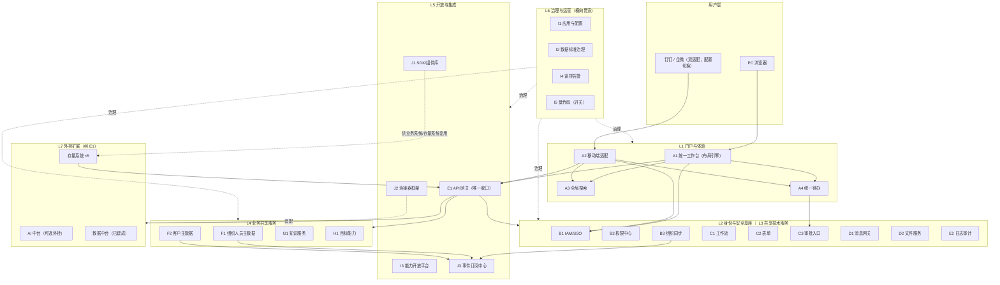

### 2.3 产品边界

| 在产品范围内 | 不在产品范围内（归属） |
| --- | --- |
| 统一门户套件（工作台/移动端/搜索/待办） | 大模型推理/微调/模型仓库/多模态 API（AI 中台，独立开发，经网关接入） |
| 身份基座（IAM/权限/组织同步/会话治理） | 数据采集/治理/加工/BI（数据中台，已建成，单向供数对接） |
| 共享技术服务（流程/表单/消息/文件/审计） | 各业务系统业务功能本体（存量系统保留，只做接入改造） |
| 业务共享服务（两类主数据/知识/目标） | 云原生基础设施（基础设施层） |
| 开放集成（网关/开放平台/连接器/SDK/事件） | 多租户/SaaS 化（本期不做，ADR-08） |
| 治理运营（配置/数据标准/监控/低代码开关/度量） | |

### 2.4 关键架构约束（ADR 摘要）

| 编号 | 决策 | 约束要点 |
| --- | --- | --- |
| ADR-01 | 技术能力域纳入产品（广义口径） | 产品 = 统一入口 + 技术能力域 + 业务能力域，一个责任主体 |
| ADR-02 | AI 中台经 E1 网关解耦 | AI 可插拔，业务中台不反向依赖，场景编排归业务中台 |
| ADR-03 | 主数据单一权威源 + 订阅分发 | F1/F2 唯一源，单向供数，根治口径不一致 |
| ADR-04 | 存量系统绞杀者模式 | 接入优先、迁移分批、公共模块逐步下线 |
| ADR-05 | 技术栈不推翻只增益 | Vue3+TS+Element Plus / Spring Boot 3+芋道 / MySQL；抽取芋道内置模块为产品服务 |
| ADR-06 | 身份协议统一 OIDC | 兼容移动端免登；老系统走适配层 |
| ADR-07 | 跨边界流量一律经 E1 | 禁止点对点直连，可管控、可审计、可灰度 |
| ADR-08 | 单企业部署，不做多租户 | 保留演进友好边界：模块化、schema 前缀、配置外置 |
| ADR-09 | 模块化单体优先 | Spring Boot 3 多模块，按需拆微服务 |
| ADR-10 | 内核/配置/定制三层隔离 | 内核禁止依赖客户定制包（依赖检查门禁） |

### 2.5 技术栈

| 层 | 选型 |
| --- | --- |
| 前端 | Vue3 + TypeScript + Element Plus；J1 组件库发布内部 npm 包 |
| 后端 | Spring Boot 3 + 芋道框架（用户/权限/流程/文件/消息/配置模块抽取为产品服务） |
| 网关 | Spring Cloud Gateway（V1.0 最小集：路由+鉴权转发；V2.0 完整：限流/熔断/灰度/目录） |
| 注册与配置 | Nacos |
| 数据库 | MySQL 多库分域（八库）：`sys_`（身份权限域）、`md_`（主数据域）、`portal_`（门户与待办域）、`msg_`（消息域）、`file_`（文件域）、`audit_`（审计域）、`wf_`（流程与表单域）、`gov_`（治理域） |
| 事件 | 消息队列 + Outbox 模式（支撑 J3 事件订阅中心） |
| 对象存储 | OSS / MinIO（D2 文件服务后端） |
| 审计日志 | ELK 体系（E2 底座） |

> **分库说明**：库名/表前缀与《麓邦业务中台V1.0基座版详细设计》第三章「分库与通用约定」表一致（`bmp_sys`/`bmp_md`/`bmp_portal`/`bmp_msg`/`bmp_file`/`bmp_audit`/`bmp_wf`/`bmp_gov`）；早期表述 `bpm_`（流程表单域）已按 **ADR-13** 统一为 **`bmp_wf` 库 + `wf_` 前缀**。

---

### 2.6 功能架构图（业务域 × 能力层）


> **分层口径**：本图为**功能架构视图**，是主 PRD 2.1「七层能力模型」与 2.2「逻辑架构图」的**功能视角展开**，与两者**衔接不矛盾**（L1→入口层、L2/L3→能力层、L4/L5→支撑层、L6→治理层、L7→外挂）。

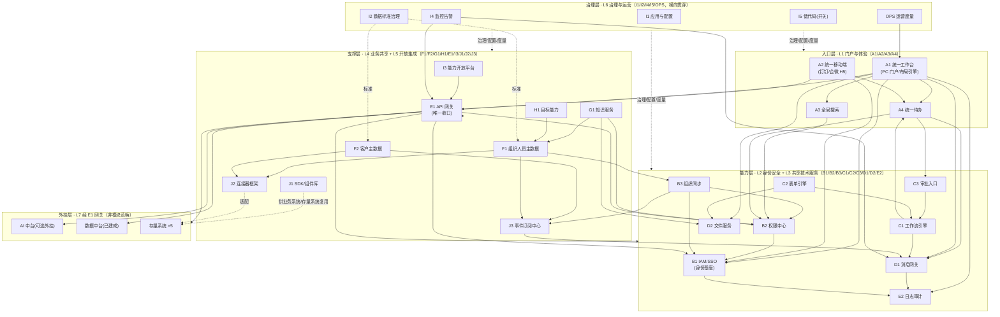

### 2.7 功能点总表（129 个顶层功能点）


> **列说明**：`前置依赖数` = 「依赖功能点」列（强 S + 弱 W）条目数；`下游被依赖数` = 被其他功能点引用为前置的次数。两列均由 §3.1 推导。**子项（-1/-2/…）不单列**（清单见主 PRD 10.5.1）。

| # | 编号 | 名称 | 所属模块 | 优先级 | 交付版本 | 前置依赖数 | 下游被依赖数 |
| --- | --- | --- | --- | --- | --- | --- | --- |
| 1 | A1-F01 | 应用导航 | A1 统一工作台 | P0 | V1.0 | 3 | 3 |
| 2 | A1-F02 | 角色化首页（布局引擎） | A1 统一工作台 | P0 | V1.0 | 3 | 5 |
| 3 | A1-F03 | 消息聚合 | A1 统一工作台 | P0 | V1.0 | 3 | 2 |
| 4 | A1-F04 | 公告管理 | A1 统一工作台 | P0 | V1.0 | 2 | 1 |
| 5 | A1-F05 | 千人千面（AI 智能推荐排序） | A1 统一工作台 | P1 | V1.5 起步 / V2.0 完整 | 4 | 1 |
| 6 | A1-F06 | 个人界面风格定制（轻定制） | A1 统一工作台 | P1 | V1.5 | 2 | 0 |
| 7 | A1-F07 | 首页通知 Banner | A1 统一工作台 | P0 | V1.5 | 2 | 0 |
| 8 | A1-F08 | 首页页面嵌入（任意页面驻留） | A1 统一工作台 | P1 | V1.5 | 4 | 0 |
| 9 | A1-F09 | 应用运营看板（后台） | A1 统一工作台 | P1 | V1.5 | 4 | 1 |
| 10 | A2-F01 | 双载体适配 | A2 统一移动端 | P0 | V1.0 | 1 | 2 |
| 11 | A2-F02 | 移动免登 | A2 统一移动端 | P0 | V1.0 | 3 | 0 |
| 12 | A2-F03 | 移动待办与审批 | A2 统一移动端 | P0 | V1.0 | 3 | 1 |
| 13 | A2-F04 | 消息卡片 | A2 统一移动端 | P0 | V1.0 | 2 | 0 |
| 14 | A2-F05 | 移动端底部 Tab 全局导航 | A2 统一移动端 | P0 | V1.5 | 4 | 0 |
| 15 | A3-F01 | 统一检索入口 | A3 全局搜索 | P1 | V2.0 | 4 | 1 |
| 16 | A3-F02 | 对象索引注册 | A3 全局搜索 | P1 | V2.0 | 1 | 2 |
| 17 | A3-F03 | 权限过滤 | A3 全局搜索 | P1 | V2.0 | 2 | 2 |
| 18 | A3-F04 | 联想与热词 | A3 全局搜索 | P1 | V2.0 | 1 | 0 |
| 19 | A4-F01 | 待办推送接入 | A4 统一待办 | P0 | V1.0 | 1 | 4 |
| 20 | A4-F02 | 待办聚合列表 | A4 统一待办 | P0 | V1.0 | 4 | 6 |
| 21 | A4-F03 | 统一处理跳转 | A4 统一待办 | P0 | V1.0 | 3 | 0 |
| 22 | A4-F04 | 催办 | A4 统一待办 | P0 | V1.0 | 3 | 0 |
| 23 | A4-F05 | 超时提醒 | A4 统一待办 | P0 | V1.0 | 3 | 1 |
| 24 | B1-F01 | 账号统一管理 | B1 IAM/SSO | P0 | V1.0 | 1 | 28 |
| 25 | B1-F02 | SSO 单点登录 | B1 IAM/SSO | P0 | V1.0 | 1 | 8 |
| 26 | B1-F03 | 认证适配层 | B1 IAM/SSO | P0 | V1.0 | 3 | 1 |
| 27 | B1-F04 | 多因素认证（可选） | B1 IAM/SSO | P1 | V1.0 | 3 | 1 |
| 28 | B1-F05 | 密码策略 | B1 IAM/SSO | P0 | V1.0 | 1 | 2 |
| 29 | B1-F06 | 账号生命周期 | B1 IAM/SSO | P0 | V1.0 | 3 | 1 |
| 30 | B1-F07 | 会话与令牌治理 | B1 IAM/SSO | P0 | V1.0 | 2 | 5 |
| 31 | B2-F01 | 角色管理（RBAC） | B2 权限中心 | P0 | V1.0 | 3 | 5 |
| 32 | B2-F02 | 功能权限 | B2 权限中心 | P0 | V1.0 | 1 | 8 |
| 33 | B2-F03 | 数据权限 | B2 权限中心 | P1 | V1.5 | 4 | 7 |
| 34 | B2-F04 | 权限申请与审批 | B2 权限中心 | P1 | V1.5 | 4 | 0 |
| 35 | B2-F05 | 权限校验服务 | B2 权限中心 | P0 | V1.0 | 3 | 22 |
| 36 | B3-F01 | 组织同步 | B3 组织同步 | P0 | V1.0 | 3 | 1 |
| 37 | B3-F02 | 人员异动分发 | B3 组织同步 | P0 | V1.0 | 3 | 1 |
| 38 | B3-F03 | 系统人员组织映射 | B3 组织同步 | P0 | V1.0 | 2 | 3 |
| 39 | C1-F01 | 流程建模 | C1 工作流引擎 | P1 | V1.5（V1.0 MVP 子集） | 3 | 11 |
| 40 | C1-F02 | 审批矩阵 | C1 工作流引擎 | P1 | V1.5（V1.0 MVP 子集） | 3 | 2 |
| 41 | C1-F03 | 审批规则 | C1 工作流引擎 | P1 | V1.5（V1.0 MVP 子集） | 2 | 1 |
| 42 | C1-F04 | 委托代理 | C1 工作流引擎 | P1 | V1.5（V1.0 MVP 子集） | 3 | 0 |
| 43 | C1-F05 | 超时提醒 | C1 工作流引擎 | P1 | V1.5（V1.0 MVP 子集） | 3 | 0 |
| 44 | C1-F06 | 流程开放接口 | C1 工作流引擎 | P1 | V1.5（V1.0 全量） | 4 | 2 |
| 45 | C1-F07 | 流程实例与任务管理 | C1 工作流引擎 | P1 | **V1.0** | 3 | 3 |
| 46 | C1-F08 | 审批留痕与追溯 | C1 工作流引擎 | P1 | **V1.0** | 2 | 1 |
| 47 | C2-F01 | 表单设计器 | C2 表单引擎 | P1 | V1.5（V1.0 MVP 子集） | 2 | 5 |
| 48 | C2-F02 | 字段规则 | C2 表单引擎 | P1 | V1.5 | 2 | 0 |
| 49 | C2-F03 | 表单-流程贯通 | C2 表单引擎 | P1 | V1.5 | 3 | 0 |
| 50 | C2-F04 | 表单数据管理 | C2 表单引擎 | P1 | V1.5（V1.0 MVP 子集） | 3 | 1 |
| 51 | C3-F01 | 统一审批视图 | C3 审批入口 | P1 | V1.5（V1.0 基础） | 5 | 4 |
| 52 | C3-F02 | 批量审批 | C3 审批入口 | P1 | V1.5（V1.0 基础） | 2 | 0 |
| 53 | C3-F03 | 移动端审批（中台自有流程） | C3 审批入口 | P1 | **V1.0** | 2 | 0 |
| 54 | D1-F01 | 统一发送接口 | D1 消息网关 | P0 | V1.0 | 3 | 9 |
| 55 | D1-F02 | 模板管理 | D1 消息网关 | P0 | V1.0 | 1 | 3 |
| 56 | D1-F03 | 渠道管理 | D1 消息网关 | P0 | V1.0 | 2 | 2 |
| 57 | D1-F04 | 发送策略 | D1 消息网关 | P0 | V1.0 | 2 | 0 |
| 58 | D1-F05 | 送达追踪 | D1 消息网关 | P0 | V1.0 | 3 | 0 |
| 59 | D2-F01 | 文件上传下载 | D2 文件服务 | P0 | V1.0 | 3 | 6 |
| 60 | D2-F02 | 在线预览 | D2 文件服务 | P1 | V1.5 | 3 | 0 |
| 61 | D2-F03 | 版本管理 | D2 文件服务 | P1 | V1.5 | 1 | 1 |
| 62 | D2-F04 | 水印与防盗链 | D2 文件服务 | P1 | V1.5 | 1 | 1 |
| 63 | D2-F05 | 文件权限 | D2 文件服务 | P1 | V1.5 | 3 | 0 |
| 64 | D2-F06 | 存量文件迁移工具 | D2 文件服务 | P1 | V1.5 | 1 | 0 |
| 65 | E1-F01 | 路由管理 | E1 API 网关 | P0 | V1.0（最小集） | 2 | 7 |
| 66 | E1-F02 | 统一鉴权 | E1 API 网关 | P0 | V1.0（最小集） | 3 | 9 |
| 67 | E1-F03 | 认证适配 | E1 API 网关 | P0 | V1.0（最小集） | 3 | 1 |
| 68 | E1-F04 | 限流熔断 | E1 API 网关 | P1 | V2.0 | 2 | 0 |
| 69 | E1-F05 | 灰度发布 | E1 API 网关 | P1 | V2.0 | 3 | 0 |
| 70 | E1-F06 | API 目录 | E1 API 网关 | P1 | V2.0 | 1 | 3 |
| 71 | E2-F01 | 日志上报接口 | E2 日志审计 | P0 | V1.0 | 1 | 12 |
| 72 | E2-F02 | 登录日志 | E2 日志审计 | P0 | V1.0 | 3 | 0 |
| 73 | E2-F03 | 操作日志 | E2 日志审计 | P0 | V1.0 | 2 | 3 |
| 74 | E2-F04 | 日志检索 | E2 日志审计 | P0 | V1.0 | 3 | 3 |
| 75 | E2-F05 | 留存策略 | E2 日志审计 | P0 | V1.0 | 1 | 1 |
| 76 | E2-F06 | 审计报表 | E2 日志审计 | P2 | V2.5 | 2 | 0 |
| 77 | E2-F07 | 异常行为分析 | E2 日志审计 | P2 | V2.5 | 3 | 0 |
| 78 | F1-F01 | 组织/岗位/人员模型 | F1 组织人员主数据 | P0 | V1.0 | 1 | 12 |
| 79 | F1-F02 | 编码标准 | F1 组织人员主数据 | P0 | V1.0 | 2 | 1 |
| 80 | F1-F03 | 权威源接入 | F1 组织人员主数据 | P0 | V1.0 | 2 | 1 |
| 81 | F1-F04 | 异动订阅分发 | F1 组织人员主数据 | P0 | V1.0 | 3 | 3 |
| 82 | F1-F05 | 组织树查询 | F1 组织人员主数据 | P0 | V1.0 | 2 | 2 |
| 83 | F2-F01 | 客户数据模型 | F2 客户主数据 | P1 | V2.0 | 2 | 4 |
| 84 | F2-F02 | 去重合并 | F2 客户主数据 | P1 | V2.0 | 2 | 0 |
| 85 | F2-F03 | 客户唯一视图 | F2 客户主数据 | P1 | V2.0 | 3 | 0 |
| 86 | F2-F04 | 多渠道来源治理 | F2 客户主数据 | P1 | V2.0 | 2 | 1 |
| 87 | F2-F05 | 订阅分发 | F2 客户主数据 | P1 | V2.0 | 3 | 0 |
| 88 | G1-F01 | 文档管理 | G1 知识服务 | P1 | V2.0 | 2 | 3 |
| 89 | G1-F02 | 全文检索 | G1 知识服务 | P1 | V2.0 | 3 | 1 |
| 90 | G1-F03 | 权限与密级 | G1 知识服务 | P1 | V2.0 | 3 | 0 |
| 91 | G1-F04 | 版本与审阅 | G1 知识服务 | P1 | V2.0 | 2 | 0 |
| 92 | G1-F05 | 智能推荐·问答 | G1 知识服务 | P2 | V3.0 | 3 | 0 |
| 93 | H1-F01 | 目标库 | H1 目标能力 | P1 | V2.0 | 2 | 3 |
| 94 | H1-F02 | 目标对齐树 | H1 目标能力 | P1 | V2.0 | 3 | 1 |
| 95 | H1-F03 | KR 跟踪 | H1 目标能力 | P1 | V2.0 | 2 | 1 |
| 96 | H1-F04 | 复盘 | H1 目标能力 | P1 | V2.0 | 2 | 1 |
| 97 | H1-F05 | 绩效口径导出 | H1 目标能力 | P1 | V2.0 | 4 | 0 |
| 98 | I1-F01 | 应用注册与生命周期 | I1 应用与配置 | P1 | V2.0 | 1 | 8 |
| 99 | I1-F02 | 统一配置中心 | I1 应用与配置 | P1 | V2.0 | 0 | 4 |
| 100 | I1-F03 | 多环境管理 | I1 应用与配置 | P1 | V2.0 | 2 | 0 |
| 101 | I1-F04 | 功能开关与灰度 | I1 应用与配置 | P1 | V2.0 | 2 | 2 |
| 102 | I2-F01 | 数据标准定义 | I2 数据标准治理 | P1 | V2.0 | 0 | 6 |
| 103 | I2-F02 | 质量规则 | I2 数据标准治理 | P1 | V2.0 | 2 | 1 |
| 104 | I2-F03 | 问题闭环 | I2 数据标准治理 | P1 | V2.0 | 2 | 0 |
| 105 | I3-F01 | 能力目录 | I3 能力开放平台 | P2 | V2.5 | 2 | 2 |
| 106 | I3-F02 | 开放授权 | I3 能力开放平台 | P2 | V2.5 | 3 | 1 |
| 107 | I3-F03 | 开发者门户 | I3 能力开放平台 | P2 | V2.5 | 3 | 0 |
| 108 | I4-F01 | 健康度监控 | I4 监控告警 | P2 | V2.5 | 1 | 1 |
| 109 | I4-F02 | 链路追踪 | I4 监控告警 | P2 | V2.5 | 2 | 1 |
| 110 | I4-F03 | 告警与值班 | I4 监控告警 | P2 | V2.5 | 3 | 0 |
| 111 | I5-F01 | 低代码搭建（开关化） | I5 低代码 | P2 | V3.0 | 3 | 0 |
| 112 | J1-F01 | 后端 SDK | J1 SDK/组件库 | P1 | V1.0 首批→V1.5 全量 | 3 | 2 |
| 113 | J1-F02 | 前端组件库 | J1 SDK/组件库 | P1 | V1.0 首批→V1.5 全量 | 3 | 1 |
| 114 | J1-F03 | SDK 文档与示例 | J1 SDK/组件库 | P1 | V1.5 | 4 | 1 |
| 115 | J2-F01 | 连接器框架 | J2 连接器框架 | P1 | V1.5 | 2 | 3 |
| 116 | J2-F02 | 权威源连接器 | J2 连接器框架 | P0 | V1.0 | 2 | 2 |
| 117 | J2-F03 | 渠道连接器 | J2 连接器框架 | P0 | V1.0 | 1 | 3 |
| 118 | J2-F04 | 存量系统适配器 | J2 连接器框架 | P1 | V1.5 | 3 | 1 |
| 119 | J3-F01 | 事件总线 | J3 事件订阅中心 | P1 | V1.5 | 2 | 8 |
| 120 | J3-F02 | 订阅注册 | J3 事件订阅中心 | P1 | V1.5 | 2 | 1 |
| 121 | J3-F03 | Webhook 出口 | J3 事件订阅中心 | P1 | V1.5 | 3 | 1 |
| 122 | J3-F04 | 重试与幂等 | J3 事件订阅中心 | P1 | V1.5 | 2 | 0 |
| 123 | J3-F05 | 事件查询 | J3 事件订阅中心 | P1 | V1.5 | 2 | 0 |
| 124 | OPS-F01 | 运营度量 | OPS 运营度量 | P2 | V2.5 | 2 | 1 |
| 125 | OPS-F02 | 运营报告 | OPS 运营度量 | P2 | V2.5 | 2 | 0 |
| **126** | **J2-F05** | **存量 RBAC 受控导入（原在线采集适配器，已降级）** | J2 连接器框架 | **P1** | **V2.0 备选 / V1.5 不交付在线 UI** | 7 | 0 |
| **127** | **J1-F04** | **接入指南与示例工程** | J1 SDK / 组件库 | **P0** | **V1.0** | 6 | 1 |
| **128** | **I1-F05** | **应用接入凭证发放与接入指引** | I1 应用与配置管理 | **P0** | **V1.0** | 4 | 1 |
| **129** | **I1-F06** | **应用回调域名白名单（V1.0 最小集）** | I1 应用与配置管理 | **P0** | **V1.0** | 2 | 2 |

> **精确计数**：本表 **129 行**（顶层编号，最终口径）。

---

## 三、产品功能清单（Feature List）

> 功能编号规则：`能力中心编号-F序号`（如 A1-F01），与上游 A1–J3 编号体系一致；优先级 P0/P1/P2 对应交付版本 V1.0/V1.5~V2.0/V2.5~V3.0。

### 3.1 M1 统一门户模块

| 编号 | 功能名称 | 功能描述 | 优先级 | 交付版本 |
| --- | --- | --- | --- | --- |
| A1-F01 | 应用导航 | 已注册应用自动出现在工作台，支持分组、排序、常用置顶。**扩展子项**：后台「应用详情」新增**能力使用总览**（某应用用了中台哪些能力）与**接入状态视图**（七步 Checklist 完成态）区块（A1-F01-1~2，详见 6.1.9） | P0 | V1.0（子项为 V1.5） |
| A1-F02 | 角色化首页（布局引擎） | 卡片式首页；卡片注册机制；按角色默认布局；用户个性化拖拽。**演进（v2 · V1.5 方案 A）**：三栏 + **规则今日简报** + 意图流 + 紧迫度时间轴 + ⌘K（**不含 AI 助手对话**；详见 §6.1.1 / §6.1.1a / A1-F02-1~7） | P0 | V1.0（v2 重构为 V1.5） |
| A1-F03 | 消息聚合 | 站内信中心：未读角标、已读管理、分类筛选 | P0 | V1.0 |
| A1-F04 | 公告管理 | 公告发布、置顶、可见范围、已读统计。**扩展子项**：Banner 展示开关 / 时段 / 优先级 / 预览 / 状态列（A1-F04-1~5，详见 6.1） | P0 | V1.0（Banner 后台增强为 V1.5） |
| A1-F05 | 千人千面（AI 智能推荐排序） | 按用户行为自动调整首页应用排序、推荐内容与同组待办顺序；不改结构、不越权限、可关闭、可解释、可退化（子项 A1-F05-1~8，详见 6.1）；**其行为埋点通道 `POST /v1/portal/behavior` 同时作为「应用运营看板」（A1-F09）的唯一数据源** | P1 | V1.5 起步 / V2.0 完整 |
| A1-F06 | 个人界面风格定制（轻定制） | 主题色 / 内容密度 / 圆角三档视觉定制，全局即时生效并持久化；不做暗色、不改语义色（子项 A1-F06-1~5，详见 6.1） | P1 | V1.5 |
| A1-F07 | 首页通知 Banner | 首页顶部展示已发布且未过期的公告 banner；有则展示、无则完全不占位；可关闭、置顶优先（子项 A1-F07-1~7，详见 6.1） | P0 | V1.5 |
| A1-F08 | 首页页面嵌入（任意页面驻留） | 允许把已注册应用页面以受控 iframe 嵌入首页（多实例、可拖拽显隐）；四条约束：白名单 / 失败降级 / 加载态 / 不改决议 #5（子项 A1-F08-1~5，详见 6.1） | P1 | V1.5 |
| **A1-F09** | **应用运营看板（后台）** | **应用调用量趋势 / 活跃应用排名 / 中台能力使用分布 / 异常下降告警**；数据源**复用 A1-F05 埋点通道**、**不与 E2 审计混存**、**无数据态有引导**（子项 A1-F09-1~4，详见 6.1.9）。**本轮新增** | P1 | V1.5（与 A1-F05 埋点同批） |
| A2-F01 | 双载体适配 | 钉钉/企微双连接器，后台配置切换主载体 | P0 | V1.0 |
| A2-F02 | 移动免登 | 钉钉/企微免登换 SSO 令牌 | P0 | V1.0 |
| A2-F03 | 移动待办与审批 | 移动端待办查看、审批处理、扫码 | P0 | V1.0 |
| A2-F04 | 消息卡片 | 待办/审批/公告以卡片形式触达 | P0 | V1.0 |
| A2-F05 | 移动端底部 Tab 全局导航 | 五项底部导航（首页/待办/审批/消息/我的）+ 未读角标 + 配套四屏（待办中心/审批中心/消息中心/我的）；与底部行动栏共存（子项 A2-F05-1~4，详见 6.1） | P0 | V1.5 |
| A3-F01 | 统一检索入口 | 一次检索跨系统对象，结果聚合展示 | P1 | V2.0 |
| A3-F02 | 对象索引注册 | 各系统按规范注册可检索对象与索引 | P1 | V2.0 |
| A3-F03 | 权限过滤 | 搜索结果严格按用户数据权限过滤 | P1 | V2.0 |
| A3-F04 | 联想与热词 | 输入联想、热门搜索 | P1 | V2.0 |
| A4-F01 | 待办推送接入 | 标准契约 `/todo/push`：待办+跳转URL+回写回调 | P0 | V1.0 |
| A4-F02 | 待办聚合列表 | 待办/已办/我发起三视图，跨系统汇聚 | P0 | V1.0 |
| A4-F03 | 统一处理跳转 | 点击跳转原系统处理页（带 SSO），处理完成回写状态 | P0 | V1.0 |
| A4-F04 | 催办 | 对待办发起催办（站内+渠道消息） | P0 | V1.0 |
| A4-F05 | 超时提醒 | 待办超时规则配置与自动提醒 | P0 | V1.0 |

### 3.2 M2 身份与权限模块

| 编号 | 功能名称 | 功能描述 | 优先级 | 交付版本 |
| --- | --- | --- | --- | --- |
| B1-F01 | 账号统一管理 | 全公司唯一身份源；账号创建/变更/停用集中管理 | P0 | V1.0 |
| B1-F02 | SSO 单点登录 | OIDC 授权码+PKCE；一次登录访问全部授权系统。**扩展子项**：登录页 Notion 风格改造 / 钉钉扫码主推 / 登录页公告 Banner / 既有能力回归保障（B1-F02-1~4，详见 6.2） | P0 | V1.0（登录页改造为 V1.5） |
| B1-F03 | 认证适配层 | 老系统经网关反向代理+票据换取接入 | P0 | V1.0 |
| B1-F04 | 多因素认证（可选） | MFA 开关化：短信/OTP 二次验证（短信通道 V1.0 实接，MFA 短信方式具备可用条件；MFA 开关本身默认关闭） | P1 | V1.0 |
| B1-F05 | 密码策略 | 复杂度、有效期、错误锁定、历史密码限制 | P0 | V1.0 |
| B1-F06 | 账号生命周期 | 入职自动开通、转岗自动调整、离职 24h 内自动停用 | P0 | V1.0 |
| B1-F07 | 会话与令牌治理 | 全局登出、令牌签发/刷新、在线会话管理 | P0 | V1.0 |
| B2-F01 | 角色管理（RBAC） | 用户→角色/岗位→权限点的统一授权 | P0 | V1.0 |
| B2-F02 | 功能权限 | 菜单/按钮/接口三级权限点管理 | P0 | V1.0 |
| B2-F03 | 数据权限 | 组织范围（本人/本部门/本部门及下属/自定义）+ 行级规则（组织维/客户维） | P1 | V1.5 |
| B2-F04 | 权限申请与审批 | 权限申请走 C1 工作流审批后生效，全程留痕 | P1 | V1.5 |
| B2-F05 | 权限校验服务 | `/perm/check` 接口 + J1 SDK，权限统一判定不复制 | P0 | V1.0 |
| B3-F01 | 组织同步 | 组织架构异动事件分发至订阅系统 | P0 | V1.0 |
| B3-F02 | 人员异动分发 | 入职/转岗/离职事件分发，驱动 B1 账号联动 | P0 | V1.0 |
| B3-F03 | 系统人员组织映射 | 多系统本地账号与组织部门同中台的映射与对齐（账号级 + 组织树级） | P0 | V1.0 |

### 3.3 M3 流程与表单模块

| 编号 | 功能名称 | 功能描述 | 优先级 | 交付版本 |
| --- | --- | --- | --- | --- |
| C1-F01 | 流程建模 | 可视化流程配置（V1.0：模板化 + JSON 定义 + **可视化配置画布**；V1.5：可视化 BPMN 设计器 `C1-F01-6`），流程定义发布与版本管理 | P1 | V1.5 |
| C1-F02 | 审批矩阵 | 按组织/岗位/金额等维度自动解析审批人 | P1 | V1.5 |
| C1-F03 | 审批规则 | 会签/或签、条件分支、退回、撤回 | P1 | V1.5 |
| C1-F04 | 委托代理 | 审批委托（出差/休假场景），代理期可配置 | P1 | V1.5 |
| C1-F05 | 超时提醒 | 节点超时规则与自动提醒/升级 | P1 | V1.5 |
| C1-F06 | 流程开放接口 | 发起/办理/状态查询 API，供业务系统嵌入 | P1 | V1.5 |
| C1-F07 | 流程实例与任务管理 | 实例五态状态机、任务生成/办理/转办/加签、三视图查询与实例监控 | P1 | V1.0 |
| C1-F08 | 审批留痕与追溯 | 全生命周期动作写 `wf_approval_record`（仅追加、不可篡改），供时间轴与合规追溯 | P1 | V1.0 |
| C2-F01 | 表单设计器 | 拖拽式设计，字段类型/布局/样式配置 | P1 | V1.5 |
| C2-F02 | 字段规则 | 字段联动、显隐规则、数据校验 | P1 | V1.5 |
| C2-F03 | 表单-流程贯通 | 表单一键挂接工作流，零代码完成表单审批应用 | P1 | V1.5 |
| C2-F04 | 表单数据管理 | 表单实例数据查询/导出/权限控制 | P1 | V1.5 |
| C3-F01 | 统一审批视图 | 跨系统审批待办聚合，统一审批操作界面 | P1 | V1.5 |
| C3-F02 | 批量审批 | 同类审批批量同意/驳回 | P1 | V1.5 |
| C3-F03 | 移动端审批（中台自有流程） | 中台自有流程任务在移动端（钉钉/企微 H5）的免登办理，与 PC 同源同权 | P1 | V1.0 |

### 3.4 M4 消息与文件模块

| 编号 | 功能名称 | 功能描述 | 优先级 | 交付版本 |
| --- | --- | --- | --- | --- |
| D1-F01 | 统一发送接口 | `POST /msg/send` 单一出口，业务系统停自建发信（含短信：业务系统不自建短信通道，经 D1 统一发送） | P0 | V1.0 |
| D1-F02 | 模板管理 | 消息模板定义/变量/审核，模板统一 | P0 | V1.0 |
| D1-F03 | 渠道管理 | 站内/邮件/钉钉/企微/短信渠道连接器化配置（短信通道 V1.0 实接，服务商账号/签名/模板在中台统一配置） | P0 | V1.0 |
| D1-F04 | 发送策略 | 去重、频控、优先级、定时发送 | P0 | V1.0 |
| D1-F05 | 送达追踪 | 发送记录与送达状态查询，到达率可统计 | P0 | V1.0 |
| D2-F01 | 文件上传下载 | 统一上传返回 fileId，鉴权下载/预览 URL（**V1.0 前移：工作流发起表单 attachment 附件字段的落地依赖**） | P0 | **V1.0** |
| D2-F02 | 在线预览 | 常见文档/图片/视频在线预览 | P1 | V1.5 |
| D2-F03 | 版本管理 | 文件版本记录与回滚 | P1 | V1.5 |
| D2-F04 | 水印与防盗链 | 预览/下载水印（用户+时间），URL 有效期控制 | P1 | V1.5 |
| D2-F05 | 文件权限 | 文件级权限隔离（继承业务权限或独立授权） | P1 | V1.5 |
| D2-F06 | 存量文件迁移工具 | 存量系统文件批量迁移，目标迁移率 ≥80% | P1 | V1.5 |

### 3.5 M5 网关与审计模块

| 编号 | 功能名称 | 功能描述 | 优先级 | 交付版本 |
| --- | --- | --- | --- | --- |
| E1-F01 | 路由管理 | 服务/系统接入网关的路由注册与管理 | P0 | V1.0（最小集） |
| E1-F02 | 统一鉴权 | 网关校验 OAuth2/OIDC 令牌，注入身份上下文 | P0 | V1.0（最小集） |
| E1-F03 | 认证适配 | 老系统经网关反向代理接入 SSO | P0 | V1.0（最小集） |
| E1-F04 | 限流熔断 | 接口级限流、熔断、降级策略 | P1 | V2.0 |
| E1-F05 | 灰度发布 | 按比例/标签的路由灰度 | P1 | V2.0 |
| E1-F06 | API 目录 | 全部注册 API 的目录化展示与检索 | P1 | V2.0 |
| E2-F01 | 日志上报接口 | `POST /audit/log` 标准上报，SDK 埋点 | P0 | V1.0 |
| E2-F02 | 登录日志 | 登录/登出/失败记录留存与检索 | P0 | V1.0 |
| E2-F03 | 操作日志 | 关键操作与数据变更留痕（变更前后摘要） | P0 | V1.0 |
| E2-F04 | 日志检索 | 按人/系统/时间/动作组合检索 | P0 | V1.0 |
| E2-F05 | 留存策略 | 日志留存 ≥6 个月，归档策略可配置 | P0 | V1.0 |
| E2-F06 | 审计报表 | 按合规要求自动输出审计报表 | P2 | V2.5 |
| E2-F07 | 异常行为分析 | 异常登录/越权尝试/批量导出等告警 | P2 | V2.5 |

### 3.6 M6 主数据模块

| 编号 | 功能名称 | 功能描述 | 优先级 | 交付版本 |
| --- | --- | --- | --- | --- |
| F1-F01 | 组织/岗位/人员模型 | 组织树、岗位、人员的标准数据模型与维护界面 | P0 | V1.0 |
| F1-F02 | 编码标准 | 组织编码、人员工号全公司唯一，规则可配置 | P0 | V1.0 |
| F1-F03 | 权威源接入 | J2 权威源连接器（HR/钉钉/企微/自建），字段映射配置 | P0 | V1.0 |
| F1-F04 | 异动订阅分发 | 组织/人员异动事件经 J3 分发（≤10 分钟） | P0 | V1.0 |
| F1-F05 | 组织树查询 | `GET /md/org/tree` 等标准查询 API | P0 | V1.0 |
| F2-F01 | 客户数据模型 | 客户/联系人标准模型与唯一编码 | P1 | V2.0 |
| F2-F02 | 去重合并 | 相似度识别重复客户，合并规则可配置，合并留痕 | P1 | V2.0 |
| F2-F03 | 客户唯一视图 | 客户 360 视图（基本信息+联系人+合同关系） | P1 | V2.0 |
| F2-F04 | 多渠道来源治理 | CRM/电商等多渠道客户来源标识与归一 | P1 | V2.0 |
| F2-F05 | 订阅分发 | 客户异动事件分发至 CRM/数据中台等订阅方 | P1 | V2.0 |

### 3.7 M7 知识与目标模块

| 编号 | 功能名称 | 功能描述 | 优先级 | 交付版本 |
| --- | --- | --- | --- | --- |
| G1-F01 | 文档管理 | 文档入库、结构化存储、目录/标签/分类 | P1 | V2.0 |
| G1-F02 | 全文检索 | 知识全文检索，可被 A3 与业务系统内嵌调用 | P1 | V2.0 |
| G1-F03 | 权限与密级 | 文档密级与访问权限控制 | P1 | V2.0 |
| G1-F04 | 版本与审阅 | 文档版本管理、在线审阅批注 | P1 | V2.0 |
| G1-F05 | 智能推荐/问答 | 调用 AI 中台能力实现知识推荐与问答（场景编排归业务中台） | P2 | V3.0 |
| H1-F01 | 目标库 | OKR 目标创建与管理 | P1 | V2.0 |
| H1-F02 | 目标对齐树 | 公司-部门-个人目标拆解与对齐可视化 | P1 | V2.0 |
| H1-F03 | KR 跟踪 | 关键结果与进度更新、提醒 | P1 | V2.0 |
| H1-F04 | 复盘 | 目标复盘在线化，复盘记录留存 | P1 | V2.0 |
| H1-F05 | 绩效口径导出 | 目标完成数据按标准口径供 HR/绩效消费 | P1 | V2.0 |

### 3.8 M8 开放与集成模块

| 编号 | 功能名称 | 功能描述 | 优先级 | 交付版本 |
| --- | --- | --- | --- | --- |
| J1-F01 | 后端 SDK | 认证/权限/待办/文件/消息客户端封装（Java/Feign） | P1 | V1.0 首批→V1.5 全量 |
| J1-F02 | 前端组件库 | 登录组件/权限指令/待办组件/上传组件（Vue3，内部 npm） | P1 | V1.0 首批→V1.5 全量 |
| J1-F03 | SDK 文档与示例 | 接入文档、示例工程、版本说明 | P1 | V1.5 |
| **J1-F04** | **接入指南与示例工程** | **V1.0 最小可用接入文档（SSO/凭证/待办/消息/权限注解/七步指引）+ 2 个可运行示例工程** | **P0** | **V1.0** |
| J2-F01 | 连接器框架 | 连接器开发规范：接口契约、注册、健康检查、配置 | P1 | V1.5 |
| J2-F02 | 权威源连接器 | HR/钉钉/企微/自建源适配，字段映射配置化 | P0 | V1.0 |
| J2-F03 | 渠道连接器 | 消息渠道适配（钉钉/企微/短信/邮件） | P0 | V1.0 |
| J2-F04 | 存量系统适配器 | 存量系统异构接口适配规范与实现 | P1 | V1.5 |
| **J2-F05** | **存量 RBAC 受控导入** | **V1.5：实施侧 DB/脚本一次性导入授权关系（审计+仲裁）；不交付在线采集 UI**；在线适配器方案 **V2.0 备选** | **P1** | **V1.5 导入 / V2.0 在线（可选）** |
| J3-F01 | 事件总线 | 平台级事件发布/订阅，Outbox 保证可靠投递 | P1 | V1.5 |
| J3-F02 | 订阅注册 | 订阅方注册、事件路由、投递确认 | P1 | V1.5 |
| J3-F03 | Webhook 出口 | 对外部系统（含 AI 中台）的 Webhook 通知 | P1 | V1.5 |
| J3-F04 | 重试与幂等 | 投递失败重试策略，事件幂等消费保障 | P1 | V1.5 |
| J3-F05 | 事件查询 | 事件流查询与排查界面 | P1 | V1.5 |
| I3-F01 | 能力目录 | 业务能力与 AI 能力同目录登记 | P2 | V2.5 |
| I3-F02 | 开放授权 | 能力申请、审批、授权、配额管理 | P2 | V2.5 |
| I3-F03 | 开发者门户 | 开放 API 文档、调试、SDK 下载 | P2 | V2.5 |

### 3.9 M9 治理与运营模块

| 编号 | 功能名称 | 功能描述 | 优先级 | 交付版本 |
| --- | --- | --- | --- | --- |
| I1-F01 | 应用注册与生命周期 | 应用接入注册、密钥发放、启停管理 | P1 | V2.0 |
| I1-F02 | 统一配置中心 | Nacos 承载，配置项集中管理与发布 | P1 | V2.0 |
| I1-F03 | 多环境管理 | 开发/测试/生产环境配置隔离与同步 | P1 | V2.0 |
| I1-F04 | 功能开关与灰度 | 功能开关、按维度灰度放量 | P1 | V2.0 |
| **I1-F05** | **应用接入凭证发放与接入指引** | **凭证受控发放（一次性展示/可重置/交付留痕）+《接入凭证单》+ 订阅方密钥管理** | **P0** | **V1.0** |
| **I1-F06** | **应用回调域名白名单（V1.0 最小集）** | **`gov_app_register` 增列 `domain_whitelist`，作为 `A4-F01`/`C1-F06` 回调校验唯一来源（防 SSRF）** | **P0** | **V1.0** |
| I2-F01 | 数据标准定义 | 主数据标准（编码/字段/字典）定义与发布 | P1 | V2.0 |
| I2-F02 | 质量规则 | 数据质量规则配置与校验执行 | P1 | V2.0 |
| I2-F03 | 问题闭环 | 质量问题登记、分派、闭环跟踪 | P1 | V2.0 |
| I4-F01 | 健康度监控 | 应用/接口健康度大盘 | P2 | V2.5 |
| I4-F02 | 链路追踪 | 跨服务调用链路追踪 | P2 | V2.5 |
| I4-F03 | 告警与值班 | 告警规则、通知渠道、值班表 | P2 | V2.5 |
| I5-F01 | 低代码搭建（开关化） | 表单+流程+页面自助搭建，默认关闭，启用待确认 | P2 | V3.0 |
| OPS-F01 | 运营度量 | 接入系统数/复用率/调用量/日活/接入周期统计 | P2 | V2.5 |
| OPS-F02 | 运营报告 | 月度运营报告自动输出 | P2 | V2.5 |

---

### 3.10 需求关系矩阵

> 本章矩阵用于界定**功能点之间的依赖、数据归属、职责边界与跨域协作**，是评审与开发分解的依据。

#### 3.10.1 ① 依赖关系矩阵

> **强依赖（S）**= 无此前置则本功能点无法交付/运行；**弱依赖（W）**= 前置缺失时可降级/延后，不阻塞主链路。**被依赖**列 = 反向引用来源。

| 功能点 | 前置依赖（S 强 / W 弱） | 被依赖（下游） |
| --- | --- | --- |
| A1-F01 应用导航 | I1-F01(S)；A1-F02(W)；B2-F02(S) | A1-F05；A1-F09；J1-F02 |
| A1-F02 角色化首页（布局引擎） | B1-F01(S)；B2-F05(S)；B2-F02(S) | A1-F01；A1-F05；A1-F06；A1-F08；A2-F05 |
| A1-F03 消息聚合 | D1-F01(S)；B1-F01(S)；E2-F01(W) | A2-F05；D1-F05 |
| A1-F04 公告管理 | B1-F01(S)；B2-F02(S) | A1-F07 |
| A1-F05 千人千面（AI 智能推荐排序） | A1-F02(S)；B2-F05(S)；A1-F01(W)；E2-F01(W) | A1-F09 |
| A1-F06 个人界面风格定制（轻定制） | A1-F02(S)；B1-F01(S) | —— |
| A1-F07 首页通知 Banner | A1-F04(S)；B1-F01(W) | —— |
| A1-F08 首页页面嵌入（任意页面驻留） | I1-F01(S)；B2-F02(S)；A1-F02(S)；B1-F07(W) | —— |
| A1-F09 应用运营看板（后台） | A1-F01(S)；A1-F05(S)；I1-F01(S)；E2-F01(W) | OPS-F01 |
| A2-F01 双载体适配 | J2-F03(S) | A2-F02；A2-F04 |
| A2-F02 移动免登 | A2-F01(S)；B1-F02(S)；J2-F03(S) | —— |
| A2-F03 移动待办与审批 | A4-F02(S)；C3-F01(S)；B1-F07(S) | C3-F03 |
| A2-F04 消息卡片 | D1-F01(S)；A2-F01(W) | —— |
| A2-F05 移动端底部 Tab 全局导航 | A1-F02(S)；A4-F02(S)；C3-F01(W)；A1-F03(W) | —— |
| A3-F01 统一检索入口 | A3-F02(S)；A3-F03(S)；B2-F03(S)；B2-F05(S) | A3-F04 |
| A3-F02 对象索引注册 | I1-F01(S) | A3-F01；G1-F02 |
| A3-F03 权限过滤 | B2-F05(S)；B2-F03(S) | A3-F01；G1-F02 |
| A3-F04 联想与热词 | A3-F01(W) | —— |
| A4-F01 待办推送接入 | B3-F03(S)；**I1-F06(S)** | A4-F02；A4-F05；C1-F07；J1-F01 |
| A4-F02 待办聚合列表 | A4-F01(S)；B2-F02(S)；B1-F01(S)；C1-F07(S) | A2-F03；A2-F05；A4-F03；A4-F04；A4-F05；C3-F01 |
| A4-F03 统一处理跳转 | A4-F02(S)；B1-F02(S)；B1-F07(W) | —— |
| A4-F04 催办 | A4-F02(S)；D1-F01(S)；B1-F01(S) | —— |
| A4-F05 超时提醒 | A4-F01(S)；D1-F01(S)；A4-F02(S) | C1-F05 |
| B1-F01 账号统一管理 | F1-F01(S) | A1-F02；A1-F03；A1-F04；A1-F06；A1-F07；A4-F02；A4-F04；B1-F02；B1-F03；B1-F04；B1-F05；B1-F06；B1-F07；B2-F01；B2-F02；B3-F03；C1-F01；C1-F04；C2-F01；D1-F01；D1-F02；D1-F03；D2-F01；E1-F02；E2-F01；H1-F01；H1-F03；I1-F01 |
| B1-F02 SSO 单点登录 | B1-F01(S) | A2-F02；A4-F03；B1-F03；B1-F07；E1-F03；E2-F02；J1-F01；J1-F02 |
| B1-F03 认证适配层 | B1-F01(S)；B1-F02(S)；E1-F01(S) | E1-F03 |
| B1-F04 多因素认证（可选） | B1-F01(S)；B1-F07(S)；B1-F05(S) | E2-F02 |
| B1-F05 密码策略 | B1-F01(S) | B1-F04；B1-F06 |
| B1-F06 账号生命周期 | B1-F01(S)；B3-F02(S)；B1-F05(W) | E2-F02 |
| B1-F07 会话与令牌治理 | B1-F01(S)；B1-F02(S) | A1-F08；A2-F03；A4-F03；B1-F04；E1-F02 |
| B2-F01 角色管理（RBAC） | B1-F01(S)；B2-F02(S)；F1-F01(W) | B2-F03；B2-F04；B2-F05；C1-F02；G1-F03 |
| B2-F02 功能权限 | B1-F01(S) | A1-F01；A1-F02；A1-F04；A1-F08；A4-F02；B2-F01；B2-F05；E1-F02；**J2-F05** |
| B2-F03 数据权限 | F1-F01(S)；B2-F01(S)；B2-F05(S)；B3-F01(W) | A3-F01；A3-F03；D2-F05；F2-F03；G1-F03；H1-F02；H1-F05 |
| B2-F04 权限申请与审批 | C1-F06(S)；B2-F01(S)；B2-F05(S)；E2-F03(W) | —— |
| B2-F05 权限校验服务 | B2-F02(S)；B2-F01(S)；E1-F02(S) | A1-F02；A1-F05；A3-F01；A3-F03；B2-F03；B2-F04；C1-F01；C1-F03；C1-F06；C2-F01；C2-F04；C3-F01；D2-F01；D2-F02；D2-F05；E1-F01；E2-F03；E2-F07；G1-F01；I3-F02；J1-F01；J1-F02 |
| B3-F01 组织同步 | F1-F04(S)；B3-F03(S)；J3-F01(S) | B2-F03 |
| B3-F02 人员异动分发 | F1-F01(S)；J3-F01(S)；B3-F03(S) | B1-F06 |
| B3-F03 系统人员组织映射 | F1-F01(S)；B1-F01(W) | A4-F01；B3-F01；B3-F02；**J2-F05** |
| C1-F01 流程建模 | B1-F01(S)；B2-F05(S)；C2-F01(S) | C1-F02；C1-F03；C1-F04；C1-F05；C1-F06；C1-F07；C2-F02；C2-F03；C3-F01；H1-F04；I5-F01 |
| C1-F02 审批矩阵 | F1-F01(S)；C1-F01(S)；B2-F01(W) | C1-F04；C3-F01 |
| C1-F03 审批规则 | C1-F01(S)；B2-F05(W) | C3-F02 |
| C1-F04 委托代理 | C1-F01(S)；B1-F01(S)；C1-F02(W) | —— |
| C1-F05 超时提醒 | C1-F01(S)；D1-F01(S)；A4-F05(W) | —— |
| C1-F06 流程开放接口 | C1-F01(S)；B2-F05(S)；E1-F02(S)；**I1-F06(S)**；C2-F04(W) | B2-F04；C2-F03 |
| C1-F07 流程实例与任务管理 | C1-F01(S)；A4-F01(S)；D1-F01(S) | A4-F02；C1-F08；C3-F01 |
| C1-F08 审批留痕与追溯 | C1-F07(S)；E2-F01(S) | E2-F04 |
| C2-F01 表单设计器 | B1-F01(S)；B2-F05(W) | C1-F01；C2-F02；C2-F03；C2-F04；I5-F01 |
| C2-F02 字段规则 | C2-F01(S)；C1-F01(S) | —— |
| C2-F03 表单-流程贯通 | C2-F01(S)；C1-F01(S)；C1-F06(W) | —— |
| C2-F04 表单数据管理 | C2-F01(S)；B2-F05(S)；E2-F03(W) | C1-F06 |
| C3-F01 统一审批视图 | A4-F02(S)；C1-F01(S)；B2-F05(S)；C1-F02(W)；C1-F07(S) | A2-F03；A2-F05；C3-F02；C3-F03 |
| C3-F02 批量审批 | C3-F01(S)；C1-F03(S) | —— |
| C3-F03 移动端审批（中台自有流程） | C3-F01(S)；A2-F03(W) | —— |
| D1-F01 统一发送接口 | D1-F02(S)；D1-F03(S)；B1-F01(W) | A1-F03；A2-F04；A4-F04；A4-F05；C1-F05；C1-F07；D1-F04；D1-F05；I4-F03 |
| D1-F02 模板管理 | B1-F01(S) | D1-F01；D1-F04；J1-F03 |
| D1-F03 渠道管理 | J2-F03(S)；B1-F01(W) | D1-F01；D1-F05 |
| D1-F04 发送策略 | D1-F01(S)；D1-F02(S) | —— |
| D1-F05 送达追踪 | D1-F01(S)；D1-F03(S)；A1-F03(W) | —— |
| D2-F01 文件上传下载 | B1-F01(S)；B2-F05(S)；E1-F02(S) | D2-F02；D2-F03；D2-F04；D2-F05；D2-F06；G1-F01 |
| D2-F02 在线预览 | D2-F01(S)；D2-F04(S)；B2-F05(W) | —— |
| D2-F03 版本管理 | D2-F01(S) | G1-F04 |
| D2-F04 水印与防盗链 | D2-F01(S) | D2-F02 |
| D2-F05 文件权限 | D2-F01(S)；B2-F05(S)；B2-F03(S) | —— |
| D2-F06 存量文件迁移工具 | D2-F01(S) | —— |
| E1-F01 路由管理 | I1-F01(S)；B2-F05(W) | B1-F03；E1-F03；E1-F05；E1-F06；I1-F03；J2-F01；J3-F01 |
| E1-F02 统一鉴权 | B1-F07(S)；B2-F02(S)；B1-F01(S) | B2-F05；C1-F06；D2-F01；E1-F04；E1-F05；G1-F05；I3-F02；I4-F02；J3-F03 |
| E1-F03 认证适配 | E1-F01(S)；B1-F02(S)；B1-F03(S) | J2-F04 |
| E1-F04 限流熔断 | E1-F02(S)；E2-F01(W) | —— |
| E1-F05 灰度发布 | E1-F01(S)；E1-F02(S)；I1-F04(W) | —— |
| E1-F06 API 目录 | E1-F01(S) | I3-F01；I3-F03；J1-F03 |
| E2-F01 日志上报接口 | B1-F01(S) | A1-F03；A1-F05；A1-F09；C1-F08；E1-F04；E2-F03；E2-F04；E2-F05；E2-F07；I4-F01；I4-F02；OPS-F01 |
| E2-F02 登录日志 | B1-F02(S)；B1-F06(W)；B1-F04(W) | —— |
| E2-F03 操作日志 | E2-F01(S)；B2-F05(W) | B2-F04；C2-F04；E2-F06 |
| E2-F04 日志检索 | E2-F01(S)；E2-F05(W)；C1-F08(W) | E2-F06；E2-F07；J3-F05 |
| E2-F05 留存策略 | E2-F01(S) | E2-F04 |
| E2-F06 审计报表 | E2-F04(S)；E2-F03(W) | —— |
| E2-F07 异常行为分析 | E2-F04(S)；B2-F05(S)；E2-F01(W) | —— |
| F1-F01 组织/岗位/人员模型 | I2-F01(W) | B1-F01；B2-F01；B2-F03；B3-F02；B3-F03；C1-F02；F1-F02；F1-F03；F1-F04；F1-F05；H1-F01；J2-F02 |
| F1-F02 编码标准 | F1-F01(S)；I2-F01(S) | F1-F05 |
| F1-F03 权威源接入 | F1-F01(S)；J2-F02(S) | F1-F04 |
| F1-F04 异动订阅分发 | F1-F01(S)；J3-F01(S)；F1-F03(W) | B3-F01；F2-F05；I2-F03 |
| F1-F05 组织树查询 | F1-F01(S)；F1-F02(S) | H1-F02；I2-F02 |
| F2-F01 客户数据模型 | I2-F01(S)；J2-F02(W) | F2-F02；F2-F03；F2-F04；F2-F05 |
| F2-F02 去重合并 | F2-F01(S)；I2-F01(S) | —— |
| F2-F03 客户唯一视图 | F2-F01(S)；B2-F03(S)；F2-F04(W) | —— |
| F2-F04 多渠道来源治理 | F2-F01(S)；J2-F04(W) | F2-F03 |
| F2-F05 订阅分发 | F2-F01(S)；J3-F01(S)；F1-F04(W) | —— |
| G1-F01 文档管理 | D2-F01(S)；B2-F05(W) | G1-F02；G1-F03；G1-F04 |
| G1-F02 全文检索 | G1-F01(S)；A3-F02(S)；A3-F03(W) | G1-F05 |
| G1-F03 权限与密级 | G1-F01(S)；B2-F01(S)；B2-F03(S) | —— |
| G1-F04 版本与审阅 | D2-F03(S)；G1-F01(S) | —— |
| G1-F05 智能推荐·问答 | G1-F02(S)；E1-F02(S)；I3-F02(W) | —— |
| H1-F01 目标库 | F1-F01(S)；B1-F01(W) | H1-F02；H1-F03；H1-F05 |
| H1-F02 目标对齐树 | F1-F05(S)；H1-F01(S)；B2-F03(W) | H1-F04 |
| H1-F03 KR 跟踪 | H1-F01(S)；B1-F01(W) | H1-F05 |
| H1-F04 复盘 | H1-F02(S)；C1-F01(W) | H1-F05 |
| H1-F05 绩效口径导出 | H1-F01(S)；H1-F03(S)；H1-F04(S)；B2-F03(W) | —— |
| I1-F01 应用注册与生命周期 | B1-F01(S) | A1-F01；A1-F08；A1-F09；A3-F02；E1-F01；I1-F04；I3-F01；J3-F02 |
| I1-F02 统一配置中心 | （基础/根节点，无功能点前置） | I1-F03；I1-F04；J2-F01；J3-F01 |
| I1-F03 多环境管理 | I1-F02(S)；E1-F01(W) | —— |
| I1-F04 功能开关与灰度 | I1-F01(S)；I1-F02(S) | E1-F05；I5-F01 |
| **I1-F05 应用接入凭证发放与接入指引** | **I1-F01(S)；F1-F04(S)**；E2-F03(W)；D1-F01(W) | A4-F01；C1-F06；J3-F03；**J1-F04** |
| **I1-F06 应用回调域名白名单（V1.0 最小集）** | **I1-F01(S)**；E1-F02(W) | **A4-F01(S)；C1-F06(S)** |
| I2-F01 数据标准定义 | （基础/根节点，无功能点前置） | F1-F01；F1-F02；F2-F01；F2-F02；I2-F02；OPS-F02 |
| I2-F02 质量规则 | I2-F01(S)；F1-F05(S) | I2-F03 |
| I2-F03 问题闭环 | I2-F02(S)；F1-F04(W) | —— |
| I3-F01 能力目录 | E1-F06(S)；I1-F01(W) | I3-F02；I3-F03 |
| I3-F02 开放授权 | I3-F01(S)；E1-F02(S)；B2-F05(W) | G1-F05 |
| I3-F03 开发者门户 | I3-F01(S)；J1-F03(S)；E1-F06(W) | —— |
| I4-F01 健康度监控 | E2-F01(W) | I4-F03 |
| I4-F02 链路追踪 | E2-F01(S)；E1-F02(W) | I4-F03 |
| I4-F03 告警与值班 | I4-F02(S)；D1-F01(S)；I4-F01(W) | —— |
| I5-F01 低代码搭建（开关化） | C1-F01(S)；C2-F01(S)；I1-F04(S) | —— |
| J1-F01 后端 SDK | B1-F02(S)；B2-F05(S)；A4-F01(S) | J1-F03；J2-F04 |
| J1-F02 前端组件库 | B1-F02(S)；B2-F05(S)；A1-F01(S) | J1-F03 |
| J1-F03 SDK 文档与示例 | J1-F01(S)；J1-F02(S)；E1-F06(S)；D1-F02(W) | I3-F03 |
| **J1-F04 接入指南与示例工程** | **J1-F01(S)**；C1-F06(W)；A4-F01(W)；D1-F01(W)；B1-F02(W)；I1-F01(W) | （七步 Checklist 第 2/5/6 步消费）；I3-F03 |
| J2-F01 连接器框架 | E1-F01(W)；I1-F02(W) | J2-F02；J2-F03；J2-F04 |
| J2-F02 权威源连接器 | F1-F01(S)；J2-F01(W) | F1-F03；F2-F01 |
| J2-F03 渠道连接器 | J2-F01(W) | A2-F01；A2-F02；D1-F03 |
| J2-F04 存量系统适配器 | E1-F03(S)；J1-F01(W)；J2-F01(W) | F2-F04；**J2-F05** |
| **J2-F05 存量权限采集适配器** | **B3-F03(S)；B2-F02(S)**；B2-F01(W)；B2-F05(W)；**J2-F04(W)**；J2-F01(W)；I1-F01(W) | （无功能点强被依赖；七步 Checklist 第 4 步消费） |
| J3-F01 事件总线 | E1-F01(W)；I1-F02(W) | B3-F01；B3-F02；F1-F04；F2-F05；J3-F02；J3-F03；J3-F04；J3-F05 |
| J3-F02 订阅注册 | J3-F01(S)；I1-F01(W) | J3-F03 |
| J3-F03 Webhook 出口 | J3-F01(S)；J3-F02(S)；E1-F02(W) | J3-F04 |
| J3-F04 重试与幂等 | J3-F01(S)；J3-F03(W) | —— |
| J3-F05 事件查询 | J3-F01(S)；E2-F04(W) | —— |
| OPS-F01 运营度量 | A1-F09(S)；E2-F01(S) | OPS-F02 |
| OPS-F02 运营报告 | OPS-F01(S)；I2-F01(W) | —— |

**成环检查**：**检查了 129 个节点的全部有向依赖边，未发现依赖成环**（逐环检测记录见 §5.6）。


#### 3.10.2 ② 数据关系矩阵

> 表名引用《麓邦业务中台V1.0基座版详细设计 v1.1》真实表（§3.2 核心表 / §3.3 其余表 / §3.4 布局引擎 / §3.5 埋点表）；库名沿用八库（`bmp_sys`/`bmp_md`/`bmp_portal`/`bmp_msg`/`bmp_file`/`bmp_wf`/`bmp_audit`/`bmp_gov`）。**R**=读，**W**=写。

| 功能点 | 读（R） | 写（W） | 数据域/库 |
| --- | --- | --- | --- |
| A1-F01 应用导航 | `portal_app`、`portal_app_scope`、`gov_app_register` | `portal_app` | bmp_portal / bmp_gov |
| A1-F02 角色化首页 | `portal_card`、`portal_layout_template`、`portal_user_layout` | `portal_layout_template`、`portal_user_layout` | bmp_portal |
| A1-F03 消息聚合 | `portal_message`、`msg_send_record` | `portal_message` | bmp_portal / bmp_msg |
| A1-F04 公告管理 | `portal_notice`、`portal_notice_scope`、`portal_notice_read` | `portal_notice`、`portal_notice_scope` | bmp_portal |
| A1-F05 千人千面 | `portal_behavior_event`、`portal_app`、`portal_app_scope` | `portal_behavior_event`、`portal_user_layout`(排序) | bmp_portal |
| A1-F06 界面风格定制 | `sys_account` | `portal_user_layout`(ui_style_json，待确认落表) | bmp_portal / bmp_sys |
| A1-F07 通知 Banner | `portal_notice`、`portal_notice_scope`、`portal_notice_read` | 关闭记录（`bmp_banner_closed`/`user_preference.banner_closed`，待确认落表） | bmp_portal |
| A1-F08 页面嵌入 | `portal_card`(multi)、`gov_app_register`(域名白名单)、`portal_user_layout` | `portal_card`、`portal_user_layout`(embed 实例存档) | bmp_portal / bmp_gov |
| A1-F09 应用运营看板 | `portal_behavior_event`、`portal_app`、`gov_app_register` | （只读聚合，聚合可落缓存） | bmp_portal / bmp_gov |
| A2-F01 双载体适配 | `msg_channel`、`gov_app_register` | `msg_channel`（载体配置） | bmp_msg / bmp_gov |
| A2-F02 移动免登 | `sys_account`、`sys_account_mapping`、`sys_session` | `sys_session`、`audit_login_log` | bmp_sys / bmp_audit |
| A2-F03 移动待办与审批 | `portal_todo`、`wf_task`、`wf_process_instance` | `wf_task`、`wf_approval_record` | bmp_portal / bmp_wf |
| A2-F04 消息卡片 | `msg_template`、`msg_send_record` | `msg_send_record` | bmp_msg |
| A2-F05 移动 Tab 导航 | `portal_todo`、`wf_task`、`portal_message` | （只读导航，无写） | bmp_portal / bmp_wf / bmp_msg |
| A3-F01 统一检索入口 | 各系统对象索引（只读缓存）、`sys_permission` | （只读聚合） | 跨域只读 / bmp_sys |
| A3-F02 对象索引注册 | `gov_app_register` | 索引注册表（待确认，建议 `portal_search_index`） | bmp_portal（待确认） |
| A3-F03 权限过滤 | `sys_role_permission`、`sys_user_role`、`sys_role`(data_scope_reserved) | （只读） | bmp_sys |
| A3-F04 联想与热词 | 检索热词表（待确认，建议 `portal_search_hotword`） | 同左 | bmp_portal（待确认） |
| A4-F01 待办推送接入 | `sys_account_mapping`、`md_employee` | `portal_todo`、`event_outbox` | bmp_portal / bmp_md |
| A4-F02 待办聚合列表 | `portal_todo`、`wf_task`、`sys_user_role`、`md_org` | `portal_todo`(状态) | bmp_portal / bmp_wf / bmp_sys / bmp_md |
| A4-F03 统一处理跳转 | `portal_todo` | `portal_todo`(status/done_time) | bmp_portal |
| A4-F04 催办 | `portal_todo`、`msg_template` | `msg_send_record` | bmp_portal / bmp_msg |
| A4-F05 超时提醒 | `portal_todo`(overdue_time) | `portal_todo`、`msg_send_record` | bmp_portal / bmp_msg |
| B1-F01 账号统一管理 | `md_employee`、`sys_account_mapping` | `sys_account` | bmp_sys / bmp_md |
| B1-F02 SSO 单点登录 | `sys_account`、`sys_session` | `sys_session`、`audit_login_log` | bmp_sys / bmp_audit |
| B1-F03 认证适配层 | `sys_account`、`sys_session` | `sys_session` | bmp_sys |
| B1-F04 MFA | `sys_account`(mfa_enabled)、`sys_session` | `sys_session`、`audit_login_log` | bmp_sys / bmp_audit |
| B1-F05 密码策略 | `sys_password_history` | `sys_account`、`sys_password_history` | bmp_sys |
| B1-F06 账号生命周期 | `md_employee` | `sys_account`(status)、`sys_session`(revoked) | bmp_sys / bmp_md |
| B1-F07 会话与令牌治理 | `sys_session` | `sys_session`(revoked) | bmp_sys |
| B2-F01 角色管理 | `sys_role`、`sys_user_role`、`sys_role_permission` | `sys_role`、`sys_user_role` | bmp_sys |
| B2-F02 功能权限 | `sys_permission`、`sys_role_permission` | `sys_permission`、`sys_role_permission` | bmp_sys |
| B2-F03 数据权限 | `sys_role`(data_scope_reserved)、`md_org`、`md_employee` | `sys_role`(data_scope_reserved) | bmp_sys / bmp_md |
| B2-F04 权限申请与审批 | `sys_perm_apply`、`wf_process_instance` | `sys_perm_apply` | bmp_sys / bmp_wf |
| B2-F05 权限校验服务 | `sys_permission`、`sys_role_permission`、`sys_user_role` | （只读判定 + Redis 缓存） | bmp_sys |
| B3-F01 组织同步 | `event_outbox`(md.*)、`sys_account_mapping` | `sys_org_sync_log`、`sys_account_mapping` | bmp_sys |
| B3-F02 人员异动分发 | `event_outbox`(md.employee.*) | `sys_org_sync_log` | bmp_sys |
| B3-F03 系统人员组织映射 | `sys_account_mapping`、`sys_org_mapping`（建议新增，待实施确认）、`sys_account`、`md_org`、`md_employee` | `sys_account_mapping`、`sys_org_mapping`（建议新增，待实施确认）、`audit_operation_log` | bmp_sys / bmp_md / bmp_audit |
| C1-F01 流程建模 | `wf_process_def` | `wf_process_def` | bmp_wf |
| C1-F02 审批矩阵 | `wf_approval_matrix`、`md_org`、`md_position` | `wf_approval_matrix` | bmp_wf / bmp_md |
| C1-F03 审批规则 | `wf_process_def`(def_json) | `wf_process_def`、`wf_task` | bmp_wf |
| C1-F04 委托代理 | `wf_delegate` | `wf_delegate`、`wf_task`(original_assignee_id) | bmp_wf |
| C1-F05 超时提醒 | `wf_task`(overdue_time) | `wf_task`、`msg_send_record`、`wf_event_outbox` | bmp_wf / bmp_msg |
| C1-F06 流程开放接口 | `wf_process_instance`、`wf_task`、`wf_approval_record` | `wf_process_instance`、`wf_task`、`wf_approval_record`、`wf_event_outbox` | bmp_wf |
| **C1-F07 流程实例与任务管理** | `wf_process_instance`、`wf_task`、`wf_instance_participant` | `wf_process_instance`、`wf_task`、`wf_instance_participant`、`wf_event_outbox` | bmp_wf |
| **C1-F08 审批留痕与追溯** | `wf_approval_record` | `wf_approval_record`（**仅追加**）+ 异步上报 E2 | bmp_wf / bmp_audit |
| C2-F01 表单设计器 | `wf_process_def`(formSchema) | `wf_process_def`(def_json.formSchema) | bmp_wf |
| C2-F02 字段规则 | `wf_process_def`(formSchema) | `wf_process_def` | bmp_wf |
| C2-F03 表单-流程贯通 | `wf_process_def` | `wf_process_def`、`wf_process_instance` | bmp_wf |
| C2-F04 表单数据管理 | `wf_process_instance`(form_data)、`file_object` | `wf_process_instance`、`audit_operation_log` | bmp_wf / bmp_file / bmp_audit |
| C3-F01 统一审批视图 | `portal_todo`、`wf_task`、`wf_process_instance` | `wf_task`(状态) | bmp_wf / bmp_portal |
| C3-F02 批量审批 | `wf_task` | `wf_task`、`wf_approval_record` | bmp_wf |
| **C3-F03 移动端审批（中台自有流程）** | `wf_task`、`portal_todo` | `wf_task`(状态)、`wf_approval_record` | bmp_wf / bmp_portal |
| D1-F01 统一发送接口 | `msg_template`、`msg_channel` | `msg_send_record`、`event_outbox` | bmp_msg |
| D1-F02 模板管理 | `msg_template` | `msg_template` | bmp_msg |
| D1-F03 渠道管理 | `msg_channel` | `msg_channel` | bmp_msg |
| D1-F04 发送策略 | `msg_template`、`msg_send_record`(去重) | `msg_send_record` | bmp_msg |
| D1-F05 送达追踪 | `msg_send_record` | `msg_send_record`(send_status) | bmp_msg |
| D2-F01 文件上传下载 | `file_object` | `file_object`、OSS/MinIO 对象 | bmp_file |
| D2-F02 在线预览 | `file_object` | `file_object`(预览记录) | bmp_file |
| D2-F03 版本管理 | `file_object` | 文件版本表（待确认，建议 `file_version`） | bmp_file |
| D2-F04 水印与防盗链 | `file_object` | （生成临时 URL，无表写） | bmp_file |
| D2-F05 文件权限 | `file_object`、`sys_role_permission` | 文件权限表（待确认，建议 `file_perm`） | bmp_file / bmp_sys |
| D2-F06 存量文件迁移工具 | 存量文件清单 | `file_object` | bmp_file |
| E1-F01 路由管理 | `gov_app_register` | 路由表（待确认，建议 `gov_gateway_route`） | bmp_gov（待确认） |
| E1-F02 统一鉴权 | `sys_session`、`sys_permission` | （只读判定 + 上下文注入） | bmp_sys |
| E1-F03 认证适配 | `sys_session` | `sys_session`（ticket 换令牌） | bmp_sys |
| E1-F04 限流熔断 | 限流策略表（待确认） | 同左 | bmp_gov（待确认） |
| E1-F05 灰度发布 | 灰度策略表（待确认） | 同左 | bmp_gov（待确认） |
| E1-F06 API 目录 | 路由表、`gov_app_register` | API 目录表（待确认，建议 `gov_api_catalog`） | bmp_gov（待确认） |
| E2-F01 日志上报接口 | —— | `audit_operation_log`、`audit_login_log` | bmp_audit |
| E2-F02 登录日志 | `audit_login_log` | `audit_login_log` | bmp_audit |
| E2-F03 操作日志 | `audit_operation_log` | `audit_operation_log` | bmp_audit |
| E2-F04 日志检索 | `audit_operation_log`、`audit_login_log` | （只读检索） | bmp_audit |
| E2-F05 留存策略 | —— | 归档策略配置（待确认，建议 `audit_retention_policy`） | bmp_audit（待确认） |
| E2-F06 审计报表 | `audit_operation_log`、`audit_login_log` | 报表数据（待确认，建议 `audit_report`） | bmp_audit（待确认） |
| E2-F07 异常行为分析 | `audit_login_log`、`audit_operation_log` | 告警规则表（待确认，建议 `audit_anomaly_rule`） | bmp_audit（待确认） |
| F1-F01 组织/岗位/人员模型 | `md_org`、`md_position`、`md_employee` | `md_org`、`md_position`、`md_employee`、`md_change_log` | bmp_md |
| F1-F02 编码标准 | `md_org`、`md_employee` | `md_org`(org_code)、`md_employee`(employee_no) | bmp_md |
| F1-F03 权威源接入 | `md_sync_source` | `md_sync_source`、`md_org`、`md_employee` | bmp_md |
| F1-F04 异动订阅分发 | `md_change_log` | `event_outbox` | bmp_md |
| F1-F05 组织树查询 | `md_org`(path/level)、`md_employee` | （只读 + Redis 缓存） | bmp_md |
| F2-F01 客户数据模型 | 客户/联系人表（待确认，建议 `md_customer`/`md_contact`） | 同左 | bmp_md（待确认，V2.0 建表） |
| F2-F02 去重合并 | 客户表 | 客户表 + 合并留痕表（建议 `md_customer_merge_log`） | bmp_md（待确认） |
| F2-F03 客户唯一视图 | 客户表、合同关系表 | （只读聚合） | bmp_md（待确认） |
| F2-F04 多渠道来源治理 | 客户表(来源标识) | 客户表 | bmp_md（待确认） |
| F2-F05 订阅分发 | 客户表变更 | `event_outbox` | bmp_md（待确认） |
| G1-F01 文档管理 | `file_object`、知识元数据表（建议 `kb_document`） | 同左 | 知识域（待确认表名） |
| G1-F02 全文检索 | 知识元数据表 + ES 索引 | ES 索引 | 知识域（待确认） |
| G1-F03 权限与密级 | 知识元数据表、`sys_role_permission` | 同左 | 知识域 / bmp_sys |
| G1-F04 版本与审阅 | `file_object`(版本) | 审阅批注表（建议 `kb_review`） | 知识域（待确认） |
| G1-F05 智能推荐·问答 | 知识元数据表、AI 返回 | 调用记录（建议 `kb_ai_call_log`） | 知识域（待确认） |
| H1-F01 目标库 | 目标表（建议 `okr_objective`） | 同左 | 目标域（待确认表名） |
| H1-F02 目标对齐树 | 目标表、`md_org` | 目标表(对齐关系) | 目标域 / bmp_md |
| H1-F03 KR 跟踪 | KR 表（建议 `okr_key_result`） | 同左 | 目标域（待确认） |
| H1-F04 复盘 | 复盘表（建议 `okr_review`） | 同左 | 目标域（待确认） |
| H1-F05 绩效口径导出 | 目标表、KR 表 | 导出记录 + `audit_operation_log` | 目标域 / bmp_audit |
| I1-F01 应用注册与生命周期 | `gov_app_register` | `gov_app_register` | bmp_gov |
| I1-F02 统一配置中心 | Nacos 配置 | Nacos 配置 | Nacos（非 MySQL） |
| I1-F03 多环境管理 | Nacos namespace | Nacos namespace | Nacos |
| I1-F04 功能开关与灰度 | 开关配置表（建议 `gov_feature_flag`） | 同左 | bmp_gov（待确认） |
| **I1-F05 应用接入凭证发放与接入指引** | `gov_app_register`、`event_subscriber` | `gov_app_register`(`app_secret`)、`event_subscriber`(`subscriber_secret`，**建议新增列**)、`audit_operation_log` | bmp_gov / bmp_md / bmp_audit |
| **I1-F06 应用回调域名白名单（V1.0 最小集）** | `gov_app_register`(`domain_whitelist`，**建议新增列**) | `gov_app_register`(`domain_whitelist`，**建议新增列**) | bmp_gov |
| I2-F01 数据标准定义 | 标准定义表（建议 `gov_data_standard`） | 同左 | bmp_gov（待确认） |
| I2-F02 质量规则 | 质量规则表（建议 `gov_quality_rule`）、`md_org`/`md_employee` | 同左 | bmp_gov / bmp_md |
| I2-F03 问题闭环 | 质量问题表（建议 `gov_quality_issue`） | 同左 | bmp_gov（待确认） |
| I3-F01 能力目录 | 能力目录表（建议 `gov_capability`）、路由表 | 同左 | bmp_gov（待确认） |
| I3-F02 开放授权 | 授权/配额表（建议 `gov_capability_grant`） | 同左 | bmp_gov（待确认） |
| I3-F03 开发者门户 | 能力目录表、API 目录表 | （只读展示） | bmp_gov（待确认） |
| I4-F01 健康度监控 | 监控指标（Prometheus 等） | 指标库 | 监控体系（非 MySQL） |
| I4-F02 链路追踪 | trace 数据（ELK/SkyWalking） | 同左 | 监控体系（非 MySQL） |
| I4-F03 告警与值班 | 告警规则表、值班表（建议 `gov_alert_rule`/`gov_duty`） | 同左 | bmp_gov（待确认） |
| I5-F01 低代码搭建 | `wf_process_def`、`wf_process_instance` | 低代码应用定义表（待确认） | bmp_wf（待确认） |
| J1-F01 后端 SDK | （SDK 无自有表） | —— | ——（封装各域 API） |
| J1-F02 前端组件库 | （组件无自有表） | —— | —— |
| J1-F03 SDK 文档与示例 | （文档无自有表） | —— | —— |
| **J1-F04 接入指南与示例工程** | （只读静态文档 / 示例工程制品，**无业务表**） | （无） | ——（文档制品，无表依赖；制品随交付工程包） |
| J2-F01 连接器框架 | 连接器注册表（建议 `gov_connector`） | 同左 | bmp_gov（待确认） |
| J2-F02 权威源连接器 | `md_sync_source` | `md_org`、`md_employee` | bmp_md |
| J2-F03 渠道连接器 | `msg_channel` | `msg_send_record` | bmp_msg |
| J2-F04 存量系统适配器 | 存量系统接口 | （适配转发） | —— |
| **J2-F05 存量权限采集适配器** | `sys_account_mapping`、`sys_account`、`md_employee`、`sys_permission`、`sys_role`、`sys_role_permission`、`sys_user_role`（只读）＋ `sys_permission_migration`(R/W)（**建议新增表**） | `sys_permission_migration`（**建议新增表**）、`sys_user_role`、`sys_role_permission`（**经 B2-F01 通道**）、`sys_org_sync_log`、`audit_operation_log` | bmp_sys / bmp_md / bmp_audit |
| J3-F01 事件总线 | `event_outbox`、`wf_event_outbox` | `event_subscriber` | bmp_md/bmp_portal/bmp_msg/bmp_wf |
| J3-F02 订阅注册 | `event_subscriber` | `event_subscriber` | 各域 event_subscriber |
| J3-F03 Webhook 出口 | `event_subscriber` | 外部系统 | —— |
| J3-F04 重试与幂等 | `event_outbox`(retry_count/next_retry_time) | `event_outbox`(published) | 各域 outbox |
| J3-F05 事件查询 | `event_outbox`、`event_subscriber` | （只读查询） | 各域 outbox |
| OPS-F01 运营度量 | `portal_behavior_event`、`audit_operation_log`、`gov_app_register` | 度量结果（建议 `gov_ops_metric`） | bmp_portal / bmp_audit / bmp_gov |
| OPS-F02 运营报告 | 度量结果 | 报告（建议 `gov_ops_report`） | bmp_gov（待确认） |

> **待确认表名汇总**：F2 客户域、G1 知识域、H1 目标域在 V1.0 详细设计中**尚未建表**（属 V2.0 交付），本骨架按命名规约给出**建议表名**并标注「待确认」，由对应域产品经理在详规中与详细设计对齐后确定。
>
> **v2.1 新增功能点的表/列口径（诚实标注）**：① **`sys_permission_migration`** 为 **`J2-F05` 的建议新增表**（含 `mapping_status` 状态机 0 待映射 / 1 已映射 / 2 未归一 / 3 无对应 / 4 冲突待仲裁 / 5 已导入 / 6 失败 / **7 已驳回**），**架构师已定稿表结构（13 字段 + `uk_idem` NULL 语义 + H1 八态等式）并已登记详细设计 §3.2**（`详细设计:247-274`）；② **`gov_app_register.domain_whitelist`**（`I1-F06`）与 **`event_subscriber.subscriber_secret`**（`I1-F05`/G-5）**均已登记详细设计 §3.2/§3.3**（`详细设计:243-245`、`:293-297`），三处均标「**建议新增，待实施确认**」（`I1-F05`）为**建议新增列**，**须 Flyway 增列**（V1.0）；③ **`J1-F04`** 为**文档与示例工程制品**，**无业务表依赖**（制品随交付工程包）。


#### 3.10.3 ③ 职责边界表（易混淆功能点对）

> 明确「**谁决定什么、互不改写什么**」。**覆盖任务单指定的 7 组**（B1~B7），并补充实测中发现的其他易混淆对（B3-b、B8~B18）。

| # | 功能点对 | 谁决定什么 | 互不改写什么（硬边界） |
| --- | --- | --- | --- |
| **B1** | **A1-F02（角色模板）** vs **A1-F05（千人千面）** | **A1-F02 决定「你看到哪些卡片」**（结构：cardId 集合、col、默认 order）；**A1-F05 决定「卡片里的东西谁在前、推荐什么」**（排序/推荐） | A1-F05 **不得增删卡片、不改三栏结构、不改 `layoutTemplate` 的 cards 集合**（H1 硬边界）；A1-F02 **不得决定组内排序与推荐**。两者可叠加。 |
| **B2** | **A1-F01（应用跳转，决议 #5）** vs **A1-F08（页面嵌入，决议 #5b）** | **A1-F01 决定「点图标跳走」**（新标签页，会话独立）；**A1-F08 决定「页面留在首页看」**（受控 iframe 驻留） | 二者**不冲突**：A1-F08 **不改变 #5**——应用图标点击（应用中心/我的订阅/意图流）**仍走新标签页**；A1-F01 不承担 iframe 内嵌职责。 |
| **B3** | **A4-F02（待办聚合）** vs **C1-F04（委托代理）** vs **C1-F05（超时提醒）** | **A4-F02 决定「跨系统待办如何聚合展示」**（三视图、角标）；**C1-F04 决定「任务路由给谁（代理人）」**；**C1-F05 决定「工作流节点超时后提醒/升级」** | A4-F02 **只聚合与跳转，不决定办理人**（办理人以原系统为准，见主 PRD 4.2 业务规则）；C1-F04 改的是 `wf_task.assignee`，**不改 A4 聚合口径**；C1-F05 与 A4-F05 的边界见 **B3-b**。 |
| **B3-b** | **A4-F05（待办超时提醒）** vs **C1-F05（流程节点超时提醒）** | **A4-F05 面向「所有来源待办」的超时提醒**（按 `portal_todo.overdue_time` 扫描）；**C1-F05 面向「本中台工作流节点」的超时**（按 `wf_task.overdue_time`，可升级至上级） | A4-F05 覆盖存量系统推送待办；C1-F05 覆盖中台自有流程且**升级策略更细**。同一待办不双向重复提醒：**工作流来源待办（`source_system=workflow`）的超时由 C1-F05 主责**，A4-F05 对其**不二次提醒**——**此边界须在详规中显式声明**。 |
| **B4** | **B2-F02（功能权限）** vs **B2-F03（数据权限）** | **B2-F02 决定「能不能用这个功能/接口」**（菜单/按钮/接口三级权限点）；**B2-F03 决定「能看到哪些数据」**（组织范围 + 行级规则 → 过滤条件） | B2-F02 判 `permission code`（如 `crm:contract:edit`）；B2-F03 出 `scopeType + orgIds` 过滤条件。**二者正交**：有功能权限 ≠ 有全部数据；数据权限**不修改**权限点定义。**V1.0 仅 B2-F02（B2-F03 留 V1.5）**。 |
| **B5** | **E1-F02（统一鉴权）** vs **B1-F02（SSO）** vs **B1-F03（认证适配层）** | **B1-F02 决定「谁能登录、怎么签发令牌」**（OIDC）；**B1-F03 决定「老系统如何换到标准令牌」**（票据换取，过渡态）；**E1-F02 决定「每个请求令牌是否有效 + 接口权限」**（网关侧校验与上下文注入） | B1-F02 **只签发**；E1-F02 **只校验**（不签发）；B1-F03 **只为老系统做适配**（不处理标准系统、不改 SSO 主链路），且**纳入下线计划**。 **名称消歧（D5 提出，不提编号）**：`B1-F03`=认证适配层（**票据换取服务**）；`E1-F03`=网关认证适配（**反向代理执行点**）——二者是「服务 ↔ 执行点」关系，表述层消歧、不合并。 |
| **B6** | **I2（数据标准）** vs **F1-F02（编码标准）** | **I2-F01 决定「标准的定义与发布（编码规则/字段/字典）」**（治理层）；**F1-F02 决定「组织编码/工号的实际生成与唯一性」**（主数据执行侧） | I2 **定义标准**，F1-F02 **执行标准**——编码规则由 I2 发布、由 F1 落地生成；F1-F02 **不得自定规则**绕过 I2；I2 **不直接写 `md_org`/`md_employee`**。 |
| **B7** | **D1-F04（发送策略）** vs **A1-F07（通知 Banner）** vs **A1-F04（公告管理）** | **A1-F04 决定「公告内容/可见范围/置顶/生命周期」**（公告本体）；**A1-F07 决定「首页顶部是否/如何展示公告 Banner」**（前台显隐、轮播、关闭）；**D1-F04 决定「消息如何去重/频控/优先级/定时」**（发送侧） | A1-F04 **只管公告本体与后台开关（bannerEnabled 等）**；A1-F07 **只读公告、只做前台渲染**（不改公告内容）；D1-F04 **只作用于消息网关发送**（Banner 非消息通道，**Banner 不占 cardId、不进时间轴流**）。三者**术语与数据源一致但职责不重叠**。 |
| **B8** | **A1-F03（消息聚合）** vs **D1-F01（统一发送接口）** | **A1-F03 决定「站内消息如何聚合展示/已读管理」**（消费侧）；**D1-F01 决定「消息如何统一发送到各渠道」**（生产侧） | D1-F01 产生 `msg_send_record`，站内信落 `portal_message`；A1-F03 **只读展示与已读操作**，**不重发**、不改发送策略。 |
| **B9** | **A1-F09（应用运营看板）** vs **E2（审计）** | **A1-F09 决定「应用使用情况的产品分析视图」**（数据源 `portal_behavior_event`，保留 90 天）；**E2 决定「合规留痕与检索」**（保留 ≥6 个月，不可篡改） | **分库分权、不得混存**（H2 硬边界）：看板**不复用审计表**、审计**不承载产品分析**；埋点关闭（A1-F05-5）后看板须显示「该周期已停止采集」。 |
| **B10** | **C1-F06（流程开放接口）** vs **C3-F01（统一审批视图）** | **C1-F06 决定「对外如何发起/办理/查询流程」**（API/服务化）；**C3-F01 决定「审批人如何统一看到并处理跨系统审批」**（视图/聚合） | C3-F01 对**已接 C1** 的走站内办理（调 C1-F06 办理接口），对**未接**的走跳转；C1-F06 **不负责聚合展示**。 |
| **B11** | **A1-F06（界面风格）** vs **A1-F02（布局）** | **A1-F02 决定「布局（卡片结构/顺序/栏位）」**；**A1-F06 决定「视觉 Token（主题色/密度/圆角）」** | A1-F06 **不改布局与功能，只改视觉 Token**（H3）；A1-F02 **不改主题色/密度/圆角**；恢复默认风格（A1-F06-5）**只清 `ui_style`，不清布局 `user_override`**。 |
| **B12** | **B3-F01/F02（组织同步）** vs **F1-F04（异动订阅分发）** | **F1-F04 决定「主数据异动事件如何发布到 J3」**（源侧）；**B3-F01/F02 决定「订阅后如何驱动账号/权限联动」**（消费侧） | F1-F04 **只发布事件**（不消费、不改账号）；B3 **只消费**（不改主数据，只做映射与联动）；主数据**唯一写入源为 F1**，B3 只读。 |
| **B13** | **C3-F03（移动端审批·中台自有流程）** vs **A2-F03（移动端待办与审批）** | **A2-F03 决定「移动端待办与审批的载体承载」**（钉钉/企微容器内的呈现、免登、卡片触达、点击入口）；**C3-F03 决定「中台自有流程任务的移动办理动作」**（`/v1/workflow/task/{id}/complete` 的移动端发起，与 PC 同源同权） | 二者**不重复实现**：A2-F03 是**通道/承载**（待办从哪来、如何聚合展示由 A4-F01/F02 决定，审批视图如何统一由 C3-F01 决定）；C3-F03 是**中台自有流程在移动端的办理能力本身**（不改变办理人与聚合口径）。**移动端办理动作与 PC 端状态实时一致、同源同权（走 B2 统一鉴权）**；A2-F03 **不承载** C1 流程的办理逻辑，C3-F03 **不重做**移动端载体。 |
| **B14** | **站内信已读（A1-F03 / `portal_message.read_status`）** vs **渠道送达（D1-F05 / `msg_send_record.send_status`）** | **A1-F03 决定「站内信是否已读」**（`portal_message.read_status`，用于未读角标/已读管理，**消费侧**）；**D1-F05 决定「消息在渠道是否送达」**（`msg_send_record.send_status`：0待发/1已发/2送达/3失败，**发送侧**） | **两者语义不同、不互相改写**：`send_status` **不扩 READ 态**（保持渠道送达 4 值）；站内已读**归 A1**（详细设计 §3.3 第 259 行已定义 `portal_message.read_status`）。`portal_message.msg_key` 关联 `msg_send_record.msg_key` 做**跨域只读关联**，**不做双写**。 |
| **B15** | **E1-F05 灰度发布** vs **I1-F04 功能开关与灰度** | **I1-F04 决定「功能是否对某类用户可见」**（feature flag）；**E1-F05 决定「请求流量打到哪个后端版本」**（路由层分流） | `E1-F05` **不改功能开关语义**；`I1-F04` **不改路由表、不改流量权重**；**冲突时以功能开关为准**（功能不可用则不分流）。 |
| **B16** | **E2-F07 异常行为分析** vs **I4-F03 告警与值班** | **E2-F07 决定「行为安全告警」**（异常登录/越权尝试/批量导出）；**I4-F03 决定「系统健康度告警」**（可用性/性能） | **阈值规则独立**（行为安全规则在 E2，健康度规则在 I4）；行为告警经 **D1 直达安全值班**，健康度告警走 I4 值班；**二者不合并、不互相代发**。 |
| **B17** | **E1-F01 路由管理** vs **I1-F01 应用注册** | **I1-F01 决定「应用是否被允许接入」**（注册/密钥/启停）；**E1-F01 决定「已注册应用的流量路由」**（路由表） | **红线**：**未注册应用不得注册路由、不得接入网关**；`E1-F01` **不注册未登记应用**；`I1-F01` **不改路由规则/权重**。（由 §3.10.4 上升为边界组） |
| **B18** | **E1-F06 API 目录** vs **I3-F01 能力目录** | **E1-F06 决定「接口级 API 目录」**（原子·归属/版本/鉴权要求）；**I3-F01 决定「业务语义能力目录」**（封装·业务能力） | `I3-F01` **只引用不复制** API 元数据；`E1-F06` **不承载业务语义**；**API 目录是原子、能力目录是封装**，双向关联不双写。 |


#### 3.10.4 ④ 跨域协作表

> 跨模块功能点标明协作方式：**接口（API/SDK）/ 事件（J3）/ 共享表（只读）**。

| 协作场景 | 涉及模块/功能点 | 协作方式 | 契约/落点 |
| --- | --- | --- | --- |
| **待办聚合与处理** | A4-F01/F02/F03 + C3-F01 + C1 + B2-F02 | 接口 + 事件 | `POST /v1/todo/push`（A4 对外三段式 `todo_key`）；工作流→A4 内部四段式 `{sourceSystem}:{bizType}:{bizId}:{nodeKey}`（**待确认兼容**，见 §6 #3）；事件 `todo.pushed/completed/overdue` |
| **审批全链路** | C1-F01~F08 + C2-F01~F04 + C3-F01/F02/F03 + A4 + D1 | 接口 + 事件 | `POST /v1/workflow/instance`、`/task/{id}/complete`；事件 `wf.*`（7 个）；回调 `callbackUrl` 双通道 |
| **身份联动** | F1-F04 → J3 → B3-F01/F02 → B1-F06 → B2-F03 → E2 | 事件 | `md.employee.transferred/created/deactivated`、`md.org.changed`；时效 ≤10 分钟 |
| **权限判定链路** | A1-F05-8 / A3-F03 / A4-F02 / E1-F02 → B2-F05 | 接口 + SDK | `GET /v1/perm/check`；J1 `@PermCheck`；结果缓存 60s |
| **数据权限落地** | B2-F03 → A3-F01 / F2-F03（业务系统查询） | 接口 | `POST /v1/perm/data-scope`（V1.5）；**接入前置**：业务表组织维字段对齐 `md_org.id`（见主 PRD 4.6 第 3/4 步） |
| **消息单一出口** | A1-F03 / A2-F04 / A4-F04 / A4-F05 / C1-F05 / B1-F04 → D1-F01 | 接口 | `POST /v1/msg/send`；幂等 `msgKey+receiver`；短信经 `connector-sms` |
| **文件存取** | C2-F04（attachment）/ G1-F01 / D2-F01 | 接口 + 共享 `fileId` | `POST /v1/file/upload` 返回 `fileId`；业务只存 `fileId` 数组，不直连 OSS |
| **埋点双受益** | A1-F05-1 → A1-F09 / A1-F01-1 | **共享通道** | `POST /v1/portal/behavior`（6 类事件）；**与 E2 审计分库分权** |
| **搜索索引** | A3-F02 → A3-F01 / G1-F02 | 接口 + 只读缓存 | `POST /search/index/register`；结果先过 B2-F05 + B2-F03 |
| **开放能力调用** | G1-F05 / 业务场景 → E1 → AI 中台 | 接口（经网关） | AI 能力经 `E1` 路由；配额校验 I3-F02；失败降级 |
| **存量接入** | I1-F01 + E1-F01/F03 + B3-F03 + B2-F05 + A4-F01 + D1-F01 + E2-F01 | 七步 Checklist | 见主 PRD 4.6；第 3/4 步数据侧前置 |
| **应用注册联动** | I1-F01 → A1-F01（自动上架）/ E1-F01 / A1-F08（域名白名单） | 接口 + 共享表 `gov_app_register` | 应用未注册不得接入网关（红线） |


## 四、产品业务流程

### 4.1 统一登录与 SSO 流程（核心流程）

用户一次登录后访问所有授权系统；老系统经 E1 认证适配层接入。

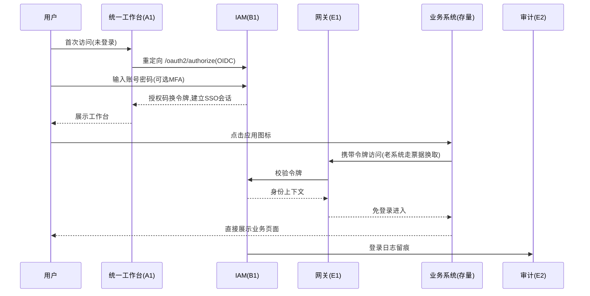

**业务规则**：
1. 账号唯一来源为 F1 主数据 + B3 同步，B1 不手工建账号（紧急通道需审批留痕）；
2. 令牌有效期与刷新策略统一配置；全局登出使所有已登录系统会话失效；
3. 连续失败锁定、异地登录告警规则可配置（联动 E2 异常行为分析）。

### 4.2 跨系统待办聚合与处理流程（核心流程）

存量系统按标准契约推送待办，A4 聚合展示，处理动作回写原系统。

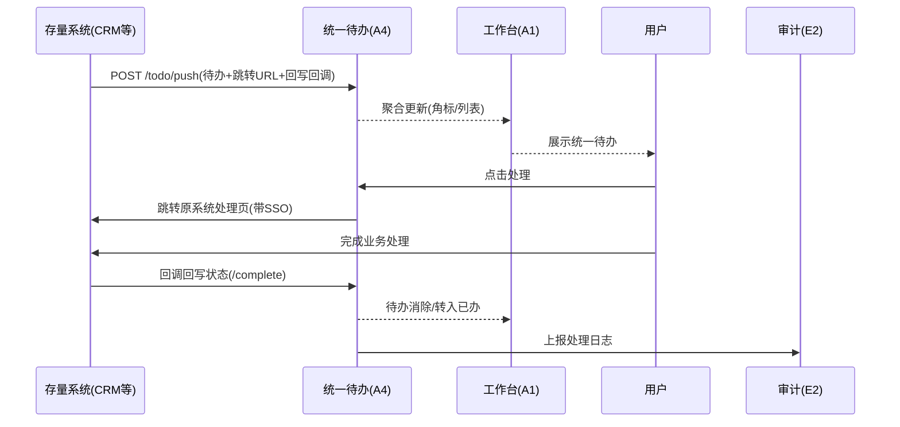

**业务规则**：
1. 待办推送必含：来源系统、业务类型、标题、跳转 URL、回写回调地址、创建时间、紧急度；
2. 超时未处理的待办按规则自动提醒（A4-F05），可升级提醒；
3. 审批类待办默认路由至 C3 统一审批视图处理（若原系统已接入 C1 则在站内完成，否则跳转原系统）。
4. **员工侧入口分工（A4 vs C3）**：**A4-F02** 聚合列表/首页紧迫度流同时展示 **外链待办**（`jumpUrl` → 待办中心处理）与 **站内工作流任务**（`source_system=workflow` / `wf_task` → **深链 `approval.html` / C3-F01 站内办理**）。**外链待办**走待办中心；**中台流程可站内办**走审批中心——两入口并存但数据聚合口径统一（角标可合并展示，办理路径按 `handleMode` 分流）。

### 4.3 组织人员异动联动流程（主数据驱动，核心流程）

权威源一次变更，全系统自动联动：账号、权限、缓存、审计全链路闭环。

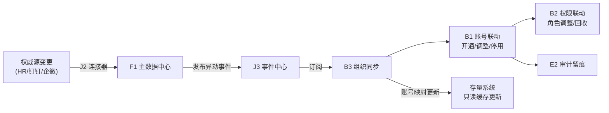

**业务规则**：
1. 异动同步时效 ≤10 分钟（事件驱动）；离职账号 24h 内自动停用（含全部子系统会话失效）；
2. 转岗：B2 数据权限按新组织范围自动重算；角色保留情况按策略配置（默认回收敏感角色）；
3. 事件投递失败自动重试（J3-F04），重试超限转人工处理队列。

### 4.4 统一审批流程（表单 + 工作流）

业务系统/表单应用发起审批，C1 引擎承载，处理过程与结果全留痕。

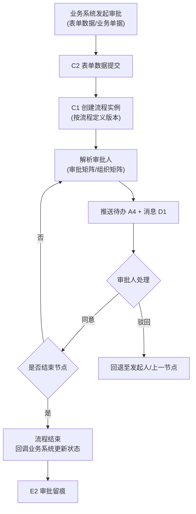

**业务规则**：
1. 流程定义有版本管理，运行中实例按发起时版本执行；新版本仅对新实例生效；
2. 审批人解析顺序：节点指定人 → 岗位/角色 → 组织矩阵；审批人即发起人时按「自动通过/上级代审」策略配置；
3. 委托代理期间任务自动路由至代理人，记录实际处理人与委托关系。

### 4.5 统一消息通知流程

全公司消息单一出口，模板统一、渠道统一、可追踪。

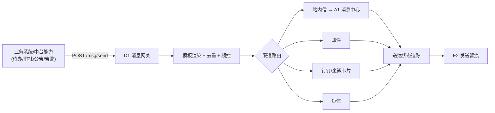

**业务规则**：
1. 业务系统禁止自建发信通道（停建清单约束），一律调 D1；**短信同样不例外**——V1.0 真实接通短信通道，短信服务商的账号/签名/模板在中台统一配置（`connector-sms`），业务系统不自建短信通道，仅调 `/v1/msg/send` 使用；
2. 模板带变量与审核状态，未审核模板不可发布；同一事件多渠道发送策略可配置（如重要通知=站内+钉钉+短信）；
3. 送达率 ≥98% 为 V1.0 验收线；失败自动重试并记录原因。

### 4.6 新系统/存量系统接入流程（七步 Checklist）

> **四域产品技术方案（逻辑视图 · 2026-10-21）**：[`outputs/规范/产品技术方案/应用接入四域-产品技术方案.md`](outputs/规范/产品技术方案/应用接入四域-产品技术方案.md) — **应用注册、应用 SSO 登录、应用能力调用、应用事件订阅** 的业务流程、产品规则、数据流与技术机制（**不含** OpenAPI/表结构）；七步 Checklist 与四域映射见该文档 §7。

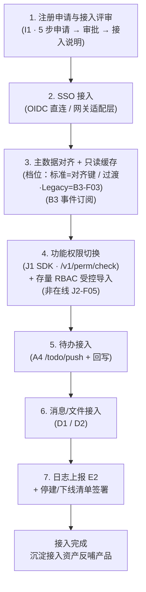

**业务规则**：
1. 未完成接入评审的新系统不予立项（架构评审红线）；
2. 每步有验收项与冒烟用例，全步骤目标 ≤5 人日（V2.5 起）；
3. 接入完成后原系统重复公共模块进入停建/下线清单管理；
4. **第 3 步验收物**：① 订阅 **B3 主数据事件** 建立组织/人员**只读缓存**；② 应用侧持久化 **钉钉对齐键**（`dingtalk_userid` + `dingtalk_dept_id` 或与钉钉绑定的 `md_org_id`，§10.4 **#13**），经 API/事件与中台一致，**不要求**全量维护 `sys_org_mapping`；③ **改造期**若 5 套存量仍持非钉钉本地部门编码，**`B3-F03`** 由**实施/连接器离线批量导入**对照数据（**V1.5 控制台无独立组织对照菜单**；账号例外在人员管理 · 账号映射）。**数据权限（行级范围）留在各业务系统自行维护**（客户拍板 P5，§10.4 #6）；七步 Checklist **不再强制全系统「业务表对齐 `md_org.id` + `/v1/perm/data-scope`」**。
5. **第 4 步验收物**为「**功能权限判定切换**（`/v1/perm/check` + **J1 SDK**）」+ **「存量功能授权关系已导入中台 RBAC」**——导入方式为 **实施阶段经审批的数据库导出 / 受控脚本导入** `sys_user_role`、`sys_role_permission` 等（**保留审计与人工仲裁**；**不交付 `J2-F05` 在线采集适配器与管理端 Tab**，见 §10.4 #4）。切换前须达到约定完成度（账号归一 + 待仲裁清空 + 导入率达标），**避免切换后全员权限清空**（比 SSRF 断链更严重的功能事故）。
6. **分工口径**：第 4 步的 **SDK/注解改造由业务系统承担**；中台侧 **不提供 V1.5 在线权限采集 UI**；`B2-F03` **不对业务库做统一行级管控**（功能权限仍走 B2-F02/F05 + 中台 RBAC）。

### 4.7 AI 能力调用流程（外挂经网关）

业务场景经 E1 网关统一调用 AI 中台，失败自动降级，不影响核心链路。

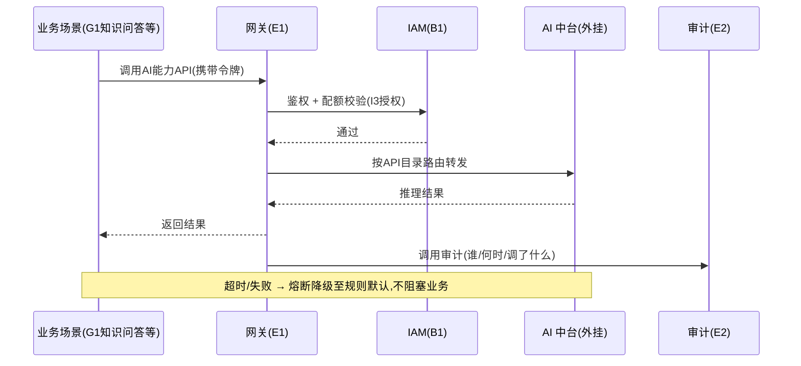

**业务规则**：
1. AI 中台不单独对外暴露网关，不另建账号体系（四个统一约束）；
2. 传递给 AI 的数据受 B2 数据权限约束并脱敏；AI 仅返回推理结果，不回写主数据；
3. AI 能力版本化（v1/v2），升级对调用方透明，灰度经网关路由。

### 4.8 文件上传与访问流程

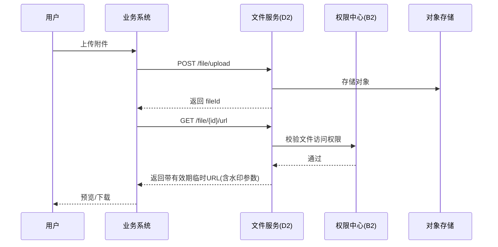

**业务规则**：
1. 文件一律经 D2 存取，业务系统不得直连对象存储；下载/预览 URL 有效期默认 30 分钟；（**V1.0 交付上传下载最小集 D2-F01，供工作流发起表单 attachment 附件字段落地**）
2. 合同/简历/知识文档按密级与业务权限隔离；下载默认叠加用户+时间水印；（水印/在线预览/版本/文件权限属 **V1.5 D2-F02~F06**）
3. 存量文件迁移走迁移工具（D2-F06，**V1.5**），迁移率 ≥80% 为 V1.5 验收线。

---

## 五、数据流

### 5.1 数据归属总表（System of Record）

> 「拥有」= 唯一写入源；「引用」= 只读使用他人主数据；「拥有（聚合态）」= 聚合元数据，业务单据仍在原系统。

| 能力中心 | 拥有的数据 | 引用的数据 |
| --- | --- | --- |
| B1 IAM | 账号、凭证、会话、令牌 | 组织人员主数据（B3 同步） |
| B2 权限中心 | 角色、权限点、授权关系、数据范围规则 | 身份（B1）、组织与客户范围（F1/F2） |
| B3 组织同步 | 账号映射表、**组织映射表（`sys_org_mapping`，建议新增，待实施确认）** | 组织人员主数据（只读） |
| C1 工作流 | 流程定义、实例、任务、审批记录 | 组织矩阵（F1）、办理人鉴权（B1/B2） |
| C2 表单 | 表单定义、表单实例数据 | —— |
| D1 消息网关 | 消息模板、发送记录、渠道配置 | 收件人解析（F1） |
| D2 文件服务 | 文件元数据、目录、版本、权限 | 文件权限（B2） |
| E1 网关 | 路由表、限流策略、API 目录、调用凭证 | 鉴权与授权（B1/B2） |
| E2 审计 | 审计日志、告警规则 | 全部能力中心与接入系统的上报 |
| F1 主数据 | 组织、岗位、人员（唯一源） | 权威源系统数据（经连接器接入） |
| F2 主数据 | 客户、联系人、客户-合同关系（唯一源） | 权威源系统数据（CRM/电商） |
| G1 知识 | 知识文档元数据、标签、分类、密级 | 文件内容（D2）、AI 推荐（AI 中台） |
| H1 目标 | 目标、关键结果、进度、复盘记录 | 组织人员（F1） |
| A4 待办 | 待办条目元数据（聚合态） | 业务单据（只读，处理回原系统） |
| A3 搜索 | 各系统对象索引（只读缓存） | 各系统数据、权限过滤（B2） |

### 5.2 主数据同步流（单向，产品数据流的根基）

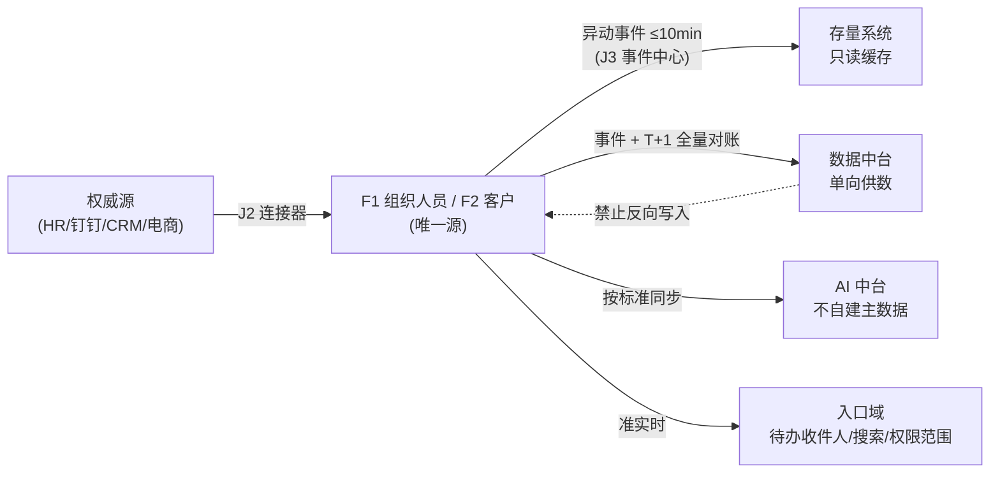

**数据规则**：
1. 主数据只允许 F1/F2 写入；订阅方本地表为只读缓存，修正需求走主数据侧问题闭环（I2-F03）；
2. 同步机制：事件订阅为主（≤10 分钟）、T+1 全量对账兜底；历史初始化走批量导出通道；
3. 客户主数据同步含合并结果传播：合并后各订阅方按统一编码自动归一。

### 5.3 事件流（J3 事件订阅中心）

| 事件类别 | 典型事件 | 主要订阅方 |
| --- | --- | --- |
| 主数据事件 | `md.org.changed`、`md.employee.created/transferred/deactivated`、`md.customer.merged` | B3、存量系统、数据中台、AI 中台、B2 |
| 流程事件 | `wf.task.completed`、`wf.instance.completed` 等（`wf.*`，见 C1-F06/J3） | A4、D1、业务系统（`callbackUrl` 主 + 订阅辅） |
| 待办事件 | `todo.pushed`、`todo.completed`、`todo.overdue` | A1、D1 |
| 消息事件 | `msg.delivered/failed` | E2、运维告警 |
| 文件事件 | `file.uploaded/deleted` | G1、业务系统 |
| 系统事件 | `app.registered`、`config.released` | I1 控制台、运维 |

**事件规则**：事件命名 `域.对象.动作`；全部事件带 `eventId`（幂等键）、`occurredAt`、`source`；Outbox 模式保证「业务写入与事件发布」原子性；失败重试 3 次后退避重试，超限转人工队列。

### 5.4 日志审计流（E2）

| 上报内容 | 上报方 | 留存要求 |
| --- | --- | --- |
| 登录/登出/认证失败 | B1、认证适配层 | ≥6 个月 |
| 关键操作（增删改、审批、导出） | 全部能力中心 + 接入系统（SDK 埋点） | ≥6 个月 |
| 数据变更留痕（变更前后摘要） | F1/F2、B2、C1/C2 | ≥6 个月 |
| API 调用记录（含 AI 中台调用） | E1 网关 | ≥6 个月 |
| 消息发送记录 | D1 | ≥6 个月 |

### 5.5 数据编码与标准（V1.0 发布 I2 标准初版）

| 数据对象 | 编码规则（示例） | 说明 |
| --- | --- | --- |
| 组织 | `ORG-{一级码}-{流水}`，如 `ORG-HQ-0001` | 全公司唯一，含生效期 |
| 人员 | 工号 `EMP-{年份}-{流水}`，如 `EMP-2026-0101` | 全公司唯一，与各系统账号映射 |
| 客户 | `CUS-{来源}-{流水}`，如 `CUS-CRM-00001` | 合并后保留统一编码 |
| 文件 | fileId：`{UUID}` | 元数据含业务归属与密级 |
| 事件 | `{域}.{对象}.{动作}` | 幂等键 eventId 全局唯一 |
| API | `/v{n}/{域}/{资源}` | 版本化路径，破坏性变更升版本 |

## 六、产品详细功能需求

> **本章为开发级详规**：覆盖全部 **129 个顶层功能点**，每点含「功能详细描述 / 输入 / 输出 / 操作流程（含 Mermaid）/ 权限说明 / 业务流程 / 关键技术点 / 数据逻辑流」**8 要素** + 「异常与边界 / 可测验收标准 / 待确认项」**3 附加**。

### 6.1 统一门户模块（A1/A2/A3/A4）

#### A1-F01 应用导航

| 项目 | 内容 |
| --- | --- |
| 所属模块 | A1 统一工作台 / 门户域 |
| 优先级 / 版本 | P0 / V1.0（子项 A1-F01-1~2 为 V1.5） |
| 上游需求 | BMP-P0-04（统一工作台） |
| 依赖功能点 | I1-F01(S)；A1-F02(W)；B2-F02(S) |
| 被依赖功能点 | A1-F05；A1-F09；J1-F02 |
| 关联表/接口 | `portal_app`、`portal_app_scope`、`gov_app_register`；`GET /v1/portal/apps` |

**① 功能详细描述**
应用导航是工作台的**应用入口中心**：应用经 I1 应用注册（`gov_app_register`）后自动上架（写入 `portal_app`），按角色/组织可见范围（`portal_app_scope`）呈现，支持管理员分组管理、用户排序与常用置顶。**边界**：A1-F01 是**入口跳转**——点击应用图标去该系统的独立页面干活（**决议 #5：新标签页打开，会话独立**），**不承担**把页面内嵌到首页的职责（后者属 A1-F08 页面驻留，#5b）。子项 A1-F01-1（能力使用总览）、A1-F01-2（接入状态视图）为后台应用详情区块，数据源复用七步 Checklist 与能力登记，**不新建采集**。本功能不产生业务数据，仅维护应用上架状态与排序权重。

**② 输入**

| 输入项 | 来源 | 类型/格式 | 必填 | 校验规则 |
| --- | --- | --- | --- | --- |
| app_code / app_name / icon / url | `gov_app_register`（I1 注册） | String | 是 | app_code 唯一；url 须为 https 合法地址 |
| 应用启停状态 | `gov_app_register.status` | 枚举（注册/启用/停用） | 是 | 仅「启用」状态上架；停用/下线自动隐藏 |
| 可见范围 | `portal_app_scope`（all/org/role） | JSON | 否 | 为空默认逐登录用户按角色计算；命中即可见 |
| 分组 / 排序 / 常用置顶 | 管理员（分组）+ 用户（排序/置顶） | 整数 / 布尔 | 否 | 置顶项数上限可配（默认 8） |
| 会话身份上下文 | E1 网关注入（`X-User-Id`/`X-Org-Id`） | String | 是 | 无有效令牌拒绝返回 |

**③ 输出**

| 输出项 | 去向 | 类型/格式 | 说明 |
| --- | --- | --- | --- |
| 我的应用列表（含分组、排序） | 首页「全部应用」/ 应用中心 UI-A1-02 | JSON list | 按 scope 过滤 + 排序（freq 降序，V1.5 起由埋点累计） |
| 应用跳转目标 URL | 浏览器新标签页 | URL（https） | 决议 #5，`target=_blank` |
| 应用上架/隐藏状态 | `portal_app.status` | 枚举 | 与注册表联动（注册→自动上架） |
| 能力使用总览 / 接入状态视图（子项） | UI-C-10 应用详情区块 | 区块数据 | 每项标「是否启用 + 使用量 + 接入时间」；七步 Checklist 完成态 |

**④ 操作流程**
1. I1 应用注册通过评审 → `gov_app_register` 落库（状态=启用）。
2. 门户订阅 `app.registered` 事件 / 定时拉取 → 写 `portal_app`（自动上架）。
3. 管理员配置 `portal_app_scope`（可见范围）与分组。
4. 用户登录 → `GET /v1/portal/apps` 返回按 scope 过滤后的应用列表。
5. 用户点击图标 → **新标签页**打开 `url`（带 SSO 免登，决议 #5）。
6. 应用停用/下线 → 事件驱动 `portal_app.status` 更新 → 列表自动隐藏。

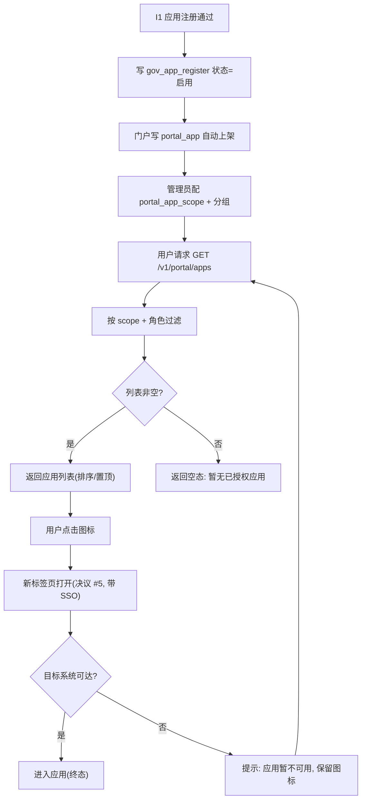

**⑤ 权限说明**

| 角色 | 可见 | 可操作 | 数据范围 | 备注 |
| --- | --- | --- | --- | --- |
| 普通员工 | 已授权应用 | 查看、排序、常用置顶、跳转 | 命中 `portal_app_scope` 的应用 | 权限点 `portal:app:view` |
| 门户管理员（`portal_admin`） | 全部应用 | 上架/隐藏、分组、配 scope | 全部 | `portal:app:manage` |
| 超级管理员（`super_admin`） | 全部 | 全部 | 全部 | 兜底 |
| 未登录 | 无 | 无 | 无 | 网关拦截（无令牌拒绝） |

**⑥ 业务流程**
对应主 PRD **4.1 统一登录与 SSO 流程**——「点击应用图标 → 携带令牌访问 → 免登录进入」即本功能的跳转动作（决议 #5，新标签页）；对应 **4.6 接入流程第 1 步「应用注册与接入评审」**后自动上架。本功能位于「登录后 → 进入目标应用」链路的中间环节。

**⑦ 关键技术点**
- 技术约束：应用清单只读 `gov_app_register`/`portal_app_scope`，**不复制权限判定**（权限判定统一 `B2-F05`）；跳转一律新标签页，禁止 iframe（决议 #5）。
- 性能要求：`GET /v1/portal/apps` P95 <300ms；缓存 scope 结果，变更事件失效。
- 并发/幂等：自动上架按 `app_code` 幂等（重复事件不产生重复行）；`UK(app_code)` 约束。
- 失败处理：注册事件丢失时以「每日全量对账 + 定时拉取」补偿；列表接口超时降级为本地缓存清单。

**⑧ 数据逻辑流**
I1 注册（`gov_app_register`）→ 事件 `app.registered`/定时拉取 → 写 `portal_app`（上架）+ 管理员配 `portal_app_scope` → 读 `portal_app`+`portal_app_scope` 按会话身份过滤 → 消费方：首页「全部应用」区块 / 应用中心 UI-A1-02 / A1-F05 排序 / A1-F08 白名单来源。

**⑨ 异常与边界**

| # | 异常场景 | 触发条件 | 处理策略 | 是否影响主流程 |
| --- | --- | --- | --- | --- |
| 1 | 空数据（无已授权应用） | 新用户无任何 scope 命中 | 返回空态引导「暂无已授权应用，请联系管理员」，不报错 | 否 |
| 2 | 越权（直接请求未授权 appId） | 用户伪造 appId | 服务端按 scope 二次校验，非授权返回 `2403 无权限`，不返回 url | 否 |
| 3 | 第三方失败（目标应用不可达） | 跳转后目标系统宕机 | 图标保留可点，失败由目标系统自行提示；门户不缓存错误态 | 否 |

**⑩ 验收标准**
- [ ] 新应用注册后 **10 分钟内**出现在工作台（对齐主 PRD 6.1 验收）。
- [ ] 应用停用/下线后刷新工作台，该图标 **不再出现**（`portal_app.status` 联动）。
- [ ] 未授权用户请求未授权 appId，接口返回 `2403`，响应体 **不含** `url` 字段。
- [ ] 点击应用图标，新窗口 `target=_blank` 打开，**当前工作台页面不跳转**（决议 #5 可走查）。
- [ ] 子项：UI-C-10 应用详情「能力使用总览」七类能力逐项可读，「接入状态视图」与 4.6 七步一一对应。

**⑪ 待确认项**
| # | 待确认事项 | 责任方 | 影响 | 建议 |
| --- | --- | --- | --- | --- |
| 1 | 常用置顶项数上限 | 产品 | 首页布局 | 默认 8，可配 |
| 2 | 应用分组由管理员统一配还是允许用户自建分组 | 产品 + 客户 | 交互复杂度 | 建议 V1.0 仅管理员配 |

---


#### A1-F02 角色化首页（布局引擎）

| 项目 | 内容 |
| --- | --- |
| 所属模块 | A1 统一工作台 / 门户域 |
| 优先级 / 版本 | P0 / V1.0（v2 三栏重构 V1.5；子项 A1-F02-1~6 V1.5） |
| 上游需求 | BMP-P0-04（统一工作台） |
| 依赖功能点 | B1-F01(S)；B2-F05(S)；B2-F02(S) |
| 被依赖功能点 | A1-F01；A1-F05；A1-F06；A1-F08；A2-F05 |
| 关联表/接口 | `portal_card`、`portal_layout_template`、`portal_user_layout`；`GET /v1/portal/home`、`POST /v1/portal/layout`、`POST /v1/portal/card/register` |

**① 功能详细描述**
角色化首页是工作台的**渲染引擎与骨架**：由 `portal_card`（卡片注册表）提供物料，`portal_layout_template.template_json` 提供「按角色的默认布局」，`portal_user_layout.layout_json` 提供「个人覆盖」，运行时**深合并**后由 `GET /v1/portal/home` 返回渲染。V1.0 为 24 栅格 v1；V1.5 升级为 **v2 三栏**（`cols:{left,right}` + `cards[].col∈{left,center,right}`；**注意 `top` 全宽置顶区已回退，当前实现无 top**）。**边界（骨架 §3.3 B1）**：本功能决定「**你看到哪些卡片**」（cardId 集合、col、默认 order），**不决定**卡片内条目的排序与推荐（属 A1-F05）。个人微调**只允许改 `order`/`visible`/`col`，cardId 集合不可增删**（决议 #6，override 结构**不含 params**）。`legacy` 区保留既有 v1 cardId，避免老用户 override 失配。

**② 输入**

| 输入项 | 来源 | 类型/格式 | 必填 | 校验规则 |
| --- | --- | --- | --- | --- |
| 角色模板 | `portal_layout_template.template_json` | JSON（v2 三栏） | 否 | `version=2` 校验 `cols`+`cards[].col`；未配走默认模板 |
| 个人覆盖 | `portal_user_layout.layout_json` | JSON（override） | 否 | 仅 `{cards:[{cardId,order,visible,col}],cols}`，**不含 params** |
| 卡片注册清单 | `portal_card`（card_code/component/data_api/params/multi） | 表数据 | 是 | cardId 唯一；嵌入卡 `embed:<唯一id>` |
| 嵌入实例存档 | 后端按 `account_id` 存（原型 `localStorage: bmp_embed_cards`） | JSON | 否 | 仅嵌入卡携带 `params:{url,title,height,icon}` |
| 会话身份 | E1 注入 + B1-F01 | String | 是 | 决定角色模板匹配 |
| 卡数据接口返回 | 各卡片 `data_api` | JSON | 否 | 单卡片失败不影响其他卡片 |

**③ 输出**

| 输出项 | 去向 | 类型/格式 | 说明 |
| --- | --- | --- | --- |
| 首页渲染结构 | UI-A1-01（PC）/ UI-M-01（移动） | JSON（合并结果） | 角色模板 + 个人覆盖 + 嵌入存档深合并，v2 三栏 |
| 保存结果 | `portal_user_layout.layout_json` | JSON | 覆盖 order/visible/col + cols |
| 模板发布结果 | `portal_layout_template.template_json` | JSON | 管理端 UI-C-11 发布（高风险操作） |
| v1 兼容渲染 | 旧模板用户 | 平铺渲染 | `version` 缺失/为 1 时按旧逻辑平铺不报错 |

**④ 操作流程**
1. 管理员在 UI-C-11（`POST /v1/portal/card/register` 注册 + 模板编辑）为角色绑定 v2 三栏模板，发布写 `portal_layout_template.template_json`。
2. 用户首次登录 → 按角色命中模板 → 无覆盖则直接用模板渲染。
3. 用户进入「个人设置 → 首页布局」编辑：栏内可拖拽/显隐/调栅格；**跨栏禁拖拽**（栏宽由模板层决定）。
4. 保存 → `POST /v1/portal/layout` 写 override（不含 params）。
5. 再次访问 → `GET /v1/portal/home` 返回「模板 + override + 嵌入存档」深合并结果。
6. 老用户既有 v1 override：`legacy` 命中仅吸收 `visible`/`order`，**不写 col**。

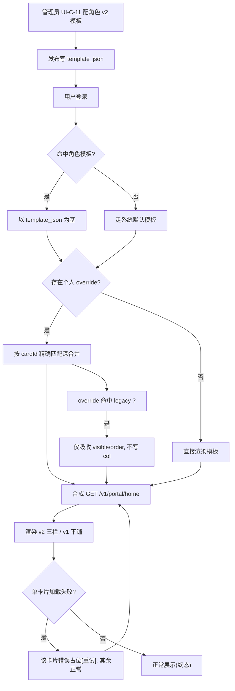

**⑤ 权限说明**

| 角色 | 可见 | 可操作 | 数据范围 | 备注 |
| --- | --- | --- | --- | --- |
| 普通员工 | 本人首页 | 个人微调（order/visible/col）、保存/恢复默认 | 本人 override | `portal:layout:self` |
| 门户管理员 | 全部模板 | 配角色模板、注册卡片、按角色预览、发布 | 全部模板 | `portal:layout:manage`（发布为 highRisk） |
| 超级管理员 | 全部 | 全部 | 全部 | 兜底 |
| 未授权用户 | 首页（默认模板） | 不可编辑 | 角色模板 | 无 manage 权限时编辑入口隐藏 |

**⑥ 业务流程**
对应主 PRD **4.1 统一登录流程**——登录成功后「展示工作台」即本功能的渲染输出；首页 v2 三纲领（首页承担判断 / 一句话到达 / 视觉权重随紧迫度衰减）在 6.1.1 定义。本功能是**所有首页承载能力的容器底座**（A1-F05/F06/F08 均在其实例与协议上叠加）。

**⑦ 关键技术点**
- 技术约束：override 深合并按 **cardId 精确匹配**（`applyOverride` 逐项 `find(x=>x.cardId===o.cardId)`）；**override 不含 params**，params 归模板层/实例存档（分治，避免改布局误改参数）；跨栏禁拖拽。
- 性能要求：`GET /v1/portal/home` P95 <500ms；卡片懒加载分包，首屏仅加载 visible 卡片。
- 并发/幂等：`portal_user_layout` 按 `account_id` UK，保存为整体覆盖（last-write-wins）；模板发布版本化。
- 失败处理：单卡片数据接口超时 → 骨架/错误占位，不影响其他卡片；模板 JSON 解析失败 → 回退默认模板并告警。

**⑧ 数据逻辑流**
`portal_card`（卡片注册，含 `params`/`multi`）→ 管理员配 `portal_layout_template.template_json`（角色默认）→ 用户微调写 `portal_user_layout.layout_json`（override）+ 嵌入实例存档（params）→ `GET /v1/portal/home` 深合并 → 消费方：UI-A1-01/UI-M-01 渲染；A1-F05（排序叠加）、A1-F08（embed 实例）、A1-F09（布局相关 event 无直写）。

**⑨ 异常与边界**

| # | 异常场景 | 触发条件 | 处理策略 | 是否影响主流程 |
| --- | --- | --- | --- | --- |
| 1 | 空数据（角色无模板） | 角色未配模板 | 走系统默认模板，不报错 | 否 |
| 2 | 并发（多端同时保存） | PC + 移动同时改布局 | 按 `account_id` last-write-wins，客户端提示「已在其他端更新」 | 否 |
| 3 | 越权（伪造 cardId 增删） | 请求含模板外 cardId | 服务端丢弃非模板 cardId，仅接受 order/visible/col 覆盖 | 否 |
| 4 | 第三方失败（卡片 data_api 超时） | 数据接口 >8s | 单卡片降级，其余正常 | 否 |

**⑩ 验收标准**
- [ ] 管理员为角色配置首页 **≤30 分钟**（对齐主 PRD 6.1 验收）。
- [ ] 个性化布局**跨端同步**（同账号 PC 与移动读到同一 override）。
- [ ] 提交含模板外 cardId 的 override，服务端落库内容**不含**该 cardId（cardId 集合不可增删可走查）。
- [ ] v1 模板（`version` 缺失/为 1）渲染**不报错**、不置灰。
- [ ] 老用户 v1 override 引用 legacy cardId 时，配置**不静默失效**（命中 legacy 仅吸收 visible/order）。

**⑪ 待确认项**
| # | 待确认事项 | 责任方 | 影响 | 建议 |
| --- | --- | --- | --- | --- |
| 1 | `portal_layout_template` 列名沿用 `layout_json` 还是统一 `template_json` | 架构师 + 研发 | 数据逻辑流 | 统一 `template_json`（与实现一致；详设 §14.3 #1） |
| 2 | 嵌入实例存档正式落表（`portal_user_layout` 增列 vs 独立表） | 架构师 | A1-F02/F08 | 建议独立实例存档表，按 `account_id` 存 params |

---


#### A1-F03 消息聚合

| 项目 | 内容 |
| --- | --- |
| 所属模块 | A1 统一工作台 / 门户域 |
| 优先级 / 版本 | P0 / V1.0 |
| 上游需求 | BMP-P0-04（统一工作台）、BMP-P0-07（消息网关一期，消费侧） |
| 依赖功能点 | D1-F01(S)；B1-F01(S)；E2-F01(W) |
| 被依赖功能点 | A2-F05；D1-F05 |
| 关联表/接口 | `portal_message`、`msg_send_record`；`GET /v1/portal/messages?unread=true`、`POST /v1/portal/messages/read` |

**① 功能详细描述**
消息聚合是**站内信中心**：D1 消息网关按渠道发送时，站内信渠道落 `portal_message`，本功能负责**聚合展示、未读角标、分类筛选（系统/审批/公告/业务）、批量已读**。**边界（骨架 §3.3 B8）**：A1-F03 是**消费侧**——只读展示与已读管理，**不重发、不改发送策略**（生产侧属 D1-F01）。站内信保留期默认 12 个月；渠道消息回执（站内）同步。公告在消息中心**仍可见**（与 Banner 显隐解耦，见 A1-F07）。

**② 输入**

| 输入项 | 来源 | 类型/格式 | 必填 | 校验规则 |
| --- | --- | --- | --- | --- |
| 站内信记录 | `portal_message`（D1 站内渠道写入） | 表数据 | 是 | `msg_key` 幂等 |
| 已读操作 | 用户（单条/批量） | messageId 列表 | 是 | 仅本人消息可标已读 |
| 分类筛选 | 用户 | 枚举（系统/审批/公告/业务） | 否 | 枚举白名单 |
| 会话身份 | E1 + B1-F01 | String | 是 | `receiver_account_id=本人` |

**③ 输出**

| 输出项 | 去向 | 类型/格式 | 说明 |
| --- | --- | --- | --- |
| 消息列表 | UI-A1-03 消息中心 / 移动消息中心 | JSON list | 按分类、时间倒序；分页 |
| 未读角标数 | 顶栏 / 移动 Tab | 整数 | 实时性 ≤30 秒 |
| 已读状态 | `portal_message.read_status` | 布尔/枚举 | 单条或批量（**本域承载**，不写 `send_status`） |
| 渠道送达情况（只读展示） | 消息中心 | 只读关联 | `portal_message.msg_key` ↔ `msg_send_record.msg_key`（只读，不双写） |

**④ 操作流程**
1. D1-F01 统一发送 → 站内渠道渲染模板 → 写 `portal_message`（`read_status=未读`）。
2. 前端 30s 轮询增量接口 → 更新未读角标。
3. 用户打开消息中心 → `GET /v1/portal/messages?unread=true` 拉列表。
4. 用户按分类筛选 / 单条点击 / 批量已读 → `POST /v1/portal/messages/read`（UIUX §5.5 亦定义 `POST /v1/messages/{id}/read`，两者同一能力）。
5. 写本域 `portal_message.read_status=已读` → 角标减计。**不写 `msg_send_record.send_status`**（骨架 §3.3 B14）。
6. 到达保留期（12 个月）→ 归档清理。

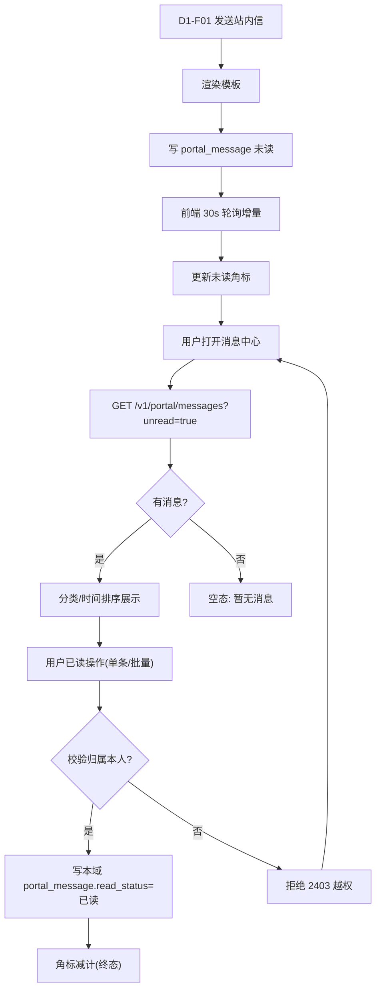

**⑤ 权限说明**

| 角色 | 可见 | 可操作 | 数据范围 | 备注 |
| --- | --- | --- | --- | --- |
| 普通员工 | 本人收到的消息 | 查看、分类筛选、单条/批量已读 | `receiver_account_id=本人` | `portal:msg:view` |
| 门户管理员 | 本人消息（不含他人内容） | 本人操作 | 本人 | 不提供后台查看他人站内信 |
| 审计员（`audit_viewer`） | 通过 E2 审计检索 | 只读检索（E2 侧） | 合规范围 | 消息内容审计走 E2，非本功能 |

**⑥ 业务流程**
对应主 PRD **4.5 统一消息通知流程**——「站内信 → A1 消息中心」的落地环节；本功能位于消息链路的**末端消费**（发送 → 落库 → 展示/已读）。**站内已读为消费侧行为，落本域 `portal_message.read_status`，不回写 `send_status`**（骨架 §3.3 B14）。

**⑦ 关键技术点**
- 技术约束：本功能**只读** `msg_send_record`（D1 拥有），不写消息发送表；站内信主存 `portal_message`。**站内「已读」归本域 `portal_message.read_status` 承载**（详细设计 §3.3 已有该字段），**不写入 `msg_send_record.send_status`**（骨架 §3.3 **B14**）。`msg_send_record.send_status` **保持 4 值**（`0待发/1已发/2送达/3失败`），**不新增 `4=已读`**。两者**只读关联、不双写**：`portal_message.msg_key` ↔ `msg_send_record.msg_key`，仅用于消息中心展示渠道送达情况。**裁定理由**：`send_status` 是「渠道送达」维度、站内「已读」是「消费侧行为」维度，混存会使送达率统计（主 PRD 4.5 ≥98%）分母失真。
- 性能要求：列表加载 P95 <1s；未读角标实时性 ≤30 秒（增量轮询）。
- 并发/幂等：已读操作按 messageId 幂等；批量已读限定本人集合。
- 失败处理：轮询失败静默重试；列表接口超时展示骨架不报错。

**⑧ 数据逻辑流**
D1-F01 发送（模板渲染）→ 站内渠道写 `portal_message`（category/read_status）→ 用户已读 → 写本域 `portal_message.read_status`（`portal_message.msg_key` 只读关联 `msg_send_record.msg_key` 展示渠道送达情况）→ 消费方：UI-A1-03 / 移动消息中心 / 顶栏角标。**本功能不写 `msg_send_record.send_status`**（骨架 §3.3 B14；`send_status` 保持 4 值，只读展示）。

**⑨ 异常与边界**

| # | 异常场景 | 触发条件 | 处理策略 | 是否影响主流程 |
| --- | --- | --- | --- | --- |
| 1 | 空数据（无消息） | 新用户 | 空态文案「暂无消息」，角标为 0（不显示） | 否 |
| 2 | 越权（标记他人消息已读） | 伪造 messageId | 校验 `receiver_account_id`，非本人返回 `2403` | 否 |
| 3 | 并发（重复点击已读） | 网络重发 | 幂等处理，重复请求返回成功 | 否 |

**⑩ 验收标准**
- [ ] 未读角标实时性 **≤30 秒**（对齐主 PRD 6.1 验收）。
- [ ] 批量已读后刷新，对应消息 `read_status=已读`，角标相应减计。
- [ ] 非本人 messageId 的已读请求返回 `2403`，不修改任何行。
- [ ] 站内信保留期默认 **12 个月**（可配），到期归档。

**⑪ 待确认项**
| # | 待确认事项 | 责任方 | 影响 | 建议 |
| --- | --- | --- | --- | --- |
| 1 | 站内信保留期（12 个月）是否需与 E2 审计留存口径对齐说明 | 产品 + 客户 | 合规表述 | 站内信为业务消息（12 个月），与审计（≥6 个月）分属不同用途，不冲突 |

---


#### A1-F04 公告管理

| 项目 | 内容 |
| --- | --- |
| 所属模块 | A1 统一工作台 / 门户域 |
| 优先级 / 版本 | P0 / V1.0（Banner 后台增强 A1-F04-1~5 为 V1.5） |
| 上游需求 | BMP-P0-04（统一工作台） |
| 依赖功能点 | B1-F01(S)；B2-F02(S) |
| 被依赖功能点 | A1-F07 |
| 关联表/接口 | `portal_notice`、`portal_notice_scope`、`portal_notice_read`；`POST /v1/portal/notice`、`GET /v1/portal/notices` |

**① 功能详细描述**
公告管理是**公告本体与可见范围的唯一维护入口**：支持发布/撤回、置顶（`top`）、可见范围（全员/组织/角色）、定时发布、已读统计，以及 V1.5 的 Banner 后台增强（`bannerEnabled`/时段/优先级/预览/状态列）。**边界（骨架 §3.3 B7）**：本功能**只管公告本体与后台开关**——不决定首页如何渲染 Banner（属 A1-F07 前台显隐），不决定消息如何发送去重（属 D1-F04）；Banner **非消息通道、不占 cardId、不进时间轴流、不受 D1-F04 去重/频控约束**；公告如需渠道触达**由调用方发起 `/v1/msg/send`，D1 不主动抓取 `portal_notice`**。发布可配置走审批（可选）。

**② 输入**

| 输入项 | 来源 | 类型/格式 | 必填 | 校验规则 |
| --- | --- | --- | --- | --- |
| 标题/正文/类型 | 管理员 | String/枚举（通知/新闻/紧急） | 是 | 标题非空；类型枚举白名单 |
| 可见范围 | 管理员 → `portal_notice_scope` | 枚举（全员/组织/角色）+ 值 | 是 | 至少一项；组织/角色须存在 |
| 置顶 | 管理员 → `portal_notice.top` | 布尔 | 否 | —— |
| 定时发布 | 管理员 → `publish_time` | DateTime | 否 | 定时须 > 当前时间 |
| Banner 开关/时段/优先级（子项） | 管理员 → `bannerEnabled`/`bannerStartTime`/`bannerEndTime`/`bannerPriority` | 布尔/DateTime/整数 | 否 | 「起 < 止」；**新建默认关闭** |
| 撤回操作 | 管理员 | noticeId | 否 | 仅已发布可撤回 |

**③ 输出**

| 输出项 | 去向 | 类型/格式 | 说明 |
| --- | --- | --- | --- |
| 公告记录 | `portal_notice` | 表数据 | 发布/撤回/置顶/定时 |
| 可见范围 | `portal_notice_scope` | 表数据 | 目标人群 |
| 已读记录 | `portal_notice_read` | 表数据 | 已读统计依据 |
| 公告列表/详情 | UI-A1-04 / UI-C-12 | JSON | 门户按范围过滤；后台全量 |
| 触达准确率统计 | 后台已读统计 | 比例 | 触达目标人群准确率 |

**④ 操作流程**
1. 管理员在 UI-C-12 创建公告 → 填标题/正文/类型/可见范围/置顶。
2. 可选配置发布审批 → 审批通过；或直接发布；或设定 `publish_time` 定时发布。
3.（V1.5）逐条开启 `bannerEnabled` + 时段 + 优先级 + 预览。
4. 发布 → 写 `portal_notice` + `portal_notice_scope`；到达 `publish_time` 生效。
5. 门户 `GET /v1/portal/notices` 按用户范围过滤返回；用户阅读写 `portal_notice_read`。
6. 撤回 → 更新状态，门户下架（消息中心仍按归档口径处理）。

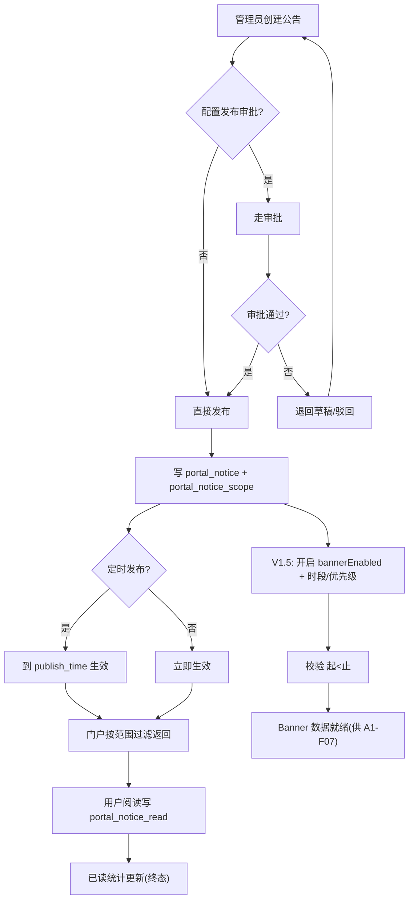

**⑤ 权限说明**

| 角色 | 可见 | 可操作 | 数据范围 | 备注 |
| --- | --- | --- | --- | --- |
| 普通员工 | 命中范围的已发布公告 | 阅读、查看详情 | `portal_notice_scope` 命中 | `portal:notice:view` |
| 门户管理员 | 全部公告（含草稿） | 发布/撤回/置顶/范围/定时/Banner 配置/预览 | 全部 | `portal:notice:manage`；Banner 开关切换写 E2 审计 |
| 超级管理员 | 全部 | 全部 | 全部 | 兜底 |

**⑥ 业务流程**
对应主 PRD **4.5 统一消息通知流程**中「公告」作为消息来源之一；公告本体的发布/可见范围在此定义，**首页曝光由 A1-F07 承接**，**渠道触达由 D1-F04 承接**。B1-F02-3（登录页公告）复用同显隐规则（待合规确认）。

**⑦ 关键技术点**
- 技术约束：公告内容与可见范围为单一权威源（`portal_notice`/`_scope`）；范围过滤与 B2 权限口径一致（先权限后展示）。
- 性能要求：门户公告列表 P95 <500ms；范围过滤走索引。
- 并发/幂等：撤回/发布状态机（草稿→已发布→已撤回）不可逆跳跃；Banner 时段校验「起<止」。
- 失败处理：定时发布任务失败重试并可人工补发；范围配置错误导致 0 命中时后台告警。

**⑧ 数据逻辑流**
管理员创建 → 写 `portal_notice`（本体）+ `portal_notice_scope`（范围）→ 用户阅读 → `portal_notice_read`（已读）→ 消费方：UI-A1-04 公告列表/详情、A1-F07（Banner 读同一公告源）、D1-F04（如需渠道触达由消息侧决定）、B1-F02-3（登录页公告，待合规）。

**⑨ 异常与边界**

| # | 异常场景 | 触发条件 | 处理策略 | 是否影响主流程 |
| --- | --- | --- | --- | --- |
| 1 | 空数据（无公告） | 无已发布公告 | 门户不展示公告区，无占位留白 | 否 |
| 2 | 越权（未授权用户查看定向公告） | 伪造 noticeId | 服务端按 scope 二次校验，非命中返回 `2403` 且不返回正文 | 否 |
| 3 | 配置错误（Banner 时段起≥止） | 管理员误填 | 保存即校验拦截，提示「起须早于止」 | 否 |

**⑩ 验收标准**
- [ ] 公告触达目标人群**准确率 100%**（对齐主 PRD 6.1 验收）。
- [ ] 定时发布到达 `publish_time` 后门户可见；时段前不可见。
- [ ] 撤回后门户立即下架；消息中心仍按归档口径可见（解耦可走查）。
- [ ] 子项：`bannerEnabled` **新建默认关闭**；切换开关写 E2 审计（可检索）。
- [ ] 子项：公告列表「Banner」列三种状态（未展示/展示中/已过期）正确渲染，筛选可用。

**⑪ 待确认项**
| # | 待确认事项 | 责任方 | 影响 | 建议 |
| --- | --- | --- | --- | --- |
| 1 | 公告发布审批是否默认开启 | 客户 + 产品 | 发布效率 | 默认关闭（可选配置） |
| 2 | 登录页对**未登录**访客展示公告的合规范围 | 客户 + 法务 + 产品 | B1-F02-3 | 后台加「可对外展示」标记；上线前须法务确认 |
| 3 | 「紧急」类型 Banner 是否允许用户关闭 | 产品 | A1-F07-6 交互 | 建议紧急类型不可关闭（安全/合规通告不应被屏蔽） |

---


#### A1-F05 千人千面（AI 智能推荐排序）

| 项目 | 内容 |
| --- | --- |
| 所属模块 | A1 统一工作台 / 门户域 |
| 优先级 / 版本 | P1 / V1.5 起步（规则化）/ V2.0 完整（模型化） |
| 上游需求 | 产品化新增（个性化与通知 PRD §2.2） |
| 依赖功能点 | A1-F02(S)；B2-F05(S)；A1-F01(W)；E2-F01(W) |
| 被依赖功能点 | A1-F09 |
| 关联表/接口 | `portal_behavior_event`、`portal_app`、`portal_app_scope`；`POST /v1/portal/behavior`、`GET /v1/perm/check` |

**① 功能详细描述**
千人千面按使用者**本人的真实行为**自动调整首页「**呈现顺序与推荐**」，无需人工配置。**边界（骨架 §3.3 B1，最核心）**：本功能只决定「**卡片里的东西谁在前、推荐什么**」，**不得增删卡片、不改三栏结构、不改 `layoutTemplate.cards` 集合**（H1 硬边界）；角色模板（A1-F02）决定「你看到哪些卡片」，两者**可叠加、互不改写结构**。五条硬边界：H1 只调顺序不改结构；H2 无权限内容绝不推荐（排序前先经 `B2-F05 /perm/check` 过滤）；H3 可关闭（`ai_rank_enabled`，关闭即停采）；H4 可解释（理由须来自真实信号，禁止编造）；H5 冷启动退化（有效事件 <20 或使用 <7 天 → 退化角色模板排序 + **移除 AI 徽标**）。**埋点通道边界**：数据源为 `POST /v1/portal/behavior`（6 类事件），**独立于 E2 审计**（分库分权、保留 90 天）、**仅采集本人行为不做跨人画像**、**埋点失败静默失败不阻断主流程**、采集合规告知后再开启。

**② 输入**

| 输入项 | 来源 | 类型/格式 | 必填 | 校验规则 |
| --- | --- | --- | --- | --- |
| 行为事件（S1~S6） | 前端 → `POST /v1/portal/behavior` | JSON（≤50 条/批） | 是 | event_type 白名单 6 类；payload 白名单字段 |
| 角色/组织/岗位（S7） | `md_employee`/`md_org`（经 B1/F1） | -- | 是 | 仅用于**冷启动兜底** |
| 权限范围（S8） | `B2-F05 /perm/check` | JSON | 是 | **前置过滤**，绝不作为排序特征 |
| 智能排序开关 | 用户 → `ai_rank_enabled` | 布尔 | 是 | 默认开启；关闭即停采 |
| 应用清单 | `portal_app`+`portal_app_scope` | 表数据 | 是 | 无权限不入候选集 |

**③ 输出**

| 输出项 | 去向 | 类型/格式 | 说明 |
| --- | --- | --- | --- |
| 应用排序结果 | 首页「全部应用」/ 推荐区 | JSON list | T+1 重算 + 支持手动刷新 |
| 「AI 为你推荐」区（3 卡 + 理由） | cardId `ai-recommend` | JSON | 与常用/最近去重；可隐藏；数据不足整块隐藏 |
| 时间轴同组加权 | 中栏 urgency-stream | order 微调 | **仅同组内**；跨组严格由紧迫度决定；加权 ≤ 相邻 1 档 |
| 行为事件记录 | `portal_behavior_event` | 表数据 | 6 类事件，保留 90 天 |
| 排序覆盖 | `portal_user_layout`(排序) | JSON | 仅 order，不改结构 |

**④ 操作流程**
1. 用户登录 → 前端校验 `ai_rank_enabled`：关闭则**不上报**、走固定排序。
2. 开启态：用户行为（打开应用/处理待办/点意图/点消息分类/订阅变更/风格切换）触发事件 → `POST /v1/portal/behavior`（异步、静默失败）。
3. 冷启动判定：有效事件 <20 或使用 <7 天 → 退化角色模板默认排序 + 移除 AI 徽标。
4. 排序计算（T+1）：候选集先经 `B2-F05 /perm/check` 过滤 → 按 S1~S6 加权 → 输出 order/推荐。
5. 推荐项附理由（来自信号字段）→ 无理由不得前置。
6. 用户关闭开关 → 停采 + 回到固定排序（角色模板 order + freq 降序），即时生效。

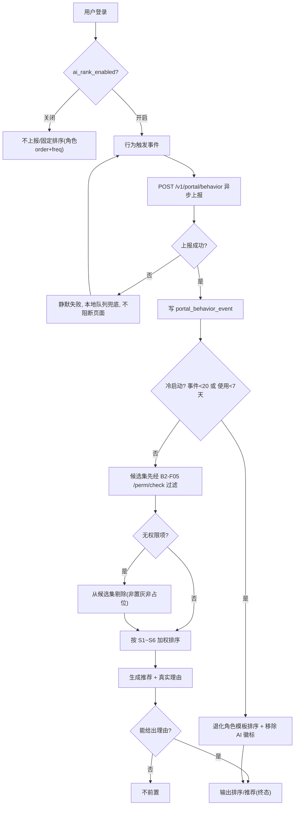

**⑤ 权限说明**

| 角色 | 可见 | 可操作 | 数据范围 | 备注 |
| --- | --- | --- | --- | --- |
| 普通员工 | 本人首页（排序/推荐） | 开关智能排序、查看理由 | **仅本人**行为数据 | `portal:ai-rank:self` |
| 门户管理员 | 排序机制配置（V2.0 模型化参数） | 配置开关策略 | 聚合口径（不看跨人明细） | `portal:ai-rank:manage` |
| 审计员 | 不涉及 | —— | —— | 埋点**不属于**审计范围 |

**⑥ 业务流程**
对应主 PRD **6.1.1 首页 v2 三纲领**（首页承担判断、一句话到达、权重随紧迫度衰减）与 **6.1.3 五条硬边界**；埋点通道对应详设 **4.9**。本功能**叠加在 A1-F02 布局之上**，不改变布局结构；其埋点通道**同时**是 A1-F09 看板唯一数据源（一次建设两处受益）。

**⑦ 关键技术点**
- 技术约束：埋点通道 `POST /v1/portal/behavior` **独立于 E2 审计**（不得写 `audit_*` 表）；payload 字段白名单、禁止冗余。
- 性能要求：排序对首页渲染**不引入阻塞**（T+1 预计算 + 缓存）；上报异步化。
- 并发/幂等：事件按 `event_id`/去重键幂等；上报失败本地队列兜底重试。
- 失败处理：**埋点失败静默失败**（不弹错、不阻塞渲染）；无权限项==0 出现；冷启动退化。

**⑧ 数据逻辑流**
前端行为 → `POST /v1/portal/behavior`（6 类事件）→ 落 `portal_behavior_event`（`bmp_portal`，保留 90 天，分库分权）→ T+1 聚合 + 先经 `B2-F05` 权限过滤 → 排序结果覆盖 `portal_user_layout`(order) + 推荐区 `ai-recommend` → 消费方：UI-A1-01 首页、UI-A1-02 应用中心、A1-F09 看板（共享通道）。

**⑨ 异常与边界**

| # | 异常场景 | 触发条件 | 处理策略 | 是否影响主流程 |
| --- | --- | --- | --- | --- |
| 1 | 埋点上报失败 | 网络异常/接口不可用 | **静默失败**，本地队列兜底，不弹错不阻塞渲染 | 否 |
| 2 | 冷启动（数据不足） | 有效事件 <20 或使用 <7 天 | 退化角色模板排序 + 移除 AI 徽标，不假装有推荐 | 否 |
| 3 | 越权（无权限内容被推荐） | 权限变更未及时同步 | 候选集排序前 `B2-F05` 过滤，无权限 0 出现 | 否 |
| 4 | 第三方失败（AI 措辞不可用，V2.0） | AI 中台超时/`enabled:false` | 降级为规则化排序 + 模板句理由，不显示 AI 徽标 | 否 |

**⑩ 验收标准**
- [ ] 关闭 `ai_rank_enabled` 后**不再产生行为埋点**（查 `portal_behavior_event` 无新增）。
- [ ] 无权限账号走查：无权限项 **0 出现**（非置灰、非占位）。
- [ ] 抽查 10 条推荐，理由 **100% 可追溯到信号字段**。
- [ ] 新账号（<20 事件）走查：按角色模板排序 + 推荐区隐藏 + 无 AI 徽标。
- [ ] 断网/埋点接口 5xx 时，页面渲染**不受影响**（可压测/可断网走查）。
- [ ] 开启/关闭对比：紧急项恒在最前，同组内顺序变化（A1-F05-4 可演示）。

**⑪ 待确认项**
| # | 待确认事项 | 责任方 | 影响 | 建议 |
| --- | --- | --- | --- | --- |
| 1 | 行为埋点合规告知与保留期（90 天 vs 审计 ≥6 个月分离） | 客户 + 法务 | 采集能否开启 | 采集前完成员工告知；保留 90 天；关闭即停采（详设 §14.3 #3） |
| 2 | `freq` 由静态值切换为埋点累计的**灰度切点** | 架构师 + 研发 | A1-F05-2 / A1-F09-2 | 与冷启动阈值一致（<20 条或 <7 天 → 固定排序） |
| 3 | V2.0 模型化是否依赖 AI 中台 `/ai/**` 就绪 | 客户 + 架构师 | 推荐区进阶 | V1.5 先规则化，V2.0 再模型化 |

---


#### A1-F06 个人界面风格定制（轻定制）

| 项目 | 内容 |
| --- | --- |
| 所属模块 | A1 统一工作台 / 门户域 |
| 优先级 / 版本 | P1 / V1.5 |
| 上游需求 | 产品化新增（个性化与通知 PRD） |
| 依赖功能点 | A1-F02(S)；B1-F01(S) |
| 被依赖功能点 | —— |
| 关联表/接口 | `sys_account`；`ui_style_json`（**待确认落表**）；`POST /v1/portal/behavior`（`style_change`） |

**① 功能详细描述**
在既有「首页个性化」（布局定制）之外，新增「**界面风格**」（视觉定制）。**只开三把旋钮**：主题色（1 默认 + 4 预设，每档定义 `primary`/`primary-light`/`primary-dark`）/ 内容密度（宽松/标准/紧凑，只改行高/内边距/间距/表格行高）/ 圆角（直角/标准/圆润）。**边界（骨架 §3.3 B11）**：本功能**不改布局与功能，只改视觉 Token**；A1-F02 不改主题色/密度/圆角。**四条硬边界**：H1 不做暗色（守决议 #3）；H2 **语义色不随主题色改变**（success/warning/danger、**紧急语义红 `#C8161D`**、渠道品牌色固定）；H3 只改视觉 Token；H4 全落 `--bmp-*` Token 层（`data-theme`/`data-density`/`data-radius`），组件禁硬编码。**暖色体系语义色划分**：紧急/超时/临期 → 品牌红 `#C8161D`；错误/失败 → danger 亮红 `#F53F3F`。**跨端规则**：主题色 + 圆角**跨端同步**；密度**分端独立**；移动端 V1.5 仅继承不设独立入口。

**② 输入**

| 输入项 | 来源 | 类型/格式 | 必填 | 校验规则 |
| --- | --- | --- | --- | --- |
| 主题色 | 用户（UI-U-01 界面风格 Tab） | 枚举 5 档 | 否 | 白名单；默认麓邦红 `#C8161D` |
| 内容密度 | 用户 | 枚举 3 档 | 否 | 默认标准；仅门户 PC + 移动生效（管理台固定标准，待确认） |
| 圆角 | 用户 | 枚举 3 档 | 否 | 映射 `radius-sm/md/lg`；`radius-pill` 不变 |
| 会话身份 | E1 + B1-F01 | String | 是 | 决定 `account_id` |

**③ 输出**

| 输出项 | 去向 | 类型/格式 | 说明 |
| --- | --- | --- | --- |
| 全局视觉 Token | `--bmp-*` CSS 变量 + `data-theme/data-density/data-radius` | CSS | 全局即时生效 |
| 风格持久化 | `ui_style_json`（**待确认落表**；原型 `localStorage: bmp_ui_style`） | JSON | 先本地后服务端对齐（防闪烁） |
| 风格切换事件 | `POST /v1/portal/behavior`（`style_change`） | 事件 | 服务于投放/偏好分析 |
| 恢复默认结果 | 清 `ui_style`（不动布局 override） | 操作 | 二次确认 |

**④ 操作流程**
1. 用户进入 UI-U-01 → 「界面风格」Tab。
2. 选择主题色/密度/圆角 → **先应用本地 Token**（防闪烁），再与服务端对齐。
3. 全局即时生效；写 `ui_style_json`（或本地）。
4. 触发 `style_change` 事件上报（`POST /v1/portal/behavior`）。
5. 离线/接口失败 → 以本地为准（离线可用）。
6. 「恢复默认」→ 二次确认 → 只清 `ui_style`，**不清布局 override**。

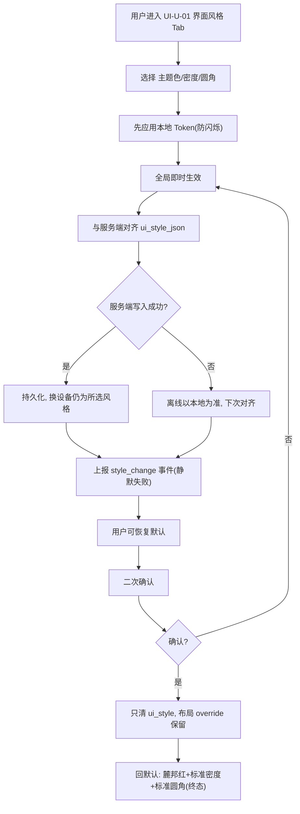

**⑤ 权限说明**

| 角色 | 可见 | 可操作 | 数据范围 | 备注 |
| --- | --- | --- | --- | --- |
| 普通员工 | 本人界面风格设置 | 切三档、恢复默认 | **本人** `ui_style` | `portal:style:self` |
| 门户管理员 | 同左 | 同左 | 本人 | 不提供后台统一强改个人风格 |
| 审计员 | 不涉及 | —— | —— | —— |

**⑥ 业务流程**
对应主 PRD **6.1.4 A1-F06** 与 **UIUX §2.1.2 语义色区分规则**；与决议 #3（不做暗色）、#6（布局与风格分治）一致。本功能是纯前端 Token 层能力，业务链路位置为「个人设置 → 全局视觉生效」。

**⑦ 关键技术点**
- 技术约束：全走 `--bmp-*` Token；**语义色与紧急语义红固定**（H2）；密度/字号/栅格/栏宽/图标尺寸的边界固定（密度只改行高等）。
- 性能要求：切换**零重载**即时生效；Token 注入无 FOUC（防闪烁）。
- 并发/幂等：多端并发以服务端为准；离线以本地为准。
- 失败处理：服务端写入失败降级离线（以本地为准），不阻断使用。

**⑧ 数据逻辑流**
用户选择 → 本地 Token（`data-theme` 等）→ 服务端 `ui_style_json`（**待确认落表**：`portal_user_layout` 增列 vs 独立 `portal_user_pref`）→ `POST /v1/portal/behavior`（`style_change`）→ 消费方：全局 UI 渲染、A1-F09（风格偏好聚合）。

**⑨ 异常与边界**

| # | 异常场景 | 触发条件 | 处理策略 | 是否影响主流程 |
| --- | --- | --- | --- | --- |
| 1 | 服务端写入失败/离线 | 网络异常 | 以本地为准，下次对齐；离线可用 | 否 |
| 2 | 越权（改他人风格） | 伪造 account_id | 服务端按会话身份写入，忽略请求体身份 | 否 |
| 3 | 语义色被主题色误改 | 实现硬编码 | H2 校验走查：语义色不随主题色变 | 否 |

**⑩ 验收标准**
- [ ] 切换后**立即全局生效**且刷新保持（可走查）。
- [ ] 主题色切换：主按钮/链接/选中态同步变色，**success/warning/danger 与紧急语义红完全不变**。
- [ ] 三档密度间距与行高明显不同，**字号视觉无变化**。
- [ ] 「恢复默认」后三维度回默认，**首页布局 override 仍在**（不清布局可走查）。
- [ ] 换设备登录仍为所选风格（主题色/圆角跨端同步）。

**⑪ 待确认项**
| # | 待确认事项 | 责任方 | 影响 | 建议 |
| --- | --- | --- | --- | --- |
| 1 | `ui_style_json` 落表 | 架构师 + 研发 | 数据逻辑流 | 落 `portal_user_layout` 增列或独立 `portal_user_pref`（骨架 §6 #2） |
| 2 | 主题色 4 预设是否需 VI 审核 | 客户 + 设计 | 上线 | 建议提 VI；或收敛 3 档 |
| 3 | 内容密度是否在管理控制台生效 | 产品 | 交互一致性 | 建议仅门户 PC + 移动生效，管理台固定标准档 |
| 4 | 界面风格是否跨端同步 / 移动端独立入口 | 产品 | 移动端 | 主题色+圆角跨端同步；密度分端独立；移动端 V1.5 仅继承 |

---


#### A1-F07 首页通知 Banner

| 项目 | 内容 |
| --- | --- |
| 所属模块 | A1 统一工作台 / 门户域 |
| 优先级 / 版本 | P0 / V1.5 |
| 上游需求 | 产品化新增（个性化与通知 PRD） |
| 依赖功能点 | A1-F04(S)；B1-F01(W) |
| 被依赖功能点 | —— |
| 关联表/接口 | `portal_notice`、`portal_notice_scope`、`portal_notice_read`；关闭记录（`bmp_banner_closed`/`user_preference.banner_closed`，**待确认落表**） |

**① 功能详细描述**
首页顶部展示「**已发布 且 未过期 且 开启了 Banner 展示 且 未关闭**」的公告 Banner；**无匹配项则完全不占位**（**不渲染 DOM**、页面高度 0、无边框、无底色）。**边界（骨架 §3.3 B7）**：本功能**只读公告、只做前台渲染**（不改公告内容）；公告本体与后台开关属 A1-F04；发送侧属 D1-F04。**Banner 不占 cardId、不进时间轴流**。位置：PC 顶栏之下、内容区之前；移动容器导航栏之下、内容之前；**均不吸顶**（保护首屏，待确认）。展示顺序：`top` → `bannerPriority` 降序 → 发布时间降序。**语义色划分**：通知=中性、新闻=主色、**紧急=品牌红 `#C8161D`**（不随主题色改变）。

**② 输入**

| 输入项 | 来源 | 类型/格式 | 必填 | 校验规则 |
| --- | --- | --- | --- | --- |
| 待展示公告集 | `portal_notice`+`portal_notice_scope`（status=已发布、bannerEnabled=true、时段内） | 表数据 | 是 | 命中用户范围；时段外不展示 |
| 已关闭记录 | `portal_notice_read` / 关闭记录（**待确认落表**） | 表数据 | 否 | 按公告 id 记录 |
| 置顶/优先级 | `top` / `bannerPriority` | 布尔 / 整数 | 否 | 排序链输入 |
| 会话身份 | E1 + B1-F01 | String | 是 | 决定范围命中 |

**③ 输出**

| 输出项 | 去向 | 类型/格式 | 说明 |
| --- | --- | --- | --- |
| Banner DOM | PC 首页 / 移动首页 | HTML | 六要素：类型标签+标题+摘要+时间+查看详情+关闭 |
| 轮播状态 | 前端 | 组件状态 | ≥2 条每 6s 切换；hover/触摸暂停 |
| 关闭记录 | 关闭记录（**待确认落表**） | 表数据 | 逐条关闭 |
| 详情跳转 | 公告详情 | 路由 | PC 抽屉 / 移动容器内推进 |

**④ 操作流程**
1. 门户请求公告数据 → 过滤「已发布 + 未过期 + `bannerEnabled` + 时段内 + 命中用户范围」。
2. 计算有条目 → 按 `top`→`bannerPriority` 降序→发布时间降序排序。
3. **有条目 → 渲染 DOM**（PC/移动位置不同，均不吸顶）。
4. **无条目 → 不渲染 DOM**（零占位）。
5. ≥2 条 → 轮播（6s/hover 暂停/尊重减少动效）。
6. 用户关闭某条 → 记录关闭 → 全关后 banner 收起（无留白）。

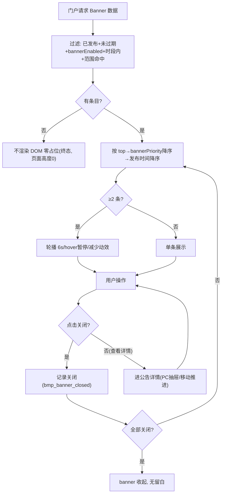

**⑤ 权限说明**

| 角色 | 可见 | 可操作 | 数据范围 | 备注 |
| --- | --- | --- | --- | --- |
| 普通员工 | 命中范围的 Banner | 查看详情、关闭（紧急类型待确认） | `portal_notice_scope` 命中 | `portal:banner:view` |
| 门户管理员 | 全部（后台配置） | Banner 开关/时段/优先级/预览（后台属 A1-F04） | 全部 | 前台不提供管理 |
| 未登录 | 无 | 无 | 无 | 首页需登录 |

**⑥ 业务流程**
对应主 PRD **6.1.5 A1-F07**；数据源复用主 PRD **4.5 统一消息通知流程**中的公告来源，但**Banner 非消息通道**——不占 cardId、不进时间轴流、**不受 D1-F04 去重/频控约束**；公告如需渠道触达**由调用方发起 `/v1/msg/send`，D1 不主动抓取 `portal_notice`**。B1-F02-3（登录页公告）**复用同显隐规则**（待合规确认）。

**⑦ 关键技术点**
- 技术约束：**零占位**是本能力最硬一条——无匹配项时**不渲染 DOM**（非 `display:none`）；不吸顶；不占 cardId、不参与布局引擎。
- 性能要求：Banner 数据与首页同批返回，不额外阻塞首屏。
- 并发/幂等：关闭记录按公告 id 幂等；多次关闭同一 id 不产生副作用。
- 失败处理：公告接口失败 → 不渲染 Banner（静默），不影响首页主体渲染。

**⑧ 数据逻辑流**
`portal_notice`（公告本体 + bannerEnabled/时段/优先级）→ 门户按范围过滤 → 排序渲染 → 用户关闭写关闭记录（**待确认落表**：`bmp_banner_closed` 或 `user_preference.banner_closed`）→ 消费方：PC/移动首页顶部；`portal_notice_read` 供已读统计。

**⑨ 异常与边界**

| # | 异常场景 | 触发条件 | 处理策略 | 是否影响主流程 |
| --- | --- | --- | --- | --- |
| 1 | 空数据（无 Banner） | 无满足条件公告 | **不渲染 DOM**，页面高度 0，无留白 | 否 |
| 2 | 并发（多端关闭） | 多端同时操作 | 按公告 id 记录，各端独立；刷新后一致 | 否 |
| 3 | 越权（未命中范围仍展示） | 范围过滤缺失 | 服务端按 `portal_notice_scope` 过滤，非命中不返回 | 否 |

**⑩ 验收标准**
- [ ] **无公告时 `querySelector('.notice-banner')===null`**，`main` 顶部偏移与无 banner 时**逐像素一致**（P0 验收项）。
- [ ] Banner 不吸顶：滚动时随页面滚走（可走查）。
- [ ] 移动端 375px 展示正常，关闭按钮触控区 **≥44px**。
- [ ] 5 条公告轮播正常；hover 暂停；开启「减少动态效果」后不自动切换。
- [ ] 关闭后刷新不再出现；全部关闭后 banner 收起、无留白。

**⑪ 待确认项**
| # | 待确认事项 | 责任方 | 影响 | 建议 |
| --- | --- | --- | --- | --- |
| 1 | 关闭记录落表（`bmp_banner_closed` vs `user_preference.banner_closed`） | 架构师 + 研发 | 数据逻辑流 | 统一至后端用户偏好表 |
| 2 | PC Banner 是否吸顶 | 产品 + 设计 | 首屏体验 | 建议不吸顶（保护首屏） |
| 3 | 「紧急」类型 Banner 是否可关闭 | 产品 | 交互 | 建议紧急不可关闭 |

---


#### A1-F08 首页页面嵌入（任意页面驻留）

| 项目 | 内容 |
| --- | --- |
| 所属模块 | A1 统一工作台 / 门户域 |
| 优先级 / 版本 | P1 / V1.5 |
| 上游需求 | 产品化新增（页面嵌入与角色模板简报，决议 #5b） |
| 依赖功能点 | I1-F01(S)；B2-F02(S)；A1-F02(S)；B1-F07(W) |
| 被依赖功能点 | —— |
| 关联表/接口 | `portal_card`(multi)、`gov_app_register`(域名白名单)、`portal_user_layout`(embed 实例存档)；`POST /v1/auth/ticket/exchange` |

**① 功能详细描述**
允许把**已注册应用页面**（驾驶舱/大屏/报表）以**受控 iframe 长期驻留**在首页，区别于应用跳转（点图标跳走，#5）。**边界（骨架 §3.3 B2）**：本功能决定「**页面留在首页看**」，**不改变 #5**——应用**图标点击（应用中心/我的订阅/意图流）仍走新标签页**；A1-F01 不承担 iframe 内嵌职责。**决议 #5b 四条约束（必须实现）**：① **必须走白名单**（仅 I1 应用注册登记过的域名/URL 可嵌入；白名单外提示「该域名未在应用注册中登记，需管理员先上架」）；② **必须有降级**（加载失败/超时/被 `X-Frame-Options` 拒绝 → 友好降级：标题 + 「无法在首页内嵌显示」+ 「在新标签页打开」+ 「重试」，**不留白屏**）；③ **必须有加载态**（骨架 + 「正在加载 XXX…」）；④ **不改变 #5**（图标点击仍新标签页；移动端**不渲染 iframe**，改页面入口卡）。多实例：`cardId = embed:<唯一id>` + `params:{url,title,height,icon}`，实例数据与 override **分两个 key 持久化**（避免刷新丢失 URL/标题）。

**② 输入**

| 输入项 | 来源 | 类型/格式 | 必填 | 校验规则 |
| --- | --- | --- | --- | --- |
| 嵌入标题 | 用户（添加弹窗） | String | 是 | 非空 |
| 嵌入 URL | 用户/从「已注册应用」选 | URL | 是 | **须命中白名单**，否则拦截 |
| 高度 | 用户 | 整数（px） | 否 | 默认 320 |
| 白名单域名 | `gov_app_register`（I1 应用注册） | 域名列表 | 是 | 白名单为唯一入口（`isWhitelisted()`） |
| 实例 params | 用户 → 实例存档（原型 `bmp_embed_cards`，正式后端按 `account_id`） | JSON | 是 | cardId=`embed:<唯一id>` |
| 一次性 ticket | `POST /v1/auth/ticket/exchange` | ticket | 是 | 5min TTL、one-time |

**③ 输出**

| 输出项 | 去向 | 类型/格式 | 说明 |
| --- | --- | --- | --- |
| 嵌入卡片实例 | 首页 cardId `embed:<id>` | JSON | 多实例互不干扰 |
| 实例存档 | 实例存档（`bmp_embed_cards`，**待确认落表**） | JSON | 与 override 分治 |
| iframe 渲染 | 首页 | HTML | `sandbox` **不含 `allow-same-origin`** |
| 降级卡 | 首页 | HTML | 失败时不白屏 |
| 移动端入口卡 | 移动首页 | HTML | 不渲染 iframe，改「打开」→ 新标签页（#5） |

**④ 操作流程**
1. 管理员在 I1 注册应用 → 写 `gov_app_register`（含域名白名单）。
2. 首页编辑模式 → 「＋ 添加页面卡片」弹窗 → 填标题 + URL（可从未「已注册应用」选）+ 高度。
3. `isWhitelisted(url)` 校验：非白名单 → 拦截并提示。
4. 通过 → 生成 `cardId=embed:<唯一id>` + params，写实例存档（与 override 分治）。
5. 渲染 iframe（容器 + 骨架加载 + 「正在加载 XXX…」）；会话经 `POST /v1/auth/ticket/exchange` 换取（**不共享 Cookie**）。
6. 失败/超时/被拒 → 降级卡；移动端 → 入口卡（不渲染 iframe）。

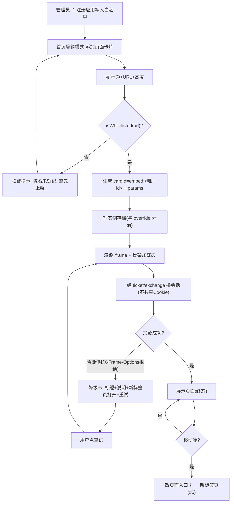

**⑤ 权限说明**

| 角色 | 可见 | 可操作 | 数据范围 | 备注 |
| --- | --- | --- | --- | --- |
| 普通员工 | 角色模板分配的嵌入卡 | 查看、重试、新标签页打开、显隐/换栏（个人微调） | 本人 override + 实例存档 | `portal:embed:view` |
| 门户管理员 | 全部 | 配嵌入卡模板物料、维护白名单（UI-C-10/11）、按角色预览 | 全部 | `portal:embed:manage` |
| 超级管理员 | 全部 | 全部 | 全部 | 兜底 |

**⑥ 业务流程**
对应主 PRD **6.1.6 A1-F08** 与 **UIUX §5.3/决议 #5b**；会话机制对应详设 **§6.2 老系统认证适配层** 中「一次性 ticket（5min TTL，one-time）→ `/v1/auth/ticket/exchange`」。本功能是决议 #5b 的唯一落地载体，**与 #5 并行不矛盾**。

**⑦ 关键技术点**
- 技术约束：`sandbox` **不含 `allow-same-origin`**（正确安全取舍）；iframe 会话靠一次性 ticket，**不共享 Cookie**（故不产生会话冲突，即 #5 顾虑可解）。
- 性能要求：加载超时建议 **8s**；嵌入卡懒加载。
- 并发/幂等：多实例 cardId 唯一（`embed:<唯一id>`），override 按 cardId 精确匹配，各实例独立拖拽/换栏/显隐。
- 失败处理：`onerror`/超时/被拒 → 降级卡（不留白屏）；移动端不渲染 iframe。

**⑧ 数据逻辑流**
I1 注册（`gov_app_register` 域名白名单）→ 用户添加（写 `portal_card.multi=true` 模板物料 + 实例存档 params）→ 运行时按 `cardId=embed:<id>` 渲染，会话经 `POST /v1/auth/ticket/exchange` → 消费方：首页（PC iframe / 移动入口卡）、UI-C-10/11 后台配置。

**⑨ 异常与边界**

| # | 异常场景 | 触发条件 | 处理策略 | 是否影响主流程 |
| --- | --- | --- | --- | --- |
| 1 | 第三方失败（目标页拒嵌） | `X-Frame-Options: DENY` | 降级卡（标题+说明+新标签页打开+重试），**不留白屏** | 否 |
| 2 | 白名单外域名 | 手填非法 URL | 拦截并提示，不渲染 iframe | 否 |
| 3 | 会话失败（ticket 过期/一次性已用） | ticket 超 5min 或重复使用 | 降级卡可选「新标签页打开」；不阻塞其他卡片 | 否 |
| 4 | 移动端越界 | 窄屏嵌大屏 | **移动端不渲染 iframe**，改入口卡（#5） | 否 |

**⑩ 验收标准**
- [ ] 同一首页可并存 **≥2 个嵌入卡**，各自独立拖拽/显隐/换栏（可走查）。
- [ ] 填无效 URL → **降级卡，不白屏**；加载中可见骨架。
- [ ] 非白名单域名被拦截且**不渲染 iframe**。
- [ ] 移动端**无 iframe**，入口卡渲染且可打开。
- [ ] 应用图标点击（应用中心/我的订阅/意图流）**仍走新标签页**（不改 #5 可走查）。
- [ ] 刷新后嵌入卡的 URL/标题**不丢失**（params 与 override 分治可验证）。

**⑪ 待确认项**
| # | 待确认事项 | 责任方 | 影响 | 建议 |
| --- | --- | --- | --- | --- |
| 1 | 嵌入实例存档正式落表 | 架构师 + 研发 | 数据逻辑流 | 建议独立实例存档表（按 `account_id`） |
| 2 | 白名单数据源读取实现 | 架构师 + 研发 | 生产可用 | 读后端 I1 应用注册域名白名单（原型内预置） |
| 3 | 加载超时阈值（8s）是否可配 | 产品 | 体验 | 建议默认 8s 可配 |

---


#### A1-F09 应用运营看板（后台）

> **原型/UI 同步（2026-10-21）**：页面编号仍为 **UI-C-17**（A1-F09 四区块）；**侧栏入口**为「总览 → 运营总览看板」，console **`page=dashboard`**（单页：**5 项 KPI 指标卡单行** + UI-C-17 门户运营图表）。书签 **`app-analytics`** 重定向至 `dashboard`（与 UIUX §3.4 路由 `/console/portal/ops-dashboard` 语义一致，实现层 canonical key 为 `dashboard`）。**不含**原 UIUX §6.4 原型中的 **8 项实施 Checklist 长列表**（实施导航仍按 §6.4 旅程逐步配置，不占用本看板首屏）。

| 项目 | 内容 |
| --- | --- |
| 所属模块 | A1 统一工作台 / 门户域（后台 **UI-C-17**，挂载 **`dashboard` 运营总览看板**） |
| 优先级 / 版本 | P1 / V1.5（与 A1-F05 埋点同批） |
| 上游需求 | 产品化新增（文档一致性同步与应用运营看板-规格简报） |
| 依赖功能点 | A1-F01(S)；A1-F05(S)；I1-F01(S)；E2-F01(W) |
| 被依赖功能点 | OPS-F01 |
| 关联表/接口 | `portal_behavior_event`、`portal_app`、`gov_app_register`；`POST /v1/portal/behavior`（只读复用） |

**① 功能详细描述**
面向管理员的**应用使用情况产品分析视图**（**UI-C-17** 四区块，与平台运维 KPI **同页**展示：`console.html?page=dashboard`，路由映射 `/console/portal/ops-dashboard`；书签 alias `app-analytics` → `dashboard`）：应用调用量趋势 / 活跃应用排名 / 中台能力使用分布 / 异常下降告警。**三条硬边界（PRD 6.1.9 已定，必须写入）**：**H1 数据源复用 A1-F05 埋点通道**（唯一来源 `POST /v1/portal/behavior`，**不另起一套采集**）；**H2 不与 E2 审计混存**（审计=合规留痕 ≥6 个月/不可篡改/分库分权；埋点=产品分析 90 天/权限不同；**不得混存于 `audit_*` 表**）；**H3 无数据态必须显示引导**（埋点未就绪/数据不足时显示明确引导文案，**不留空白图表**、禁止空坐标轴/0 值假图）。**边界（骨架 §3.3 B9）**：看板**仅管理员可见**（挂 `sys_permission` 菜单权限）；员工个人行为**不做跨人画像**；埋点关闭（A1-F05-5）后对应区间显示「该周期已停止采集」。子项 A1-F01-1（能力使用总览）/ A1-F01-2（接入状态视图）为 UI-C-10 应用详情内区块。

**② 输入**

| 输入项 | 来源 | 类型/格式 | 必填 | 校验规则 |
| --- | --- | --- | --- | --- |
| 行为事件（app_open 等） | `portal_behavior_event`（A1-F05 埋点落库） | 表数据 | 是 | 只读聚合；保留 90 天 |
| 应用清单 | `portal_app`、`gov_app_register` | 表数据 | 是 | 无权限应用不参与（先权限后统计） |
| 时间粒度/周期 | 管理员 | 枚举（日/周/月） | 否 | 默认日 |
| 告警阈值/环比参数 | 管理员 | 数值/配置 | 否 | 阈值可配；可抑制误报 |
| 能力登记数据（子项/分布） | 各能力登记 + 服务端统计 | 表数据 | 否 | 见待确认项 |

**③ 输出**

| 输出项 | 去向 | 类型/格式 | 说明 |
| --- | --- | --- | --- |
| 调用量趋势 | UI-C-17 区块① | 图表 | 按应用/时间；**仅埋点聚合** |
| 活跃应用排名 | UI-C-17 区块② | 列表 | 与前端「最近使用」同源同口径；可下钻能力使用总览 |
| 中台能力使用分布 | UI-C-17 区块③ | 图表 | SSO/权限/待办/消息/文件/工作流/通知 |
| 异常下降告警 | UI-C-17 区块④ | 告警 | 联动 D1 消息 |
| 无数据态引导 | UI-C-17 | 文案 | 「数据采集中，预计 X 后可见」「去开启智能排序以开始采集」 |

**④ 操作流程**
1. 管理员进入 **总览 → 运营总览看板**（`dashboard` / UI-C-17 区块；校验 `sys_permission` 菜单权限）。
2. 选择应用 / 时间维度 / 粒度。
3. 后端仅从 `portal_behavior_event` 聚合（H1），按周期分组计数。
4. 有数据 → 渲染四区块。
5. **无数据/数据不足 → 显示引导文案**（H3），不渲染空图表。
6. 异常下降（阈值/环比）→ 触发告警，联动 D1 消息。
7. 排名项可下钻 UI-C-10 应用详情「能力使用总览」（子项）。

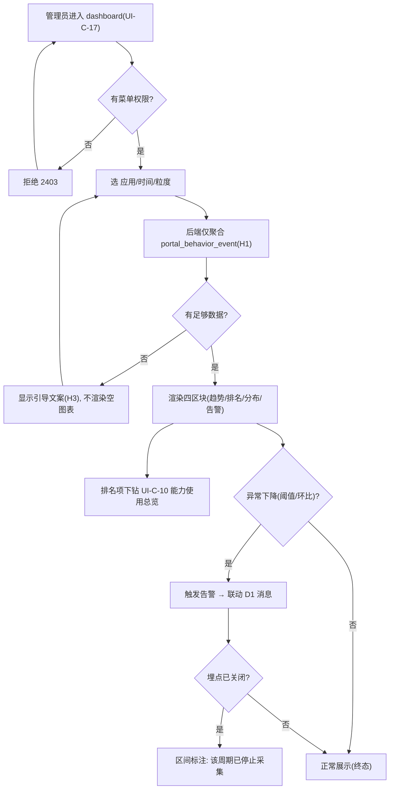

**⑤ 权限说明**

| 角色 | 可见 | 可操作 | 数据范围 | 备注 |
| --- | --- | --- | --- | --- |
| 门户管理员 | 看板全部 | 查看、切换维度、下钻、配置告警阈值 | 聚合口径（**不看跨人个人明细**） | 菜单权限挂 `sys_permission`；`portal:ops-dashboard:view` |
| 超级管理员 | 看板全部 | 全部 | 全部 | 兜底 |
| 普通员工 | **不可见** | 无 | 无 | 仅管理员可见 |
| 审计员 | 通过 E2 检索（非本看板） | —— | 合规范围 | 两者分权（H2） |

**⑥ 业务流程**
对应主 PRD **6.1.9 A1-F09**（含 H1/H2/H3）与 **UI-C-17**；数据链路对应主 PRD **5.4 日志审计流**之外的**独立埋点流**（**H2 明确分离**）；下游供 **OPS-F01 运营度量**。本功能位于「埋点采集 → 产品分析 → 运营洞察」链路的分析端。

**⑦ 关键技术点**
- 技术约束：**H1** 只复用 `POST /v1/portal/behavior` 通道、**不另起采集**；**H2** 与 E2 审计**分库分权**（不写/不读 `audit_*` 表做产品分析）；**H3** 无数据态必须引导。
- 性能要求：看板聚合查询 P95 <2s；大周期走预聚合/缓存。
- 并发/幂等：聚合只读，天然幂等；告警去重防抖。
- 失败处理：埋点关闭 → 区间标注「已停止采集」；聚合失败 → 降级展示上次结果并提示。

**⑧ 数据逻辑流**
前端行为 → `POST /v1/portal/behavior`（6 类事件）→ 落 `portal_behavior_event`（`bmp_portal`，90 天）→ 看板**只读聚合**（按应用/时间/能力）+ `portal_app`/`gov_app_register` 应用清单 + 能力登记 → 消费方：UI-C-17 四区块、UI-C-10「能力使用总览」（子项）、OPS-F01 运营度量。**与 E2 `audit_*` 分库分权、不混存**。

**⑨ 异常与边界**

| # | 异常场景 | 触发条件 | 处理策略 | 是否影响主流程 |
| --- | --- | --- | --- | --- |
| 1 | 空数据（采集未积累） | 新上线/无 `app_open` | **显示引导文案，不渲染空图表**（H3） | 否 |
| 2 | 越权（非管理员访问） | 无菜单权限 | 返回 `2403`，不返回任何统计 | 否 |
| 3 | 埋点关闭（智能排序关闭即停采） | A1-F05-5 关闭 | 对应区间标注「该周期已停止采集」 | 否 |
| 4 | 告警误报 | 阈值过敏感 | 阈值可配 + 误报抑制 | 否 |

**⑩ 验收标准**
- [ ] 看板页可打开、四区块齐备；**无数据时有引导不空白**（H3 可走查）。
- [ ] 趋势与埋点事件数**口径一致**（同源校验）。
- [ ] 排名与前端「最近使用」**同源同口径**；无权限应用不参与排名。
- [ ] 看板数据**与 E2 审计分库分权**：查 `audit_*` 表无产品分析写入（H2 可验证）。
- [ ] 模拟下降时产生告警并可追溯；告警可联动 D1 消息。
- [ ] 子项：UI-C-10「能力使用总览」七类能力逐项可读，「接入状态视图」与 4.6 七步一一对应。

**⑪ 待确认项**
| # | 待确认事项 | 责任方 | 影响 | 建议 |
| --- | --- | --- | --- | --- |
| 1 | 「能力使用分布」数据源（纯埋点 vs 埋点 + 既有能力调用统计） | 产品 + 架构师 | 区块③口径 | 建议后者：SSO/权限等基础能力调用量由服务端统计，埋点补业务侧（详设 §14.3 #5） |
| 2 | `freq` 由静态值切换为埋点累计的灰度切点 | 架构师 + 研发 | A1-F09-2 | 与冷启动阈值一致（<20 条或 <7 天 → 固定排序） |
| 3 | 异常下降告警默认阈值基线 | 产品 + 客户 | 告警灵敏度 | 上线后按实际基线调优 |

---

#### A2-F01 双载体适配

| 项目 | 内容 |
| --- | --- |
| 所属模块 | A2 统一移动端 / 入口层 L1 · 门户域 |
| 优先级 / 版本 | P0 / V1.0 |
| 上游需求 | BMP-P0-06（统一移动端）|
| 依赖功能点 | J2-F03(S) |
| 被依赖功能点 | A2-F02；A2-F04 |
| 关联表/接口 | `msg_channel`(channel_type=intranet/email/dingtalk/wecom/sms) + `gov_app_register`；H5 页面路由 `/m/*` |

**① 功能详细描述**
A2-F01 解决「一套移动端 H5 同时运行在钉钉与企微两个容器」的**框架适配**问题：以 375px 为基准做 vw 弹性适配，处理容器导航栏（44px，由容器提供，页面不自绘）、状态栏、底部 home indicator 安全区（`env(safe-area-inset-bottom)`）与容器差异（扫码/选人/返回行为）。
**边界**：A2-F01 是**「框架/容器适配」**（尺寸、安全区、API 抹平）；A2-F05 是**「导航结构」**（底部 Tab 的五项与层级）——**A2-F01 不定义导航项，A2-F05 不处理尺寸与安全区**。载体主/备由后台配置（`msg_channel` + 应用注册），**切换主载体不影响历史消息触达**。

**② 输入**

| 输入项 | 来源 | 类型/格式 | 必填 | 校验规则 |
| --- | --- | --- | --- | --- |
| `containerType` | 前端探测（UA + jsapi 可用性） | enum:`dingtalk`/`wecom`/`h5` | 是 | 无法识别时置 `h5`（降级为普通浏览器） |
| 主/备载体配置 | 后台（`msg_channel.enabled` + `priority`） | JSON | 是 | 两载体至少一个 `enabled=true` |
| 视口宽度 | 运行时 | number(px) | 是 | 以 375 为基准换算 vw；≥768 提示「建议用 PC 端」 |
| 安全区高度 | 运行时 `env(safe-area-inset-bottom)` | length | 否 | 容器内为 0 时按 0 处理 |

**③ 输出**

| 输出项 | 去向 | 类型/格式 | 说明 |
| --- | --- | --- | --- |
| 统一容器上下文对象 | 业务页面（`@bmp/utils` container 模块） | `{containerType, navHeight:44, safeAreaBottom, scan(), pickUser(), back()}` | 业务代码不感知载体 |
| 自适应样式变量 | 页面 CSS | `--tabbar-h` / `--home-ind-h` / `--bottom-chrome` | 供 A2-F05 共用 |
| 载体适配日志 | E2（`audit_operation_log` 可选） | 事件 | 记录探测结果与降级（埋点/审计分库） |

**④ 操作流程**（主流程 + 异常分支 + 回退路径）
1. 容器内打开 H5 → 前端 `container` 模块探测 `containerType`；
2. 加载容器 SDK（钉钉 `dingtalk-jsapi` / 企微 `wx.agentConfig`）→ 抹平导航栏、返回、扫码、选人 API；
3. 注入 vw 基准与安全区变量（`--bottom-chrome`）→ 渲染页面（含顶部 44px 容器导航栏由容器提供）；
4. 探测失败/容器外 → 走 `h5` 降级（保留安全区计算，隐藏容器专属能力）；
5. 页面渲染完成 → 上报适配结果。

```mermaid
flowchart TD
    A["容器内打开 H5"] --> B{"探测容器类型"}
    B -->|"dingtalk"| C["加载 dingtalk-jsapi"]
    B -->|"wecom"| D["加载 wx.agentConfig"]
    B -->|"未知/容器外"| E["降级 h5"]
    C --> F["注入 vw 基准 + 安全区变量"]
    D --> F
    E --> F
    F --> G["渲染页面（含 44px 容器导航栏）"]
    G --> H{"容器 API 可用?"}
    H -->|"是"| I["启用扫码/选人/返回"]
    H -->|"否"| J["隐藏容器专属能力<br/>(按钮置灰+文案提示)"]
    I --> K["终态：页面可用"]
    J --> K
```

**⑤ 权限说明**

| 角色 | 可见 | 可操作 | 数据范围 | 备注 |
| --- | --- | --- | --- | --- |
| 全员（已登录） | 移动端全部页面 | 按各功能点权限 | 本人 | 适配层本身无数据权限，仅框架 |
| 管理员 | 载体配置（后台 `msg_channel` + 应用注册） | 切换主/备载体 | 全租户 | 需 `sys_permission` 渠道管理权限点 |

**⑥ 业务流程**
属主 PRD **4.1 统一登录与 SSO 流程**的移动端分支（载体侧）与 **4.6 存量系统接入流程**移动端载体项；为 A2-F02 免登的**容器前置**。在 4.2 待办流程中承担「移动端载体承载」。

**⑦ 关键技术点**
- 技术约束：`container` 模块统一封装，业务代码不写 `if(dingtalk)` 分支；仅浅色主题（决议 #3）。
- 性能要求：容器 SDK 加载不阻塞首屏（异步/懒加载），首屏可交互 ≤2s（4G）。
- 并发/幂等：无状态；同页面多次探测结果一致（结果缓存于会话）。
- 失败处理：SDK 加载失败 → 3s 超时降级为 `h5`，不白屏；企微 jsapi 签名失败 → 回退静默 OAuth。

**⑧ 数据逻辑流**
前端探测 `containerType` → `container` 模块抹平差异 → 注入 CSS 变量 → 页面渲染；载体配置来源 `msg_channel`(bmp_msg) + `gov_app_register`(bmp_gov) → 后台写、前台读 → 供 D1 消息渠道路由与 A2-F02 免登消费。

**⑨ 异常与边界**

| # | 异常场景 | 触发条件 | 处理策略 | 是否影响主流程 |
| --- | --- | --- | --- | --- |
| 1 | 容器外打开（普通浏览器） | `containerType=未知` | 降级 `h5`，保留安全区算法，隐藏容器专属能力 | 否（降级可用）|
| 2 | 容器 SDK 加载超时 | 网络差/jsapi 不可用 | 3s 超时 → `h5` 降级；记录 `fail_reason` | 否 |
| 3 | 超大屏（≥768px） | 平板/桌面浏览器 | 提示「建议使用 PC 端」并提供跳转，不强行拉伸 | 否 |

**⑩ 验收标准**
- [ ] 钉钉与企微容器内均可打开 `/m/home`，顶部 44px 导航栏由容器提供，页面不自绘标题栏。
- [ ] 真机（iOS 有 home indicator）底部内容不被遮挡，`env(safe-area-inset-bottom)` 生效（走查截图逐像素对比）。
- [ ] 容器外以 `h5` 打开不白屏、不报错，容器专属入口置灰并给出文案。
- [ ] 后台切换主载体后，**配置生效 ≤5 分钟**（沿用主 PRD 6.1 验收），历史消息触达不受影响。

**⑪ 待确认项**

| # | 待确认事项 | 责任方 | 影响 | 建议 |
| --- | --- | --- | --- | --- |
| 1 | 企微容器「扫码/选人」API 差异是否统一到 `container` 同一接口签名 | 架构师 + 前端 | 影响 J2-F03/A2-F01 适配成本 | 建议统一为 `container.scan()/pickUser()`，差异内聚 |
| 2 | 移动端域名与容器可信域名白名单（内网部署）| 架构师 + 运维 | 影响容器内打开可行性 | 部署前登记，见 E1/I1 |

---

#### A2-F02 移动免登

| 项目 | 内容 |
| --- | --- |
| 所属模块 | A2 统一移动端 / 入口层 L1 · 门户域 |
| 优先级 / 版本 | P0 / V1.0 |
| 上游需求 | BMP-P0-06（统一移动端）|
| 依赖功能点 | A2-F01(S)；B1-F02(S)；J2-F03(S) |
| 被依赖功能点 | —— |
| 关联表/接口 | `sys_account`、`sys_account_mapping`、`sys_session`、`audit_login_log`；`POST /v1/auth/mobile-login`（UIUX v1.1 口径）/ 详细设计口径 `/v1/auth/dingtalk/login` |

**① 功能详细描述**
A2-F02 解决「容器内打开移动端**无登录界面**」问题：容器内 jsapi 获取**免登码** → 后台用连接器换取 unionId → 经 B3 账号映射换 `account_id` → **签发标准 JWT** → 直达页面。
**边界**：免登是「**容器内静默换 token**」的通道，**token 签发规则与有效性由 B1-F02（SSO）主责**，A2-F02 只做「免登码 → 换 token」的移动侧适配，**不定义令牌有效期、不改 SSO 主链路**（对照骨架 §3.3 B5）。免登失败降级链（**容器免登 → 静默 OAuth → 登录页兜底**）为**硬要求**。

**② 输入**

| 输入项 | 来源 | 类型/格式 | 必填 | 校验规则 |
| --- | --- | --- | --- | --- |
| 免登码 `authCode` | 容器 jsapi（钉钉/企微） | string | 是 | 一次性、有效期短（秒级）；过期需重取 |
| `containerType` | A2-F01 | enum | 是 | 决定走哪套连接器 |
| 账号映射 | B3-F03 `sys_account_mapping` | 关系 | 是 | unionId → account_id 必须命中 |
| 账号状态 | `sys_account.status` | enum | 是 | 停用/锁定/离职 → 拒绝签发 |

**③ 输出**

| 输出项 | 去向 | 类型/格式 | 说明 |
| --- | --- | --- | --- |
| 标准 JWT | 前端（存 `userStore`） | `Bearer` token | 与 PC 端同源同权 |
| 会话记录 | `sys_session` | 行 | 建立移动端会话 |
| 登录日志 | `audit_login_log` | 行 | `login_type=免登`、`client_type`、`result`、`fail_reason` |
| 降级指令 | 前端 | enum:`silent_oauth`/`login_page` | 免登失败时下发 |

**④ 操作流程**
1. 容器内打开 `/m/*` → `container` 模块调 jsapi 取免登码（≤2s）；
2. 前端 `POST /v1/auth/mobile-login`（携 `authCode` + `containerType`）；
3. B1/连接器用免登码换 unionId → B3 映射 `account_id` → 校验 `sys_account.status`；
4. 通过 → 签发 JWT + 建 `sys_session` + 写 `audit_login_log` → 返回前端直达页面；
5. 失败 → 按降级链：容器免登失败 → **静默 OAuth** → 仍失败 → **登录页兜底**（H5 登录页，复用 B1-F02 登录页）。
6. JWT 就绪前页面显示**骨架**（不显示登录界面）。

```mermaid
flowchart TD
    A["容器内打开 /m/*"] --> B["jsapi 取免登码"]
    B --> C{"取码成功?"}
    C -->|"否"| D["降级：静默 OAuth"]
    C -->|"是"| E["POST /v1/auth/mobile-login"]
    E --> F["换 unionId + 命中账号映射"]
    F --> G{"映射命中且账号可用?"}
    G -->|"否"| H["降级：登录页兜底（H5）"]
    G -->|"是"| I["签发 JWT + 建会话 + 写登录日志"]
    I --> J["直达页面（JWT 就绪前显示骨架）"]
    D --> K{"OAuth 成功?"}
    K -->|"是"| I
    K -->|"否"| H
    J --> L["终态：免登进入"]
```

**⑤ 权限说明**

| 角色 | 可见 | 可操作 | 数据范围 | 备注 |
| --- | --- | --- | --- | --- |
| 容器内员工 | 本人工作台 | 免登进入 | 本人 | 无登录界面 |
| 容器外/未映射用户 | 登录页 | 账密/OAuth 登录 | 本人 | 降级路径 |
| 停用/离职账号 | 拒绝进入 | —— | —— | 返回明确错误码（2xxx）|

**⑥ 业务流程**
属主 PRD **4.1 统一登录与 SSO 流程**的移动端免登分支；**4.3 组织人员异动联动流程**的下游之一（离职账号 24h 内停用 → 免登被拒 → 会话失效）。在 4.2 待办流程中为「移动端进入待办」的前置。

**⑦ 关键技术点**
- 技术约束：免登码**一次性**、短时效；连接器侧持 AppKey/Secret（AES 加密存 `msg_channel.config`），前端不持有。
- 性能要求：免登全程 ≤2s 直达（UIUX 8.5「免登无感 ≤2s」）。
- 并发/幂等：同一 `authCode` 只可消费一次（防重放）；重复提交同码返回已使用错误。
- 失败处理：三级降级链；每级失败写 `audit_login_log.fail_reason`；连续失败可触发 E2 异常行为分析。

**⑧ 数据逻辑流**
容器 jsapi → 免登码 → 连接器换 unionId → `sys_account_mapping` 映射 `account_id`（bmp_sys）→ 校验 `sys_account.status` → 签发 JWT 写 `sys_session`(bmp_sys) + `audit_login_log`(bmp_audit) → 前端 `userStore` 持有 → 各业务 API 携 Bearer。

**⑨ 异常与边界**

| # | 异常场景 | 触发条件 | 处理策略 | 是否影响主流程 |
| --- | --- | --- | --- | --- |
| 1 | 容器外打开（无 jsapi） | 普通浏览器 | 直接进降级链 → 登录页兜底 | 否（降级）|
| 2 | 免登码失效/已被消费 | 超时或重放 | 返回已使用错误，前端重取一次；再失败进降级链 | 否 |
| 3 | 账号映射未命中（新员工） | B3 尚未同步 | 降级登录页；提示「账号未开通，请联系管理员」 | 否 |
| 4 | 账号停用/锁定/离职 | `sys_account.status` 异常 | 拒绝签发并返回 2xxx 错误码；不建会话 | 是（拒绝进入，符合预期）|

**⑩ 验收标准**
- [ ] 钉钉与企微容器内打开 `/m/*`，**无登录界面**，≤2s 直达页面。
- [ ] 同一免登码重放返回「已使用」错误，不产生第二个会话。
- [ ] 容器外打开触发降级链，最终可用 H5 登录页登录成功。
- [ ] 停用账号免登被拒并写 `audit_login_log`（`result=失败` + `fail_reason`）。
- [ ] 免登成功率 ≥99%（沿用主 PRD 6.1 验收）。

**⑪ 待确认项**

| # | 待确认事项 | 责任方 | 影响 | 建议 |
| --- | --- | --- | --- | --- |
| 1 | **免登接口路径三处口径不一**：UIUX v1.1 为 `POST /v1/auth/mobile-login`；详细设计 v1.1 §7 为 `/v1/auth/dingtalk/login`；主 PRD 6.1 为 `POST /mobile/oauth/callback` | 架构师 + B1 负责人 | 影响接口契约一致性（评审重点）| 建议**统一为 `/v1/auth/mobile-login`**，`containerType` 区分钉钉/企微；回写详细设计与主 PRD |
| 2 | 移动端会话有效期/刷新策略是否与 PC 一致 | B1 负责人 | 影响安全与体验 | 建议沿用 B1-F07 统一策略 |
| 3 | 静默 OAuth 的具体协议（钉钉/企微各自） | 架构师 + J2 | 影响降级实现 | 建议在 J2-F03 连接器内实现 |

---

#### A2-F03 移动待办与审批

| 项目 | 内容 |
| --- | --- |
| 所属模块 | A2 统一移动端 / 入口层 L1 · 门户域 |
| 优先级 / 版本 | P0 / V1.0 |
| 上游需求 | BMP-P0-06（统一移动端）|
| 依赖功能点 | A4-F02(S)；C3-F01(S)；B1-F07(S) |
| 被依赖功能点 | C3-F03 |
| 关联表/接口 | `portal_todo`(只读展示)、`wf_task`/`wf_process_instance`/`wf_approval_record`（**只读，经 C3-F03 消费**）；`GET /v1/todo/list?view=todo\|done\|initiated`；站内办理接口 `POST /v1/workflow/task/{taskId}/complete` **由 C3-F03 承载，本点仅引用、不直连** |

**① 功能详细描述**
A2-F03 解决「移动端**待办与审批的载体承载 + 入口跳转**」问题：移动端呈现待办列表（数据来自 A4-F02 聚合）、打开审批详情（`UI-M-03`）、对**未接入中台工作流（C1）**的审批**跳转原系统**（`jumpUrl`，新标签页 + SSO）；另含**卡片触达与点击入口**及扫码（文件/资产）。对**已接入中台工作流（C1）**的站内审批，本点**仅提供入口与载体**，**同意/驳回的办理动作引用 C3-F03 的移动办理能力**完成，**A2-F03 不承载办理逻辑**。
**边界（引用骨架 §3.3 B13，硬要求）**：**A2-F03 决定「移动端待办与审批的载体承载」**（钉钉/企微容器内的呈现、免登、卡片触达、点击入口）；**C3-F03 决定「中台自有流程任务的移动办理动作」**（`/v1/workflow/task/{id}/complete` 的移动端发起）。**A2-F03 不承载 C1 流程的办理逻辑，C3-F03 不重做移动端载体。**
此外：「待办从哪来、如何聚合」由 **A4-F01/F02** 决定；「审批视图如何统一」由 **C3-F01** 决定；A2-F03 **不改变办理人、不改变聚合口径**（对照骨架 §3.3 B3），移动审批动作与 PC **同源同权**（走 B2 统一鉴权）。

**② 输入**

| 输入项 | 来源 | 类型/格式 | 必填 | 校验规则 |
| --- | --- | --- | --- | --- |
| 待办列表数据 | A4-F02 / `GET /v1/todo/list` | 分页 JSON | 是 | `view ∈ {todo,done,initiated}` |
| 站内办理动作 | 用户操作（**经 C3-F03 提交**）| enum:`approve`/`reject` | 否 | 由 C3-F03 承载；驳回意见必填（C1 规则）|
| `idempotencyKey` | 前端生成（**传 C3-F03**）| string | 否（办理时）| 幂等由 C3-F03 保证 |
| 扫码输入 | 容器 jsapi 扫码 | 码值 | 否 | 文件/资产码格式校验 |

**③ 输出**

| 输出项 | 去向 | 类型/格式 | 说明 |
| --- | --- | --- | --- |
| 移动待办列表/详情 | 前端 UI-M-02/03 | 视图 | 与 PC 实时一致 |
| 站内办理入口 | C3-F03（移动办理能力）| 调用 | 同意/驳回动作由 C3-F03 执行 |
| 待办状态更新 | `portal_todo.status` | TINYINT | 经 C3-F03 办理/源系统回写后消除，转已办 |
| 扫码结果 | 业务页面 | 业务对象 | 文件/资产定位 |

**④ 操作流程**
1. 底部 Tab 进入「待办」→ `GET /v1/todo/list?view=todo`（移动端呈现，A4-F02 数据）；
2. 点击待办 → 打开 `UI-M-03` 审批详情（标题 + 来源系统标签 + 发起人/时间 + 业务摘要 key-value）；
3. 判断办理方式：**站内**（已接 C1）→ **调用 C3-F03 的移动办理能力**完成同意/驳回；**跳转**（未接 C1）→ 跳 `jumpUrl` 新标签页（带 SSO）；
4. **站内办理（引用 C3-F03）** → C3-F03 内部调 `POST /v1/workflow/task/{taskId}/complete`（携 `idempotencyKey`）→ 待办即时消除；
5. 跳转办理 → 原系统处理后回调 `/v1/todo/{todoId}/complete` → 列表移除；
6. 扫码 → 调容器扫码 → 定位业务对象。

```mermaid
flowchart TD
    A["底部 Tab: 待办"] --> B["GET /v1/todo/list?view=todo"]
    B --> C["打开审批详情 UI-M-03"]
    C --> D{"站内(已接 C1) 或 跳转?"}
    D -->|"站内"| E["引用 C3-F03 移动办理能力<br/>(同意/驳回)"]
    D -->|"跳转"| F["新标签页打开 jumpUrl（带 SSO）"]
    E --> G{"办理成功?"}
    G -->|"是"| H["待办即时消除 → 转已办"]
    G -->|"否(幂等/权限)"| I["提示错误码，保留待办"]
    F --> J["原系统处理 → 回调 /v1/todo/{id}/complete"]
    J --> H
    H --> K["终态：移动/PC 状态一致"]
```

**⑤ 权限说明**

| 角色 | 可见 | 可操作 | 数据范围 | 备注 |
| --- | --- | --- | --- | --- |
| 待办处理人 | 本人待办/已办/我发起的 | 站内办理（**经 C3-F03**）、跳转、扫码 | 本人 | 办理人须为 assignee 或其代理人（7004 校验，由 C3-F03/C1 判定）|
| 非处理人 | 不可见他人待办 | —— | —— | 默认只可见本人；C3 管理员视图另计 |

**⑥ 业务流程**
属主 PRD **4.4 统一审批流程**的移动端分支与 **4.2 跨系统待办聚合与处理流程**的移动端呈现；「站内/跳转」分支对应 4.2 业务规则 3（已接 C1 站内完成，否则跳转）——**站内完成部分经 C3-F03 承载**。

**⑦ 关键技术点**
- 技术约束：**站内办理不在 A2-F03 承载**，引用 C3-F03 的移动办理能力（C3-F03 复用 C1-F06-2 接口）；驳回意见必填；V1.0 审批人**只读表单**（C2-F01-5），无字段编辑态。
- 性能要求：列表首屏 P95 <1s；移动/PC 状态一致性 100%。
- 并发/幂等：**办理幂等由 C3-F03 保证**（本点不重复实现 `idempotencyKey` 校验）。
- 失败处理：站内办理失败（7002/7004/7005，经 C3-F03 返回）保留待办并提示；跳转源系统不可达 → 见 A4-F03 兜底。

**⑧ 数据逻辑流**
A4-F02 聚合 `portal_todo`(bmp_portal) + `wf_task`(bmp_wf) → 移动端 `GET /v1/todo/list` 渲染（**只读**）；站内办理经 **C3-F03** 写 `wf_task`/`wf_approval_record`(bmp_wf) 并回调更新 `portal_todo.status`(bmp_portal)；跳转类由源系统回写。 → 消费方：A2-F03 列表、A2-F05 角标。

**⑨ 异常与边界**

| # | 异常场景 | 触发条件 | 处理策略 | 是否影响主流程 |
| --- | --- | --- | --- | --- |
| 1 | 任务已被他人/他端办理 | 并发办理 | 返回 7002/幂等冲突，提示「任务已被处理」，刷新列表 | 否（提示重试）|
| 2 | 无办理权限 | 非 assignee 也非代理人 | 返回 7004，禁用操作按钮 | 否 |
| 3 | 跳转源系统不可达 | 网络/系统故障 | 走 A4-F03 兜底（提示重试/复制链接）| 否 |
| 4 | 扫码失败/码非法 | 非业务码 | 提示「无法识别的码」，不中断 | 否 |

**⑩ 验收标准**
- [ ] 移动端待办列表与 PC 统一待办**实时一致**（同一待办两端可见，处理后两端同步移除）。
- [ ] **站内办理经 C3-F03 完成**（A2-F03 不直连 `/complete`）：办理成功率 ≥99%；重复提交同 `idempotencyKey` 不产生二次办理（由 C3-F03 保证）。
- [ ] 跳转类待办点击后**新标签页**打开 `jumpUrl` 且免登录（带 SSO）。
- [ ] 移动待办卡片操作区**触控 ≥44px**（走查）。
- [ ] 驳回未填意见被拒并给出明确提示（由 C3-F03 返回）。

**⑪ 待确认项**

| # | 待确认事项 | 责任方 | 影响 | 建议 |
| --- | --- | --- | --- | --- |
| 1 | A2-F03 与 C3-F03 的职责边界 | A2/C3 负责人 | 避免重复建设 | **已裁定采纳**：A2-F03 收敛为「**载体承载 + 入口跳转**」，站内办理动作归 **C3-F03**（引用骨架 §3.3 B13），不重复实现 |
| 2 | 扫码（文件/资产）V1.0 是否纳入 | 客户 + 产品 | 影响范围 | 主 PRD 6.1 已列，建议 V1.0 保留基础扫码 |

---

#### A2-F04 消息卡片

| 项目 | 内容 |
| --- | --- |
| 所属模块 | A2 统一移动端 / 入口层 L1 · 门户域 |
| 优先级 / 版本 | P0 / V1.0 |
| 上游需求 | BMP-P0-06（统一移动端）|
| 依赖功能点 | D1-F01(S)；A2-F01(W) |
| 被依赖功能点 | —— |
| 关联表/接口 | `msg_template`、`msg_send_record`(`msg_key` UK)；`POST /v1/msg/send`；落地页 `UI-M-04` |

**① 功能详细描述**
A2-F04 解决「待办/审批/公告以**载体消息卡片**（钉钉工作通知/企微应用消息）触达用户」问题：D1 消息网关按模板渲染卡片（`msg_template`）→ 经渠道连接器（钉钉/企微）下发 → 用户点击卡片跳落地页 `UI-M-04`（消息全文 + 业务跳转按钮，**带 SSO**）。卡片失效（任务已完成）时提示失效。
**边界**：A2-F04 是**移动载体侧的卡片渲染与落地页**；**消息如何发送/去重/频控由 D1-F01/F04 主责**，A2-F04 **不重发、不改发送策略**（对照骨架 §3.3 B8）。卡片点击**一律带 SSO**。

**② 输入**

| 输入项 | 来源 | 类型/格式 | 必填 | 校验规则 |
| --- | --- | --- | --- | --- |
| 消息发送请求 | D1-F01（`POST /v1/msg/send`） | JSON（`msgKey`/`templateCode`/`receivers`/`channels`/`params`）| 是 | `msgKey+receiver` 幂等（24h 去重）|
| 卡片模板 | `msg_template`（`status=已发布`）| 模板 | 是 | 未审核不可用 |
| 卡片点击动作 | 用户 | 事件 | 是 | 携 `msgKey` + 业务 `jumpUrl` |

**③ 输出**

| 输出项 | 去向 | 类型/格式 | 说明 |
| --- | --- | --- | --- |
| 载体消息卡片 | 钉钉/企微容器 | 卡片 | 待办/审批/公告三类 |
| 落地页内容 | `UI-M-04` | 视图 | 消息全文 + 业务跳转按钮 |
| 发送记录 | `msg_send_record` | 行（`send_status`）| 送达追踪（D1-F05）|

**④ 操作流程**
1. 业务事件（待办推送/审批结果/公告发布）→ D1-F01 `POST /v1/msg/send`；
2. D1 模板渲染 + 去重 + 频控 → 经 `connector-dingtalk`/企微渠道下发卡片；
3. 用户点击卡片 → 打开 `UI-M-04` 落地页（免登 SSO）；
4. 落地页展示全文 + 业务跳转按钮 → 点击跳源系统（新标签页）；
5. 卡片对应任务已完成 → 落地页显示「该任务已处理」。

```mermaid
flowchart TD
    A["业务事件(待办/审批/公告)"] --> B["D1 POST /v1/msg/send"]
    B --> C["模板渲染 + 去重(msgKey+receiver)"]
    C --> D["经渠道连接器下发卡片(钉钉/企微)"]
    D --> E{"用户点击卡片?"}
    E -->|"是"| F["打开落地页 UI-M-04(带 SSO)"]
    E -->|"否"| G["仅留发送记录"]
    F --> H{"任务是否仍有效?"}
    H -->|"有效"| I["展示全文 + 业务跳转按钮"]
    H -->|"已失效"| J["提示『该任务已处理』"]
    I --> K["终态：卡片闭环"]
    J --> K
```

**⑤ 权限说明**

| 角色 | 可见 | 可操作 | 数据范围 | 备注 |
| --- | --- | --- | --- | --- |
| 消息接收人 | 本人卡片 | 点击查详情/跳转 | 本人 | 卡片带 SSO |
| 其他用户 | 不可见 | —— | —— | 按 `receivers` 定向 |

**⑥ 业务流程**
属主 PRD **4.5 统一消息通知流程**的移动载体分支；为 4.2 待办流程与 4.4 审批流程的**触达通道**。事件清单见增量 PRD `wf.task.created` 等。

**⑦ 关键技术点**
- 技术约束：卡片模板与渠道配置统一在中台（`msg_template`/`msg_channel`）；业务系统不自建发信通道（C1-F07-2 同口径）。
- 性能要求：卡片触达延迟 ≤1 分钟（沿用主 PRD 6.1 验收）；
- 并发/幂等：`msgKey+receiver` 24h 去重窗口（D1-F04）；重复点击落地页幂等。
- 失败处理：卡片发送失败重试 ≤2 次后置 `failed` 并告警 I4（详细设计 §4.6）；企微/钉钉任一通道失败可降级另一通道（双活）。

**⑧ 数据逻辑流**
业务事件 → `msg_send_record`(bmp_msg) 生成 → 渠道下发 → 用户点击 → 落地页 → 跳源系统；送达状态回写 `msg_send_record.send_status` → 消费方 D1-F05 送达追踪、A1-F03 消息聚合。

**⑨ 异常与边界**

| # | 异常场景 | 触发条件 | 处理策略 | 是否影响主流程 |
| --- | --- | --- | --- | --- |
| 1 | 模板未发布/不存在 | `msg_template.status≠已发布` | D1 拒绝发送，返回 5xxx 错误码 | 是（拒发，符合预期）|
| 2 | 卡片点击时任务已完成 | 用户延迟点击 | 落地页提示「该任务已处理」，不跳转 | 否 |
| 3 | 渠道下发失败 | 钉钉/企微接口异常 | 重试 ≤2 次；双活降级另一通道；仍失败告警 | 否 |

**⑩ 验收标准**
- [ ] 待办/审批/公告三类事件均可渲染为载体卡片并触达，触达延迟 ≤1 分钟。
- [ ] 卡片点击**均带 SSO**，落地页免登录展示；任务失效时给出明确提示。
- [ ] 同 `msgKey+receiver` 24h 内重复触发不重复发送（去重生效）。

**⑪ 待确认项**

| # | 待确认事项 | 责任方 | 影响 | 建议 |
| --- | --- | --- | --- | --- |
| 1 | 三类卡片的模板编码清单（待办/审批/公告） | D1 负责人 + 产品 | 影响模板建设 | 建议随 D1-F02 模板管理一并登记 |

---

#### A2-F05 移动端底部 Tab 全局导航

| 项目 | 内容 |
| --- | --- |
| 所属模块 | A2 统一移动端 / 入口层 L1 · 门户域 |
| 优先级 / 版本 | P0 / V1.5 |
| 上游需求 | BMP-P0-06（统一移动端）；本轮缺口补齐（旧「金刚区」拆后未补导航）|
| 依赖功能点 | A1-F02(S)；A4-F02(S)；C3-F01(W)；A1-F03(W) |
| 被依赖功能点 | —— |
| 关联表/接口 | `portal_todo`、`wf_task`、`portal_message`（只读导航，无写）；页面 `UI-M-05`（四屏）|

**① 功能详细描述**
A2-F05 补齐移动端**跨页全局导航**：底部固定 Tab 五项——**首页 / 待办 / 审批 / 消息 / 我的**（与 PC `renderTopbar` 一一对应；PC 的「应用」在移动端改为「我的」），并落地**配套四屏**（待办中心三视图 / 审批中心 / 消息中心 / 我的）。待办/审批/消息带**未读角标**（**为 0 不显示**）。
**边界（与 A2-F01）**：A2-F01 是**框架适配**（vw/安全区/容器），**A2-F05 是导航结构**（Tab 项与层级）；A2-F05 **不定义尺寸适配规则**，直接消费 A2-F01 注入的 `--tabbar-h`/`--home-ind-h`/`--bottom-chrome`。与底部行动栏**共存方案**（z 序、滚动后出现、flex 兄弟节点）为本功能点硬要求（见 ⑦）。

**② 输入**

| 输入项 | 来源 | 类型/格式 | 必填 | 校验规则 |
| --- | --- | --- | --- | --- |
| 角标数（待办/审批/消息） | A4-F02 / C3-F01 / A1-F03 | number | 是 | ≥0；**=0 时 `[hidden]` 生效（不被 flex 覆盖）** |
| 当前 Tab | 路由/用户操作 | enum:home/todos/approval/messages/me | 是 | `active` 唯一 |
| 滚动位置 | `.screen` scrollTop | number | 是 | 与 `ACTION_SHOW_AT` 比较决定行动栏显隐 |
| 安全区变量 | A2-F01 | CSS 变量 | 是 | `env(safe-area-inset-bottom)` |

**③ 输出**

| 输出项 | 去向 | 类型/格式 | 说明 |
| --- | --- | --- | --- |
| Tab 栏（5 项） | 前端 `UI-M-05` | 视图 | 常驻 `bottom:0`（含安全区），z40 |
| 行动栏（滚动后出现） | 前端 | 视图 | `bottom: var(--bottom-chrome)`，z30 |
| 四屏页面 | `UI-M-05` | 视图 | 待办/审批/消息/我的 |
| 角标更新 | 前端 | 数字 | 与实际列表一致；0 隐藏 |

**④ 操作流程**
1. 页面加载 → A2-F01 注入 CSS 变量（`--tabbar-h=56px`/`--home-ind-h`/`--bottom-chrome`）；
2. 渲染 `.phone` 容器：`.screen`(flex:1，内容区) + **Tab 栏为 flex 兄弟节点**（位于 `.screen` 与 home indicator 之间）；
3. 用户点击 Tab 项 → `active` 转移 → 切换对应屏（`go(screenId)`）；
4. 内容区滚动超过 `ACTION_SHOW_AT`(160px) → 行动栏 `.show`（`translateY(0)`）出现；回顶收起；
5. 角标数变化 → 更新；为 0 → 移除/隐藏角标。

```mermaid
flowchart TD
    A["页面加载"] --> B["A2-F01 注入 CSS 变量<br/>--tabbar-h/--bottom-chrome"]
    B --> C["渲染 .phone: .screen(flex:1) + Tab栏(flex兄弟)"]
    C --> D["点击 Tab 项 → active 转移 → 切屏"]
    D --> E{"内容区滚动 > ACTION_SHOW_AT?"}
    E -->|"是"| F["行动栏 .show 出现(bottom=--bottom-chrome, z30)"]
    E -->|"否"| G["行动栏收起"]
    D --> H{"角标数 = 0?"}
    H -->|"是"| I["隐藏角标([hidden] 不被 flex 覆盖)"]
    H -->|"否"| J["显示角标"]
    F --> K["终态：两栏不重叠"]
    G --> K
    I --> K
    J --> K
```

**⑤ 权限说明**

| 角色 | 可见 | 可操作 | 数据范围 | 备注 |
| --- | --- | --- | --- | --- |
| 全员（已登录） | 五项 Tab + 四屏 | 切屏、查看 | 本人 | 各屏内容按各功能点权限 |
| 未登录 | Tab 骨架（JWT 就绪前） | 不可操作 | —— | 免登就绪后正常 |

**⑥ 业务流程**
属移动端**全局导航结构**，服务主 PRD **4.2 待办流程**（待办 Tab + 角标）、**4.4 审批流程**（审批 Tab）、**4.5 消息流程**（消息 Tab）。为 A2-F03 的容器级承载。

**⑦ 关键技术点**
- **与底部行动栏共存方案（硬要求）**：
  - Tab 栏占 `bottom:0`（含安全区），**z40**（高于内容 z30 的行动栏）；
  - 行动栏上移至 `bottom: var(--bottom-chrome)`，**z30**，**改为「滚动后出现」**（阈值 `ACTION_SHOW_AT`），回顶收起；
  - **层级优先级**：内容 < 行动栏(z30) < Tab 栏(z40) < 抽屉(z60)；
  - `--bottom-chrome = --tabbar-h + --home-ind-h + env(safe-area-inset-bottom)`；
  - **`.screen` 用 `flex:1` + Tab 栏为 `.phone` 的 flex 兄弟节点** → 内容**天然不被 Tab 栏遮挡**（比靠 padding 硬撑稳健）。
- 触控 ≥44px；含 `env(safe-area-inset-bottom)`；沿用 Notion Token（仅浅色）。
- 性能要求：Tab 切换 <100ms；角标刷新 ≤30s（V1.0 轮询）。
- 失败处理：角标接口失败 → 保持上次值不闪 0（避免误导）；JWT 未就绪 → 显示骨架。

**⑧ 数据逻辑流**
`portal_todo`(bmp_portal) + `wf_task`(bmp_wf) + `portal_message`(bmp_portal) 只读计数 → 前端角标 → 各屏列表渲染；无写操作（导航只读）。

**⑨ 异常与边界**

| # | 异常场景 | 触发条件 | 处理策略 | 是否影响主流程 |
| --- | --- | --- | --- | --- |
| 1 | 角标数为 0 | 无未读 | **隐藏角标**（修复 flex 覆盖 `[hidden]`：以 `[hidden]{display:none!important}` 或条件渲染保证不显示）| 否 |
| 2 | 角标接口失败/超时 | 网络异常 | 保持上次值，不闪 0；重试 | 否 |
| 3 | 滚动阈值边界 | 恰好 `scrollTop==ACTION_SHOW_AT` | 以 `>` 判断，避免抖动（可加防抖）| 否 |
| 4 | JWT 未就绪 | 免登进行中 | Tab 显示骨架，不可操作 | 否 |

**⑩ 验收标准**
- [ ] 五项 Tab（首页/待办/审批/消息/我的）可切换，`active` 正确转移，触控 ≥44px。
- [ ] 待办/审批/消息角标与实际列表一致；**为 0 时不显示**（`querySelector('.ti-badge:not([hidden])')` 为空）。
- [ ] 行动栏与 Tab 栏**不重叠**：滚动超过阈值后行动栏出现且位于 Tab 栏之上，回顶收起。
- [ ] 各屏内容完整可见、**不被 Tab 栏遮挡**（`.screen` flex:1 走查）。
- [ ] 真机安全区不遮挡 Tab 栏（`env(safe-area-inset-bottom)` 生效）。
- [ ] 四屏（待办三视图/审批/消息/我的）渲染正常、互跳正常，沿用 Notion Token 不照搬旧配色。

**⑪ 待确认项**

| # | 待确认事项 | 责任方 | 影响 | 建议 |
| --- | --- | --- | --- | --- |
| 1 | 行动栏 `ACTION_SHOW_AT` 阈值在不同屏是否一致（原型为 160px）| 前端 + 设计 | 影响体验一致性 | 建议全局统一 160px，或按屏配置 |
| 2 | 「我的」入口组具体项清单（含「我的订阅」管理入口）| 产品 + 设计 | 影响 UI-M-05 | 建议随设置页一并确认 |

---

#### 第二部分 · A3 全局搜索

> **版本口径**：A3-F01~F04 均为 **V2.0**（以骨架 §2.1 为准）。注意 UIUX 中顶栏「全局搜索🔍V1.5」为**位置预留标注**（UIUX v1.1 §3.2「全局搜索 V1.5 上线时插入，位置预留」），**与功能交付版本 V2.0 不一致 → 见待确认项**，本域以骨架 §2.1 的 **V2.0** 为准。

#### A3-F01 统一检索入口

| 项目 | 内容 |
| --- | --- |
| 所属模块 | A3 全局搜索 / 入口层 L1 · 门户域 |
| 优先级 / 版本 | P1 / V2.0 |
| 上游需求 | BMP-P1-08（全局搜索）|
| 依赖功能点 | A3-F02(S)；A3-F03(S)；B2-F03(S)；B2-F05(S) |
| 被依赖功能点 | A3-F04 |
| 关联表/接口 | 跨系统对象索引（只读）、`sys_permission`、`sys_role_permission`；`POST /search/index/register`（注册）、检索接口（待确认）|

**① 功能详细描述**
A3-F01 提供**一次检索跨系统对象**的统一入口（PC 顶栏搜索位 / ⌘K 命令栏唤起），结果**聚合展示**并按对象类型分组。解决「跨系统找东西要逐个系统翻」问题。
**边界**：A3-F01 是**检索入口与结果聚合**；**对象索引如何注册**由 A3-F02 决定；**结果如何按权限过滤**由 A3-F03 决定（与 B2-F03 数据权限的关系见 A3-F03）；**知识域全文检索**由 G1-F02 承担（G1-F02 依赖 A3-F02/A3-F03，G1 全文检索结果可作为 A3-F01 的一个对象类型入口）。

**② 输入**

| 输入项 | 来源 | 类型/格式 | 必填 | 校验规则 |
| --- | --- | --- | --- | --- |
| 检索关键词 | 用户 | string | 是 | 去首尾空格；长度 1~64；敏感词过滤 |
| 对象类型筛选 | 用户 | enum[] | 否 | 默认全部已注册对象 |
| 分页参数 | 前端 | `{page,size}` | 否 | size ≤50 |
| 用户身份/权限 | B1/B2 | 上下文 | 是 | 用于 A3-F03 过滤 |

**③ 输出**

| 输出项 | 去向 | 类型/格式 | 说明 |
| --- | --- | --- | --- |
| 聚合结果集 | 前端 | 分页 JSON（按对象类型分组）| **先权限过滤后返回** |
| 结果计数 | 前端 | 各类型计数 | 用于分组 Tab |
| 命中高亮 | 前端 | 富文本片段 | 关键词高亮 |
| 检索日志（可选）| E2/埋点 | 事件 | 检索词与命中（埋点与审计分库）|

**④ 操作流程**
1. 用户在顶栏搜索位 / ⌘K 输入关键词；
2. 后端按已注册对象索引（A3-F02）并行检索；
3. **结果先过 B2-F05 功能权限 + B2-F03 数据权限过滤（A3-F03）**；
4. 按对象类型分组聚合返回 → 前端展示（分组 Tab + 高亮）；
5. 点击结果 → 跳对应业务对象详情（源系统带 SSO / 中台页面）。

```mermaid
flowchart TD
    A["顶栏搜索位 / ⌘K 输入关键词"] --> B["按已注册索引并行检索(A3-F02)"]
    B --> C["B2-F05 功能权限过滤"]
    C --> D["B2-F03 数据权限过滤(A3-F03)"]
    D --> E{"有可见结果?"}
    E -->|"有"| F["按对象类型分组聚合返回"]
    E -->|"无"| G["空态：无可见结果(不暴露存在性)"]
    F --> H["前端高亮展示 → 点击跳对象"]
    G --> I["终态：检索完成"]
    H --> I
```

**⑤ 权限说明**

| 角色 | 可见 | 可操作 | 数据范围 | 备注 |
| --- | --- | --- | --- | --- |
| 全员（已登录） | 有权访问的结果 | 检索、跳转 | **按 B2-F03 数据权限** | 无权限对象**不可见**（不脱敏展示，直接不可见，沿用主 PRD 6.1）|
| 未登录 | 不可用 | —— | —— | 检索需登录 |

**⑥ 业务流程**
属主 PRD 数据流 **5.1 数据归属总表**的只读消费；与 **4.6 存量系统接入流程**联动（新系统接入时注册索引，A3-F02）。无独立第四章流程。

**⑦ 关键技术点**
- 技术约束：索引/检索引擎待确认（V2.0，ES/OpenSearch 候选）；结果**先权限后返回**（H2 红线）。
- 性能要求：搜索响应 **P95 <1s**（沿用主 PRD 6.1）；索引 **T+0 准实时**。
- 并发/幂等：只读；检索请求可缓存短时（按用户+关键词）。
- 失败处理：某对象索引不可用 → 该类型降级不展示并标注「该来源暂不可用」，不整体失败；越权路径 0 容忍。

**⑧ 数据逻辑流**
各业务对象数据（跨域）→ 索引注册（A3-F02）→ 检索命中 → B2-F05/B2-F03 过滤 → 聚合结果 → 前端消费。库/表为「跨域只读 + 权限表(bmp_sys)」，索引存储**待确认**（建议 `portal_search_index`）。

**⑨ 异常与边界**

| # | 异常场景 | 触发条件 | 处理策略 | 是否影响主流程 |
| --- | --- | --- | --- | --- |
| 1 | 空关键词/仅空格 | 用户输入 | 不发起检索，展示热词/联想（A3-F04）| 否 |
| 2 | 某来源索引不可用 | 索引服务异常 | 该类型降级，整体仍可用并标注 | 否 |
| 3 | 越权数据被命中 | 权限过滤缺陷 | **硬约束：过滤前置**，越权测试 **0 泄漏** | 是（红线）|
| 4 | 无可见结果 | 全部被权限过滤 | 空态「无匹配结果」（**不提示"无权"，避免暴露存在性**）| 否 |

**⑩ 验收标准**
- [ ] 一次检索可跨 ≥2 个已注册对象类型返回聚合结果，分组展示正确。
- [ ] 搜索响应 **P95 <1s**；索引 **T+0 准实时**（新数据 ≤分钟级可见）。
- [ ] **越权测试 0 泄漏**：无权限对象**不出现在结果**（非脱敏展示）。
- [ ] 某来源不可用时整体检索不失败，并标注该来源降级。

**⑪ 待确认项**

| # | 待确认事项 | 责任方 | 影响 | 建议 |
| --- | --- | --- | --- | --- |
| 1 | **A3 版本口径**：骨架 §2.1 为 V2.0；UIUX §3.2 标注「全局搜索🔍V1.5 位置预留」 | 架构师 + 主理人 | 影响排期与 UI 上线 | 以骨架 **V2.0** 为准；UIUX 的 V1.5 为「位置预留」，建议统一表述 |
| 2 | 检索引擎选型（ES/OpenSearch/其他）| 架构师 | 影响实现与性能 | V2.0 前确认 |
| 3 | 检索接口路径与结果结构 | 架构师 + A3 负责人 | 影响开发 | 建议 `/v1/search/query`，`{code,data,msg}` 统一体 |

---

#### A3-F02 对象索引注册

| 项目 | 内容 |
| --- | --- |
| 所属模块 | A3 全局搜索 / 入口层 L1 · 门户域 |
| 优先级 / 版本 | P1 / V2.0 |
| 上游需求 | BMP-P1-08（全局搜索）|
| 依赖功能点 | I1-F01(S) |
| 被依赖功能点 | A3-F01；G1-F02 |
| 关联表/接口 | `gov_app_register`（读）；索引注册表**待确认**（建议 `portal_search_index`）；`POST /search/index/register` |

**① 功能详细描述**
A3-F02 让**各业务系统/中台能力按规范注册可检索对象与索引**（对象类型、字段、索引字段、敏感级、跳转模板），使 A3-F01 能跨来源检索。
**边界**：A3-F02 **只负责「注册与索引元数据」**，**不做检索**（A3-F01）**不做权限过滤**（A3-F03）；应用须**先经 I1-F01 注册**才可注册索引（红线联动）。

**② 输入**

| 输入项 | 来源 | 类型/格式 | 必填 | 校验规则 |
| --- | --- | --- | --- | --- |
| `appCode` | I1-F01 | string | 是 | 必须已注册且启用 |
| 对象类型定义 | 业务系统 | JSON（`objectType`/字段/可检索字段/敏感级）| 是 | 字段名规范化（I2 标准）|
| 跳转模板 | 业务系统 | string（含占位）| 是 | 须 https；白名单校验 |
| 索引同步方式 | 业务系统 | enum：全量/增量事件 | 是 | 增量建议走 J3 |

**③ 输出**

| 输出项 | 去向 | 类型/格式 | 说明 |
| --- | --- | --- | --- |
| 索引注册记录 | 索引注册表（待确认）| 行 | 元数据 |
| 索引数据 | 检索引擎索引 | 文档 | 供 A3-F01 检索 |
| 注册回执 | 业务系统 | `{code,data,msg}` | 成功/失败 |

**④ 操作流程**
1. 业务系统（须已 I1-F01 注册）调 `POST /search/index/register` 提交对象定义；
2. 中台校验 `appCode` + 字段规范 + 跳转模板白名单；
3. 通过 → 写索引注册表 → 首次全量/增量同步建立索引；
4. 后续数据变更 → 经 J3 事件增量更新索引；
5. 注册变更/注销 → 更新元数据与索引。

```mermaid
flowchart TD
    A["业务系统提交对象定义"] --> B{"appCode 已注册?"}
    B -->|"否"| C["拒绝：先完成 I1-F01 应用注册"]
    B -->|"是"| D["校验字段规范 + 跳转白名单"]
    D --> E{"校验通过?"}
    E -->|"否"| F["返回错误(4xxx)"]
    E -->|"是"| G["写索引注册表 + 建索引"]
    G --> H["后续经 J3 事件增量更新"]
    H --> I["终态：对象可被检索"]
```

**⑤ 权限说明**

| 角色 | 可见 | 可操作 | 数据范围 | 备注 |
| --- | --- | --- | --- | --- |
| 应用管理员 | 本应用索引配置 | 注册/更新/注销 | 本应用 | 需 I1-F01 权限 |
| 平台管理员 | 全部索引 | 审核/下线 | 全租户 | 可强制下线违规索引 |

**⑥ 业务流程**
属主 PRD **4.6 新系统/存量系统接入流程（七步 Checklist）**的扩展项（「搜索索引注册」纳入接入清单，见骨架 §3.4 搜索索引协作）。

**⑦ 关键技术点**
- 技术约束：字段命名遵循 I2-F01 数据标准；跳转模板仅 https 且域名白名单（防 SSRF）。
- 性能要求：索引建立/更新准实时（T+0）。
- 并发/幂等：同 `appCode+objectType` 重复注册**幂等覆盖**（不产生重复索引）。
- 失败处理：增量更新失败重试（复用 J3-F04 重试与幂等）。

**⑧ 数据逻辑流**
业务对象数据 → 注册元数据（索引注册表，待确认）→ 建/更新检索引擎索引 → A3-F01 检索消费、G1-F02 复用（知识域全文检索依赖 A3-F02）。

**⑨ 异常与边界**

| # | 异常场景 | 触发条件 | 处理策略 | 是否影响主流程 |
| --- | --- | --- | --- | --- |
| 1 | 未注册应用提交索引 | `appCode` 不存在/停用 | 拒绝并提示先完成 I1-F01 | 是（拒入，符合预期）|
| 2 | 跳转模板含内网/未登记域名 | 白名单校验失败 | 拒绝（防 SSRF）| 是（拒入）|
| 3 | 重复注册同对象 | 幂等覆盖 | 更新而非新增索引 | 否 |

**⑩ 验收标准**
- [ ] 未注册应用无法注册索引（返回明确错误码）。
- [ ] 同 `appCode+objectType` 重复注册幂等，不产生重复索引。
- [ ] 含内网地址的跳转模板被拒绝。
- [ ] 注册后对象可被 A3-F01 检索到（T+0）。

**⑪ 待确认项**

| # | 待确认事项 | 责任方 | 影响 | 建议 |
| --- | --- | --- | --- | --- |
| 1 | 索引注册表真实表名（详细设计未定义）| 架构师 | 影响数据关系矩阵 | 建议 `portal_search_index`，落 bmp_portal |
| 2 | 索引数据存储（检索引擎 vs DB） | 架构师 | 影响实现 | V2.0 前确认 |

---

#### A3-F03 权限过滤

| 项目 | 内容 |
| --- | --- |
| 所属模块 | A3 全局搜索 / 入口层 L1 · 门户域 |
| 优先级 / 版本 | P1 / V2.0 |
| 上游需求 | BMP-P1-08（全局搜索）|
| 依赖功能点 | B2-F05(S)；B2-F03(S) |
| 被依赖功能点 | A3-F01；G1-F02 |
| 关联表/接口 | `sys_permission`、`sys_role_permission`、`sys_user_role`、`sys_role`(data_scope_reserved)；`GET /v1/perm/check`、`POST /v1/perm/data-scope`(V1.5) |

**① 功能详细描述**
A3-F03 保证**搜索结果严格按用户数据权限过滤**：无权限对象**不出现在结果**（不脱敏展示，直接不可见）。
**边界（与 B2-F03 数据权限，硬要求）**：**B2-F03 决定「能看到哪些数据」**（组织范围 + 行级规则 → 过滤条件），是**权限的唯一裁判**；**A3-F03 是「在搜索链路中执行该过滤」的消费方/执行点**，**不自定义权限规则、不改写权限定义**（对照骨架 §3.3 B4）。即：A3-F03 = 「按 B2 给的 `scopeType + orgIds` 过滤搜索结果」，**先权限后返回**（H2 红线）。

**② 输入**

| 输入项 | 来源 | 类型/格式 | 必填 | 校验规则 |
| --- | --- | --- | --- | --- |
| 检索命中文档 | A3-F01 检索 | 文档集合 | 是 | 含对象类型 + 数据归属维度 |
| 功能权限结果 | B2-F05 `GET /v1/perm/check` | 布尔 | 是 | 结果缓存 60s |
| 数据权限过滤条件 | B2-F03 `POST /v1/perm/data-scope`(V1.5) | `{scopeType, orgIds}` | 是（V1.5）| 业务表组织维须对齐 `md_org.id` |
| 用户身份 | B1 | `account_id` | 是 | —— |

**③ 输出**

| 输出项 | 去向 | 类型/格式 | 说明 |
| --- | --- | --- | --- |
| 过滤后结果集 | A3-F01 | 文档集合 | 仅用户可见 |
| 结果计数 | A3-F01 | number | 过滤后计数 |
| 过滤日志（可选）| 埋点 | 事件 | 过滤前后计数（不记明细，避免泄漏）|

**④ 操作流程**
1. 接收 A3-F01 命中文档；
2. 调 B2-F05 判定**功能权限**（能否访问该对象类型的检索功能）；
3. 调 B2-F03 取**数据权限过滤条件**（组织范围/行级规则）；
4. 按过滤条件裁剪结果 → 返回 A3-F01；
5. 全被过滤 → 返回空态（不提示「无权」）。

```mermaid
flowchart TD
    A["接收 A3-F01 命中文档"] --> B["B2-F05 功能权限判定(缓存60s)"]
    B --> C{"有功能权限?"}
    C -->|"否"| D["该类型整体不可见"]
    C -->|"是"| E["B2-F03 取数据权限过滤条件"]
    E --> F["按 scopeType + orgIds 裁剪结果"]
    F --> G{"结果是否为空?"}
    G -->|"是"| H["返回空态(不提示无权)"]
    G -->|"否"| I["返回过滤后结果给 A3-F01"]
    D --> J["终态：0 泄漏"]
    H --> J
    I --> J
```

**⑤ 权限说明**

| 角色 | 可见 | 可操作 | 数据范围 | 备注 |
| --- | --- | --- | --- | --- |
| 普通用户 | 按其数据权限可见的对象 | 检索 | 本人组织范围 | 越权 0 泄漏 |
| 管理员 | 按管理员数据权限 | 检索 | 管理范围 | 不因管理员身份绕过数据权限 |

**⑥ 业务流程**
属主 PRD 数据流 **5.1 数据归属总表**与**权限判定链路**（骨架 §3.4）；对应主 PRD **4.6 接入流程**的数据侧前置（业务表组织维对齐 `md_org.id`）。

**⑦ 关键技术点**
- 技术约束：**先权限后功能/后返回**（H2）；V1.0/V1.5 依赖 B2-F03（V1.5 交付）——A3 为 V2.0，可依赖。
- 性能要求：过滤不显著增加检索延迟（目标总 P95 <1s）；权限结果缓存 60s。
- 并发/幂等：只读；权限变更后缓存失效（≤60s）。
- 失败处理：**权限服务不可用 → 默认拒绝（fail-close）**，宁少不多，禁止 fail-open 导致越权。

**⑧ 数据逻辑流**
B2-F05/B2-F03 权限数据（`sys_permission`/`sys_role_permission`/`sys_user_role`/`sys_role`，bmp_sys）→ 过滤条件 → 裁剪检索结果 → A3-F01 消费。A3-F03 **只读权限数据，不写**。

**⑨ 异常与边界**

| # | 异常场景 | 触发条件 | 处理策略 | 是否影响主流程 |
| --- | --- | --- | --- | --- |
| 1 | 权限服务超时/不可用 | B2-F05 故障 | **fail-close**：默认拒绝该类型结果，不 fail-open | 否（安全优先）|
| 2 | 数据权限字段未对齐 | 业务表组织维≠`md_org.id` | 该来源按最保守范围过滤或暂不纳入检索；记待办回 B2/I2 | 否 |
| 3 | 权限缓存过期边界 | 角色刚变更 | ≤60s 内生效；过期后重取 | 否 |
| 4 | 全被过滤 | 无可见结果 | 空态（不暴露存在性）| 否 |

**⑩ 验收标准**
- [ ] **越权测试 0 泄漏**：构造无权限对象，检索结果**不可见**（非脱敏）。
- [ ] 权限服务不可用时结果为**拒绝**（fail-close），无越权。
- [ ] 权限变更后 ≤60s 生效（缓存失效）。
- [ ] 过滤前后计数差异可解释（埋点核对）。

**⑪ 待确认项**

| # | 待确认事项 | 责任方 | 影响 | 建议 |
| --- | --- | --- | --- | --- |
| 1 | A3 检索数据权限是否**强依赖** B2-F03（V1.5），A3 为 V2.0 是否需等待 | A3/B2 负责人 | 影响排期 | A3（V2.0）晚于 B2-F03（V1.5），无阻塞；确认无版本倒挂 |
| 2 | 无 B2-F03 覆盖的来源（未对齐组织维）在检索中的处理 | 业务系统 + I2 | 影响召回完整性 | 接入时强制对齐组织维 |

---

#### A3-F04 联想与热词

| 项目 | 内容 |
| --- | --- |
| 所属模块 | A3 全局搜索 / 入口层 L1 · 门户域 |
| 优先级 / 版本 | P1 / V2.0 |
| 上游需求 | BMP-P1-08（全局搜索）|
| 依赖功能点 | A3-F01(W) |
| 被依赖功能点 | —— |
| 关联表/接口 | 热词表**待确认**（建议 `portal_search_hotword`）；联想接口（待确认）|

**① 功能详细描述**
A3-F04 提供**输入联想**（实时补全）与**热门搜索**（全租户或按范围的 Top 词）。降低输入成本、提升检索命中。
**边界**：A3-F04 是**检索辅助**，**不改变检索结果排序规则**（排序由 A3-F01 承担）；热词统计**不涉及个人画像**（与 A1-F05 埋点隐私边界一致，仅聚合词频）。

**② 输入**

| 输入项 | 来源 | 类型/格式 | 必填 | 校验规则 |
| --- | --- | --- | --- | --- |
| 输入前缀 | 用户 | string | 是（联想）| 长度 ≥1 |
| 热词统计周期 | 系统 | 日/周 | 否 | 默认近 7 日 |
| 用户可见范围 | B2 | 权限 | 是 | 热词按用户可见范围过滤 |

**③ 输出**

| 输出项 | 去向 | 类型/格式 | 说明 |
| --- | --- | --- | --- |
| 联想词列表 | 前端 | string[] | ≤10 条 |
| 热词列表 | 前端 | string[]（含热度）| ≤10 条 |
| 热词更新 | 热词表 | 行 | 周期聚合 |

**④ 操作流程**
1. 用户聚焦搜索框 → 拉取热词（按可见范围）；
2. 用户输入 → 实时调联想接口 → 返回补全词（≤10）；
3. 用户选择词 → 触发 A3-F01 检索；
4. 后台周期聚合检索日志词频 → 更新热词表。

```mermaid
flowchart TD
    A["聚焦搜索框"] --> B["拉取热词(按可见范围)"]
    A --> C["用户输入前缀"]
    C --> D{"前缀长度 ≥1?"}
    D -->|"否"| E["仅显示热词"]
    D -->|"是"| F["实时联想 → 返回 ≤10 补全词"]
    F --> G["用户选择 → 触发 A3-F01 检索"]
    B --> E
    E --> H["终态：辅助检索"]
    G --> H
```

**⑤ 权限说明**

| 角色 | 可见 | 可操作 | 数据范围 | 备注 |
| --- | --- | --- | --- | --- |
| 全员（已登录） | 联想词/热词 | 使用 | 按可见范围 | 热词不暴露无权对象 |

**⑥ 业务流程**
属主 PRD 数据流 5.1 的检索辅助；服务 A3-F01。

**⑦ 关键技术点**
- 技术约束：联想词来源于已注册对象（A3-F02）字段 + 历史热词；**不跨人画像**。
- 性能要求：联想响应 P95 <300ms（实时补全体感）。
- 并发/幂等：只读 + 周期聚合（幂等按周期覆盖）。
- 失败处理：联想服务失败 → 降级仅显示热词；热词为空 → 显示默认推荐词。

**⑧ 数据逻辑流**
检索日志/命中词 → 周期聚合 → 热词表（建议 `portal_search_hotword`，bmp_portal，待确认）→ 前端消费；联想来自 A3-F02 已注册字段词典。

**⑨ 异常与边界**

| # | 异常场景 | 触发条件 | 处理策略 | 是否影响主流程 |
| --- | --- | --- | --- | --- |
| 1 | 热词为空（冷启动）| 新上线 | 显示默认推荐词/空列表，不报错 | 否 |
| 2 | 联想服务超时 | 性能异常 | 降级仅显示热词，不阻塞输入 | 否 |
| 3 | 敏感词进入热词 | 词频聚合异常 | 敏感词过滤，不入热词表 | 否 |

**⑩ 验收标准**
- [ ] 输入前缀后 ≤300ms 返回 ≤10 条联想词。
- [ ] 热词按用户可见范围过滤，**不暴露无权对象**。
- [ ] 联想/热词服务失败时搜索主链路不受影响（可继续检索）。

**⑪ 待确认项**

| # | 待确认事项 | 责任方 | 影响 | 建议 |
| --- | --- | --- | --- | --- |
| 1 | 热词表真实表名 | 架构师 | 数据关系矩阵 | 建议 `portal_search_hotword` |
| 2 | 热词范围（全局/部门/个人）与周期 | 产品 | 影响实现 | 建议全局 + 近 7 日 |

---

#### 第三部分 · A4 统一待办

> **A4 核心边界总述（本域硬约束，先行声明）**
> - **`A4-F02` vs `C1-F04` vs `C1-F05`（骨架 §3.3 B3）**：**A4-F02 决定「跨系统待办如何聚合展示」**（三视图/角标）；**C1-F04 决定「任务路由给谁（代理人）」**；**C1-F05 决定「工作流节点超时后提醒/升级」**。A4-F02 **只聚合与跳转，不决定办理人**（办理人以原系统为准）；C1-F04 改 `wf_task.assignee`，**不改 A4 聚合口径**。
> - **`A4-F05` vs `C1-F05`（骨架 §3.3 B3-b）**：**工作流来源待办（`source_system=workflow`）的超时由 `C1-F05` 主责，`A4-F05` 对其不二次提醒**（避免重复打扰）；**A4-F05 只处理非工作流来源待办的超时**。

#### A4-F01 待办推送接入

| 项目 | 内容 |
| --- | --- |
| 所属模块 | A4 统一待办 / 入口层 L1 · 门户域 |
| 优先级 / 版本 | P0 / V1.0 |
| 上游需求 | BMP-P0-05（统一待办）|
| 依赖功能点 | B3-F03(S) |
| 被依赖功能点 | A4-F02；A4-F05；C1-F07；J1-F01 |
| 关联表/接口 | `portal_todo`、`event_outbox`、`sys_account_mapping`、`md_employee`；`POST /v1/todo/push` |

**① 功能详细描述**
A4-F01 是**待办接入中台的唯一入口契约**：业务/存量系统调 `POST /v1/todo/push` 推送待办（来源系统、业务类型、标题、跳转 URL、回写回调、处理人、紧急度、超时小时）→ A4 落 `portal_todo`。**幂等键 `todo_key` = `{sourceSystem}:{bizType}:{bizId}`（三段式）**，**重复推送同 `todo_key` 幂等覆盖，不重复建单**。处理人支持**工号/账号/角色编码三种**，经 B3 换算 `account_id`。
**边界**：A4-F01 **只负责「接入与落库」**；**聚合展示**归 A4-F02；**办理人由来源系统提供**（A4 不改写）。**工作流内部推送为四段式** `{sourceSystem}:{bizType}:{bizId}:{nodeKey}`（前三段 = `bizKey`），属工作流→A4 **内部约定**，**不改对外三段式契约**。

**② 输入**

| 输入项 | 来源 | 类型/格式 | 必填 | 校验规则 |
| --- | --- | --- | --- | --- |
| `sourceSystem` | 业务系统 | string | 是 | ≤20，须为已登记系统（应用注册）|
| `bizType` | 业务系统 | string | 是 | ≤50 |
| `bizId` | 业务系统 | string | 是 | 源系统内唯一 |
| `title`/`summary` | 业务系统 | string | 是/否 | ≤255 |
| `jumpUrl` | 业务系统 | string | 是 | https；白名单校验（防 SSRF）|
| `callbackUrl` | 业务系统 | string | 是 | https；白名单；I1 登记 |
| `assignees` | 业务系统 | array（`employeeNo`/账号/角色编码）| 是 | 至少 1 个，且可经 B3 换算 `account_id` |
| `urgency` | 业务系统 | enum:1/2/3 | 否 | 默认 1（普通）|
| `overdueHours` | 业务系统 | number | 否 | >0；默认按业务类型映射（工作流默认 48h）|

**③ 输出**

| 输出项 | 去向 | 类型/格式 | 说明 |
| --- | --- | --- | --- |
| 待办记录 | `portal_todo` | 行 | `todo_key` UK 幂等 |
| 回执 | 业务系统 | `{code,data:{todoId,todoKey,accepted},msg}` | 详细设计 §4.5 |
| 事件 | `event_outbox` | `todo.pushed` | 供 A4-F02/角标/A2 消费 |
| 待办分配 | `assignee_account_id` | BIGINT | B3 换算结果 |

**④ 操作流程**
1. 业务系统调 `POST /v1/todo/push`（携三段式业务键信息）；
2. A4 计算 `todo_key = sourceSystem:bizType:bizId`；
3. 校验 `jumpUrl`/`callbackUrl` 白名单 + `assignees` 可换算；
4. **幂等判断**：查 `portal_todo.todo_key` 是否存在 → 存在则**更新**（覆盖 title/jumpUrl/assignees/urgency/overdue_time），不存在则**新建**；
5. `assignees` 经 B3-F03 映射 `account_id` → 写 `portal_todo`；
6. 发事件 `todo.pushed` → 返回回执。

```mermaid
flowchart TD
    A["业务系统 POST /v1/todo/push"] --> B["计算 todo_key(三段式)"]
    B --> C["校验 jumpUrl/callbackUrl 白名单 + assignees 可换算"]
    C --> D{"校验通过?"}
    D -->|"否"| E["返回错误(4xxx)，不落库"]
    D -->|"是"| F{"todo_key 已存在?"}
    F -->|"是"| G["幂等更新(覆盖字段，不新建)"]
    F -->|"否"| H["新建待办记录"]
    G --> I["B3 换算 assignee_account_id"]
    H --> I
    I --> J["写 portal_todo + 发事件 todo.pushed"]
    J --> K["返回回执 {todoId,todoKey,accepted}"]
```

**⑤ 权限说明**

| 角色 | 可见 | 可操作 | 数据范围 | 备注 |
| --- | --- | --- | --- | --- |
| 业务系统（应用） | 无 UI | 推送/更新/完结待办 | 其推送的待办 | 经 E1 网关鉴权；未注册不得接入（红线）|
| 待办处理人 | 本人待办 | 查看 | 本人 | —— |
| 平台管理员 | 全部待办 | 排查 | 全租户 | 只读为主 |

**⑥ 业务流程**
属主 PRD **4.2 跨系统待办聚合与处理流程**的**第 1 步**（`LEG->>A4: POST /todo/push`）；业务规则 1（推送必含字段）落于本功能点输入校验。

**⑦ 关键技术点**
- 技术约束：`todo_key` UK 唯一；**同时支持三段（对外）与四段（工作流内部）键的幂等/唯一性**（评审重点，骨架 §6 #3、增量 PRD R11）。
- 性能要求：推送响应 P95 <500ms；推送至可见延迟 ≤1 分钟（增量 PRD 性能表）。
- 并发/幂等：**幂等键 `todo_key`**；并发重复推送用 UK 约束 + 「先查后写/upsert」，保证不重复建单；**幂等覆盖为「更新」语义**。
- 失败处理：`assignees` 无法换算 → 返回明确错误（不静默丢弃）；白名单校验失败 → 拒入。

**⑧ 数据逻辑流**
业务系统 → `POST /v1/todo/push` → 校验 → `assignees` 经 `sys_account_mapping`(bmp_sys)/`md_employee`(bmp_md) 换算 `account_id` → 写 `portal_todo`(bmp_portal) → 写 `event_outbox`(bmp_portal) → 消费方：A4-F02 聚合、A2-F05 角标、C3-F01 审批视图。

**⑨ 异常与边界**

| # | 异常场景 | 触发条件 | 处理策略 | 是否影响主流程 |
| --- | --- | --- | --- | --- |
| 1 | **同 `todo_key` 重复推送** | 网络重试/源系统重复 | **幂等覆盖（更新），不重复建单**；回执 `accepted=true`（如已存在则更新）| 否（幂等）|
| 2 | `assignees` 无法换算 account_id | 工号未同步/角色无成员 | 返回明确错误码；**不静默丢弃**；源系统修正后重推 | 是（拒入该次）|
| 3 | `jumpUrl`/`callbackUrl` 非白名单 | 未登记域名/内网 | 拒绝（防 SSRF）| 是（拒入）|
| 4 | 并发推送同 `todo_key` | 高并发 | UK 约束兜底，后写覆盖前写，无重复行 | 否 |

**⑩ 验收标准**
- [ ] **同 `todo_key` 重复推送不产生第二条记录**（幂等覆盖）；`portal_todo` 中该键唯一。
- [ ] **四段式键（工作流）与三段式键（对外）均能被唯一性/幂等校验正确处理**（技术评审确认项）。
- [ ] **V1.0 ≥3 类待办来源接入**（沿用主 PRD 6.1 验收，如 CRM 合同审批 / 招聘 offer 审批 / OA 等）。
- [ ] `assignees` 支持工号/账号/角色编码三种，均可正确换算 `account_id`。
- [ ] 推送延迟 ≤1 分钟可见。

**⑪ 待确认项**

| # | 待确认事项 | 责任方 | 影响 | 建议 |
| --- | --- | --- | --- | --- |
| 1 | **`todo_key` 四段式与对外三段式的兼容与 A4 侧幂等/唯一性支持**（详细设计 §10 #7、骨架 §6 #3、增量 PRD P7/R11）| 架构师 + A4 负责人 | **评审重点**：幂等与唯一键一致性 | A4 侧同时支持三段/四段键；对外三段式契约不变 |
| 2 | `source_system=workflow` 的**取值约定**（用于 A4-F05/C1-F05 边界判定）| 架构师 + C1/A4 | 影响超时提醒去重 | 明确工作流来源标识常量，如 `workflow` |
| 3 | `overdueHours` 缺省时的业务类型映射表（默认 48h） | C1/A4 负责人 | 影响超时判定 | 沿用 C1-F05-1：合同 24h / offer 24h / 权限申请 48h / 公告 72h |

---

#### A4-F02 待办聚合列表

| 项目 | 内容 |
| --- | --- |
| 所属模块 | A4 统一待办 / 入口层 L1 · 门户域 |
| 优先级 / 版本 | P0 / V1.0 |
| 上游需求 | BMP-P0-05（统一待办）|
| 依赖功能点 | A4-F01(S)；B2-F02(S)；B1-F01(S)；C1-F07(S) |
| 被依赖功能点 | A2-F03；A2-F05；A4-F03；A4-F04；A4-F05；C3-F01 |
| 关联表/接口 | `portal_todo`、`wf_task`、`sys_user_role`、`md_org`；`GET /v1/todo/list?view=todo\|done\|initiated` |

**① 功能详细描述**
A4-F02 提供**跨系统待办聚合列表**（三视图：**待办 / 已办 / 我发起的**），支持按**来源/类型/紧急度**筛选与排序（紧急度 > 剩余时间升序，临期/超时置顶），并输出**角标**（未读数）。列表须合并 **`portal_todo`（外链）** 与 **`wf_task`（C1 站内）**：站内项展示「站内办理」标签并深链 **C3 统一审批**（`approval.html` / `UI-C3-01`），外链项仍走 **A4-F03** 跳转原系统。
**边界（B3，硬要求）**：A4-F02 **决定「跨系统待办如何聚合展示」**（三视图、角标、排序、筛选）；**C1-F04 决定「任务路由给谁（代理人）」**（改 `wf_task.assignee`）；**C1-F05 决定「工作流节点超时后提醒/升级」**。A4-F02 **只聚合与跳转，不决定办理人**（办理人以原系统为准，见主 PRD 4.2）。A4-F02 **不改写** `wf_task.assignee`，C1-F04 **不改** A4 聚合口径。

**② 输入**

| 输入项 | 来源 | 类型/格式 | 必填 | 校验规则 |
| --- | --- | --- | --- | --- |
| 当前用户 | B1 | `account_id` | 是 | —— |
| 视图 `view` | 用户 | enum:todo/done/initiated | 是 | 默认 `todo` |
| 筛选 | 用户 | `{source,type,urgency}` | 否 | 枚举合法 |
| 分页 | 前端 | `{page,size}` | 否 | size ≤50 |
| 角标轮询 | 前端（30s）| 定时 | 否 | 只取计数 |

**③ 输出**

| 输出项 | 去向 | 类型/格式 | 说明 |
| --- | --- | --- | --- |
| 待办列表 | 前端 `UI-A4-01`/`UI-M-02` | 分页 JSON | 排序/筛选后 |
| 三视图数据 | 前端 | 分组 | 待办/已办/我发起的 |
| 角标数 | A2-F05 / PC 顶栏 | number | 未读数 |
| 空态数据 | 前端 | —— | 「太棒了，暂无待办」+ 引导 |

**④ 操作流程**
1. 请求 `GET /v1/todo/list?view=todo&source=&type=&urgency=`；
2. 后端按身份聚合 `portal_todo`（+ 工作流 `wf_task` 映射）；
3. 按视图裁剪：`todo`=未办、`done`=已完成（只读，显示结果与时间）、`initiated`=我发起（显示进度：处理中/已完成/已撤回）；
4. 排序：紧急度 > 剩余时间升序（临期/超时置顶）；
5. 返回分页 + 角标数 → 前端渲染（超时项红色）。

```mermaid
flowchart TD
    A["GET /v1/todo/list?view=..."] --> B["按身份聚合 portal_todo(+wf_task)"]
    B --> C{"view = ?"}
    C -->|"todo"| D["未办待办"]
    C -->|"done"| E["已办(只读，结果+时间)"]
    C -->|"initiated"| F["我发起(进度:处理中/已完成/已撤回)"]
    D --> G["排序: 紧急度 > 剩余时间升序"]
    E --> G
    F --> G
    G --> H["返回分页 + 角标数"]
    H --> I{"结果为空?"}
    I -->|"是"| J["空态: 暂无待办 + 引导"]
    I -->|"否"| K["渲染列表(超时红色)"]
    J --> L["终态"]
    K --> L
```

**⑤ 权限说明**

| 角色 | 可见 | 可操作 | 数据范围 | 备注 |
| --- | --- | --- | --- | --- |
| 待办处理人 | 本人三视图 | 查看/筛选/去处理 | 本人 | 办理人以原系统为准 |
| 我发起的发起人 | 其发起的待办进度 | 查看进度 | 本人发起 | —— |
| 非相关人 | 不可见 | —— | —— | 默认仅本人；C3 管理员视图另计 |

**⑥ 业务流程**
属主 PRD **4.2 跨系统待办聚合与处理流程**的**「聚合更新/展示」环节**；业务规则 2（超时提醒，A4-F05）与 3（审批类路由 C3）依赖本视图。

**⑦ 关键技术点**
- 技术约束：三视图口径以 `portal_todo.status`（0/1/2）+ 发起人维度为准；**不改 `wf_task.assignee`**（B3 边界）。
- 性能要求：列表首屏 P95 <1s；角标刷新 ≤30s（V1.0 轮询，WebSocket V1.5）。
- 并发/幂等：只读；轮询请求可合并；状态变更来自 A4-F03/F01 回调。
- 失败处理：聚合某来源超时 → 已就绪来源先返回 + 标注「部分来源加载中」，不整体失败。

**⑧ 数据逻辑流**
`portal_todo`(bmp_portal) + `wf_task`/`wf_process_instance`(bmp_wf) ← 聚合；`sys_user_role`(bmp_sys)/`md_org`(bmp_md) 辅助组织维度 → 三视图 + 角标 → 消费方：A4-F03 跳转、A2-F03 移动列表、C3-F01 审批视图、A2-F05 角标。

**⑨ 异常与边界**

| # | 异常场景 | 触发条件 | 处理策略 | 是否影响主流程 |
| --- | --- | --- | --- | --- |
| 1 | 空数据 | 无待办 | 空态「太棒了，暂无待办」+ 引导去应用中心，不空白 | 否 |
| 2 | 某来源聚合超时 | 来源系统慢 | 先返回已就绪 + 标注加载中，重试补齐 | 否 |
| 3 | 待办状态与源系统不一致 | 回调丢失 | 以「原系统为准」，提供刷新；长时间不一致由 A4-F03 兜底 | 否 |
| 4 | 分页 size 越界 | 参数异常 | 服务端截断为 ≤50 | 否 |

**⑩ 验收标准**
- [ ] 三视图（待办/已办/我发起的）数据正确；已办只读显示结果与时间；我发起的显示进度。
- [ ] 排序符合「紧急度 > 剩余时间升序（临期/超时置顶）」。
- [ ] 角标数与待办视图计数一致；空态有引导不空白。
- [ ] 跨系统待办（≥3 来源）均能正确聚合。
- [ ] **A4-F02 不修改 `wf_task.assignee`**（走查数据：委托人变更后 A4 仅展示，不改办理人）。

**⑪ 待确认项**

| # | 待确认事项 | 责任方 | 影响 | 建议 |
| --- | --- | --- | --- | --- |
| 1 | 「我发起的」进度口径来源（`portal_todo` 无 initiator 字段）| 架构师 + A4 | 影响我发起视图实现 | **`portal_todo` 当前无发起人字段 → 需增列 `initiator_account_id` 或经 `wf_process_instance.initiator_account_id` 关联**；**待确认** |
| 2 | 列表接口口径：详细设计 `GET /v1/todo/list` vs UIUX `GET /v1/todos` | 架构师 + A4 | 接口一致性 | 统一为一套（建议详细设计口径）|

---

#### A4-F03 统一处理跳转

| 项目 | 内容 |
| --- | --- |
| 所属模块 | A4 统一待办 / 入口层 L1 · 门户域 |
| 优先级 / 版本 | P0 / V1.0 |
| 上游需求 | BMP-P0-05（统一待办）|
| 依赖功能点 | A4-F02(S)；B1-F02(S)；B1-F07(W) |
| 被依赖功能点 | —— |
| 关联表/接口 | `portal_todo`(status/done_time)；`GET /v1/todo/list`、`POST /v1/todo/{todoId}/complete`、源系统 `callbackUrl` |

**① 功能详细描述**
A4-F03 解决「点击待办 → **跳回源系统处理**（决议 #5：**新标签页** + SSO）→ 源系统处理后**回调中台更新待办状态**」。点击「去处理」以新标签页打开 `jump_url`（避免 iframe 会话冲突），处理完成后源系统回调 `POST /v1/todo/{todoId}/complete`（或业务系统自带 `callbackUrl`）→ A4 更新 `portal_todo.status=1` + `done_time`，待办自动移除并转已办。
**边界**：A4-F03 **只做「跳转与回写」**；**办理人/处理动作以原系统为准**（A4 不改写业务结论）；工作流来源的站内办理由 C3/C1 承担（A4-F03 负责跳转类与回写）。

**② 输入**

| 输入项 | 来源 | 类型/格式 | 必填 | 校验规则 |
| --- | --- | --- | --- | --- |
| 点击事件 | 用户 | `todoId` | 是 | 本人待办 |
| `jump_url` | `portal_todo` | string | 是 | https；已白名单 |
| 回写回调 | 源系统 | `POST /v1/todo/{todoId}/complete` | 是 | 鉴权（应用令牌）|

**③ 输出**

| 输出项 | 去向 | 类型/格式 | 说明 |
| --- | --- | --- | --- |
| 新标签页跳转 | 浏览器 | 打开 `jump_url`（带 SSO）| 决议 #5 |
| 待办状态更新 | `portal_todo.status/done_time` | 行 | 完成回写 |
| 前端刷新指令 | A4-F02/A2-F03 | 事件/轮询 | 列表移除 + Toast「待办已更新」|

**④ 操作流程**
1. 用户点击「去处理」→ 校验本人待办；
2. **新标签页**打开 `jump_url`（携 SSO，免登录进入源系统处理页）；
3. 用户在源系统完成业务处理；
4. 源系统回调 `POST /v1/todo/{todoId}/complete` → A4 校验 → 更新 `status=1` + `done_time`；
5. 前端（A4-F02/移动）轮询感知 → 移除待办 + Toast「待办已更新」。

```mermaid
flowchart TD
    A["用户点击『去处理』"] --> B{"是本人待办?"}
    B -->|"否"| C["拒绝(4xxx 越权)"]
    B -->|"是"| D["新标签页打开 jump_url(带 SSO)"]
    D --> E{"源系统可达?"}
    E -->|"否"| F["兜底: 提示重试/复制链接"]
    E -->|"是"| G["源系统完成业务处理"]
    G --> H["回调 POST /v1/todo/{todoId}/complete"]
    H --> I["更新 status=1 + done_time"]
    I --> J["前端轮询感知 → 移除 + Toast"]
    J --> K["终态: 待办闭环"]
```

**⑤ 权限说明**

| 角色 | 可见 | 可操作 | 数据范围 | 备注 |
| --- | --- | --- | --- | --- |
| 待办处理人 | 本人待办 | 跳转、回写（经源系统）| 本人 | 越权路径需拦截 |
| 源系统（应用） | 无 UI | 回调完结 | 其推送待办 | 应用令牌鉴权 |

**⑥ 业务流程**
属主 PRD **4.2 跨系统待办聚合与处理流程**的 **`U->>A4: 点击处理` → `A4->>LEG: 跳转原系统处理页(带SSO)` → `LEG->>A4: 回调回写状态` → `A4-->>W: 待办消除/转入已办`** 全链路；决议 #5（新标签页）落于本功能点。

**⑦ 关键技术点**
- 技术约束：**新标签页**（决议 #5）避免 iframe 会话冲突；跳转**带 SSO**（B1-F02）。
- 性能要求：跳转无中台侧阻塞；回写后列表刷新 ≤30s（轮询）；V1.5 WebSocket 实时。
- 并发/幂等：`POST /v1/todo/{todoId}/complete` **幂等**（重复回写同结果，不重复改状态）。
- 失败处理：源系统不可达 → 兜底（提示重试 / 复制链接 / 稍后再试）；回写失败 → 重试 + 人工队列；长时间状态不一致由 A4-F02 刷新兜底。

**⑧ 数据逻辑流**
`portal_todo.jump_url`(bmp_portal) → 浏览器新标签页 → 源系统 → 回调 `POST /v1/todo/{todoId}/complete` → 更新 `portal_todo.status/done_time`(bmp_portal) → 消费方：A4-F02 列表、A2-F03、A2-F05 角标。

**⑨ 异常与边界**

| # | 异常场景 | 触发条件 | 处理策略 | 是否影响主流程 |
| --- | --- | --- | --- | --- |
| 1 | 源系统不可达 | 系统故障/网络 | 兜底：提示重试、复制链接；待办保留 | 否（可重试）|
| 2 | 回调丢失/重复 | 网络/重试 | 待办保持未办直至刷新（以原系统为准）；**重复回调幂等** | 否 |
| 3 | 越权点击非本人待办 | 参数篡改 | 拒绝（4xxx）| 是（拒入）|
| 4 | 跳转后源系统无 SSO 接入 | 未接 E1/B1 | 源系统自身登录；**接入时须完成 SSO**（4.6 Checklist）| 否 |

**⑩ 验收标准**
- [ ] 点击「去处理」**新标签页**打开 `jump_url`，工作台上下文不丢失（决议 #5）。
- [ ] 源系统处理完成后回调，待办**自动移除并转已办**，前端 Toast「待办已更新」。
- [ ] 重复回写 `complete` 幂等，状态不重复变更。
- [ ] 源系统不可达时给出兜底提示，待办不丢失。
- [ ] 查看与跳转成功率 ≥99%（沿用主 PRD 6.1）。

**⑪ 待确认项**

| # | 待确认事项 | 责任方 | 影响 | 建议 |
| --- | --- | --- | --- | --- |
| 1 | 回写接口口径：`/v1/todo/{todoId}/complete`（详细设计）vs UIUX `/todo/done` | 架构师 + A4 | 接口一致性 | 统一为详细设计口径 |
| 2 | 完成后列表刷新机制（轮询 30s vs WebSocket）| 架构师 | 体验 | V1.0 轮询，V1.5 WebSocket（沿用详设）|

---

#### A4-F04 催办

| 项目 | 内容 |
| --- | --- |
| 所属模块 | A4 统一待办 / 入口层 L1 · 门户域 |
| 优先级 / 版本 | P0 / V1.0 |
| 上游需求 | BMP-P0-05（统一待办）|
| 依赖功能点 | A4-F02(S)；D1-F01(S)；B1-F01(S) |
| 被依赖功能点 | —— |
| 关联表/接口 | `portal_todo`、`msg_template`、`msg_send_record`；`POST /v1/todo/{id}/remind`（催办）|

**① 功能详细描述**
A4-F04 让**发起人/超时待办相关人**对待办发起**催办**：向当前处理人推送催办消息（站内 + 渠道，经 D1）。**规则**：仅「**我发起的**」视图与**超时待办**可用；点击后向当前处理人发催办消息；**24h 内同一待办催办去重**，重复点击提示「今日已催办」；支持**批量催办**（勾选 ≤50 条，我发起的视图）。
**边界**：A4-F04 **只发起催办通知**；**不改变办理人**（办理人由源系统/C1-F04 决定）；**消息发送统一经 D1-F01**（A4-F04 不自建发信通道）。

**② 输入**

| 输入项 | 来源 | 类型/格式 | 必填 | 校验规则 |
| --- | --- | --- | --- | --- |
| 待办 ID / 批量 ID | 用户 | `todoId`[] | 是 | ≤50；须为我发起或超时 |
| 催办去重键 | 中台生成 | `{todoId}:{date}` | —— | 24h 内同键去重 |
| 催办模板 | `msg_template` | `templateCode` | 是 | 已发布 |

**③ 输出**

| 输出项 | 去向 | 类型/格式 | 说明 |
| --- | --- | --- | --- |
| 催办消息 | D1-F01 → 处理人 | 消息 | 站内 + 渠道 |
| 催办记录 | `msg_send_record` | 行 | 送达追踪 |
| 去重标记 | 缓存/表 | —— | 24h 去重 |
| 用户反馈 | 前端 | Toast | 「已催办」/「今日已催办」|

**④ 操作流程**
1. 用户在我发起的/超时待办点击「催办」（或勾选批量）；
2. 校验：是否为「我发起的」或超时；批量 ≤50；
3. **24h 去重检查**（同 `todoId` 今日是否已催）→ 已催则提示「今日已催办」；
4. 未催 → 调 `POST /v1/todo/{id}/remind` → 经 D1-F01 发送催办消息给当前处理人；
5. 写催办记录 + 去重标记 → 前端反馈。

```mermaid
flowchart TD
    A["点击『催办』/批量催办"] --> B{"是我发起或超时? 且批量≤50?"}
    B -->|"否"| C["拒绝: 该待办不可催办"]
    B -->|"是"| D{"24h 内已催办?"}
    D -->|"是"| E["提示『今日已催办』"]
    D -->|"否"| F["POST /v1/todo/{id}/remind"]
    F --> G["经 D1-F01 发送催办消息给当前处理人"]
    G --> H["写催办记录 + 去重标记"]
    H --> I["反馈『已催办』"]
    E --> J["终态"]
    I --> J
```

**⑤ 权限说明**

| 角色 | 可见 | 可操作 | 数据范围 | 备注 |
| --- | --- | --- | --- | --- |
| 发起人 | 我发起的待办 | 催办/批量催办 | 本人发起 | 24h 去重 |
| 超时待办相关人 | 超时待办 | 催办 | 相关 | —— |
| 其他 | 无催办入口 | —— | —— | —— |

**⑥ 业务流程**
属主 PRD **4.2 跨系统待办聚合与处理流程**的催办支线（业务规则 2 的超时提醒相关）；与 **4.5 统一消息通知流程**联动（经 D1-F01）；工作流场景复用 A4 催办（增量 PRD C1-F07-2）。

**⑦ 关键技术点**
- 技术约束：**唯一致信通道** D1-F01（`POST /v1/msg/send`）；催办不改变待办状态。
- 性能要求：催办响应 P95 <1s；消息触达 ≤1 分钟。
- 并发/幂等：**24h 去重**（同 `todoId`）；并发重复点击由去重键兜底。
- 失败处理：D1 发送失败重试 ≤2 次后置 failed 并告警 I4；失败时回滚去重标记（允许重试）。

**⑧ 数据逻辑流**
`portal_todo`(bmp_portal) 取当前处理人 `assignee_account_id` + `msg_template`(bmp_msg) → `POST /v1/todo/{id}/remind` → D1 `msg_send_record`(bmp_msg) → 处理人收到（站内 `portal_message` + 渠道）→ 消费方：催办记录/送达追踪。

**⑨ 异常与边界**

| # | 异常场景 | 触发条件 | 处理策略 | 是否影响主流程 |
| --- | --- | --- | --- | --- |
| 1 | 24h 内重复催办 | 用户重复点击 | 提示「今日已催办」，不再发送 | 否 |
| 2 | 非我发起且未超时 | 越权/不满足条件 | 拒绝，隐藏/禁用催办入口 | 否 |
| 3 | 批量超 50 条 | 选择超限 | 前端阻断并提示 | 否 |
| 4 | D1 发送失败 | 渠道异常 | 重试 ≤2 次；失败回滚去重标记；告警 | 否 |

**⑩ 验收标准**
- [ ] 仅「我发起的」与超时待办显示催办入口；其他待办无入口。
- [ ] 24h 内同一待办重复催办被去重，提示「今日已催办」。
- [ ] 批量催办支持勾选 ≤50 条，超限被阻断。
- [ ] 催办消息经 D1 送达并写 `msg_send_record`。

**⑪ 待确认项**

| # | 待确认事项 | 责任方 | 影响 | 建议 |
| --- | --- | --- | --- | --- |
| 1 | 催办渠道组合（站内 + 具体渠道） | D1 + 产品 | 影响触达 | 建议站内 + 钉钉/企微 |
| 2 | 去重窗口是否严格 24h（跨自然日）| 产品 | 影响规则 | 建议 24h 滚动窗口 |

---

#### A4-F05 超时提醒

| 项目 | 内容 |
| --- | --- |
| 所属模块 | A4 统一待办 / 入口层 L1 · 门户域 |
| 优先级 / 版本 | P0 / V1.0 |
| 上游需求 | BMP-P0-05（统一待办）|
| 依赖功能点 | A4-F01(S)；D1-F01(S)；A4-F02(S) |
| 被依赖功能点 | C1-F05 |
| 关联表/接口 | `portal_todo`(overdue_time)、`msg_send_record`；超时扫描任务（每小时调度）|

**① 功能详细描述**
A4-F05 对**非工作流来源**的待办做**超时提醒**：按 `portal_todo.overdue_time` 由**超时扫描任务每小时**调度提醒（经 D1），可**升级提醒**；前端配合显示（到期前 2h 变红「剩余 X 小时」，超时后红色「已超时 Xh」）。
**边界（B3-b，硬要求）**：**工作流来源待办（`source_system=workflow`）的超时由 `C1-F05` 主责，`A4-F05` 对其不二次提醒**（避免重复打扰）；**A4-F05 只处理非工作流来源待办**的超时。`C1-F05` 面向本中台工作流节点（按 `wf_task.overdue_time`，可升级至上级，策略更细）。

**② 输入**

| 输入项 | 来源 | 类型/格式 | 必填 | 校验规则 |
| --- | --- | --- | --- | --- |
| `overdue_time` | `portal_todo` | DATETIME | 是 | 由 A4-F01 `overdueHours` 计算 |
| 扫描周期 | 调度 | 每小时 | 是 | 定时任务 |
| 提醒模板 | `msg_template` | `templateCode` | 是 | 已发布 |
| `overdueHours` 映射 | 业务类型配置 | 配置 | 否 | 默认 48h（工作流）|

**③ 输出**

| 输出项 | 去向 | 类型/格式 | 说明 |
| --- | --- | --- | --- |
| 超时提醒消息 | D1-F01 → 处理人（可升级）| 消息 | 经 D1 |
| 提醒记录 | `msg_send_record` | 行 | 送达追踪 |
| 状态标记 | `portal_todo.status`（超时=2 可选）| TINYINT | 超时标色 |
| 前端标色数据 | A4-F02 | 计算字段 | 剩余/超时小时 |

**④ 操作流程**
1. 每小时超时扫描任务启动；
2. 查 `portal_todo` 中 `overdue_time < now` 且 `status=0` 且 **`source_system ≠ workflow`** 的待办；
3. 对命中的每条 → 按规则经 D1-F01 发提醒（可升级提醒 → 上级）；
4. 写 `msg_send_record`；可选置 `status=2`（已过期）；
5. 前端（A4-F02）按 `overdue_time` 计算并标红（剩余/已超时）。

```mermaid
flowchart TD
    A["每小时超时扫描任务"] --> B["查 overdue_time < now 且 status=0"]
    B --> C{"source_system = workflow?"}
    C -->|"是"| D["跳过：由 C1-F05 主责，A4 不二次提醒"]
    C -->|"否"| E["经 D1-F01 发超时提醒"]
    E --> F{"需升级提醒?"}
    F -->|"是"| G["同时提醒上级"]
    F -->|"否"| H["仅提醒处理人"]
    G --> I["写 msg_send_record"]
    H --> I
    I --> J["前端按 overdue_time 标色"]
    D --> J
    J --> K["终态"]
```

**⑤ 权限说明**

| 角色 | 可见 | 可操作 | 数据范围 | 备注 |
| --- | --- | --- | --- | --- |
| 待办处理人 | 本人超时待办 | 查看/处理 | 本人 | 收提醒 |
| 上级（升级时）| 下属超时待办 | 查看 | 管辖范围 | 升级提醒对象 |
| 系统调度 | 无 UI | 扫描+发提醒 | 全租户 | 定时任务 |

**⑥ 业务流程**
属主 PRD **4.2 跨系统待办聚合与处理流程**的**业务规则 2**（超时未处理自动提醒，可升级）；与 **4.5 统一消息通知流程**联动（经 D1-F01）。

**⑦ 关键技术点**
- 技术约束：**超时扫描任务每小时**（详细设计 §4.5）；**必须按来源排除工作流待办**（`source_system=workflow`），避免与 C1-F05 重复提醒（**评审重点**）。
- 性能要求：扫描任务 P95 不影响在线；提醒触达 ≤1 分钟。
- 并发/幂等：同一待办同一扫描周期只提醒一次（提醒幂等键 `{todoId}:{hour}` 或 `{todoId}:{level}`）；升级提醒分级去重。
- 失败处理：D1 发送失败重试 ≤2 次后告警；扫描任务失败下周期补偿（幂等）。

**⑧ 数据逻辑流**
`portal_todo.overdue_time`(bmp_portal) ← 扫描 → 命中非工作流来源 → D1-F01 `POST /v1/msg/send` → `msg_send_record`(bmp_msg) → 处理人/上级；前端标色消费 `overdue_time`。**工作流来源待办由 `wf_task.overdue_time`(bmp_wf) 经 C1-F05 处理，A4-F05 不介入**。

**⑨ 异常与边界**

| # | 异常场景 | 触发条件 | 处理策略 | 是否影响主流程 |
| --- | --- | --- | --- | --- |
| 1 | **工作流来源待办超时** | `source_system=workflow` | **A4-F05 跳过，由 C1-F05 主责**（不二次提醒）| 否（边界）|
| 2 | 扫描任务失败 | 调度/DB 异常 | 下周期补偿 + 幂等去重，不重复提醒 | 否 |
| 3 | 处理人已停用/离职 | `sys_account.status` 异常 | 跳过或改提醒其上级/管理员 | 否 |
| 4 | `overdue_time` 为空（未设超时）| 源系统未传 `overdueHours` | 按业务类型默认（默认 48h）或不计超时 | 否 |

**⑩ 验收标准**
- [ ] 非工作流来源待办到期后**每小时扫描**并发提醒，触达率 ≥99%。
- [ ] **工作流来源待办（`source_system=workflow`）不被 A4-F05 提醒**（验证：其超时仅由 C1-F05 触发，无重复消息）。
- [ ] 前端到期前 2h 变红「剩余 X 小时」，超时后「已超时 Xh」。
- [ ] 同待办同周期不重复提醒（幂等）。
- [ ] 未配置 SLA 时按默认 48h 生效。

**⑪ 待确认项**

| # | 待确认事项 | 责任方 | 影响 | 建议 |
| --- | --- | --- | --- | --- |
| 1 | **`source_system=workflow` 常量取值**与 C1-F05/A4-F05 去重判定的落地（评审重点）| 架构师 + C1/A4 | 决定是否重复提醒 | 明确工作流来源标识；A4 扫描 SQL 显式排除 |
| 2 | 升级提醒的层级与规则（是否 A4 也升级，还是仅 C1-F05 升级）| C1/A4 负责人 | 边界细化 | 建议**升级策略由 C1-F05 承担**；A4-F05 仅对非工作流来源做基础提醒（升级可选）|
| 3 | 超时是否置 `status=2`（已过期）还是仅标色 | A4 负责人 | 状态机语义 | 建议仅标色，`status=2` 保留语义给「明确过期」 |

---


##### 6.1.1 A1-F02 演进：工作台首页 v2（AI 简报 + 意图流 + 时间轴流）

**功能概述**：首页从「数据罗列」升级为「AI 判断」，落成 `prototype/home-v2.html`（PC）与 `prototype/mobile/home-v2.html`（移动）。页面编号 **UI-A1-01 / UI-M-01 不变**（仅标注「重构版 v2」），避免改动页面地图、权限点与埋点 ID。

**三个不可偏离的设计纲领（对应三个可验证检验）**：

| 目标 | 承载区块 | 检验（可走查/可埋点） |
| --- | --- | --- |
| G1 **首页承担判断** | PC 左栏「今日简报」B1；移动「问候 + AI 简报」B1 + 「最要紧的一件事」大卡 B2 | **三秒检验**：首屏无需滚动可见简报第一句；3 秒内说出最要紧的一件事正确率 ≥4/5 |
| G2 **到达动作只需一句话 / 一次点击** | PC 意图流 B2 + ⌘K 命令栏 B6 + **A1-F02-9 多轮助手（MCP 最小集）**；移动 **意图胶囊** + 底部行动栏 + **FAB 助手** | **一句话检验（V1.5）**：7 个意图项（经 `GET /v1/portal/intents` 或等价配置）**一跳可达**；⌘K 可唤起并执行**站内固定命令**（含「打开 AI 助手」）；**A1-F02-9** 须覆盖 FAB/⌘K 唤起、多轮对话与 MCP 三类能力（见 §10.4 **#15**） |
| G3 **视觉权重随紧迫度衰减** | PC 中栏「时间轴流」B3；移动大卡 + 其余待办流 | **权重检验**：「今天必须做」行高 ≥「知悉即可」行高 ×1.5；首屏无等大方块阵列 |

**PC 首页骨架**：顶栏 56px 毛玻璃 sticky + 内容区 `max-width 1440px` 居中 + **三栏**（各 8/24）：左栏（今日简报 + 意图流）/ 中栏（时间轴流，主区）/ 右栏（关注与动态 + 本月速览 + 全部应用）。**每栏为独立 24 栅格容器**（`LayoutGrid` 递归）。断点：`≥1440px` 三栏；`1024–1439px` 右栏折叠为吸底抽屉触发条（左 + 中双栏）；`<1024px` 沿用既有「建议更大屏幕」提示。

**时间轴流权重表（三组，四维同步衰减）**：

| 分组 | 判定 | 行高 | 标题字号 | 左侧色条 | 行内操作 |
| --- | --- | --- | --- | --- | --- |
| **今天必须做** | `urgency=2` 或 `overdue=true` 或 `remainHours ≤ 4` | 72px | 16px/600 | 3px 品牌红 `#C8161D` | 实心主按钮「立即处理」 |
| **本周待办** | `remainHours ≤ 168` 且未落入上一组 | 56px | 15px/500 | 3px 暖橙 `#dd5b00` | 文字按钮「去处理」（hover 现） |
| **知悉即可** | `urgency=0` 且 `remainHours > 24` | 44px | 14px/400 | 无（上边框细线） | 无按钮（整行可点） |

**今日简报规则（V1.5 方案 A = 规则模板，非大模型）**：结构固定四段（问候 → 判断句 → ①② 逐项 → 收尾句「其余 N 件」）；**必说 2–3 件、上限 3 件**；文案由服务端 **规则引擎** 根据待办/公告/消息聚合生成（**不调用** AI 中台 `/ai/**`）；排序主链 `urgency` 降序 → `remainHours` 升序（**超时项不自动霸占首位**）。**V1.5 默认不展示「AI」徽标**（卡片名可保留「今日简报」）；接口建议统一为 `GET /v1/portal/brief`（返回 `source=rule`）。**V2.0 起** 在 AI 中台就绪后，可切换 `source=ai` 并恢复「诚实原则」：AI 不可用 / 超时 / 数据不足时**不生成判断文案、不显示 AI 徽标**，降级为模板句 + 小字「AI 暂不可用，已按待办时限排序」。

**分组分工（避免重叠）**：**公告与消息不进时间轴流**，只在右栏「关注与动态」出现；时间轴流「知悉即可」只放**待办性质的知悉项**。

**布局引擎兼容（A1-F02 既有机制零变更）**：新首页区块以**新 cardId 注册进 `cardManifest`**（`ai-brief` / `intent-stream` / `urgency-stream` / `watch-list` / `my-subscriptions`），沿用「`layoutTemplate` + `user_override` 深合并」「卡片注册渲染器」「栅格/显隐/排序可调、cardId 集合不可增删」三条既有机制。**硬规则：不删除任何既有 cardId**（`todo-list` / `notice-msg` / `birthday` / `data-metrics` / `frequent-apps` / `quick-stats`）——老用户 `user_override_json` 可能引用，删除会导致覆盖配置静默失效；新默认模板只改其 `visible / order`（收录于 `legacy` 区，`visible:false`）。跨栏禁拖拽（栏宽由模板层决定），栏内排序/显隐/栅格（12/16/24）可调。

| 编号 | 需求描述 | 业务规则 | 验收标准 | 版本 |
| --- | --- | --- | --- | --- |
| A1-F02 演进（首页 v2） | 三栏 + **规则今日简报** + 意图流 + 紧迫度时间轴 + ⌘K + **A1-F02-9 多轮助手（MCP 最小集）**；移动端精简简报 + 最要紧大卡 + 手势 + FAB 助手 | ① 页面编号 UI-A1-01/UI-M-01 不变；② 不改布局引擎协议（`user_override` 结构零变更）；③ 卡片集合不可增删 | **V1.5**：三秒 + 权重 + 意图/⌘K + **#15 助手必验** 走查通过；v1 模板仍按旧逻辑平铺不报错 | V1.5 |

##### 6.1.1a V1.5 首页务实范围（方案 A · 客户拍板）

> **目的**：避免 V1.5 因 AI 中台未就绪、模块运营能力未建设而阻塞交付；**管理端只做「摆位 + 应用/嵌入 + 意图项」**，不做大模型对话与全模块运营台。

| 类别 | V1.5 **交付** | V1.5 **不交付**（顺延） |
| --- | --- | --- |
| **管理端（门户运营）** | **A1-F02-1~6** 布局模板 **真持久化**（`portal_layout_template` / 发布 / 审计）；**UI-C-10** **`portal-apps` 应用管理**（**＋ 上架应用**）+ **`portal-components` 首页组件**（卡片/嵌入/意图；嵌入 host 随 **I1 应用注册**，**无**独立域名白名单 Tab）；**A1-F02-7** 意图项最小配置；**A1-F02-9** 助手开关 / MCP allowlist / 降级文案（`portal-ai-assistant`） | 卡片 manifest **后台注册/开发新 card 类型**（仍由前端 registry + 发版）；**大模型生成简报** Prompt / 模型路由 **全量配置台**（顺延 V2.0+） |
| **员工端模块** | `ai-brief` **规则简报**；`intent-stream` 读配置；`urgency-stream` 接 A4 待办；`all-apps` / 嵌入 / Banner；**A1-F02-9** FAB + 多轮对话面板（**与简报并存**） | **`watch-list` 关注动态**：预置模板 **`visible:false`** 或仅占位（无 feed 配置则**不承诺**内容运营） |
| **AI 能力** | **A1-F02-9** 多轮助手 **MCP 最小集**（查数 / 搜应用 / 操作导航；权限前置；失败降级不挡首页）；规则简报仍 **`source=rule`** | **大模型生成简报**（`source=ai`）；与 Drawer **上下文联动**（规格 §3.3.6 顺延 **V2.0+**） |
| **⌘K** | 前端 **固定命令集** + 意图项同步（跳转类）+ **「打开 AI 助手」**（助手开启时唤起面板） | 跨系统 **统一检索**（属 **A3 V2.0**） |
| **接口口径（V1.5 冻结）** | `GET /v1/portal/home`、`POST /v1/portal/layout`、`GET /v1/portal/brief`（`source=rule`）、`GET /v1/portal/intents`、**`POST /v1/portal/assistant/chat`（A1-F02-9 最小集 · 见派生方案）** | `GET /v1/ai/morning-brief`（大模型简报；**不得与规则简报混称已上线**） |

**V1.5 默认角色模板建议**：普通员工模板 **不含** `watch-list`（或 `visible:false`）；管理层/研发模板可按演示需要保留嵌入卡（A1-F08）。

> **原型说明**：交互原型 `home-v2` / `mobile/home-v2` **验收演示默认开启助手 FAB**（`portalAiAssistantDefault.enabled=true`；运行时以 `bmp_portal_ai_config` 覆盖）。**产品策略**：租户/环境 **可配置** 启停；**验收环境必须开启**并执行 §10.4 **#15** 通用例。

> **A1-F02-9 纳入必验（客户追加确认 2026-10-21）**：**多轮助手（MCP 最小集）**与方案 A **一并纳入 V1.5 冻结签字验收**——规则简报 + 意图流 + ⌘K + 助手 **同批必验**（完整 **A3 全站检索** 等仍属 V2.0）。方案见 `outputs/规范/产品技术方案/首页AI助手-MCP对接-产品技术方案.md`；WBS 见 §10.5.6。

##### 6.1.2 A1-F02-1 管理员按角色配布局模板

**功能概述**：在既有 `PAGES.layouts`（UI-C-11 布局模板管理）上升级，做到「**不同角色看到不同默认首页**」，用户仍可个人微调。

| 编号 | 需求描述 | 业务规则 | 验收标准 | 版本 |
| --- | --- | --- | --- | --- |
| A1-F02-1 | 后台模板编辑器升级为 v2 三栏 | 物料面板支持三栏（左/中/右）分组；画布实时渲染 v2 结构；保留拖拽/栅格/移除/`template_json` 查看/保存/发布（`highRisk`） | 编辑器可拖入 v2 卡片并调栏宽；保存发布后员工端生效 | V1.5 |
| A1-F02-2 | 模板列表增强 | 「适用角色」支持**多角色**（标签形式）；新增「布局版本」标注（v1 24 栅格 / v2 三栏） | 列表可看出「不同角色有不同模板」 | V1.5 |
| A1-F02-3 | 按角色预览 | 选择角色 → 预览该角色看到的首页（含其专属嵌入卡片），用该角色成员数据脱敏预览 | 切换角色预览结果与绑定模板一致 | V1.5 |
| A1-F02-4 | 角色绑定与生效 | 模板绑定角色 → 该角色用户**首次登录即用此模板**；用户仍可个人微调（`user_override_json` 深合并叠加） | 绑定后新用户首登按模板渲染；老用户 override 被安全吸收 | V1.5 |
| A1-F02-5 | 预置角色模板 | 至少含「普通员工首页」「管理层首页」（含经营驾驶舱嵌入卡）「研发角色首页」 | 三套模板可见且含各自嵌入卡 | V1.5 |
| A1-F02-6 | 与布局引擎一致性 | 后台 `template_json` 与前端 `layoutTemplateV2` **同构**（栏 + cards + 嵌入实例）；物料来源复用 `cardManifest` | 后台配置改一处，前端渲染一致，无二次维护 | V1.5 |
| **A1-F02-7** | **意图项配置（V1.5 最小集 · 方案 A）** | 管理端 **UI-C-10「首页组件管理 · 意图项」**（或 `console.html?page=portal-components&tab=intents`）：维护 `key/名称/图标/跳转类型(jumpUrl|cmd)/目标/排序/启用/功能权限点`；**`jumpUrl`（跳转链接，https 或站内路径）+ `jumpType`（external/internal/cmd）**；员工端 `intent-stream` 与 ⌘K **只读**该配置；变更写审计 | 至少 7 条预置意图可后台 **启停与改序**；保存后 **5 分钟内** 员工端生效；无权限意图 **不展示**（B2-F05） | **V1.5 P0**（与首页 v2 同批） |
| **A1-F02-8** | **角色默认 · 订阅与意图** | 管理端 **门户运营 → 角色订阅与意图**（`console.html?page=portal-role-defaults&role=…`）：**左栏**选角色（与 `LAY_TEMPLATES` 对齐），**右栏** Tab 配置 **我的订阅**（应用中心多选）与 **我要做什么**（意图注册表多选）；持久化 `portal_role_defaults_{roleId}`。员工端 / 个人设置：在目录与角色可选范围内维护 `bmp_my_subscriptions`、`bmp_user_intents`，**个人覆盖优先于角色默认** | 切换角色默认后，无个人 key 的用户首屏展示更新；个人已保存的不被强制覆盖；不可订阅目录外应用/未启用意图 | **V1.5 P1**（原型已落地） |

> **拟议扩展（客户确认 2026-10-21）**：已发布流程可 **「发布到应用中心」**（**C1-F01-8** / **A1-F01-3**），写入 `portal_app.kind=workflow`（绑定 `defKey`、`biz_domain`、`portal_app_scope`），**不要求** I1 注册即可作为站内发起入口；员工在 **UI-A1-02** 发起，在 **A1-F02-8** / **`bmp_my_subscriptions`** 订阅。权限：**B2-F05** + 拟议 `workflow:instance:start:{defKey}`；管理端 **UI-C-03** 增加按 **接入系统 / 业务域** 筛选（**B2-F02-1**）。逻辑方案见 `outputs/规范/产品技术方案/流程应用化与分域权限-产品方案.md`。

> **与 A1-F05 的边界**：角色模板决定「**你看到哪些卡片**」；千人千面（A1-F05）决定「**卡片里的东西谁在前、推荐什么**」。两者可叠加，互不改写对方结构。
>
> **V1.5 管理端边界（方案 A）**：**A1-F02-1~6 + A1-F02-7** 构成 V1.5 可验收的「首页配置」；**不等于**「每个 card 的业务数据源都在后台可配」——`urgency-stream` 数据来自 **A4**，简报来自 **规则引擎**，卡片类型扩展仍走 **研发 registry**。

##### 6.1.3 A1-F05 千人千面（AI 智能推荐排序）

**功能概述**：系统按使用者**本人的真实行为**自动调整首页「呈现顺序与推荐」，无需人工配置。

**输入信号**：S1 应用打开频次 / S2 打开时段分布 / S3 待办处理习惯 / S4 待办来源与类型偏好 / S5 意图流使用分布 / S6 常访问内容类型 → **仅用于排序**；S7 角色/组织/岗位 → **仅用于冷启动兜底**；S8 权限范围 → **前置过滤（先权限、后排序），绝不作为排序特征**。

**五条硬边界**：

| # | 硬边界 | 具体约束 |
| --- | --- | --- |
| H1 | AI 只调顺序，不改结构 | 不得增删卡片、不改三栏结构、不改 `layoutTemplate` 的 cards 集合 |
| H2 | 无权限内容绝不推荐 | 排序前先经 B2-F05 `/perm/check` 过滤；不允许「推荐了但点不开」 |
| H3 | 可关闭 | 个人设置「智能排序」开关（`ai_rank_enabled`）；关闭后回到固定排序（角色模板 `order` + `freq` 降序），即时生效 |
| H4 | 可解释 | 每条推荐/前置须给出来自真实信号的理由；**禁止编造**；无法给理由则不得前置 |
| H5 | 冷启动退化 | 有效行为事件 <20 条 或 使用 <7 天 → 退化角色模板默认排序 + **移除 AI 徽标**，不假装有推荐 |

| 编号 | 需求描述 | 业务规则 | 验收标准 | 版本 |
| --- | --- | --- | --- | --- |
| A1-F05 | 千人千面 · 模块总项 | 按行为自动调整应用排序、推荐内容与同组待办顺序 | 不改卡片集合；排序前先权限过滤；可关闭可解释可退化 | 可演示「AI 排序 vs 固定排序」差异 | V1.5 起步 / V2.0 完整 |
| A1-F05-1 | 行为信号采集 | 采集 S1–S6 六类行为信号 | 仅采集**本人**行为，不做跨人画像；合规告知后开启；埋点失败静默失败不阻断主流程 | 六类事件可查；页面不受埋点失败影响 | V1.5 |
| A1-F05-2 | 应用排序自适应 | 高频/当列宁舍应用前置 | 仅作用于「全部应用」与推荐区；无权限不参与；T+1 重算 + 支持手动刷新 | 同一账号在不同行为下首位不同 | V1.5 |
| A1-F05-3 | 「AI 为你推荐」区 | 首页新增推荐区（3 张推荐卡 + 理由），注册 `cardManifest`（cardId `ai-recommend`） | 与常用/最近去重；可被用户隐藏；数据不足整块隐藏（不显示空壳） | 推荐卡含图标/名称/理由/打开按钮 | V1.5 规则化 / V2.0 模型化 |
| A1-F05-4 | 时间轴流权重微调 | 同组内行顺序按常处理类型/来源适度加权 | **仅同组内**；跨组顺序严格由紧迫度决定；加权 ≤ 相邻 1 档 | 开启/关闭对比：紧急项恒在最前，同组内顺序变化 | V1.5 |
| A1-F05-5 | 智能排序开关 | 个人可随时关闭回到固定排序 | 默认开启；关闭后固定排序 = 角色模板 `order` + `freq` 降序；**关闭即停止采集** | 切换即时生效；关闭后不再产生行为埋点 | V1.5 |
| A1-F05-6 | 推荐理由（可解释） | 每条推荐/前置附一句来自真实信号的理由 | 理由须由信号字段直接生成；无理由不得推荐 | 抽查 10 条推荐，理由 100% 可追溯到信号 | V1.5 |
| A1-F05-7 | 冷启动与降级 | 行为不足时退化，不假装有推荐 | 阈值：有效事件 <20 或 使用 <7 天；退化后不显示 AI 徽标 | 新账号走查：按角色模板排序 + 推荐区隐藏 | V1.5 |
| A1-F05-8 | 权限前置过滤 | 排序/推荐候选集先经权限校验 | 复用 B2-F05 `/perm/check`；过滤在排序之前；无权限不入候选集 | 无权限账号走查：无权限项 0 出现（非置灰非占位） | V1.5 |

##### 6.1.4 A1-F06 个人界面风格定制（轻定制）

**功能概述**：在既有「首页个性化」（**布局**定制）之外新增「**界面风格**」（**视觉**定制）。**只开三把旋钮（主题色 / 内容密度 / 圆角），不做主题市场、不做自定义上传、不做暗色。**

**主题色（1 默认 + 4 预设）**：麓邦红 `#C8161D`（默认） / 靛蓝 `#2F6FEB` / 石墨灰 `#4A4A47` / 暖橙 `#DD5B00` / 青竹绿 `#1F7A5A`。每档须同时定义 `primary` / `primary-light` / `primary-dark` 三档。
**内容密度（三档）**：宽松（行高 1.7 / 卡片内边距 20px / 表格行高 52px） / 标准（默认：1.5 / 16px / 44px） / 紧凑（1.35 / 12px / 36px）。**只改行高、内边距、区块间距、表格行高；字号档位、栅格、栏宽、图标尺寸不变。**
**圆角（三档）**：直角（4/4/6）/ 标准（默认 4/8/12）/ 圆润（6/12/16）；`--bmp-radius-pill`（9999px）三档不变。

**四条硬边界**：

| # | 硬边界 | 理由 |
| --- | --- | --- |
| H1 | **不做暗色模式**（不预留入口、不做暗色预览） | 守 UIUX 决议 #3（仅浅色主题，V1.5 也不列入） |
| H2 | **语义色不随主题色改变**：success/warning/danger、**紧急语义红 `#C8161D`**、渠道品牌色固定 | 避免「红色不再警示」，是认知一致性与安全问题 |
| H3 | **不改变布局与功能，只改视觉 Token** | 布局属决议 #6 既有能力（角色模板 + 个人微调），风格定制不得越界 |
| H4 | **全部落在 `--bmp-*` Token 层**（`data-theme` / `data-density` / `data-radius`），组件内禁止硬编码 | 既有约定「色彩全走 Token，未来如需暗色只扩 Token 层」 |

| 编号 | 需求描述 | 业务规则 | 验收标准 | 版本 |
| --- | --- | --- | --- | --- |
| A1-F06 | 界面风格定制 · 模块总项 | 主题色 / 内容密度 / 圆角三档视觉定制，全局即时生效并持久化 | 不做暗色；语义色不改；不改布局与功能；全走 Token | 切换后立即全局生效且刷新保持 | V1.5 |
| A1-F06-1 | 主题色切换 | 5 档主题色 | 每档定义三档派生色；语义色与紧急语义红固定；渠道品牌色不变 | 主按钮/链接/选中态同步变色；语义色完全不变 | V1.5 |
| A1-F06-2 | 内容密度切换 | 宽松/标准/紧凑 | 只改行高/内边距/间距/表格行高；字号、栅格、栏宽、图标不变 | 三档间距与行高明显不同；字号视觉无变化 | V1.5 |
| A1-F06-3 | 圆角切换 | 直角/标准/圆润 | 映射 `radius-sm/md/lg`；`radius-pill` 不变 | 卡片/按钮/输入框/弹窗同步变化；胶囊形态不变 | V1.5 |
| A1-F06-4 | 即时生效与持久化 | 选择后立即全局生效并持久化 | 原型 `localStorage: bmp_ui_style`；正式 `ui_style_json`；**先应用本地再与服务端对齐（防闪烁）**；离线以本地为准 | 切换即时生效；刷新保持；换设备仍为所选风格 | V1.5 |
| A1-F06-5 | 恢复默认风格 | 一键回默认（麓邦红 + 标准密度 + 标准圆角） | 需二次确认；**只清 `ui_style`，不得清空**布局覆盖 `user_override` | 三维度回默认；首页布局覆盖仍在 | V1.5 |

> **落地位置与分工**：`settings.html` 左侧菜单在「首页个性化」之后插入「界面风格」（建议「首页个性化」更名为「首页布局」以区分）。Tab 1 首页布局（既有 `layout_override`，本次不改）／Tab 2 界面风格（本次新增 `ui_style_json`）。**建议：密度档仅在门户 PC + 移动生效，管理控制台固定标准档**（保护表格可读性）—— 待确认。

##### 6.1.5 A1-F07 首页通知 Banner（前台）+ A1-F04-1~5（后台增强）

**前台显隐条件（本能力最硬的一条）**：**有「已发布 且 未过期 且 开启了 Banner 展示」的公告 → 显示；无 → 完全不占位。** 无匹配项时 **不渲染 DOM**（非 `display:none`）——页面高度 0、无边框、无底色、无占位留白。

**位置**：PC 顶栏之下、网络异常横幅之上、三栏内容区之前；移动容器导航栏之下、内容容器之前。**均不吸顶**（保护首屏「最要紧的一件事」）—— 待确认。
**展示顺序**：`top=true`（复用既有置顶字段）→ `bannerPriority` 降序 → 发布时间降序。
**业务规则中语义色划分（暖色体系下避免三种红打架）**：**紧急 / 超时 / 临期 → 品牌红 `#C8161D`**；**错误 / 失败 → danger 亮红 `#F53F3F`**。Banner 类型标签：通知=中性、新闻=主色、**紧急=品牌红**（不随主题色改变）。

| 编号 | 需求描述 | 业务规则 | 验收标准 | 版本 |
| --- | --- | --- | --- | --- |
| A1-F07 | 首页通知 Banner · 模块总项 | 首页顶部展示已发布未过期公告 banner | 有则展示、无则完全不占位；可关闭；置顶优先 | 有条目显示；无条目首页无空横条 | V1.5 |
| A1-F07-1 | PC 首页 Banner 位 | 顶栏之下、内容区之上插入 | 不吸顶；不占 cardId、不参与布局引擎 | 顶栏下方正确展示；滚动时随页面滚走 | V1.5 |
| A1-F07-2 | 移动端首页 Banner 位 | 容器导航栏之下、内容容器之前 | 不吸顶；触控区 ≥44px；安全区适配 | 375px 下展示正常；关闭按钮触控区 ≥44px | V1.5 |
| A1-F07-3 | **显隐条件（零占位）** | 有「已发布 + 未过期 + 开 Banner + 未关闭」才渲染 | **不渲染 DOM**；页面高度 0、无边框、无底色 | `querySelector('.notice-banner')===null`；`main` 顶部偏移与无 banner 时逐像素一致 | V1.5（**P0 验收项**） |
| A1-F07-4 | 内容构成与「查看详情」 | 类型标签 + 标题 + 摘要 + 发布时间 + 查看详情 + 关闭 | 标题单行省略；摘要 ≤40 字；类型语义色固定 | 六要素齐全；点击进公告详情（PC 抽屉 / 移动容器内推进） | V1.5 |
| A1-F07-5 | 多条轮播 | ≥2 条时轮播 | 每 6s 切换；hover/触摸暂停；1/N 指示器 + 左右按钮；尊重「减少动态效果」 | 5 条公告轮播正常；hover 暂停；减少动效后不自动切换 | V1.5 |
| A1-F07-6 | 关闭与已关闭记录 | 用户可逐条关闭 | 按公告 id 记录（`bmp_banner_closed` / `user_preference.banner_closed`）；全部关闭后 banner 收起 | 关闭后刷新不再出现；全部关闭后无留白 | V1.5 |
| A1-F07-7 | 置顶优先 | 复用既有 `top` 决定展示顺序 | 排序链：`top` → `bannerPriority` 降序 → 发布时间降序 | 置顶恒在非置顶之前 | V1.5 |
| A1-F04-1 | 「是否在 Banner 展示」开关 | 公告新增 `bannerEnabled` | **新建默认关闭**（避免默认污染首屏）；切换写审计（E2） | 开启且满足时段后在首页出现 | V1.5 |
| A1-F04-2 | Banner 展示时段 | 新增 `bannerStartTime` / `bannerEndTime` | 校验「起 < 止」；二者皆可空（空 = 发布起 / 无终期）；时段外不展示但公告在消息中心仍可见 | 设「已过期」后首页立即消失 | V1.5 |
| A1-F04-3 | Banner 优先级 / 排序 | 新增 `bannerPriority` | 仅在同一置顶状态下参与比较；同优先级按发布时间降序 | 调整优先级后顺序随之变化 | V1.5 |
| A1-F04-4 | Banner 预览 | 编辑弹窗内以首页真实样式预览（PC + 移动两尺寸） | 仅本人可见；预览不发布、不影响线上 | 预览与线上样式一致；预览后线上无变化 | V1.5 |
| A1-F04-5 | 列表 Banner 状态列 | 公告列表新增「Banner」列与筛选 | 状态：未展示 / 展示中（含时段）/ 已过期 | 三种状态正确渲染；筛选可用 | V1.5 |

> **与既有消息/公告的分工**：Banner 只承担「公司级、需一眼看到」的公告（后台逐条开启）；右栏「关注与动态」承担阅读类信息流；消息中心承担全量归档；时间轴流不含公告/消息。Banner 内部不得重复（同一公告 id 只出现一次）。

##### 6.1.6 A1-F08 首页页面嵌入（任意页面驻留）

**功能概述**：允许把**已注册应用页面**（驾驶舱 / 大屏 / 报表等）以受控 `iframe` **长期驻留**在首页。区别于应用跳转（点图标跳走），本能力是「内容留在首页看」。

**决议 #5b（本轮新增，与决议 #5 不冲突）**：

| 决议 | 场景 | 用户行为 | 结论 |
| --- | --- | --- | --- |
| **#5（保留）** | **应用跳转** | 点应用图标 → 去那个系统干活 | **仍用新标签页**，不改 |
| **#5b（新增）** | **页面驻留** | 把页面长期放首页看（大屏/驾驶舱） | **允许受控内嵌（iframe）** |

> **#5 的顾虑（iframe 会话冲突）在 #5b 下可解**：嵌入页经 `POST /v1/auth/ticket/exchange`（一次性 ticket 换标准令牌，5min TTL、one-time）获得会话，**不共享 Cookie，不产生会话冲突**。

**四条附加约束（必须实现，写入业务规则）**：
1. **必须走白名单**：只有「I1 应用注册」中登记过的域名/URL 才允许嵌入（防钓鱼、防越权）；白名单外提示「该域名未在应用注册中登记，需管理员先上架」。
2. **必须有降级**：加载失败 / 超时 / 被目标页拒绝（`X-Frame-Options`）时，显示友好降级（标题 + 「无法在首页内嵌显示」+ 「在新标签页打开」+ 「重试」），**不留白屏**。
3. **必须有加载态**：加载中显示骨架 + 「正在加载 XXX…」。
4. **不改变 #5**：应用**图标点击**（应用中心 / 我的订阅 / 意图流）**仍走新标签页**。

| 编号 | 需求描述 | 业务规则 | 验收标准 | 版本 |
| --- | --- | --- | --- | --- |
| A1-F08 | 页面嵌入 · 模块总项 | 首页可添加并渲染嵌入页面卡片（多实例） | 四条约束齐备；不改 #5 | 编辑模式可添加立即渲染；预置驾驶舱可见模拟内容 | V1.5 |
| A1-F08-1 | 多实例嵌入卡片 | `cardId` 采用 **`embed:<唯一id>`** 形式（如 `embed:dashboard-1`）+ `params:{url,title,height,icon}` | 多实例须保证 cardId 唯一（`applyOverride` 按 cardId 精确匹配，否则无法各自独立拖拽/换栏/显隐）；实例数据与 `user_override`（order/visible/col）**分两个 key 持久化**（`bmp_embed_cards` 存 params，避免刷新丢失 URL/标题） | 同一首页可并存 ≥2 个嵌入卡，各自独立拖拽显隐 | V1.5 |
| A1-F08-2 | 添加入口 | 首页编辑模式提供「＋ 添加页面卡片」弹窗 | 填标题（必填）+ URL（必填）+ 高度（可选，默认 320px），可从「已注册应用」选（自动带 URL）或手填；不在白名单则拦截提示 | 添加后立即渲染；非白名单域名被拦截并提示 | V1.5 |
| A1-F08-3 | 白名单校验 | 仅登记过的域名可嵌入 | 白名单为唯一入口（`isWhitelisted()`）；生产应读取后端「I1 应用注册」域名白名单 | 非法域名被拦截且不渲染 iframe | V1.5 |
| A1-F08-4 | 加载态与失败降级 | iframe 容器 + 骨架加载 + 失败降级 | 超时建议 8s；`onerror` / 超时 → 降级卡（标题 + 说明 + 新标签页打开 + 重试）；`sandbox` 不含 `allow-same-origin`（正确安全取舍） | 填无效 URL → 降级卡不白屏；加载中可见骨架 | V1.5 |
| A1-F08-5 | 移动端处理 | **移动端不渲染 iframe** | 窄屏嵌大屏不可用 → 改为「页面入口卡」（标题 + 图标 + 「打开」→ 新标签页/全屏，走 #5 语义） | 移动端无 iframe；入口卡渲染且可打开 | V1.5 |

> **前置依赖**：嵌入页面须先「上架到应用中心（I1 应用注册）+ 按角色授权可见」；白名单与 `cardManifest` 为物料来源。

##### 6.1.7 A2-F05 移动端底部 Tab 全局导航

**功能概述**：补齐移动端与 PC 顶栏对应的**全局导航**。此前移动端 v2 重构移除旧「金刚区」时**只拆了旧导航、没补新导航**，导致移动端只有单屏、无跨页导航——本项为缺口补齐。

| 编号 | 需求描述 | 业务规则 | 验收标准 | 版本 |
| --- | --- | --- | --- | --- |
| A2-F05 | 底部 Tab 全局导航 · 模块总项 | 底部固定 Tab：**首页 / 待办 / 审批 / 消息 / 我的**（与 PC 顶栏 5 项对应；PC 的「应用」在移动端改为「我的」） | 触控 ≥44px；含 `env(safe-area-inset-bottom)`；沿用 Notion Token | 五项可切换、`active` 正确转移 | V1.5 |
| A2-F05-1 | 未读角标 | 待办 / 审批 / 消息带未读角标 | **为 0 时不显示**（修复 flex 覆盖 `[hidden]` 的问题） | 角标数据与各列表一致；为 0 时无角标 | V1.5 |
| A2-F05-2 | 配套四屏 | 待办中心（三视图：待办/已办/我发起的）、审批中心（站内项可同意/驳回）、消息中心（消息 + 公告）、我的（个人信息 + 入口组，含「我的订阅」管理入口） | 四屏均沿用 Notion Token，不照搬旧版配色 | 四屏渲染正常、互跳正常 | V1.5 |
| A2-F05-3 | 与底部行动栏共存 | Tab 栏占 `bottom:0`（含安全区）；行动栏上移至 Tab 栏之上（`bottom: var(--bottom-chrome)`）；**行动栏改为「滚动后出现」**（阈值 `ACTION_SHOW_AT`） | 层级优先级：内容 < 行动栏(z30) < Tab 栏(z40) < 抽屉(z60) | 两栏不重叠；滚动时行动栏出现、回顶收起 | V1.5 |
| A2-F05-4 | 结构稳健性 | `.screen` 用 `flex:1`，Tab 栏为 `.phone` 的 flex 兄弟节点（位于 `.screen` 与 home indicator 之间） | 内容**天然不被 Tab 栏叠加**（比靠 padding 硬撑稳健） | 各屏内容完整可见、不被遮挡 | V1.5 |

**移动端四项能力同步（并入对应 A1 项）**：① 我的订阅（A1 首页能力，移动端同 `localStorage` key `bmp_my_subscriptions` 与 PC 双向同步）；② 嵌入页面入口卡（A1-F08-5）；③ 通知 Banner（A1-F07-2）；④ 界面风格（A1-F06，移动端继承跨端同步项：主题色 / 圆角；密度按分端独立规则处理）——详见各条。

##### 6.1.8 移动端载体决议 #2 与本轮变更的关系（核对结论）

| 项 | 结论 |
| --- | --- |
| 决议 #2（钉钉/企微**双活**）是否受本轮影响 | **无影响**。底部 Tab 导航、移动端四屏、Banner、页面入口卡均为**容器内 H5 页面实现**，运行于 `container` 模块抹平后的统一容器中，**不新增载体差异**。企微仅差异（导航栏/免登 API）继续由 container 模块抹平，不单独出稿 |
| 移动端导航栏 | 44px 顶部导航栏**由钉钉容器提供**，本页不自绘标题栏；Tab 栏位于容器内屏容器与 home indicator 之间，不冲突 |
| 免登与 Tab 导航 | 免登失败降级链（容器免登 → 静默 OAuth → 登录页兜底）不变；Tab 导航在 JWT 就绪前显示骨架 |

##### 6.1.9 A1-F09 应用运营看板 + A1-F01-1~2（能力使用总览 / 接入状态视图）· **本轮新增**

> **原型/UI 同步（2026-10-21）**：A1-F09 看板区块与 **5 项 KPI** 合并为 **`dashboard` 单页**（侧栏「总览」组，非「门户运营」独立项）；`portal-ai-assistant` 为 **演示配置项**（产品 V1.5 **不交付 B7**，见 §6.1.1a）。

**背景（缺口确认）**：现有文档中「应用接入」「鉴权」机制完整，**使用记录**由 E2 审计承担（面向合规），但**「使用了中台哪些能力」缺汇总视图**、**「使用情况数据看板」明确缺口**（原仅出现于详设 W12「运营看板上线」一句话，无编号、无页面、无原型）。本轮补齐。

**需求定义（2 项前台/后台能力）**：

| # | 能力 | 落点 | 说明 |
| --- | --- | --- | --- |
| 1 | **应用运营看板**（后台） | **UI-C-17**（A1-F09 四区块）挂载 **`dashboard` 运营总览看板**（`/console/portal/ops-dashboard`；canonical `page=dashboard`；alias `app-analytics` → 重定向）；侧栏 **「总览」** 组 | 应用调用量趋势 / 活跃应用排名 / 中台能力使用分布 / 异常下降告警；页首 **5 项 KPI 单行**（接入/活跃/会话/能力调用/待办推送） |
| 2 | **能力使用总览**（应用详情） | `UI-C-10` 应用详情**内区块**（不新增页面 ID） | 「某应用用了中台哪些能力」一屏总览（SSO / 权限 / 待办 / 消息 / 文件 / 工作流 / 通知），每项标注**是否启用 + 使用量 + 接入时间** |
| 3 | **接入状态视图** | 并入上项（同区块） | 七步 Checklist 完成态（**复用既有 checklist 数据**，不新建采集） |

**三条硬边界（必须写入业务规则）**：

| # | 硬边界 | 具体约束 |
| --- | --- | --- |
| H1 | **数据源复用 A1-F05 埋点通道** | 看板数据**唯一来源**为 `POST /v1/portal/behavior`（A1-F05-1 已规划的 6 类行为事件：`app_open` / `todo_handle` / `intent_click` / …），**不另起一套采集**——否则会出现「采集了没看板」或「看板要数据没采集」的错位 |
| H2 | **不与 E2 审计混存** | 审计（E2-F01~F05）是**合规留痕**（面向查证、留存 ≥6 个月、不可篡改、按人/系统/时间/动作组合检索）；埋点是**产品分析**（面向洞察、保留期与权限要求不同）——两者**分库分权、不得混存**（沿用既有 D2 结论） |
| H3 | **无数据态必须显示引导** | 埋点未就绪 / 数据不足（采集尚在积累）时，看板**显示明确引导**（「数据采集中，预计 X 后可见」「去开启智能排序以开始采集」等），**不留空白图表**（禁止渲染空坐标轴/0 值假图） |

**权限与合规（沿用 A1-F05 边界）**：看板**仅管理员可见**（挂 `sys_permission` 菜单权限）；员工个人行为数据**不做跨人画像**；埋点关闭（A1-F05-5 智能排序关闭即停采）后，看板对应区间显示「该周期已停止采集」。

**与既有字段的关系**：原型中 `MOCK.apps[].freq`（应用中心「最近使用」排序用）原为**静态值** → 改由**埋点累计**产出，看板「活跃应用排名」与前端「最近使用」**同源同口径**，不再二次维护。

| 编号 | 需求描述 | 业务规则 | 验收标准 | 版本 |
| --- | --- | --- | --- | --- |
| **A1-F09** | 应用运营看板 · 模块总项 | 后台看板：调用量趋势 / 活跃排名 / 能力分布 / 异常下降告警 | 三条硬边界齐备（H1/H2/H3）；仅管理员可见 | 看板页可打开、四区块齐备；无数据时有引导不空白 | V1.5 |
| A1-F09-1 | 应用调用量趋势 | 按应用 / 时间维度展示调用量趋势曲线 | 数据源**仅** `POST /v1/portal/behavior` 聚合；时间粒度 日/周/月；不看跨人个人明细 | 趋势与埋点事件数口径一致 | V1.5 |
| A1-F09-2 | 活跃应用排名 | 按周期活跃度对已上架应用排名 | 复用埋点累计，与前端「最近使用」同源；无权限应用不参与（先权限后统计） | 排名可下钻到应用详情「能力使用总览」 | V1.5 |
| A1-F09-3 | 中台能力使用分布 | 展示各应用对中台能力（SSO/权限/待办/消息/文件/工作流/通知）的使用分布 | 能力启停与用量来自各能力登记 + 埋点聚合；**与 E2 审计分库分权** | 分布图与「能力使用总览」一致 | V1.5 |
| A1-F09-4 | 异常下降告警 | 调用量异常下降（阈值/环比）触发告警 | 告警规则可配；告警联动 D1 消息；阈值误报可抑制 | 模拟下降时产生告警并可追溯 | V1.5 |
| **A1-F01-1** | 能力使用总览（应用详情区块） | 「某应用用了中台哪些能力」一屏总览 | 每项标 **是否启用 + 使用量 + 接入时间**；复用七步 checklist 与能力登记数据，**不新建采集**；无数据态引导 | 七类能力逐项可读；未启用项明确标注 | V1.5 |
| **A1-F01-2** | 接入状态视图（应用详情区块） | 七步 Checklist 完成态可视化 | **复用既有 checklist 数据**（不新建）；未完成项给出直达链接 | 与 4.6 七步流程一一对应 | V1.5 |

> **页面与编号映射（三文档口径一致，2026-10-21）**：`UI-C-17 应用运营看板（A1-F09 四区块）` ↔ **挂载 `dashboard` 单页** ↔ **A1-F09（+ A1-F09-1~4）**；`UI-C-10` 应用详情内区块「能力使用总览」↔ **A1-F01-1**、「接入状态视图」↔ **A1-F01-2**。
> **技术依赖（架构师侧，详见《V1.0 基座版详细设计》）**：需新增**行为埋点通道**（`POST /v1/portal/behavior`，独立于 E2 审计）与**应用使用统计**聚合（说明与 `freq` 字段关系）——与 A1-F05-1 为**同一通道**，一次建设两处受益。

### 6.2 身份与权限模块（B1/B2/B3）

#### B1-F01 账号统一管理

| 项目 | 内容 |
| --- | --- |
| 所属模块 | B1 IAM/SSO |
| 优先级 / 版本 | P0 / V1.0 |
| 上游需求 | BMP-P0-01（统一身份认证与单点登录 IAM） |
| 依赖功能点 | F1-F01(S) |
| 被依赖功能点 | A1-F02；A1-F03；A1-F04；A1-F06；A1-F07；A4-F02；A4-F04；B1-F02；B1-F03；B1-F04；B1-F05；B1-F06；B1-F07；B2-F01；B2-F02；B3-F03；C1-F01；C1-F04；C2-F01；D1-F01；D1-F02；D1-F03；D2-F01；E1-F02；E2-F01；H1-F01；H1-F03；I1-F01 |
| 关联表/接口 | `sys_account`、`md_employee`、`sys_account_mapping`；OIDC 端点组（4.2）、`POST /v1/auth/sso/logout`、`GET /oauth2/userinfo` |

**① 功能详细描述**
账号统一管理是**全公司唯一的账号权威源落地**：账号的创建、变更、停用、注销集中在此，**禁止多源建号**。账号锚点唯一——`sys_account.employee_id` 一对一关联 `md_employee.id`（唯一身份源锚点），登录名 `username` 默认与工号一致（策略可配）。**常规建号路径只有一条**：F1 主数据「人员创建」事件 → B3-F02 分发 → B1-F01 开通账号（预置「普通员工」角色）；管理员手工建号属**紧急通道**，须带审批留痕（`source=2 管理员建 / 3 紧急建号`）。**⚠️ D12 后补充**：权威源 = `custom`（自建维护）时，**中台自建人员/账号属常规路径**（`source=4 中台自建`），**非紧急通道、不走审批留痕**——避免实施误把「中台自建」当「紧急通道」处理。

**边界声明**：本点**管账号本体（身份）**，**不管凭证策略**（归 B1-F05）、**不管会话状态**（归 B1-F07）、**不管角色授权**（归 B2-F01）、**不管组织人员字段**（归 F1，本点只读）。账号与人员是**一比一强绑定**，本点不承担人员信息的编辑职责。

**② 输入**

| 输入项 | 来源 | 类型/格式 | 必填 | 校验规则 |
| --- | --- | --- | --- | --- |
| employeeId | F1 事件 `md.employee.created` / 管理员选择 | BIGINT | 是 | 必须存在于 `md_employee.id`；`emp_status ≠ 离职`；未被其他账号占用（唯一） |
| username | F1 工号 / 管理员录入 | VARCHAR(64) | 是 | 唯一；默认 = `employee_no`；4–32 位字母数字（管理员录入时） |
| initialPassword | 管理员设置 / 随机生成 | 明文（仅传输，不落库） | 是 | 满足 B1-F05 策略；随机生成时须首登强制修改 |
| initialRoleIds | 管理员选择 / 策略默认 | BIGINT[] | 否 | 角色须存在且 `sys_role.status=1`；默认「普通员工」 |
| source | 调用方标识 | TINYINT | 是 | 1 连接器同步 / 2 管理员建 / 3 紧急建号 / **4 中台自建（`custom` 权威源，D12 配套；建议新增，待实施确认）** |
| reason / approver | 管理员紧急通道 | VARCHAR / BIGINT | 条件必填 | `source=2/3` 时必填，且须有审批记录（E2 留痕） |

**③ 输出**

| 输出项 | 去向 | 类型/格式 | 说明 |
| --- | --- | --- | --- |
| accountId | B3-F03 / B1-F06 / B1-F07 / B2-F01 / D1-F01 | BIGINT | 全平台账号唯一标识（`sub` 声明来源） |
| 账号记录 | `sys_account`（bmp_sys） | 行 | 落库并置 `status=1 启用` |
| 开通通知 | D1-F01 `POST /v1/msg/send` | 消息 | 通知本人（含首登指引），钉钉/企微渠道 |
| 账号创建留痕 | E2-F03 `audit_operation_log` | 日志 | 操作人、来源、关联员工、初始角色（before/after） |
| 事件 | J3（可选） | `sys.account.created`（**待确认**事件是否 V1.0 发布） | 供订阅方联动 |

**④ 操作流程**
1. **路径 A（主路径·事件驱动）**：F1 写入人员 → `md.employee.created` 落 `event_outbox` → J3 投递 → B3-F02 消费 → 调 B1-F01 开通 → 落 `sys_account` → 通知本人 + 审计留痕。
2. **路径 B（紧急通道）**：管理员在 `UI-C-01` 新建账号 → 关联员工（`EmployeeSelect`）→ 选初始角色与初始密码策略 → 提交 → 校验来源与审批留痕 → 落库 → 审计留痕。
3. **变更**：角色变更走 B2-F01；账号状态变更走 B1-F06；本点仅承载「基本信息（登录名/关联员工）更正」。
4. **异常分支**：员工已离职 → 拒绝建号；员工已有账号 → 幂等返回既有 `accountId`（不重复建号）。
5. **回退**：落库失败 → 事务回滚 + 事件重试（B3-F02 侧按 `event_id` 幂等）；重试超限 → 人工队列。

```mermaid
flowchart TD
    A["F1 人员创建<br/>md.employee.created"] --> B["event_outbox → J3 投递"]
    B --> C{"B3-F02 消费<br/>幂等校验 event_id"}
    C -->|"已处理"| C1["跳过（幂等）"]
    C -->|"未处理"| D{"该 employeeId<br/>已有账号?"}
    D -->|"是"| D1["返回既有 accountId<br/>（不重复建号）"]
    D -->|"否"| E{"emp_status = 离职?"}
    E -->|"是"| E1["拒绝建号<br/>写异常日志"]
    E -->|"否"| F["创建 sys_account<br/>status=1 启用"]
    F --> G["绑定初始角色<br/>sys_user_role（普通员工）"]
    G --> H["D1 发开通通知（含首登指引）"]
    H --> I["E2 审计留痕"]
    I --> J["终态：账号可用"]
```

**⑤ 权限说明**（**元权限口径**）

| 角色 | 可见 | 可操作 | 数据范围 | 备注 |
| --- | --- | --- | --- | --- |
| `super_admin` 超管 | 全部账号 | 新建 / 更正 / 停用 / 重置密码 / 强制下线 | 全公司 | **谁能配权限**：超管可授予「账号管理员」角色本身 |
| `portal_admin` 门户管理员 | 全部账号（只读） | 查看 + 强制下线 | 全公司 | 不可建号/改号 |
| 账号管理员（自建角色，含 `system:account:*` 权限点） | 其所辖范围账号 | 新建（仅紧急通道）/ 更正 / 停用 | **由 B2-F03 决定（V1.5）**；V1.0 限定全公司 | 权限点编码示例 `system:account:create` / `system:account:update` / `system:account:disable` |
| 普通员工 | 仅本人 | 查看本人账号信息（不含权限配置项） | 本人 | 无管理入口 |
| **同步通道（非人类调用方）** | —— | **仅创建/停用**（`source=1`） | 由事件驱动，非人工选择 | 连接器凭证经 `gov_app_register` 注册；**不得绕过 B1-F05 密码策略** |

> **元权限要点**：① 「账号管理员」角色的**授予权限本身**是权限点 `system:role:grant`，**仅 `super_admin` 可持有**（防提权链）；② `super_admin` 为**内置不可删**角色，编码只读（`sys_role.type=1`）。

**⑥ 业务流程**
- 主 PRD **4.3 组织人员异动联动流程**：本点承担「B1 账号联动 → 开通」节点；
- 主 PRD **4.1 统一登录与 SSO 流程**：业务规则 1 明确「账号唯一来源为 F1 主数据 + B3 同步，B1 不手工建账号（紧急通道需审批留痕）」——即本点的输入约束；
- UIUX **6.2 新员工入职旅程**：`HR → F1 → B1 账号自动开通（预置普通员工角色）→ 推送开通通知`。

**⑦ 关键技术点**
- 技术约束：账号与人员一比一强绑定（`employee_id` 唯一）；`password_hash` 仅存 BCrypt(cost≥10) 摘要，**明文不落库不入日志**；
- 性能要求：单次建号 P95 <300ms（含落库与角色绑定）；批量初始化（T+1 全量对账补建）≥200 账号/秒；
- 并发/幂等：以 `employeeId` 为**业务幂等键**（DB 唯一约束兜底），重复事件不重复建号；`username` 唯一约束防并发同名；
- 失败处理：建号失败不阻塞事件投递（B3-F02 重试 3 次 → 死信 → 人工队列）；通知发送失败**不影响建号成功**（D1 侧独立重试）；
- 安全约束：管理员重置密码须 `HighRiskConfirm` 模式（输入账号名确认），生成密码**一次性明文展示**，关闭后不可再查。

**⑧ 数据逻辑流**
```
F1 md_employee（权威源，唯一写入）
  → F1-F04 写 event_outbox（md.employee.created）
  → J3 投递器（每 1s 扫 unpublished，按 event_id 幂等）
  → B3-F02 消费 → 调 B1-F01 开通
  → 处理：校验 employeeId（存在/在职/未占用）→ 生成 username → BCrypt 初始密码 → 绑初始角色
  → 落表：sys_account（bmp_sys）+ sys_user_role（bmp_sys）
  → 消费方：B3-F03（建映射）、B1-F06（生命周期受控）、B1-F07（会话主体）、B2-F01（角色绑定）、D1-F01（通知）、E2-F02（登录日志主体）
```

**⑨ 异常与边界**

| # | 异常场景 | 触发条件 | 处理策略 | 是否影响主流程 |
| --- | --- | --- | --- | --- |
| 1 | **越权建号** | 非 `super_admin`/账号管理员调用建号接口（含同步通道伪造 `source`） | 接口级 `@PermCheck("system:account:create")` 拦截 + 网关 `client_credentials` 校验 + 拒绝并审计（E2-F07 告警） | 否（拒绝即止） |
| 2 | **重复建号（并发）** | 同一 `employeeId` 两条事件并发到达 | `employee_id` 唯一约束兜底，后到者捕获唯一冲突 → 返回既有 `accountId`（幂等） | 否 |
| 3 | **离职人员建号** | 事件延迟导致人员已转「离职」 | 校验 `emp_status`，拒绝建号并写异常日志 + 告警 | 否 |
| 4 | **通知渠道失败** | 钉钉/企微不可用 | 建号仍成功；D1-F01 按 `msg_key` 重试（≤2 次）；全部失败则站内信兜底 | 否（降级） |
| 5 | **紧急通道无审批** | 管理员提交但缺审批记录 | 前置校验阻断提交（`source=2/3` 必填 reason + approver） | 否 |

**⑩ 验收标准**
- [ ] 走查：任取 1 名新员工，从 F1 创建到 `sys_account` 落库的端到端时延 **≤10 分钟**（事件时效指标）；
- [ ] SQL 核对：`SELECT COUNT(*) FROM sys_account a JOIN md_employee e ON a.employee_id=e.id WHERE a.employee_id IS NULL` = 0（账号唯一率 100%）；
- [ ] 压测：并发 200 条同 `employeeId` 事件，**`sys_account` 仅 1 行**、接口全部返回同一 `accountId`（幂等通过）；
- [ ] 越权测试：以普通员工令牌调建号接口，**返回 403 且 `audit_operation_log` 有拒绝记录**；
- [ ] 走查：`source=2/3` 建号在 `audit_operation_log` 中可查到 reason 与 approver；
- [ ] 检查：`sys_account.password_hash` 全部为 BCrypt 格式，全库无明文密码。

**⑪ 待确认项**

| # | 待确认事项 | 责任方 | 影响 | 建议 |
| --- | --- | --- | --- | --- |
| 1 | `username` 是否强制 = 工号（现策略可配） | 客户 + 架构师 | 影响登录名规则与存量映射 | 建议 V1.0 强制 = 工号（简化映射），后续按需开放别名 |
| 2 | 是否发布 `sys.account.created` 事件 | 架构师 | 影响 J3 事件清单与订阅方 | 建议 V1.0 不发布（B3-F02 已内部驱动），避免事件面膨胀 |
| 3 | 存量系统账号初始化映射方案（首扫 vs 人工清单） | 实施 + 客户 | 影响七步 checklist 第 3 步工作量 | 沿用详细设计第十章遗留决策 #4 |

---


#### B1-F02 SSO 单点登录

| 项目 | 内容 |
| --- | --- |
| 所属模块 | B1 IAM/SSO |
| 优先级 / 版本 | P0 / V1.0（**子项 B1-F02-1/2/3/4 为 V1.5**，其中 B1-F02-3 依赖合规确认） |
| 上游需求 | BMP-P0-01（IAM） |
| 依赖功能点 | B1-F01(S) |
| 被依赖功能点 | A2-F02；A4-F03；B1-F03；B1-F07；E1-F03；E2-F02；J1-F01；J1-F02 |
| 关联表/接口 | `sys_account`、`sys_session`、`audit_login_log`；`GET /oauth2/authorize`、`POST /oauth2/token`、`GET /oauth2/userinfo`、`GET /.well-known/openid-configuration`、`POST /v1/auth/sso/logout`、`POST /v1/auth/ticket/exchange` |

**① 功能详细描述**
SSO 单点登录是**面向用户登录**的统一入口，采用 **OIDC 授权码 + PKCE** 标准协议：用户一次登录后可访问全部授权系统。令牌模型：`access_token`=JWT（claims 含 `sub`=account_id、`emp`=employee_no、`org`=org_id、`roles`、`jti`、`iss`、`exp`），有效期 **2h（可配）**；`refresh_token` **7d**；`jti` 与 `sys_session` 绑定以支撑强制下线（B1-F07）。移动端免登（钉钉/企微）：免登码 → `/v1/auth/dingtalk/login`（连接器换 unionId → 映射 account_id）→ 签发标准 JWT，**复用同一条令牌模型**。

**边界声明（三处易混，必守）**：
- **vs B1-F03（认证适配层）**：B1-F02 面向**标准协议用户登录**（新系统/工作台/移动端）；B1-F03 面向**存量老系统**（无法改造 OIDC 时经适配层做**一次性票据换取**）。**B1-F02 只签发令牌，不做老系统反代**。
- **vs E1-F02（统一鉴权）**：E1-F02 在网关侧**只校验**（验签 → jti 会话校验 → 接口权限匹配 → 注入上下文），**不签发、不吊销**。B1-F02 是**签发方**。
- **vs A2-F02（移动免登）**：A2-F02 是**载体侧免登流程编排**（钉钉/企微容器内），其令牌签发**复用本点的令牌模型与 OIDC 端点**，本点不承担容器免登码获取。

**② 输入**

| 输入项 | 来源 | 类型/格式 | 必填 | 校验规则 |
| --- | --- | --- | --- | --- |
| client_id / redirect_uri | 业务系统 / `gov_app_register` | String | 是 | 须在 `gov_app_register` 已注册且 `status=启用`；`redirect_uri` 须**精确白名单匹配**（禁止通配） |
| response_type=code | 调用方 | String | 是 | 仅接受 `code`（禁用隐式模式） |
| code_challenge / code_challenge_method | 调用方 | String | 是 | PKCE 必填；method 仅 `S256`（拒绝 `plain`） |
| state | 调用方 | String | 是 | 回跳原样带回，防 CSRF |
| scope | 调用方 | String | 是 | 至少含 `openid`；未登记 scope 拒绝 |
| username / password | 用户（登录页） | String | 是（密码方式） | 校验 B1-F05 策略与锁定态；失败计数 |
| captcha | 用户（失败 ≥3 次后） | String | 条件必填 | 第 3 次失败起追加 |
| mfaCode | 用户（MFA 开启） | String | 条件必填 | 由 B1-F04 校验 |
| grant_type | 调用方 | String | 是 | `authorization_code` / `refresh_token` / `client_credentials` |
| code / refresh_token | 调用方 | String | 条件必填 | 单次有效；refresh 轮换 |

**③ 输出**

| 输出项 | 去向 | 类型/格式 | 说明 |
| --- | --- | --- | --- |
| authorization code | 回跳 `redirect_uri` | String | 一次性、短 TTL（建议 5min，**待确认**） |
| access_token | 调用方 | JWT | 2h；claims 见 ① |
| refresh_token | 调用方 | Opaque/JWT | 7d；轮换 |
| id_token（可选） | 调用方 | JWT | 标准 OIDC 扩展（**是否 V1.0 提供待确认**） |
| `sys_session` 记录 | bmp_sys | 行 | `token_jti` / `client_type` / `login_ip` / `expire_time` |
| `audit_login_log` 记录 | bmp_audit | 行 | 登录成功/失败/登出、`login_type`、`fail_reason` |
| 全局登出结果 | E1-F02 / 各系统 | 无 | `POST /v1/auth/sso/logout` → 吊销全部 `jti` |

**④ 操作流程**
1. 用户访问业务系统/工作台（未登录）→ 302 至 `GET /oauth2/authorize`（带 PKCE）。
2. 已登录 SSO 会话 → 直接签发 code（**静默续期**）；未登录 → 展示 `UI-LOGIN-01`。
3. 登录页：**扫码 Tab（钉钉）默认** 或 密码 Tab → 密码方式校验失败计数/验证码 → 若 `sys_account.mfa_enabled=1` 则进 `UI-LOGIN-04`。
4. 校验通过 → 签发 code → 回跳 `redirect_uri`。
5. 系统后端用 code 调 `POST /oauth2/token`（`authorization_code` + `code_verifier`）→ 返回 access/refresh。
6. 落 `sys_session` + `audit_login_log`；后续请求经 E1-F02 校验。
7. **异常分支**：code 已用/过期 → `invalid_grant`；PKCE 不匹配 → 拒发；`redirect_uri` 不在白名单 → **不跳转**（防开放重定向）。
8. **回退**：扫码不可用 → 自动回退密码 Tab 并说明（B1-F02-2）；MFA 通道失败 → 允许重试，超限锁定。

```mermaid
flowchart TD
    A["用户访问业务系统（未登录）"] --> B["302 → /oauth2/authorize<br/>（PKCE + state）"]
    B --> C{"client_id / redirect_uri<br/>白名单校验"}
    C -->|"不通过"| C1["拒绝：不跳转<br/>（防开放重定向）"]
    C -->|"通过"| D{"已有 SSO 会话?"}
    D -->|"是"| G["静默签发 code"]
    D -->|"否"| E["展示 UI-LOGIN-01<br/>扫码Tab(钉钉)默认 / 密码Tab"]
    E --> F{"登录校验<br/>来源:B1-F05 策略"}
    F -->|"失败"| F1{"failCount >= 3?"}
    F1 -->|"是"| F2["追加图片验证码"]
    F1 -->|"否"| F3["提示失败 + 计数"]
    F2 --> E
    F3 --> E
    F -->|"成功"| M{"mfa_enabled=1?"}
    M -->|"是"| M1["UI-LOGIN-04 二次验证<br/>（B1-F04）"]
    M1 -->|"通过"| G
    M1 -->|"失败/超限"| M2["锁定 + 审计"]
    M -->|"否"| G
    G --> H["回跳 redirect_uri 携带 code"]
    H --> I["POST /oauth2/token<br/>code + code_verifier"]
    I --> J["签发 access(2h) + refresh(7d)<br/>落 sys_session + audit_login_log"]
    J --> K["终态：可访问授权系统"]
```

**⑤ 权限说明**（**元权限口径**）

| 角色 | 可见 | 可操作 | 数据范围 | 备注 |
| --- | --- | --- | --- | --- |
| 全体用户（含访客） | 登录页 | 登录（密码/扫码/第三方 OAuth） | 仅本人身份 | 登录页为**公开页面**；B1-F02-3 公告须限流（见 ⑪） |
| 业务系统（OIDC 客户端） | 授权端点 | 发起 authorize / 换 token / 查 userinfo | **仅本人**（`sub` 约束） | 须 `gov_app_register` 注册；`client_credentials` 令牌**不得代表用户** |
| `super_admin` 超管 | 登录策略配置 | 配置令牌有效期 / 登出全局会话 | 全公司 | **谁能配登录策略**：`system:auth:config` 权限点 |
| 普通员工 | 仅本人登录记录 | 查看本人登录历史（可选） | 本人 | 不可查他人登录记录（归 E2-F02） |

> **元权限要点**：「令牌有效期」「是否启用扫码」「是否启用第三方 OAuth」等**登录策略配置项**属**元权限**，仅 `super_admin` 可改，且变更须写 E2 审计。

**⑥ 业务流程**
- 主 PRD **4.1 统一登录与 SSO 流程（核心流程）**：本点为该流程的**主体实现**（承担 `重定向 authorize → 登录 → code 换令牌 → 建立 SSO 会话`）；
- 业务规则 2：令牌有效期与刷新策略统一配置；全局登出使所有已登录系统会话失效（本点提供 `POST /v1/auth/sso/logout`，**执行由 B1-F07 落地**）；
- UIUX **6.5 存量系统用户首次 SSO 旅程**：本点负责其中「302 统一登录 → 登录成功 → 换取 code」段。

**⑦ 关键技术点**
- 技术约束：**仅授权码 + PKCE（S256）**，禁用隐式模式与 `plain`；JWT 签名 **RS256**（密钥对 Nacos 加密托管）；全链路 HTTPS；
- **ticket 机制（决议 #5b 关键依据）**：`POST /v1/auth/ticket/exchange` 为**一次性 ticket 换标准令牌**，**TTL 5min、one-time、不共享 Cookie**——因此 **A1-F08 页面嵌入（iframe 驻留）不产生会话冲突**，**决议 #5b「允许受控内嵌」成立**；#5（应用图标跳转仍用新标签页）**不变**，二者**并行不矛盾**；
- 性能要求：authorize→token 全链路 P95 <1s；token 端点 P95 <200ms；
- 并发/幂等：code **单次消费**（Redis 原子删除，防重放）；refresh **轮换**（旧 refresh 立即失效，防重放）；同一 `jti` 会话唯一；
- 失败处理：连接器（钉钉/企微）不可用 → 回退密码 Tab；SSO 服务不可用 → 前端展示友好错误（**不白屏**）；
- 安全约束：**开放重定向防护**（`redirect_uri` 精确白名单）；登录失败计数与锁定跨会话累计（以账号为维度，Redis + DB 双写，防清 Cookie 绕过）。

**⑧ 数据逻辑流**
```
输入：用户凭证（密码/扫码/免登码）+ OIDC 授权请求（authorize）
  → 处理：B1-F05 校验失败计数/锁定 → B1-F04 校验 MFA → 生成 code（Redis, 5min）
  → 落表：sys_session（bmp_sys：jti/client_type/login_ip/expire_time）
          audit_login_log（bmp_audit：login_type/result/fail_reason）
          Redis：code（一次性）、jti 会话缓存（TTL=令牌有效期）、失败计数
  → 消费方：E1-F02（每请求校验 jti）、B1-F07（强制下线/全局登出）、B1-F04（MFA 态）、E2-F02（登录日志检索）
```

**⑨ 异常与边界**

| # | 异常场景 | 触发条件 | 处理策略 | 是否影响主流程 |
| --- | --- | --- | --- | --- |
| 1 | **开放重定向攻击** | `redirect_uri` 伪造为外站 | 严格白名单精确匹配（禁用通配/前缀匹配），不匹配则**不跳转**并审计 | 否 |
| 2 | **code 重放** | 同一 code 二次换 token | Redis 原子删除，第二次返回 `invalid_grant`；写审计 | 否 |
| 3 | **越权：client_credentials 冒充用户** | 业务系统持服务令牌调 userinfo 查他人 | 校验 `sub` 与调用主体一致；服务令牌**不得**代表用户（详细设计 4.6ter 明确） | 否 |
| 4 | **SSO 服务不可用** | 中台 auth 节点宕机 | 网关侧降级提示；已签发未过期令牌**在本节点恢复前仍可校验**（Redis 会话缓存在共享 Redis） | 部分（新登录不可用） |
| 5 | **清 Cookie 绕过锁定** | 攻击者清除浏览器状态重试 | 锁定以**账号维度**在服务端累计（Redis + `sys_account.status=2`），与 Cookie 无关 | 否 |
| 6 | **扫码服务不可用** | 钉钉扫码接口超时 | 自动回退密码 Tab 并说明（B1-F02-2 业务规则①） | 否（降级） |

**⑩ 验收标准**
- [ ] 走查：**5 套存量系统 SSO 接入**（V1.0 验收线）；一次登录后点击 5 个系统图标均免登录直达；
- [ ] 协议核对：`GET /.well-known/openid-configuration` 返回标准发现文档；`authorize` 请求缺失 `code_challenge` 时**拒绝**（PKCE 强制）；
- [ ] 安全测试：构造外站 `redirect_uri`，**不跳转且落审计**；同一 code 二次换 token 返回 `invalid_grant`；
- [ ] 功能测试：`POST /v1/auth/sso/logout` 后，全部已登录系统的既有令牌**校验失败**（与 B1-F07 联合验收）；
- [ ] 性能：authorize→token 全链路 P95 <1s（压测 200 QPS）；
- [ ] 令牌核对：`sys_session.expire_time - create_time` = 2h（可配），refresh 为 7d；
- [ ] 回归（子项 B1-F02-4，V1.5）：**R1–R11 全部通过**（见 ⑪ 表下方引用）。

**⑪ 待确认项**

| # | 待确认事项 | 责任方 | 影响 | 建议 |
| --- | --- | --- | --- | --- |
| 1 | **B1-F02-3 登录页公告对未登录访客的展示合规范围** | **客户 + 法务 + 产品** | **阻塞 B1-F02-3 上线**（骨架待确认 #7） | 后台公告新增「**可对外展示**」标记作为公开接口唯一筛选条件 + 字段裁剪 + 接口限流；**未确认前本项顺延，不得默认开启** |
| 2 | authorization code TTL（建议 5min）与 `id_token` 是否 V1.0 提供 | 架构师 | 影响协议完整度 | code TTL 5min；`id_token` 建议 V1.0 提供（标准 OIDC 兼容），至少支持 `userinfo` |
| 3 | 是否记忆上次登录方式（`bmp_login_tab`）与「扫码主推」的折衷 | 产品 + 客户 | 影响 B1-F02-2 交互 | 见 B1-F02-2 表：主推体现为**首次访问默认态 + 视觉权重**，不强制每次跳扫码 |
| 4 | 登录失败计数与锁定的存储位置（Redis 主 / DB 主） | 研发 | 影响锁定一致性 | Redis 计数 + DB 持久化双写，重启不丢 |

> **子项展开（V1.5，沿用主 PRD 6.2.1，不重复改写）**：`B1-F02-1` Notion 暖色视觉改造（**不删功能**）；`B1-F02-2` **钉钉扫码主推**（企微次之，第三方 OAuth 保留；扫码不可用自动回退密码 Tab）；`B1-F02-3` 登录页公告 Banner（**含合规待确认，见 ⑪#1**）；`B1-F02-4` **既有 12 项能力回归保障**（密码登录/失败计数/验证码/5 次锁定 30 分钟/锁定倒计时/锁定态禁用/错误码 4230 审计文案/扫码钉钉企微切换/第三方 OAuth/MFA 分支/redirect 回跳/记住账号，**回归用例 R1–R11 逐条通过**）。

---


#### B1-F03 认证适配层

| 项目 | 内容 |
| --- | --- |
| 所属模块 | B1 IAM/SSO |
| 优先级 / 版本 | P0 / V1.0 |
| 上游需求 | BMP-P0-01（IAM）；产品化新增（主 PRD 10.2：老系统接入需要，网关最小集前移 V1.0） |
| 依赖功能点 | B1-F01(S)；B1-F02(S)；E1-F01(S) |
| 被依赖功能点 | E1-F03 |
| 关联表/接口 | `sys_account`、`sys_session`；`POST /v1/auth/ticket/exchange`、网关 `LegacyAuthFilter` |

**① 功能详细描述**
认证适配层解决**存量老系统无法改造 OIDC**的问题：老系统经网关反向代理接入，**无需改造原登录模块**即可获得统一身份。链路：用户访问老系统（经网关）→ 网关发现**无标准令牌但有老系统 Cookie/Session** → 反代至老系统校验会话有效（调老系统校验接口，由 J2 适配器封装）→ 有效则**签发一次性 ticket（5min TTL、one-time）** → 老系统后端用 ticket 调 `/v1/auth/ticket/exchange` 换标准 JWT；无效则 302 重定向至统一登录页。

**边界声明（三处易混，必守）**：
- **vs B1-F02（SSO）**：B1-F02 是**标准用户登录链路**（OIDC）；B1-F03 **只为存量老系统做过渡适配**，**不处理标准系统、不改 SSO 主链路**。
- **vs E1-F03（网关认证适配）**：**网关侧的执行器为 E1-F03**（`LegacyAuthFilter` 落地于网关），**本点提供票据模型与换取服务**；二者是「服务 ↔ 执行点」关系（骨架 §3.1：B1-F03 → E1-F03 强依赖）。
- **过渡态属性**：适配层**纳入下线计划**（主 PRD 4.6 第 7 步「停建/下线清单签署」）；随系统改造转标准 OIDC 后下线。

**② 输入**

| 输入项 | 来源 | 类型/格式 | 必填 | 校验规则 |
| --- | --- | --- | --- | --- |
| 老系统会话凭证 | 网关反代（Cookie/Session） | Cookie / Header | 是 | 由老系统校验接口判定有效性；**中台不直读老系统库** |
| system_code | 网关（路由配置） | String | 是 | 须为已接入系统标识（CRM/REC/OKR/KMS/DATA） |
| ticket | 老系统后端（换取时） | String（一次性票据） | 是 | **one-time + TTL 5min**；已消费即失效 |
| local_username | 老系统校验返回 | String | 是 | 经 B3-F03 映射为 `account_id`；映射缺失则拒绝 |

**③ 输出**

| 输出项 | 去向 | 类型/格式 | 说明 |
| --- | --- | --- | --- |
| ticket | 老系统后端 | String | 一次性、5min TTL、**不共享 Cookie** |
| 标准 access_token | 老系统后端 | JWT | 与 B1-F02 同模型（2h） |
| `sys_session` 记录 | bmp_sys | 行 | `client_type` 标记适配来源 |
| `audit_login_log` 记录 | bmp_audit | 行 | `login_type=适配票据` |
| 302 重定向 | 用户浏览器 | HTTP 302 | 会话无效时指向统一登录页（带 redirect） |

**④ 操作流程**
1. 用户访问老系统（流量经 E1 网关）。
2. `LegacyAuthFilter` 检测：**无标准令牌** + 有老系统 Cookie/Session。
3. 反代调老系统校验接口（J2-F04 适配器封装）。
4. 有效 → 签发一次性 ticket（5min）→ 老系统后端调 `/v1/auth/ticket/exchange` → 换标准 JWT → 落 `sys_session`。
5. 无效 → 302 至统一登录页（带 `redirect`）。
6. **异常分支**：ticket 已消费/超时 → `invalid_ticket`，重新走 3；映射缺失（`sys_account_mapping` 无记录）→ 拒绝并告警（**不得放行**）。
7. **回退**：老系统校验接口不可用 → **按"不可信"处理**（拒绝放行），回退至统一登录页；**不降级为放行**。

```mermaid
flowchart TD
    A["用户访问老系统<br/>（流量经 E1 网关）"] --> B["LegacyAuthFilter<br/>检测凭证"]
    B --> C{"有标准令牌?"}
    C -->|"是"| C1["走 E1-F02 标准鉴权"]
    C -->|"否"| D{"有老系统<br/>Cookie/Session?"}
    D -->|"否"| E["302 统一登录页<br/>（带 redirect）"]
    D -->|"是"| F["反代调老系统校验接口<br/>（J2-F04 适配器）"]
    F --> G{"会话有效?"}
    G -->|"否"| E
    G -->|"接口异常/超时"| G1["按不可信处理<br/>拒绝放行 + 告警"]
    G1 --> E
    G -->|"是"| H["签发一次性 ticket<br/>5min TTL / one-time"]
    H --> I["老系统后端调<br/>POST /v1/auth/ticket/exchange"]
    I --> J{"ticket 有效?"}
    J -->|"否（已用/超时）"| J1["invalid_ticket → 重试步骤 F"]
    J -->|"是"| K{"账号映射存在?"}
    K -->|"否"| K1["拒绝 + 告警<br/>（不得静默放行）"]
    K -->|"是"| L["换标准 JWT + 落 sys_session<br/>+ audit_login_log（login_type=适配票据）"]
    L --> M["终态：老系统免登录进入"]
```

**⑤ 权限说明**（**元权限口径**）

| 角色 | 可见 | 可操作 | 数据范围 | 备注 |
| --- | --- | --- | --- | --- |
| 存量系统用户 | 老系统页面 | 经适配层进入（**无感知**） | 由所访问老系统自身权限决定 | 中台不在本点做业务数据过滤 |
| 存量系统后端（服务调用方） | ticket 换取端点 | 换取标准令牌 | 单一 `account_id` | 凭证经 `gov_app_register` 注册 |
| `super_admin` 超管 | 适配层配置 | 配置老系统校验接口 / 启停适配 | 全公司 | **谁能配**：`system:auth:legacy:config` 权限点 |
| E1 网关（执行器） | ticket 签发上下文 | 签发/转发（**不自签令牌**） | —— | 网关**只签发 ticket**，令牌签发归本点 |

> **元权限要点**：适配层**启停开关**属元权限（仅超管）；**每次启停与配置变更须写 E2 审计**，且下线计划执行须可追溯。

**⑥ 业务流程**
- 主 PRD **4.1 统一登录与 SSO 流程**：业务规则「老系统经 E1 认证适配层接入」；时序图中「老系统走票据换取」分支即本点；
- 主 PRD **4.6 七步 Checklist 第 2 步**「SSO 接入（OIDC 直连 / 网关适配层）」——本点是该步的**适配层**选项；
- UIUX **6.5 存量系统用户首次 SSO 旅程**：`LegacyAuthFilter 检测无中台票据 → 302 统一登录 → 统一登录换一次性 ticket → 回跳 CRM 建立会话`。

**⑦ 关键技术点**
- **ticket 三要素（决议 #5b 关键依据，必须实现）**：**一次性（one-time）+ TTL 5min + 不共享 Cookie**——这是「**iframe 页面嵌入不产生会话冲突**」的根本原因（A1-F08 / UIUX 决议 #5b）；**不得改为共享 Cookie 实现**，否则 #5 的顾虑回归；
- 技术约束：中台**不直读老系统数据库**，只调其校验接口（J2-F04 适配规范）；票据存 Redis（原子消费）；
- 性能要求：ticket 换取 P95 <100ms；网关附加延迟 P95 <50ms（与 E1 指标一致）；
- 并发/幂等：ticket **单次消费**（Redis `GETDEL` 原子操作）；重复换取返回 `invalid_ticket`；
- 失败处理：老系统校验接口超时 → **fail-closed（拒绝放行）**，**绝不 fail-open**；连续失败触发 I4 告警；
- 安全约束：适配会话与标准 SSO 单点互信（**一侧登出全下线**）；ticket 须绑定 `system_code` + `account_id`，防跨系统重放。

**⑧ 数据逻辑流**
```
输入：老系统 Cookie/Session（经网关反代）+ 老系统校验接口返回 local_username
  → 处理：校验会话 → 生成 ticket（Redis, 5min, one-time, 绑定 system_code+accountId）
          → ticket 换取时：消费 ticket → 查 B3-F03 映射 sys_account_mapping → 得 account_id
  → 落表：sys_session（bmp_sys，client_type 标适配来源）
          audit_login_log（bmp_audit，login_type=适配票据）
          Redis：ticket（一次性）
  → 消费方：E1-F02（后续请求校验）、B1-F07（会话治理/强制下线）、E2-F02（登录日志）、I4（失败告警）
```

**⑨ 异常与边界**

| # | 异常场景 | 触发条件 | 处理策略 | 是否影响主流程 |
| --- | --- | --- | --- | --- |
| 1 | **ticket 重放** | 同一 ticket 二次换取 | Redis 原子消费，第二次 `invalid_ticket` + 审计；**异常频率高则告警（疑似攻击）** | 否 |
| 2 | **校验接口超时 → 侥幸放行风险** | 老系统校验接口不可用 | **fail-closed**：拒绝放行并回退统一登录页；**绝不默认放行** | 否（安全优先） |
| 3 | **账号映射缺失** | `sys_account_mapping` 无该 `local_username` | 拒绝换取 + 告警（映射不一致告警，主 PRD B3-F03 验收项）；引导补齐映射 | 否 |
| 4 | **跨系统 ticket 重放** | 拿 A 系统 ticket 换 B 系统令牌 | ticket 绑定 `system_code`，不匹配即拒绝 | 否 |
| 5 | **适配层被绕过** | 老系统直连绕过网关 | 老系统**仅经网关注册路由可达**（ADR-07 跨边界流量一律经 E1） | 否 |

**⑩ 验收标准**
- [ ] 走查：**老系统接入后登录体验与标准 SSO 一致**（主 PRD 6.2 验收项）；
- [ ] 安全测试：同一 ticket 二次换取返回 `invalid_ticket`；ticket 超 5min 后失效；
- [ ] 安全测试：老系统校验接口模拟超时，**访问被拒绝**（fail-closed 验证，非放行）；
- [ ] 会话核对：`sys_session` 中适配来源会话可被 `POST /v1/auth/sso/logout` 一并吊销（与 B1-F07 联合验收）；
- [ ] 走查：映射缺失账号访问时**被拒绝且告警可见**（UI-C-09 同步日志可查）；
- [ ] 边界核对：**A1-F08 嵌入页经 ticket 换令牌，未出现会话冲突**（决议 #5b 验收联调，与 D1 域联合）。

**⑪ 待确认项**

| # | 待确认事项 | 责任方 | 影响 | 建议 |
| --- | --- | --- | --- | --- |
| 1 | 老系统校验接口规范（各系统不一，J2-F04 适配器封装） | 架构师 + 存量系统方 | 影响适配层落地 | 由 J2-F04 统一封装；本文不展开（归 D8 域） |
| 2 | 适配层**下线计划**的具体时点（与各系统改造进度挂钩） | 客户 + 架构师 | 影响过渡期长度 | V2.0「存量 5 套接入完成」后逐步下线（主 PRD 4.6 第 7 步） |
| 3 | 适配会话与标准 SSO「互信单点登出」的实现深度 | 架构师 | 影响登出一致性 | 建议 V1.0 至少保证「标准侧登出 → 适配会话失效」单向 |

---


#### B1-F04 多因素认证（可选）

| 项目 | 内容 |
| --- | --- |
| 所属模块 | B1 IAM/SSO |
| 优先级 / 版本 | P1 / V1.0（**开关默认关闭**） |
| 上游需求 | BMP-P0-01（IAM） |
| 依赖功能点 | B1-F01(S)；B1-F07(S)；B1-F05(S) |
| 被依赖功能点 | E2-F02 |
| 关联表/接口 | `sys_account`(mfa_enabled)、`sys_session`、`audit_login_log`；登录链路内嵌（`UI-LOGIN-04` `/login/mfa`） |

**① 功能详细描述**
MFA 为**可选二次验证**：短信 / OTP 两种方式，**按角色/场景开关化**（`sys_account.mfa_enabled` 默认 0，**开关本身默认关闭**）。MFA 开启时，密码校验通过后**必须**通过二次验证才签发令牌——**未二次验证的访问拦截率 100%**。管理员角色**默认开启**（主 PRD 6.2 业务规则）。V1.0 短信通道已实接（`connector-sms`），故 **MFA 的短信方式在 V1.0 具备可用条件**，但 MFA 本身仍不默认开启（详细设计第十章遗留决策 #5）。

**边界声明**：本点**只管「二次验证的校验与拦截」**；**密码策略归 B1-F05**（第一因子）、**令牌签发归 B1-F02**、**会话状态归 B1-F07**、**MFA 短信下发走 D1-F01**（本点不自建发信通道）。**MFA 失败不写入密码失败计数**——二者是不同因子，避免误锁定（见 ⑨#3）。

**② 输入**

| 输入项 | 来源 | 类型/格式 | 必填 | 校验规则 |
| --- | --- | --- | --- | --- |
| accountId | 登录链路（第一因子通过后） | BIGINT | 是 | 须 `status=1 启用` |
| mfaMethod | 策略（角色/场景） | ENUM(SMS/OTP) | 是 | 策略未启用则该账号不进入本点 |
| mfaCode | 用户（UI-LOGIN-04） | String(6) | 是 | 一次性；TTL 建议 5min；**错误次数上限 3 次**（建议，**待确认**） |
| 策略配置 | 管理员 / 角色属性 | JSON | 否 | `mfa_enabled`（账号级）+ 角色级默认策略 |

**③ 输出**

| 输出项 | 去向 | 类型/格式 | 说明 |
| --- | --- | --- | --- |
| 二次验证结果 | 登录链路（B1-F02） | Bool | 通过 → 允许签发令牌；失败 → 中断登录 |
| MFA 码下发请求 | D1-F01 `POST /v1/msg/send` | 消息 | 短信经 `connector-sms` |
| `sys_session` 标记 | bmp_sys | 行 | 记录本次登录已完成 MFA（**不得仅存前端标记**） |
| `audit_login_log` | bmp_audit | 行 | MFA 触发/通过/失败留痕 |

**④ 操作流程**
1. 用户在登录页提交账号密码 → B1-F05 校验通过。
2. 读 `sys_account.mfa_enabled`（或角色策略）→ 为 1 则**不签发令牌**，返回「需二次验证」信号。
3. 前端跳 `UI-LOGIN-04`；后端下发 MFA 码（短信经 D1-F01；OTP 本地生成）。
4. 用户提交 `mfaCode` → 服务端校验（Redis 存码 + 原子消费）。
5. 通过 → 回 B1-F02 签发令牌，`sys_session` 标注已完成 MFA；失败 → 提示重试。
6. **异常分支**：连续 3 次错误 → 中断本次登录，要求重走第一因子；短信通道失败 → 提示「验证码发送失败，请重试」+ 允许 OTP 兜底（若策略允许）。
7. **回退**：MFA 服务不可用 → **fail-closed**（拒绝登录，提示稍后重试），**不得跳过二次验证**。

```mermaid
flowchart TD
    A["密码校验通过（B1-F05）"] --> B{"mfa_enabled / 角色策略?"}
    B -->|"否"| Z["直接进入 B1-F02 签发令牌"]
    B -->|"是"| C["不签发令牌<br/>返回 needMfa 信号"]
    C --> D["跳转 UI-LOGIN-04"]
    D --> E["下发 MFA 码<br/>短信经 D1-F01 / OTP 本地生成"]
    E --> F{"用户提交 mfaCode"}
    F -->|"超时/通道失败"| F1["提示重试<br/>（策略允许时提供 OTP 兜底）"]
    F1 --> D
    F -->|"错误"| G{"错误次数 >= 3?"}
    G -->|"否"| F2["提示重试"] --> D
    G -->|"是"| G1["中断登录<br/>要求重走第一因子 + 审计"]
    G1 --> A
    F -->|"正确"| H["回 B1-F02 签发令牌<br/>sys_session 标注已过 MFA"]
    H --> I["audit_login_log 留痕"]
    I --> J["终态：登录完成"]
```

**⑤ 权限说明**（**元权限口径**）

| 角色 | 可见 | 可操作 | 数据范围 | 备注 |
| --- | --- | --- | --- | --- |
| 被开启 MFA 的用户 | MFA 验证页 | 提交验证码 | 本人 | 无法自行关闭 MFA（**若策略强制**） |
| `super_admin` 超管 | MFA 策略配置 | 配置 MFA 开关/方式/强制范围 | 全公司 | **谁能配 MFA**：`system:mfa:config` 权限点 |
| 管理员角色（默认开启 MFA） | MFA 验证页 | 提交验证码 | 本人 | 主 PRD 6.2：**管理员角色默认开启** |
| 普通员工 | —— | —— | —— | 默认不开启 |

> **元权限要点**：「**关闭 MFA**」是**高危元权限**——若允许用户自助关闭，则 MFA 形同虚设。建议：MFA 一旦被策略强制，**用户不可自助关闭**（仅超管可改策略），且每次策略变更写 E2 审计。

**⑥ 业务流程**
- 主 PRD **4.1 统一登录与 SSO 流程**：时序图「输入账号密码(**可选 MFA**)」节点即本点；
- 主 PRD **6.2 B1-F04 验收**：「MFA 开启时拦截未二次验证访问 100%」；
- UIUX：`UI-LOGIN-04`（MFA 验证页，`/login/mfa`，P1 默认关）。

**⑦ 关键技术点**
- 技术约束：MFA 是**服务端强制**（签发令牌前校验），**不得仅由前端跳转控制**（否则可绕过）；`sys_session` 记录 MFA 完成标记；
- 性能要求：MFA 校验 P95 <200ms；短信下发 P95 <3s（依 `connector-sms`）；
- 并发/幂等：验证码**一次性**（Redis 原子消费）；同账号并发多次下发同码（**不发多码**，防重放）；
- 失败处理：短信通道失败 → 提示重试；**MFA 服务不可用 → fail-closed**；
- 安全约束：验证码不得出现在日志/响应体中；短信内容按最小化（不暴露业务上下文）；OTP 生成使用密码学安全随机源。

**⑧ 数据逻辑流**
```
输入：账号密码（第一因子，B1-F05 校验）+ mfaCode（第二因子）
  → 处理：读 sys_account.mfa_enabled / 角色策略 → 生成并下发验证码（Redis, TTL 5min, 一次性）
          → 校验（原子消费）→ 通过则标记会话已完成 MFA
  → 落表：sys_session（bmp_sys，MFA 完成标记）、audit_login_log（bmp_audit）
          Redis：mfa code（一次性）、错误计数
  → 消费方：B1-F02（决定是否签发令牌）、B1-F07（会话治理）、E2-F02（登录日志）、D1-F01（短信通道）
```

**⑨ 异常与边界**

| # | 异常场景 | 触发条件 | 处理策略 | 是否影响主流程 |
| --- | --- | --- | --- | --- |
| 1 | **绕过 MFA 直接取令牌** | 前端伪造「已过 MFA」跳转 | 令牌签发**服务端强制校验**会话 MFA 标记；未标记则拒绝签发 | 否（核心安全项） |
| 2 | **短信通道失败** | `connector-sms` 不可用 | 提示「发送失败，请重试」；策略允许时提供 OTP 兜底；**不跳过验证** | 否（降级） |
| 3 | **MFA 失败误计入密码锁定** | 实现误将 MFA 失败计入 `sys_account` 锁定 | **MFA 失败独立计数（≤3）**，仅中断本次登录，**不改 `status`**（避免误锁定） | 否 |
| 4 | **验证码暴力破解** | 攻击者高频提交 | 错误次数上限 3 次即中断；速率限制（建议 5 次/分钟，**待确认**）；异常告警（E2-F07） | 否 |
| 5 | **验证码重放** | 同码二次使用 | Redis 原子消费，二次即失效 | 否 |

**⑩ 验收标准**
- [ ] 安全测试：`mfa_enabled=1` 的账号，在**不提交验证码**的情况下直接调 token 端点，**被拒绝**（拦截率 100%）；
- [ ] 功能测试：验证码正确 → 正常签发令牌；连续 3 次错误 → 登录中断；
- [ ] 检查：`audit_login_log` 可查到 MFA 触发/通过/失败记录；
- [ ] 边界测试：MFA 失败 3 次后，`sys_account.status` **仍为 1**（未被误锁定）；
- [ ] 走查：管理员角色首次登录默认进入 `UI-LOGIN-04`（默认开启 MFA）；
- [ ] 压测：MFA 校验 P95 <200ms。

**⑪ 待确认项**

| # | 待确认事项 | 责任方 | 影响 | 建议 |
| --- | --- | --- | --- | --- |
| 1 | MFA **是否 V1.0 启用** | 客户 | 开关化，不影响交付 | **默认关闭**（详细设计遗留决策 #5）；短信通道 V1.0 实接后具备可用条件 |
| 2 | MFA 错误次数上限与限流阈值 | 产品 + 安全 | 影响体验与安全平衡 | 建议错误 3 次中断 + 5 次/分钟限流 |
| 3 | 「管理员角色默认开启」是否含全部管理端角色 | 客户 | 影响管理端登录体验 | 建议 super_admin 强制开启；其余管理角色按策略可配 |
| 4 | 用户可否自助关闭 MFA | 客户 + 安全 | 影响安全强度 | 建议**策略强制时不可自助关闭** |

---


#### B1-F05 密码策略

| 项目 | 内容 |
| --- | --- |
| 所属模块 | B1 IAM/SSO |
| 优先级 / 版本 | P0 / V1.0 |
| 上游需求 | BMP-P0-01（IAM） |
| 依赖功能点 | B1-F01(S) |
| 被依赖功能点 | B1-F04；B1-F06 |
| 关联表/接口 | `sys_account`(password_hash / pwd_changed_time / pwd_expire_time / status)、`sys_password_history`；`UI-LOGIN-03` `/login/forgot` |

**① 功能详细描述**
密码策略是**凭证安全的统一口径**：复杂度（长度 ≥8、含三类字符）、有效期（90 天）、错误锁定（5 次错误锁 30min）、历史密码限制（近 3 次不可重用），**策略可配**。策略变更对**存量密码下次修改生效**（不强制全员立即改密）。密码一律 **BCrypt(cost≥10)** 加盐哈希存储，**明文永不落库、不入日志、不回显**。同时承载「忘记密码/重置」（`UI-LOGIN-03`）与「管理员重置密码」（`UI-C-01` 高危确认）。

**边界声明**：本点**只定「凭证规则与校验」**；**重试计数与锁定的触发在登录链路（B1-F02）**，但**锁定状态的权威在 `sys_account.status`（本点定义 2=锁定态语义）**；**MFA 是第二因子，不归本点**（B1-F04）；**账号停用（status=0）归 B1-F06**，本点只处理 `status=2 锁定`。

**② 输入**

| 输入项 | 来源 | 类型/格式 | 必填 | 校验规则 |
| --- | --- | --- | --- | --- |
| 新密码 | 用户（改密/重置/首登） | String | 是 | 长度 ≥8；含三类字符（大写/小写/数字/符号中任三类）；**不等于近 3 次历史** |
| 旧密码 | 用户（自助改密） | String | 条件必填 | 自助改密必填；管理员重置不需要 |
| 策略配置 | `super_admin` | JSON | 否 | `minLength` / `complexity` / `expireDays` / `lockThreshold` / `lockMinutes` / `historyCount` |
| 登录失败事件 | B1-F02 | 计数 | 是 | 累计失败达到阈值触发锁定 |
| 重置申请 | 用户（忘记密码）/管理员 | 请求 | 是 | 忘记密码须走身份校验（短信/OTP，**待确认**） |

**③ 输出**

| 输出项 | 去向 | 类型/格式 | 说明 |
| --- | --- | --- | --- |
| `password_hash` 更新 | `sys_account`（bmp_sys） | BCrypt | 更新 `pwd_changed_time` / `pwd_expire_time`（+90d） |
| 历史密码记录 | `sys_password_history` | 行 | 追加，保留最近 N 条 |
| 锁定状态 | `sys_account.status=2` | TINYINT | 达阈值时置位；锁定期间拒绝登录 |
| 校验结果 | B1-F02 / UI-LOGIN-03 | Bool + 原因 | 不通过返回具体规则（**不回显密码**） |
| 策略变更留痕 | E2-F03 | 日志 | 策略调整前后（before/after） |

**④ 操作流程**
1. **自助改密**：用户进入「忘记密码」→ 身份校验 → 输入新密码 → 校验复杂度 + 历史（近 3 次）→ BCrypt 存储 → 更新有效期。
2. **登录校验**：B1-F02 校验密码 → 失败则计数 +1 → 达 3 次追加图形验证码（B1-F02）→ 达 5 次置 `status=2` 并锁 30min。
3. **解锁**：30min 到期自动解除（定时任务或登录时惰性判定）→ `status=1`；或管理员手工解锁（UI-C-01，高危确认 + 审计）。
4. **过期提醒**：`pwd_expire_time` 临近（建议提前 7 天）→ 经 D1-F01 提醒；**过期后是否强制改密待确认**（建议登录时强制跳改密页）。
5. **异常分支**：新密码命中历史 → 拒绝并提示「不能使用近 3 次用过的密码」；密码复杂度不足 → 返回具体未满足项。
6. **回退**：策略配置非法（如 `minLength<8`）→ **拒绝保存**（守住安全底线），提示合法范围。

```mermaid
flowchart TD
    A["改密入口<br/>自助 / 管理员重置 / 首登强改"] --> B{"身份校验<br/>（自助需旧密码或短信验证）"}
    B -->|"失败"| B1["拒绝 + 审计"]
    B -->|"通过"| C["输入新密码"]
    C --> D{"复杂度校验<br/>长度≥8 + 三类字符"}
    D -->|"不通过"| D1["返回未满足项"] --> C
    D -->|"通过"| E{"命中近 3 次历史?"}
    E -->|"是"| E1["拒绝：不能复用历史密码"] --> C
    E -->|"否"| F["BCrypt(cost≥10) 存储<br/>更新 pwd_changed/expire_time"]
    F --> G["追加 sys_password_history"]
    G --> H["审计留痕"]
    H --> I["终态：改密成功"]

    J["登录失败"] --> K["failCount +1"]
    K --> L{"failCount >= 3?"}
    L -->|"是"| L1["追加图形验证码（B1-F02）"]
    K --> M{"failCount >= 5?"}
    M -->|"是"| M1["status=2 锁定 30min<br/>+ 审计错误码 4230"]
    M1 --> N["到期惰性解锁 或 管理员手工解锁"]
```

**⑤ 权限说明**（**元权限口径**）

| 角色 | 可见 | 可操作 | 数据范围 | 备注 |
| --- | --- | --- | --- | --- |
| 全体用户 | 改密页 | **仅改本人密码** | 本人 | 自助改密须旧密码校验 |
| `super_admin` 超管 | 密码策略配置 | 配置复杂度/有效期/锁定阈值/历史条数 | 全公司 | **谁能配策略**：`system:pwd:policy` 权限点；**策略变更属元权限，须审计** |
| 账号管理员 | 本人所辖账号 | **重置他人密码**（高危确认） | 由 B2-F03 决定（V1.5）；V1.0 全公司 | 重置后**一次性明文展示**，关闭后不可再查；**不得查看既有密码**（不可逆哈希） |
| 普通员工 | —— | 修改本人密码 | 本人 | 不可重置他人密码 |

> **元权限要点**：**「密码策略」是最敏感的元权限之一**——策略一旦被放宽（如 `minLength=4`）则全公司凭证安全降级。建议：① 策略配置页**仅 `super_admin` 可访问**；② 配置项设**安全下限**（`minLength` 不得 <8）；③ 每次变更写 E2 审计并可在 UI-C-14 检索。

**⑥ 业务流程**
- 主 PRD **4.1 统一登录与 SSO 流程**：业务规则 3「连续失败锁定、异地登录告警规则可配置（联动 E2 异常行为分析）」；
- 主 PRD **6.2 B1-F05 验收**：「策略校验覆盖率 100%」；
- UIUX **5.1 UI-LOGIN-01** 交互规则：「连续失败 3 次后追加图片验证码，失败 5 次锁定账号并提示「账号已锁定，请 30 分钟后重试或联系管理员」（B1-F05 策略）」。

**⑦ 关键技术点**
- 技术约束：**BCrypt(cost=10)**（详细设计 6.3）；明文不落库/不入日志；`sys_password_history` 仅存 hash；
- 性能要求：密码校验 P95 <50ms（BCrypt 为 CPU 密集，注意并发下的线程池与限流）；
- 并发/幂等：改密为**幂等写**（同新密码重复提交结果一致）；锁定置位使用**乐观锁/原子更新**，防并发计数丢失；
- 失败处理：Redis 计数不可用 → 回退 DB 判定（**不降级为不锁定**）；策略配置非法 → 拒绝保存；
- 安全约束：**策略只可收紧、不可突破安全下限**；密码强度校验在**服务端**执行（前端校验仅为体验）；
- 兼容性：**策略变更对存量密码下次修改生效**（不强制全员重设）。

**⑧ 数据逻辑流**
```
输入：新密码（用户） / 登录失败事件（B1-F02） / 策略配置（超管）
  → 处理：复杂度 + 历史校验 → BCrypt 哈希 → 更新过期时间
          失败计数累加 → 达阈值置 status=2
  → 落表：sys_account（bmp_sys：password_hash / pwd_changed_time / pwd_expire_time / status）
          sys_password_history（bmp_sys：account_id / pwd_hash / changed_time）
          audit_operation_log（bmp_audit：策略变更、锁定、重置）
          Redis：失败计数
  → 消费方：B1-F02（登录校验）、B1-F04（MFA 前置）、B1-F06（生命周期与密码过期联动）、E2-F02（失败原因检索）
```

**⑨ 异常与边界**

| # | 异常场景 | 触发条件 | 处理策略 | 是否影响主流程 |
| --- | --- | --- | --- | --- |
| 1 | **越权重置他人密码** | 非授权用户调重置接口 | `@PermCheck("system:account:resetpwd")` + 高危确认 + 审计；重置后一次性展示密码 | 否 |
| 2 | **明文密码泄漏到日志** | 实现误将密码入日志/响应 | 全局日志脱敏（详细设计 6.3）；**接口响应体永不回显密码**（除重置一次性明文，且不落日志） | 否（安全红线） |
| 3 | **并发计数丢失导致锁定失效** | 多请求并发失败 | 计数原子更新（Redis `INCR`）+ DB 兜底；达阈值必置 `status=2` | 否 |
| 4 | **策略被放宽** | 超管误配 `minLength=4` | 配置项**安全下限校验**，低于下限拒绝保存 | 否 |
| 5 | **清 Cookie 绕过锁定** | 攻击者清状态重试 | 锁定以**账号维度服务端**累计（见 B1-F02 ⑨#5） | 否 |
| 6 | **密码过期后仍可访问** | 未强制跳转 | 建议登录时检测 `pwd_expire_time` 已过 → **强制跳转改密页**（**待确认是否强制**） | 部分 |

**⑩ 验收标准**
- [ ] 走查：**策略校验覆盖率 100%**（主 PRD 验收项）——所有设密入口均调用同一策略服务；
- [ ] 功能测试：输入 `123456`（不足三类/长度）→ 拒绝并给出未满足项；输入近 3 次历史密码 → 拒绝；
- [ ] 安全测试：连续 5 次错误密码 → `sys_account.status=2`，重新登录提示锁定 30 分钟；
- [ ] 检查：全库 `sys_account.password_hash` 均为 BCrypt 格式（`$2a$10$...`），无明文；
- [ ] 检查：日志/响应体中**不含明文密码**（走查 + 关键字扫描）；
- [ ] 边界测试：超管尝试保存 `minLength=4` → **被拒绝**（安全下限生效）。

**⑪ 待确认项**

| # | 待确认事项 | 责任方 | 影响 | 建议 |
| --- | --- | --- | --- | --- |
| 1 | 密码过期后**是否强制改密**（或仅提醒） | 客户 | 影响登录体验与安全 | 建议强制跳改密页（过期即不可继续）；若客户要求不强制，则仅提醒 + 策略可配 |
| 2 | 忘记密码的身份校验方式（短信/OTP/管理员协助） | 客户 + 安全 | 影响自助重置可行性 | 建议短信验证码（V1.0 短信已实接）；无手机号则走管理员协助 |
| 3 | 提前提醒天数（建议 7 天） | 产品 | 影响提醒频率 | 建议 7 天，经 D1-F01 站内 + 钉钉 |
| 4 | 历史密码保留条数（近 3 次）是否需提高 | 客户 + 安全 | 影响安全强度 | 建议保持 ≥3，等保要求下可调 5 |

---


#### B1-F06 账号生命周期

| 项目 | 内容 |
| --- | --- |
| 所属模块 | B1 IAM/SSO |
| 优先级 / 版本 | P0 / V1.0 |
| 上游需求 | BMP-P0-01（IAM） |
| 依赖功能点 | B1-F01(S)；B3-F02(S)；B1-F05(W) |
| 被依赖功能点 | E2-F02 |
| 关联表/接口 | `sys_account`(status)、`sys_session`(revoked)、`md_employee`(emp_status) |

**① 功能详细描述**
账号生命周期实现**「入职自动开通、转岗自动调整（角色/数据范围）、离职 24h 内自动停用」**：由 F1 异动事件驱动（`F1-F04 → J3 → B3-F02 → B1-F06`）。**离职停用含全部在线会话踢出**（时效 ≤24h，验收指标）；**转岗触发角色重算与数据范围重算**（默认回收敏感角色，按策略配置）；**停用为软停用（`status=0`），保留数据与审计可溯**（非物理删除）。**注销（物理/归档）**在 V1.0 不做自动注销，仅支持人工注销（**待确认是否 V1.0 提供**）。

**边界声明（关键，必须守）**：
- **vs B3-F02（人员异动分发）**：**B3-F02 决定「异动事件如何分发、分发结果如何可观测」**（消费侧，只读主数据）；**B1-F06 决定「账号状态/角色的具体动作」**（开通/调整/停用/会话吊销）。**B3-F02 不直接写 `sys_account`**（避免双写）。
- **vs B2-F01 / B2-F03**：**角色重算的「结果」在本点触发**，但**角色继承策略与敏感角色回收规则归 B2-F01**；**数据范围重算归 B2-F03**（V1.5）。**本点不做数据范围计算**。
- **vs 主数据（F1）**：**主数据唯一写入源为 F1，本点只读 `md_employee`**，**不得反向写主数据**（单向）。

**② 输入**

| 输入项 | 来源 | 类型/格式 | 必填 | 校验规则 |
| --- | --- | --- | --- | --- |
| eventType | J3（`md.employee.created/transferred/deactivated`） | ENUM | 是 | 仅接受这三类；其余忽略并记日志 |
| employeeNo / accountId | 事件 payload | String / BIGINT | 是 | 须能经 B3-F03 映射到 `account_id` |
| fromOrgId / toOrgId | 事件 payload（转岗） | BIGINT | 条件必填 | 转岗必填；须存在于 `md_org` |
| emp_status | `md_employee` 只读 | TINYINT | 是 | 1 待入职/2 在职/3 离职/4 退休 |
| 角色保留策略 | 配置 | JSON | 否 | 默认回收敏感角色；普通角色保留 |
| event_id | J3 envelope | UUID | 是 | **幂等键** |

**③ 输出**

| 输出项 | 去向 | 类型/格式 | 说明 |
| --- | --- | --- | --- |
| `sys_account.status` 变更 | bmp_sys | TINYINT | 0 停用 / 1 启用 / 2 锁定 |
| `sys_session.revoked=1` | bmp_sys | TINYINT | **离职时全量置位**（会话踢出） |
| 角色变更记录 | `sys_user_role`（经 B2-F01） | 行 | 转岗 → 回收敏感角色 + 按策略增补 |
| 数据范围重算触发 | B2-F03（V1.5） | 事件/调用 | V1.0 无数据范围，仅记录待重算标记 |
| 审计留痕 | E2-F02 / E2-F03 | 日志 | 停用/重算/踢出 |
| 通知 | D1-F01 | 消息 | 通知本人/管理员（**离职转交待办提示管理员指定接收人**） |

**④ 操作流程**
1. **入职**：`md.employee.created` → B3-F02 → B1-F01 开通账号（预置普通员工角色）→ 通知本人。
2. **转岗**：`md.employee.transferred` → B3-F02 → B1-F06 触发 **① 角色重算**（回收敏感角色，按策略增补）→ **② 数据范围重算**（V1.5 调 B2-F03；V1.0 记标记）→ 审计。
3. **离职**：`md.employee.deactivated` → B3-F02 → B1-F06 **① 置 `status=0`** → **② 全量 `sys_session.revoked=1`（踢出全部会话，≤30s 生效）** → ③ 触发转交待办（A4，待办转交）→ ④ 审计 + 通知。
4. **异常分支**：事件重复（`event_id` 已处理）→ 幂等跳过；映射缺失 → 告警 + 人工队列。
5. **回退**：停用后如为误操作（人员复职）→ `md.employee.created/transferred` 反向事件 → 恢复 `status=1`（**须审计，且需人工确认**，避免误复活）。

```mermaid
flowchart TD
    A["J3 事件<br/>md.employee.*"] --> B{"event_id 幂等校验"}
    B -->|"已处理"| B1["跳过"] 
    B -->|"未处理"| C{"事件类型"}
    C -->|"created"| D["走 B1-F01 开通账号<br/>+ 预置普通员工角色"]
    C -->|"transferred"| E["角色重算<br/>回收敏感角色 + 策略增补"]
    E --> E1["数据范围重算<br/>V1.5 调 B2-F03 / V1.0 记标记"]
    C -->|"deactivated"| F["status = 0 停用"]
    F --> G["全量 sys_session.revoked = 1<br/>（踢出全部会话，≤30s 生效）"]
    G --> H["触发待办转交（A4）<br/>提示管理员指定接收人"]
    D --> I["审计留痕（E2）"]
    E1 --> I
    H --> I
    I --> J["终态"]
    J --> K{"人员复职（反向事件）?"}
    K -->|"是"| L["人工确认后恢复 status=1<br/>（须审计）"]
```

**⑤ 权限说明**（**元权限口径**）

| 角色 | 可见 | 可操作 | 数据范围 | 备注 |
| --- | --- | --- | --- | --- |
| 系统（事件驱动） | —— | 开通/停用/踢出（**自动**） | 单 `account_id` | 无人工干预；**不可人工伪造事件** |
| `super_admin` 超管 | 全部账号状态 | 手工停用/启用/解锁/注销 | 全公司 | **谁能配生命周期策略**：`system:lifecycle:config` 权限点 |
| 账号管理员 | 所辖账号 | 手工停用/启用（**高危确认**） | 由 B2-F03（V1.5）/ V1.0 全公司 | 手工停用须填原因 + 审计 |
| 人力资源（若有角色） | 触发源在 HR 系统 | **不直接操作中台账号** | —— | 通过权威源系统触发，**中台侧只读** |
| 普通员工 | —— | —— | —— | 无入口 |

> **元权限要点**：**「生命周期策略」（如离职停用时延、角色回收规则）是元权限**，仅 `super_admin` 可配；**手工停用/启用是双刃剑**——建议：① 手工停用须填原因；② 手工**启用**（尤其离职账号复活）须**二次确认 + 审计 + 告警**（防内部人为开权限）。

**⑥ 业务流程**
- 主 PRD **4.3 组织人员异动联动流程（核心流程）**：本点承担「**B1 账号联动（开通/调整/停用）**」与「**B1 → E2 审计留痕**」节点；
- 业务规则 1：异动同步时效 **≤10 分钟**（事件驱动）；**离职账号 24h 内自动停用**（含全部子系统会话失效）；
- 业务规则 2：转岗 → **B2 数据权限按新组织范围自动重算**；角色保留按策略配置（**默认回收敏感角色**）；
- UIUX **6.3 员工离职旅程（安全闭环）**：主数据「离职」事件 → 账号自动停用 + 全部会话强制下线 + 待办自动转交（提示管理员指定接收人）→ 管理员在 `UI-C-01` 看到状态变更记录。

**⑦ 关键技术点**
- 技术约束：由事件驱动，**不接受人工伪造事件**；停用为**软停用**（保留数据）；**幂等键 = `event_id`**；
- 性能要求：**异动同步 ≤10 分钟**（事件链路总时效，V1.0 验收）；**离职停用 ≤24h**（更严：实际应秒级触发）；**会话踢出 ≤30s 生效**（Redis jti 删除 + `sys_session.revoked`）；
- 并发/幂等：同一 `event_id` 重复消费幂等；转岗与离职**乱序到达**（如先离职后转岗）→ 以**最终 `emp_status` 为准**，离职态为终态优先（防状态回退）；
- 失败处理：会话踢出失败 → 重试；**以 Redis jti 删除为准（即时生效）**，DB 标记为留痕；
- 安全约束：**离职必须同时停用 + 踢出会话 + 回收敏感角色**（三者缺一不可，避免「人已离职但仍持有效令牌」）；**角色回收先于会话踢出或同事务**。

**⑧ 数据逻辑流**
```
输入：F1 md_change_log → F1-F04 写 event_outbox（md.employee.*）→ J3 投递 → B3-F02 消费
  → 处理：按 eventType 分派（created/transferred/deactivated）
          → 更新 sys_account.status；转岗触发角色重算（→ B2-F01）+ 数据范围标记（→ B2-F03 V1.5）
          → 离职全量 sys_session.revoked=1 + 删 Redis jti + 触发 A4 待办转交
  → 落表：sys_account（bmp_sys：status）、sys_session（bmp_sys：revoked）、sys_user_role（经 B2-F01）
          audit_login_log / audit_operation_log（bmp_audit）、sys_org_sync_log（bmp_sys：同步可观测）
  → 消费方：E1-F02（校验 revoked 即时拒绝）、B1-F07（会话治理）、B2-F03（数据范围重算）、A4（待办转交）、E2（审计）
```

**⑨ 异常与边界**

| # | 异常场景 | 触发条件 | 处理策略 | 是否影响主流程 |
| --- | --- | --- | --- | --- |
| 1 | **离职后仍持有效令牌** | 会话未及时吊销 | **停用 + 全量 revoked + Redis jti 删除**三管齐下；E1-F02 每请求校验 → 即时拒绝；验收 ≤30s 生效 | 否（核心安全项） |
| 2 | **事件乱序（离职后又收到转岗）** | J3 至少一次投递 + 乱序 | **离职为终态优先**：终态账号拒绝被转岗事件复活；冲突事件记异常日志 + 告警 | 否 |
| 3 | **误停用（错误事件）** | 权威源数据错误 | 支持正向恢复（人工确认 + 审计）；**不做自动复活** | 否 |
| 4 | **敏感角色未回收** | 策略配置遗漏 | 默认**回收全部敏感角色**（`sys_role` 标敏感）；回收结果可审计（E2-F03 前后快照） | 否 |
| 5 | **映射缺失导致停用失败** | `sys_account_mapping` 无记录 | 告警 + 人工队列；**不静默忽略**（否则离职账号留活） | 是（需人工介入） |
| 6 | **待办未转交** | A4 不可用 | 重试；A4 降级不影响账号停用（**停用优先**） | 否（降级） |

**⑩ 验收标准**
- [ ] 时效验收：从权威源离职事件到 `sys_account.status=0` **≤10 分钟**；端到端（含会话失效）**≤24h**（V1.0 验收线），实测应秒级；
- [ ] 安全验收：离职账号的既有令牌**全部校验失败**（≤30s），且 `sys_session.revoked=1` 全量置位（SQL 核对）；
- [ ] 功能验收：转岗后敏感角色**被回收**，`audit_operation_log` 有 `before/after` 快照；
- [ ] 幂等验收：同一 `event_id` 投递 3 次，`sys_account` 状态变更**仅 1 次**；
- [ ] 边界验收：构造「先离职后转岗」乱序事件，账号**保持停用**（终态优先）；
- [ ] 走查：离职账号在 `UI-C-01` 可见状态变更记录与待办转交提示。

**⑪ 待确认项**

| # | 待确认事项 | 责任方 | 影响 | 建议 |
| --- | --- | --- | --- | --- |
| 1 | 角色保留策略细节（离职回收全部角色 vs 保留非敏感；转岗回收哪些敏感角色） | 客户 + HR | 影响权限回收完整性 | 建议**离职回收全部角色**；转岗回收敏感角色清单可配 |
| 2 | 转岗是否**自动**重算数据范围（V1.0 无 B2-F03） | 架构师 | 影响 V1.0 行为 | V1.0 仅记「待重算」标记，V1.5 上线后补算；**不阻塞 V1.0** |
| 3 | 是否提供**账号注销（归档）**能力（V1.0 仅软停用） | 客户 + 法务 | 影响数据保留与合规 | 建议 V1.0 不做物理注销，保留软停用（审计可溯）；V2.0 按合规要求评估 |
| 4 | 离职待办转交目标（默认直属上级 or 管理员指定） | 客户 | 影响待办不流失 | 建议「提示管理员指定接收人」（UIUX 6.3 既有口径） |
| 5 | 复职（反向事件）的恢复策略 | 客户 | 影响误操作恢复 | 建议**人工确认后恢复**，不自动复活 |

---


#### B1-F07 会话与令牌治理

| 项目 | 内容 |
| --- | --- |
| 所属模块 | B1 IAM/SSO |
| 优先级 / 版本 | P0 / V1.0 |
| 上游需求 | BMP-P0-01（IAM）；产品化新增（主 PRD 10.2：B1-F07 会话与令牌治理） |
| 依赖功能点 | B1-F01(S)；B1-F02(S) |
| 被依赖功能点 | A1-F08；A2-F03；A4-F03；B1-F04；E1-F02 |
| 关联表/接口 | `sys_session`；`POST /v1/auth/sso/logout`；`UI-C-04` `/console/sessions` |

**① 功能详细描述**
会话与令牌治理是**会话与令牌状态的唯一权威**：提供**在线会话查看**、**强制下线**、**全局登出**、**令牌刷新**、**异地登录提醒**，并管控**单账号并发会话数**（可配）。会话落地 `sys_session`（`account_id`/`token_jti`/`client_type`/`login_ip`/`user_agent`/`expire_time`/`revoked`），**`token_jti` 同步 Redis 缓存（TTL=令牌有效期）**——这是 E1-F02 每请求校验的依据，也是**强制下线 ≤30 秒生效**的实现基础。**全局登出**（`POST /v1/auth/sso/logout`）吊销该账号**全部** `jti`，使所有已登录系统会话失效。

**边界声明（关键，必须守）**：
- **vs B1-F02（SSO）**：**B1-F02 只签发**令牌；**B1-F07 管令牌生命周期状态**（刷新/吊销）。**两者不得互相代写**。
- **vs E1-F02（统一鉴权）**：**E1-F02 只校验**（读 Redis jti + `sys_session.revoked`），**不得自行吊销或续期**；**吊销动作唯一由 B1-F07 执行**（骨架 §3.3 B5 硬边界）。
- **vs B1-F06（账号生命周期）**：**离职引发的会话踢出由 B1-F06 触发**（业务驱动），**执行落到本点**（`revoked` 置位 + Redis 删除）。本点**不判断业务原因**。

**② 输入**

| 输入项 | 来源 | 类型/格式 | 必填 | 校验规则 |
| --- | --- | --- | --- | --- |
| token_jti | `sys_session` / JWT | VARCHAR(64) | 是 | 唯一；须存在于 `sys_session` 且未过期 |
| accountId | 管理端 / 登录链路 | BIGINT | 是 | 存在且非删除 |
| action | 管理端（UI-C-04）/ 系统 | ENUM(revoke/revokeAll/refresh) | 是 | `revoke`=单会话；`revokeAll`=全部 |
| client_type | 登录链路 | TINYINT | 是 | 1 PC / 2 钉钉 / 3 企微 |
| refresh_token | 客户端 | String | 条件必填 | 刷新时必填；须未过期且未轮换失效 |
| 并发上限配置 | `super_admin` | Int | 否 | 单账号并发会话数上限（可配） |
| 强制下线原因 | 管理端 | String | 条件必填 | 手工强制下线必填（审计要求） |

**③ 输出**

| 输出项 | 去向 | 类型/格式 | 说明 |
| --- | --- | --- | --- |
| `sys_session.revoked=1` | bmp_sys | TINYINT | 吊销标记（留痕） |
| Redis jti 删除 | Redis | DEL | **即时生效主依据**（E1-F02 校验失败） |
| 新令牌（刷新） | 客户端 | JWT | access 2h；**refresh 轮换** |
| 会话列表 | `UI-C-04` | 列表 | 在线会话（含 IP/UA/登录时间/客户端类型） |
| 审计留痕 | E2-F03 | 日志 | **强制下线必须留痕**（操作人/目标/原因/时间/会话数） |
| 异地登录提醒 | D1-F01 | 消息 | 异地/异常 IP 登录提醒本人 |

**④ 操作流程**
1. **登录建立会话**：B1-F02 签发令牌 → 落 `sys_session` → 写 Redis jti（TTL=有效期）。
2. **查看在线会话**：管理员进 `UI-C-04` → 按账号/客户端类型筛选 → 查看会话明细。
3. **强制下线（单会话）**：管理员选会话 → `HighRiskConfirm`（显示该账号当前会话数）→ 确认 → 置 `revoked=1` + 删 Redis jti → **写审计（E2）** → ≤30s 生效。
4. **全局登出/强制下线（全部）**：`POST /v1/auth/sso/logout` → 该账号**全部** jti 删除 → 所有系统会话失效。
5. **令牌刷新**：客户端用 refresh 换新 access → **旧 refresh 立即失效（轮换）** → 更新 `sys_session.expire_time`。
6. **并发超限**：登录时若并发会话数 > 上限 → **按策略处置**（踢最旧 / 拒绝新登录）——**策略待确认**（见 ⑪#3）。
7. **异常分支**：刷新时 refresh 已失效 → 要求重新登录（`2401 令牌过期`）；Redis 不可用 → **fail-closed**（校验失败，要求重登）。
8. **回退**：误强制下线 → 无法"撤销下线"（安全优先），用户重新登录即可。

```mermaid
flowchart TD
    A["登录成功（B1-F02 签发令牌）"] --> B["落 sys_session + 写 Redis jti<br/>TTL = 令牌有效期"]
    B --> C{"并发会话数 > 上限?"}
    C -->|"否"| D["会话正常"]
    C -->|"是"| C1["按策略：踢最旧 / 拒绝新登录<br/>（待确认）"]
    D --> E{"触发动作"}
    E -->|"刷新令牌"| F["校验 refresh → 换新 access<br/>旧 refresh 轮换失效"]
    F --> B
    E -->|"管理员强制下线"| G["HighRiskConfirm<br/>显示当前会话数"]
    G --> H["置 revoked=1 + 删 Redis jti"]
    H --> I["写审计 E2-F03<br/>（操作人/目标/原因）"]
    I --> J["≤30s 生效：E1-F02 校验失败"]
    E -->|"全局登出 / 离职踢出"| K["吊销该账号全部 jti"]
    K --> I
    J --> L["终态：会话失效，需重登"]
```

**⑤ 权限说明**（**元权限口径**）

| 角色 | 可见 | 可操作 | 数据范围 | 备注 |
| --- | --- | --- | --- | --- |
| 全体用户 | **仅本人会话**（可选） | 登出本人 / 全局登出本人 | 本人 | 不可见他人会话 |
| `super_admin` 超管 | **全部在线会话** | 强制下线（单/全部）/ 配置并发上限 | 全公司 | **谁能配会话策略**：`system:session:config` 权限点 |
| 账号管理员 | 所辖账号会话 | 强制下线 | 由 B2-F03（V1.5）；V1.0 全公司 | **强制下线必填原因 + 审计** |
| `audit_viewer` 审计员 | 会话审计记录（只读） | 只读检索 | 全公司（只读） | 可看「谁在何时下线了谁」，**不可执行下线** |
| E1 网关 | —— | **只校验**（不吊销） | —— | 硬边界：执行点唯一归本点 |

> **元权限要点**：**「强制下线」是高危元权限**——可中断他人工作。建议：① 强制下线**必须写审计（E2）**（骨架任务要求明确）；② 并发上限策略变更写审计；③ **只提供"下线"不提供"复活"**（安全单向性）。

**⑥ 业务流程**
- 主 PRD **4.1 统一登录与 SSO 流程**：业务规则 2「**全局登出使所有已登录系统会话失效**」——本点实现；
- 主 PRD **4.3 组织人员异动联动流程**：业务规则 1「离职账号 24h 内自动停用（**含全部子系统会话失效**）」——执行由本点落地（触发方 B1-F06）；
- 主 PRD **6.2 B1-F07 验收**：「强制下线生效 ≤30 秒」；
- UIUX **UI-C-01**：「强制下线」（B1-F07）：确认弹窗显示该账号当前会话数 → 强制后写审计日志；**UI-C-04 在线会话管理**。

**⑦ 关键技术点**
- 技术约束：**`jti` 与 `sys_session` 绑定**实现强制下线（详细设计 4.2）；**Redis 为即时生效主依据**，DB 为留痕与检索依据；令牌 **RS256**、`refresh` 轮换；
- 性能要求：**强制下线 ≤30s 生效**（V1.0 验收线）；会话查询 P95 <200ms；jti 校验 P95 <10ms（Redis 命中）；
- 并发/幂等：吊销为**幂等操作**（重复吊销无副作用）；刷新并发（同一 refresh 两次）→ 第二次失败（轮换保证单次有效）；
- 失败处理：**Redis 不可用 → fail-closed**（校验失败要求重登），**不降级为放行**；DB 写失败不影响 Redis 吊销（Redis 优先）；
- 安全约束：会话列表**不返回**令牌明文（仅 `jti` 前缀或哈希）；异地登录检测建议基于 IP 地理库（**V1.0 是否提供待确认**）。

**⑧ 数据逻辑流**
```
输入：登录（B1-F02）产生 jti / 管理端吊销指令（UI-C-04）/ 系统吊销（B1-F06 离职）/ 刷新请求
  → 处理：写/删 Redis jti（即时生效） + 更新 sys_session（revoked/expire_time 留痕）
          检测并发数与异地登录
  → 落表：sys_session（bmp_sys：account_id/token_jti/client_type/login_ip/user_agent/expire_time/revoked）
          Redis：jti 会话缓存（TTL=令牌有效期）
          audit_operation_log（bmp_audit：强制下线留痕）
  → 消费方：E1-F02（每请求校验 jti + revoked）、B1-F04（MFA 会话标记）、A4-F03（跳转携带 SSO）、E2-F04（会话审计检索）
```

**⑨ 异常与边界**

| # | 异常场景 | 触发条件 | 处理策略 | 是否影响主流程 |
| --- | --- | --- | --- | --- |
| 1 | **越权强制下线他人会话** | 非授权用户调下线接口 | `@PermCheck("system:session:revoke")` 校验 + 强制填原因 + **必写审计（E2）**；拒绝并告警 | 否 |
| 2 | **强制下线未生效** | Redis 删除失败/缓存不一致 | Redis 删除为**主依据**，失败则重试；仍失败触发告警；DB `revoked` 作为二次判定（E1-F02 双检） | 是（安全项，需告警） |
| 3 | **强制下线无审计留痕** | 实现遗漏 | **审计为强制项**：下线动作与审计写入**同一事务/可靠队列**；无审计则操作失败 | 否 |
| 4 | **Redis 不可用** | 缓存故障 | **fail-closed**：校验失败，要求重登（不降级放行）；同时告警 | 是（可用性 vs 安全取舍：安全优先） |
| 5 | **refresh 重放** | 同一 refresh 二次使用 | 轮换机制：首次使用后旧 refresh 失效 → 第二次 `invalid_grant`；异常告警 | 否 |
| 6 | **并发超限策略缺失** | 未配置上限 | 默认上限（建议 PC 3 / 移动 1，**待确认**）；超限按「踢最旧」并提示 | 否 |

**⑩ 验收标准**
- [ ] 验收：**强制下线生效 ≤30 秒**（主 PRD 6.2 验收项）——下线后立即用该会话访问接口，**返回 401/2401**；
- [ ] 验收：`POST /v1/auth/sso/logout` 后，**该账号全部系统会话失效**（跨 5 套系统逐一验证）；
- [ ] 审计验收：任一强制下线在 `audit_operation_log` 中可查到**操作人/目标账号/原因/时间/会话数**；
- [ ] 安全测试：非授权用户调下线接口 → 403 + 审计；
- [ ] 幂等测试：同一会话重复吊销 3 次，结果一致、无异常；
- [ ] 性能：会话列表查询 P95 <200ms；jti 校验 P95 <10ms。

**⑪ 待确认项**

| # | 待确认事项 | 责任方 | 影响 | 建议 |
| --- | --- | --- | --- | --- |
| 1 | 并发会话数上限默认值与超限策略（踢最旧 / 拒绝新登录） | 客户 + 产品 | 影响多端体验 | 建议 PC 3 / 移动 1；超限**踢最旧**并提示 |
| 2 | 异地登录提醒是否 V1.0 提供（依赖 IP 地理库） | 客户 + 研发 | 影响安全感知 | 建议 V1.0 先做「新 IP 登录提醒」，精确异地判定 V1.5 增强 |
| 3 | 会话列表对外返回粒度（是否暴露 IP/UA 全文） | 产品 + 安全 | 影响隐私 | 建议 IP 打码展示（如 `10.8.*.*`），完整值仅审计可见 |
| 4 | 强制下线是否支持「通知被下线用户」 | 客户 | 影响体验 | 建议支持（经 D1-F01 告知原因），**待确认** |

---

#### 四、B2 权限中心功能点详规（5 点）


#### B2-F01 角色管理（RBAC）

| 项目 | 内容 |
| --- | --- |
| 所属模块 | B2 权限中心 |
| 优先级 / 版本 | P0 / V1.0 |
| 上游需求 | BMP-P0-03（统一权限中心一期：角色 + 菜单权限） |
| 依赖功能点 | B1-F01(S)；B2-F02(S)；F1-F01(W) |
| 被依赖功能点 | B2-F03；B2-F04；B2-F05；C1-F02；G1-F03 |
| 关联表/接口 | `sys_role`、`sys_user_role`、`sys_role_permission`；`UI-C-02` `/console/roles` |

**① 功能详细描述**
角色管理实现 **RBAC 统一授权**：**用户 → 角色/岗位 → 权限点**的关系维护。角色元数据落 `sys_role`（`code` 唯一、`name`、`type`：**1 内置不可删 / 2 自定义**、`status`、`data_scope_reserved`（V1.5 数据权限预留 JSON 列，V1.0 不读））；「用户↔角色」落 `sys_user_role`（`account_id`+`role_id` 联合唯一）。**内置角色初始化**：`super_admin` / `portal_admin` / `audit_viewer` / `普通员工`。**授权数据只在中台维护，业务系统不复制**（H2 硬边界）。

**边界声明（骨架 §3.3 B4 与 §3.3 ⑥）**：
- **vs B2-F02（功能权限）**：**B2-F01 管「角色元数据 + 用户↔角色绑定」**；**B2-F02 管「权限点定义 + 角色↔权限点授权」**。**本点不定义权限点**，只引用。
- **vs B2-F03（数据权限）**：**B2-F01 维护 `data_scope_reserved` 列的存储与读写通道**；**范围规则的计算口径归 B2-F03**（V1.5）。**V1.0 本点不读该列**。
- **vs 岗位**：V1.0 授权主线为「角色」，**岗位（`md_position`）作为 B2-F01 的弱依赖参考（F1-F01(W)）**，**岗位→角色的映射是否 V1.0 生效待确认**（见 ⑪#1）。

**② 输入**

| 输入项 | 来源 | 类型/格式 | 必填 | 校验规则 |
| --- | --- | --- | --- | --- |
| roleCode | 管理员 | VARCHAR | 是 | 唯一；4–32 位字母数字下划线；**内置角色编码只读** |
| roleName | 管理员 | VARCHAR(50) | 是 | 非空；同类型下不重复 |
| roleType | 系统/管理员 | TINYINT | 是 | 1 内置（不可删）/ 2 自定义 |
| status | 管理员 | TINYINT | 是 | 0 停用 / 1 启用 |
| accountIds | 管理员（成员管理） | BIGINT[] | 否 | 账号须存在且未删除 |
| permissionIds | 管理员（权限配置，经 B2-F02） | BIGINT[] | 否 | 权限点须存在且 `status=1` |
| dataScopeConfig | 管理员（V1.5） | JSON | 否 | 写入 `data_scope_reserved`；**V1.0 不读** |

**③ 输出**

| 输出项 | 去向 | 类型/格式 | 说明 |
| --- | --- | --- | --- |
| 角色记录 | `sys_role`（bmp_sys） | 行 | 含 `data_scope_reserved` |
| 成员绑定 | `sys_user_role` | 行 | 联合唯一约束 |
| 角色-权限授权 | `sys_role_permission`（经 B2-F02） | 行 | 本点触发写入通道 |
| 授权变更留痕 | E2-F03 | 日志 | before/after 快照 |
| 缓存失效信号 | B2-F05（Redis） | 通知 | 「在线用户下次请求应用新权限」（UI-C-02 文案） |

**④ 操作流程**
1. 管理员进入 `UI-C-02`（左列表右详情）→ 新建角色 → 填编码/名称 → 保存（落 `sys_role`，`type=2`）。
2. 权限配置 Tab → **菜单树 + API 权限点双 Tab 树形勾选**（父子联动、半选态）→ 保存 → 写 `sys_role_permission`（经 B2-F02）。
3. 成员管理 Tab → `EmployeeSelect` 批量选人 → 保存 → 写 `sys_user_role`。
4. 保存后提示「已生效，在线用户将在下次请求时应用新权限」→ **失效 B2-F05 判定缓存**（60s 内自然过期 + 主动失效）。
5. **异常分支**：删除内置角色 → 拒绝；删除仍有成员的**自定义角色** → 二次确认（并解除绑定）；编码重复 → 拒绝。
6. **回退**：授权变更支持"回滚到上一版本"（**V1.0 是否提供待确认**）；最小回退 = 依据 E2 before 快照人工恢复。

```mermaid
flowchart TD
    A["管理员进入 UI-C-02"] --> B{"操作类型"}
    B -->|"新建角色"| C["填 code / name → 落 sys_role<br/>type=2 自定义"]
    B -->|"编辑角色"| D{"type=1 内置?"}
    D -->|"是"| D1["禁止删除；code 只读"]
    D -->|"否"| E["允许编辑"]
    B -->|"权限配置"| F["菜单树 + API 权限点树形勾选<br/>（父子联动/半选态）"]
    F --> G["写 sys_role_permission（经 B2-F02）"]
    B -->|"成员管理"| H["EmployeeSelect 批量选人"]
    H --> I["写 sys_user_role（联合唯一）"]
    C --> J["E2 审计留痕（before/after）"]
    G --> J
    I --> J
    J --> K["失效 B2-F05 判定缓存"]
    K --> L["提示：在线用户下次请求应用新权限"]
    L --> M["终态：授权生效"]
```

**⑤ 权限说明**（**元权限口径**）

| 角色 | 可见 | 可操作 | 数据范围 | 备注 |
| --- | --- | --- | --- | --- |
| `super_admin` 超管 | 全部角色（含内置） | 新建 / 编辑 / 删除自定义 / 配权限 / 管成员 / **授予「角色管理员」角色本身** | 全公司 | **元权限核心**：可授予一切权限，**不可被降权**（防锁死） |
| `portal_admin` 门户管理员 | 全部角色（只读） | 只读查看 | 全公司 | 不可改授权 |
| 角色管理员（自建，含 `system:role:*`） | 其可管角色 | 新建/编辑自定义角色 + 配权限 | 由 B2-F03（V1.5）/ V1.0 全公司 | **不得修改 `super_admin` 及内置角色**（硬约束，防提权） |
| `audit_viewer` 审计员 | 授权变更记录 | 只读检索 | 全公司（只读） | 可查「谁改了谁的权限」 |
| 普通员工 | 无管理入口 | —— | —— | 仅被动持有角色 |

> **元权限要点（安全底座关键）**：① **`super_admin` 不可被删除、不可被降权**（防"管理员把自己锁死"，详细设计 3.2 已定 `type=1 内置不可删`）；② **「授予角色」本身是权限点**（`system:role:grant`），**禁止非超管持有**，否则形成提权链（A → 授予自己超管）；③ 内置角色编码只读（UI-C-02 已定）；④ **每次授权变更必写 E2 审计（before/after）**，可回溯。

**⑥ 业务流程**
- 主 PRD **4.3 组织人员异动联动流程**：业务规则 2「转岗 → 角色保留情况按策略配置（默认回收敏感角色）」——角色回收动作经本点写入；
- 主 PRD **6.2 B2-F01/F02 验收**：「新系统接入无需自建权限模块」；业务规则「权限判定统一在 B2，业务系统不复制授权数据」；
- UIUX **6.4 管理员配置旅程**：`配置角色权限(UI-C-02)` 为实施期最高频配置动作之一；**UI-C-02 角色管理（左列表右详情）**。

**⑦ 关键技术点**
- 技术约束：**授权数据唯一写在 B2**；`sys_user_role` / `sys_role_permission` **联合唯一约束**防重复；内置角色 `type=1` 硬编码保护；
- 性能要求：角色列表查询 P95 <200ms；成员批量绑定（≤500 人）P95 <2s；
- 并发/幂等：绑定/解绑**幂等**（联合唯一 + 存在性判断）；并发编辑同一角色用乐观锁（`update_time` 校验）；
- 失败处理：缓存失效失败 → 依赖 60s 自然过期兜底（V1.0 已有缓存 TTL=60s，不必强一致）；**不得因缓存导致旧权限长期生效**；
- 安全约束：**角色变更与审计写入同事务/可靠队列**；`data_scope_reserved` 列 **V1.0 只写不读**（保留演进位，零/低风险前置）；
- 兼容性：与芋道框架角色模型对齐（ADR-05 抽取芋道内置模块）。

**⑧ 数据逻辑流**
```
输入：管理员角色配置（UI-C-02：编码/名称/成员/权限勾选）
  → 处理：校验唯一性与内置保护 → 写角色元数据 → 写成员绑定 → 触发权限点授权（B2-F02）
          → 失效 B2-F05 Redis 判定缓存
  → 落表：sys_role（bmp_sys）、sys_user_role（bmp_sys）、sys_role_permission（bmp_sys，经 B2-F02）
          audit_operation_log（bmp_audit：before/after）
  → 消费方：B2-F05（权限判定输入）、B2-F03（数据范围规则载体）、B2-F04（授权申请目标）、G1-F03（知识密级角色）、A1-F02（角色模板匹配）、Q 侧转岗回收（B1-F06）
```

**⑨ 异常与边界**

| # | 异常场景 | 触发条件 | 处理策略 | 是否影响主流程 |
| --- | --- | --- | --- | --- |
| 1 | **提权链（自我授权）** | 角色管理员给自己授 `super_admin` 或授予 `system:role:grant` | **硬拦截**：非 `super_admin` 不得授予/持有 `system:role:grant`；不得修改内置角色 | 否（安全红线） |
| 2 | **删除内置角色 / 超管锁死** | 尝试删除 `super_admin` 或移除其全部权限 | `type=1` 拒删；超管权限不可移除（防系统不可管理） | 否 |
| 3 | **权限变更未生效（缓存旧值）** | 缓存未失效 | 主动失效 + 60s TTL 兜底；UI 明确提示「下次请求生效」 | 否 |
| 4 | **并发编辑覆盖** | 两名管理员同时改同一角色 | 乐观锁冲突检测 → 后提交者提示「已被他人修改，请刷新」 | 否 |
| 5 | **删除仍有成员的角色** | 直接删除 | 二次确认 + 提示成员数；确认则先解绑再删（或禁止删除，**策略待确认**） | 否 |
| 6 | **角色编码重复** | 编码冲突 | 唯一约束拒绝，提示已存在 | 否 |

**⑩ 验收标准**
- [ ] 走查：**新系统接入无需自建权限模块**（主 PRD 验收项）——接入系统调 `/perm/check` 即可；
- [ ] 安全测试：角色管理员尝试授予自身 `system:role:grant` → **被拒绝**（提权链阻断）；
- [ ] 安全测试：尝试删除 `super_admin` / 内置角色 → **被拒绝**；
- [ ] 功能测试：配置权限保存后，被授权用户在**下一次请求**即生效（≤60s），无长期旧值；
- [ ] 数据核对：`sys_user_role` / `sys_role_permission` 无重复行（联合唯一生效）；
- [ ] 审计核对：任一授权变更在 `audit_operation_log` 可查 before/after 快照。

**⑪ 待确认项**

| # | 待确认事项 | 责任方 | 影响 | 建议 |
| --- | --- | --- | --- | --- |
| 1 | **「岗位」是否作为 V1.0 授权维度**（用户→岗位→权限点） | 客户 + 架构师 | 影响 RBAC 模型与 F1 依赖 | 建议 **V1.0 仅角色维度**（岗位作弱依赖参考），岗位→角色映射 V1.5 评估 |
| 2 | 是否提供「授权回滚到上一版本」 | 产品 | 影响误操作恢复 | 建议 V1.0 不提供自动回滚，依赖 E2 before 快照人工恢复 |
| 3 | 删除仍有成员的角色策略（禁止 vs 级联解绑） | 客户 | 影响误删风险 | 建议**禁止删除有成员的角色**（先解绑），更安全 |
| 4 | 角色数量上限与复杂度（是否需角色分组） | 客户 | 影响大规模运维 | 建议 V1.0 设软上限（建议 ≤200 角色），超限提示；分组 V1.5 评估 |

---


#### B2-F02 功能权限

| 项目 | 内容 |
| --- | --- |
| 所属模块 | B2 权限中心 |
| 优先级 / 版本 | P0 / **V1.0** |
| 上游需求 | BMP-P0-03（统一权限中心一期） |
| 依赖功能点 | B1-F01(S) |
| 被依赖功能点 | A1-F01；A1-F02；A1-F04；A1-F08；A4-F02；B2-F01；B2-F05；E1-F02 |
| 关联表/接口 | `sys_permission`、`sys_role_permission`；`GET /v1/perm/check`；J1 `@PermCheck` / 前端 `v-perm`；`UI-C-03` `/console/permissions` |

**① 功能详细描述**
功能权限回答**「能不能进这个功能 / 点这个按钮 / 调这个接口」**：管理**菜单/按钮/接口三级权限点**（`sys_permission.type`：1 菜单 / 2 按钮 / 3 接口），并通过「角色↔权限点」授权（`sys_role_permission`）。权限点含 `code`（唯一，如 `crm:contract:edit`）、`name`、`parent_id`、`path`、`component`、`api_pattern`（如 `POST /v1/crm/contract/*`）、`sort`、`status`。判定经 **B2-F05**（`GET /v1/perm/check`）统一执行；**业务系统不复制授权数据**（H2）。

**边界声明（骨架 §3.3 B4，本域最重点）**：
- **vs B2-F03（数据权限）**：**B2-F02 判 `permission code`（能不能用）**；**B2-F03 出 `scopeType + orgIds`（能看哪些数据行）**。**二者正交**：有功能权限 ≠ 有全部数据；**数据权限不修改权限点定义**。**B2-F02 为 V1.0；B2-F03 为 V1.5**（**版本务必准确**）。
- **vs B2-F05（校验服务）**：**B2-F02 是「权限点的定义与授权维护」**（管理面）；**B2-F05 是「判定执行」**（运行面）。本点**不做判定**，只提供数据。
- **vs E1-F02（统一鉴权）**：**E1-F02 在网关侧做接口级权限匹配**（依据 `sys_permission.api_pattern`）；**B2-F02 提供 `api_pattern` 定义**。接口权限的**定义**在本点，**执行**在网关。

**② 输入**

| 输入项 | 来源 | 类型/格式 | 必填 | 校验规则 |
| --- | --- | --- | --- | --- |
| permissionCode | 管理员 / 接入系统 | VARCHAR | 是 | 唯一；命名规约 `{域}:{资源}:{动作}` |
| permissionType | 管理员 | TINYINT | 是 | 1 菜单 / 2 按钮 / 3 接口 |
| parentId | 管理员 | BIGINT | 否 | 须存在；菜单/按钮树形结构 |
| path / component | 管理员（菜单类） | VARCHAR | 条件必填 | 菜单类必填；前端路由与组件路径 |
| apiPattern | 管理员（接口类） | VARCHAR | 条件必填 | 接口类必填；支持通配（如 `POST /v1/crm/contract/*`） |
| rolePermissionMapping | 管理员（经 B2-F01） | (roleId, permissionId)[] | 否 | 角色与权限点均须存在且启用 |

**③ 输出**

| 输出项 | 去向 | 类型/格式 | 说明 |
| --- | --- | --- | --- |
| 权限点定义 | `sys_permission`（bmp_sys） | 行 | 三级权限点树 |
| 角色-权限授权 | `sys_role_permission` | 行 | 授权关系 |
| 菜单树（当前用户） | A1-F01 / 前端动态路由 | 树 | 无权限菜单**不渲染** |
| 判定输入 | B2-F05 / E1-F02 | 只读 | `api_pattern` 供网关匹配 |
| 权限点变更留痕 | E2-F03 | 日志 | before/after |

**④ 操作流程**
1. 管理员进入 `UI-C-03`（左树右表）→ 新建权限点（选类型：菜单/按钮/接口）→ 填 `code`/`name`/`parent_id`/`path`/`api_pattern`。
2. 保存 → 落 `sys_permission`（校验 `code` 唯一与命名规约）。
3. 在 `UI-C-02` 角色详情 → 权限配置 → 勾选权限点 → 写 `sys_role_permission`（**归 B2-F01 触发，本点提供数据**）。
4. 用户登录后 → 前端按 `sys_permission`（`type=menu`）**动态生成菜单**（权限不足自动隐藏）；按钮经 `v-perm` 指令控制；接口经 E1-F02 `api_pattern` 匹配。
5. **异常分支**：删除已被角色引用的权限点 → **阻断**（提示引用角色数）；`code` 重复 → 拒绝；`api_pattern` 非法 → 校验并拒绝。
6. **回退**：权限点停用（`status=0`）而非物理删除 → 授权关系保留但不生效（**可恢复**）。

```mermaid
flowchart TD
    A["管理员进入 UI-C-03<br/>（左树右表）"] --> B["新建权限点<br/>选类型：菜单/按钮/接口"]
    B --> C{"code 唯一 + 命名规约?"}
    C -->|"否"| C1["拒绝并提示"] 
    C -->|"是"| D{"类型校验"}
    D -->|"菜单"| D1["必填 path / component"]
    D -->|"接口"| D2["必填 api_pattern<br/>（如 POST /v1/crm/contract/*）"]
    D -->|"按钮"| D3["挂 parent_id（菜单下）"]
    D1 --> E["落 sys_permission"]
    D2 --> E
    D3 --> E
    E --> F["UI-C-02 角色勾选<br/>写 sys_role_permission（B2-F01 触发）"]
    F --> G["失效 B2-F05 判定缓存"]
    G --> H{"用户登录/请求"}
    H -->|"菜单"| H1["按 type=menu 动态生成<br/>无权限隐藏"]
    H -->|"按钮"| H2["v-perm 指令控制<br/>（默认隐藏/可选禁用）"]
    H -->|"接口"| H3["E1-F02 按 api_pattern 匹配"]
    H1 --> I["终态：三级权限生效"]
    H2 --> I
    H3 --> I
    F -.删除被引用权限点.-> J["阻断：提示引用角色数"]
```

**⑤ 权限说明**（**元权限口径**）

| 角色 | 可见 | 可操作 | 数据范围 | 备注 |
| --- | --- | --- | --- | --- |
| `super_admin` 超管 | 全部权限点 | 新建 / 编辑 / 停用 / 删除 | 全公司 | **谁能配权限点**：`system:permission:*` 权限点（**元权限的元权限**） |
| 权限管理员（自建，含 `system:permission:manage`） | 全部权限点 | 新建/编辑/停用（**不可删内置**） | 全公司 | **不得新建/修改 `system:*` 自身权限点**（防自举提权） |
| `portal_admin` 门户管理员 | 全部权限点（只读） | 只读 | 全公司 | 不可改 |
| `audit_viewer` 审计员 | 权限点变更记录 | 只读 | 全公司 | 可查权限点增删改 |
| 普通员工 | 无入口 | —— | —— | 仅按其角色在 UI 上呈现可见菜单/按钮 |

> **元权限要点（本域最敏感）**：**「定义权限点」是元权限的最高层**——谁能定义 `system:permission:manage` 这个权限点，谁就能定义一切。安全设计：① **`system:*` 前缀的权限点为受保护命名空间**，仅 `super_admin` 可创建/修改，**权限管理员不得触碰**（防自举提权）；② **权限点删除为"停用"而非物理删除**（保可恢复 + 保审计）；③ **`api_pattern` 修改是高危操作**（可放大接口开放面），须审计 + 影响面提示（被影响角色数）。

**⑥ 业务流程**
- 主 PRD **4.6 七步 Checklist 第 4 步**：「权限判定切换（B2 SDK，权限不复制）」——本点提供权限点定义；
- 主 PRD **4.1 统一登录流程**：登录后菜单按权限动态生成（`sys_permission.type=menu`）；
- UIUX **4.5 权限交互（v-perm 指令）**：按钮级（无权限默认隐藏，需告知存在时禁用+tooltip）/ 菜单级（不渲染）/ 页面级（无权限态页）——三种策略均由本点数据驱动；
- UIUX **UI-C-03 权限点管理**（左树右表范式）。

**⑦ 关键技术点**
- 技术约束：三级权限点（菜单/按钮/接口）统一建模于 `sys_permission`；`api_pattern` 支持通配匹配（网关侧）；**授权数据不复制到业务系统**（H2）；
- 性能要求：菜单树生成 P95 <200ms；权限点列表（树）P95 <300ms；权限点变更后缓存失效 ≤60s；
- 并发/幂等：权限点创建按 `code` 唯一幂等（重复创建返回既有）；授权关系联合唯一；
- 失败处理：网关 `api_pattern` 匹配失败 → **fail-closed**（拒绝访问）；**不得默认放行**；
- 安全约束：**受保护命名空间 `system:*`** 仅超管可改；`api_pattern` 变更须审计 + 影响面提示；**先权限后功能（H2）**——无权限点则不渲染功能；
- 兼容性：菜单 `path`/`component` 与前端动态路由约定一致（Vue3 + Element Plus）。

**⑧ 数据逻辑流**
```
输入：管理员权限点定义（UI-C-03）+ 角色授权勾选（UI-C-02）
  → 处理：校验 code 唯一 + 命名规约 + 受保护命名空间 → 落权限点 → 写授权关系 → 失效判定缓存
  → 落表：sys_permission（bmp_sys：code/name/type/parent_id/path/component/api_pattern/sort/status）
          sys_role_permission（bmp_sys：role_id/permission_id）
          audit_operation_log（bmp_audit）
  → 消费方：B2-F05（判定输入）、E1-F02（接口 api_pattern 匹配）、A1-F01（菜单/应用可见性）、A3-F01（搜索结果过滤）、A4-F02（待办菜单权限）、前端动态路由与 v-perm
```

**⑨ 异常与边界**

| # | 异常场景 | 触发条件 | 处理策略 | 是否影响主流程 |
| --- | --- | --- | --- | --- |
| 1 | **自举提权（修改 `system:*` 权限点）** | 权限管理员尝试改 `system:permission:manage` | **受保护命名空间硬拦截**：仅超管可改；拒绝并告警 | 否（安全红线） |
| 2 | **删除被引用权限点致功能不可用** | 直接删除被角色引用的点 | **阻断删除**，提示引用角色数；改为**停用**（可恢复） | 否 |
| 3 | **`api_pattern` 过宽导致越权** | 配成 `/*` 全通配 | 校验 + 影响面提示（被影响角色数）+ 审计；建议禁止纯 `/*`，限定前缀 | 否 |
| 4 | **网关匹配失败被放行** | 实现 fail-open | 强制 **fail-closed**：匹配不到即拒绝；异常告警 | 否（安全红线） |
| 5 | **缓存旧权限长期生效** | 缓存未失效 | 主动失效 + 60s TTL 兜底 | 否 |
| 6 | **权限点与前端路由不一致** | `path`/`component` 配错 | 前端动态路由生成失败 → 该菜单隐藏并记前端错误（不白屏） | 否（局部） |

**⑩ 验收标准**
- [ ] 走查：菜单/按钮/接口**三级权限点**均可在 `UI-C-03` 维护；`type` 三值可区分；
- [ ] 功能测试：无权限用户登录后，**无权限菜单不渲染**（DOM 中不存在对应节点）；
- [ ] 安全测试：非超管尝试修改 `system:*` 权限点 → **被拒绝**；
- [ ] 安全测试：构造未在 `api_pattern` 中声明的接口调用 → **网关拒绝**（fail-closed 验证）；
- [ ] 功能测试：权限点变更后，被授权用户**下一次请求**即生效（≤60s）；
- [ ] 边界测试：删除被引用权限点 → **被阻断**且提示引用角色数；
- [ ] 走查：**B2-F02（V1.0）与 B2-F03（V1.5）版本边界在 `UI-C-02`/`UI-C-03` 页面文案中不混淆**（数据权限配置入口 V1.5 才出现）。

**⑪ 待确认项**

| # | 待确认事项 | 责任方 | 影响 | 建议 |
| --- | --- | --- | --- | --- |
| 1 | 受保护命名空间范围（`system:*` 之外是否还保护 `bmp:*` / 内置域前缀） | 架构师 + 安全 | 影响提权防护面 | 建议**双保护**：`system:*` + 内置域前缀（如 `portal:admin:*`）仅超管可改 |
| 2 | 按钮级无权限的默认策略（隐藏 vs 禁用+tooltip） | 产品 | 影响体验与安全感知 | 沿用 UIUX 4.5：**默认隐藏**，需告知存在的场景用禁用+tooltip |
| 3 | `api_pattern` 是否支持正则（现为通配） | 架构师 | 影响网关实现复杂度 | 建议仅通配（`*`），**不支持正则**（防误配放权） |
| 4 | 权限点是否需「批量导入/导出」 | 客户 | 影响接入效率 | 建议 V1.0 支持 JSON 导入（增量），导出用于备份 |

---


#### B2-F03 数据权限

| 项目 | 内容 |
| --- | --- |
| 所属模块 | B2 权限中心 |
| 优先级 / 版本 | P1 / **V1.5**（**非 V1.0，务必准确**；V1.0 仅保留演进位与接入规范前置） |
| 上游需求 | BMP-P1-05（统一权限中心二期：数据权限） |
| 依赖功能点 | F1-F01(S)；B2-F01(S)；B2-F05(S)；B3-F01(W) |
| 被依赖功能点 | A3-F01；A3-F03；D2-F05；F2-F03；G1-F03；H1-F02；H1-F05 |
| 关联表/接口 | `sys_role`(data_scope_reserved)、`md_org`、`md_employee`；`POST /v1/perm/data-scope` |

**① 功能详细描述**
数据权限回答**「能看哪些数据行」**：由**组织范围**（本人 / 本部门 / 本部门及下属 / 自定义）+ **行级规则**（组织维 / 客户维）解析为**过滤条件下发**。第一层「算范围」在中台完成——输入登录用户 `accountId`，依据其角色（`sys_role` 含数据范围配置）+ 所属组织（`md_employee.org_id`）+ F1 组织树（`md_org.path` 物化路径支持「本部门及下属」），输出**组织 ID 列表**（如 `[1,15,16]`）；接口形态：`POST /v1/perm/data-scope` → `{"scopeType":"DEPT_AND_CHILD","orgIds":[1,15,16]}`。规则**版本化**、变更**实时生效**。**V1.5 越权测试通过率 100%**。

**边界声明（骨架 §3.3 B4，本域最重点）**：
- **vs B2-F02（功能权限）**：**B2-F02 判「能不能用这个功能/接口」**（`permission code`）；**B2-F03 出「能看到哪些数据」**（`scopeType + orgIds`）。**二者正交**；数据权限**不修改权限点定义**。**B2-F02 = V1.0；B2-F03 = V1.5**。
- **vs F1（主数据）**：**组织树的唯一源是 F1**，本点**只读** `md_org`/`md_employee`；**组织变更由 F1→B3 分发，本点范围在每次判定时实时重算**（**不落地快照**，避免范围漂移）。
- **vs 业务系统（关键边界）**：**本点管「范围」，不管「业务表」**；中台输出 `orgIds`，业务系统按契约应用（**范式 A**）；**不采用范式 B**（中台统一数据访问层）。

**② 输入**

| 输入项 | 来源 | 类型/格式 | 必填 | 校验规则 |
| --- | --- | --- | --- | --- |
| accountId | 调用方（B2-F05 / 业务系统） | BIGINT | 是 | 存在且启用；**不得由调用方任意指定他人**（须等于当前令牌主体） |
| scopeDimension | 调用方 | ENUM(org/customer) | 是 | V1.5 支持 `org`；`customer` 依赖 F2（V2.0） |
| 角色范围配置 | `sys_role.data_scope_reserved` | JSON | 否 | 格式：`{scopeType, customOrgIds?}`；**V1.0 不读** |
| 组织树 | `md_org`（只读） | 树/路径 | 是 | 须含 `path` 物化路径；`status=1` |
| 用户组织 | `md_employee.org_id`（只读） | BIGINT | 是 | 须存在 |

**③ 输出**

| 输出项 | 去向 | 类型/格式 | 说明 |
| --- | --- | --- | --- |
| `scopeType` | 业务系统（查询条件） | ENUM(SELF/DEPT/DEPT_AND_CHILD/CUSTOM) | 范围类型 |
| `orgIds` | 业务系统（查询条件） | BIGINT[] | 组织 ID 列表，供 `AND org_field IN (...)` |
| 判定留痕 | E2-F04 / E2-F07 | 日志 | 判定经 E2 留痕，供事后追溯 |
| 规则存储 | `sys_role.data_scope_reserved` | JSON | 本点为写入方（V1.5） |

**④ 操作流程**
1. 管理员在 `UI-C-02` 角色详情配置**数据范围规则**（本人/本部门/本部门及下属/自定义）→ 写 `sys_role.data_scope_reserved`。
2. 业务系统查询前 → 调 `POST /v1/perm/data-scope`（`accountId` + `scopeDimension`）。
3. 中台：取该账号角色范围配置 → 读 `md_employee.org_id` + `md_org.path` → **实时计算** `orgIds` → 返回 `scopeType + orgIds`。
4. 业务系统把 `orgIds` **应用为查询条件**（`AND org_field IN (...)`，**建议经 J1 SDK MyBatis 拦截器自动注入**）。
5. **接入前置（两个，必须满足，否则静默失效）**：见 ⑦ 与 ⑨#1。
6. **异常分支**：账号无角色/无组织 → 返回**最小范围（SELF）**并记录异常（**不返回全量**）；组织树缓存过期 → 以 DB 为准重算。
7. **回退/降级**：无法对齐组织字段或不愿改造的系统 → **降级方案 D1/D2/D3**（仅功能权限 / 部分覆盖 / 范围下发业务自管应用），**须书面登记**。

```mermaid
flowchart TD
    subgraph CTRL["中台管辖（不依赖业务表结构）"]
        A["登录用户 accountId"] --> B["读角色范围配置<br/>sys_role.data_scope_reserved"]
        B --> C["读用户组织 md_employee.org_id"]
        C --> D["读组织树 md_org.path<br/>（子树=本部门及下属）"]
        D --> E{"范围类型"}
        E -->|"SELF"| E1["本人 1 个 orgId"]
        E -->|"DEPT"| E2["本部门 orgId"]
        E -->|"DEPT_AND_CHILD"| E3["本部门 + 子树 orgIds"]
        E -->|"CUSTOM"| E4["自定义 orgIds"]
        E1 --> F["输出 scopeType + orgIds"]
        E2 --> F
        E3 --> F
        E4 --> F
        F --> G["E2 判定留痕"]
    end

    subgraph BIZ["业务系统管辖（依赖业务表结构）"]
        H["查询前调 /v1/perm/data-scope"] --> I["拿 orgIds 应用为查询条件<br/>AND org_field IN (...)"]
        I --> J{"组织字段已对齐<br/>md_org.id ?"}
        J -->|"否"| J1["⚠ 静默失效：范围不生效<br/>（高等级风险 R1）"]
        J -->|"是"| K{"实际调用了<br/>data-scope ?"}
        K -->|"否"| K1["⚠ 静默失效：数据权限等于未生效<br/>（高等级风险 R2）"]
        K -->|"是"| L["过滤后的业务数据"]
    end
    F -.接口.-> H
```

**⑤ 权限说明**（**元权限口径**）

| 角色 | 可见 | 可操作 | 数据范围 | 备注 |
| --- | --- | --- | --- | --- |
| `super_admin` 超管 | 数据范围配置（`UI-C-02`） | 配置角色数据范围 | 全公司 | **谁能配数据范围**：`system:role:datascope` 权限点 |
| 业务系统（查询方） | `/v1/perm/data-scope` | 查询**本人**范围 | **仅本人**（`accountId` 须等于令牌主体） | **不得查他人范围**（防范围探测） |
| `audit_viewer` 审计员 | 判定留痕 | 只读检索 | 全公司（只读） | 可查判定记录 |
| 普通员工 | 其可见数据（由范围决定） | —— | 由规则决定 | 不可配置规则 |

> **元权限要点**：① **「配置数据范围」是元权限**（`system:role:datascope`）——扩大范围即扩大可读写数据面，须审计；② **禁止调用方查询他人范围**（`accountId` 强校验 = 令牌主体），否则攻击者可探测组织全貌；③ 降级方案**D1（仅功能权限）须书面登记**（骨架 §3.3 边界），避免"以为有数据权限、其实是自管"。

**⑥ 业务流程**
- 主 PRD **4.3 组织人员异动联动流程**：业务规则 2「**转岗 → B2 数据权限按新组织范围自动重算**」——本点为重算执行方；
- 主 PRD **4.6 七步 Checklist 第 3/4 步**：**第 3 步**要求「业务表组织维度字段对齐中台组织 ID（`md_org.id`）+ **存量数据回填**」；**第 4 步**要求「业务查询**实际调用并应用** `/v1/perm/data-scope` 返回的范围条件（建议经 SDK 的 MyBatis 拦截器自动注入）」——**这是数据权限生效的两个前置条件（见 ⑦）**；
- 主 PRD **4.6 业务规则 6**：「第 4/5 条是数据权限（**B2-F03，V1.5 交付**）能否生效的**接入规范层面前置要求**，由业务系统在接入改造中承担，**不增加中台侧开发量**；V1.0 仅在 2 套试点系统（CRM+招聘）上「顺手」完成字段对齐，为 V1.5 铺路（**B2-F03 版本归属不变**）」；
- **数据权限论证文档**：第二层采用**范式 A**；工作流 `wf_instance_participant` 降级在 V1.0 **够用**，V1.5 平滑切本点。

**⑦ 关键技术点**

- **【关键】数据权限生效的两个前置条件（必须写入并落实）**：
  1. **业务表组织维度字段对齐中台组织 ID**（`md_org.id`）**或建立稳定映射 + 存量数据回填**——业务表必须能用中台 `orgIds` 过滤（归属七步 checklist **第 3 步**）；
  2. **业务查询实际调用并应用 `/v1/perm/data-scope` 返回的范围条件**（如 `AND org_field IN (...)`，**建议经 J1 SDK 的 MyBatis 拦截器自动注入**）——范围不落到查询上，**数据权限等于未生效（会静默失效）**（归属七步 checklist **第 4 步**）。
- **【关键】静默失效风险（必须提示）**：范式 A 的固有属性——业务系统**未按契约应用**时，**不报错、不阻断，只在事后才被发现**（隐式、难发现）。因此必须组合使用「**接入规范 + SDK + 验收**」三件套，并在接入验收中增加「**超出授权范围测试**」维度。
- 技术约束：**范围计算实时进行，不落地快照**（避免组织调整后范围漂移 R4）；`md_org.path` 物化路径支持子树查询；中台**不接触业务数据、不理解业务表结构**；
- 性能要求：`data-scope` 判定 **P95 <50ms**（目标）；组织树 Redis 缓存 5min；判定结果**本地缓存 60s**（既有设计）；范围计算纯内存；
- 并发/幂等：只读计算，天然幂等；组织树缓存刷新由 B3-F01 事件驱动（≤10 分钟）；
- 失败处理：判定服务不可用 → **业务侧应 fail-closed（按最小范围或拒绝）**，**不得 fail-open 返回全量**；服务可用性 ≥99.9%；
- 安全约束：`accountId` 强校验为令牌主体；**V1.0 只写不读 `data_scope_reserved`**（保留演进位）；判定留痕经 E2 供事后追溯 + E2-F07 异常行为分析；
- 存量改造提示：**数据权限改造成本明显高于接口权限改造**（存量回填 + 查询面广 + 验证复杂 + 静默失败），须向客户明确预算与顺序。

**⑧ 数据逻辑流**
```
输入：登录用户 accountId（B2-F05/业务系统传入，须=令牌主体）
  → 处理：读 sys_role.data_scope_reserved（规则）→ 读 md_employee.org_id（用户组织）
          → 读 md_org.path（组织树，Redis 缓存 5min）→ 实时计算 orgIds
  → 落表/落缓存：sys_role.data_scope_reserved（bmp_sys，规则存储，本点为写入方）
                md_org / md_employee（bmp_md，本点只读，唯一源为 F1）
                Redis：组织树缓存、判定结果缓存 60s
                audit_operation_log / 判定留痕（bmp_audit）
  → 消费方：业务系统查询（A3-F01 搜索、F2-F03 客户唯一视图、CRM/招聘等试点）→ 以 org_field IN (orgIds) 过滤
```

**⑨ 异常与边界**

| # | 异常场景 | 触发条件 | 处理策略 | 是否影响主流程 |
| --- | --- | --- | --- | --- |
| 1 | **【高】静默失效——业务未按契约应用范围** | 业务查询未调/未应用 `data-scope` | **中台无法强制**（范式 A 固有属性）。缓解：**SDK MyBatis 拦截器自动注入** + 服务侧二次校验 + **接入验收加"超出授权范围"测试** + E2-F07 事后对账（T+1）；**必须在接入规范中列为交付物与验收项** | **是（高等级风险）** |
| 2 | **【高】组织字段未对齐** | 业务表 `dept_id` ≠ 中台 `md_org.id` | 缓解：**七步 checklist 第 3 步列为交付物** + 存量回填 + I2 数据标准约束 + 接入验收；未对齐系统走**降级方案 D1/D2/D3**（书面登记） | **是（高等级风险）** |
| 3 | **越权：查询他人范围** | 调用方传他人 `accountId` | 强校验 `accountId` = 令牌主体，否则拒绝 + 审计 + E2-F07 告警 | 否 |
| 4 | **fail-open 返回全量** | 判定服务故障时降级不当 | 强制 **fail-closed**（最小范围或拒绝）；**绝不返回全量**；可用性 ≥99.9% 降低触发概率 | 否（安全红线） |
| 5 | **组织调整后范围漂移** | 组织合并/撤销/转岗后缓存未刷 | 范围**每次判定实时重算**（不落地快照）；组织事件触发缓存刷新（≤10 分钟）；`md_org` 含 `effective_from/to` 生效期 | 否 |
| 6 | **账号无角色/无组织** | 新建账号未配角色 | 返回**最小范围 SELF** + 记录异常（**不返回全量**） | 否（最小权限原则） |
| 7 | **跨系统数据对象口径不一致** | 同一客户在不同系统定义不同 | F2 客户主数据统一（V2.0）前**仅对已统一对象做强过滤**；I2 数据标准登记 | 部分（V2.0 收敛） |

**⑩ 验收标准**
- [ ] 验收：**越权测试通过率 100%（V1.5）**（主 PRD 6.2 B2-F03 验收项、第 8 章 V1.5 关键验收）；
- [ ] 功能测试：同一功能权限、不同数据范围的两名用户查询同一列表，**返回行数不同且符合各自范围**；
- [ ] 接口测试：`POST /v1/perm/data-scope` 返回 `{"scopeType":"DEPT_AND_CHILD","orgIds":[...]}`，`orgIds` 含本部门及其全部子树 ID；
- [ ] 安全测试：调用方传**他人 `accountId`** → **被拒绝** + 审计；
- [ ] 安全测试：模拟判定服务不可用 → **不返回全量**（fail-closed 验证）；
- [ ] **前置条件验收**：接入系统**能证明**「① 组织字段已对齐 `md_org.id`（含回填对账）+ ② 查询实际调用并应用 `data-scope`」（**此二项为接入验收的必检项**，缺失即判"数据权限未生效"）；
- [ ] 性能：`data-scope` P95 <50ms（压测）；
- [ ] 版本核对：**B2-F03 在版本计划中为 V1.5**（非 V1.0）；V1.0 仅验证「`data_scope_reserved` 列存在且不读 + 七步 checklist 第 3/4 步已补交付物」。

**⑪ 待确认项**

| # | 待确认事项 | 责任方 | 影响 | 建议 |
| --- | --- | --- | --- | --- |
| 1 | **V1.0 试点系统（CRM+招聘）是否同步对齐组织字段** | 客户（决策 P5） | 决定 V1.5 数据权限能否按期落地 | W6 前拍板；建议**同步对齐**（低成本铺路） |
| 2 | **存量系统改造范围与顺序**（哪几套对齐、按什么顺序） | 客户（决策 P2） | 决定消费方是否就绪 | M0 前给方向，W10 前定试点 |
| 3 | **「组织字段对齐 + 应用 data-scope」纳入七步 checklist 第 3/4 步** | 技术评审（决策 P3） | 决定数据权限能否「管得到」 | **已在主 PRD 4.6 补充**；建议正式纳入验收清单 |
| 4 | **数据权限改造预算投入**（接受其成本高于接口权限改造） | 客户（决策 P4） | 决定是否对不愿改造的系统降级 | M0 前拍板；明确拒绝改造则书面登记 D1 |
| 5 | 客户维行级规则（`scopeDimension=customer`）交付版本 | 客户 + 产品 | 依赖 F2（V2.0） | 建议随 F2 一并 V2.0，**V1.5 仅交付组织维** |
| 6 | SDK MyBatis 拦截器自动注入是否纳入 J1 交付 | 架构师 | 影响「未按契约应用」概率 | 建议纳入 J1（与 B2 SDK 同批，七步 checklist 第 4 步） |
| 7 | 「降级方案 D1（仅功能权限）」的登记模板与审批人 | 产品 + 架构师 | 影响口径一致性 | 建议在 `gov_app_register` 增「数据权限模式」字段（D1/D2/D3） |

---


#### B2-F04 权限申请与审批

| 项目 | 内容 |
| --- | --- |
| 所属模块 | B2 权限中心 |
| 优先级 / 版本 | P1 / V1.5（**V1.0 为线上登记版**，审批流 V1.5 接 C1） |
| 上游需求 | BMP-P0-03（权限中心一期）；产品化扩展（主 PRD 10.2） |
| 依赖功能点 | C1-F06(S)；B2-F01(S)；B2-F05(S)；E2-F03(W) |
| 被依赖功能点 | —— |
| 关联表/接口 | `sys_perm_apply`、`wf_process_instance`；`UI-C-05` `/console/perm-applies` |

**① 功能详细描述**
权限申请与审批实现**「申请 → C1 审批 → 生效 → E2 留痕」全流程线上化**：用户（或其上级）发起角色/权限申请，经 C1 工作流审批后**自动授予**，**全程留痕可追溯**。**敏感角色需二级审批**；**授权有效期可配（到期自动回收）**。**V1.0 为线上登记版**（`sys_perm_apply` 落库 + 状态流转，**审批流 V1.5 接 C1**，主 PRD 详细设计 3.3 已定）；V1.5 接入 C1 工作流实现真实审批。

**边界声明**：
- **vs B2-F01（角色管理）**：**本点是「授权的前置申请通道」**，**实际授权动作仍由 B2-F01 执行**（审批通过 → 调 B2-F01 写 `sys_user_role`）。**本点不直接改授权表**（避免绕过 RBAC 唯一写入方）。
- **vs C1（工作流）**：**审批过程由 C1 承载**（本点不自建审批引擎）；本点只提交与消费审批结果（依赖 C1-F06 流程开放接口）。
- **vs B1-F01（账号）**：申请主体为已存在账号；**不产生新账号**。

**② 输入**

| 输入项 | 来源 | 类型/格式 | 必填 | 校验规则 |
| --- | --- | --- | --- | --- |
| applicantAccountId | 用户/上级 | BIGINT | 是 | 存在且启用 |
| targets | 用户（申请目标） | JSON | 是 | 角色 ID 列表 / 权限点 ID 列表；须存在且启用 |
| reason | 用户 | Text | 是 | 非空，≥10 字（申请理由必填） |
| validUntil | 用户/管理员 | DATETIME | 否 | 授权有效期（可配）；到期自动回收 |
| approverChain | 规则 | BIGINT[] | 是 | 按 C1 审批矩阵解析（敏感角色二级） |
| processInstanceId | C1 | String | 条件必填 | V1.5 审批关联 |

**③ 输出**

| 输出项 | 去向 | 类型/格式 | 说明 |
| --- | --- | --- | --- |
| 申请单 | `sys_perm_apply`（bmp_sys） | 行 | 状态：待审批/已通过/已驳回/已回收 |
| C1 流程实例 | `wf_process_instance` | 实例 | V1.5 审批承载 |
| 授权生效 | `sys_user_role`（经 B2-F01） | 行 | 审批通过后写入 |
| 到期回收 | `sys_user_role` 删除 | 行 | 有效期到期自动回收 |
| 留痕 | E2-F03 | 日志 | 申请/审批/授予/回收全程 |

**④ 操作流程**
1. 用户在 `UI-C-05` 发起申请 → 选目标角色/权限点 + 填理由 + 选有效期 → 提交 → 落 `sys_perm_apply`（状态=待审批）。
2. **V1.0**：状态流转由管理员在 `UI-C-05` 手工推进（线上登记版）；**V1.5**：调 C1-F06 创建流程实例 → 按审批矩阵解析审批人（敏感角色二级）。
3. 审批通过 → **回调 B2-F04** → 调 **B2-F01** 写 `sys_user_role` → 授权生效 → 通知申请人。
4. **到期回收**：定时任务扫 `validUntil` 到期 → 移除授权 → 通知（**回收留痕**）。
5. **异常分支**：驳回 → 状态=已驳回 + 理由反馈；审批超时 → 按 C1 超时规则提醒/升级；申请人离职 → 申请单自动终止。
6. **回退**：已通过申请可**申请回收**（发起"权限回收单"）→ 同样走审批或管理员直接回收（**高危确认 + 审计**）。

```mermaid
flowchart TD
    A["用户在 UI-C-05 发起申请<br/>目标角色/权限点 + 理由 + 有效期"] --> B["落 sys_perm_apply<br/>状态=待审批"]
    B --> C{"V1.0 还是 V1.5?"}
    C -->|"V1.0 登记版"| C1["管理员在 UI-C-05<br/>手工推进状态"]
    C -->|"V1.5 接 C1"| D["调 C1-F06 创建流程实例"]
    D --> E["审批矩阵解析审批人<br/>（敏感角色二级审批）"]
    E --> F{"审批结果"}
    F -->|"驳回"| F1["状态=已驳回<br/>+ 理由反馈申请人"]
    F -->|"通过"| G["回调 B2-F04"]
    C1 -->|"管理员通过"| G
    G --> H["调 B2-F01 写 sys_user_role<br/>（授权动作归 B2-F01）"]
    H --> I["通知申请人 + E2 留痕"]
    I --> J{"validUntil 到期?"}
    J -->|"是"| K["自动回收授权 + 通知 + 留痕"]
    J -->|"否"| L["终态：授权有效"]
    K --> M["终态：已回收"]
```

**⑤ 权限说明**（**元权限口径**）

| 角色 | 可见 | 可操作 | 数据范围 | 备注 |
| --- | --- | --- | --- | --- |
| 普通员工 | 本人申请单 | 发起申请 / 撤回本人待审申请 | 本人 | **不可自批**（硬约束） |
| 直属上级/审批人 | 待其审批的申请单 | 审批（通过/驳回） | 其审批范围 | 由 C1 审批矩阵解析 |
| `super_admin` 超管 | 全部申请单 | 审批 / 直接授予 / 回收 | 全公司 | **谁能配申请规则**：`system:perm:apply:config` 权限点 |
| 权限管理员 | 全部申请单 | 审批（除敏感角色）/ 回收 | 全公司 | **敏感角色须二级审批**，权限管理员不得单独批 |
| `audit_viewer` 审计员 | 申请与审批记录 | 只读检索 | 全公司（只读） | 可查全流程留痕 |

> **元权限要点**：① **「不可自批」是硬约束**——申请人不得审批自己的申请，否则权限体系被绕过（须显式实现校验）；② **敏感角色需二级审批**（主 PRD 6.2 业务规则），二级审批人须与一级不同人；③ 回收（减少权限）**优先走管理员直接回收**（安全方向，可不等审批）；④ 全程留痕（申请/审批/授予/回收），**不可篡改**。

**⑥ 业务流程**
- 主 PRD **6.2 B2-F04 需求**：「申请→C1 审批→生效→E2 留痕全流程线上化」；业务规则「敏感角色需二级审批；授权有效期可配（到期回收）」；验收「权限变更全留痕可追溯」；
- 主 PRD **4.4 统一审批流程**：本点提交的申请单作为 C1 流程实例之一参与统一审批；
- 主 PRD **8 版本计划 V1.5**：「B2-F04 权限申请审批」纳入 V1.5；
- UIUX **UI-C-05 权限申请登记**（`/console/perm-applies`，P1）；**4.2 无权限态**「无权限态 → 申请入口（跳权限申请登记）」。

**⑦ 关键技术点**
- 技术约束：**V1.0 为登记版**（状态机手工推进）；**V1.5 接 C1**（经 C1-F06 开放接口，不自建审批引擎）；**授权写入唯一经 B2-F01**；
- 性能要求：申请单列表 P95 <300ms；权限生效（审批通过→授权可用）≤60s（受 B2-F05 缓存影响）；
- 并发/幂等：审批回调按 `processInstanceId` **幂等**（防重复授予）；同一 `accountId + target` 重复申请 → 合并提示；
- 失败处理：C1 不可用 → 申请单保留"待提交"状态，可重试；**授权写入失败 → 审批状态回滚为"待生效"**，不产生"已批准但未授权"的静默不一致；
- 安全约束：**不可自批**；敏感角色二级审批；到期回收由定时任务保证（**须有监控，防漏回收**）；
- 兼容性：与 C1 审批矩阵（C1-F02）联动解析审批人。

**⑧ 数据逻辑流**
```
输入：用户申请（UI-C-05：目标/理由/有效期）→ 审批结果（C1 回调）
  → 处理：落申请单 → (V1.0) 手工推进 / (V1.5) 创建 C1 流程 → 审批回调 → 调 B2-F01 授权
          → 定时任务扫到期 → 回收授权
  → 落表：sys_perm_apply（bmp_sys：account_id/targets/reason/status/approver）
          wf_process_instance（bmp_wf：V1.5 审批关联）、sys_user_role（经 B2-F01）
          audit_operation_log（bmp_audit：申请/审批/授予/回收全程）
  → 消费方：B2-F01（执行授权/回收）、B2-F05（判定输入）、B2-F03（数据范围随角色生效）、E2-F03（留痕检索）、UI-C-05（申请单视图）
```

**⑨ 异常与边界**

| # | 异常场景 | 触发条件 | 处理策略 | 是否影响主流程 |
| --- | --- | --- | --- | --- |
| 1 | **自审自批（绕过审批）** | 申请人同时是审批人 | **硬校验**：申请人不得出现在审批链；若解析冲突则自动跳过并升级至上级 | 否（安全红线） |
| 2 | **审批通过但授权失败** | 调 B2-F01 写 `sys_user_role` 失败 | 状态回滚为"待生效" + 重试；**不得停留在"已批准未授权"**（静默不一致） | 是（需重试） |
| 3 | **到期未回收** | 定时任务失败 | 监控告警；回收任务**幂等可重跑**；漏回收须可被 E2 异常分析发现 | 是（权限残留风险） |
| 4 | **重复申请/重复授予** | 并发提交同一目标 | `processInstanceId`/`accountId+target` 幂等；重复则合并提示 | 否 |
| 5 | **申请人离职** | 审批中申请人转离职 | 申请单自动终止（消费 B1-F06 离职事件）+ 通知 | 否 |
| 6 | **期限绕过（无有效期申请长期权限）** | 用户不填有效期 | 按策略**强制默认有效期**（如敏感角色 90 天），不填不生效 | 否 |

**⑩ 验收标准**
- [ ] 验收：**权限变更全留痕可追溯**（主 PRD 验收项）——任一授权可在 E2 查到"谁申请、谁审批、何时生效/回收"；
- [ ] 安全测试：申请人 = 审批人时 → **不可自批**（校验阻断）；
- [ ] 功能测试：敏感角色申请 → **需二级审批**（两个不同审批人）；
- [ ] 功能测试：设置 `validUntil` 为近期 → 到期后**授权自动回收**且通知 + 留痕；
- [ ] 幂等测试：同一 `processInstanceId` 回调 3 次，`sys_user_role` **仅写 1 次**；
- [ ] 边界测试：审批通过但模拟 B2-F01 写入失败 → 状态为"待生效"并可重试（**无静默不一致**）。

**⑪ 待确认项**

| # | 待确认事项 | 责任方 | 影响 | 建议 |
| --- | --- | --- | --- | --- |
| 1 | V1.0「登记版」是否需保留（或直接等 V1.5） | 客户 | 影响 V1.0 范围 | 沿用详细设计 3.3：**V1.0 线上登记版**（低成本、留痕先行） |
| 2 | 敏感角色清单定义（哪些角色需二级审批） | 客户 + 安全 | 影响审批成本 | 建议由 `sys_role` 增「敏感标记」字段，清单可配 |
| 3 | 有效期默认值与上限（如敏感 90 天 / 普通 365 天） | 客户 | 影响权限残留风险 | 建议敏感角色默认 90 天且强制填；上限 365 天 |
| 4 | 回收是否需要审批（或管理员直接回收） | 客户 | 影响回收时效 | 建议**减少权限可不等审批**（安全方向优先回收） |

---


#### B2-F05 权限校验服务

| 项目 | 内容 |
| --- | --- |
| 所属模块 | B2 权限中心 |
| 优先级 / 版本 | P0 / V1.0 |
| 上游需求 | BMP-P0-03（统一权限中心一期） |
| 依赖功能点 | B2-F02(S)；B2-F01(S)；E1-F02(S) |
| 被依赖功能点 | A1-F02；A1-F05；A3-F01；A3-F03；B2-F03；B2-F04；C1-F01；C1-F03；C1-F06；C2-F01；C2-F04；C3-F01；D2-F01；D2-F02；D2-F05；E1-F01；E2-F03；E2-F07；G1-F01；I3-F02；J1-F01；J1-F02 |
| 关联表/接口 | `sys_permission`、`sys_role_permission`、`sys_user_role`；`GET /v1/perm/check`；J1 `@PermCheck` / 前端 `v-perm` |

**① 功能详细描述**
权限校验服务是**权限的单一判定口径**：提供 `GET /v1/perm/check?permission={code}` 接口 + **J1 SDK**（后端 `@PermCheck` 注解、前端 `v-perm` 指令），业务系统**一行代码接入**。判定链：`accountId` → `sys_user_role`（角色）→ `sys_role_permission`（权限点）→ `sys_permission`（编码）→ 结果 `{allowed: bool}`。**网关侧注入数据范围，服务侧二次校验**（主 PRD 6.2 业务规则）。**校验结果本地缓存 60s**。**权限判定统一在 B2，业务系统不复制授权数据**（H2）。

**边界声明（骨架 §3.3 B5）**：
- **vs B2-F02（功能权限）**：**B2-F02 是"权限点的定义与授权维护"**（管理面，写）；**B2-F05 是"判定执行"**（运行面，只读判定）。**B2-F05 不改任何授权数据**。
- **vs E1-F02（统一鉴权）**：**E1-F02 是网关侧执行点**（验签 → jti 会话校验 → `api_pattern` 接口权限匹配 → 注入 `X-User-Id/X-Emp-No/X-Org-Id`）；**B2-F05 是服务侧判定服务**（更细粒度、供业务代码直接调用）。二者**协同不重复**：网关做**粗粒度接口级**拦截，服务侧做**业务级细粒度**判定 + **二次校验**。
- **vs B2-F03（数据权限）**：本点判**功能权限**；数据权限由 `data-scope` 另出范围。**本点不产出数据范围**（但**先功能后数据**的顺序由调用方保证）。

**② 输入**

| 输入项 | 来源 | 类型/格式 | 必填 | 校验规则 |
| --- | --- | --- | --- | --- |
| permission（code） | 调用方（SDK/接口） | String | 是 | 须存在于 `sys_permission` 且 `status=1`；否则**拒绝（fail-closed）** |
| accountId | 令牌上下文（**不得由调用方指定**） | BIGINT | 是 | 必须等于当前令牌主体 |
| 请求上下文 | 网关注入 | Header | 否 | `X-User-Id/X-Emp-No/X-Org-Id`（供日志与后续数据权限） |

**③ 输出**

| 输出项 | 去向 | 类型/格式 | 说明 |
| --- | --- | --- | --- |
| 判定结果 | 调用方 | `{"allowed":true,"permission":"..."}` | 统一响应体 `{code,data,msg}` |
| 缓存 | Redis / 本地缓存 | 60s | 降低判定开销 |
| 判定留痕（可选） | E2（拒绝时必留） | 日志 | 供 E2-F07 异常行为分析 |
| 前端可见性 | `v-perm` 指令 | 隐藏/禁用 | 按钮/菜单可见性 |

**④ 操作流程**
1. 业务系统接入 J1 SDK → 后端方法加 `@PermCheck("crm:contract:edit")`；前端用 `v-perm="'system:account:create'"`。
2. 请求到达 → 网关 E1-F02 先做**接口级**校验（`api_pattern`）。
3. 业务代码执行前 → 本点判定：查缓存 → 未命中则查 `sys_user_role` → `sys_role_permission` → 命中权限点 → 返回结果。
4. 前端按 `v-perm` 结果**隐藏/禁用**按钮（无权限默认隐藏；需告知存在时禁用 + tooltip「无权限，可申请」）。
5. **异常分支**：`permission` 不存在 → **拒绝**（fail-closed）；`accountId` 与令牌不符 → 拒绝 + 审计；缓存不可用 → 直查 DB（**不降级放行**）。
6. **回退**：B2 服务不可用 → **fail-closed**（拒绝访问）并告警；**不得 fail-open**。

```mermaid
flowchart TD
    A["业务请求到达"] --> B["E1-F02 网关接口级校验<br/>api_pattern 匹配"]
    B -->|"不匹配/令牌无效"| B1["401/403 拒绝"]
    B -->|"通过"| C["注入 X-User-Id/X-Emp-No/X-Org-Id"]
    C --> D["业务代码 @PermCheck(code)"]
    D --> E{"accountId = 令牌主体?"}
    E -->|"否"| E1["拒绝 + 审计（防越权探测）"]
    E -->|"是"| F{"缓存命中（60s）?"}
    F -->|"是"| G["返回缓存结果"]
    F -->|"否"| H{"code 存在且启用?"}
    H -->|"否"| H1["⚠ fail-closed 拒绝<br/>（不默认放行）"]
    H -->|"是"| I["查 sys_user_role → sys_role_permission<br/>→ 命中 sys_permission"]
    I --> J["返回 allowed + 写缓存 60s"]
    J --> K{"allowed?"}
    K -->|"是"| L["执行业务逻辑"]
    K -->|"否"| M["403 拒绝 + 审计<br/>（可触发 E2-F07）"]
    G --> K
```

**⑤ 权限说明**（**元权限口径**）

| 角色 | 可见 | 可操作 | 数据范围 | 备注 |
| --- | --- | --- | --- | --- |
| 业务系统（调用方） | `/v1/perm/check` | 查询**本人**权限 | **仅本人**（`accountId` 强校验） | 服务间调用可用 `client_credentials`（但**不得代表用户**） |
| 全体用户（前端） | 按 `v-perm` 决定的按钮/菜单 | —— | —— | 无权限默认隐藏 |
| `super_admin` 超管 | 判定服务监控 | 查看判定统计 | 全公司 | **谁能配判定缓存 TTL**：`system:perm:cache:config` 权限点 |
| `audit_viewer` 审计员 | 判定日志 | 只读检索 | 全公司（只读） | 可查拒绝记录 |
| E1 网关 | —— | **调用本点做二次校验** | —— | 网关**不做数据权限判定** |

> **元权限要点**：① **判定缓存 TTL（60s）是元权限**——延长会加大"旧权限残留"窗口，缩短会加大 DB 压力，**变更须审计**；② **`accountId` 必须取令牌主体、不得由调用方指定**（否则可探测他人权限）；③ **fail-closed 为强制**——判定服务任何异常**不得默认放行**。

**⑥ 业务流程**
- 主 PRD **4.1 统一登录流程**：视图中 `E1 → B1 校验令牌 → 注入身份上下文`；本点为其服务侧判定补充；
- 主 PRD **4.6 七步 Checklist 第 4 步**：「权限判定切换（B2 SDK，权限不复制）」——本点为该步交付物；
- UIUX **4.5 权限交互（v-perm 指令）**：按钮级 / 菜单级 / 页面级 / 数据级（V1.5 数据权限生效后列表仅展示有权数据，**不做前端脱敏占位**）；
- 骨架 §3.4 跨域协作表「**权限判定链路**」：`A1-F05-8 / A3-F03 / A4-F02 / E1-F02 → B2-F05`，接口 `GET /v1/perm/check`，J1 `@PermCheck`，**结果缓存 60s**。

**⑦ 关键技术点**
- 技术约束：**唯一判定口径**；J1 SDK（后端注解 + 前端指令）；**结果缓存 60s**（既有设计）；网关侧 `api_pattern` 粗粒度 + 服务侧细粒度**双层**；
- 性能要求：**权限校验 P95 <50ms**（主 PRD 非功能需求硬指标）；缓存命中 P95 <10ms；
- 并发/幂等：只读判定，天然幂等；缓存雪崩防护（随机 TTL 抖动 / 互斥重建）；
- 失败处理：**fail-closed**（`code` 不存在、服务不可用、Redis 故障 → 全部拒绝）；拒绝必留痕（供 E2-F07 异常行为分析）；
- 安全约束：`accountId` 取令牌主体；**不返回权限详情**（仅 `allowed`），避免探测权限结构；判定服务可用性 ≥99.9%（与 B2 服务口径一致）；
- 兼容性：SDK 与 Vue3 + Element Plus / Spring Boot 3 对齐（ADR-05）。

**⑧ 数据逻辑流**
```
输入：permission code + 令牌主体 accountId（网关注入上下文）
  → 处理：查缓存 60s → 未命中则联查 sys_user_role → sys_role_permission → sys_permission
          → 输出 allowed；拒绝时留痕
  → 落表：只读 sys_user_role / sys_role_permission / sys_permission（bmp_sys）
          Redis/本地缓存（60s）；拒绝留痕 audit_operation_log（bmp_audit）
  → 消费方：业务系统代码（@PermCheck）、前端（v-perm）、E1-F02（网关二次校验）、A1-F05-8（推荐前置过滤）、A3-F03（搜索权限过滤）、E2-F07（异常行为分析）、B2-F03/B2-F04（前置功能判定）
```

**⑨ 异常与边界**

| # | 异常场景 | 触发条件 | 处理策略 | 是否影响主流程 |
| --- | --- | --- | --- | --- |
| 1 | **fail-open 放行** | 服务异常时降级错误 | 强制 **fail-closed**：`code` 不存在/服务不可用/缓存故障 → 拒绝；异常告警 | 否（安全红线） |
| 2 | **越权：查他人权限** | 调用方传他人 `accountId` | 强校验 = 令牌主体；不符则拒绝 + 审计；**不返回他人权限结构** | 否 |
| 3 | **缓存旧权限长期生效** | 授权变更后缓存未失效 | 授权变更主动失效 + 60s TTL 兜底；**最大残留窗口 60s**（可接受，UI-C-02 已明示） | 否 |
| 4 | **缓存雪崩** | 大范围缓存同时过期 | TTL 抖动 + 单飞重建（互斥）；降级直查 DB（**仍 fail-closed 语义**） | 否（性能） |
| 5 | **服务不可用拖垮业务** | B2 服务宕机 | fail-closed + 告警；可用性目标 ≥99.9%；考虑 SDK 侧短暂本地缓存兜底（**待确认**） | 是（可用性 vs 安全：安全优先） |
| 6 | **权限码拼写错误** | 业务方调用不存在的 code | 返回拒绝 + **明确错误提示**（便于排查）；接入期告警提示 | 否 |

**⑩ 验收标准**
- [ ] 验收：**权限校验 P95 <50ms**（主 PRD 非功能硬指标，压测验证）；
- [ ] 验收：**新系统接入无需自建权限模块**——接入方仅加 `@PermCheck` 即可生效（SDK 接入 ≤2 人日）；
- [ ] 安全测试：请求不存在的 `permission code` → **返回拒绝**（fail-closed）；
- [ ] 安全测试：模拟 B2 服务不可用 → **拒绝访问**（不 fail-open）；
- [ ] 安全测试：传他人 `accountId` → **拒绝** + 审计；
- [ ] 功能测试：撤销某用户权限后，**≤60s** 内该用户判定结果变为拒绝；
- [ ] 联调：`A1-F05-8 / A3-F03 / A4-F02 / E1-F02` 四处调用本点，判定口径**一致**（同码同结果）。

**⑪ 待确认项**

| # | 待确认事项 | 责任方 | 影响 | 建议 |
| --- | --- | --- | --- | --- |
| 1 | 网关侧与 SDK 侧判定的职责切分精细度（避免重复判定） | 架构师 | 影响性能与实现复杂度 | 网关做**接口级**（`api_pattern`）、SDK 做**业务级**（业务语义 code），不重复判定同一 code |
| 2 | 判定缓存 TTL 是否允许按业务调整（现 60s） | 架构师 | 影响残留窗口与性能 | 保持 60s 默认；敏感业务可缩短（可配） |
| 3 | 判定服务是否需批量接口（`perm/check/batch`） | 架构师 | 影响前端菜单渲染性能 | 建议提供批量接口（菜单树一次判定），减少往返 |
| 4 | 拒绝事件的告警阈值（触发 E2-F07） | 安全 | 影响异常发现 | 建议同账号短时高拒绝率（如 1 分钟 >20 次）触发告警 |

---

#### 五、B3 组织同步功能点详规（3 点）

> **B3 域总边界（必须守，骨架 §3.3 B12 与 §2 边界声明）**：B3 是**身份侧的同步消费方**；**F1（主数据）是权威源**。**单向**：**F1 权威源 → B3 同步**。B3 **只消费、只做映射与联动**，**不改主数据**；**主数据唯一写入源为 F1**。**严禁写成双向**。B3 三个功能点**均不直接写 `sys_account`**（账号动作归 B1-F06），仅产出映射与同步可观测日志。


#### B3-F01 组织同步

| 项目 | 内容 |
| --- | --- |
| 所属模块 | B3 组织同步 |
| 优先级 / 版本 | P0 / V1.0 |
| 上游需求 | BMP-P0-02（组织与人员主数据一期）；BMP-P0-01（IAM 联动） |
| 依赖功能点 | F1-F04(S)；B3-F03(S)；J3-F01(S) |
| 被依赖功能点 | B2-F03 |
| 关联表/接口 | `event_outbox`(md.*)、`sys_account_mapping`、`sys_org_sync_log`；`POST /v1/sync/org` |

**① 功能详细描述**
组织同步把**组织架构异动事件分发至订阅系统**：消费 F1 经 J3 发布的 `md.org.changed` / `md.org.created` 等事件，驱动**订阅方的组织缓存刷新**（存量系统只读缓存）与**中台侧账号映射的组织维度更新**。同步时效 **≤10 分钟**（事件驱动），**组织人员口径一致率 ≥99%**。同时提供 `POST /v1/sync/org` 供订阅方向中台**拉取组织树**（`GET /v1/md/org/tree` 为查询接口，`POST /v1/sync/org` 为同步通知/注册通道）。

**边界声明（骨架 §3.3 B12）**：
- **vs F1-F04（异动订阅分发）**：**F1-F04 决定"主数据异动事件如何发布到 J3"**（源侧，**只发布不消费**）；**B3-F01 决定"订阅后如何驱动组织缓存与映射联动"**（消费侧）。**F1-F04 不改账号；B3-F01 不改主数据**。
- **vs B3-F02（人员异动分发）**：**B3-F01 面向"组织"维度**（`md.org.*`）；**B3-F02 面向"人员"维度**（`md.employee.*`）。二者**不重叠**，均消费同一事件总线但订阅不同事件类型。
- **vs B2-F03（数据权限）**：B3-F01 提供**组织树的同步可观测与映射**（`B2-F03` 为**弱依赖**）；**范围计算口径归 B2-F03**，B3-F01 **不计算范围**。

**② 输入**

| 输入项 | 来源 | 类型/格式 | 必填 | 校验规则 |
| --- | --- | --- | --- | --- |
| eventType | J3（`md.org.changed` / `md.org.created`） | ENUM | 是 | 仅接受组织类事件；`event_id` 为幂等键 |
| orgId / orgCode | 事件 payload | BIGINT / String | 是 | 须存在于 `md_org` |
| orgPath | 事件 payload | String | 是 | 物化路径（如 `/0/1/15/`），用于子树刷新 |
| 订阅方清单 | `event_subscriber` | 表 | 是 | 已注册订阅方（含存量系统） |
| 拉取请求 | 订阅方（`POST /v1/sync/org`） | 请求 | 否 | 订阅方主动拉取组织树 |

**③ 输出**

| 输出项 | 去向 | 类型/格式 | 说明 |
| --- | --- | --- | --- |
| 组织树数据 | 订阅方（存量系统） | JSON 树 | 经接口拉取或事件推送 |
| 映射组织维度更新 | `sys_account_mapping`（组织字段） | 行 | 组织变更时同步更新映射 |
| 同步日志 | `sys_org_sync_log`（bmp_sys） | 行 | `event_id`/`entity`/`action`/`sync_status`/`retry_count` |
| 缓存失效 | 中台侧组织树缓存 | Redis | 组织变更触发刷新（Redis 5min 缓存） |
| 不一致告警 | D1-F01 / I4 | 告警 | 映射不一致/同步失败告警 |

**④ 操作流程**
1. F1 组织变更 → 写 `event_outbox`（`md.org.changed`）→ J3 投递（每 1s 扫描，按 `event_id` 幂等）。
2. B3-F01 订阅消费 → 幂等校验 `event_id` → **更新 `sys_account_mapping` 组织维度** → **失效中台组织树缓存**。
3. 向订阅方分发：① 事件推送（Webhook，`event_subscriber.push_type=webhook`）；② 或订阅方主动 `POST /v1/sync/org` 拉取。
4. 写 `sys_org_sync_log`（成功/失败/重试次数）。
5. **异常分支**：事件乱序 → 以 `occurredAt` + `md_org.path` 最新为准；订阅方不可达 → 重试（3 次，间隔 1m/5m/30m）→ 死信 + 告警。
6. **回退**：同步失败不影响 F1 主数据（**主数据写入已完成**，B3 侧可重试/人工重放）。

```mermaid
flowchart TD
    A["F1 组织变更<br/>md.org.changed / md.org.created"] --> B["写 event_outbox → J3 投递<br/>（每 1s 扫描，event_id 幂等）"]
    B --> C["B3-F01 订阅消费"]
    C --> D{"event_id 已处理?"}
    D -->|"是"| D1["跳过（幂等）"]
    D -->|"否"| E["更新 sys_account_mapping<br/>（组织维度）"]
    E --> F["失效中台组织树缓存<br/>（Redis 5min 缓存）"]
    F --> G{"分发方式"}
    G -->|"事件推送"| G1["Webhook 推送订阅方<br/>（X-BMP-Signature 签名）"]
    G -->|"主动拉取"| G2["订阅方 POST /v1/sync/org"]
    G1 --> H{"投递成功?"}
    G2 --> H
    H -->|"失败"| H1["重试 3 次（1m/5m/30m）<br/>→ 死信 + 告警"]
    H -->|"成功"| I["写 sys_org_sync_log<br/>（sync_status / retry_count）"]
    H1 --> I
    I --> J["终态：组织口径同步完成<br/>（时效 ≤10 分钟）"]
```

**⑤ 权限说明**（**元权限口径**）

| 角色 | 可见 | 可操作 | 数据范围 | 备注 |
| --- | --- | --- | --- | --- |
| 订阅方（存量系统/中台服务） | 组织树 + 同步事件 | 注册订阅 / 拉取同步 | **只读组织**（不可写） | 经 `event_subscriber` 注册 |
| `super_admin` 超管 | `UI-C-09` 同步日志 | 查看/重放失败同步 | 全公司 | **谁能配订阅**：`system:sync:subscribe` 权限点 |
| 运维/集成管理员 | `UI-C-09` 同步日志 | 查看/重试/重放 | 全公司 | 失败详情可导出 CSV |
| **F1（主数据）** | —— | **唯一写入源**（B3 只读） | —— | 硬边界：**B3 不得写 `md_org`** |

> **元权限要点**：① **「注册订阅方」是元权限**（谁能拿到组织全量数据）——须审计，且订阅方须已接入（`gov_app_register`）；② **B3 侧无「改组织」权限**（唯一写入源为 F1），任何 B3 侧写组织的入口都属**越权**，须在设计上不存在。

**⑥ 业务流程**
- 主 PRD **4.3 组织人员异动联动流程**：本点承担「`F1 → J3 → B3`」中的**组织维度消费**；
- 主 PRD **4.6 七步 Checklist 第 3 步**：「组织人员切换只读缓存（B3 事件订阅）」——**本步即本点**；并叠加「业务表组织维度字段对齐中台组织 ID（含存量回填）」；
- 主 PRD **6.2 B3-F01~F03 验收**：「同步时效 ≤10 分钟；映射不一致告警；组织人员口径一致率 ≥99%」；
- UIUX **UI-C-09 同步日志**（列：同步时间/来源/类型/结果/统计/耗时/操作；失败明细可导 CSV）。

**⑦ 关键技术点**
- 技术约束：**单向同步**（F1→B3→订阅方），**严禁反向写**；以 J3 Outbox 保证**至少一次**投递，消费方按 `event_id` 幂等；
- 性能要求：**同步时效 ≤10 分钟**（V1.0 验收）；组织树查询 P95 <200ms（Redis 5min 缓存）；单次同步（含分发）P95 <2s；
- 并发/幂等：`event_id` 幂等；组织变更**批量合并**（短时多次变更合并为一次刷新，防抖动）；
- 失败处理：投递失败重试 **3 次（1m/5m/30m）→ 死信 → 管理端人工重放**；**存量系统只读缓存可 T+1 全量对账兜底**；
- 安全约束：Webhook 签名 `X-BMP-Signature = HMAC-SHA256(body, subscriber_secret)`；订阅方须经 `gov_app_register` 注册（**未注册不得订阅**）；
- 可观测：`sys_org_sync_log` 记录最终一致状态，UI-C-09 可视化 + 失败率超阈值告警。

**⑧ 数据逻辑流**
```
输入：F1 组织变更（md.org.changed/created）→ md_change_log → F1-F04 写 event_outbox → J3
  → 处理：B3-F01 按 event_id 幂等消费 → 更新 sys_account_mapping 组织维度 → 失效组织树缓存
          → 分发（Webhook 推送 / 订阅方拉取）
  → 落表：sys_org_sync_log（bmp_sys：event_id/entity/action/sync_status/retry_count）
          sys_account_mapping（bmp_sys：组织维度字段）
          md_org（bmp_md：**只读**，唯一写入源为 F1）、event_subscriber（各域）
          Redis：组织树缓存（5min）
  → 消费方：存量系统只读缓存、B2-F03（组织范围计算依据）、A4-F02（待办组织维度）、B1-F06（转岗组织联动）、I2-F02（质量规则校验 `md_org`）
```

**⑨ 异常与边界**

| # | 异常场景 | 触发条件 | 处理策略 | 是否影响主流程 |
| --- | --- | --- | --- | --- |
| 1 | **双向写入（越权改主数据）** | 实现误在 B3 侧提供组织编辑 | **设计上不提供**任何 B3 写 `md_org` 的入口；越权尝试拒绝 + 告警 | 否（安全红线） |
| 2 | **事件乱序** | 组织改名/移动先后到达乱序 | 以 `occurredAt` 最新为准；短时批量合并刷新；最终以 F1 为准（T+1 对账兜底） | 否 |
| 3 | **订阅方不可达** | Webhook 目标宕机 | 重试 3 次 → 死信 → 人工重放；订阅方可改用**主动拉取**兜底 | 否 |
| 4 | **映射不一致** | `sys_account_mapping` 组织维度与 `md_org` 不符 | **告警**（主 PRD B3 验收项）；T+1 全量对账修复 | 否（可修复） |
| 5 | **同步风暴（大批量组织变更）** | HR 批量重组 | 批量合并 + 限流分发；分批推送；避免订阅方被冲垮 | 否（性能） |
| 6 | **缓存未失效致范围旧值** | 缓存刷新失败 | 依赖 5min TTL 自然过期；组织事件的缓存刷新失败触发告警 | 否 |

**⑩ 验收标准**
- [ ] 验收：**异动同步时效 ≤10 分钟**（主 PRD V1.0 验收线）——组织变更从 F1 到订阅方可见 ≤10 分钟；
- [ ] 验收：**组织人员口径一致率 ≥99%**（主 PRD 验收项）——抽查 N 个组织与订阅方比对；
- [ ] 幂等测试：同一 `event_id` 投递 3 次，`sys_account_mapping` 组织维度**变更仅 1 次**；
- [ ] 失败处理测试：切断订阅方网络 → 重试 3 次 → `sys_org_sync_log.sync_status` 标记失败且可重放；
- [ ] 安全测试：**不存在任何 B3 侧写 `md_org` 的接口**（走查确认 + 越权尝试被拒）；
- [ ] 走查：`UI-C-09` 可见同步记录、失败明细可导出 CSV。

**⑪ 待确认项**

| # | 待确认事项 | 责任方 | 影响 | 建议 |
| --- | --- | --- | --- | --- |
| 1 | 存量系统"只读缓存"的刷新方式（事件推送 vs 定时拉取） | 存量系统方 + 架构师 | 影响同步时效与改造量 | 优先**事件推送**；不支持 Webhook 者用**定时拉取**（≤10 分钟）兜底 |
| 2 | T+1 全量对账的触发方与频率 | 架构师 + 数据中台 | 影响兜底可靠性 | 建议每日一次全量比对，差异入 I2-F03 问题闭环 |
| 3 | 组织"停用/撤销"对订阅方缓存的处理（删除 vs 标记） | 存量系统方 | 影响历史数据可溯 | 建议**标记停用**（`status=0`），不物理删除 |
| 4 | 订阅方数量与并发分发的性能上限 | 架构师 | 影响大规模分发 | 建议分批 + 异步队列；V1.0 订阅方 ≤10 |

---


#### B3-F02 人员异动分发

| 项目 | 内容 |
| --- | --- |
| 所属模块 | B3 组织同步 |
| 优先级 / 版本 | P0 / V1.0 |
| 上游需求 | BMP-P0-02（组织与人员主数据一期）；BMP-P0-01（IAM 联动） |
| 依赖功能点 | F1-F01(S)；J3-F01(S)；B3-F03(S) |
| 被依赖功能点 | B1-F06 |
| 关联表/接口 | `event_outbox`(md.employee.*)、`sys_org_sync_log`；`POST /v1/sync/user` |

**① 功能详细描述**
人员异动分发把**入职/转岗/离职事件分发**，并**驱动 B1 账号联动**：消费 F1 经 J3 发布的 `md.employee.created` / `md.employee.transferred` / `md.employee.deactivated`，分发给订阅方（存量系统更新人员只读缓存），并**触发 B1-F06 执行账号动作**。**同步时效 ≤10 分钟**。

**边界声明（骨架 §3.3 B12 与 §3.3 ④，**本点最易混淆**）**：
- **vs B1-F06（账号生命周期）**：**B3-F02 决定"异动事件如何分发、分发结果如何可观测"**（消费侧，**只读主数据**）；**B1-F06 决定"账号状态/角色的具体动作"**（开通/调整/停用/会话吊销）。**B3-F02 不直接写 `sys_account`**（避免双写与职责混乱）。
- **vs F1-F04（异动订阅分发）**：**F1-F04 只发布事件**（源侧）；**B3-F02 只消费与分发**（**不改主数据**）。
- **vs B3-F01（组织同步）**：**B3-F02 面向"人员"**（`md.employee.*`）；**B3-F01 面向"组织"**（`md.org.*`）。不重叠。

**② 输入**

| 输入项 | 来源 | 类型/格式 | 必填 | 校验规则 |
| --- | --- | --- | --- | --- |
| eventType | J3（`md.employee.created/transferred/deactivated`） | ENUM | 是 | 仅接受人员类事件；`event_id` 幂等键 |
| employeeNo / accountId | 事件 payload | String / BIGINT | 是 | 须能经 B3-F03 映射到 `account_id` |
| fromOrgId / toOrgId | 事件 payload（转岗） | BIGINT | 条件必填 | 转岗必填；须存在于 `md_org` |
| fromOrgPath / toOrgPath | 事件 payload（转岗） | String | 条件必填 | 物化路径（helper 供数据范围重算） |
| 订阅方清单 | `event_subscriber` | 表 | 是 | 已注册订阅方 |

**③ 输出**

| 输出项 | 去向 | 类型/格式 | 说明 |
| --- | --- | --- | --- |
| 人员异动事件分发 | 订阅方（存量系统） | 事件/Webhook | 更新人员只读缓存 |
| **联动触发** | **B1-F06**（账号动作） | 事件/调用 | 触发开通/调整/停用——**动作由 B1-F06 执行** |
| 同步日志 | `sys_org_sync_log`（bmp_sys） | 行 | `entity=employee`、`action`、`sync_status` |
| 不一致告警 | D1-F01 / I4 | 告警 | 映射不一致/分发失败 |
| 待办转交触发 | A4（经 B1-F06） | 事件 | 离职待办转交（间接） |

**④ 操作流程**
1. F1 人员异动 → `event_outbox`（`md.employee.*`）→ J3 投递（≥1 次，按 `event_id` 幂等）。
2. B3-F02 消费 → 幂等校验 → 经 B3-F03 解析 `account_id` → **分发给订阅方**。
3. **同时触发 B1-F06**（`created`→开通 / `transferred`→角色与范围重算 / `deactivated`→停用 + 会话踢出）。
4. 写 `sys_org_sync_log`（分发结果可观测）。
5. **异常分支**：映射缺失 → 告警 + 人工队列（**不静默忽略**）；事件乱序（离职后收到转岗）→ **离职为终态优先**（详见 B1-F06 ⑨#2）。
6. **回退**：分发失败重试 3 次 → 死信 + 人工重放；**不影响 F1 主数据与 B1 账号动作**（账号动作独立于分发成功与否，**账号安全优先**）。

```mermaid
flowchart TD
    A["F1 人员异动<br/>md.employee.created/transferred/deactivated"] --> B["写 event_outbox → J3 投递<br/>（≥1 次，event_id 幂等）"]
    B --> C["B3-F02 订阅消费"]
    C --> D{"event_id 已处理?"}
    D -->|"是"| D1["跳过（幂等）"]
    D -->|"否"| E["经 B3-F03 解析 account_id"]
    E --> F{"映射存在?"}
    F -->|"否"| F1["告警 + 人工队列<br/>（不静默忽略）"]
    F -->|"是"| G["分发给订阅方<br/>（存量系统人员只读缓存）"]
    G --> H["触发 B1-F06 账号动作"]
    H --> H1{"事件类型"}
    H1 -->|"created"| H2["开通账号"]
    H1 -->|"transferred"| H3["角色/范围重算"]
    H1 -->|"deactivated"| H4["停用 + 会话踢出"]
    H2 --> I["写 sys_org_sync_log"]
    H3 --> I
    H4 --> I
    I --> J["终态：≤10 分钟"]
```

**⑤ 权限说明**（**元权限口径**）

| 角色 | 可见 | 可操作 | 数据范围 | 备注 |
| --- | --- | --- | --- | --- |
| 订阅方（存量系统/中台服务） | 人员异动事件 | 注册订阅 / 拉取同步 | **只读人员**（不可写） | 经 `event_subscriber` 注册 |
| `super_admin` 超管 | `UI-C-09` 同步日志 | 查看/重放 | 全公司 | **谁能配订阅**：`system:sync:subscribe` 权限点 |
| 运维/集成管理员 | `UI-C-09` 同步日志 | 查看/重试/重放 | 全公司 | 失败明细导出 |
| **F1（主数据）** | —— | **唯一写入源**（B3 只读） | —— | 硬边界：**B3 不得写 `md_employee`** |
| **B1-F06** | —— | 接收联动触发，**执行账号动作** | 单 `account_id` | **B3 不直接改账号** |

> **元权限要点**：① **「人员异动订阅」是元权限**——拿到全量人员异动流即掌握组织人事动态，须审计；② **B3-F02 无「改人员」权限**（唯一源 F1）；③ **B1-F06 的账号动作有独立权限口径**（见 B1-F06 ⑤），B3-F02 **不得绕过**。

**⑥ 业务流程**
- 主 PRD **4.3 组织人员异动联动流程（核心流程）**：本点承担时序中「`F1 → 发布异动事件 → J3 → 订阅 B3`」与「`B3 → B1 账号联动`」的**触发段**；
- 主 PRD **4.6 七步 Checklist 第 3 步**：组织人员只读缓存（B3 事件订阅）——本点承担**人员维度**；
- 主 PRD **6.2 B3-F01~F03**：`POST /sync/user`、时效 ≤10 分钟、映射不一致告警；
- UIUX **6.2 新员工入职旅程**：`HR → F1 → 员工创建事件 → B1 账号自动开通`；**6.3 员工离职旅程**：`主数据离职事件 → 账号停用 + 会话下线 + 待办转交`。

**⑦ 关键技术点**
- 技术约束：**单向**（F1→B3→订阅方/B1）；Outbox 保证**至少一次**；`event_id` 幂等；**B3 不写 `sys_account`/`md_employee`**；
- 性能要求：**同步时效 ≤10 分钟**；单事件分发 P95 <2s；批量（HR 批量入职）≥500 人/分钟；
- 并发/幂等：`event_id` 幂等；**乱序保护**：离职为**终态优先**（防离职后被转岗事件"复活"）；
- 失败处理：分发失败重试 3 次 → 死信 → 人工重放；**账号动作（B1-F06）与订阅分发解耦**——分发失败**不阻塞**账号停用（安全优先）；
- 安全约束：Webhook 签名（与 B3-F01 同规约）；订阅方须经 `gov_app_register` 注册；人员事件 payload **不含敏感字段**（如证件号/薪资），仅含 `employeeNo/accountId/orgId` 等最小集；
- 可观测：`sys_org_sync_log` + UI-C-09；失败率超阈值告警。

**⑧ 数据逻辑流**
```
输入：F1 人员异动（md.employee.*）→ md_change_log → F1-F04 写 event_outbox → J3
  → 处理：B3-F02 按 event_id 幂等消费 → B3-F03 解析 account_id → 分发给订阅方
          → 触发 B1-F06（开通/重算/停用）
  → 落表：sys_org_sync_log（bmp_sys：entity=employee/action/sync_status/retry_count）
          md_employee（bmp_md：**只读**，唯一写入源 F1）
          sys_account / sys_session（**经 B1-F06 写入**，非本点直写）
          event_subscriber（各域）
  → 消费方：存量系统人员只读缓存、B1-F06（账号动作）、B2-F03（转岗数据范围重算依据）、A4-F01（待办收件人映射）、E2-F02（登录日志人员维度）
```

**⑨ 异常与边界**

| # | 异常场景 | 触发条件 | 处理策略 | 是否影响主流程 |
| --- | --- | --- | --- | --- |
| 1 | **B3 直写账号（越界双写）** | 实现误在 B3 侧写 `sys_account` | **硬边界**：账号动作**唯一经 B1-F06**；走查确认 B3 无写账号入口 | 否（安全红线） |
| 2 | **乱序：离职后又收转岗** | J3 至少一次 + 乱序 | **离职终态优先**：停用账号不被转岗事件复活；冲突记异常 + 告警 | 否 |
| 3 | **映射缺失** | `sys_account_mapping` 无该 `local_username`/`employeeNo` | 告警 + 人工队列（**不静默忽略**，否则人员事件丢失） | 是（需人工） |
| 4 | **分发失败阻塞账号安全** | 分发重试耗时，账号未及时停用 | **解耦**：账号动作（B1-F06）**独立执行、安全优先**；分发失败单独重试 | 否（关键设计） |
| 5 | **事件 payload 含敏感字段** | 实现误带证件号/薪资 | 校验 payload **最小集**；超范围字段拒绝/裁剪 | 否（安全） |
| 6 | **批量异动冲击订阅方** | HR 批量调整 | 批量限流分发、分批推送；订阅方可用主动拉取兜底 | 否（性能） |

**⑩ 验收标准**
- [ ] 验收：**异动同步时效 ≤10 分钟**（人员维度）；
- [ ] 功能测试：入职事件 → 账号自动开通（≤10 分钟）；离职事件 → 账号停用 + 会话失效（≤24h，实测秒级）；
- [ ] **边界验收**：走查确认 **B3-F02 代码路径中不存在 `sys_account` / `md_employee` 的写操作**（仅 B1-F06 写账号）；
- [ ] 乱序测试：构造"先离职后转岗"，账号**保持停用**；
- [ ] 幂等测试：同一 `event_id` 投递 3 次，分发与联动**仅执行 1 次**；
- [ ] 安全测试：事件 payload **不含敏感字段**（走查 + 字段白名单校验）；
- [ ] 走查：`UI-C-09` 可见人员异动分发记录与失败明细。

**⑪ 待确认项**

| # | 待确认事项 | 责任方 | 影响 | 建议 |
| --- | --- | --- | --- | --- |
| 1 | 人员事件 payload 最小字段集（是否含手机号等） | 安全 + 架构师 | 影响隐私与订阅方适配 | 建议仅 `employeeNo/accountId/fromOrgId/toOrgId/empStatus`，**不含**手机号/证件号/薪资 |
| 2 | 「退休」（`emp_status=4`）事件是否复用 `deactivated` | 架构师 + HR | 影响事件模型 | 建议 V1.0 复用 `deactivated`（退休=停用），V1.5 按需细分 |
| 3 | 分发与账号动作的**顺序保证**（是否需要"账号先停用再分发"） | 架构师 | 影响安全时效 | 建议**账号动作优先并行执行**，不等待分发 |
| 4 | 订阅方失败后的人工重放入口归属（UI-C-09 vs 运维台） | 产品 + 运维 | 影响运维效率 | 建议 `UI-C-09` 内提供重放按钮（已有「操作：详情」，扩为重放） |

---


#### B3-F03 系统人员组织映射

| 项目 | 内容 |
| --- | --- |
| 所属模块 | B3 组织同步 |
| 优先级 / 版本 | P0 / V1.0 |
| 上游需求 | BMP-P0-01（IAM）；BMP-P0-02（主数据一期） |
| 依赖功能点 | F1-F01(S)；B1-F01(W) |
| 被依赖功能点 | A4-F01；B3-F01；B3-F02 |
| 关联表/接口 | `sys_account_mapping`、`sys_org_mapping`（**建议新增，待实施确认**）、`sys_account`、`md_employee`、`md_org`；`GET /v1/sync/mapping` |

**① 功能详细描述**

**（零）默认契约与改造期例外（2026-10-20，§10.4 #12/#13）**

**主路径（#13）**：钉钉为组织人员权威源 → 中台 `md_org` / `md_employee`；**中台对外**组织/人员查询与主数据事件 **payload 使用 `dingtalk_userid`、`dingtalk_dept_id`（或带钉钉关联的 `md_org_id`）**；**应用 inbound**（待办/消息/日志/文件元数据等）**须回传同一套标识**。此路径下 **B3-F03 组织对照表非必填**；**数据权限仍在各业务系统**（§10.4 #6）。

| 档位 `integrationTier` | 人员 | 组织 | 映射表角色 | 审批 / 第 3 步 |
| --- | --- | --- | --- | --- |
| **标准档** `standard`（**默认**） | `dingtalk_userid` | `dingtalk_dept_id` / `md_org_id` | **无需** `sys_org_mapping` | **不因**组织对照阻塞 |
| **过渡档** `transition`（改造期可选） | `employee_no` + SSO | 一次性 bulk 或 ≤20 条前缀/默认规则 | 映射表 = **例外队列** | 未完成一次性组织对照 **阻塞** |
| **Legacy 档** `legacy`（改造期可选） | `legacy_login` | `legacy_dept_code` | 全量对照 + 例外（5 套存量 **须 sunset**） | 例外未清且未接受兜底 **阻塞** |

**仍须对照的场景（#12 补充）**：应用库表/离线导出仍写**本地 legacy 部门编码**、SSO 仍认 **legacy 登录名**、改造未完成前的 **5 套存量**——由**实施/连接器**经审批**离线批量导入** `sys_org_mapping` / 必要时 `sys_account_mapping`（**`B3-F03`**），**非** V1.5 控制台菜单、**非**全量接入前置。

**硬边界**：注册向导 **不采集** 业务库数据源 / schema 发现；只登记 **档位 + 对齐键**。

**（一）账号映射**：账号映射是**多系统本地账号与统一账号的桥接**：维护 `sys_account_mapping`（`account_id`、`system_code`（CRM/REC/OKR/KMS/DATA）、`local_username`（原系统账号）、`sync_status`，联合唯一 `(system_code, local_username)`）。**存量改造期按系统逐个补齐**。它是 B3-F01/B3-F02 分发的前提（无映射则无法定位账号），也是 A4-F01 待办推送的收件人定位基础。提供 `GET /v1/sync/mapping` 查询映射。

**（二）组织映射（新增）**：在 **Legacy / 过渡档** 下，本点由「账号映射」**扩展为「系统人员组织映射」**，在账号级映射之外**补齐组织树级映射**（**标准档以应用内对齐键为主，本表仅承载例外**）——维护 `sys_org_mapping`（`system_code`、`source_org_code`（源系统组织编码原文）、`target_org_id`（中台 `md_org.id`，未映射=NULL）、`mapping_type`、`sync_status`，联合唯一 `(system_code, source_org_code)`）。**粒度 = 组织树级**（源系统的组织节点可**跨级对应**中台某组织节点，亦可**裁剪**掉中台不需要的层级）。`mapping_type` 三值：**1 精确**（源组织 ↔ 中台组织一对一）、**2 前缀**（源组织编码前缀匹配中台组织，用于批量归类）、**3 默认归属**（未匹配的源组织统一挂到指定中台组织，如「未分类」）。**未映射不静默丢弃**——凡源系统出现但 `sys_org_mapping` 无对应记录（`sync_status` 非 1）的组织，**入冲突队列并告警**（`sync_status`：0 待映射 / 1 已映射 / 2 冲突 / 3 失败），由管理员补齐映射或调整。`sys_org_mapping` 与账号级 `sys_account_mapping` **配对**，二者**以 `system_code` 关联**，共同构成「应用怎么对应中台」的完整映射层。

> `sys_org_mapping` 表：`bmp_sys`（**建议新增，待实施确认**）；`target_org_id` **允许 NULL**（未映射；MySQL 联合唯一键对 NULL 不去重），**实施不得加 NOT NULL**。**主键与通用字段（雪花 `id`、`create_time`/`update_time`、`creator`/`updater`/逻辑删除 `deleted`）以详细设计 §3.1 通用约定为准**——本点仅列业务字段，**实施不得自行采用 AUTO_INCREMENT 或 `created_at`/`updated_at` 命名**（对齐详细设计 §3.1）。

**边界声明**：
- **vs B1-F01（账号统一管理）**：**B1-F01 管统一账号本体**；**B3-F03 管"统一账号 ↔ 本地账号"的映射关系**。**B3-F03 不创建账号**（B1-F01(W) 为弱依赖——账号存在是映射的隐含前提，但映射独立维护）。
- **vs B3-F01/B3-F02**：本点是二者的**前置**（映射存在才能分发）；本点**只维护映射，不执行组织/人员分发**。
- **vs 存量系统**：**本地账号的权威在存量系统**，映射表是**中台侧的桥接登记**；映射不一致**以中台统一账号为准**（`account_id` 锚定）。组织映射同理——**源系统的组织编码权威在存量系统**，本点只登记其与中台 `md_org` 的对应关系。
- **vs `B2-F03` 数据权限（V1.5）**：`B2-F03` 管「**能看哪些数据**」（行级/组织范围）；本点管「**应用的组织结构怎么对应中台**」。**先映射后授权**，不可互替——组织映射缺失时数据权限无从判定组织范围，但二者职责不同、不可合并。
- **vs `F1-F03` 权威源接入**：`F1-F03` = **中台的源**（中台从哪取数）；本点 = **应用的映射**（应用怎么对应中台）。**两个层级，勿混**。

**② 输入**

| 输入项 | 来源 | 类型/格式 | 必填 | 校验规则 |
| --- | --- | --- | --- | --- |
| accountId | 中台（B1-F01）/ 管理员 | BIGINT | 是 | 须为有效中台账号 |
| systemCode | 存量系统标识 | ENUM(CRM/REC/OKR/KMS/DATA) | 是 | 须为已接入系统 |
| localUsername | 存量系统本地账号 | VARCHAR | 是 | 联合唯一 `(system_code, local_username)` |
| 初始化方式 | 管理员（首扫 / 人工清单） | ENUM | 是 | 决定映射生成方式 |
| 查询条件 | 调用方 | accountId / systemCode / localUsername | 否 | 至少一个 |

*（组织映射补充输入）*

| 输入项 | 来源 | 类型/格式 | 必填 | 校验规则 |
| --- | --- | --- | --- | --- |
| systemCode | 存量系统标识 | ENUM(CRM/REC/OKR/KMS/DATA) | 是 | 须为已接入系统（与账号映射共用） |
| sourceOrgCode | 存量系统组织编码**原文** | VARCHAR(128) | 是 | 联合唯一 `(system_code, source_org_code)`；编码权威在存量系统 |
| targetOrgId | 中台组织（B1-F01 / 管理员选择） | BIGINT（`md_org.id`） | 否 | **允许为空（未映射=NULL）**；填则须为有效中台组织节点 |
| mappingType | 管理员 | TINYINT(1 精确 / 2 前缀 / 3 默认归属) | 是 | 前缀型须给可匹配前缀；默认归属须指定兜底组织 |
| 初始化方式 | 管理员（首扫 / 人工清单） | ENUM | 是 | 与账号映射同批执行（首扫可自动按编码/名称匹配） |
| 查询条件 | 调用方 | systemCode / sourceOrgCode | 否 | 至少一个，且**限定本系统** |

**③ 输出**

| 输出项 | 去向 | 类型/格式 | 说明 |
| --- | --- | --- | --- |
| 映射记录 | `sys_account_mapping`（bmp_sys） | 行 | 账号级桥接关系 |
| **组织映射记录** | **`sys_org_mapping`（bmp_sys，建议新增，待实施确认）** | 行 | 组织树级映射关系（`target_org_id` 可为 NULL） |
| 映射查询结果 | 调用方（`GET /v1/sync/mapping`） | JSON | 供分发/待办定位/组织归一 |
| 不一致告警 | D1-F01 / I4 | 告警 | 账号映射不一致/缺失告警 |
| **组织映射冲突告警** | **D1-F01 / I4 / 冲突队列** | 告警 | **未映射/冲突不静默丢弃**，`sync_status≠1` 入冲突队列 |
| 映射留痕 | E2-F03 | 日志 | 账号映射与组织映射的增删改**均审计** |

**④ 操作流程**
1. **初始化（存量改造期）**：管理员按系统执行「首扫（扫描存量账号 + 自动匹配工号）」或「人工清单（Excel 导入）」→ 生成 `sys_account_mapping`。
2. **组织映射配置（接入序列第 2 步）**：在同一「业务系统权威源配置」环节内，为该系统逐节点建立 `sys_org_mapping`——选择 `mapping_type`（精确 / 前缀 / 默认归属），指定 `target_org_id`（未定则留 NULL 待映射）。**顺序**：**先组织映射、后账号映射消费**（组织映射决定「应用的组织怎么对应中台」，账号映射在此基础上锚定「账号是谁」）；二者均以 `system_code` 关联，可同批导入、独立维护。
3. **日常维护**：新增存量系统账号 → 补录映射；存量账号变更 → 更新映射（`sync_status`）；新增/变更源组织 → 补录组织映射（未补录者 `sync_status=0/2` 入冲突队列）。
4. **消费**：B3-F01/B3-F02 分发时按映射定位 `account_id`；A4-F01 待办推送时按映射定位收件人；数据权限（B2-F03）判定组织范围时消费组织映射。
5. **查询**：调用方 `GET /v1/sync/mapping?accountId=&systemCode=`（账号级）；组织级查询 `GET /v1/sync/mapping?systemCode=&sourceOrgCode=`。
6. **异常分支**：映射冲突（同一 `local_username` 映射到两个 `account_id`，或同一 `source_org_code` 映射到多中台组织）→ 拒绝 + 告警；映射缺失（账号/组织）→ **告警 + 冲突队列（不静默忽略）**。
7. **回退**：错误映射可删除/更正（**高危确认 + 审计**），并触发相关系统缓存刷新。

```mermaid
flowchart TD
    A["存量改造期初始化"] --> B{"初始化方式"}
    B -->|"首扫"| B1["扫描存量账号<br/>按工号自动匹配 account_id"]
    B -->|"人工清单"| B2["Excel 导入映射"]
    B1 --> C["落 sys_account_mapping<br/>UK(system_code, local_username)"]
    B2 --> C
    C --> D{"冲突校验"}
    D -->|"同一 local_username 映射多个 account_id"| D1["拒绝 + 告警"]
    D -->|"通过"| E["映射可用"]
    E --> F["消费方"]
    F -->|"B3-F01/B3-F02 分发"| G["按映射定位 account_id"]
    F -->|"A4-F01 待办推送"| H["按映射定位收件人"]
    F -->|"GET /v1/sync/mapping"| I["查询映射"]
    G --> J{"映射存在?"}
    H --> J
    J -->|"否"| J1["告警 + 人工队列<br/>（不静默忽略）"]
    J -->|"是"| K["终态：定位成功"]
    E -.映射更正/删除.-> L["高危确认 + 审计<br/>+ 触发订阅方缓存刷新"]
```

**⑤ 权限说明**（**元权限口径**）

| 角色 | 可见 | 可操作 | 数据范围 | 备注 |
| --- | --- | --- | --- | --- |
| `super_admin` 超管 | 全部映射 | 新增/更正/删除映射 | 全公司 | **谁能配映射**：`system:sync:mapping` 权限点 |
| 集成/运维管理员 | 全部映射 | 新增/更正（**不可删**）/导入 | 全公司 | 批量导入须校验报告 |
| 订阅方（存量系统/中台服务） | **仅本人相关映射** | **只读查询** | 仅本系统 `system_code` | 不得跨系统查询 |
| 普通员工 | 无入口 | —— | —— | 映射为技术数据，不面向终端用户 |

> **元权限要点**：① **「更正/删除映射」是高危元权限**——错删映射会**断掉存量系统的 SSO/待办定位**，须 `HighRiskConfirm` + 审计 + **触发相关系统缓存刷新**；② **订阅方只能查本系统映射**（`system_code` 隔离），防跨系统账号关系探测；③ 映射**不暴露密码/凭证**，仅暴露账号名。

**⑥ 业务流程**
- 主 PRD **4.6 七步 Checklist 第 3 步**：组织人员切换只读缓存的前提是**账号映射 + 组织映射均已建立**（`sys_account_mapping` / `sys_org_mapping`；详细设计第十章遗留决策 #4「存量系统账号初始化映射方案（首扫 vs 人工清单）」）；
- 主 PRD **4.2 待办聚合流程**：待办收件人定位依赖映射（A4-F01 依赖本点）；
- 主 PRD **6.2 B3-F01~F03**：`GET /sync/mapping`；「映射不一致告警」；
- UIUX：**默认钉钉标识**（§10.4 #13）；**V1.5 不提供**组织对照独立控制台页；改造期 **`B3-F03`** 走**实施/连接器离线导入**（见 §10.4 #12/#13）。

**⑦ 关键技术点**
- 技术约束：**联合唯一 `(system_code, local_username)`** 防重复映射；`account_id` 锚定中台统一账号；**映射表不含任何凭证/密码**；
- **组织映射约束（新增）**：`sys_org_mapping` 联合唯一 `(system_code, source_org_code)`；**`target_org_id` 允许 NULL**（未映射；MySQL UK 对 NULL 不去重）——**实施不得加 NOT NULL**；`mapping_type` 三值（1 精确 / 2 前缀 / 3 默认归属）须显式校验；
- 性能要求：映射查询 P95 <50ms（高频：每次分发/待办推送均查）；批量导入 ≥1000 条/次；
- 并发/幂等：映射写入按 `(system_code, local_username)` **upsert 幂等**；组织映射按 `(system_code, source_org_code)` upsert 幂等；并发导入去重；
- 失败处理：映射缺失 → 告警 + 冲突队列（**不静默**）；组织映射未命中 → `sync_status` 置 0/2 **入冲突队列**；批量导入部分失败 → 返回失败明细（可导出 CSV 修正重传）；
- 安全约束：订阅方查询**限定本系统**；映射更正须高危确认 + 审计；**不存密码**；
- 数据质量：映射一致率纳入主 PRD 验收（组织人员口径一致率 ≥99%）；不一致由 I2-F02 质量规则抽查。

**⑧ 数据逻辑流**
```
输入：① 存量改造期初始化（首扫自动匹配工号 / 人工清单导入）② 中台账号创建（B1-F01）③ 存量系统账号变更
  → 处理：按 (system_code, local_username) upsert → 冲突校验（一个本地账号只能映射一个 accountId）
          → 供分发与待办定位查询
  → 落表：sys_account_mapping（bmp_sys：account_id / system_code / local_username / sync_status，UK(system_code, local_username)）
          sys_org_mapping（bmp_sys，建议新增，待实施确认：system_code / source_org_code / target_org_id / mapping_type / sync_status，UK(system_code, source_org_code)）
          sys_account（bmp_sys：只读，提供 account_id）、md_employee（bmp_md：只读，提供 employee_no 匹配）、md_org（bmp_md：只读，提供 target_org_id）
          audit_operation_log（bmp_audit：映射增删改）
  → 消费方：B3-F01（组织分发定位）、B3-F02（人员分发定位）、A4-F01（待办收件人定位）、B1-F03（老系统票据换取时映射 local_username → account_id）、B2-F03（数据权限按组织映射解析组织范围）
```

**⑨ 异常与边界**

| # | 异常场景 | 触发条件 | 处理策略 | 是否影响主流程 |
| --- | --- | --- | --- | --- |
| 1 | **映射冲突（一本地账号映射多账号）** | 首扫匹配错 / 人工录入错 | 联合唯一约束拒绝 + 告警；人工确认后更正 | 否 |
| 2 | **映射缺失致分发/待办定位失败** | 新增存量账号未补录 | 告警 + 人工队列（**不静默忽略**）；分发侧降级为「延迟处理」而非丢弃 | 是（需人工） |
| 3 | **越权跨系统查询** | 订阅方查他人 `system_code` | 查询强制 `system_code = 调用方` 隔离；越权拒绝 + 审计 | 否 |
| 4 | **错删映射断链** | 误删导致 SSO/待办失效 | 高危确认 + 审计 + **触发相关系统缓存刷新**；支持从 E2 留痕恢复 | 是（可恢复） |
| 5 | **批量导入部分失败** | 清单含非法行 | 事务分批；返回失败明细 CSV（含原因），**成功行已入库**（幂等可重传） | 否 |
| 6 | **映射表泄漏凭证风险** | 实现误存密码 | **设计禁止**存任何凭证；走查确认字段白名单 | 否（安全红线） |
| 7 | **组织映射缺失/未命中**（新增） | 源组织未建立 `sys_org_mapping` 或 `target_org_id` 为 NULL | `sync_status` 置 0/2，**入冲突队列 + 告警（不静默丢弃）**；管理员补齐或设为「默认归属」 | 是（需人工） |
| 8 | **组织映射冲突（一源组织映射多中台组织）** | 拆并组织时误配 / 前缀与精确规则重叠 | 联合唯一约束拒绝；`mapping_type` 优先级（精确 > 前缀 > 默认）仲裁 + 告警 | 否 |

**⑩ 验收标准**
- [ ] 验收：**组织人员口径一致率 ≥99%**（主 PRD 验收项，映射一致率为其组成）；
- [ ] 功能测试：`GET /v1/sync/mapping?accountId=&systemCode=` 返回正确映射；无映射时返回空（不报错）；
- [ ] 边界测试：同一 `(system_code, local_username)` 插入两次 → **仅 1 行**（联合唯一生效，幂等）；
- [ ] 安全测试：以 CRM 身份查询 REC 的映射 → **被拒绝**（跨系统隔离）；
- [ ] 安全测试：走查 `sys_account_mapping` **无任何凭证/密码字段**；
- [ ] 覆盖验收：**V1.0 试点系统（CRM+招聘）映射完整率 100%**（试点范围内）；映射缺失可告警可见（`UI-C-16` 集成与网关）；
- [ ] 恢复测试：删除一条映射后，从 E2 审计留痕可恢复（**可溯**）。
- [ ] **组织映射验收**：`sys_org_mapping` 可按 `(system_code, source_org_code)` 唯一落库；`target_org_id` 为 NULL（未映射）时**不报错但入冲突队列**；
- [ ] **组织映射边界测试**：同一 `(system_code, source_org_code)` 插入两次 → **仅 1 行**（联合唯一生效，幂等）；`target_org_id` 为 NULL 的行**不被 UK 去重**（MySQL 特性）；
- [ ] **组织映射类型验收**：`mapping_type` 三值（1 精确 / 2 前缀 / 3 默认归属）各构造用例，命中结果与预期一致；
- [ ] **组织映射缺失不静默**：源系统出现中台无映射的组织 → **可见冲突告警 + 冲突队列条目**（构造测试）；
- [ ] **接入序列验收**：本点作为接入序列**第 2 步**在 `UI-C-16` 可见可配，且**先组织映射、后账号映射消费**顺序正确。

**⑪ 待确认项**

| # | 待确认事项 | 责任方 | 影响 | 建议 |
| --- | --- | --- | --- | --- |
| 1 | 存量账号初始化映射方案（**首扫 vs 人工清单**） | 实施 + 客户 | 影响七步 checklist 第 3 步工作量 | 详细设计遗留决策 #4；建议**首扫自动匹配工号 + 人工确认**（混合） |
| 2 | 映射维护是否需独立管理页面（现无独立 UI 编号） | 产品 + 架构师 | 影响运维效率 | **已拍板（2026-10-20 / V1.5 收敛）：V1.5 控制台不提供独立页**；`B3-F03` 离线导入能力保留；沿用 UI-C-16 域编号，**不新增 UI-C-17** |
| 3 | 「映射不一致」的判定规则（工号 vs 姓名 vs 手机号优先） | 架构师 + 实施 | 影响首扫准确率 | 建议优先**工号**（唯一性最高），姓名仅作辅助提示 |
| 4 | 是否需支持"一人多本地账号"（同一系统内多账号） | 客户 | 影响映射模型 | 建议 V1.0 **一系统一账号**（联合唯一已约束），多账号 V1.5 评估 |
| 5 | **`sys_org_mapping` 表落库确认**（表名/字段/归属库 `bmp_sys`） | 架构师 + 实施 | 影响组织映射可交付性 | 本 PRD 按**建议新增、待实施确认**口径；字段见 ①，`target_org_id` **允许 NULL、实施不得加 NOT NULL** |
| 6 | **组织映射 `mapping_type` 优先级仲裁规则**（精确 > 前缀 > 默认归属） | 架构师 + 实施 | 影响映射命中准确性 | 建议多规则重叠时**精确优先**，冲突入队列人工裁决 |

---

##### 6.2.1 B1-F02 子项：统一登录页改造（Notion 风格 + 增强）

**功能概述**：`prototype/login.html` **已存在且功能完整**（密码登录 + 失败计数 + 图片验证码 + 扫码登录（钉钉/企微切换） + 第三方 OAuth + MFA 分支 + `redirect` 回跳 + 锁定倒计时 + 错误码 4230）。本次**不是新建登录页**，而是对其做「**视觉改造（→ Notion 风格）＋ 增强（钉钉扫码主推、登录页公告 banner）**」，且**既有功能一个都不删**。

**视觉改造要点**：左侧红渐变品牌区（`linear-gradient(135deg,#8F0F14,#C8161D,#E4453A)`）→ 暖白 `#f6f5f4` + 细边框 `1px solid rgba(0,0,0,.1)`；移除装饰圆；Logo 改麓邦红实底白字；slogan 字距由 `+2px` 改 **`-1.5px`（压缩字距）**；登录卡加细边框 + 多层低透明度阴影（累计不透明度 ≤0.05）。**对比度硬要求：正文 ≥4.5:1（WCAG AA）**。

| 编号 | 需求描述 | 业务规则 | 验收标准 | 版本 |
| --- | --- | --- | --- | --- |
| B1-F02-1 | 登录页 Notion 风格视觉改造 | 左侧红渐变改暖白极简；登录卡加细边框与多层低透明度阴影；字距压缩 | 沿用 `sample-notion.html` Token，不另立色彩体系；麓邦红仅作强调 | 无红渐变色块；细边框 `1px solid rgba(0,0,0,.1)`；slogan 负字距；对比度走查通过 | V1.5 |
| B1-F02-2 | 钉钉扫码主推 | 扫码 Tab 前置并默认选中；钉钉为默认扫码渠道；二维码放大至 ≥200px；副文案引导扫码 | ① 扫码不可用时**自动回退密码 Tab 并说明**，不出现空白面板；② 建议记忆上次登录方式（`bmp_login_tab`）；③ 移动钉钉容器内仍走免登，不展示本页 | 首次访问默认落扫码 Tab 且默认钉钉；关闭扫码服务时自动回退 | V1.5 |
| B1-F02-3 | 登录页公告 / 新闻 Banner | 未登录可见的公司要闻条（标题 + 摘要 + 类型 + 时间 + 查看详情），**不含关闭按钮** | ① 复用公告数据与 A1-F07 显隐规则；② **仅返回非敏感字段**（不返回正文全文/已读统计等）；③ 公开只读接口（如 `GET /v1/public/banners`）须**限流**；④ 无条目完全不占位；⑤ 仅展示 1 条不轮播 | 有条目时品牌区下方展示 1 条；无条目不占位；接口不返回内部字段 | V1.5（**依赖合规确认**，见待确认） |
| B1-F02-4 | 既有登录能力回归保障 | 改造不得删除或削弱既有 12 项能力 | 密码登录 / 失败计数(3 次出验证码) / 第 5 次锁定 30 分钟 / 锁定倒计时 / 锁定态禁用 / 错误码 4230 审计文案 / 扫码钉钉企微切换 / 第三方 OAuth（未启用渠道不渲染） / MFA 分支 / `redirect` 回跳 / 记住账号（仅记忆用户名） / 忘记密码入口，**逐条保持不变** | 回归用例 R1–R11 全部通过 | V1.5（**P0，与改造同批**） |

> **合规阻塞项（待确认）**：把公司内部公告暴露给**未登录访问者**涉及信息可见范围与合规判断。建议后台公告新增「可对外展示」标记作为公开接口唯一筛选条件；**上线前须由用户 / 法务确认**，未确认前本项顺延。


### 6.3 流程与表单模块（C1/C2/C3）

#### C1-F01 流程建模

| 项目 | 内容 |
| --- | --- |
| 所属模块 | C1 工作流引擎（L3 共享技术服务层） |
| 优先级 / 版本 | P1 / V1.5 完整版（**V1.0 交付 MVP 子集**：模板化 + JSON 定义 + 发布/版本/删除保护/配置向导/空白模板） |
| 上游需求 | BMP-P1-01（工作流）；主 PRD 6.3 C1-F01；增量 PRD 3.1（`C1-F01-1~F01-7`） |
| 依赖功能点 | B1-F01(S)；B2-F05(S)；C2-F01(S) |
| 被依赖功能点 | C1-F02；C1-F03；C1-F04；C1-F05；C1-F06；C1-F07；C2-F02；C2-F03；C3-F01；H1-F04；I5-F01 |
| 关联表/接口 | `wf_process_def`；`POST/PUT /v1/workflow/def`、`POST /v1/workflow/def/{id}/publish`、`POST /v1/workflow/def/{id}/disable`、`POST /v1/workflow/def/{id}/clone`、`DELETE /v1/workflow/def/{id}`、`GET /v1/workflow/def`、`GET /v1/workflow/def/{defKey}/versions` |

**① 功能详细描述**
本点负责流程定义的「创建 → 配置 → 发布 → 版本管理 → 停用/启用 → 删除保护」全生命周期，是 C1 的**定义侧总项**。V1.0 提供**两种配置方式**：**模板化配置**（预置审批模板 + **空白模板 `TPL_BLANK`**，仅填空参数）与 **JSON 流程定义**（结构化 `nodes + edges`）；V1.5 增加**可视化 BPMN 设计器**（`C1-F01-6`）。配置界面为「新建审批流」入口（先选配置方式）→ **A′ 四步向导**（① 发起表单 → ② 节点与审批人 → ③ 路由条件 → ④ 校验与发布），向导**不提供拖拽 BPMN 画布**，但步骤 2/3 提供「列表 / **可视化配置画布**」双视图（V1.0 体验增强，非 `C1-F01-6`）。
**边界**：本点**只产出定义**（`wf_process_def`），**不产生运行实例**——**实例与任务管理（含实例五态状态机、任务生成/办理/取消/转办/加签、`GET /v1/workflow/task/list`）已拆分为 `C1-F07`，本点不重复承载**；**表单定义（`formSchema`）归 C2-F01**，本点仅在向导中集成其步骤、不定义表单数据结构；「可视化配置画布」≠「BPMN 设计器」（术语口径强制）。

> **2026-10-21（C1-F01 × C2-F01 边界）**：向导步骤 1 发起方式 **中台表单 | 外部应用页面**（`launchMode=external`）；外部态必填 **外部应用填写页面** / **外部应用查看页面**（`fillUrl` / `viewUrl`）；可不配置 `formSchema` 字段（跳转业务系统填写/查看，实例/待办仍由 C1 承载，与 `C1-F06` 回调衔接）。

**② 输入**
| 输入项 | 来源 | 类型/格式 | 必填 | 校验规则 |
| --- | --- | --- | --- | --- |
| 配置方式 | 流程管理员（新建入口） | 枚举 `TEMPLATE`/`JSON` | ✔ | 二选一；模板档含空白模板 |
| `defKey` | 流程管理员 | string | ✔ | 4–32 位字母/数字/下划线；**一经发布不可修改** |
| 流程名称 | 流程管理员 | string | ✔ | 非空，≤64 字符 |
| 模板参数（模板化） | 流程管理员 | JSON | 模板化必填 | 节点名/审批人维度/金额阈值必填；空白模板无参数 |
| 流程定义 JSON（JSON 方式） | 流程管理员 | JSON（`{defKey,name,formSchema,variables,nodes,edges}`） | JSON 方式必填 | 结构合规；节点 `key` 唯一；条件表达式受限白名单 |
| `formSchema` | C2-F01（向导步骤 1） | JSON | 可选 | 两态兼容：可留空（外部集成流程） |

**③ 输出**
| 输出项 | 去向 | 类型/格式 | 说明 |
| --- | --- | --- | --- |
| `wf_process_def` 记录 | `bmp_wf` 库 | 表行 | 含 `def_json`（内嵌 `formSchema`）、`status`、`version` |
| 发布结果 | 管理端 UI | `{code,data:{defKey,version},msg}` | 发布成功返回 `defKey + version` |
| 发布前校验清单（8 条） | 管理端 UI | 数组 | 逐条状态 + 失败定位（步骤/节点/行号） |
| 定义变更事件 | J3 | `wf.*`（定义侧不触发运行事件） | 定义变更留痕上报 E2 |
| 版本历史 | 管理端 UI | 列表 | 同 `defKey` 多版本，旧版本只读 |

**④ 操作流程**
1. 流程管理员点击「＋ 新建审批流」→ **选择配置方式**（模板化含空白模板 / JSON）。
2. 填写 `defKey` + 流程名称 → 进入 **A′ 四步向导**。
3. 步骤 1 配置发起表单（`formSchema`，可留空）→ 步骤 2 配置节点与审批人 → 步骤 3 配置路由条件（变量取自 `formSchema.fields[].key ∪ variables`）→ 步骤 4 触发**发布前校验（8 条）**。
4. 生成 `status=草稿` 定义；校验通过后 `POST /v1/workflow/def/{id}/publish` 发布为 `defKey + version`（`status=已发布`）。
5. 后续维护：新建 `version` / 停用 / 重新启用 / 删除保护。
6. **回退路径**：校验不通过 → 逐条错误定位 → 返回草稿继续编辑；已发布版本不可改 → 引导「新建版本」。

```mermaid
flowchart TD
    A["新建审批流（选配置方式）"] --> B{"配置方式"}
    B -->|"模板化 / 空白模板"| C["选模板 + 填参数（C1-F01-1/7）"]
    B -->|"JSON 定义"| D["提交结构化 JSON（C1-F01-2）"]
    C --> E["向导① 发起表单 formSchema（C2-F01）"]
    D --> E
    E --> F["向导② 节点与审批人"]
    F --> G["向导③ 路由条件"]
    G --> H["向导④ 发布前校验 · 8 条"]
    H -->|"不通过"| I["逐条错误定位 → 返回草稿编辑"]
    I --> H
    H -->|"通过"| J["发布 defKey + version（status=已发布）"]
    J --> K{"后续维护"}
    K -->|"修改"| L["新建 version（旧版本保留）"]
    K -->|"停用/启用"| M["停用 ↔ 重新启用（须重新校验）"]
    K -->|"删除"| N{"有实例?"}
    N -->|"有"| O["拒绝删除（C1-F01-4 保护）"]
    N -->|"无"| P["HighRiskConfirm 二次确认后删除"]
```

**⑤ 权限说明**
| 角色 | 可见 | 可操作 | 数据范围 | 备注 |
| --- | --- | --- | --- | --- |
| 流程管理员 | 全部流程定义与版本 | 新建/编辑草稿/发布/停用/启用/删除/新建版本 | 全部 `defKey` | 权限点 `workflow:def:manage` |
| 业务角色（发起人） | 已发布定义（发起入口） | 仅「发起」（`workflow:instance:start`） | 全部已发布 | 见 C2-F01-4 |
| 普通用户 | 无管理菜单 | —— | —— | 菜单按 `sys_permission` 动态隐藏 |

**⑥ 业务流程**
对应主 PRD **4.4 统一审批流程**第 1 步（「业务系统/表单应用发起审批」之前的**定义准备**）；对应增量 PRD 4.1「配置 → 校验 → 发布 → 运行 → 完成」的**前 4 步**。本点在流程中承担「**定义与版本基座**」，为 C1-F02/F03/F05/F06/**F07** 提供已发布定义。运行侧（实例/任务/状态机）见 **C1-F07**。

**⑦ 关键技术点**
- 技术约束：流程域统一 `bmp_wf` 库 + `wf_` 前缀（ADR-13）；引擎对外**只暴露中台 API**（ADR-12）；定义产物**可转译为 BPMN XML**（V1.5 演进手段，非 V1.0 交付物）。
- 性能要求：定义提交→校验→发布全过程 ≤10 分钟（C1-F01-2）；列表查询 P95 <500ms。
- 并发/幂等：`UK(def_key, version)` 全局唯一；发布动作幂等（重复发布同版本返回既有版本）。
- 失败处理：发布前校验失败**阻断发布并定位**；删除请求服务端**二次校验实例数**，存在实例返回拒绝码。

**⑧ 数据逻辑流**
管理端表单/JSON → 结构校验（`GraphValidator` + 8 条发布前校验）→ 落 `wf_process_def`（`def_json` 内嵌 `formSchema`、`nodes`、`edges`、`variables`，`status`、`UK(def_key,version)`）→ 被 **C1-F07**（按 `bmp_wf` 反查定义发起实例与生成任务）、**C2-F01**（读 `def_json.formSchema` 渲染）、**C3-F01**（聚合展示）消费；定义变更留痕 → E2（数据流详见 C1-F08）。

**⑨ 异常与边界**
| # | 异常场景 | 触发条件 | 处理策略 | 是否影响主流程 |
| --- | --- | --- | --- | --- |
| 1 | 并发发布同 `defKey` | 两管理员同时提交 `version+1` | `UK(def_key,version)` 唯一约束拦截，后者返回版本冲突（发布前校验第 7 条） | 否（阻断后者） |
| 2 | 删除时存在运行/历史实例 | 删除 `defKey` 有实例 | 拒绝删除并禁用按钮 + tooltip「已有运行/历史实例，不可删除」（C1-F01-4） | 否 |
| 3 | JSON 结构非法/含越界语法 | 提交非法表达式或越界节点类型 | 校验即时定位（行号/节点 key），阻断发布 | 否 |
| 4 | 空白模板选中后未加审批节点 | 从零配置后直接发布 | 发布前校验**第 8 条**「至少 1 个审批节点」拦截 | 否 |

**⑩ 验收标准**
- [ ] 业务管理员**5 分钟内**完成一条简单审批流配置并发布（模板化路径）。
- [ ] 提交合法 JSON 定义 → 校验 → 发布成功全过程 ≤10 分钟。
- [ ] 发布前校验**拦截率 100%**（8 条规则，不合规定义 0 上线）。
- [ ] 停用后**不再产生新实例**（API 与 UI 双验证），运行中实例状态不变。
- [ ] 删除保护拦截率 100%（存在实例时 0 误删）。
- [ ] 空白模板可选中且节点被清空（`nodes: []`），从零配置 ≥1 审批节点后可成功发布。

**⑪ 待确认项**
| # | 待确认事项 | 责任方 | 影响 | 建议 |
| --- | --- | --- | --- | --- |
| 1 | 可视化配置画布交付节奏（V1.0 内 vs V1.0.x feature flag） | 团队 | 排期 | 工期紧走 V1.0.x（UIUX Q12） |
| 2 | 画布库选型（AntV X6 主选 / LogicFlow 备选） | 前端 + 架构师 | 开发量 | 1–2 天 spike 后拍板（UIUX Q14） |
| 3 | 空白模板是否允许与 JSON 定义双向切换 | 产品 | 数据一致性 | V1.0 不提供（UIUX Q16） |
| 4 | 是否登记 ADR-14（画布与 DAG 模型） | 架构师 | 文档一致性 | 建议同意（UIUX Q15） |

> **说明**：`C1-F07`/`C1-F08`/`C3-F03` 的编号差异 **Δ1 已裁定采纳（125 口径）**，本文件已拆分单列，原「编号未登记」待确认项已消除（见 §0.2）。

---

#### C1-F02 审批矩阵

| 项目 | 内容 |
| --- | --- |
| 所属模块 | C1 工作流引擎 |
| 优先级 / 版本 | P1 / V1.5 完整版（**V1.0 交付 MVP 子集**：组织/岗位/金额三维 + 兜底告警） |
| 上游需求 | 主 PRD 6.3 C1-F02；增量 PRD 3.2（`C1-F02-1~F02-3`）；主 PRD 4.4 业务规则 2 |
| 依赖功能点 | F1-F01(S)；C1-F01(S)；B2-F01(W) |
| 被依赖功能点 | C1-F04；C3-F01 |
| 关联表/接口 | `wf_approval_matrix`、`md_org`、`md_position`；`GET /v1/workflow/matrix`、`POST/PUT /v1/workflow/matrix`、`GET/PUT /v1/workflow/def/fallback-config` |

**① 功能详细描述**
本点按**组织 / 岗位 / 金额档位**三维度配置规则，在流程实例到达审批节点时**自动解析审批人**（`accountId` 列表）并生成任务。配置能力含规则增删改、优先级排序、匹配条件（受限白名单表达式）、解析规则（上级/岗位负责人/指定人）；并提供**解析失败兜底**（回退至兜底审批人，默认流程管理员）与**解析失败告警**（经 D1 通知流程管理员）。解析顺序为「节点指定人 → 岗位/角色 → 组织矩阵」，矩阵变更**不影响运行实例**。
**边界**：本点**只决定「审批人是谁」**（`wf_task.assignee_account_id` 的解析来源）；**不改写 A4 聚合口径**（骨架 B3）；**不做任务归属转移**（那是 C1-F04 委托代理职责）；发起人 = 审批人时按「自动通过/上级代审」策略处理（策略枚举待确认）。

**② 输入**
| 输入项 | 来源 | 类型/格式 | 必填 | 校验规则 |
| --- | --- | --- | --- | --- |
| 规则编码 `matrix_code` | 流程管理员 | string | ✔ | 保存后不可改；唯一 |
| 维度 `dimension` | 流程管理员 | 枚举 `ORG/POSITION/AMOUNT` | ✔ | V1.0 仅此三维 |
| 匹配条件 `match_json` | 流程管理员 | JSON（受限表达式） | ✔ | 白名单语法；变量须已声明 |
| 解析规则 `resolver_json` | 流程管理员 | 上级/岗位负责人/指定人 | ✔ | 指定人时展开 EmployeeSelect |
| 优先级 `priority` | 流程管理员 | int | ✔ | 数值越小越优先 |
| 兜底审批人 / 告警接收人 | 流程管理员 | accountId | ✔（默认流程管理员） | 须为有效账号 |
| 节点入参（运行期） | 流程实例 | `{orgId, positionId, amount}` 等 | 运行期必填 | 依节点维度取值 |

**③ 输出**
| 输出项 | 去向 | 类型/格式 | 说明 |
| --- | --- | --- | --- |
| `wf_approval_matrix` 记录 | `bmp_wf` | 表行 | 规则配置 |
| 解析结果 `accountId[]` | `wf_task` / 前端 | 数组 | 参与人可见性登记 |
| 解析失败告警 | 流程管理员（经 D1） | 消息 | 告警触达率 ≥99% |
| 兜底回退记录 | `wf_instance_participant` | 表行 | `role=APPROVER` |

**④ 操作流程**
1. 流程管理员在「审批矩阵管理」（UI-WF-03）新建/编辑规则：维度、匹配条件、解析规则、优先级、状态。
2. 规则保存即生效（**不回溯运行实例**）。
3. 运行期：实例到达节点 → 按 `priority` 升序匹配规则 → 命中后按 `resolver` 结合 F1 主数据解析 `accountId[]`。
4. 生成 `wf_task` 并登记 `wf_instance_participant`。
5. **异常/兜底路径**：无命中或主数据缺失 → 回退兜底审批人 + 触发解析失败告警。

```mermaid
flowchart TD
    A["实例到达审批节点"] --> B["按 priority 升序匹配矩阵规则"]
    B --> C{"命中规则?"}
    C -->|"是"| D["按 resolver 解析（上级/岗位负责人/指定人）"]
    D --> E{"解析出 accountId?"}
    E -->|"是"| F["生成 wf_task + 登记参与者"]
    E -->|"否"| G["回退兜底审批人 + 触发解析失败告警"]
    C -->|"否"| G
    G --> H{"兜底审批人可用?"}
    H -->|"是"| F
    H -->|"否"| I["流程阻断 + 升级流程管理员 + 返回 7003"]
    F --> J["推送待办 A4 + 通知 D1"]
```

**⑤ 权限说明**
| 角色 | 可见 | 可操作 | 数据范围 | 备注 |
| --- | --- | --- | --- | --- |
| 流程管理员 | 全部矩阵规则 + 兜底配置 | 新建/编辑/启用/停用规则 | 全部 | 权限点 `workflow:matrix:manage` |
| 实施 | 同流程管理员 | 同流程管理员 | 全部 | 交付期配置 |
| 普通用户 | 无 | —— | —— | —— |

**⑥ 业务流程**
对应主 PRD **4.4 统一审批流程**第 2~3 步（「解析审批人」→「推送待办」）；属增量 PRD 4.1 流程的「解析审批人（审批矩阵 C1-F02 + F1 主数据）」环节。在流程中承担「**审批人解析**」。

**⑦ 关键技术点**
- 技术约束：强依赖 **F1 组织人员主数据**（权威源 P1 待拍板）；规则存储 `match_json`/`resolver_json` 为 JSON 列。
- 性能要求：**解析 P95 <200ms**；解析成功率 ≥99.5%。
- 并发/幂等：解析规则**变更不回溯**运行实例；同一入参按 `priority` 稳定排序。
- 失败处理：**解析失败 0 阻断**（100% 有兜底）；兜底不可用时返回 **`7003`** 并升级告警。

**⑧ 数据逻辑流**
F1 主数据（`md_org`/`md_position`/`md_employee`）+ 矩阵规则（`wf_approval_matrix`）→ 运行期按 `priority` 匹配 + 解析 → `accountId[]` → 落 `wf_task.assignee_account_id` 与 `wf_instance_participant` → 被 A4/D1 消费（推送待办/通知）；矩阵变更留痕 → E2。

**⑨ 异常与边界**
| # | 异常场景 | 触发条件 | 处理策略 | 是否影响主流程 |
| --- | --- | --- | --- | --- |
| 1 | 矩阵无匹配 | 无规则命中入参 | 回退兜底审批人 + 告警 | 否（0 阻断） |
| 2 | 主数据缺失/异动未同步 | F1 无对应组织/岗位/人员 | 回退兜底 + 告警；依赖 B3 异动事件刷新（≤10 分钟） | 否 |
| 3 | 兜底审批人本身不可用 | 兜底账号停用 | 返回 `7003`，实例挂起并升级流程管理员 | 是（临时阻断，人工介入） |
| 4 | 并发保存同 `matrix_code` | 两管理员同时编辑 | 唯一键拦截，后者提示冲突 | 否 |

**⑩ 验收标准**
- [ ] **审批人解析准确率 100%**（矩阵 + F1 主数据，V1.0 验收项）。
- [ ] 解析成功率 ≥99.5%；**P95 解析耗时 <200ms**。
- [ ] 解析失败 **0 阻断**（100% 有兜底）；告警触达率 ≥99%。
- [ ] 矩阵变更后运行实例的既有任务办理人**不变**（不回溯）。

**⑪ 待确认项**
| # | 待确认事项 | 责任方 | 影响 | 建议 |
| --- | --- | --- | --- | --- |
| 1 | **组织人员主数据权威源（P1）** | 客户/业务 | 解析准确率达标前提 | M0 前拍板（增量 PRD P1） |
| 2 | 发起人 = 审批人的策略枚举（自动通过 / 上级代审） | 产品 + 业务 | 解析分支 | 按流程定义可配置 |
| 3 | V1.0 是否放行系统内置变量（`initiator` 等）参与矩阵匹配 | 架构师 | 匹配面 | 建议仅 `formSchema` 字段 key ∪ 内置白名单（技术规格 A6） |

---

#### C1-F03 审批规则

| 项目 | 内容 |
| --- | --- |
| 所属模块 | C1 工作流引擎 |
| 优先级 / 版本 | P1 / V1.5 完整版（**V1.0 交付 MVP 子集**：顺序多级 + 条件分支 + 会签/或签 + 退回/驳回 + 撤回） |
| 上游需求 | 主 PRD 6.3 C1-F03；增量 PRD 3.2（`C1-F03-1~F03-6`）；主 PRD 4.4 业务规则 |
| 依赖功能点 | C1-F01(S)；B2-F05(W) |
| 被依赖功能点 | C3-F02 |
| 关联表/接口 | `wf_process_def`(def_json)、`wf_task`；`POST /v1/workflow/task/{taskId}/complete`、`POST /v1/workflow/instance/{instanceId}/withdraw` |

**① 功能详细描述**
本点定义流程运行的**流转规则**：顺序多级审批（上一节点全部通过后进入下一节点）、条件分支（按表单/业务变量路由，**必须含默认分支**）、会签（全通过 ALL）、或签（一票通过 OR，通过后其余任务 `CANCELED`）、退回/驳回（**意见必填**）、撤回（**仅限后续节点均未办理**）。规则以受限表达式白名单实现，变量源 = `formSchema.fields[].key ∪ variables`。
**边界**：本点决定「**流程怎么走、怎么判**」；**不解析审批人**（C1-F02 职责）；**不做任务归属转移**（C1-F04 职责）；**不做超时判定**（C1-F05 职责）；**不产生定义**（C1-F01 职责）。

**② 输入**
| 输入项 | 来源 | 类型/格式 | 必填 | 校验规则 |
| --- | --- | --- | --- | --- |
| 节点顺序定义 | `wf_process_def.def_json.nodes` | 数组 | ✔ | 开始/结束节点各 1；`key` 唯一 |
| 条件表达式 | 路由条件配置（步骤 3） | 受限白名单表达式（如 `amount > 50000`） | ✔（网关） | 变量已声明；**必须含默认分支** |
| 办理动作 | 审批人 | 枚举 同意/驳回/加签/转办 | ✔ | 驳回时 `comment` 必填 |
| 办理意见 `comment` | 审批人 | string | 驳回必填 | 非空校验 |
| 撤回请求 | 发起人 | `idempotencyKey` | ✔ | 后续节点均未办理 |

**③ 输出**
| 输出项 | 去向 | 类型/格式 | 说明 |
| --- | --- | --- | --- |
| `wf_task` 状态变更 | `bmp_wf` | 表行 | `PENDING/DONE/CANCELED`，`action` |
| 实例状态变更 | `wf_process_instance.status` | 枚举五态 | 见 §0.4 |
| 流转事件 | J3（`wf_event_outbox`） | `wf.task.completed` 等 | 至少一次投递 |
| 驳回/撤回留痕 | `wf_approval_record` | 表行 | 仅追加不可篡改 |

**④ 操作流程**
1. 审批人办理任务 → 引擎按定义判定（顺序/条件/会签/或签）。
2. 同意 → 满足条件则流转下一节点（或结束）；会签需全部同意；或签任一人同意即通过。
3. 驳回 → 校验 `comment` 必填 → 回退至发起人或上一节点（实例仍 `RUNNING`）。
4. 撤回 → 校验后续节点均未办理 → `WITHDRAWN`；否则返回 `7007`。
5. **异常分支**：条件分支无命中 → 走默认分支；无默认分支 → 发布即被校验第 3 条拦截。

```mermaid
flowchart TD
    A["审批人办理"] --> B{"动作"}
    B -->|"同意"| C{"节点类型"}
    C -->|"单人"| D["流转下一节点"]
    C -->|"会签 ALL"| E{"全部同意?"}
    E -->|"是"| D
    E -->|"否"| F["节点驳回"]
    C -->|"或签 OR"| G["通过 + 其余任务 CANCELED"]
    G --> D
    B -->|"驳回"| H{"意见必填校验"}
    H -->|"缺失"| I["阻断 + 参数校验错误"]
    H -->|"通过"| J["回退发起人/上一节点"]
    B -->|"撤回请求"| K{"后续节点均未办理?"}
    K -->|"是"| L["实例 WITHDRAWN"]
    K -->|"否"| M["返回 7007"]
    D --> N{"网关节点?"}
    N -->|"是"| O{"条件命中?"}
    O -->|"是"| P["走命中分支"]
    O -->|"否"| Q["走默认分支"]
    N -->|"否"| R["顺序下一节点 / 结束"]
```

**⑤ 权限说明**
| 角色 | 可见 | 可操作 | 数据范围 | 备注 |
| --- | --- | --- | --- | --- |
| 审批人（assignee 或代理人） | 本任务 + 表单 + 时间轴 | 同意/驳回/加签/转办 | 参与者可见 | 权限点 `workflow:task:complete` |
| 发起人 | 本人发起实例 | 撤回（未办理） | 本人实例 | `workflow:instance:start` |
| 流程管理员 | 全部实例 | 终止/全量查看 | 全部 | `workflow:instance:viewAll` |

**⑥ 业务流程**
对应主 PRD **4.4 统一审批流程**的「审批人处理」判定分支（同意/驳回/结束/回退）；属增量 PRD 4.1 的「审批人处理」环节。承担「**流转与规则判定**」。

**⑦ 关键技术点**
- 技术约束：条件表达式仅支持**受限白名单语法**（`> < >= <= == != && ||`）；变量源 = `formSchema.fields[].key ∪ variables`；会签/或签为节点属性。
- 性能要求：办理 P95 <500ms；条件路由命中率 100%（0 无分支死锁）。
- 并发/幂等：办理幂等键 `idempotencyKey`；或签通过后其余任务`CANCELED`需并发安全（乐观锁）。
- 失败处理：驳回意见缺失返回参数校验错误；条件无命中返回 `7006`（默认分支缺失应被发布校验拦截）。

**⑧ 数据逻辑流**
审批人办理 → 引擎读 `wf_process_def.def_json`（节点/边/条件）+ 实例 `form_data`/`variables` → 判定 → 写 `wf_task`（状态/action/comment）+ `wf_process_instance.status` → 写 `wf_approval_record` → 写 `wf_event_outbox` → J3 投递；留痕上报 E2。

**⑨ 异常与边界**
| # | 异常场景 | 触发条件 | 处理策略 | 是否影响主流程 |
| --- | --- | --- | --- | --- |
| 1 | 撤回时已有节点办理 | 存在 `status=DONE` 任务 | 返回 **`7007` 撤回条件不满足** | 否（阻断撤回） |
| 2 | 条件分支无命中 | 表达式求值为非默认且无匹配 | 走默认分支；无默认分支则发布阶段已拦截 | 否 |
| 3 | 或签并发同意 | 两审批人同时点同意 | 乐观锁保证仅首次生效，其余任务 `CANCELED` | 否 |
| 4 | 驳回意见缺失 | 驳回未填意见 | 服务端参数校验错误，阻断提交 | 否 |

**⑩ 验收标准**
- [ ] 规则引擎覆盖 **100% 声明场景**（顺序/条件/会签/或签/退回/撤回）。
- [ ] 会签结果判定准确率 100%；或签结果判定准确率 100%。
- [ ] **驳回意见校验覆盖率 100%**；撤回条件判定准确率 100%（返回 `7007`）。
- [ ] 条件路由 100% 命中（0 无分支死锁）。

**⑪ 待确认项**
| # | 待确认事项 | 责任方 | 影响 | 建议 |
| --- | --- | --- | --- | --- |
| 1 | 退回「指定节点」是否 V1.0 提供（增量 PRD 标「可选」） | 产品 | 规则集 | V1.0 先做「回退发起人/上一节点」 |
| 2 | 加签/转办高级策略归属 | 产品 | 版本 | 基础版 V1.0，高级策略 V1.5 |
| 3 | `variables` 与 `formSchema` 字段 key 冲突时的取舍 | 架构师 | 变量源 | 有 schema 时以 schema 为准（技术规格 §2.4） |

---

#### C1-F04 委托代理

| 项目 | 内容 |
| --- | --- |
| 所属模块 | C1 工作流引擎 |
| 优先级 / 版本 | P1 / V1.5 完整版（**V1.0 交付 MVP 子集**：委托设置 + 代理路由与留痕；性价比高，建议进 V1.0） |
| 上游需求 | 主 PRD 6.3 C1-F04；增量 PRD 3.6（`C1-F04-1~F04-2`）；主 PRD 4.4 业务规则 3 |
| 依赖功能点 | C1-F01(S)；B1-F01(S)；C1-F02(W) |
| 被依赖功能点 | —— |
| 关联表/接口 | `wf_delegate`、`wf_task`(original_assignee_id)；`GET /v1/workflow/delegate`、`POST/PUT /v1/workflow/delegate`、`POST /v1/workflow/delegate/{id}/disable` |

**① 功能详细描述**
本点为出差/休假场景设置**委托关系**（委托人、代理人、起止时间、事由），代理期内**委托人新任务自动路由至代理人**，实际办理人为代理人并**留痕标注代理关系**（`proxy_flag`）；到期**自动失效**，无需手工操作。列表状态三态：待生效 / 生效中 / 已失效。
**边界（重点，骨架 B3）**：本点**只决定「任务路由给谁」**（改写 `wf_task.assignee_account_id`，`original_assignee_id` 留存原审批人）；**不改 A4 聚合口径**（A4-F02 只聚合展示，不决定办理人）；**不判定超时**（C1-F05 职责）；**不改矩阵解析规则**（C1-F02 职责）。

**② 输入**
| 输入项 | 来源 | 类型/格式 | 必填 | 校验规则 |
| --- | --- | --- | --- | --- |
| 委托人 `principal_account_id` | 管理端/个人端 | EmployeeSelect | ✔ | 有效账号 |
| 代理人 `delegate_account_id` | 管理端/个人端 | EmployeeSelect | ✔ | 有效账号；≠委托人 |
| 起止时间 | 管理端/个人端 | datetime | ✔ | `start < end` |
| 事由 `reason` | 管理端/个人端 | string | ✖ | ≤200 字符 |
| 停用请求 | 管理端 | `delegate_id` | ✔ | 存在且生效/待生效 |

**③ 输出**
| 输出项 | 去向 | 类型/格式 | 说明 |
| --- | --- | --- | --- |
| `wf_delegate` 记录 | `bmp_wf` | 表行 | 含状态与代理期 |
| `wf_task.assignee_account_id` 改写 | `bmp_wf` | 表行 | 代理期内新任务路由至代理人 |
| `wf_task.original_assignee_id` | `bmp_wf` | 表行 | 留存委托人 |
| 代理留痕 | `wf_approval_record.proxy_flag` | 布尔 | 「由 X 代理 Y 办理」 |

**④ 操作流程**
1. 设置委托关系（起止时间必填；校验 `start < end`；提示同时间段重叠）。
2. 生效期内：新任务生成时把 `assignee` 路由至代理人，`original_assignee_id` 记录委托人。
3. 代理人办理 → 留痕标注 `proxy_flag=true`，委托人亦可见。
4. 到期 → 自动失效（前端仅展示，不提供手工改状态）；「停用」可提前终止。
5. **回退路径**：停用即时生效，后续新任务路由回委托人。

```mermaid
flowchart TD
    A["设置委托关系"] --> B{"start < end 校验"}
    B -->|"不通过"| C["阻断并提示"]
    B -->|"通过"| D["落 wf_delegate（待生效）"]
    D --> E{"到达 start_time?"}
    E -->|"是"| F["生效中"]
    E -->|"停用"| G["即时失效（提前终止）"]
    F --> H["新任务路由至代理人（assignee 改写）"]
    H --> I["代理人办理 → 留痕 proxy_flag"]
    F --> J{"到达 end_time?"}
    J -->|"是"| K["自动失效（无需手工）"]
    K --> L["后续新任务路由回委托人"]
```

**⑤ 权限说明**
| 角色 | 可见 | 可操作 | 数据范围 | 备注 |
| --- | --- | --- | --- | --- |
| 流程管理员 | 全部委托关系 | 新建/编辑/停用 | 全部 | `workflow:delegate:manage`（待确认） |
| 委托人与代理人 | 本人委托关系 | 查看（个人端可自建） | 本人 | 个人端自建权限待确认 |
| 普通用户 | 无 | —— | —— | —— |

**⑥ 业务流程**
对应主 PRD **4.4 业务规则 3**（委托代理期间任务自动路由至代理人，记录实际处理人与委托关系）；属增量 PRD 4.1 运行阶段的可选分支。承担「**任务归属转移（代理）**」。

**⑦ 关键技术点**
- 技术约束：代理路由只在**新任务生成时**生效，不批量改写已有任务（避免与 A4 待办不一致）。
- 性能要求：路由判定 P95 <200ms（随任务生成链路）。
- 并发/幂等：同一委托人同一时段**多条委托**需明确优先级（待确认）；到期失效由定时任务驱动。
- 失败处理：代理人账号停用 → 回退委托人 + 告警。

**⑧ 数据逻辑流**
管理端/个人端设置 → `wf_delegate`（`principal/delegate/start/end/reason/status`）→ 运行期任务生成时读 `wf_delegate` 判定 → 改写 `wf_task.assignee_account_id` + `original_assignee_id` → 办理留痕 `wf_approval_record.proxy_flag` → A4-F02 聚合展示（不改其口径）；留痕上报 E2。

**⑨ 异常与边界**
| # | 异常场景 | 触发条件 | 处理策略 | 是否影响主流程 |
| --- | --- | --- | --- | --- |
| 1 | 代理期重叠冲突 | 委托人同时间段有两条生效委托 | 提示重叠；按优先级/最新生效（策略**待确认**） | 否 |
| 2 | 代理人账号停用 | 代理期内代理人离职/停用 | 回退委托人 + 告警 | 否 |
| 3 | 委托人 = 代理人 | 同一账号 | 设置时校验拒绝 | 否 |
| 4 | 代理期内原任务已在办理中 | 已生成任务 | 不改写既有任务（仅新任务路由），避免与 A4 待办错乱 | 否 |

**⑩ 验收标准**
- [ ] **代理期任务路由准确率 100%**（V1.0 验收项）。
- [ ] 到期**自动失效**，无需手工（走查 + 埋点验证）。
- [ ] 留痕可区分代理（`proxy_flag` 正确，「由 X 代理 Y 办理」可追溯）。

**⑪ 待确认项**
| # | 待确认事项 | 责任方 | 影响 | 建议 |
| --- | --- | --- | --- | --- |
| 1 | 个人端自建委托的权限点（`workflow:delegate:self`？） | 产品 + B2 | 权限 | 建议 V1.0 由管理端配置（先窄后宽） |
| 2 | 同委托人同时段多条委托的优先级规则 | 产品 | 路由准确性 | 明确「最新/最高优先级」 |
| 3 | 代理权是否可再委托（链式代理） | 产品 | 复杂度 | 建议 V1.0 不支持链式 |

---

#### C1-F05 超时提醒

| 项目 | 内容 |
| --- | --- |
| 所属模块 | C1 工作流引擎 |
| 优先级 / 版本 | P1 / V1.5 完整版（**V1.0 交付 MVP 子集**：节点 SLA 默认 48h + 复用 A4 超时扫描提醒；节点级升级上级留 V1.5） |
| 上游需求 | 主 PRD 6.3 C1-F05；增量 PRD 3.6（`C1-F05-1`，`C1-F05-2` V1.5） |
| 依赖功能点 | C1-F01(S)；D1-F01(S)；A4-F05(W) |
| 被依赖功能点 | —— |
| 关联表/接口 | `wf_task`(overdue_time)、`msg_send_record`、`wf_event_outbox`；`POST /v1/msg/send`（经 D1）；超时扫描任务（每小时） |

**① 功能详细描述**
本点为**工作流节点**配置超时规则并自动提醒：推送待办时按节点 SLA 计算 `overdueHours`（**默认 48h**，可按业务类型映射覆盖，如合同审批 24h、offer 审批 24h、权限申请 48h、公告发布 72h），写 `wf_task.overdue_time`；每小时超时扫描命中后经 **D1** 触达提醒。V1.5 增加**节点级超时规则**（时长/提醒方式/升级对象）与**自动升级上级**。
**边界（重点，骨架 B3-b）**：本点**只对「本中台工作流节点」超时**（`wf_task.overdue_time`）主责；**对工作流来源待办，A4-F05 不二次提醒**——**同一待办不双向重复提醒**。升级策略比 A4-F05 更细（V1.5 可升级上级）。**不聚合展示**（A4-F02 职责）、**不改办理人归属**（C1-F04 职责）。

**② 输入**
| 输入项 | 来源 | 类型/格式 | 必填 | 校验规则 |
| --- | --- | --- | --- | --- |
| 节点 SLA / `overdueHours` | 流程定义/业务类型映射 | int（小时） | ✖（缺省 48） | 正整数 |
| 业务类型映射（示例覆盖） | 流程管理员 | Map | ✖ | 合同 24h / offer 24h / 权限 48h / 公告 72h |
| `wf_task.overdue_time` | C1-F07 任务生成/推送 | datetime | 运行期 | = 推送时间 + `overdueHours` |
| 通知模板 | D1 | `APPROVAL_TIMEOUT_NOTIFY`（建议） | ✔ | 模板已审核 |

**③ 输出**
| 输出项 | 去向 | 类型/格式 | 说明 |
| --- | --- | --- | --- |
| 超时提醒消息 | 审批人（经 D1） | `msg_send_record` | 触达率 ≥99% |
| `wf_task.overdue_time` | `bmp_wf` | 表行 | 超时判定依据 |
| 超时事件 | J3（`wf_event_outbox`） | `wf.task.overdue`（建议） | 供订阅 |
| 升级动作（V1.5） | `wf_task` + 留痕 | 表行 | 升级至上级 |

**④ 操作流程**
1. 任务生成/推送时按节点 SLA 计算 `overdueHours`（缺省 48h），写 `wf_task.overdue_time`。
2. 每小时超时扫描任务命中 `overdue_time < now` 且 `status=PENDING` 的工作流任务。
3. 经 D1 发送提醒（模板 + 业务摘要）。
4. 记录提醒（防重复提醒同一任务同小时）。
5. **边界协作**：对工作流来源待办，A4-F05 **不二次提醒**（见 ⑧）。
6. **回退/异常路径**：无 SLA 配置 → 按默认 48h；D1 失败 → 重试 + 降级。

```mermaid
flowchart TD
    A["推送待办时按 SLA 计算 overdueHours（默认 48h）"] --> B["写 wf_task.overdue_time"]
    B --> C["每小时超时扫描"]
    C --> D{"overdue_time < now 且 PENDING?"}
    D -->|"否"| E["跳过"]
    D -->|"是"| F{"已提醒过本小时?"}
    F -->|"是"| E
    F -->|"否"| G["经 D1 发送超时提醒"]
    G --> H{"D1 成功?"}
    H -->|"否"| I["重试 2 次 + 置 failed + 告警 I4"]
    H -->|"是"| J["记录提醒（防重复）"]
    J --> K["写 wf_event_outbox（超时事件）"]
    K --> L["边界：A4-F05 对 workflow 来源不二次提醒"]
```

**⑤ 权限说明**
| 角色 | 可见 | 可操作 | 数据范围 | 备注 |
| --- | --- | --- | --- | --- |
| 流程管理员 | 全部超时配置 | 配置 SLA/业务类型映射 | 全部 | `workflow:def:manage` |
| 审批人 | 本人超时任务 | 办理 | 本人待办 | —— |
| 上级（V1.5） | 下级超时任务 | 接收升级 | 下级 | V1.5 |

**⑥ 业务流程**
对应主 PRD **4.4**（审批处理链路的超时监控）；属增量 PRD 4.1 运行阶段。在流程中承担「**工作流节点超时判定与提醒**」；与 A4-F05 分工见 §0.3 边界一。

**⑦ 关键技术点**
- 技术约束：**不自建发信通道**，统一经 D1；**不自建超时扫描基建**（复用 A4 每小时扫描 + `overdue_time`）。
- 性能要求：超时提醒触达率 ≥99%；扫描任务每小时执行，无 SLA 时按默认生效。
- 并发/幂等：同一任务同一小时**只提醒一次**（去重键）；扫描任务需幂等。
- 失败处理：D1 失败重试 ≤2 次后置 failed 并告警 I4。

**⑧ 数据逻辑流**
节点 SLA / 业务类型映射 → 任务生成时计算 `overdueHours` → 写 `wf_task.overdue_time` → 每小时扫描命中 → 经 `POST /v1/msg/send` 落 `msg_send_record` → 提醒审批人；写 `wf_event_outbox`（超时事件）→ J3。
**边界落地点（关键）**：`wf_task` 任务推送 A4 时带 `source_system=workflow`；**A4-F05 超时扫描对 `portal_todo.source_system=workflow` 的记录跳过**（不二次提醒），工作流超时提醒唯一由 C1-F05 经 D1 发出。该「跳过条件」须与 A4-F05 详规共同确认（**跨域联调项**）。

**⑨ 异常与边界**
| # | 异常场景 | 触发条件 | 处理策略 | 是否影响主流程 |
| --- | --- | --- | --- | --- |
| 1 | **与 A4-F05 重复提醒** | 未约定跳过条件时两方同时扫描 | 约定：`source_system=workflow` 超时由 C1-F05 主责，A4-F05 跳过 | 否（已定边界，需联调验证） |
| 2 | 未配置 SLA | 节点无 SLA | 按默认 48h 生效 | 否 |
| 3 | D1 发送失败 | 渠道不可用 | 重试 ≤2 次 + 置 failed + 告警 I4 | 否 |
| 4 | 扫描任务重启漏扫 | 任务中断 | 幂等扫描（按 `overdue_time` 窗口补偿） | 否 |

**⑩ 验收标准**
- [ ] **超时提醒触达率 ≥99%**（V1.0 验收项）。
- [ ] 未配置 SLA 时按**默认 48h** 生效（可走查 `overdue_time`）。
- [ ] **同一工作流待办不出现 A4/C1 双提醒**（联调验证：仅 C1-F05 一条提醒记录）。

**⑪ 待确认项**
| # | 待确认事项 | 责任方 | 影响 | 建议 |
| --- | --- | --- | --- | --- |
| 1 | **A4-F05 与 C1-F05 重复边界的落地机制**（跳过条件字段/联调口径） | 架构师 + A4/C1 负责人 | 重复打扰 | 骨架 §6 #4 建议：workflow 来源由 C1-F05 主责，A4 不二次提醒 |
| 2 | 超时通知模板编码（`APPROVAL_TIMEOUT_NOTIFY`？） | 产品 + D1 | 消息 | 与 D1 模板管理对齐 |
| 3 | 业务类型超时映射清单（合同/offer/权限/公告之外的默认值） | 业务 | 超时口径 | 汇总后回填 |

---

#### C1-F06 流程开放接口

| 项目 | 内容 |
| --- | --- |
| 所属模块 | C1 工作流引擎 |
| 优先级 / 版本 | P1 / V1.5 完整版（**V1.0 交付全量**：对外集成是核心诉求） |
| 上游需求 | 主 PRD 6.3 C1-F06；增量 PRD 3.7（`C1-F06-1~F06-9`）；主 PRD 4.6 接入流程 |
| 依赖功能点 | C1-F01(S)；B2-F05(S)；E1-F02(S)；C2-F04(W) |
| 被依赖功能点 | B2-F04；C2-F03 |
| 关联表/接口 | `wf_process_instance`、`wf_task`、`wf_approval_record`、`wf_event_outbox`；`POST /v1/workflow/instance`、`POST /v1/workflow/task/{taskId}/complete`、`GET /v1/workflow/instance/{instanceId}`、`GET /v1/workflow/instance?bizKey=&sourceSystem=`、`POST /v1/workflow/instance/{instanceId}/withdraw`、`POST /v1/workflow/instance/{instanceId}/terminate`、`GET /v1/workflow/task/list?view=todo\|done\|initiated` |

**① 功能详细描述**
本点把工作流能力以**标准开放接口 + SDK + 回调/事件**供给业务系统（「工作流即服务」），业务系统**不感知引擎内部实现**（ADR-12）。含：发起实例、办理任务、查询实例状态、按业务键反查、撤回、终止、**回调与事件双通道**、SDK 与接入组件、**接入验收与 Checklist**。发起/办理/撤回/终止均带幂等键；回调失败重试 3 次（1m/5m/30m），超限转死信 + 人工重放；`callbackUrl` 须在 I1 应用注册时登记并**白名单校验**、仅允许 https、防 SSRF。
**边界（骨架 B10）**：本点**只提供对外 API / 事件，不负责聚合展示**（那是 C3-F01）；C3-F01 对已接 C1 的走站内办理（调本点办理接口），对未接的走跳转。
**边界（与 C1-F07 / C1-F08）**：本点是**对外接口层**，只做「发起/办理/查询/撤回/终止/回调」的**契约与鉴权**；**运行态的实例与任务管理（五态状态机、任务生成/办理/取消/转办/加签、`GET /v1/workflow/task/list`）归 `C1-F07`**；**留痕的产生与追溯归 `C1-F08`**（本点的办理接口仅触发留痕写入，不定义留痕模型）。
**特殊要求（增量 PRD C1-F06-9）**：**业务系统嵌入对接 ≤2 人日（含联调）**；V1.0 验收项「**≥1 个真实审批场景由 C1 承载**」。

**② 输入**
| 输入项 | 来源 | 类型/格式 | 必填 | 校验规则 |
| --- | --- | --- | --- | --- |
| 发起请求 | 业务系统（经 E1） | JSON：`sourceSystem/bizType/bizId/defKey/initiator/title/formData/callbackUrl/jumpUrl` | ✔ | 幂等键 `bizKey` 三段式；发起人锚定真实身份（防伪发起） |
| 办理请求 | 审批人/业务系统 | JSON：`taskId/action/comment/attachment` | ✔ | 幂等键 `idempotencyKey`；驳回意见必填；办理人须为 assignee 或其代理人 |
| `formData` | 业务系统 / 中台前端 | JSON | 有 `formSchema` 时校验 | 必填校验失败返回 **`7008`** |
| `callbackUrl` | I1 应用注册 | https URL | ✔ | 白名单校验；禁内网；防 SSRF |
| 查询参数 | 业务系统 | `instanceId` / `bizKey+sourceSystem` | ✔ | 只读；参与者权限可见 |

**③ 输出**
| 输出项 | 去向 | 类型/格式 | 说明 |
| --- | --- | --- | --- |
| `instanceId` + 首个任务 | 业务系统 | JSON（统一响应体） | 发起成功返回 |
| 实例状态 / 审批记录 / 表单快照 | 业务系统 | JSON | 查询/反查返回 |
| 回调 HTTP | 业务系统 `callbackUrl` | POST（HMAC-SHA256 签名） | 主通道 |
| 订阅事件 | J3 → MQ/Webhook | `wf.*`（7 个事件） | 辅通道 |
| SDK 组件 | 接入方 | npm/maven | `@StartWorkflow` 等注解 + Vue3 组件 |

**④ 操作流程（含七步接入 Checklist 第 5 步）**
1. 业务系统在 I1 注册应用（`app_code/app_secret`、`grant_types=client_credentials`）、登记 `callbackUrl`（白名单）。
2. 引入 SDK（Java 注解 + Feign 双实现 / Vue3 组件）。
3. 加注解：`@StartWorkflow`（发起）、`@WorkflowCallback`（回调更新单据状态）。
4. 配置 `client_id/secret`（服务间 `client_credentials`）。
5. 联调：发起 → 办理 → 回调 → 反查，配套 demo 工程。
6. **异常/回退路径**：回调失败 → 重试 3 次 → 死信 → 人工重放；业务系统按 `eventId` 幂等；`GET /instance` 兜底查询。

```mermaid
sequenceDiagram
    participant BIZ as 业务系统(CRM/招聘)
    participant GW as E1 网关
    participant WF as C1 工作流
    participant A4 as A4 统一待办
    participant D1 as D1 消息网关
    participant EV as J3 Outbox
    participant E2 as E2 审计
    BIZ->>GW: POST /v1/workflow/instance (bizKey 幂等)
    GW->>WF: 鉴权 + 身份上下文注入
    WF->>WF: 按 formSchema 校验 formData（失败 7008）
    WF->>A4: pushTask（todo_key 四段式）
    WF->>D1: /v1/msg/send（task.created）
    WF-->>BIZ: instanceId + 首个任务
    WF->>E2: 发起留痕
    BIZ->>GW: POST /task/{taskId}/complete（idempotencyKey）
    GW->>WF: 办理（assignee 或代理人）
    WF->>EV: 写 wf_event_outbox
    EV-->>BIZ: Webhook 回调（HMAC/重试/幂等/https 白名单）
    EV-->>BIZ: MQ 事件 wf.instance.completed
    WF->>E2: 办理留痕
```

**⑤ 权限说明**
| 角色 | 可见 | 可操作 | 数据范围 | 备注 |
| --- | --- | --- | --- | --- |
| 业务系统（服务间） | 本系统发起/相关实例 | 发起/办理/查询/撤回/终止 | 按 `bizKey`/参与者 | `client_credentials`；禁透传用户令牌 |
| 审批人（经网关） | 本人待办实例 | 办理 | 参与者可见 | `workflow:task:complete` |
| 流程管理员 | 全部实例 | 终止/全量查看 | 全部 | `workflow:instance:viewAll` |

**⑥ 业务流程**
对应主 PRD **4.6 新系统/存量系统接入流程（七步 Checklist）**第 5 步（待办接入扩展为「工作流接入」子步骤）；与主 PRD **4.4** 全链路对应。承担「**对外供给（工作流即服务）**」。

**⑦ 关键技术点**
- 技术约束：跨边界流量**必须经 E1 网关**（ADR-07）；对外**只暴露中台 API**；`bizKey` 三段式，工作流→A4 内部 `todo_key` 四段式（前三段=bizKey）。
- 性能要求：发起/办理 **P95 <500ms**；查询 P95 <200ms；核心链路可用性 ≥99.9%。
- 并发/幂等：发起 `bizKey` 幂等（0 重复实例）；办理/撤回/终止 `idempotencyKey` 幂等；回调按 `eventId`。
- 失败处理：回调重试 3 次（1m/5m/30m）→ 死信 + 管理端人工重放；服务间调用 `client_credentials`。

**⑧ 数据逻辑流**
业务系统（经 E1）→ 发起/办理 → 落 `wf_process_instance`、`wf_task`、`wf_approval_record`（**实例/任务写入与流转详见 C1-F07，留痕详见 C1-F08，本点为对外契约入口**）→ 写 `wf_event_outbox` → J3 投递器 → Webhook 回调（`callbackUrl`）/ MQ 事件 → 业务系统；留痕 → E2。

**⑨ 异常与边界**
| # | 异常场景 | 触发条件 | 处理策略 | 是否影响主流程 |
| --- | --- | --- | --- | --- |
| 1 | 回调端点不可用 | `callbackUrl` 无响应 | 重试 3 次 → 死信 + 人工重放；业务系统按 `eventId` 幂等 + `GET /instance` 兜底 | 否 |
| 2 | 重复发起 | 同 `bizKey` 重复调用 | 幂等（0 重复实例）；冲突返回 `7005` | 否 |
| 3 | 越权办理 | 非 assignee/代理人办理 | 返回 **`7004` 无办理权限** | 否 |
| 4 | `callbackUrl` 未登记/内网地址 | SSRF 风险 | 白名单 + https 校验拦截 | 否 |
| 5 | `formData` 必填缺失 | 有 schema 时缺失必填 | 返回 **`7008`** + 缺失字段 `fields[]` | 否（不创建实例，原子回滚） |

**⑩ 验收标准**
- [ ] **业务系统嵌入对接 ≤2 人日（含联调）**（V1.0 验收项，`C1-F06-9`）。
- [ ] **≥1 个真实审批场景由 C1 承载**（V1.0 验收项，试点 CRM 合同审批 / 招聘 offer 审批）。
- [ ] 发起成功率 ≥99.9%、重复发起 0 重复实例；办理成功率 ≥99.9%、越权办理 0 通过。
- [ ] 回调成功率 ≥99%；业务系统按 `eventId` 幂等 0 重复处理。
- [ ] 有 schema 时必填校验拦截率 100%（返回 `7008`）。

**⑪ 待确认项**
| # | 待确认事项 | 责任方 | 影响 | 建议 |
| --- | --- | --- | --- | --- |
| 1 | **`todo_key` 四段式 vs A4 对外三段式兼容**（A4 侧 4 段键幂等/唯一性支持） | 架构师 + A4 负责人 | 待办幂等 | 骨架 §6 #3；对外的 `bizKey` 三段式不变 |
| 2 | 首批接入工作流的业务系统（试点范围） | 客户 | V1.0 试点 | 建议 CRM 合同审批 + 招聘 offer 审批（P6） |
| 3 | 内部发起是否新增可选 `defVersion` 参数 | 架构师 | 版本锁定 | 建议加（可选，缺省取最新已发布，技术规格 Q6） |
| 4 | 实例表单查询：复用 `GET /instance/{id}` 扩 `formSchema` vs 新增 `/form` 轻量接口 | 架构师 | 接口面 | 建议复用扩展（技术规格 Q9） |

> **说明**：留痕相关能力已按裁定拆分为独立功能点 **`C1-F08`**（见下），本点不再承载其编号。

---

#### C1-F07 流程实例与任务管理

| 项目 | 内容 |
| --- | --- |
| 所属模块 | C1 工作流引擎 |
| 优先级 / 版本 | P1 / **V1.0** |
| 上游需求 | 增量 PRD §8.2（`C1-F07` 正式登记项）；《V1.0 基座版详细设计》第 27/270/799 行；UIUX 增量第 114 行（UI-WF-04） |
| 依赖功能点 | C1-F01(S)；A4-F01(S)；D1-F01(S) |
| 被依赖功能点 | A4-F02；C1-F08；C3-F01 |
| 关联表/接口 | `wf_process_instance`、`wf_task`、`wf_instance_participant`；`GET /v1/workflow/task/list?view=todo\|done\|initiated`、`GET /v1/workflow/instance/{instanceId}`、`POST /v1/workflow/task/{taskId}/complete`、`POST /v1/workflow/instance/{instanceId}/withdraw`、`POST /v1/workflow/instance/{instanceId}/terminate`、`GET /v1/workflow/instance?pageNo=&pageSize=&status=&sourceSystem=&bizKey=` |

**① 功能详细描述**
本点管理**流程实例与任务的运行态全生命周期**：按发起时版本创建实例、生成任务并向 A4 推送待办（`todo_key` 四段式）、任务办理（同意/驳回/加签/转办基础）、任务取消（或签通过后其余任务）、状态流转与收敛；提供「我待办/已办/我发起」查询（`GET /v1/workflow/task/list?view=todo|done|initiated`）与实例监控（UI-WF-04，含当前节点、已办/待办、耗时）。本点持有**实例五态状态机**（见 ⑨），供 C1-F06 对外查询与 C3-F01 聚合消费。
**边界**：本点**只做运行态（实例/任务/状态）管理**，**不产生流程定义**（C1-F01）；**不解析审批人**（C1-F02）；**不判定流转规则**（C1-F03）；**不判超时**（C1-F05，本点仅按 SLA 计算 `overdue_time` 供其扫描）；**不产生留痕**（C1-F08）；**对外供给契约**（发起/办理/查询接口的鉴权、幂等、回调）归 **C1-F06**——本点是其**运行态数据来源**。

**② 输入**
| 输入项 | 来源 | 类型/格式 | 必填 | 校验规则 |
| --- | --- | --- | --- | --- |
| 已发布流程定义 | C1-F01 | `wf_process_def` | ✔ | `status=已发布` |
| 发起请求载荷 | C1-F06 / C2-F01-4 | `{defKey,initiator,formData,bizKey,callbackUrl}` | ✔ | `bizKey` 三段式幂等 |
| 任务办理动作 | 审批人（C1-F06 接口） | 同意/驳回/加签/转办 + 意见 | ✔ | 驳回意见必填；办理人=assignee 或代理人 |
| 查询视图参数 | 审批人 | `view=todo\|done\|initiated` | ✔ | 枚举 |
| 终止请求 | 发起人/管理员 | `instanceId` + `idempotencyKey` | ✔ | 实例须 `RUNNING` |

**③ 输出**
| 输出项 | 去向 | 类型/格式 | 说明 |
| --- | --- | --- | --- |
| `wf_process_instance` 记录 | `bmp_wf` | 表行 | `biz_key`(UK)、`def_key+def_version`、`form_data`、`status`、`callback_url`、`jump_url` |
| `wf_task` 记录 | `bmp_wf` | 表行 | `node_key`、`assignee`、`sign_mode`、`status`、`overdue_time` |
| `wf_instance_participant` 记录 | `bmp_wf` | 表行 | 可见性登记（INITIATOR/APPROVER/CC/ADMIN） |
| 待办推送 | A4（`PortalTodoApi`） | 内部直连 | `todo_key` 四段式 |
| 实例状态变更事件 | `wf_event_outbox` → J3 | `wf.*` | `instance.started/completed/rejected/withdrawn/terminated` 等 |
| 运行态查询结果 | 管理端/C3-F01 | JSON | 待办/已办/我发起、实例详情 |

**④ 操作流程**
1. 接收发起载荷（经 C1-F06）→ 按 `defKey+version` 创建实例（`status=RUNNING`）、写入 `wf_process_instance`。
2. 按 C1-F02 解析结果生成 `wf_task` → 写 `wf_instance_participant` → 经 `PortalTodoApi` 推 A4 待办（`todo_key` 四段式）+ 经 D1 通知。
3. 任务办理（经 C1-F06 办理接口）→ 按 C1-F03 判定流转 → 更新 `wf_task`/`wf_process_instance`。
4. 或签通过后其余任务置 `CANCELED`；转办改写 `assignee`；加签新增任务。
5. 实例收敛：全部通过 `APPROVED`；任一驳回 `REJECTED`；撤回 `WITHDRAWN`；终止 `TERMINATED`。
6. **回退路径**：驳回 → 回退发起人/上一节点（实例仍 `RUNNING`）；撤回 → 仅未办理（否则 `7007`）。

```mermaid
flowchart TD
    A["接收发起载荷（经 C1-F06）"] --> B["创建实例 RUNNING + 写 wf_process_instance"]
    B --> C["按 C1-F02 解析 → 生成 wf_task + 登记参与者"]
    C --> D["推 A4 待办（todo_key 四段式）+ D1 通知"]
    D --> E{"任务办理"}
    E -->|"同意"| F["按 C1-F03 流转 → 下一节点/结束"]
    E -->|"驳回"| G["回退发起人/上一节点（仍 RUNNING）"]
    E -->|"转办/加签"| H["改写 assignee / 新增任务"]
    E -->|"撤回（仅未办理）"| I["实例 WITHDRAWN"]
    E -->|"终止"| J["实例 TERMINATED"]
    F --> K{"全部节点通过?"}
    K -->|"是"| L["实例 APPROVED（终态）"]
    K -->|"否"| C
    E -->|"任一驳回终判"| M["实例 REJECTED（终态）"]
    F --> N["写 wf_event_outbox → J3"]
```

**⑤ 权限说明**
| 角色 | 可见 | 可操作 | 数据范围 | 备注 |
| --- | --- | --- | --- | --- |
| 审批人（assignee/代理人） | 本人待办/已办 | 同意/驳回/加签/转办 | 本人待办 | 权限点 `workflow:task:complete` |
| 发起人 | 本人发起实例 | 撤回（未办理） | 本人实例 | `workflow:instance:start` |
| 流程管理员 | 全部实例（UI-WF-04） | 终止/全量查看 | 全部（`role=ADMIN`） | `workflow:instance:viewAll` |
| 参与者（发起/审批/抄送） | 本实例 | 查询 | `wf_instance_participant` 显式可见（V1.0 数据权限降级） | V1.5 接 B2-F03 |

**⑥ 业务流程**
对应主 PRD **4.4 统一审批流程**的「创建流程实例 → 解析审批人 → 推送待办 → 审批人处理 → 结束」主干；属增量 PRD 4.1 运行阶段的**实例与任务管理**。承担「**运行态承载**」。

**⑦ 关键技术点**
- 技术约束：实例 `biz_key`(UK) 幂等；实例**锁定发起时 `def_version`**（新版本仅对新实例生效）；`business_key = biz_key` 关联 Flowable 原生表；**不自建发信/待办**（经 D1/A4）。
- 性能要求：任务列表 P95 <500ms；实例详情 P95 <500ms；待办推送成功率 ≥99.9%。
- 并发/幂等：发起 `bizKey` 幂等（0 重复实例）；办理 `idempotencyKey`；或签并发通过乐观锁保证仅首次生效。
- 失败处理：A4 推送失败重试 + 告警；D1 失败重试 ≤2 次。

**⑧ 数据逻辑流**
发起载荷（C1-F06）→ `wf_process_instance`（`biz_key` UK、`def_version`、`form_data`、`status`）→ 生成 `wf_task` + `wf_instance_participant` → 经 `PortalTodoApi` 推 A4（`todo_key` 四段式）+ 经 D1 通知 → 办理写 `wf_task`（状态/action/comment）与 `wf_process_instance.status` → 写 `wf_event_outbox` → J3；留痕写 `wf_approval_record`（数据源给 C1-F08）；状态供 **C1-F06**（对外查询）、**C3-F01**（聚合）、**A4-F02**（待办聚合）消费。

**⑨ 异常与边界（含实例五态状态机 · 本点为唯一权威定义）**
| # | 异常场景 | 触发条件 | 处理策略 | 是否影响主流程 |
| --- | --- | --- | --- | --- |
| 1 | 重复发起 | 同 `bizKey` 重复调用 | 幂等（0 重复实例）；冲突返回 `7005` | 否 |
| 2 | 撤回时已有节点办理 | 存在 `status=DONE` 任务 | 返回 **`7007` 撤回条件不满足** | 否 |
| 3 | 或签并发同意 | 两审批人同时点同意 | 乐观锁保证仅首次生效，其余任务 `CANCELED` | 否 |
| 4 | A4 待办推送失败 | `PortalTodoApi` 异常 | 重试 + 告警；实例状态不受影响（以 C1 为准） | 否 |
| 5 | 终止已终态实例 | 实例已 `APPROVED/REJECTED` | 返回 **`7002` 实例已终止/已完成** | 否 |

**实例五态状态机（`wf_process_instance.status`）**：

```mermaid
stateDiagram-v2
    [*] --> RUNNING: 发起（bizKey 幂等，锁定 def_version）
    RUNNING --> RUNNING: 逐节点流转 / 转办 / 加签 / 驳回回退
    RUNNING --> APPROVED: 全部节点通过（终态）
    RUNNING --> REJECTED: 任一节点驳回（终态）
    RUNNING --> WITHDRAWN: 发起人撤回（仅未办理节点，终态）
    RUNNING --> TERMINATED: 发起人/管理员强制作废（终态）
    APPROVED --> [*]
    REJECTED --> [*]
    WITHDRAWN --> [*]
    TERMINATED --> [*]
```

> **终态集合 = `{APPROVED, REJECTED, WITHDRAWN, TERMINATED}`**；`RUNNING` 为唯一非终态。**回退路径**：驳回 → 回退发起人/上一节点（仍 `RUNNING`，非终态）；撤回失败 `7007`；终止写留痕不可恢复。

**⑩ 验收标准**
- [ ] 创建实例成功率 ≥99.9%、重复发起 **0 重复实例**（`bizKey` 幂等）。
- [ ] 待办推送成功率 ≥99.9%；`todo_key` 四段式与 A4 契约一致。
- [ ] 实例五态状态流转正确率 100%（含 4 个终态收敛）；撤回/终止条件判定 100%。
- [ ] 「我待办/已办/我发起」三视图查询正确率 100%；移动/PC 状态实时一致。

**⑪ 待确认项**
| # | 待确认事项 | 责任方 | 影响 | 建议 |
| --- | --- | --- | --- | --- |
| 1 | **`todo_key` 四段式 vs A4 对外三段式兼容**（A4 侧 4 段键幂等/唯一性） | 架构师 + A4 负责人 | 待办幂等 | 骨架 §6 #3 / §3.3 边界；对外 `bizKey` 三段式不变 |
| 2 | 实例可见性默认过滤口径（全量 vs 参与者） | 产品 | 数据范围 | 流程管理员全量，普通用户参与者（UIUX Q5） |
| 3 | 转办/加签高级策略（指定节点退回等）归属 | 产品 | 版本 | 基础版 V1.0，高级 V1.5 |

---

#### C1-F08 审批留痕与追溯

| 项目 | 内容 |
| --- | --- |
| 所属模块 | C1 工作流引擎 |
| 优先级 / 版本 | P1 / **V1.0** |
| 上游需求 | 增量 PRD §8.2（`C1-F08` 正式登记项）；《V1.0 基座版详细设计》第 270 行（`wf_approval_record` 标注 C1-F08）；UIUX 增量第 114 行（UI-WF-04） |
| 依赖功能点 | C1-F07(S)；E2-F01(S) |
| 被依赖功能点 | E2-F04 |
| 关联表/接口 | `wf_approval_record`（**仅追加**）；`GET /v1/workflow/instance/{instanceId}/records`；异步上报 `POST /v1/audit/log`（E2） |

**① 功能详细描述**
本点对流程全生命周期动作**产生并留存不可篡改的审批留痕**：发起、办理（同意/驳回）、撤回、终止、转办、加签、以及**审批矩阵变更**等，逐条写 `wf_approval_record`（`operator_account_id`/`action`/`comment`/`attachment`(fileId 数组)/`op_time`/`proxy_flag`/`trace_id`）。记录**仅追加、不可篡改、不可删除**，供 UI-WF-04 审批时间轴展示与合规追溯。
**边界（关键 · **非双写**）**：本点负责**产生**留痕数据；**E2 负责承载、检索与留存**（日志留存 ≥6 个月、组合检索）——C1 **只产留痕 + 异步上报 E2**，不重复建设审计存储与检索，避免「双写」误解（对齐一致性审查报告 C1-F08 要求）。
**与 C1-F06 的分工**：C1-F06 的办理接口**触发**留痕写入，**留痕模型与追溯**归本点。

**② 输入**
| 输入项 | 来源 | 类型/格式 | 必填 | 校验规则 |
| --- | --- | --- | --- | --- |
| 动作事件 | C1-F07（发起/办理/撤回/终止/转办/加签） | 事件 | ✔ | 动作枚举合法 |
| 操作人 | B2 身份上下文 | `accountId` | ✔ | 有效账号 |
| 意见 `comment` | 审批人 | string | 驳回必填 | 非空 |
| 附件 | D2 文件服务 | `fileId[]` | ✖ | 合法 fileId（仅存 ID 数组） |
| 代理标记 | C1-F04 | `proxy_flag` | ✖ | 布尔 |
| 矩阵变更事件 | C1-F02 | 事件 | ✖ | 变更前后摘要 |

**③ 输出**
| 输出项 | 去向 | 类型/格式 | 说明 |
| --- | --- | --- | --- |
| `wf_approval_record` 记录 | `bmp_wf` | 表行（**仅追加**） | 全动作逐条留痕 |
| 审批时间轴 | UI-WF-04/06/07（`ApprovalTimeline`） | 列表 | 节点/处理人/动作/意见/时间/代理/`trace_id` |
| 审计上报 | E2（`POST /v1/audit/log`） | 异步批量 | C1 产留痕，E2 承载检索 |
| 留痕查询结果 | 管理端 | JSON | `GET /instance/{id}/records` |

**④ 操作流程**
1. 流程发生动作（发起/办理/驳回/撤回/终止/转办/加签/矩阵变更）→ 组装留痕条目（含 `proxy_flag`/`trace_id`）。
2. 追加写 `wf_approval_record`（**仅追加**，无 update/delete 权限）。
3. 异步上报 E2（`POST /v1/audit/log`，失败不阻断业务）。
4. 展示：按实例查询留痕 → 审批时间轴（不可篡改，仅追加）。
5. **异常/回退路径**：E2 上报失败 → 本地队列重试，**不影响流程**；留痕写入失败 → 阻断该动作（保证「有办理必有留痕」）。

```mermaid
flowchart TD
    A["流程动作发生（发起/办理/驳回/撤回/终止/转办/加签/矩阵变更）"] --> B["组装留痕条目（含 proxy_flag/trace_id）"]
    B --> C["追加写 wf_approval_record（仅追加·不可篡改）"]
    C --> D{"写入成功?"}
    D -->|"否"| E["阻断该动作（保证有办理必有留痕）"]
    D -->|"是"| F["异步上报 E2（POST /v1/audit/log）"]
    F --> G{"E2 上报成功?"}
    G -->|"否"| H["本地队列重试（不影响流程）"]
    G -->|"是"| I["E2 承载·检索·留存（≥6 个月）"]
    C --> J["UI-WF-04/06/07 审批时间轴展示"]
```

**⑤ 权限说明**
| 角色 | 可见 | 可操作 | 数据范围 | 备注 |
| --- | --- | --- | --- | --- |
| 参与者（发起/审批/抄送） | 本实例留痕 | 仅查看 | 本实例 | 与实例可见性一致 |
| 流程管理员 | 全部留痕 | 查看/全量检索（经 E2） | 全部 | `workflow:instance:viewAll` |
| 普通用户 | 无 | —— | —— | —— |

**⑥ 业务流程**
对应主 PRD **4.4 统一审批流程**末段「E2 审批留痕」；属增量 PRD 运行阶段的**留痕与追溯**。承担「**留痕产生与追溯**」。

**⑦ 关键技术点**
- 技术约束：`wf_approval_record` **仅追加（append-only）**，无 update/delete；附件**仅存 `fileId` 数组**（与 D2 同源，不新建存储）；审计**异步化**（本地队列 + 批量刷盘，失败不阻断业务）。
- 性能要求：留痕写入 P95 <100ms；时间轴查询 P95 <500ms；E2 上报批量 ≤100 条/次。
- 并发/幂等：留痕按 `eventId`/`trace_id` 幂等，避免重放重复。
- 失败处理：E2 上报失败本地重试；**留痕写入失败则阻断动作**（合规优先）。

**⑧ 数据逻辑流**
C1-F07 动作事件 + C1-F02 矩阵变更 → 组装条目 → **仅追加**写 `wf_approval_record`（`bmp_wf` 库）→ 异步上报 `POST /v1/audit/log` → E2（`bmp_audit` 库）承载/检索/留存 ≥6 个月 → 被 **E2-F04**（弱依赖，日志检索）与 UI-WF-04/06/07 时间轴消费；与 E2 的边界为「**C1 产留痕、E2 承载检索，非双写**」。

**⑨ 异常与边界**
| # | 异常场景 | 触发条件 | 处理策略 | 是否影响主流程 |
| --- | --- | --- | --- | --- |
| 1 | 留痕写入失败 | DB 异常 | **阻断该动作**（保证有办理必有留痕） | 是（临时阻断，人工介入） |
| 2 | E2 上报失败 | E2/网络异常 | 本地队列重试；**不阻断业务** | 否 |
| 3 | 非法变更留痕 | 尝试修改/删除留痕 | 无 update/delete 权限，拦截 | 否 |
| 4 | 重复上报 | 事件重放 | 按 `eventId`/`trace_id` 幂等去重 | 否 |
| 5 | 附件已删 | fileId 失效 | 时间轴标注「附件不可用」，留痕仍保留元数据 | 否 |

**⑩ 验收标准**
- [ ] **审批留痕覆盖率 100%**（发起/办理/驳回/撤回/终止/转办/加签/矩阵变更全动作）。
- [ ] 留痕**不可篡改**（append-only，越权修改/删除测试 0 通过）。
- [ ] 留痕**可追溯到人**（`operator_account_id` + `proxy_flag` + `trace_id` 齐全）。
- [ ] E2 上报覆盖率 100%，上报失败不阻断业务。

**⑪ 待确认项**
| # | 待确认事项 | 责任方 | 影响 | 建议 |
| --- | --- | --- | --- | --- |
| 1 | **C1-F08 与 E2 的边界**：留痕值/读职责划分与是否有独立存储检索 | 架构师 + E2 负责人 | 双写风险 | C1 **产留痕**、E2 **承载与检索**（骨架口径）；见 §3.3 边界 |
| 2 | 矩阵变更留痕是否进 `wf_approval_record` 还是独立表 | 架构师 | 表设计 | 建议复用同表 + `action=MATRIX_CHANGED` |
| 3 | 留痕留存策略是否与 E2「≥6 个月」统一 | 产品 + E2 | 合规 | 建议一致（≥6 个月） |

---

#### 第二部分 · C2 表单引擎（4 个功能点）

#### C2-F01 表单设计器

| 项目 | 内容 |
| --- | --- |
| 所属模块 | C2 表单引擎 |
| 优先级 / 版本 | P1 / V1.5 完整版（**V1.0 交付 MVP 子集**：发起表单配置 `formSchema`——列表式字段配置 + 渲染 + 必填校验；拖拽式设计器 `C2-F01-2` 留 V1.5） |
| 上游需求 | 主 PRD 6.3 C2-F01；增量 PRD 3.4（`C2-F01-1`、`C2-F01-3/4/5`）；发起表单技术规格 §2 |
| 依赖功能点 | B1-F01(S)；B2-F05(W) |
| 被依赖功能点 | C1-F01；C2-F02；C2-F03；C2-F04；I5-F01 |
| 关联表/接口 | `wf_process_def.def_json.formSchema`；`GET /v1/workflow/def/{defKey}/versions/{version}`（返回 `formSchema`）、`POST /v1/workflow/instance`（`formData` 提交） |

**① 功能详细描述**
本点为流程定义配置**发起表单**：流程定义内以字段清单（`formSchema = {schemaVersion, title, layout, fields[]}`）描述发起表单，`fields[]` 每项含 `key/label/type/required/placeholder/help/options[]/defaultValue/sort`。**V1.0 配置形态为「列表式字段配置」**（左字段列表 + 右属性面板，增删 + 上下移排序，**非拖拽**），字段类型**仅 9 种**（`text/textarea/number/amount/date/datetime/select/multiselect/attachment`）；发起时按 schema 渲染填报（`mode=edit`，含必填双校验，失败返回 `7008`），办理时按 schema **只读**渲染（`mode=readonly`，无 schema 时降级 key-value 平铺）。`formSchema` **并入 `wf_process_def.def_json`**，与 `defKey+version` 同版本锁定，**发布后不可修改**（改须新建 version）；**两态兼容**：外部集成流程**可无 `formSchema`**。
**边界（强制）**：本点**仅做「静态字段清单 + 渲染 + 必填校验」**；**不做**拖拽式设计器（`C2-F01-2` V1.5）、**不做**字段联动/显隐（`C2-F02-1` V1.5）、**不做**字段级权限（V1.5，V1.0 审批态一律只读）、**不建**独立表单中心/独立表/独立版本体系（ADR-15）。

**② 输入**
| 输入项 | 来源 | 类型/格式 | 必填 | 校验规则 |
| --- | --- | --- | --- | --- |
| 字段标签 `label` | 流程管理员（步骤 1） | string | ✔ | 非空 |
| 字段 `key` | 流程管理员 | string | ✔ | 同定义内唯一；`^[a-z][a-z0-9_]{3,31}$`（兼作条件变量名） |
| 字段类型 `type` | 流程管理员 | 枚举 9 种 | ✔ | 仅 9 种，越界不给 |
| 是否必填 `required` | 流程管理员 | boolean | ✔ | 默认否 |
| 选项 `options[]` | 流程管理员 | `{label,value}[]` | `select`/`multiselect` 必填 | 非空 ≥1 |
| 布局 `layout` | 流程管理员 | `single`/`double` | ✔ | 仅此二值 |
| `formData`（发起） | 发起人 / 业务系统 | JSON | 有 schema 时按 schema | 必填/类型/范围/选项/长度/附件 |

**③ 输出**
| 输出项 | 去向 | 类型/格式 | 说明 |
| --- | --- | --- | --- |
| `formSchema` | `wf_process_def.def_json` | JSON 子节点 | 与 `defKey+version` 锁定，不改表 |
| 渲染视图（填写态） | 发起人（UI-WF-08） | 表单控件 | `mode=edit`，含必填红星 |
| 渲染视图（只读态） | 审批人（UI-WF-04/06/07） | 只读字段 | `mode=readonly`，值来自 `formData` |
| 表单预览 | 向导步骤 4 | 双态切换 | 与 SDK `<ApprovalForm>` 同源内核 |

**④ 操作流程**
1. 向导步骤 1：`[＋ 添加字段]` → 选中行 → 右侧属性面板编辑（标签/key/类型/必填/占位符/说明/选项/默认值）。
2. 行内即时校验：`key` 唯一与合法性（重复即时标红）；`select/multiselect` 选项非空（空则阻断「下一步」）。
3. 步骤 3 变量下拉**从 `formSchema.fields[].key` 动态生成**（显示「字段标签（key）」）。
4. 步骤 4 **表单预览**（可填/只读双态）+ 发布。
5. 发起时按该版本 `formSchema` 渲染填报 → 必填双校验 → 提交（失败 `7008`）。
6. **异常/回退路径**：无 `formSchema` 时「发起」入口不展示（外部集成流程由业务系统发起）；发布后不可改 → 引导「新建版本」。

```mermaid
flowchart TD
    A["向导步骤1：列表式字段配置"] --> B["添加字段 + 属性面板编辑"]
    B --> C{"key 唯一且合法?"}
    C -->|"否"| D["即时标红 + 阻断下一步"]
    C -->|"是"| E{"select/multiselect 有选项?"}
    E -->|"否"| F["行内红字 + 阻断下一步"]
    E -->|"是"| G["落入 def_json.formSchema（可留空·两态兼容）"]
    G --> H["步骤3 变量下拉取自 fields[].key"]
    H --> I["步骤4 表单预览（填/只读双态）"]
    I --> J["发布（随 defKey+version 锁定）"]
    J --> K{"发起来源"}
    K -->|"中台自建"| L["按 schema 渲染填报（mode=edit）"]
    K -->|"外部集成（无 schema）"| M["业务系统传 formData，降级平铺"]
    L --> N{"必填校验"}
    N -->|"失败"| O["返回 7008 + 缺失字段定位"]
    N -->|"通过"| P["创建实例"]
```

**⑤ 权限说明**
| 角色 | 可见 | 可操作 | 数据范围 | 备注 |
| --- | --- | --- | --- | --- |
| 流程管理员 | 全部表单定义 | 配置/编辑（仅草稿态） | 全部 | `workflow:def:manage` |
| 发起人 | 已发布 schema（填报） | 填写/提交 | 全部已发布 | `workflow:instance:start` |
| 审批人 | 只读渲染 | 仅查看（G-3 只读） | 参与者 | 不渲染输入控件 |

**⑥ 业务流程**
对应主 PRD **4.4 统一审批流程**第 1~2 步（表单数据提交/承载）；属增量 PRD 4.1 向导步骤 1 与运行阶段「按 `formSchema` 只读展示」。承担「**表单定义与渲染**」。

**⑦ 关键技术点**
- 技术约束：`formSchema` 并入 `def_json`（**不改表、不加列、不新增表**，ADR-15）；`schemaVersion` 标识契约版本（V1.0 固定 1，未知字段忽略/透传）。
- 性能要求：渲染 P95 <300ms（含 schema 反查）。
- 并发/幂等：定义/实例分离——`formSchema`（定义，随版本）与 `formData`（实例值，发起后只读）分离；**表单定义变更不影响历史实例数据**。
- 失败处理：必填/类型/范围/选项/长度/附件校验失败 → 统一 **`7008`** + `data.errors[]`（`{key,label,rule,message}`）+ 原子回滚不创建实例。

**⑧ 数据逻辑流**
流程管理员配置 → `wf_process_def.def_json.formSchema`（与 `defKey+version` 锁定）→ 发起：`GET /def/{defKey}/versions/{version}` 取 schema → `FormRenderer(mode=edit)` 渲染 → 提交 `formData` → 后端按 schema 校验 → 落 `wf_process_instance.form_data`；办理：按 `def_key+def_version` 反查 schema → `FormRenderer(mode=readonly)` + `formData` 渲染；附件存 D2（仅存 `fileId`）。

**⑨ 异常与边界**
| # | 异常场景 | 触发条件 | 处理策略 | 是否影响主流程 |
| --- | --- | --- | --- | --- |
| 1 | 字段 `key` 重复 | 同定义内两字段同 key | 行内即时标红阻断；发布校验规则 5 变量来源冲突亦拦截 | 否 |
| 2 | `select/multiselect` 无选项 | 选项为空 | 行内红字 + 阻断「下一步」 | 否 |
| 3 | 必填字段缺失（绕过前端） | 服务端收到缺失值 | 返回 `7008` + `fields[]` 定位，不创建实例 | 否 |
| 4 | 历史实例遇新增字段 | 新版本加了字段，查历史实例 | 历史实例按**发起版本** schema 渲染（新增字段显示为空或不显示） | 否 |
| 5 | 附件 fileId 非法 | `attachment` 元素非合法 fileId | 返回 `INVALID_FILE`（`7008` 子规则） | 否 |

**⑩ 验收标准**
- [ ] **≥1 个中台自建流程经向导配置发起表单并成功发起**（V1.0 验收项）。
- [ ] **发起必填校验拦截率 100%**（前端 + 服务端双校验）。
- [ ] **各审批节点表单数据展示完整率 100%**（UI-WF-04/06/07 按 schema 只读渲染；无 schema 降级可用）。
- [ ] 字段 `key` 可被条件分支变量命中；发布后 `formSchema` 不可改（走查）。

**⑪ 待确认项**
| # | 待确认事项 | 责任方 | 影响 | 建议 |
| --- | --- | --- | --- | --- |
| 1 | **9 种字段类型是否够用**（`RADIO` 是否独立——建议合并入 `select`） | 团队/客户 | 配置器工作量 | 按 UIUX Q20 裁决执行（9 种） |
| 2 | **发起表单交付节奏**（必须进 V1.0 vs V1.0.x feature flag） | 团队 | 排期 | 工期紧作 V1.0.x 增量（UIUX Q15/PRD 8.4 #15） |
| 3 | 「发起」入口是否对全部已发布流程开放（含外部集成流程） | 产品 | 入口可见性 | 建议仅中台自建流程（UIUX Q26 / PRD 8.4 #14） |
| 4 | 向导 A′ vs 备选 A（配置方式放新建入口 vs 步骤 1 页头） | 团队 | 交互形态 | A′ 已裁决（UIUX Q19） |
| 5 | UI-WF-08 形态（独立页 vs 抽屉） | 设计/产品 | 页面地图 | 建议抽屉（UIUX Q22） |
| 6 | `formSchema` 结构定义与 JSON Schema 校验口径（与引擎表单能力映射） | 架构师 | 技术契约 | 技术规格 §8.2 / 8.5 #5 |

> 说明：本点名称沿用骨架 §2.1「表单设计器」；**V1.0 交付的是「发起表单配置 `formSchema`」（列表式）**，拖拽式设计器（`C2-F01-2`）为 V1.5。

---

#### C2-F02 字段规则

| 项目 | 内容 |
| --- | --- |
| 所属模块 | C2 表单引擎 |
| 优先级 / 版本 | P1 / **V1.5**（V1.0 不交付；V1.0 仅「必填 + 类型约束」，无联动/显隐/正则/跨字段/动态默认值） |
| 上游需求 | 主 PRD 6.3 C2-F02；增量 PRD 3.4（`C2-F02-1`） |
| 依赖功能点 | C2-F01(S)；C1-F01(S) |
| 被依赖功能点 | —— |
| 关联表/接口 | `wf_process_def.def_json.formSchema`（V1.5 将新增 `linkage[]`/`visibility[]` 子节点）；接口随定义保存 |

**① 功能详细描述**
本点定义表单**字段级动态规则**：字段联动、显隐规则、数据校验（正则/跨字段）、字段级权限（审批人可见/可编辑），随表单定义版本生效。为 V1.5 能力，V1.0 仅保留 `formSchema` 的静态属性（必填 + 类型约束）。
**边界（强制）**：本点**与 C2-F01 的分工**——C2-F01 管「字段的静态定义与渲染」，本点管「字段的**动态行为规则**」；V1.0 的 `FormRenderer` 预留 `readonly` 开关，**规则子节点不引入 V1.0**（越界即 V1.5）；**字段级可编辑**属本点（V1.5），V1.0 审批态一律只读。

**② 输入**
| 输入项 | 来源 | 类型/格式 | 必填 | 校验规则 |
| --- | --- | --- | --- | --- |
| 联动/显隐规则（V1.5） | 表单设计器 | `linkage[]`/`visibility[]` | V1.5 | 规则引用字段须存在 |
| 数据校验规则（V1.5） | 表单设计器 | `pattern/跨字段` | V1.5 | 表达式受限 |
| 字段级权限（V1.5） | 表单设计器 | `permission{readonly[],editable[]}` | V1.5 | 角色有效 |

**③ 输出**
| 输出项 | 去向 | 类型/格式 | 说明 |
| --- | --- | --- | --- |
| 规则子节点 | `def_json.formSchema`（`schemaVersion` 递增） | JSON | V1.5 |
| 渲染态差异 | 前端 `FormRenderer` | 显隐/可编辑 | V1.5 |

**④ 操作流程（V1.5）**
1. 在表单设计器（拖拽式 `C2-F01-2`）配置联动/显隐/校验/字段权限。
2. 规则随表单定义版本生效；发布后不可改。
3. 渲染时按规则动态显隐/校验/设置只读。
4. **异常路径**：规则引用不存在的字段 → 保存拦截；跨字段表达式非法 → 拦截。

```mermaid
flowchart TD
    A["配置字段规则（V1.5）"] --> B{"规则引用字段存在?"}
    B -->|"否"| C["保存拦截 + 定位"]
    B -->|"是"| D["随 formSchema 版本发布（schemaVersion 递增）"]
    D --> E["渲染时按规则显隐/校验/只读"]
    E --> F{"规则求值异常?"}
    F -->|"是"| G["降级：字段按静态定义渲染 + 记录"]
    F -->|"否"| H["正常渲染"]
```

**⑤ 权限说明**
| 角色 | 可见 | 可操作 | 数据范围 | 备注 |
| --- | --- | --- | --- | --- |
| 流程管理员 | 全部表单规则 | 配置 | 全部 | V1.5 |
| 审批人 | 按字段级权限 | 按字段级权限（V1.5） | 参与者 | V1.0 一律只读 |

**⑥ 业务流程**
与主 PRD **4.4** 关联于表单展示环节；V1.5 增强「字段随流程节点变化」。V1.0 不进入主链路。

**⑦ 关键技术点**
- 技术约束：新增子节点须 `schemaVersion` 递增，旧解析器忽略未知字段（向前兼容）；与引擎表单能力隔离。
- 性能要求：渲染规则求值 P95 <300ms。
- 并发/幂等：规则随定义版本，不回溯历史实例。
- 失败处理：规则求值异常降级为静态渲染（不阻断）。

**⑧ 数据逻辑流**
表单设计器（V1.5）→ `def_json.formSchema.linkage/visibility/permission` → 前端 `FormRenderer` 按规则渲染 → `formData` 变更按字段级权限留痕（V1.5）。

**⑨ 异常与边界**
| # | 异常场景 | 触发条件 | 处理策略 | 是否影响主流程 |
| --- | --- | --- | --- | --- |
| 1 | 规则引用不存在字段 | 字段被删后规则残留 | 保存拦截 + 定位 | 否 |
| 2 | 规则求值死循环/异常 | 联动规则相互触发 | 求值上限 + 降级静态渲染 | 否 |
| 3 | V1.0 误配字段级可编辑 | 越界配置 | 前端不提供入口（G-3），后端 schema 拒绝 | 否 |

**⑩ 验收标准**
- [ ] V1.5 交付：复杂表单规则覆盖率（联动/显隐/校验/字段权限）达到声明场景 100%。
- [ ] V1.0 边界守住：`FormRenderer` 只读态**不渲染任何输入控件**（G-3 走查）。

**⑪ 待确认项**
| # | 待确认事项 | 责任方 | 影响 | 建议 |
| --- | --- | --- | --- | --- |
| 1 | V1.5 字段规则的规则集范围（正则/跨字段/联动表达式语法） | 产品 + 架构师 | 设计器工作量 | 复用 V1.0 受限表达式白名单 |
| 2 | 字段级权限与 B2 角色的映射方式 | 架构师 | 权限模型 | 按 `permission{readonly[],editable[]}` 角色引用 |
| 3 | `schemaVersion` 递增策略与向后兼容测试口径 | 架构师 | 契约演进 | 技术规格 §2.1 |

---

#### C2-F03 表单-流程贯通

| 项目 | 内容 |
| --- | --- |
| 所属模块 | C2 表单引擎 |
| 优先级 / 版本 | P1 / **V1.5**（V1.0 不交付；V1.0 表单字段 key 已可作为条件变量，属「手动贯通」） |
| 上游需求 | 主 PRD 6.3 C2-F03；增量 PRD 3.4（`C2-F03`） |
| 依赖功能点 | C2-F01(S)；C1-F01(S)；C1-F06(W) |
| 被依赖功能点 | —— |
| 关联表/接口 | `wf_process_def`、`wf_process_instance`；`POST /v1/workflow/instance` |

**① 功能详细描述**
本点实现**表单一键挂接工作流**——零代码由表单生成审批应用，表单字段直接作为流程条件变量。V1.5 交付；V1.0 中「字段 key 作为条件变量」的能力由 C2-F01 承载（**手动贯通**），本点的「零代码一键挂接」为 V1.5。
**边界**：本点**不重复定义表单**（C2-F01 职责）、**不重复定义流程**（C1-F01 职责）；只做「**表单 ↔ 流程的零代码绑定与变量贯通**」。

**② 输入**
| 输入项 | 来源 | 类型/格式 | 必填 | 校验规则 |
| --- | --- | --- | --- | --- |
| 表单定义 | C2-F01 | `formSchema` | ✔ | 已发布 |
| 流程定义 | C1-F01 | `def_json` | ✔ | 已发布 |
| 挂接配置（V1.5） | 业务人员 | 一键挂接 | ✔ | 字段 ↔ 条件变量映射 |

**③ 输出**
| 输出项 | 去向 | 类型/格式 | 说明 |
| --- | --- | --- | --- |
| 生成的审批应用 | 工作台 | 应用条目 | 零代码表单审批应用 |
| 变量贯通映射 | `wf_process_def` | JSON | 表单字段作条件变量 |

**④ 操作流程（V1.5）**
1. 选择已发布表单与流程 → 一键挂接。
2. 系统自动把表单字段 key 映射为条件变量。
3. 发布生成审批应用 → 可发起。
4. **异常路径**：字段与变量不匹配 → 校验拦截；已发布定义不可改 → 新建版本。

```mermaid
flowchart TD
    A["选择表单 + 流程"] --> B["一键挂接（字段 ↔ 条件变量）"]
    B --> C{"映射校验通过?"}
    C -->|"否"| D["拦截 + 定位不匹配字段"]
    C -->|"是"| E["生成零代码审批应用"]
    E --> F["发布 → 可发起"]
    F --> G["运行（字段驱动路由）"]
```

**⑤ 权限说明**
| 角色 | 可见 | 可操作 | 数据范围 | 备注 |
| --- | --- | --- | --- | --- |
| 业务人员/流程管理员 | 表单与流程 | 挂接/发布 | 授权范围 | V1.5 |
| 发起人 | 生成的应用 | 发起 | 已发布 | —— |

**⑥ 业务流程**
对应主 PRD **4.4 统一审批流程**的应用生成前置；V1.5 增强「零代码生成表单审批应用」。

**⑦ 关键技术点**
- 技术约束：复用同一 `formSchema` 与 `FlowGraphDef`，**不产生两套定义**；字段 key 即条件变量。
- 性能要求：挂接与发布 ≤10 分钟。
- 并发/幂等：发布幂等。
- 失败处理：映射不匹配 → 拦截 + 定位。

**⑧ 数据逻辑流**
表单定义 + 流程定义 → 挂接配置 → `wf_process_def`（变量映射）→ 生成应用 → 发起时 `POST /v1/workflow/instance` → 实例按字段路由；复用 `formData` 与条件变量。

**⑨ 异常与边界**
| # | 异常场景 | 触发条件 | 处理策略 | 是否影响主流程 |
| --- | --- | --- | --- | --- |
| 1 | 字段与变量不匹配 | 表单字段未声明为变量 | 挂接校验拦截 + 定位 | 否 |
| 2 | 表单/流程版本不一致 | 挂接后任一升级 | 绑定到具体版本，旧实例不受影响 | 否 |

**⑩ 验收标准**
- [ ] V1.5 交付：**零代码表单审批应用 ≥5 类**（V1.5 验收项）。
- [ ] 表单字段可正确作为流程条件变量被命中（100%）。

**⑪ 待确认项**
| # | 待确认事项 | 责任方 | 影响 | 建议 |
| --- | --- | --- | --- | --- |
| 1 | 挂接后表单/流程版本升级的绑定策略（跟随最新 vs 锁定版本） | 产品 + 架构师 | 一致性 | 建议锁定挂接版本 |
| 2 | 生成应用的命名与上架（I1 应用注册联动） | 产品 | 入口 | 复用 I1-F01 |

---

#### C2-F04 表单数据管理

| 项目 | 内容 |
| --- | --- |
| 所属模块 | C2 表单引擎 |
| 优先级 / 版本 | P1 / V1.5 完整版（**V1.0 交付 MVP 子集**：实例数据查询/导出（含水印）/基础权限控制） |
| 上游需求 | 主 PRD 6.3 C2-F04；增量 PRD 3.4（`C2-F04-1`） |
| 依赖功能点 | C2-F01(S)；B2-F05(S)；E2-F03(W) |
| 被依赖功能点 | C1-F06 |
| 关联表/接口 | `wf_process_instance`(form_data)、`file_object`、`audit_operation_log`；`GET /v1/workflow/instance/{instanceId}`、`GET /v1/file/{fileId}/url`、`POST /v1/audit/log` |

**① 功能详细描述**
本点管理**表单实例数据**：按实例查询表单数据（含快照）、导出（含水印）、权限控制（基础版，数据可见性随实例参与者权限）。V1.0 为**基础版**（查询/导出/基础权限），完整版（导出/水印/权限深化）留 V1.5。
**边界**：本点**只管「实例数据的读取/导出/权限」**，**不定义表单**（C2-F01）、**不改实例流转**（C1-F03/C1-F06）；**导出行为上报 E2**，不落审计表之外的业务分析（分库分权，参照骨架 B9 精神）。

**② 输入**
| 输入项 | 来源 | 类型/格式 | 必填 | 校验规则 |
| --- | --- | --- | --- | --- |
| 查询条件 | 流程管理员/参与者 | `instanceId`/`bizKey`/时间范围 | ✔ | 参与者权限 |
| 导出请求 | 流程管理员 | 筛选条件 + 格式 | ✔ | 权限校验（先权限后功能 H2） |
| 实例快照 | `wf_process_instance.form_data` | JSON | 运行期 | 只读 |

**③ 输出**
| 输出项 | 去向 | 类型/格式 | 说明 |
| --- | --- | --- | --- |
| 表单实例数据 | 前端 | JSON | 按 schema 渲染或平铺 |
| 导出文件（含水印） | 用户 | Excel/PDF | 水印（V1.5 增强） |
| 导出审计 | E2 | `audit_operation_log` | 导出行为上报 |
| 附件下载 URL | D2 | 临时 URL（30 分钟） | `GET /v1/file/{fileId}/url` |

**④ 操作流程**
1. 授权用户按条件查询实例表单数据（跟随实例参与者权限）。
2. 导出 → 权限校验 → 生成含水印文件 → 上报 E2。
3. 附件下载 → D2 鉴权临时 URL（默认 30 分钟）。
4. **异常/回退路径**：越权访问 → 拒绝并留痕；附件已删 → 返回提示。

```mermaid
flowchart TD
    A["查询/导出请求"] --> B["B2-F05 权限校验（先权限后功能）"]
    B --> C{"有权限?"}
    C -->|"否"| D["拒绝 + 留痕 E2"]
    C -->|"是"| E{"导出?"}
    E -->|"是"| F["生成含水印文件"]
    E -->|"否"| G["返回表单数据（按 schema 渲染）"]
    F --> H["上报 E2（audit_operation_log）"]
    G --> I["附件经 D2 临时 URL 下载"]
```

**⑤ 权限说明**
| 角色 | 可见 | 可操作 | 数据范围 | 备注 |
| --- | --- | --- | --- | --- |
| 流程管理员 | 全部实例表单数据 | 查询/导出 | 全部（`role=ADMIN`） | `workflow:instance:viewAll` |
| 参与者（发起/审批/抄送） | 本实例表单数据 | 查询 | 参与者可见（`wf_instance_participant`） | V1.5 接 B2-F03 |
| 普通用户 | 无 | —— | —— | —— |

**⑥ 业务流程**
与主 PRD **4.4** 关联于实例数据查看/导出；属增量 PRD 运行阶段的数据管理。承担「**表单实例数据读取与导出**」。

**⑦ 关键技术点**
- 技术约束：数据可见性 V1.0 用 `wf_instance_participant` 显式控制（V1.5 接 B2-F03 数据权限）；**附件一律经 D2**（只存 fileId），不直连对象存储。
- 性能要求：查询 P95 <200ms；导出大数据量异步 + 分批。
- 并发/幂等：导出请求幂等（同条件可缓存）。
- 失败处理：导出失败重试；越权 100% 拒绝并留痕。

**⑧ 数据逻辑流**
`wf_process_instance.form_data` + `wf_process_def.def_json.formSchema`（反查版本）→ 权限校验（B2-F05 + `wf_instance_participant`）→ 返回/导出（含水印）→ 导出行为写 `audit_operation_log`；附件经 `file_object` + D2 临时 URL。

**⑨ 异常与边界**
| # | 异常场景 | 触发条件 | 处理策略 | 是否影响主流程 |
| --- | --- | --- | --- | --- |
| 1 | 越权导出 | 非参与者/无权限导出 | 拒绝 + 留痕 E2（导出越权测试 0 泄漏） | 否 |
| 2 | 附件已逻辑删除 | fileId 失效 | 提示「附件不可用」 | 否 |
| 3 | 大数据量导出超时 | 实例数过大 | 异步导出 + 分批 + 通知 | 否 |
| 4 | 历史实例 schema 变更 | 新版本改了 formSchema | 按发起版本渲染，0 数据迁移 | 否 |

**⑩ 验收标准**
- [ ] **导出越权测试 0 泄漏**（V1.0 验收项）。
- [ ] 表单数据随实例正确存储与回溯，0 丢失。
- [ ] 导出行为 100% 上报 E2（可检索）。

**⑪ 待确认项**
| # | 待确认事项 | 责任方 | 影响 | 建议 |
| --- | --- | --- | --- | --- |
| 1 | 水印内容口径（用户 + 时间 + trace）与 D2 水印（D2-F04 V1.5）协同 | 产品 + D2 | 导出安全 | V1.0 先做基础水印，V1.5 对齐 D2-F04 |
| 2 | 完整版数据权限（接 B2-F03）切换时点 | 架构师 | 可见性 | V1.5（与 R3 一致） |
| 3 | 导出格式清单（Excel/PDF/CSV） | 产品 | 开发量 | 建议 V1.0 先 Excel |

---

#### 第三部分 · C3 审批入口（3 个功能点）

#### C3-F01 统一审批视图

| 项目 | 内容 |
| --- | --- |
| 所属模块 | C3 审批入口 |
| 优先级 / 版本 | P1 / V1.5 完整版（**V1.0 交付基础版**：站内 + 跳转聚合、三视图 Tab） |
| 上游需求 | 主 PRD 6.3 C3-F01；增量 PRD 3.5（`C3-F01`）；UIUX 5.4/3.6/3.7 |
| 依赖功能点 | A4-F02(S)；C1-F01(S)；B2-F05(S)；C1-F02(W)；C1-F07(S) |
| 被依赖功能点 | A2-F03；A2-F05；C3-F02；C3-F03 |
| 关联表/接口 | `portal_todo`、`wf_task`、`wf_process_instance`；`GET /v1/workflow/task/list?view=todo\|done\|initiated`、`GET /v1/todos?status=pending`、`POST /v1/workflow/task/{taskId}/complete`、`POST /v1/workflow/instance/{instanceId}/withdraw` |

**① 功能详细描述**
本点提供审批人的**统一审批中心**（门户独立页 `approval.html`，UI-WF-06），聚合「**站内审批**（已接 C1）+ **跳转审批**（未接 C1，A4 已具备）」；含**三视图 Tab**（**待我审批 / 已办 / 我发起**，来自 UIUX 5.4）。站内审批在站内直接办理（内联办理弹窗，调 C1-F06 办理接口，表单按 `formSchema` 只读渲染）；跳转审批跳原系统（带 SSO，`jumpUrl`）。
**边界（骨架 B10）**：本点**只做「聚合视图与办理入口（PC 门户）」**，**不直接读写 `wf_*` 表做流转**（办理经 C1-F06 接口）；C1-F06 **不负责聚合展示**。对已接 C1 走站内办理，未接走跳转。
**边界（骨架 B13，与 C3-F03）**：**移动端的办理能力已拆分为 `C3-F03`**——本点是**跨系统审批聚合与统一入口（PC 门户视图）**；**C3-F03 是中台自有流程在移动端的「办理动作」本身**（`/v1/workflow/task/{id}/complete` 的移动端发起，同源同权）。两者**不重复实现**：本点不承载移动端载体与移动办理逻辑，`C3-F03` 不重做聚合视图与 PC 入口。

**② 输入**
| 输入项 | 来源 | 类型/格式 | 必填 | 校验规则 |
| --- | --- | --- | --- | --- |
| 视图参数 `view` | 审批人 | `todo`/`done`/`initiated` | ✔ | 枚举 |
| 筛选条件 | 审批人 | 来源系统/类型/关键字 | ✖ | —— |
| 办理动作 | 审批人 | 同意/驳回/加签/转办 + 意见 | ✔ | 驳回意见必填 |
| 撤回请求 | 发起人（我发起 Tab） | `instanceId` + `idempotencyKey` | ✔ | 仅未办理节点（否则 `7007`） |

**③ 输出**
| 输出项 | 去向 | 类型/格式 | 说明 |
| --- | --- | --- | --- |
| 三视图列表 | 前端 | 列表（站内 + 跳转） | 视觉区分：🟥站内 / 🟦跳转 |
| 办理结果 | `wf_task` / `wf_process_instance`（经 C1-F06） | 表行 | 状态更新 |
| 撤回结果 | `wf_process_instance.status` | `WITHDRAWN` | 或 `7007` |
| 新待办通知 | 审批人 | Notification（5s） | 到达提醒 |

**④ 操作流程**
1. 审批人进入统一审批中心，默认「待我审批」Tab（`view=todo`）：站内（`/v1/workflow/task/list?view=todo`）+ 跳转（`/v1/todos?status=pending`）聚合。
2. 站内项：点击展开办理弹窗（表单只读渲染 + 时间轴）→ 选择动作 + 意见（驳回必填）→ 提交（调 C1-F06 办理接口）→ 待办即时移除（乐观更新）。
3. 跳转项：新标签页跳 `jumpUrl`（带 SSO）。
4. 「已办」Tab（`view=done`）只读；「我发起」Tab（`view=initiated`）支持撤回（仅未办理）。
5. **异常/回退路径**：办理失败（越权 `7004`/幂等冲突 `7005`）→ 提示并刷新；撤回条件不满足 → `7007`。

```mermaid
flowchart TD
    A["进入统一审批中心"] --> B["三视图 Tab"]
    B --> C{"视图"}
    C -->|"待我审批"| D["聚合：站内 + 跳转"]
    C -->|"已办"| E["只读列表"]
    C -->|"我发起"| F["进度 + 撤回入口"]
    D --> G{"站内 或 跳转?"}
    G -->|"站内🟥"| H["办理弹窗（表单只读）→ 调 C1-F06 办理"]
    G -->|"跳转🟦"| I["新标签页 jumpUrl（带 SSO）"]
    H --> J{"驳回?"}
    J -->|"是"| K["意见必填校验 → 缺失阻断"]
    J -->|"否"| L["提交 → 待办即时移除"]
    F --> M{"撤回（未办理）?"}
    M -->|"是"| N["实例 WITHDRAWN"]
    M -->|"否"| O["返回 7007"]
```

**⑤ 权限说明**
| 角色 | 可见 | 可操作 | 数据范围 | 备注 |
| --- | --- | --- | --- | --- |
| 审批人 | 本人待办/已办 | 同意/驳回/加签/转办 | 本人待办 | `workflow:task:complete` |
| 发起人 | 本人发起实例 | 撤回（未办理） | 本人实例 | `workflow:instance:start` |
| 流程管理员 | 全部 | 查看/终止 | 全部 | `workflow:instance:viewAll` |

**⑥ 业务流程**
对应主 PRD **4.2 跨系统待办聚合与处理流程** + **4.4 统一审批流程**；属增量 PRD 运行阶段。承担「**跨系统审批聚合与统一办理入口**」。

**⑦ 关键技术点**
- 技术约束：**不直连 `wf_*` 流转**，办理一律经 C1-F06；跳转沿用「存量系统跳转=新标签页」（决议 #5）；移动/PC 同源同权（B2 统一鉴权）。
- 性能要求：列表加载 P95 <1s；办理 P95 <500ms。
- 并发/幂等：办理幂等 `idempotencyKey`；待办移除用乐观更新 + 回列表刷新。
- 失败处理：站内办理失败提示并可重试；跳转项不可用提示「去源系统处理」。

**⑧ 数据逻辑流**
`wf_task`（站内，经 C1-F06 `/task/list`）+ `portal_todo`（跳转，A4 `/v1/todos`）→ 前端三视图聚合渲染 → 办理经 C1-F06 → 写 `wf_task`/`wf_process_instance` → A4 待办同步完结；表单只读经 `wf_process_instance.form_data` + 反查 `formSchema`。

**⑨ 异常与边界**
| # | 异常场景 | 触发条件 | 处理策略 | 是否影响主流程 |
| --- | --- | --- | --- | --- |
| 1 | 站内办理越权 | 非 assignee/代理人 | 返回 **`7004`**，提示并刷新 | 否 |
| 2 | 撤回条件不满足 | 已有节点办理 | 返回 **`7007`** | 否 |
| 3 | 跳转项源系统不可用 | SSO/源系统异常 | 提示「去源系统处理」失败，保留待办 | 否 |
| 4 | A4 与 C1 待办状态不一致 | A4 聚合延迟 | 以原系统为准，页面标注来源；C1 侧为准（骨架 B3 规则） | 否 |
| 5 | 待办并发办理 | 同任务两处办理 | 幂等键保证仅首次生效 | 否 |

**⑩ 验收标准**
- [ ] V1.0 **站内 + 跳转均可用**；站内直接办理成功率 ≥99%。
- [ ] 三视图 Tab 全部可用（待我审批/已办/我发起），与 UIUX 5.4 一致。
- [ ] 移动/PC 状态一致性 100%。
- [ ] V1.5：审批人单点处理覆盖率 ≥80%。

**⑪ 待确认项**
| # | 待确认事项 | 责任方 | 影响 | 建议 |
| --- | --- | --- | --- | --- |
| 1 | 门户「待办」入口默认落点（UI-WF-06 vs UI-A4-01） | 产品 | 导航 | 建议默认 UI-WF-06（UIUX Q1） |
| 2 | 移动端是否支持加签/转办（详见 C3-F03） | 产品 | 移动范围 | 建议 V1.0 移动端仅同意/驳回（UIUX Q7） |
| 3 | 实例可见性默认过滤口径（全量 vs 参与者） | 产品 | 数据范围 | 流程管理员全量，普通用户参与者（UIUX Q5） |

> **说明**：移动端办理能力已按裁定拆分为独立功能点 **`C3-F03`**（见下），本点不再承载 `C3-F03` 能力。

---

#### C3-F03 移动端审批（中台自有流程）

| 项目 | 内容 |
| --- | --- |
| 所属模块 | C3 审批入口 |
| 优先级 / 版本 | P1 / **V1.0** |
| 上游需求 | 增量 PRD §8.2（`C3-F03` 正式登记项）；UIUX 增量第 117 行（UI-WF-07）；UIUX 3.7 |
| 依赖功能点 | C3-F01(S)；A2-F03(W) |
| 被依赖功能点 | —— |
| 关联表/接口 | `wf_task`、`portal_todo`；`GET /v1/workflow/task/{taskId}`、`POST /v1/workflow/task/{taskId}/complete`；`/v1/todos`（跳转卡片） |

**① 功能详细描述**
本点提供**中台自有流程任务的移动端办理能力**（钉钉/企微 H5，UI-WF-07，扩展 `mobile/index.html`；以钉钉容器为准出稿，决议 #2）：从移动端待办卡片点击**直达站内审批页（免登）**，按 `formSchema` **只读**展示表单与审批时间轴，底部固定操作栏办理（`POST /v1/workflow/task/{id}/complete`）；办理后待办**即时消除**（乐观更新 + 回列表刷新）。
**边界（骨架 B13）**：`C3-F03` 是**中台自有流程的移动办理动作本身**（不改变办理人与聚合口径）；`A2-F03` 是**移动端待办与审批的载体承载**（钉钉/企微容器、免登、卡片触达、点击入口）——**二者不重复实现**：A2-F03 不承载 C1 流程的办理逻辑，C3-F03 不重做移动端载体。**移动审批动作与 PC 端同源同权**（走 B2 统一鉴权），**状态实时一致**。

**② 输入**
| 输入项 | 来源 | 类型/格式 | 必填 | 校验规则 |
| --- | --- | --- | --- | --- |
| 待办卡片点击 | A2-F03（移动端载体） | 免登直达 UI-WF-07 | ✔ | 带 `taskId` |
| 审批动作 | 审批人 | 同意/驳回 | ✔ | V1.0 移动端仅同意/驳回（加签/转办 PC 端，UIUX Q7） |
| 审批意见 | 审批人 | string | 驳回必填 | 非空 |
| 办理请求 | 移动端 | `POST /task/{id}/complete` | ✔ | 办理人=assignee 或代理人 |

**③ 输出**
| 输出项 | 去向 | 类型/格式 | 说明 |
| --- | --- | --- | --- |
| 办理结果 | `wf_task` / `wf_process_instance`（经 `/complete`） | 表行 | 状态更新，与 PC 同源 |
| 待办即时消除 | 移动端列表 | 乐观更新 | 提交成功后回列表并移除该项 |
| 表单只读视图 | 移动端 | 只读字段 | 按 `formSchema` 结构化渲染 |
| 审批时间轴 | 移动端 | 列表 | 节点/处理人/动作/时间 |

**④ 操作流程**
1. 审批人从**待办卡片**（A2-F03 容器）点击 → **免登直达** UI-WF-07（移动审批页）。
2. 页面按 `formSchema` 只读渲染表单 + 审批时间轴 + 审批意见输入。
3. 底部固定操作栏 `[驳回] [同意]`（触控 ≥44px）；点「驳回」→ 意见变必填，缺失阻断并 Toast。
4. 提交 → `POST /v1/workflow/task/{id}/complete` → Toast「已办理」→ 返回待办列表并即时移除。
5. **异常/回退路径**：办理失败（越权 `7004`/幂等冲突）→ 提示并刷新；无 `formSchema` → 降级 key-value 平铺只读。

```mermaid
flowchart TD
    A["移动端待办卡片点击（A2-F03 载体）"] --> B["免登直达 UI-WF-07"]
    B --> C["按 formSchema 只读渲染表单 + 时间轴"]
    C --> D{"底部操作栏"}
    D -->|"驳回"| E["意见必填校验 → 缺失阻断 + Toast"]
    D -->|"同意"| F["POST /task/{id}/complete（同源同权）"]
    E --> F
    F --> G{"办理成功?"}
    G -->|"是"| H["Toast 已办理 → 待办即时消除"]
    G -->|"否（7004/幂等冲突）"| I["提示并刷新"]
    H --> J["PC/移动状态实时一致（B2 统一鉴权）"]
```

**⑤ 权限说明**
| 角色 | 可见 | 可操作 | 数据范围 | 备注 |
| --- | --- | --- | --- | --- |
| 审批人（移动端） | 本人移动待办 | 同意/驳回 | 本人待办 | 与 PC 同源同权（B2 统一鉴权） |
| 发起人 | 无移动端发起（V1.0 不做，UIUX Q24） | —— | —— | 移动端仅办理 |
| 流程管理员 | 同 PC（不涉移动专属） | —— | —— | 移动端不额外授权 |

**⑥ 业务流程**
对应主 PRD **4.4 统一审批流程**的**审批人处理（移动端通道）**；属增量 PRD 运行阶段的**移动办理**。承担「**中台自有流程的移动端办理动作**」；对应一致性审查报告 A11（移动端审批打通升格为明确需求）。

**⑦ 关键技术点**
- 技术约束：**免登直达**（沿用移动端免登流程 5.6）；办理**经 `POST /complete`**；与 PC **同源同权**（B2 统一鉴权）；**不自建移动端容器**（载体由 A2-F03 提供）。
- 性能要求：移动页加载 P95 <1.5s（弱网）；办理 P95 <800ms。
- 并发/幂等：办理 `idempotencyKey`；待办消除乐观更新 + 回列表刷新。
- 失败处理：办理失败提示并保留下待办；移动/PC 状态实时一致（防「已办仍显示待办」）。

**⑧ 数据逻辑流**
A2-F03 移动容器 → 待办卡片（`portal_todo`，`source_system=workflow`）→ 免登直达 → 读 `GET /v1/workflow/task/{taskId}` + `wf_process_instance.form_data`（反查 `formSchema` 只读渲染）+ `wf_approval_record`（时间轴）→ 办理 `POST /complete` → 写 `wf_task`/`wf_process_instance`（与 PC 同源）→ 待办经 A4 同步完结；留痕写 `wf_approval_record`（C1-F08）。

**⑨ 异常与边界**
| # | 异常场景 | 触发条件 | 处理策略 | 是否影响主流程 |
| --- | --- | --- | --- | --- |
| 1 | 与 A2-F03 重复实现 | 移动办理逻辑与载体承载边界不清 | 严守 B13：A2-F03 管载体/免登/入口，C3-F03 管办理动作；**不重复** | 否 |
| 2 | 移动端越权办理 | 非 assignee/代理人 | 返回 **`7004`**，提示并刷新 | 否 |
| 3 | 办理后待办未消除 | 乐观更新失败 | 回列表强制刷新；移动/PC 状态一致 | 否 |
| 4 | 无 `formSchema` | 外部集成/纯接口流程 | 降级 key-value 平铺只读（沿用 C2-F01 口径） | 否 |
| 5 | 触控区过小/可访问性 | 滑动操作无等价按钮 | 底部固定操作栏 ≥44px，滑动提供按钮等价（沿用 8.5） | 否 |

**⑩ 验收标准**
- [ ] 移动端**免登直达办理**成功率 ≥99%；移动端仅同意/驳回（V1.0 范围）。
- [ ] 移动办理**待办即时消除**（提交后该项即时从列表移除）。
- [ ] **移动/PC 状态实时一致率 100%**（同源同权，走 B2 统一鉴权）。
- [ ] 触控区 ≥44px；滑动操作有按钮等价（可访问性走查）。

**⑪ 待确认项**
| # | 待确认事项 | 责任方 | 影响 | 建议 |
| --- | --- | --- | --- | --- |
| 1 | **C3-F03 vs A2-F03 职责边界**（骨架 B13）落地联调口径 | 架构师 + D1 门户域 PM | 重复实现风险 | 已裁定：A2-F03 载体、C3-F03 办理动作；见 §3.3 B13 |
| 2 | 移动端是否支持加签/转办 | 产品 | 移动范围 | 建议 V1.0 移动端仅同意/驳回（UIUX Q7） |
| 3 | 移动端是否支持发起（中台自建流程） | 产品 | 移动范围 | 建议 V1.0 不做移动端发起（UIUX Q24） |
| 4 | 移动端容器优先级（钉钉 vs 企微） | 产品 | 出稿 | 以钉钉为准（决议 #2） |

---

#### C3-F02 批量审批

| 项目 | 内容 |
| --- | --- |
| 所属模块 | C3 审批入口 |
| 优先级 / 版本 | P1 / V1.5 完整版（**V1.0 交付基础版·可选**：同类审批批量同意/驳回，逐条生效留痕） |
| 上游需求 | 主 PRD 6.3 C3-F02；增量 PRD 3.5（`C3-F02`）；UIUX 3.6 |
| 依赖功能点 | C3-F01(S)；C1-F03(S) |
| 被依赖功能点 | —— |
| 关联表/接口 | `wf_task`、`wf_approval_record`；`POST /v1/workflow/task/{taskId}/complete`（逐条调用） |

**① 功能详细描述**
本点在同类型审批场景下支持**批量同意/驳回**：勾选后底部浮出操作条（来自 UIUX），批量操作**逐条生效并留痕**（驳回批量时统一意见必填）；执行后逐条结果反馈（成功 N / 失败 M 并列出原因）。
**边界**：本点**只做「批量入口与逐条下发」**，**不改变单条办理语义**（复用 C1-F03 的同意/驳回判定与 C1-F06 的办理接口）；**不新增流转规则**（规则归 C1-F03）；**不做跨类型批量**（同类才可批量，避免误批）。

**② 输入**
| 输入项 | 来源 | 类型/格式 | 必填 | 校验规则 |
| --- | --- | --- | --- | --- |
| 勾选任务列表 | 审批人 | `taskId[]` | ✔ | 同类审批；均属待办 |
| 批量动作 | 审批人 | 同意/驳回 | ✔ | 枚举 |
| 批量意见 | 审批人 | string | 批量驳回必填 | 非空 |

**③ 输出**
| 输出项 | 去向 | 类型/格式 | 说明 |
| --- | --- | --- | --- |
| 逐条办理结果 | `wf_task` / `wf_process_instance` | 表行 | 逐条生效 |
| 逐条留痕 | `wf_approval_record` | 表行 | 每条独立记录 |
| 批量结果反馈 | 前端 | `{成功 N, 失败 M, 失败原因[]}` | 逐条结果 |
| 底部浮出操作条 | 前端 | 组件 | 勾选后出现 |

**④ 操作流程**
1. 审批人在「待我审批」勾选多条同类任务 → 底部浮出操作条（已选 N 项）。
2. 点击「批量同意 / 批量驳回」→ 确认弹窗明确提示「共 N 条将逐条生效，每条分别留痕」。
3. 批量驳回 → 统一意见必填。
4. 逐条调用办理接口（`idempotencyKey` 逐条）→ 逐条结果反馈。
5. **异常/回退路径**：部分失败 → 列出失败原因，成功项不回滚；勾选项含非同类 → 阻断或提示。

```mermaid
flowchart TD
    A["勾选多条同类任务"] --> B["底部浮出操作条（已选 N）"]
    B --> C["批量同意 / 批量驳回"]
    C --> D{"批量驳回?"}
    D -->|"是"| E["统一意见必填校验"]
    D -->|"否"| F["确认弹窗（逐条生效·分别留痕）"]
    E --> F
    F --> G["逐条调用办理接口（逐条幂等键）"]
    G --> H{"逐条结果"}
    H -->|"成功"| I["待办即时移除 + 留痕"]
    H -->|"失败"| J["记录失败原因 + 不回滚成功项"]
    I --> K["汇总反馈（成功 N / 失败 M）"]
    J --> K
```

**⑤ 权限说明**
| 角色 | 可见 | 可操作 | 数据范围 | 备注 |
| --- | --- | --- | --- | --- |
| 审批人 | 本人待办（同类） | 批量同意/驳回 | 本人待办 | `workflow:task:complete` |
| 流程管理员 | 全部 | 查看 | 全部 | 无批量特权 |

**⑥ 业务流程**
对应主 PRD **4.4 统一审批流程**的批量处理增强；属增量 PRD 运行阶段。承担「**批量审批入口（逐条生效）**」。

**⑦ 关键技术点**
- 技术约束：**逐条生效、逐条留痕**（不合并为一条）；复用 C1-F03 判定与 C1-F06 办理接口。
- 性能要求：批量 N≤50 条，总耗时 P95 <5s（异步/分批）。
- 并发/幂等：每条独立 `idempotencyKey`；部分失败不回滚成功项。
- 失败处理：逐条失败记录原因并反馈；越权条自动跳过并提示。

**⑧ 数据逻辑流**
前端勾选（`taskId[]`）→ 逐条调用 `POST /v1/workflow/task/{taskId}/complete`（逐条幂等）→ 写 `wf_task`（状态）+ `wf_approval_record`（逐条留痕）→ 汇总结果回前端；待办经 A4 同步完结。

**⑨ 异常与边界**
| # | 异常场景 | 触发条件 | 处理策略 | 是否影响主流程 |
| --- | --- | --- | --- | --- |
| 1 | 批量中部分越权 | 勾选项含非本人/非同类 | 该条跳过 + 提示 | 否 |
| 2 | 批量驳回未填意见 | 意见为空 | 阻断提交 | 否 |
| 3 | 批量部分失败 | 单条幂等冲突/并发 | 列出失败原因，成功项保留 | 否 |
| 4 | 勾选项跨类型 | 不同审批类型混选 | 阻断并提示（仅同类可批量） | 否 |

**⑩ 验收标准**
- [ ] **批量操作成功率 100%、逐条留痕**（V1.0 验收项）。
- [ ] 批量驳回意见必填校验覆盖率 100%。
- [ ] 底部浮出操作条仅在勾选后出现（交互走查，UIUX 一致）。

**⑪ 待确认项**
| # | 待确认事项 | 责任方 | 影响 | 建议 |
| --- | --- | --- | --- | --- |
| 1 | **V1.0 是否交付批量审批**（增量 PRD 标「基础版·可选」） | 团队 | 范围 | 建议 V1.0 交付基础版（UIUX Q3 / PRD 8.4 #9） |
| 2 | 同类判定口径（按 `defKey`？按 `bizType`？） | 产品 | 批量范围 | 建议按 `bizType` + 同一节点类型 |
| 3 | 批量条数上限 | 产品 | 性能 | 建议 ≤50 条/次 |

---

### 6.4 消息与文件模块（D1/D2）

> **管理端 UI（2026-10-21 · D2 与原型对齐）**：**D2 文件治理**侧栏入口归 **「主数据」** 组 — **`file-admin`「文件管理」**（页内三 Tab：**文件元数据** / **下载审计** / **上传与安全策略**；书签 alias `file-audit` / `file-policy` → `file-admin&tab=*`）。**不与**消息模块（`msg`）或审计中心（`audit`）混菜单；合规下载留痕走 D2 Tab「下载审计」，全站操作审计仍走 **E2 · `audit`**。

#### D1-F01 统一发送接口

| 项目 | 内容 |
| --- | --- |
| 所属模块 | D1 消息网关 / 消息文件域 |
| 优先级 / 版本 | P0 / V1.0 |
| 上游需求 | BMP-P0-07（消息网关一期）、主 PRD 3.4 M4 / 6.4 D1-F01 |
| 依赖功能点 | D1-F02(S)；D1-F03(S)；B1-F01(W) |
| 被依赖功能点 | A1-F03；A2-F04；A4-F04；A4-F05；C1-F05；C1-F07；D1-F04；D1-F05；I4-F03 |
| 关联表/接口 | `msg_send_record`、`msg_template`、`msg_channel`、`portal_message`、`event_outbox`；`POST /v1/msg/send` |

**① 功能详细描述**
统一发送接口是全公司企业消息的**单一出口**（主 PRD 4.5「消息单一出口」）：业务系统 / 中台能力（待办、审批、公告、告警）**禁止自建发信通道**，一律调 `POST /v1/msg/send`。本接口负责：**接收人解析（工号/账号/角色 → `account_id`）→ 参数校验与模板渲染 → 幂等去重 → 渠道路由分发 → 落发送记录 → 返回 `recordIds`**。**边界（骨架 §3.3 B8）**：本功能是**生产侧**——产生 `msg_send_record`、站内信落 `portal_message`；**A1-F03 消息聚合是消费侧**，只读展示与已读操作，**不重发、不改发送策略**。**短信不例外**：`channels:["sms"]` 由中台统一配置服务商（`connector-sms`），业务系统不自建短信通道、不持有凭证。**本接口不负责**发送时机与频控（属 D1-F04）、渠道是否启用（属 D1-F03）、状态机推进（属 D1-F05）。

**② 输入**

| 输入项 | 来源 | 类型/格式 | 必填 | 校验规则 |
| --- | --- | --- | --- | --- |
| `msgKey` | 调用方（业务事件键） | String | 是 | 非空；作为幂等键前缀（默认 `{msgKey}:{receiver}`） |
| `templateCode` | 调用方 → `msg_template` | String | 是 | 须存在且 `status=2 已发布`（未审核/草稿不可用，返回 `5101`） |
| `receivers` | 调用方 | 数组（`employeeNo`/账号/角色编码） | 是 | 至少 1 项；经 B3-F03 换算 `account_id`；无法换算项返回 `5102` |
| `channels` | 调用方 | 枚举数组（intranet/email/dingtalk/wecom/sms） | 否 | 缺省按 `msg_template.channels`；含未启用渠道剔除（D1-F03） |
| `params` | 调用方 | JSON（模板变量值） | 否 | 与模板 `variables` 声明比对，缺失变量告警（D1-F02） |
| `priority` | 调用方 | 枚举（普通/重要/紧急） | 否 | 默认普通；仅作路由/展示优先级（频控策略见 D1-F04） |
| `sendMode` | 调用方 | 枚举（sync/async） | 否 | 默认 async；sync 仅站内信/邮件支持 |

**③ 输出**

| 输出项 | 去向 | 类型/格式 | 说明 |
| --- | --- | --- | --- |
| `recordIds` | 调用方 | 数组（Long） | 每条渠道 × 接收人一条记录 |
| `acceptedChannels` | 调用方 | 数组 | 实际受理渠道（已剔除未启用/降级后的结果） |
| `msgId`（幂等标识） | 调用方 | String | 幂等键回显，便于调用方对账 |
| 发送记录 | `msg_send_record`（`bmp_msg`） | 表数据 | `send_status=0 待发`，交由 D1-F05 推进 |
| 站内信记录 | `portal_message`（`bmp_portal`） | 表数据 | 站内信渠道渲染后落库（`read_status=未读`） |
| 发送事件 | `event_outbox`（`bmp_msg`） | 事件 | 供 D1-F05 / E2 留痕 / J3 订阅 |

**④ 操作流程**
1. 调用方（A4-F04 催办 / A4-F05 超时 / C1-F05 超时 / B1-F04 MFA / I4-F03 告警等）发起 `POST /v1/msg/send`。
2. 校验令牌＋调用方身份（E1 注入上下文）；校验 `templateCode` 已发布、`receivers` 非空。
3. 接收人解析（B3-F03 系统人员组织映射·账号级）→ 校验幂等键 `msgKey+receiver`（24h 去重窗口）。
4. 命中幂等键 → **去重命中**，返回原 `recordIds`（不重复投递，返回 `acceptedChannels` 不变）。
5. 模板渲染（`content` 中 `{{变量}}` 用 `params` 替换）；变量缺失 → 记告警，按模板兜底文案渲染。
6. 渠道路由：读 `msg_channel.enabled`（D1-F03）→ 剔除未启用渠道 → 按 `priority` 排序。
7. 落 `msg_send_record`（`send_status=0`）→ 异步投递各渠道连接器（J2-F03）。
8. **主渠道投递失败 → 降级**：按 `msg_channel.priority` 切备用渠道；**全部渠道失败 → 站内信兜底**（`portal_message` 必落）。
9. 返回 `recordIds` / `acceptedChannels` / `msgId`；状态推进移交 D1-F05。

```mermaid
flowchart TD
    A["调用方 POST /v1/msg/send"] --> B{"令牌/身份有效?"}
    B -->|"否"| C["拒绝 2401/2403"]
    B -->|"是"| D{"templateCode 已发布?"}
    D -->|"否"| E["返回 5101 模板不可用"]
    D -->|"是"| F["接收人解析(B3-F03)"]
    F --> G{"幂等键 msgKey+receiver 命中?"}
    G -->|"是"| H["去重: 返回原 recordIds, 不投递"]
    G -->|"否"| I["模板渲染(变量替换)"]
    I --> J{"变量缺失?"}
    J -->|"是"| K["记告警 + 模板兜底文案"]
    J -->|"否"| L["读 msg_channel.enabled 过滤渠道"]
    K --> L
    L --> M{"有效渠道数 > 0?"}
    M -->|"否"| N["仅站内信兜底 portal_message"]
    M -->|"是"| O["落 msg_send_record status=0"]
    O --> P["异步投递 J2-F03 连接器"]
    P --> Q{"主渠道成功?"}
    Q -->|"是"| R["返回 recordIds/acceptedChannels/msgId(终态)"]
    Q -->|"否"| S["按 priority 切备用渠道"]
    S --> T{"备用成功?"}
    T -->|"是"| R
    T -->|"否"| N
    N --> R
    H --> R
```

**⑤ 权限说明**

| 角色 | 可见 | 可操作 | 数据范围 | 备注 |
| --- | --- | --- | --- | --- |
| 业务系统（应用身份） | 自己的发送记录 | 调 `POST /v1/msg/send` | 仅本应用发起的记录 | 应用须先经 I1 注册（红线）；权限点 `msg:send` |
| 消息管理员（`msg_admin`） | 全部模板/渠道/记录 | 调管理接口、测试发送 | 全部 | `msg:manage`；`UI-C-13` |
| 中台能力（内部调用） | 自己的发送记录 | 内部直调 | 按能力范围 | 经 E1 内网 |
| 普通员工 | **不可调发送接口** | 无 | 无 | 仅 A1-F03 消费侧可见本人消息 |

**⑥ 业务流程**
对应主 PRD **4.5 统一消息通知流程**的**入口环节**（`业务系统/中台能力 → POST /msg/send → D1 消息网关`）；在 **4.2 待办流程**中承担催办（A4-F04）/超时（A4-F05）的触达出口；在 **4.4 审批流程**中承担审批结果通知（C1-F07-2，模板 `APPROVAL_RESULT_NOTIFY`）；在 **4.6 七步接入 Checklist 第 6 步**（消息/文件接入）被存量系统调用。

**⑦ 关键技术点**
- 技术约束：**单一出口硬约束**——业务系统禁自建发信通道（停建清单）；短信亦经本接口（`connector-sms` 适配，服务商凭证 AES 加密存 `msg_channel.config`）；统一响应体 `{code,data,msg}`。
- 性能要求：接口 P95 <300ms（异步受理，不含实际投递）；批量接收人 ≤500/次。
- 并发/幂等：**幂等键 `msgKey+receiver`，24h 去重窗口**（详细设计 §4.6 规则）；重复提交返回原 `recordIds`，不产生新记录。
- 失败处理：连接器失败 → **按 `msg_channel.priority` 切备用渠道**；全渠道失败 → **站内信必兜底**（保证可追溯）；失败重试 ≤2 次由 D1-F05 主责，超限置 `failed` 并告警 I4。

**⑧ 数据逻辑流**
调用方业务事件 → `POST /v1/msg/send` → 校验/解析/幂等去重 → 读 `msg_template`（渲染）+ `msg_channel`（渠道路由）→ 写 `msg_send_record`（`bmp_msg`，status=0）+ 站内信写 `portal_message`（`bmp_portal`）+ 事件写 `event_outbox`（`bmp_msg`）→ 经 J2-F03 连接器投递（钉钉/企微/邮件/短信）→ 消费方：D1-F05 送达追踪、A1-F03 消息中心、A2-F04 消息卡片、E2-F01 留痕、I4-F03 告警。

**⑨ 异常与边界**

| # | 异常场景 | 触发条件 | 处理策略 | 是否影响主流程 |
| --- | --- | --- | --- | --- |
| 1 | 空数据（无有效接收人） | `receivers` 换算后 0 条 | 返回 `5102 接收人无法解析`，不落记录 | 否 |
| 2 | 第三方失败（主渠道不可用） | 钉钉/企微/短信连接器超时或 5xx | 按 `priority` 切备用渠道；全失败 → 站内信兜底；重试 ≤2 次 | 否 |
| 3 | 并发（同 `msgKey` 重复提交） | 业务侧重试/双写 | 24h 幂等去重，返回原 `recordIds`，不重复投递 | 否 |
| 4 | 越权（未注册应用调用） | 应用未在 I1 注册（红线） | E1 网关拒绝（未注册不得接入），返回 `2403` | 否 |
| 5 | 模板不可用 | `templateCode` 为草稿/已停用（`status≠2`） | 返回 `5101`，不投递 | 否 |

**⑩ 验收标准**
- [ ] **≥3 套系统接入**本接口（V1.0，对齐主 PRD 6.4 验收）。
- [ ] 同一 `msgKey+receiver` 24h 内重复提交，`msg_send_record` **不新增行**（幂等可自动化验证）。
- [ ] 停用某渠道后，`channels` 含该渠道的请求返回的 `acceptedChannels` **不含该渠道**（可走查）。
- [ ] 主渠道全部失败时，**站内信必有 `portal_message` 记录**（兜底可验证）。
- [ ] 业务系统侧代码走查：**无自建发信通道**（停建清单核对，无直连 SMTP/短信 SDK）。

**⑪ 待确认项**
| # | 待确认事项 | 责任方 | 影响 | 建议 |
| --- | --- | --- | --- | --- |
| 1 | 幂等去重窗口 24h 是否可配（长周期业务事件是否需更长窗口） | 产品 + 研发 | 重复投递风险 | 默认 24h 可配 |
| 2 | `sendMode=sync` 支持范围（是否含钉钉/企微） | 架构师 + 研发 | 调用方体验 | 建议 sync 仅站内信/邮件；其余强制 async |
| 3 | 批量接收人上限（当前建议 500/次） | 架构师 | 群发场景 | 上限可配；超限提示拆分 |
| 4 | 单次请求记录数上限与事务边界 | 架构师 | 性能 | 建议落库批量 + 投递异步解耦 |

---


#### D1-F02 模板管理

| 项目 | 内容 |
| --- | --- |
| 所属模块 | D1 消息网关 / 消息文件域 |
| 优先级 / 版本 | P0 / V1.0 |
| 上游需求 | BMP-P0-07（消息网关一期）、主 PRD 3.4 M4 / 6.4 D1-F02 |
| 依赖功能点 | B1-F01(S) |
| 被依赖功能点 | D1-F01；D1-F04；J1-F03 |
| 关联表/接口 | `msg_template`；`POST /v1/msg/template`（模板 CRUD + 审核） |

**① 功能详细描述**
模板管理是消息**内容与变量的统一维护入口**：定义模板编码、名称、适用渠道、内容（含 `{{变量}}` 占位）、变量声明、审核状态与版本。**硬规则**：**未审核（草稿/待审核）模板不可用**——`status=2 已发布` 才可被 `POST /v1/msg/send` 引用（详细设计 §3.2 明确「未审核不可用」）。**边界**：本功能**只定义模板本体与审核状态**，不决定发送时机（D1-F04）、不决定渠道启停（D1-F03）、不执行发送（D1-F01）。**本项目仅中文**（单语言，**不建多语言字段**，见 ⑪）。**与工作流域呼应**：C1-F07-2「催办与结果通知」的审批结果通知使用模板 **`APPROVAL_RESULT_NOTIFY`**（详细设计 §4.6 示例、工作流增量 PRD §3.3 C1-F07-2）——该模板须由本功能在 V1.0 首批预置并审核发布，供工作流 `POST /v1/msg/send` 引用。**审核流归属**：UIUX §3.3 UI-C-13 标注「审核流（D1-F04）」为笔误（审核属模板管理本体），本域按 **D1-F02** 承接审核，并在 ⑪ 标注与 UIUX 的表述差异。

**② 输入**

| 输入项 | 来源 | 类型/格式 | 必填 | 校验规则 |
| --- | --- | --- | --- | --- |
| `templateCode` | 消息管理员 | String | 是 | 唯一（`UK`）；命名建议大写下划线（如 `APPROVAL_RESULT_NOTIFY`） |
| `name` | 管理员 | String | 是 | 非空；中文 |
| `channels` | 管理员 | CSV（intranet,email,dingtalk,wecom,sms） | 是 | 至少 1 项；须为 `msg_channel` 已登记渠道类型 |
| `content` | 管理员 | String（含 `{{变量}}`） | 是 | 变量名须在 `variables` 中声明；不允许未声明占位符 |
| `variables` | 管理员 | JSON（变量名 + 说明 + 是否必填） | 否 | 声明与实际占位一致 |
| 提交审核 / 通过 / 驳回 | 审核人（消息管理员角色） | 操作 | 是 | 驳回**必填原因**（UIUX UI-C-13） |
| 会话身份 | E1 + B1-F01 | String | 是 | 决定操作人 |

**③ 输出**

| 输出项 | 去向 | 类型/格式 | 说明 |
| --- | --- | --- | --- |
| 模板记录 | `msg_template` | 表数据 | `status`：0 草稿 / 1 已审核 / 2 已发布 |
| 版本号 | `msg_template.version` | 整数 | 内容变更递增；已发布模板改内容须重新审核 |
| 模板列表/编辑器视图 | `UI-C-13` | JSON | 含渠道标签、状态、变量面板、按渠道预览 |
| 变量缺失告警 | 告警 / 日志 | 事件 | 渲染时变量缺失 → 告警（不阻断） |
| 模板复用统计 | 管理台 | 指标 | 引用次数（模板复用率可统计） |

**④ 操作流程**
1. 管理员在 `UI-C-13` 新建模板 → 填编码/名称/渠道/内容（变量插入面板点击插入 `{{name}}`）+ 变量声明 + 跳转链接。
2. 右侧**按渠道分别实时预览**（钉钉卡片 / 站内信样式 / 邮件 / 短信）。
3. 可选「发送测试」→ 输入测试账号 → 实际下发一条测试消息（不走业务幂等，标 `test` 标记）。
4. 提交审核 → `status=1 待审核` → 审核人**通过**（→ `status=2 已发布`）或**驳回**（必填原因 → 回 `status=0`）。
5. 已发布模板修改内容 → `version+1` → **须重新审核**，未通过前线上仍用旧版本内容。
6. 停用/下线模板 → `status` 置停用；已在途发送不受影响。

```mermaid
flowchart TD
    A["管理员 UI-C-13 新建模板"] --> B["填编码/名称/渠道/内容+变量声明"]
    B --> C["变量名与声明一致性校验"]
    C --> D{"校验通过?"}
    D -->|"否"| E["拦截: 存在未声明占位符"]
    D -->|"是"| F["按渠道实时预览"]
    F --> G{"发送测试?"}
    G -->|"是"| H["下发测试消息(标 test)"]
    G -->|"否"| I["提交审核 status=1"]
    H --> I
    I --> J{"审核结果?"}
    J -->|"驳回"| K["填原因 → 回 status=0"]
    J -->|"通过"| L["status=2 已发布, 可供 /msg/send 引用"]
    K --> B
    L --> M{"已发布模板改内容?"}
    M -->|"是"| N["version+1 → 重新审核, 期间线上用旧版本"]
    M -->|"否"| O["模板可用(终态)"]
    N --> J
    E --> B
```

**⑤ 权限说明**

| 角色 | 可见 | 可操作 | 数据范围 | 备注 |
| --- | --- | --- | --- | --- |
| 消息管理员（`msg_admin`） | 全部模板 | 新建/编辑/提交审核/停用/发送测试 | 全部 | `msg:template:manage` |
| 审核人（消息管理员角色） | 待审核模板 | 通过/驳回（驳回必填原因） | 全部 | `msg:template:audit` |
| 业务系统 | 只读（渲染用） | 仅经 `/msg/send` 引用已发布模板 | 全部已发布 | 不可改模板 |
| 普通员工 | 不可见 | 无 | 无 | 模板管理为后台能力 |

**⑥ 业务流程**
对应主 PRD **4.5 统一消息通知流程**中「模板带变量与审核状态，未审核模板不可发布」的业务规则 2；是 **UIUX §3.3 UI-C-13**（消息模板管理）的后端承载；为 **C1-F07-2 审批结果通知**提供模板 `APPROVAL_RESULT_NOTIFY`。

**⑦ 关键技术点**
- 技术约束：变量占位 `{{变量}}` 语法统一；`status` 状态机（0 草稿 → 1 待审核 → 2 已发布；驳回回 0）；**未审核不可用**为硬约束（服务端强校验，不依赖前端）。
- 性能要求：模板渲染 P95 <50ms（含缓存）；模板列表 P95 <500ms。
- 并发/幂等：`templateCode` 全局唯一（`UK`）；已发布模板内容变更为「新版本 + 重审」，不改历史版本语义。
- 失败处理：渲染变量缺失 → 记录告警 + 模板兜底文案（不阻断发送）；模板缓存失效 → 回查库。

**⑧ 数据逻辑流**
管理员维护 → `msg_template`（`bmp_msg`；content/variables/status/version）→ 审核状态推进 → 被 `POST /v1/msg/send` 按 `templateCode` 读取渲染 → 消费方：D1-F01（渲染）、D1-F04（策略引用模板渠道）、J1-F03（SDK 示例文档引用）、UI-C-13（管理台）。

**⑨ 异常与边界**

| # | 异常场景 | 触发条件 | 处理策略 | 是否影响主流程 |
| --- | --- | --- | --- | --- |
| 1 | 空数据（无模板） | 新环境未预置模板 | 发送请求因 `templateCode` 不存在返回 `5101`；管理台空态引导新建 | 否 |
| 2 | 变量缺失 | `params` 未提供模板声明的必填变量 | 记录告警 + 用模板兜底文案渲染，**不阻断发送**（对齐主 PRD 6.4「模板引用变量缺失告警」） | 否 |
| 3 | 并发（同编码重复新建） | 两人同时建同 `templateCode` | `UK` 约束拦截，后者报「编码已存在」 | 否 |
| 4 | 越权（非审核人通过） | 无 `msg:template:audit` 调用审核 | 返回 `2403`，不改状态 | 否 |
| 5 | 未声明占位符 | 内容含未在 `variables` 声明的 `{{x}}` | 保存即拦截，提示补齐声明 | 否 |

**⑩ 验收标准**
- [ ] **未审核模板不可用**：以 `status≠2` 的 `templateCode` 调 `/msg/send` 返回 `5101`（可自动化验证）。
- [ ] 驳回审核**必填原因**才可提交（前端 + 服务端双校验）。
- [ ] 模板内引用变量缺失时**产生告警**且发送仍成功（兜底文案）（对齐主 PRD 6.4）。
- [ ] **模板复用率可统计**（管理台可见引用次数）。
- [ ] `APPROVAL_RESULT_NOTIFY` 模板在 V1.0 **首批预置并已发布**，工作流结果通知可引用（与 C1-F07-2 联调通过）。
- [ ] 已发布模板改内容后 `version` 递增且需重新审核；重审期间线上用旧版本内容（可走查）。

**⑪ 待确认项**
| # | 待确认事项 | 责任方 | 影响 | 建议 |
| --- | --- | --- | --- | --- |
| 1 | **多语言**：本项目仅中文，是否预留 `locale` 字段 | 产品 + 客户 | 表结构 | 建议 V1.0 **不建多语言字段**（单语言），预留扩展位 |
| 2 | 审核流表述归属（UIUX UI-C-13 标「审核流（D1-F04）」） | 产品 + 设计 | 文档一致性 | 审核属**模板本体**，建议 UIUX 更正为 **D1-F02**（D1-F04 负责去重/频控/优先级/定时） |
| 3 | 模板内容富文本 vs 纯文本（按渠道差异） | 产品 + 设计 | 渲染 | 建议站内信/邮件支持富文本，短信/卡片纯文本 |
| 4 | 「发送测试」是否计入送达率统计 | 产品 | 指标口径 | 建议不计入（标 `test` 排除） |
| 5 | 模板是否需要「双人复核」 | 客户 + 产品 | 合规 | 建议普通模板单人审核，重要模板可选双人 |

---


#### D1-F03 渠道管理

| 项目 | 内容 |
| --- | --- |
| 所属模块 | D1 消息网关 / 消息文件域 |
| 优先级 / 版本 | P0 / V1.0 |
| 上游需求 | BMP-P0-07（消息网关一期）、主 PRD 3.4 M4 / 6.4 D1-F03 |
| 依赖功能点 | J2-F03(S)；B1-F01(W) |
| 被依赖功能点 | D1-F01；D1-F05 |
| 关联表/接口 | `msg_channel`、`msg_send_record`；**`POST /v1/msg/channel`（CRUD）+ `GET /v1/msg/channel`（列表）**（架构师裁定，沿用 §4.6 管理接口风格） |

**① 功能详细描述**
渠道管理是**多渠道路由的配置中心**：以连接器化方式登记并配置 `站内信（intranet）/ 邮件（email）/ 钉钉（dingtalk）/ 企微（wecom）/ 短信（sms）` 五类渠道，维护 `enabled`（启停）与 `priority`（路由优先级），`config JSON`（**AES 加密**存服务商账号/AccessKey/签名/模板）。**硬规则**：**未启用渠道不渲染入口**（与登录页第三方按钮同规则，UIUX §5.2/§375「连接器配置驱动，未启用的渠道不渲染按钮」）——渠道停用后，前端不展示该渠道入口，`/msg/send` 的 `channels` 亦剔除。**短信通道 V1.0 实接**：`channel_type='sms'` 由「预留」改为「实接」，由 `connector-sms` 负责协议适配与回执解析（详细设计 §4.6）。**边界**：本功能**只定义渠道可用性与连接配置**，不执行发送（D1-F01）、不决定去重/频控（D1-F04）、不定义状态机（D1-F05）；连接器实现协议适配属 **J2-F03 渠道连接器**。

**② 输入**

| 输入项 | 来源 | 类型/格式 | 必填 | 校验规则 |
| --- | --- | --- | --- | --- |
| `channel_type` | 消息管理员 | 枚举（intranet/email/dingtalk/wecom/sms） | 是 | 枚举白名单；intranet 为内置渠道 |
| `enabled` | 管理员 | 布尔 | 是 | 停用后服务端与前端同步隐藏入口 |
| `priority` | 管理员 | 整数 | 是 | 越小越优先；用于备用渠道切换顺序 |
| `config` | 管理员 | JSON（服务商账号/AccessKey/签名/模板等） | 视渠道 | 存库前 **AES 加密**；不回显明文 |
| 连通性测试 | 管理员 | 操作 | 否 | 触发探测请求，返回状态码/耗时 |
| 会话身份 | E1 + B1-F01 | String | 是 | 决定操作人 |

**③ 输出**

| 输出项 | 去向 | 类型/格式 | 说明 |
| --- | --- | --- | --- |
| 渠道配置记录 | `msg_channel`（`bmp_msg`） | 表数据 | `channel_type` / `config`(AES) / `enabled` / `priority` |
| 渠道清单（前端渲染用） | 门户/移动/管理台 | JSON | **仅返回 `enabled=true` 渠道**供入口渲染 |
| 连通性测试结果 | 管理台 | 状态码/耗时 | 配置变更后验证 |
| 渠道切换行为 | `msg_send_record`(channel_type) | 表数据 | 备用渠道切换留痕 |
| 配置变更审计 | `audit_operation_log`（`bmp_audit`） | 事件 | 渠道启停/密钥变更写审计 |

**④ 操作流程**
1. 管理员在 `UI-C-13`「渠道」页新增/编辑渠道配置 → 填 `channel_type` / `config` / `enabled` / `priority`。
2. `config` 保存 → **AES 加密入库**，前端不回显明文（仅显示掩码）。
3. 「测试」→ 发起连通性探测（如短信发送权/钉钉机器人 token 校验）→ 返回状态码与耗时。
4. 启用 / 停用 → 更新 `enabled`；**≤5 分钟生效**（配置缓存失效）。
5. `/msg/send` 渠道路由时读 `enabled` → **剔除未启用渠道**；全渠道不可用 → 站内信兜底。
6. 主渠道失败 → 按 `priority` 切备用渠道（D1-F01 落地，本功能提供顺序）。
7. 渠道启停/密钥变更 → 写 `audit_operation_log`。

```mermaid
flowchart TD
    A["管理员 UI-C-13 渠道页"] --> B["新增/编辑渠道配置"]
    B --> C["config 明文输入"]
    C --> D["AES 加密入库, 前端掩码回显"]
    D --> E{"连通性测试?"}
    E -->|"是"| F["探测请求 → 状态码/耗时"]
    E -->|"否"| G["保存 enabled/priority"]
    F --> H{"测试通过?"}
    H -->|"否"| I["提示修正 config, 不启用"]
    H -->|"是"| G
    G --> J["配置缓存失效 ≤5min 生效"]
    J --> K{"enabled=true?"}
    K -->|"是"| L["前端渲染入口 + /msg/send 受理"]
    K -->|"否"| M["前端不渲染入口 + 路由剔除"]
    L --> N["写 audit_operation_log(启停/密钥变更)"]
    M --> N
    I --> B
```

**⑤ 权限说明**

| 角色 | 可见 | 可操作 | 数据范围 | 备注 |
| --- | --- | --- | --- | --- |
| 消息管理员（`msg_admin`） | 全部渠道配置 | 新增/编辑/启停/测试 | 全部 | `msg:channel:manage`；密钥变更写审计 |
| 业务系统 | 只读（不可见 config） | 仅经 `/msg/send` 指定 `channels` | 无 | 业务系统**不持有**服务商凭证（短信硬约束） |
| 普通员工 | 仅见已启用渠道入口 | 无 | 本人 | 未启用渠道**不渲染** |
| 审计员 | 通过 E2 检索变更 | 只读 | 合规范围 | 走 `audit_operation_log` |

**⑥ 业务流程**
对应主 PRD **4.5 统一消息通知流程**「渠道路由」节点（站内信/邮件/钉钉企微卡片/短信四路）；「短信 V1.0 实接」对应主 PRD 决议 #2 与详细设计 §4.6「短信通道（V1.0 实接）」；渠道入口显隐规则对应 **UIUX §5.2 第三方入口**（未启用渠道不渲染按钮）。

**⑦ 关键技术点**
- 依赖方向说明：本点依赖 `J2-F03 渠道连接器`（框架前置，**单向**）——方向已按骨架 §3.1 v1.1 破环后核定，**不存在 `J2-F03 → D1-F03` 反向依赖**。
- 技术约束：**连接器化**——D1 只做渠道路由与配置，协议适配由 `J2-F03 渠道连接器` 承载（`connector-sms` / 钉钉 / 企微 / 邮件）；`config` **AES 加密**，不落明文、不回显；业务系统**不持有服务商凭证**。
- 性能要求：配置变更 **≤5 分钟生效**（对齐主 PRD 6.4 验收）；渠道路由判定 <10ms。
- 并发/幂等：`channel_type` 唯一配置（同类型单条）；启停操作幂等。
- 失败处理：渠道不可用 → 路由剔除 + 按 `priority` 切备用；全渠道失败 → 站内信兜底；回执解析失败 → `send_status` 置失败并告警。

**⑧ 数据逻辑流**
管理员配置 → `msg_channel`（`bmp_msg`；`channel_type`/`config`(AES)/`enabled`/`priority`）→ 启停/密钥变更写 `audit_operation_log`（`bmp_audit`）→ `/msg/send` 路由时读 `enabled` 过滤 + 读 `priority` 定序 → 经 `J2-F03` 连接器投递 → 回执写 `msg_send_record.send_status` → 消费方：D1-F01（路由）、D1-F05（回执/状态）、D1-F04（可用渠道集）、前端（入口显隐）。

**⑨ 异常与边界**

| # | 异常场景 | 触发条件 | 处理策略 | 是否影响主流程 |
| --- | --- | --- | --- | --- |
| 1 | 空数据（无启用渠道） | 全部渠道停用 | 前端不渲染任何渠道入口；发送请求仅站内信兜底；管理台告警 | 否 |
| 2 | 第三方失败（渠道连通性失效） | 短信服务商欠费/钉钉 token 过期 | 连通性测试预检；运行时该渠道置失败 → 备用渠道/站内信兜底 | 否 |
| 3 | 配置明文泄露风险 | `config` 未加密或日志打印明文 | 加密入库 + 日志脱敏；审计留痕可溯源 | 否 |
| 4 | 越权（非管理员改配置） | 无 `msg:channel:manage` | 返回 `2403`，不改配置 | 否 |
| 5 | 渠道配置错误致全渠道失败 | 错误配置使路由空集 | 保存时预校验 + 全失败兜底站内信 + 告警 I4 | 否 |

**⑩ 验收标准**
- [ ] **渠道配置变更 ≤5 分钟生效**（对齐主 PRD 6.4 验收）。
- [ ] **短信通道连通测试通过**（V1.0 实接验收项）。
- [ ] 停用某渠道后，**门户/移动侧该渠道入口不再渲染**（可走查，`querySelector` 无该渠道 DOM）。
- [ ] 业务系统侧走查：**不持有短信/邮件服务商凭证**，无自建通道代码。
- [ ] `msg_channel.config` 落库为**密文**（DB 抽查无明文密钥）。
- [ ] 渠道启停/密钥变更记录可在 **E2 审计**检索到。

**⑪ 待确认项**
| # | 待确认事项 | 责任方 | 影响 | 建议 |
| --- | --- | --- | --- | --- |
| 1 | ~~渠道配置接口路径~~ **【已裁定】** `POST /v1/msg/channel`（CRUD）+ `GET /v1/msg/channel`（列表） | 架构师（已裁定） | 接口契约 | 沿用 §4.6 管理接口风格；本点关联表/接口已按裁定更新 |
| 2 | 备用渠道切换策略为「自动」还是「可选配置」（主 PRD 标「可选」） | 客户 + 产品 | 路由行为 | 建议按渠道维度可配 `fallback` 开关 |
| 3 | 邮件渠道是否 V1.0 实接（或仅站内+钉钉+企微+短信） | 客户 + 产品 | 交付范围 | 待客户确认实际邮箱网关 |
| 4 | `connector-sms` 服务商选型 | 客户 + 架构师 | 上线 | V1.0 须定服务商与签名/模板报备 |

> **【架构师裁定已落实】**：原「渠道配置接口路径待确认」**已裁定**为 `POST /v1/msg/channel`（CRUD）+ `GET /v1/msg/channel`（列表），本点 ①②⑪ 已更新；**成环 `D1-F03 ↔ J2-F03` 已按骨架 §3.1 v1.1 定向破环**（保留 `J2-F03(S) → D1-F03` 单向，移除反向），详见 §0.1 依赖方向说明。

---


#### D1-F04 发送策略

| 项目 | 内容 |
| --- | --- |
| 所属模块 | D1 消息网关 / 消息文件域 |
| 优先级 / 版本 | P0 / V1.0 |
| 上游需求 | BMP-P0-07（消息网关一期）、主 PRD 3.4 M4 / 6.4 D1-F04 |
| 依赖功能点 | D1-F01(S)；D1-F02(S) |
| 被依赖功能点 | —— |
| 关联表/接口 | `msg_template`、`msg_send_record`（去重依据）；`POST /v1/msg/send`（策略在发送链路内生效） |

**① 功能详细描述**
发送策略是消息网关的**发送侧治理能力**：**去重（事件键，默认同事件 24h 内去重）→ 频控（人/天）→ 优先级（路由与展示权重）→ 定时发送**。**边界（骨架 §3.3 B7，评审重点，不可混写）**：
- **vs `A1-F04 公告管理`**：A1-F04 决定「**公告内容与可见范围**（发什么、谁能看）」；本功能**不抓取、不改写公告**——公告如需渠道触达，由调用方（或公告后台开关驱动）**发起 `/msg/send`**，本功能只对「已进入发送链路的消息」做去重/频控/优先级/定时。
- **vs `A1-F07 通知 Banner`**：A1-F07 决定「**首页曝光位**（在哪展示、是否吸顶）」；**Banner 非消息通道**——不占 `cardId`、不进时间轴流、**不受本功能去重/频控约束**（Banner 显隐是前台渲染逻辑，属门户域）。
- **vs `D1-F01`**：D1-F01 负责「**如何发送**（解析/渲染/路由/兜底）」；本功能负责「**发送时机与节流**」——两者在发送链路中**前后衔接**（D1-F01 受理 → 本功能判定策略 → 放行/延迟/丢弃）。

**② 输入**

| 输入项 | 来源 | 类型/格式 | 必填 | 校验规则 |
| --- | --- | --- | --- | --- |
| 去重键（事件键） | `/msg/send` 的 `msgKey` + `receiver` | String | 是 | 默认 24h 窗口（详细设计 §4.6） |
| 频控规则 | 管理配置（人/天上限） | JSON（维度 + 阈值） | 否 | 阈值可配；超限则丢弃或降级渠道 |
| 优先级 `priority` | `/msg/send` 入参 | 枚举（普通/重要/紧急） | 否 | 默认普通；**紧急可穿透频控**（待确认，见 ⑪） |
| 定时发送时间 | 调用方/管理员 | DateTime | 否 | 须 > 当前时间 |
| 模板渠道配置 | `msg_template.channels`（D1-F02） | CSV | 是 | 作为策略判定输入 |

**③ 输出**

| 输出项 | 去向 | 类型/格式 | 说明 |
| --- | --- | --- | --- |
| 去重判定结果 | `/msg/send` 链路 | 布尔 | 命中→不投递，返回原 `recordIds` |
| 频控判定结果 | `/msg/send` 链路 | 布尔/降级动作 | 超限→丢弃或降级（按配置） |
| 优先级排序结果 | D1-F01 渠道路由 | 整数序列 | 影响备用渠道切换顺序与展示权重 |
| 定时任务 | 调度器（延后投递） | 调度记录 | 到点投递 |
| 策略命中记录 | `msg_send_record`(去重/失败原因) | 表数据 | 供 D1-F05 统计与追溯 |

**④ 操作流程**
1. `/msg/send` 受理后，本策略按序判定。
2. **去重**：以 `msgKey+receiver` 查 `msg_send_record`；24h 内已存在 → **丢弃**，返回原 `recordIds`。
3. **频控**：统计该 `receiver` 当日在各渠道已发送量；超「人/天」上限 → 按配置**丢弃或降级**（如钉钉→站内信）；**紧急优先级是否穿透**待确认。
4. **优先级**：按 `priority` 影响渠道路由顺序与备用切换次序（紧急优先走直达渠道）。
5. **定时**：`sendTime > now` → 落调度 → 到点重新走投递；到点前可取消（待确认）。
6. 放行 → 交 D1-F01 投递 → 记录策略命中（去重/频控/失败原因）。
7. 策略判定结果写 `msg_send_record`（`fail_reason` 记录「去重命中/频控丢弃」等）。

```mermaid
flowchart TD
    A["/msg/send 受理完成"] --> B["去重判定 msgKey+receiver"]
    B --> C{"24h 窗口内已存在?"}
    C -->|"是"| D["丢弃, 返回原 recordIds, fail_reason=去重命中"]
    C -->|"否"| E{"配置了定时?"}
    E -->|"是"| F["落调度, 到点投递"]
    E -->|"否"| G["频控判定(人/天)"]
    F --> G
    G --> H{"超频控上限?"}
    H -->|"是"| I{"优先级=紧急?"}
    I -->|"是"| J["穿透频控(待确认) → 放行"]
    I -->|"否"| K["丢弃或降级渠道(按配置)"]
    H -->|"否"| L["优先级排序(路由/备用次序)"]
    J --> L
    L --> M["交 D1-F01 投递"]
    K --> N["写 msg_send_record(fail_reason)"]
    M --> N
    D --> N
    N --> O["交 D1-F05 状态推进(终态)"]
```

**⑤ 权限说明**

| 角色 | 可见 | 可操作 | 数据范围 | 备注 |
| --- | --- | --- | --- | --- |
| 消息管理员（`msg_admin`） | 策略配置（去重窗口/频控阈值/优先级规则） | 配置策略、查命中记录 | 全部 | `msg:policy:manage` |
| 业务系统 | 不可见 | 通过 `/msg/send` 的 `priority`/`sendTime` 间接生效 | 无 | 不直接配策略 |
| 普通员工 | 不可见 | 无 | 本人消息收件 | 频控直接影响其收信量 |

**⑥ 业务流程**
对应主 PRD **4.5 统一消息通知流程**中「模板渲染 + **去重 + 频控**」节点；对应主 PRD 6.4「同事件 24h 内默认去重」「重复消息 0 投递」验收；与 **A1-F04 公告**（本体）与 **A1-F07 Banner**（曝光位）**职责解耦**（骨架 B7）。

**⑦ 关键技术点**
- 技术约束：策略判定**内嵌于 `/msg/send` 链路**（不新增独立接口）；去重以 `msg_send_record` 为唯一依据（不新增去重表）；紧急可穿透频控（待确认）。
- 性能要求：策略判定合计 <30ms（去重走 `msgKey` 索引）。
- 并发/幂等：去重与 D1-F01 幂等共用 `msgKey+receiver`；并发重复提交由 `UK` + 24h 窗口双保险。
- 失败处理：频控超限默认**降级而非静默丢弃**（可配）；定时任务失败重试 ≤2 次。

**⑧ 数据逻辑流**
`/msg/send` 入参（msgKey/priority/sendTime）+ `msg_template.channels` → 策略判定（去重/频控/优先级/定时）→ 读写 `msg_send_record`（`bmp_msg`，去重依据 + fail_reason 记录）→ 放行交 D1-F01 投递 → 命中结果供 D1-F05 统计；**不读写 `portal_notice`（公告属 A1-F04 权威源）**。

**⑨ 异常与边界**

| # | 异常场景 | 触发条件 | 处理策略 | 是否影响主流程 |
| --- | --- | --- | --- | --- |
| 1 | 并发（同事件多路径触发） | 事件重放/多处触发同 `msgKey` | 24h 去重命中 → 只投递一次；**重复消息 0 投递**（主 PRD 验收） | 否 |
| 2 | 频控误伤（阈值过低） | 阈值配置过严致重要消息丢失 | 紧急优先级可穿透（待确认）；阈值可配 + 命中记录可追溯 | 否 |
| 3 | 定时任务积压 | 定时消息量大/调度失败 | 调度重试 ≤2 次 + 积压告警 I4 | 否 |
| 4 | 策略配置错误 | 去重窗口/频控阈值非法 | 保存即校验拦截；非法值回退默认（24h 去重） | 否 |
| 5 | 边界混淆（Banner 被误纳入频控） | 误将 Banner 展示计入消息频控 | **硬边界**：Banner 非消息通道，不占 cardId、不受频控约束；代码走查校验 | 否 |

**⑩ 验收标准**
- [ ] **同事件 24h 内默认去重**，**重复消息 0 投递**（对齐主 PRD 6.4 验收，可自动化）。
- [ ] 频控「人/天」上限生效：超限后按配置丢弃/降级，命中记录可在 `msg_send_record.fail_reason` 追溯。
- [ ] 定时消息到点投递；到点前可见待发状态（可走查）。
- [ ] 走查确认：**Banner（A1-F07）未被纳入本策略频控去重**（未占 cardId、未进消息链路）。
- [ ] 走查确认：**公告（A1-F04）内容与可见范围未被本功能改写**。

**⑪ 待确认项**
| # | 待确认事项 | 责任方 | 影响 | 建议 |
| --- | --- | --- | --- | --- |
| 1 | 去重窗口固定 24h 还是按事件类型可配 | 产品 + 研发 | 重复投递风险 | 默认 24h，支持按事件类型覆盖 |
| 2 | 频控「人/天」维度（全渠道合计 vs 分渠道） | 产品 | 用户打扰 | 建议全渠道合计上限 + 渠道内单独上限 |
| 3 | **紧急优先级是否穿透频控/去重** | 客户 + 产品 | 安全/合规通告可达性 | 建议「紧急」可穿透频控，**但去重仍生效**（防重复轰炸） |
| 4 | 定时消息到点前是否可取消/修改 | 产品 | 交互 | 建议可取消不可改内容（改内容走重发） |
| 5 | 频控超限默认动作（丢弃 vs 降级） | 产品 + 客户 | 消息可达性 | 建议默认降级（重要→站内信），普通→丢弃 |

---


#### D1-F05 送达追踪

| 项目 | 内容 |
| --- | --- |
| 所属模块 | D1 消息网关 / 消息文件域 |
| 优先级 / 版本 | P0 / V1.0 |
| 上游需求 | BMP-P0-07（消息网关一期）、主 PRD 3.4 M4 / 6.4 D1-F05 |
| 依赖功能点 | D1-F01(S)；D1-F03(S)；A1-F03(W) |
| 被依赖功能点 | —— |
| 关联表/接口 | `msg_send_record`(send_status)、`portal_message`（**只读关联**，`msg_key` ↔ `msg_key`）；`GET /v1/msg/record` |

**① 功能详细描述**
送达追踪是消息**渠道送达状态机的唯一权威**：以 `msg_send_record.send_status` 承载 `0 待发 / 1 已发 / 2 送达 / 3 失败`（**保持 4 值**），并按渠道回执推进状态、统计送达率、记录失败原因、驱动失败重试（≤2 次）。**边界（骨架 §3.3 B14 新增，硬边界）**：**A1-F03 消息聚合只消费 `send_status` 不定义、不写入**；**本功能不承载站内已读**。
**【对 A1 域待确认 #5 的回应（已按裁定修正）】站内信的「已读」写入 `msg_send_record.send_status` —— 否（不采纳）。**
- **裁定结论**：**站内信已读归 A1 门户域 `portal_message.read_status`**（详细设计 §3.3 第 259 行**已定义，本就有落点**）；**`msg_send_record.send_status` 保持 4 值**（`0 待发 / 1 已发 / 2 送达 / 3 失败`），**不新增 `4 = 已读`**。
- **理由（维度不同）**：`send_status` 语义是「**渠道**送达」；站内信「**已读**」是**消费侧行为**。若混入同字段，会使**送达率统计口径失真**（主 PRD 4.5 送达率 ≥98% 的分母不可解释）。
- **分工（先权限后功能，H2）**：**本功能**只追**渠道送达率**（无已读态）；**A1-F03** 负责**站内已读**（写 `portal_message.read_status`）；**关联方式 = 只读关联、不双写**（`portal_message.msg_key` ↔ `msg_send_record.msg_key`，供消息中心展示渠道送达情况）。
- **落地影响**：**无需回写详细设计 §3.2**（`send_status` 与 `portal_message.read_status` 现有定义已足够）；已同步骨架 §3.3 **B14** 与骨架待确认 #10。

**② 输入**

| 输入项 | 来源 | 类型/格式 | 必填 | 校验规则 |
| --- | --- | --- | --- | --- |
| 发送记录 | `msg_send_record`（D1-F01 写入） | 表数据 | 是 | `msg_key` 唯一 |
| 渠道回执 | J2-F03 连接器（短信/钉钉/企微/邮件） | 回调/事件 | 否 | 回执解析后推进 `send_status`（**仅渠道送达维度，不含已读**） |
| **站内信已读态（只读）** | A1-F03（`portal_message.read_status`） | **只读关联** | 否 | **不写入 `msg_send_record`**；仅按 `msg_key` 关联展示 |
| 查询条件 | 管理员（应用/渠道/状态/时间/送达率） | 筛选 | 否 | 时间范围默认近 7 日 |
| 重试触发 | 调度器（失败记录） | 定时 | 否 | `retry_count < 2` |

**③ 输出**

| 输出项 | 去向 | 类型/格式 | 说明 |
| --- | --- | --- | --- |
| 发送记录与状态 | `GET /v1/msg/record` / `UI-C-13` | JSON list | 含 `send_status`/`retry_count`/`fail_reason`/`send_time`/`delivered_time` |
| 送达率统计 | 管理台 | 比例 | **≥98% 为 V1.0 验收线**（仅渠道送达口径，**不含已读**） |
| 失败原因分布 | 管理台 | 分组统计 | 按渠道/原因 |
| 重试动作 | `msg_send_record.retry_count` | 表数据 | ≤2 次 |
| 留痕事件 | `audit_operation_log`（E2-F01） | 事件 | 发送留痕（主 PRD 4.5「E2 发送留痕」） |
| ~~已读状态~~ | —— | —— | **本功能不产出已读状态**（已读属 A1-F03 `portal_message.read_status`） |

**④ 操作流程**
1. D1-F01 落 `msg_send_record`（`send_status=0 待发`）。
2. 投递成功受理 → `send_status=1 已发`（`send_time`）。
3. 渠道回执「投递成功」→ `send_status=2 送达`（`delivered_time`）——**站内信渠道至此为终态**。
4. 渠道回执「失败」→ `send_status=3 失败` + `fail_reason` → **重试 ≤2 次**；超限置失败并告警 I4。
5. **站内信已读（不写本表）**：用户在 A1-F03 标记已读 → 写 `portal_message.read_status`；本功能按 `msg_key` **只读关联**展示，**不改 `send_status`**。
6. 管理台 `GET /v1/msg/record` 查询记录与送达率；按渠道/状态/时间筛选。
7. 发送留痕写 `audit_operation_log`（E2-F01）。

```mermaid
flowchart TD
    A["D1-F01 落 msg_send_record status=0 待发"] --> B["投递受理成功"]
    B --> C["status=1 已发, 写 send_time"]
    C --> D{"渠道回执?"}
    D -->|"成功"| E["status=2 送达, 写 delivered_time(渠道终态)"]
    D -->|"失败"| F["status=3 失败, 写 fail_reason"]
    F --> H{"retry_count < 2?"}
    H -->|"是"| I["重试投递, retry_count+1"]
    H -->|"否"| J["置失败终态 + 告警 I4"]
    I --> D
    E --> K["统计送达率(仅渠道口径, ≥98% V1.0 线)"]
    J --> K
    K --> L["写 audit_operation_log(E2-F01 留痕)"]
    L --> M["GET /v1/msg/record 可查(终态)"]
    N["A1-F03 站内已读 → 写 portal_message.read_status"] -.->|"只读关联 msg_key, 不双写"| M
```

**⑤ 权限说明**

| 角色 | 可见 | 可操作 | 数据范围 | 备注 |
| --- | --- | --- | --- | --- |
| 消息管理员（`msg_admin`） | 全部发送记录与送达率 | 查询/筛选/导出（如有） | 全部 | `msg:record:view` |
| 业务系统 | 本应用发送记录 | 经 `GET /v1/msg/record` 查询自身记录 | 仅本应用 | 用于对账 |
| 普通员工 | 本人消息收件（经 A1-F03） | 标记已读（**A1-F03 入口，写 `portal_message`**） | 本人 | 本功能不直接对员工开放 |
| 审计员 | 通过 E2 检索留痕 | 只读 | 合规范围 | 走 `audit_operation_log` |

**⑥ 业务流程**
对应主 PRD **4.5 统一消息通知流程**末端「**送达状态追踪 → E2 发送留痕**」节点；送达率 ≥98% 为 **V1.0 验收线**（6.4）；与 **A1-F03** 的关系为「**渠道送达权威（D1-F05）↔ 站内已读权威（A1-F03 `portal_message.read_status`）**」——两维分离、**只读关联不双写**，即骨架 §3.3 **B14**。

**⑦ 关键技术点**
- 技术约束：`msg_send_record.send_status` 为**渠道送达唯一权威**（**保持 4 值**，不扩已读）；**站内已读态不写入本表**；`portal_message` 与本表**只读关联**（`msg_key`），**禁止双写**；留痕走 E2（不写门户表）。
- 性能要求：记录查询 P95 <1s；送达率统计走预聚合/索引。
- 并发/幂等：回执按 `msg_key`（+ 渠道）幂等推进，**状态不可逆跳跃**（待发→已发→送达；失败可重试回待发）。
- 失败处理：回执丢失 → 以「发送受理成功」为兜底态（`已发`）+ 定时对账补状态；失败重试 ≤2 次后置失败告警。

**⑧ 数据逻辑流**
`msg_send_record`（D1-F01 写入 status=0）→ 渠道回执（J2-F03）推进 `send_status`（**仅渠道送达 4 值**）→ 统计送达率/失败原因 → 留痕写 `audit_operation_log`（`bmp_audit`，E2-F01）→ 消费方：`UI-C-13` 记录页、业务系统对账（`GET /v1/msg/record`）；**站内已读走另一条独立链路**（A1-F03 → `portal_message.read_status`，本功能**只读关联**，不写）。

**⑨ 异常与边界**

| # | 异常场景 | 触发条件 | 处理策略 | 是否影响主流程 |
| --- | --- | --- | --- | --- |
| 1 | 回执丢失（状态滞后） | 连接器未回调/网络丢失 | 以「已发」为兜底态；定时对账补推；不影响投递本身 | 否 |
| 2 | 越权（他人消息回执推进） | 伪造 `msg_key`/messageId | 回执按本人消息校验；非本人拒绝 `2403` | 否 |
| 3 | 并发（重复回执） | 同一 `msg_key` 多次回执 | 幂等推进，状态不可逆跳跃；重复请求返回成功 | 否 |
| 4 | 失败超限 | `retry_count` 达 2 仍失败 | 置失败终态 + 告警 I4；记录 `fail_reason` | 否 |
| 5 | **双写风险（边界混淆）** | 误将站内已读写入 `send_status` | **硬边界**：已读属 A1-F03 `portal_message.read_status`；**代码走查校验无对 `msg_send_record` 的已读写入**；送达率口径不受污染 | 否 |

**⑩ 验收标准**
- [ ] **到达率 ≥98%（V1.0）**（对齐主 PRD 6.4 验收，**仅渠道送达口径**，可统计验证）。
- [ ] 失败记录自动重试 **≤2 次**，超限置失败且可在记录中看到 `retry_count`/`fail_reason`。
- [ ] **`send_status` 全程仅 4 值**（0/1/2/3），**无 `READ` 值**（DB 枚举走查 + 服务端代码走查）。
- [ ] 站内信已读**写在 `portal_message.read_status`**，且 `msg_send_record.send_status` **保持「2 送达」不变**（可自动化验证）。
- [ ] `portal_message` 与 `msg_send_record` 为**只读关联**，**无双写**（走查确认）。
- [ ] `GET /v1/msg/record` 可按应用/渠道/状态/时间查询；业务系统仅见自身记录。

**⑪ 待确认项**
| # | 待确认事项 | 责任方 | 影响 | 建议 |
| --- | --- | --- | --- | --- |
| 1 | ~~站内信已读态落地方案~~ **【已裁定】** 归 **A1 门户域 `portal_message.read_status`**；`send_status` **保持 4 值**（不新增 `READ`） | 架构师（已裁定） | 详细设计 §3.2 表结构、A1-F03 口径 | 已落实至本点 ①②③⑦⑧⑨⑩ 与 §0.2 边界二；**无需回写详细设计 §3.2** |
| 2 | ~~已读回执通道（A1-F03 → D1-F05）~~ **【已随裁定消解】** 已读不经 D1-F05，无回执通道需求 | 架构师（已裁定） | 实现复杂度 | 已读写 `portal_message`，本功能只读关联 |
| 3 | 送达率统计口径（含/不含测试消息） | 产品 | 指标一致性 | 送达率=送达÷已发；测试消息排除 |
| 4 | 失败重试上限 2 次是否按渠道可配 | 产品 + 研发 | 可达性 | 默认 2 次，按渠道可配 |

---


#### D2-F01 文件上传下载

| 项目 | 内容 |
| --- | --- |
| 所属模块 | D2 文件服务 / 消息文件域 |
| 优先级 / 版本 | P0 / **V1.0（最小集：上传 / 取 URL / 删除）** |
| 上游需求 | BMP-P1-03（文件服务）、主 PRD 决议 #2（D2-F01 前移 V1.0）、主 PRD 4.8 / 6.4 |
| 依赖功能点 | B1-F01(S)；B2-F05(S)；E1-F02(S) |
| 被依赖功能点 | D2-F02；D2-F03；D2-F04；D2-F05；D2-F06；G1-F01 |
| 关联表/接口 | `file_object`（`bmp_file`）；`POST /v1/file/upload`、`GET /v1/file/{fileId}/url`、`DELETE /v1/file/{fileId}` |

**① 功能详细描述**
文件上传下载是**全中台文件的唯一存取通道**：上传返回 `fileId`，取用返回**鉴权后的带有效期临时 URL（默认 30 分钟）**，删除走逻辑删除 + 异步物理回收。**硬约束（主 PRD 4.8 业务规则 1）**：**文件一律经 D2 存取，业务系统不得直连对象存储**；物理对象存 OSS/MinIO，`file_object.storage_key` 指向。**`attachment` 仅存 `fileId` 数组**（与 `wf_approval_record.attachment` **同源**，详细设计 §3.3 / §4.6bis）——业务侧与工作流侧**只保存 `fileId`**，不保存 URL/存储路径。**边界**：本功能是**最小集**，只做「上传 / 取 URL / 删除」；**在线预览（D2-F02）/ 版本（D2-F03）/ 水印防盗链（D2-F04）/ 文件权限 ACL（D2-F05）/ 迁移工具（D2-F06）留 V1.5**。V1.0 的权限校验走 **B2-F05 功能权限 + 业务上下文**（文件级 ACL 属 V1.5 D2-F05）。

**② 输入**

| 输入项 | 来源 | 类型/格式 | 必填 | 校验规则 |
| --- | --- | --- | --- | --- |
| 文件流 | 用户/业务系统 | multipart | 是 | **大小 ≤2GB**（对齐主 PRD 6.4 验收）；**类型白名单**校验（扩展名 + MIME 双校验） |
| `biz_type` / `biz_id` | 调用方（如 `wf_approval_record`/业务单据） | String | 否 | 用于业务归属与后续 ACL 继承 |
| `file_name` | 调用方 | String | 是 | 非空；防路径穿越（去 `../`） |
| `sha256` | 服务端计算（或调用方提供比对） | String | 否 | 秒传/去重依据（可选） |
| `fileId`（取 URL/删除时） | 调用方 | String | 是 | 须存在且 `status` 可用 |
| 会话身份 | E1-F02 注入 + B1-F01 | String | 是 | 鉴权前置（无令牌拒绝） |

**③ 输出**

| 输出项 | 去向 | 类型/格式 | 说明 |
| --- | --- | --- | --- |
| `fileId` | 调用方 | String | **唯一句柄**，业务侧仅存此值（附件只存 `fileId` 数组） |
| 临时下载/预览 URL | 调用方 | URL（默认 **30 分钟**有效） | 鉴权后返回；权限校验对接 B2 |
| 文件元数据 | `file_object`（`bmp_file`） | 表数据 | `file_id`/`file_name`/`file_size`/`mime_type`/`storage_key`/`sha256`/`uploader_account_id`/`status` |
| 删除结果 | 调用方 | 布尔 | 逻辑删除元数据；物理删除异步回收 |
| 上传/下载留痕 | `audit_operation_log`（`bmp_audit`） | 事件 | 谁在何时传/取了什么文件 |

**④ 操作流程**
1. 调用方 `POST /v1/file/upload`（multipart）→ E1-F02 鉴权 → B2-F05 校验上传权限。
2. 校验：大小 ≤2GB、类型白名单（扩展名 + MIME）、文件名清洗；**安全校验（病毒扫描占位，见 ⑪）**。
3. 通过 → 存对象存储（OSS/MinIO）→ 计算 `sha256` → 写 `file_object`（`status` 可用）→ 返回 `fileId`。
4. 业务侧组装 `attachment = [fileId1, fileId2, ...]`（仅存 `fileId` 数组）。
5. 取用：`GET /v1/file/{fileId}/url` → E1 鉴权 + **B2-F05 校验** → 返回**带有效期临时 URL（默认 30 分钟）**。
6. 删除：`DELETE /v1/file/{fileId}` → **逻辑删除元数据**；物理删除走**异步回收**。
7. 上传/下载写 `audit_operation_log`。

```mermaid
flowchart TD
    A["调用方 POST /v1/file/upload"] --> B{"E1 鉴权 + B2-F05 通过?"}
    B -->|"否"| C["拒绝 2401/2403"]
    B -->|"是"| D{"大小≤2GB 且 类型白名单?"}
    D -->|"否"| E["拒绝 5103 上传校验失败"]
    D -->|"是"| F["安全校验(病毒扫描占位)"]
    F --> G["存 OSS/MinIO + 计算 sha256"]
    G --> H["写 file_object → 返回 fileId"]
    H --> I["业务侧仅存 attachment=[fileId...]"]
    I --> J["GET /v1/file/{fileId}/url"]
    J --> K{"E1 鉴权 + B2-F05 通过?"}
    K -->|"否"| L["拒绝 2403"]
    K -->|"是"| M["返回临时 URL(默认30min)"]
    M --> N{"文件已逻辑删除?"}
    N -->|"是"| O["提示 附件不可用"]
    N -->|"否"| P["预览/下载(终态)"]
    P --> Q["写 audit_operation_log"]
    O --> Q
    E --> A
```

**⑤ 权限说明**

| 角色 | 可见 | 可操作 | 数据范围 | 备注 |
| --- | --- | --- | --- | --- |
| 已登录用户 | 有业务权限的附件 | 上传、取 URL、删除（本人/有权） | 按业务上下文 + `biz_id` | **V1.0 走 B2-F05 功能权限**；文件级 ACL 属 V1.5 D2-F05 |
| 业务系统（应用身份） | 自己业务单据的附件 | 上传/取 URL（代业务侧） | 本应用 | 应用须经 I1 注册 |
| 未登录/无令牌 | 无 | 无 | 无 | E1-F02 拦截 |
| 文件管理员（V1.5） | 全部（治理视图） | 回收/审计 | 全部 | 属 D2-F05/F06 范畴 |

**⑥ 业务流程**
对应主 PRD **4.8 文件上传与访问流程**（时序图：用户 → 业务系统 → D2 → B2 → OSS）与业务规则 1「文件一律经 D2 存取、不得直连对象存储、URL 默认 30 分钟」；对应 **4.6 七步接入 Checklist 第 6 步**（消息/文件接入）；为 **工作流发起表单 `attachment` 字段**（C2-F01/C2-F04）与 **`wf_approval_record.attachment`** 提供落地依赖（配置 ADR 已定）。

**⑦ 关键技术点**
- 技术约束：**业务系统不得直连对象存储**（硬红线，走查核对）；**附件只存 `fileId` 数组**（与 `wf_approval_record.attachment` 同源）；临时 URL 有效期默认 30 分钟；逻辑删除优先，物理删除异步。
- 性能要求：**大文件（≤2GB）上传成功率 ≥99%（V1.0）**（主 PRD 6.4 验收）；取 URL P95 <200ms。
- 并发/幂等：`file_id` 为 `UK`（唯一句柄）；上传可基于 `sha256` 做秒传/去重（可选）；重复删除幂等（已删返回成功）。
- 失败处理：对象存储失败重试 ≤2 次；上传中断 → 临时对象异步清理；删除物理失败 → 进入回收队列重试。

**⑧ 数据逻辑流**
调用方上传 → E1-F02 鉴权 + B2-F05 校验 → 存 OSS/MinIO + 计算 `sha256` → 写 `file_object`（`bmp_file`）→ 返回 `fileId` → 业务侧仅存 `fileId` 数组（如 `wf_approval_record.attachment`/`form_data.attachment`）→ 取用时 `GET /v1/file/{fileId}/url` 鉴权后返回临时 URL → 留痕写 `audit_operation_log`（`bmp_audit`）→ 消费方：C2-F04（表单数据/附件）、D2-F02（预览，V1.5）、D2-F05（ACL，V1.5）、G1-F01（知识文档，V2.0）。

**⑨ 异常与边界**

| # | 异常场景 | 触发条件 | 处理策略 | 是否影响主流程 |
| --- | --- | --- | --- | --- |
| 1 | 空数据（fileId 不存在/已删） | 取 URL 时 `fileId` 失效 | 返回「附件不可用」（与 C2-F04 ⑨ 一致）；不返回 URL | 否 |
| 2 | 越权（无权限取他人文件 URL） | 用户取非授权 `fileId` | E1 鉴权 + B2-F05 二次校验，非授权返回 `2403`，**不返回 URL** | 否 |
| 3 | 上传超限/类型非法 | 文件 >2GB 或类型不在白名单 | 上传前拦截返回 `5103`；不落 `file_object` | 否 |
| 4 | 第三方失败（对象存储不可用） | OSS/MinIO 超时 | 重试 ≤2 次；失败提示重传；临时对象异步清理 | 否 |
| 5 | 并发（重复上传同文件/重复删除） | 秒传/重复删除 | `sha256` 去重（可选）；删除幂等返回成功 | 否 |
| 6 | 路径穿越/文件名注入 | 文件名含 `../`/特殊字符 | 服务端清洗文件名，拒绝路径穿越 | 否 |

**⑩ 验收标准**
- [ ] **大文件（≤2GB）上传成功率 ≥99%（V1.0）**（主 PRD 6.4 验收）。
- [ ] 上传返回 **`fileId`**；`GET /v1/file/{fileId}/url` 返回 URL **有效期默认 30 分钟**，过期后不可用。
- [ ] **附件字段仅存 `fileId` 数组**：DB 走查 `wf_approval_record.attachment` / `form_data.attachment` **不含 URL/存储路径**（与 C 域一致）。
- [ ] 业务系统代码走查：**无直连 OSS/MinIO**（无存储 SDK 调用、无 AK/SK）。
- [ ] 非白名单类型/超 2GB 文件被拦截，返回 `5103`。
- [ ] 删除为逻辑删除（元数据 `status` 变更），物理删除走异步回收；重复删除返回成功。

**⑪ 待确认项**
| # | 待确认事项 | 责任方 | 影响 | 建议 |
| --- | --- | --- | --- | --- |
| 1 | ~~分片上传~~ **【已裁定：V1.0 选做/延后 V1.5】** V1.0 单请求 `POST /v1/file/upload` 即满足 ≤2GB（§4.6bis 未要求分片） | 架构师（已裁定） | 上传成功率 | V1.0 简单上传 + 超时重试；**分片延后 V1.5** |
| 2 | ~~病毒/恶意文件扫描~~ **【已裁定：V1.0 占位】** 先做「类型白名单 + 大小限制（≤2GB）+ 文件名清洗」，扫描引擎计 V1.5 | 架构师（已裁定） | 安全合规 | 占位接口预留；**扫描引擎 V1.5 选型** |
| 3 | 类型白名单具体范围（文档/图片/压缩包/音视频） | 产品 + 客户 | 可用性 | 待客户确认业务所需类型清单 |
| 4 | 临时 URL 有效期 30 分钟是否按业务可配 | 产品 | 体验/安全 | 建议可配（30 分钟默认） |
| 5 | `sha256` 秒传/去重是否 V1.0 启用 | 架构师 | 存储成本 | 建议 V1.0 计算并存储 `sha256`，秒传逻辑 V1.5 |
| 6 | 文件物理存储在 OSS 与 MinIO 间的选型 | 架构师 + 客户 | 部署 | 待客户环境确认（`storage_key` 已抽象，切换不动业务） |

---


#### D2-F02 在线预览

| 项目 | 内容 |
| --- | --- |
| 所属模块 | D2 文件服务 / 消息文件域 |
| 优先级 / 版本 | P1 / V1.5 |
| 上游需求 | BMP-P1-03（文件服务）、主 PRD 3.4 M4 / 6.4 D2-F02 |
| 依赖功能点 | D2-F01(S)；D2-F04(S)；B2-F05(W) |
| 被依赖功能点 | —— |
| 关联表/接口 | `file_object`、**`file_preview_log`（预览记录，架构师裁定新增表，V1.5）**；`GET /v1/file/{fileId}/url`（预览参数复用） |

**① 功能详细描述**
在线预览为**常见文档 / 图片 / 视频**提供**浏览器内直接预览**（不下载），**预览一律带水印**（水印能力由 D2-F04 提供，本功能强依赖）。**边界**：本功能**只做「渲染与格式化」**——把 `fileId` 转为容器化预览（PDF/图片/音视频/Office 转换）；**水印生成与防盗链校验属 D2-F04**；**文件级权限判定属 D2-F05**；**版本链（历史版本预览）属 D2-F03**。预览 URL 复用 D2-F01 的鉴权链路；**预览同样需经 B2-F05 校验**（弱依赖，V1.5 与 D2-F05 协同）。

**② 输入**

| 输入项 | 来源 | 类型/格式 | 必填 | 校验规则 |
| --- | --- | --- | --- | --- |
| `fileId` | 调用方 | String | 是 | 存在且 `status` 可用 |
| 预览类型 | 服务端按 `mime_type` 判定 | 枚举（文档/图片/视频） | 是 | 仅支持白名单格式 |
| 水印参数 | D2-F04 | JSON（用户 + 时间） | 是 | 由 D2-F04 生成，不由调用方传 |
| 会话身份 | E1 + B1-F01 | String | 是 | 决定水印用户标识 |

**③ 输出**

| 输出项 | 去向 | 类型/格式 | 说明 |
| --- | --- | --- | --- |
| 预览容器 / 预览 URL | 前端预览组件 | HTML/URL | 按类型渲染；含水印参数 |
| 预览记录 | `file_object` 或预览日志表（**待确认**） | 表数据 | 谁预览了哪个文件（可审计） |
| 不支持格式提示 | 前端 | 文案 | 降级为「下载查看」 |

**④ 操作流程**
1. 前端发起预览 → 传 `fileId`。
2. E1 鉴权 + B2-F05 校验（V1.5 与 D2-F05 协同）。
3. 服务端按 `mime_type` 判定预览类型；**不支持格式 → 降级「下载查看」**。
4. 文档类 → 转 PDF/图片流；图片 → 原图/缩略；视频 → 分片流。
5. **请求 D2-F04 生成「用户 + 时间」水印**并叠加到预览流。
6. 返回预览容器 / 带水印预览 URL → 前端渲染。
7. 写预览记录（审计可溯）。

```mermaid
flowchart TD
    A["前端请求预览 fileId"] --> B{"E1 鉴权 + B2-F05 通过?"}
    B -->|"否"| C["拒绝 2403"]
    B -->|"是"| D{"格式在预览白名单?"}
    D -->|"否"| E["降级: 提示下载查看"]
    D -->|"是"| F["按 mime_type 判定类型"]
    F --> G{"类型?"}
    G -->|"文档"| H["转 PDF/图片流"]
    G -->|"图片"| I["原图/缩略"]
    G -->|"视频"| J["分片流"]
    H --> K["调 D2-F04 生成 用户+时间 水印"]
    I --> K
    J --> K
    K --> L["返回带水印预览容器/URL"]
    L --> M["前端渲染 + 写预览记录(终态)"]
    E --> M
```

**⑤ 权限说明**

| 角色 | 可见 | 可操作 | 数据范围 | 备注 |
| --- | --- | --- | --- | --- |
| 已登录用户 | 有权文件的预览 | 预览（不可关水印） | 按 B2 + D2-F05 口径 | **水印不可用户关闭**（主 PRD 6.4） |
| 业务系统 | 不涉及（前端能力） | —— | —— | —— |
| 文件管理员（V1.5） | 全部 | 治理/审计 | 全部 | 属 D2-F05/F06 |

**⑥ 业务流程**
对应主 PRD **4.8 文件上传与访问流程**中「预览 → D2 返回带有效期临时 URL（**含水印参数**）」环节；对应 **6.4 D2-F02**「预览带水印」业务规则；为 **G1-F01 知识文档**（V2.0）提供预览能力。

**⑦ 关键技术点**
- 技术约束：**水印强制**（不可用户关闭）；预览流不落明文缓存（防截图外泄）；Office 转换服务（LibreOffice/第三方）选型待确认。
- 性能要求：**常见格式预览成功率 ≥99%（V1.5）**（主 PRD 6.4 验收）；首屏预览 <2s。
- 并发/幂等：预览只读，天然幂等；大文件视频走分片流。
- 失败处理：转换失败 → 降级「下载查看」；水印服务不可用 → **拒绝预览**（不可无水印输出，安全优先）。

**⑧ 数据逻辑流**
`file_object`（`fileId`/`mime_type`）→ 鉴权（E1 + B2-F05 + D2-F05）→ 格式转换（文档→PDF/图片、图片→缩略、视频→分片）→ **D2-F04 水印叠加** → 返回预览容器 → 写**`file_preview_log`（架构师裁定新增表，V1.5）** → 消费方：前端预览组件、G1-F01（知识文档预览，V2.0）、审计（预览行为留痕）。

**⑨ 异常与边界**

| # | 异常场景 | 触发条件 | 处理策略 | 是否影响主流程 |
| --- | --- | --- | --- | --- |
| 1 | 格式不支持 | 非常见格式（如 CAD/压缩包） | 降级提示「下载查看」，不报错 | 否 |
| 2 | 越权（预览无权限文件） | 传非授权 `fileId` | B2-F05 + D2-F05 拦截，返回 `2403` | 否 |
| 3 | 第三方失败（转换服务不可用） | 转换超时 | 降级「下载查看」+ 告警 | 否 |
| 4 | 水印服务不可用 | D2-F04 异常 | **拒绝预览**（安全优先，不输出无水印流） | 否 |
| 5 | 大文件预览超时 | 视频/超大文档 | 分片流 + 加载态；超时降级下载 | 否 |

**⑩ 验收标准**
- [ ] **常见格式预览成功率 ≥99%（V1.5）**（主 PRD 6.4 验收）。
- [ ] 预览**一律带水印**（用户 + 时间），**无任何入口可关闭水印**（可走查）。
- [ ] 不支持格式走降级「下载查看」，**无白屏/报错**。
- [ ] 无权限用户预览返回 `2403` 且**不返回预览 URL**。
- [ ] 预览行为产生可审计记录（谁在何时预览了什么文件）。

**⑪ 待确认项**
| # | 待确认事项 | 责任方 | 影响 | 建议 |
| --- | --- | --- | --- | --- |
| 1 | 预览支持格式清单（Office 版本/图片/视频编码） | 产品 + 客户 | 可用性 | 待客户确认；建议 V1.5 支持 pdf/doc/docx/xls/xlsx/ppt/pptx/常见图片/mp4 |
| 2 | Office 转换引擎选型（LibreOffice 自建 vs 第三方） | 架构师 | 部署与成本 | 建议 LibertyOffice 容器自建（数据不出域） |
| 3 | ~~预览记录落表~~ **【已裁定】** 独立表 **`file_preview_log`**（`bmp_file` 库 + `file_` 前缀，V1.5） | 架构师（已裁定） | 数据逻辑流 | 已落实至本点 ③⑧ 与 §0.3 |
| 4 | 视频预览是否支持转码/清晰度切换 | 产品 | 体验 | 建议 V1.5 仅原码流分片，转码留 V2.0 |

---


#### D2-F03 版本管理

| 项目 | 内容 |
| --- | --- |
| 所属模块 | D2 文件服务 / 消息文件域 |
| 优先级 / 版本 | P1 / V1.5 |
| 上游需求 | BMP-P1-03（文件服务）、主 PRD 3.4 M4 / 6.4 D2-F03 |
| 依赖功能点 | D2-F01(S) |
| 被依赖功能点 | G1-F04 |
| 关联表/接口 | `file_object`；**`file_version`（版本链表，架构师裁定新增，`bmp_file` 库 + `file_` 前缀，V1.5）**；**`POST /v1/file/{fileId}/version`（提交新版本）+ `POST /v1/file/version/{versionId}/rollback`（回滚）**（架构师裁定，与 `POST /v1/file/upload` 同风格） |

**① 功能详细描述**
版本管理为文件维护**版本链**：同一逻辑文件（`fileId`）支持多版本上传，可**回滚**到指定版本、**版本对比（元数据级）**。**硬规则**：**版本数上限可配（默认 20）**；**版本回滚不丢数据**（回滚=切换当前版本指针，历史版本保留）。**边界**：本功能**只管版本链**，**不负责审阅批注**（属 G1-F04 知识域）；**版本内容预览**复用 D2-F02；**版本文件的水印/防盗链**复用 D2-F04。**"版本对比"为元数据级**（大小/时间/上传人/摘要），**不做内容级 diff**（内容级属 V2.0 知识域）。

**② 输入**

| 输入项 | 来源 | 类型/格式 | 必填 | 校验规则 |
| --- | --- | --- | --- | --- |
| `fileId` | 调用方 | String | 是 | 存在且可用 |
| 新版本文件流 | 用户/业务系统 | multipart | 是 | 同 D2-F01 上传校验（大小/类型/安全） |
| 回滚目标版本号 | 用户/管理员 | 整数 | 否 | 须存在于版本链且未清理 |
| 版本上限配置 | 管理配置 | 整数 | 否 | 默认 20；可配 |

**③ 输出**

| 输出项 | 去向 | 类型/格式 | 说明 |
| --- | --- | --- | --- |
| 版本链 | **`file_version`（架构师裁定新增，V1.5）** | 表数据 | `fileId` + 版本号 + `storage_key` + 上传人 + 时间 + 大小 |
| 当前版本指针 | `file_object` 或 `file_version`（**待确认**） | 字段 | 指向当前生效版本 |
| 回滚结果 | 调用方 | 布尔 | 切换当前版本指针，历史版本保留 |
| 版本对比结果 | 前端 | JSON（元数据级 diff） | 大小/时间/上传人/摘要差异 |
| 版本操作留痕 | `audit_operation_log` | 事件 | 新版本/回滚操作可审计 |

**④ 操作流程**
1. 用户对已有 `fileId` 上传新版本 → 校验（同 D2-F01）→ 存对象存储 → **追加版本记录**（版本号 +1）。
2. 达到版本上限（默认 20）→ 按策略清理最早版本（**待确认：清理 vs 拒绝**）。
3. 版本列表展示：版本号 / 上传人 / 时间 / 大小 / 操作。
4. 用户选择「回滚」→ 校验目标版本存在 → **切换当前版本指针**（历史版本保留）。
5. 版本对比（元数据级）→ 展示大小/时间/上传人/摘要差异。
6. 版本操作写 `audit_operation_log`。

```mermaid
flowchart TD
    A["对已有 fileId 上传新版本"] --> B{"上传校验通过?"}
    B -->|"否"| C["拒绝 5103"]
    B -->|"是"| D{"版本数 < 上限(默认20)?"}
    D -->|"否"| E{"策略: 清理最早 vs 拒绝?"}
    E -->|"清理"| F["清理最早版本(待确认)"]
    E -->|"拒绝"| G["拒绝: 版本数已达上限"]
    D -->|"是"| H["追加版本记录 版本号+1"]
    F --> H
    H --> I["版本列表(号/上传人/时间/大小)"]
    I --> J{"用户操作?"}
    J -->|"回滚"| K["校验目标版本存在 → 切换当前版本指针"]
    J -->|"对比"| L["元数据级 diff(大小/时间/上传人/摘要)"]
    K --> M["历史版本保留, 不丢数据(终态)"]
    L --> M
    M --> N["写 audit_operation_log"]
    C --> A
    G --> A
```

**⑤ 权限说明**

| 角色 | 可见 | 可操作 | 数据范围 | 备注 |
| --- | --- | --- | --- | --- |
| 已登录用户（文件有权限者） | 有权文件的版本链 | 上传新版本、回滚（按业务授权） | 按业务上下文 | 回滚为**高危操作**（建议二次确认 + 留痕） |
| 文件管理员（V1.5） | 全部版本 | 治理/清理/审计 | 全部 | 属 D2-F05/F06 |
| 业务系统 | 自己业务的版本 | 追加版本 | 本应用 | —— |

**⑥ 业务流程**
对应主 PRD **6.4 D2-F03**「版本链、回滚、版本对比（元数据级）、版本数上限可配（默认 20）」；与 **G1-F04 知识版本与审阅**（V2.0）联动——知识域**复用本功能版本链**，审阅批注归 G1-F04。

**⑦ 关键技术点**
- 技术约束：版本存储**复用 D2-F01 对象存储**（`storage_key` 分版本）；`fileId` 为逻辑句柄**不随版本变**；回滚只切指针（**内容不可变、不覆盖**）；**元数据级 diff**，不做内容 diff。
- 性能要求：版本列表 P95 <500ms；回滚操作 <1s；版本上传复用上传链路性能。
- 并发/幂等：版本号单调递增；并发上传按 `fileId` 串行/乐观锁；重复回滚到同版本幂等。
- 失败处理：版本记录写入失败 → 回滚事务（不残留孤儿对象）；清理失败 → 重试 + 告警。

**⑧ 数据逻辑流**
`file_object`（逻辑文件句柄）→ 新版本上传（`POST /v1/file/{fileId}/version`）→ 追加 **`file_version`（架构师裁定新增，V1.5）**（版本号/`storage_key`/上传人/时间/大小）→ 当前版本指针回写（`file_object` 或 `file_version`）→ 回滚（`POST /v1/file/version/{versionId}/rollback`）=切换指针 → 操作写 `audit_operation_log`（`bmp_audit`）→ 消费方：D2-F02（版本预览）、G1-F04（知识版本与审阅，V2.0）、前端版本列表。

**⑨ 异常与边界**

| # | 异常场景 | 触发条件 | 处理策略 | 是否影响主流程 |
| --- | --- | --- | --- | --- |
| 1 | 空数据（无历史版本） | 首次上传 | 版本链仅 1 条，回滚/对比入口置灰 | 否 |
| 2 | 版本数达上限 | 超默认 20 | 按策略清理最早版本或拒绝（**待确认**）；不静默丢数据 | 否 |
| 3 | 并发（同 `fileId` 同时上传/回滚） | 多人操作 | 乐观锁/串行；冲突提示重试 | 否 |
| 4 | 越权（无权限回滚） | 非授权用户回滚 | 业务权限校验，拒绝 `2403` | 否 |
| 5 | 版本对象已清理但记录残留 | 清理与指针不一致 | 回滚时校验 `storage_key` 可用，不可用则提示「该版本已归档」 | 否 |

**⑩ 验收标准**
- [ ] **版本回滚不丢数据**（历史版本仍可预览/下载）（主 PRD 6.4 验收，可自动化）。
- [ ] 版本数上限**默认 20 且可配**；达到上限行为符合策略（可走查）。
- [ ] 版本对比为**元数据级**（大小/时间/上传人/摘要），明确**不含内容 diff**。
- [ ] 新版本上传后 `fileId` **不变**（逻辑句柄稳定，可走查）。
- [ ] 版本操作（新版本/回滚）可在 **E2 审计**检索。

**⑪ 待确认项**
| # | 待确认事项 | 责任方 | 影响 | 建议 |
| --- | --- | --- | --- | --- |
| 1 | ~~版本表落表~~ **【已裁定】** 独立表 **`file_version`**（`bmp_file` 库 + `file_` 前缀，V1.5） | 架构师（已裁定） | 数据逻辑流 | 已落实至本点 ③⑧ |
| 2 | 版本数上限行为（清理最早 vs 拒绝新版本） | 产品 + 客户 | 数据保留 | 建议默认「拒绝 + 提示」，可选「归档最早」 |
| 3 | 回滚是否为高危操作（是否需二次确认/审批） | 产品 + 客户 | 合规 | 建议二次确认 + 审计；敏感文件可选走审批 |
| 4 | ~~版本接口路径~~ **【已裁定】** `POST /v1/file/{fileId}/version`（提交新版本）+ `POST /v1/file/version/{versionId}/rollback`（回滚） | 架构师（已裁定） | 接口契约 | 与 `POST /v1/file/upload` 同风格；本点关联表/接口与 ⑧ 已更新 |
| 5 | 版本清理后的归档策略（保留期/冷存储） | 架构师 + 客户 | 成本 | 待客户确定保留要求 |

---


#### D2-F04 水印与防盗链

| 项目 | 内容 |
| --- | --- |
| 所属模块 | D2 文件服务 / 消息文件域 |
| 优先级 / 版本 | P1 / V1.5 |
| 上游需求 | BMP-P1-03（文件服务）、主 PRD 3.4 M4 / 6.4 D2-F04 |
| 依赖功能点 | D2-F01(S) |
| 被依赖功能点 | D2-F02 |
| 关联表/接口 | `file_object`；`GET /v1/file/{fileId}/url`（URL 有效期与签名参数） |

**① 功能详细描述**
水印与防盗链是文件的**外发安全能力**：① **预览/下载叠加「用户 + 时间」水印**（如「张三 2026-10-15 14:32」），**水印不可用户关闭**（主 PRD 6.4 硬规则），**截图可溯源到人**；② **防盗链**——外链（临时 URL）**有效期控制（默认 30 分钟）** + **签名校验**（防篡改/防跨域盗用）。**边界**：本功能**只产水印与 URL 安全参数**，**不做预览渲染**（属 D2-F02）、**不做权限判定**（属 D2-F05/B2-F05）。**被依赖**：D2-F02 在线预览**强依赖本功能**（预览必带水印，水印服务不可用则拒绝预览）。

**② 输入**

| 输入项 | 来源 | 类型/格式 | 必填 | 校验规则 |
| --- | --- | --- | --- | --- |
| `fileId` | D2-F02/D2-F01 | String | 是 | 存在且可用 |
| 用户标识 | E1 + B1-F01（会话） | String | 是 | **水印用户来源**（防伪造，服务端取会话） |
| 时间戳 | 服务端 | DateTime | 是 | 生成时取服务端时间 |
| URL 有效期 | 配置（默认 30 分钟） | 整数（分钟） | 否 | 可配；超期 URL 失效 |
| 签名密钥 | 服务端密钥管理 | 密钥 | 是 | 用于 URL 签名（防篡改） |

**③ 输出**

| 输出项 | 去向 | 类型/格式 | 说明 |
| --- | --- | --- | --- |
| 带水印的预览/下载流 | D2-F02 / 下载链路 | 图片/PDF 流 | 叠加「用户 + 时间」水印（**不可关闭**） |
| 带签名临时 URL | 调用方 | URL（默认 30 分钟） | 含签名参数，超期失效 |
| 防盗链校验结果 | 请求链路 | 布尔 | 签名/Referer 校验，非法拒绝 |
| 下载留痕 | `audit_operation_log` | 事件 | 谁在何时取用（可溯源） |

**④ 操作流程**
1. D2-F02 预览或 D2-F01 下载请求 `GET /v1/file/{fileId}/url`。
2. 生成**签名临时 URL**（含 `fileId` + 过期时间 + 签名），有效期默认 30 分钟。
3. 请求预览/下载时**校验签名与有效期**；非法/超期 → 拒绝（防盗链）。
4. 预览流生成时**叠加「用户 + 时间」水印**（服务端取会话用户，防伪造）。
5. 返回带水印流 / 带签名 URL；**用户无任何开关可去水印**。
6. 取用行为写 `audit_operation_log`（截图/外泄可溯源到人）。

```mermaid
flowchart TD
    A["预览/下载请求 GET /v1/file/{fileId}/url"] --> B["生成签名临时 URL(默认30min)"]
    B --> C["请求携带签名+有效期"]
    C --> D{"签名有效 且 未过期?"}
    D -->|"否"| E["拒绝: 防盗链校验失败 2403"]
    D -->|"是"| F["服务端取会话用户标识"]
    F --> G["叠加 用户+时间 水印"]
    G --> H{"水印服务可用?"}
    H -->|"否"| I["拒绝输出(安全优先, 不返回无水印流)"]
    H -->|"是"| J["返回带水印流 / 带签名 URL"]
    J --> K["写 audit_operation_log(可溯源到人)"]
    E --> A
```

**⑤ 权限说明**

| 角色 | 可见 | 可操作 | 数据范围 | 备注 |
| --- | --- | --- | --- | --- |
| 已登录用户 | 带水印预览/下载 | **不可关闭水印** | 按 B2 + D2-F05 | 水印标识取服务端会话用户 |
| 业务系统 | 不涉及 | —— | —— | —— |
| 安全/审计员 | 留痕可检索 | 只读 | 合规范围 | 溯源自 `audit_operation_log` |

**⑥ 业务流程**
对应主 PRD **4.8 文件上传与访问流程**中「D2 返回带有效期临时 URL（**含水印参数**）」；对应 **4.8 业务规则 2**「下载默认叠加用户+时间水印」与 **6.4 D2-F04**「水印不可用户关闭、截图可溯源到人」。

**⑦ 关键技术点**
- 依赖方向说明：本点**不依赖** `D2-F02 在线预览`——原 `D2-F02(W)` 反向边已按骨架 §3.1 v1.1 破环移除（水印是预览的前置，方向为 `D2-F04 → D2-F02` 单向）。
- 技术约束：**水印不可用户关闭**（硬规则，服务端强制叠加，无客户端开关）；**URL 签名 + 有效期**双保险（防篡改 + 防过期复用）；水印用户标识**取服务端会话**（防伪造）；水印失败 → **拒绝输出**（安全优先）。
- 性能要求：水印叠加 <300ms（可预生成/流式叠加）；签名校验 <10ms。
- 并发/幂等：URL 签名按 `fileId + 过期时间 + user` 生成，天然幂等；重复请求生成新 URL（旧 URL 到期前仍有效）。
- 失败处理：水印服务不可用 → 拒绝预览/下载（不输出无水印）；签名密钥轮换 → 新旧密钥并行过渡期。

**⑧ 数据逻辑流**
`file_object`（`fileId`）→ 生成签名临时 URL（有效期默认 30 分钟）→ 请求校验签名/有效期（防盗链）→ 服务端取会话用户 → 叠加「用户 + 时间」水印 → 返回带水印流/URL → 写 `audit_operation_log`（`bmp_audit`，可溯源）→ 消费方：D2-F02（预览，强依赖）、D2-F01（下载）、G1-F01（知识文档，V2.0）。

**⑨ 异常与边界**

| # | 异常场景 | 触发条件 | 处理策略 | 是否影响主流程 |
| --- | --- | --- | --- | --- |
| 1 | URL 过期/盗链 | 超 30 分钟或签名不符 | 拒绝并返回 `2403`；引导重新获取 URL | 否 |
| 2 | 水印服务不可用 | 水印组件异常 | **拒绝输出**（安全优先，宁可不给也不给无水印） | 是（预览不可用，但下载可降级为带水印下载） |
| 3 | 伪造用户标识 | 调用方传他人 `userId` 做水印 | **服务端强制取会话用户**，忽略外部传值 | 否 |
| 4 | 签名密钥轮换期 | 旧密钥签名 URL 仍在有效期 | 新旧密钥并行校验过渡（过渡期可配） | 否 |
| 5 | 水印被客户端裁剪/遮挡 | 用户恶意操作 | 服务端平铺多枚水印 + 半透明覆盖；**截图溯源仍有效**（含用户+时间） | 否 |

**⑩ 验收标准**
- [ ] **水印不可用户关闭**：全站走查无任何去水印开关；预览/下载输出必含水印（可自动化校验）。
- [ ] **截图可溯源到人**：水印含「用户 + 时间」，可定位到具体账号与时刻（主 PRD 6.4 验收）。
- [ ] 临时 URL **有效期默认 30 分钟**，超期/签名不符被拒绝。
- [ ] 伪造 `userId` 不影响水印（服务端取会话），走查通过。
- [ ] 取用行为在 **E2 审计**可检索（谁在何时取用了什么文件）。

**⑪ 待确认项**
| # | 待确认事项 | 责任方 | 影响 | 建议 |
| --- | --- | --- | --- | --- |
| 1 | 水印形式（斜向平铺文字 / 页眉页脚 / 图片水印） | 产品 + 设计 | 体验 | 建议 PDF/图片斜向半透明平铺「用户 + 时间」 |
| 2 | 防盗链校验维度（签名 + Referer 白名单 + IP 绑定？） | 架构师 + 安全 | 安全强度 | 建议签名 + 有效期为主，Referer 白名单可选 |
| 3 | URL 有效期是否按文件密级分档 | 产品 + 客户 | 安全 | 建议按密级分档（普通 30 分钟 / 机密 5 分钟） |
| 4 | 水印信息是否含员工工号/部门（更可溯源） | 客户 + 法务 | 隐私 | 待客户确认展示字段 |

---


#### D2-F05 文件权限

| 项目 | 内容 |
| --- | --- |
| 所属模块 | D2 文件服务 / 消息文件域 |
| 优先级 / 版本 | P1 / V1.5 |
| 上游需求 | BMP-P1-03（文件服务）、主 PRD 3.4 M4 / 6.4 D2-F05 |
| 依赖功能点 | D2-F01(S)；B2-F05(S)；B2-F03(S) |
| 被依赖功能点 | —— |
| 关联表/接口 | `file_object`、`sys_role_permission`；**`file_perm`（文件 ACL 表，架构师裁定新增，`bmp_file` 库 + `file_` 前缀，V1.5）** |

**① 功能详细描述**
文件权限为**文件级 ACL**：对单个 `fileId` 授权到 **人 / 角色 / 组织**，或**默认继承上传者所在业务权限上下文**；取用文件（取 URL / 预览 / 下载）时**二次校验**。**边界（见 §0.2 边界三）**：本功能**是文件级 ACL**（`fileId` 粒度），**B2-F03 数据权限**是**数据行级范围**（`scopeType + orgIds` 过滤条件），**二者正交、不得互相替代**：
- 有数据权限（能查到某业务单据）**≠** 能取该单据附件（还须过文件 ACL）；
- D2-F05 的「组织 / 角色」维度取值**复用 B2-F03 口径**（`md_org.id` / `sys_role`），**不自造组织语义**；
- 判定链：**E1 鉴权 → B2-F05 功能权限 → D2 文件 ACL（含 B2-F03 组织范围口径）**；**先权限后功能**（H2）。
**V1.0 说明**：V1.0 最小集仅走 **B2-F05 功能权限 + 业务上下文**，**文件级 ACL 属 V1.5**（本功能）。

**② 输入**

| 输入项 | 来源 | 类型/格式 | 必填 | 校验规则 |
| --- | --- | --- | --- | --- |
| `fileId` | 调用方/授权人 | String | 是 | 存在且可用 |
| 授权对象 | 授权人 | 人 / 角色 / 组织 | 是 | 对象须存在（`sys_account`/`sys_role`/`md_org`） |
| 授权动作 | 授权人 | 枚举（预览/下载/删除/管理） | 是 | 枚举白名单 |
| 继承标记 | 上传上下文 | 布尔（默认继承） | 否 | 默认继承上传者业务权限上下文 |
| 会话身份 | E1 + B1-F01 | String | 是 | 判定主体 |

**③ 输出**

| 输出项 | 去向 | 类型/格式 | 说明 |
| --- | --- | --- | --- |
| 文件 ACL 记录 | **`file_perm`（架构师裁定新增，V1.5）** | 表数据 | `fileId` + 主体类型 + 主体值 + 动作 |
| 授权判定结果 | 取 URL / 预览 / 下载链路 | 布尔 | 允许/拒绝（拒绝不返回 URL） |
| 继承标记 | `file_object`（或权限表，**待确认**） | 字段 | 是否继承业务权限上下文 |
| 授权变更留痕 | `audit_operation_log` | 事件 | 授权/回收可审计 |

**④ 操作流程**
1. 文件上传（D2-F01）→ 默认**继承上传者业务权限上下文**（`biz_type`/`biz_id`）。
2. 授权人在文件详情/管理页**追加授权**（人 / 角色 / 组织 + 动作）。
3. 写 **`file_perm`（架构师裁定新增，V1.5）**。
4. 取用文件 → **判定链**：E1 鉴权 → B2-F05 功能权限 → **文件 ACL 判定**（含 B2-F03 组织范围口径）。
5. 允许 → 返回临时 URL（经 D2-F04 签名/水印）；拒绝 → 返回 `2403`，**不返回 URL**。
6. 授权/回收变更写 `audit_operation_log`。

```mermaid
flowchart TD
    A["文件上传 D2-F01"] --> B["默认继承上传者业务权限上下文"]
    B --> C["授权人追加授权(人/角色/组织 + 动作)"]
    C --> D["写 file_perm (架构师裁定新增表, V1.5)"]
    D --> E["取用请求(取URL/预览/下载)"]
    E --> F{"E1 鉴权 + B2-F05 功能权限 通过?"}
    F -->|"否"| G["拒绝 2403"]
    F -->|"是"| H{"文件 ACL 判定(含 B2-F03 组织范围口径)"}
    H -->|"拒绝"| I["拒绝 2403, 不返回 URL"]
    H -->|"允许"| J["返回临时URL(经 D2-F04 签名+水印)"]
    J --> K["写 audit_operation_log"]
    I --> K
    C --> L{"授权变更?"}
    L -->|"是"| M["写 audit_operation_log(授权/回收)"]
```

**⑤ 权限说明**

| 角色 | 可见 | 可操作 | 数据范围 | 备注 |
| --- | --- | --- | --- | --- |
| 文件上传者/业务负责人 | 本人上传/业务文件 | 授权/回收授权 | 本业务上下文 | 权限点 `file:grant`（V1.5） |
| 已授权用户 | 有权文件 | 预览/下载（按授权动作） | 按 ACL | 不返回越权文件 URL |
| 文件管理员（V1.5） | 全部文件 | 治理/强制授权/审计 | 全部 | `file:manage` |
| 超级管理员 | 全部 | 全部 | 全部 | 兜底 |

**⑥ 业务流程**
对应主 PRD **6.4 D2-F05**「文件级授权（人/角色/组织）+ 业务系统权限校验集成；默认继承上传者所在业务权限上下文；越权下载测试 0 通过」；**与 B2-F03 的关系**见 §0.2 边界三与 §11 跨域；判定链对应主 PRD 4.8 中「D2 → B2 校验文件访问权限」环节。

**⑦ 关键技术点**
- 技术约束：**文件级 ACL 与数据行级范围正交**（不得混写）；组织/角色维度**复用 B2 口径**（不自造）；**默认继承业务上下文**（减少显式授权）；判定**先权限后功能**（H2）；拒绝时**不返回 URL**（防绕过）。
- 性能要求：ACL 判定 <20ms（缓存）；授权变更实时生效（缓存失效）。
- 并发/幂等：授权按 `(fileId, 主体, 动作)` 唯一（幂等 upsert）；回收即删记录。
- 失败处理：ACL 判定服务不可用 → **默认拒绝**（fail-close，安全优先）；缓存失效回源库。

**⑧ 数据逻辑流**
`file_object`（`fileId`/`biz_type`/`biz_id`/`uploader_account_id`）→ 默认继承业务上下文 + 授权写 **`file_perm`（架构师裁定新增，V1.5）**（主体/动作）+ 复用 `sys_role`/`md_org` 口径（含 B2-F03 组织范围）→ 取用时判定链（E1 → B2-F05 → 文件 ACL）→ 写 `audit_operation_log` → 消费方：D2-F01（取 URL）、D2-F02（预览）、业务系统（集成校验）。

**⑨ 异常与边界**

| # | 异常场景 | 触发条件 | 处理策略 | 是否影响主流程 |
| --- | --- | --- | --- | --- |
| 1 | 越权下载 | 无 ACL 权限取 URL | 判定拒绝 `2403`，**不返回 URL**；**越权下载测试 0 通过**（主 PRD 验收） | 否 |
| 2 | ACL 服务不可用 | 判定服务异常 | **fail-close 默认拒绝**（安全优先） | 是（临时不可用，可降级提示稍后重试） |
| 3 | 组织/角色变更未同步 | `md_org`/`sys_role` 异动后 ACL 未刷新 | 缓存失效 + 事件驱动刷新；变更实时生效 | 否 |
| 4 | 授权对象已删除 | 被授权账号/角色/组织被删 | 判定时校验对象存在，失效项自动忽略 | 否 |
| 5 | 边界混淆（用数据权限替代文件权限） | 仅过 B2-F03 未过 ACL | **硬边界**：两者正交，必须**双过**；走查校验 | 否 |

**⑩ 验收标准**
- [ ] **越权下载测试 0 通过**（主 PRD 6.4 验收，可自动化：构造无 ACL 用户取 URL，必被拒）。
- [ ] 拒绝时**响应体不含 URL**（可走查）。
- [ ] 默认继承上传者业务权限上下文（新上传文件无需显式授权即可被上下文内用户取用）。
- [ ] 与 **B2-F03 正交**：构造「有数据权限但无文件 ACL」用户，取 URL **仍被拒**（可自动化）。
- [ ] 授权/回收变更可在 **E2 审计**检索。

**⑪ 待确认项**
| # | 待确认事项 | 责任方 | 影响 | 建议 |
| --- | --- | --- | --- | --- |
| 1 | ~~文件权限表落表~~ **【已裁定】** 独立表 **`file_perm`**（`bmp_file` 库 + `file_` 前缀，V1.5） | 架构师（已裁定） | 数据逻辑流 | 已落实至本点 ③④⑧ |
| 2 | 授权是否支持有效期（到期自动回收） | 产品 + 客户 | 合规 | 建议支持有效期（对齐 B2-F04 权限申请有效期口径） |
| 3 | 「继承业务权限上下文」的具体实现（读 `biz_type`/`biz_id` 关联的业务权限？） | 架构师 + 研发 | 落地复杂度 | 建议 V1.5 先按 `biz_id` 关联单据的参与者/职责判定 |
| 4 | 敏感文件是否需「下载审批」 | 客户 + 产品 | 合规 | 待客户确认；建议 V2.0 可选 |
| 5 | 是否需「水印 + ACL」联动（无 ACL 但有水印仍可看？） | 产品 + 安全 | 安全 | 建议 **ACL 优先**：无 ACL 直接拒绝，水印是次级防护 |

---


#### D2-F06 存量文件迁移工具

| 项目 | 内容 |
| --- | --- |
| 所属模块 | D2 文件服务 / 消息文件域 |
| 优先级 / 版本 | P1 / V1.5 |
| 上游需求 | BMP-P1-03（文件服务）、主 PRD 3.4 M4 / 6.4 D2-F06 |
| 依赖功能点 | D2-F01(S) |
| 被依赖功能点 | —— |
| 关联表/接口 | `file_object` | 存量文件清单（导入）；**`file_migrate_task`（迁移任务表，架构师裁定新增，`bmp_file` 库 + `file_` 前缀，V1.5）** |

**① 功能详细描述**
存量文件迁移工具把**存量系统（×5）**的文件批量迁移到中台 D2：**清单导入 → 批量拉取 → 落 D2（写 `file_object`）→ 校验 → 断点续传**。**硬规则**：**目标迁移率 ≥80%（V1.5 验收线）**；**迁移期双读**（原地址可重定向，新旧地址均可访问，避免迁移期断档）。**边界**：本功能**只做迁移与校验**，**不改存量系统业务逻辑**（存量侧改造由接入 Checklist 负责）；**迁移后文件的权限/水印/预览**分别归 D2-F05/F04/F02；迁移的是**文件对象本身**（`file_object` + 对象存储），**业务侧仅回填 `fileId`**（不改业务附件字段语义）。

**② 输入**

| 输入项 | 来源 | 类型/格式 | 必填 | 校验规则 |
| --- | --- | --- | --- | --- |
| 迁移清单 | 存量系统导出 | CSV/JSON（原文件路径/URL + 业务键 + 文件名 + 大小） | 是 | 逐条校验字段完整；重复项去重 |
| 存量访问方式 | 存量系统（文件服务器/旧 OSS/DB 大字段） | 适配器配置 | 是 | 连通性测试通过 |
| 迁移批次/并发度 | 管理员 | 整数 | 否 | 默认按批；并发可配（防压垮源端） |
| 断点续传起点 | 任务状态表 | 任务 ID | 否 | 从上次中断位点继续 |
| 校验规则 | 管理员 | 枚举（大小/sha256/可读） | 否 | 默认大小 + sha256 校验 |

**③ 输出**

| 输出项 | 去向 | 类型/格式 | 说明 |
| --- | --- | --- | --- |
| 迁移任务状态 | **`file_migrate_task`（架构师裁定新增，V1.5）** | 表数据 | 总数/成功/失败/跳过/进度 |
| 迁移后文件 | `file_object`（`bmp_file`） | 表数据 | 每条成功迁移生成 `fileId` |
| 业务侧 `fileId` 回填清单 | 业务系统 | 映射文件（原业务键 → `fileId`） | 供业务系统回填 |
| 校验报告 | 管理员 | JSON/报告 | 大小/sha256 不一致条目 |
| 迁移率统计 | 管理台 | 比例 | **≥80% 为 V1.5 验收线** |
| 失败清单 | 管理员 | 列表 | 可重试 |

**④ 操作流程**
1. 管理员准备**迁移清单**（存量系统导出原文件路径/URL + 业务键）→ 导入工具。
2. 配置存量访问方式（适配器）→ **连通性测试**。
3. 启动迁移任务 → 按批拉取源文件 → 存 D2 对象存储 → 写 `file_object` → 生成 `fileId`。
4. **校验**：大小 + `sha256` 比对；不一致 → 记失败清单。
5. **断点续传**：任务中断 → 记录位点 → 重启从位点继续（不重迁已完成）。
6. **迁移期双读**：原地址保留可访问（重定向）；新旧地址并行期内均可取。
7. 输出**映射清单**（业务键 → `fileId`）供业务系统回填；统计迁移率。
8. 失败条目可**单独重试**；迁移完成 → 生成报告。

```mermaid
flowchart TD
    A["管理员导入迁移清单"] --> B["配置存量访问方式(适配器)"]
    B --> C{"连通性测试通过?"}
    C -->|"否"| D["修正配置, 不启动"]
    C -->|"是"| E["启动迁移任务(按批)"]
    E --> F["拉取源文件 → 存 D2 → 写 file_object"]
    F --> G["校验 大小 + sha256"]
    G --> H{"校验一致?"}
    H -->|"否"| I["记失败清单"]
    H -->|"是"| J["成功计数 + 生成 fileId"]
    J --> K{"任务中断?"}
    K -->|"是"| L["记录位点 → 断点续传"]
    L --> F
    K -->|"否"| M["输出映射清单(业务键→fileId)"]
    I --> N["失败条目单独重试"]
    N --> F
    M --> O["迁移期双读: 原地址重定向保留"]
    O --> P["统计迁移率(≥80% V1.5 线)(终态)"]
    D --> B
```

**⑤ 权限说明**

| 角色 | 可见 | 可操作 | 数据范围 | 备注 |
| --- | --- | --- | --- | --- |
| 文件管理员（V1.5） | 迁移任务全部 | 导入清单/启动/暂停/续传/重试 | 全部 | `file:migrate:manage` |
| 架构师/运维 | 迁移报告 | 只读 | 全部 | 用于接入验收 |
| 业务系统 | 映射清单 | 回填 `fileId` | 本业务 | 仅接收映射，不操作迁移 |
| 普通员工 | 不可见 | 无 | 无 | 后台能力 |

**⑥ 业务流程**
对应主 PRD **4.6 七步接入 Checklist 第 6 步（消息/文件接入）** 的文件侧落地；对应 **4.8 业务规则 3**「存量文件迁移走迁移工具（D2-F06，V1.5），迁移率 ≥80% 为 V1.5 验收线」；服务**存量系统 ×5** 的附件迁入。

**⑦ 关键技术点**
- 技术约束：迁移**复用 D2-F01 入库链路**（写 `file_object` + 对象存储，**不另起存储**）；**断点续传**（任务位点持久化）；**迁移期双读**（原地址重定向保留，避免断档）；业务侧**仅回填 `fileId`**（不改附件字段语义）。
- 性能要求：迁移吞吐可配（防压垮源端）；任务进度可观测。
- 并发/幂等：单条迁移按「业务键 + 源路径」幂等（重复迁移不产生重复 `file_object`）；并发度可配。
- 失败处理：单条失败不阻断批次；失败清单可单独重试；源端不可达 → 暂停并告警。

**⑧ 数据逻辑流**
存量系统清单 → 迁移工具（适配器拉取）→ 存 D2 对象存储 + 写 `file_object`（`bmp_file`）→ 校验（大小/`sha256`）→ 迁移任务状态写 **`file_migrate_task`（架构师裁定新增，V1.5）** → 输出映射清单（业务键 → `fileId`）→ 业务系统回填 → 迁移期双读（原地址重定向）→ 消费方：存量系统业务侧、接入验收报告、后续 D2-F02/F04/F05（预览/水印/权限）。

**⑨ 异常与边界**

| # | 异常场景 | 触发条件 | 处理策略 | 是否影响主流程 |
| --- | --- | --- | --- | --- |
| 1 | 空数据（清单为空/全部源失效） | 清单无效或源端不可达 | 提示清单无效并暂停；不产生空任务 | 否 |
| 2 | 第三方失败（源端不可达/超时） | 存量文件服务器故障 | 暂停任务 + 断点位点 + 告警；恢复后续传 | 否 |
| 3 | 校验不一致（大小/sha256 不符） | 传输损坏或源文件已变 | 记失败清单（**不落库**），可重试 | 否 |
| 4 | 重复迁移（重复导入同清单） | 管理员重复导入 | 按「业务键 + 源路径」幂等，不产生重复 `file_object` | 否 |
| 5 | 迁移期断档 | 原地址已停用、映射未回填 | **迁移期双读**（原地址重定向保留）避免断档；回填完成后再下线原地址 | 否 |
| 6 | 迁移率不足 80% | 失败条目过多 | 报告标红 + 失败原因分类；**未达 V1.5 验收线须整改** | 否 |

**⑩ 验收标准**
- [ ] **迁移率 ≥80%（V1.5）**（主 PRD 6.4 验收线，可统计验证）。
- [ ] 任务中断后可**断点续传**，已完成条目**不重复迁移**（可自动化）。
- [ ] 校验（大小 + `sha256`）不一致条目**不入库**并进失败清单。
- [ ] **迁移期双读**有效：迁移中原地址仍可访问（重定向保留），无断档（可走查）。
- [ ] 输出映射清单（业务键 → `fileId`）供业务回填，**业务附件字段语义不变**（仅存 `fileId`）。
- [ ] 重复导入同一清单不产生重复 `file_object`（幂等可验证）。

**⑪ 待确认项**
| # | 待确认事项 | 责任方 | 影响 | 建议 |
| --- | --- | --- | --- | --- |
| 1 | ~~迁移任务表落表~~ **【已裁定】** 独立表 **`file_migrate_task`**（`bmp_file` 库 + `file_` 前缀，V1.5） | 架构师（已裁定） | 数据逻辑流 | 已落实至本点 ③⑧ |
| 2 | 存量 5 系统的文件存储形态（文件服务器 / 旧 OSS / DB 大字段） | 客户 + 架构师 | 适配器设计 | 须逐系统勘察后确定适配器方案（**待确认**） |
| 3 | 「迁移期双读」实现方式（反向代理重定向 vs 双写代理） | 架构师 | 接入期稳定性 | 建议反向代理重定向（原地址 302 到 D2 URL） |
| 4 | 迁移率 80% 的分母口径（按文件数 vs 按数据量） | 产品 + 客户 | 验收判定 | 建议按**文件数**计（可对齐主 PRD 表述），另附数据量参考 |
| 5 | 迁移是否需停机窗口 | 客户 + 架构师 | 业务影响 | 建议在线迁移 + 双读，不停机 |
| 6 | 迁移后原文件是否保留/下线 | 客户 | 存储成本/合规 | 待客户确认（建议保留一个观察期后下线） |

---

### 6.5 网关与审计模块（E1/E2）

#### E1-F01 路由管理

| 项目 | 内容 |
| --- | --- |
| 所属模块 | E1 API 网关 / 网关审计域 |
| 优先级 / 版本 | **P0 / V1.0（最小集）** |
| 上游需求 | BMP-P1-09（API 网关）；主 PRD §10.2 第 991 行 |
| 依赖功能点 | I1-F01(S)；B2-F05(W) |
| 被依赖功能点 | B1-F03；E1-F03；E1-F05；E1-F06；I1-F03；J2-F01；J3-F01 |
| 关联表/接口 | `gov_app_register`（真实）；路由表（**待确认**，建议 `gov_gateway_route`）｜`POST /v1/gateway/route`、`GET /v1/gateway/routes`、`POST /v1/gateway/route/{id}/toggle`；管理端页面 `UI-C-15` |

**① 功能详细描述**
路由管理是网关的**流量入口配置面**：以 `app_code → target_uri / strip_prefix / auth_policy` 的映射注册一条路由，支持查询、启停与连通性测试。**核心价值**是把「应用接入」与「流量转发」解耦——应用先经 I1 应用注册获批（`gov_app_register`），再登记其路由，之后所有跨边界调用经此路由收敛。**边界**：① 本点**只管路由的登记与服务地址/前缀/鉴权策略**，**不管应用是否能接入**（那是 `I1-F01`）；② 本点**不做令牌校验**（那是 `E1-F02`），仅在路由上声明 `auth_policy`（`required` / `none` / `client_credentials`）供 `E1-F02` 执行；③ 本点**不承担存量系统的反向代理与票据探测**（那是 `E1-F03`，其路由由本点注册）。
**红线（骨架 §3.4、详细设计 §3.2）**：**应用未注册不得接入网关** —— 路由注册前必须校验 `app_code` 在 `gov_app_register` 存在且 `status=启用`，否则拒绝注册；**未注册路由的请求一律默认拒绝**（不回落、不透传）。

**② 输入**
| 输入项 | 来源 | 类型/格式 | 必填 | 校验规则 |
| --- | --- | --- | --- | --- |
| app_code | 管理端（`UI-C-15`） | String | 是 | 必须存在于 `gov_app_register` 且 `status=启用`（**红线**）；全局唯一 + 同一 `path_prefix` 不重复 |
| path_prefix | 管理端 | String（如 `/v1/workflow/**`） | 是 | 以 `/` 开头；`/v{n}/` 版本化路径（主 PRD §5.5）；与既有路由冲突则拒绝 |
| target_uri | 管理端 | String（如 `http://bmp-server-workflow:8080`） | 是 | 合法 URI；**不得配置为中台外未注册的外挂地址**（AI/数据中台须先经 I1 注册） |
| strip_prefix | 管理端 | Bool | 是 | 缺省 `false` |
| auth_policy | 管理端 | Enum(`required`/`none`/`client_credentials`) | 是 | 缺省 `required`；`none` 需二次确认并**强制写审计** |
| timeout_ms | 管理端 | Int | 否 | 缺省 3000；上限 30000 |
| 启停动作 | 管理端 | Enum(enable/disable) | 是（toggle） | 路由须处于已注册状态 |

**③ 输出**
| 输出项 | 去向 | 类型/格式 | 说明 |
| --- | --- | --- | --- |
| 路由 ID | 管理端 / 审计 | Long | 注册成功返回；启停/编辑均携带 |
| 路由列表 | `UI-C-15` 列表 | JSON list（路径前缀、目标服务、状态开关、限流配置、灰度百分比、操作） | UIUX `UI-C-15` 列定义 |
| 路由匹配结果 | 网关转发链路 | Route | 运行时内存路由表（Nacos 配置 + 本地缓存） |
| 连通性探测结果 | 管理端「测试」按钮 | `{statusCode, costMs}` | UIUX `UI-C-15` 探测要求 |
| 变更审计事件 | `POST /v1/audit/log` → `audit_operation_log` | JSON | 路由增/改/启停均写审计（UIUX `UI-C-15`「变更需确认并写审计」） |

**④ 操作流程**
1. 管理员在 `UI-C-15` 新建路由 → 填写 `app_code`/`path_prefix`/`target_uri`/`strip_prefix`/`auth_policy`。
2. **红线校验**：查 `gov_app_register`，`app_code` 不存在或 `status≠启用` → 拒绝（错误码**待确认**，见附录 B）。
3. 路由唯一性与冲突校验（同前缀不重复）→ 通过则落路由表（`gov_gateway_route`，**待确认**），状态默认 `停用`（**须显式启用**）。
4. 管理员点「启用」→ `POST /v1/gateway/route/{id}/toggle` → 刷新 Nacos 路由配置 → 网关热加载（**不重启**）。
5. 点「测试」→ 网关发起探测请求 → 展示状态码与耗时。
6. **异常分支**：目标服务不可达 → 探测失败并提示，路由**保持停用**不自动启用；停用路由的请求 → `404`（默认拒绝，**不回落**）。
7. **回退路径**：误启用 → 立即 `disable` → 配置回滚（保留变更审计，可追溯「谁在何时改了哪条路由」）。

```mermaid
flowchart TD
    A["管理端新建路由 UI-C-15"] --> B{"app_code 在<br/>gov_app_register<br/>且启用?"}
    B -->|"否"| B1["拒绝注册<br/>红线：未注册不得接入网关"]
    B -->|"是"| C{"path_prefix<br/>冲突?"}
    C -->|"是"| C1["拒绝：路由冲突"]
    C -->|"否"| D["落路由表(待确认)<br/>状态=停用"]
    D --> E["显式启用 toggle"]
    E --> F["刷新 Nacos 路由<br/>网关热加载"]
    F --> G{"连通性探测"}
    G -->|"失败"| G1["提示失败<br/>保持停用(不自动启用)"]
    G -->|"通过"| H["路由生效"]
    H --> I["写审计 audit_operation_log"]
    I --> J["终态：流量经此路由转发"]
    H --> K["停用 → 请求 404 默认拒绝(不回落)"]
```

**⑤ 权限说明**
| 角色 | 可见 | 可操作 | 数据范围 | 备注 |
| --- | --- | --- | --- | --- |
| 网关管理员（`gateway_admin`，**待确认权限点**） | 全部路由 | 新增/编辑/启停/测试 | 全部 | 建议权限点 `gateway:route:manage`（引用 `sys_permission`） |
| 应用负责人 | 本应用路由（只读） | 无 | 本 `app_code` | 路由变更**须经网关管理员** |
| 审计员（`audit_viewer`） | 通过 E2 检索路由变更审计 | 只读检索（E2 侧） | 合规范围 | 路由变更审计走 E2，非本功能 |

**⑥ 业务流程**
对应主 PRD **§4.6 新系统/存量系统接入流程（七步 Checklist）**的「**配置网关路由**」步（UIUX §6.3 第 5 步：`配置网关路由(UI-C-15) → 冒烟验证`）；在 **§4.7 AI 能力调用流程**中承担「AI 能力 API 经网关路由转发」的路由登记前置；在 **§4.1 统一登录流程**中承担登录端点路由。本功能是 E1「唯一收口」的**配置底座**，是 `E1-F02`（鉴权）与 `E1-F03`（适配）的**共同前置**。

**⑦ 关键技术点**
- 技术约束：Spring Cloud Gateway 路由模型；路由配置**外置 Nacos + 本地缓存**，变更**热加载不重启**；`app_code` 与 `gov_app_register` **强一致校验**（红线）。
- 性能要求：**路由匹配 P95 <5ms**（网关附加延迟总 P95 <50ms，与 B1-F03 网关指标口径一致）；路由热加载生效 **≤30s**。
- 并发/幂等：同一 `path_prefix` 唯一约束（DB UK + 分布式锁）防并发重复注册；`toggle` 幂等（重复启停结果一致）。
- 失败处理：路由注册失败 → 明确错误码返回；运行时**未匹配任何路由 → 404 默认拒绝**（不回落、不透传；ADR-07 红线）。

**⑧ 数据逻辑流**
管理端（`UI-C-15`）→ 红线校验查 `gov_app_register`（`bmp_gov`，只读）→ 落路由表（`gov_gateway_route`，**待确认**，`bmp_gov`）→ 同步 Nacos 路由配置 → 网关运行时内存路由表（`bmp-gateway`）→ 消费方：`E1-F02`（按路由 `auth_policy` 执行鉴权）、`E1-F03`（存量系统反向代理路由）、`E1-F05`（V2.0 按路由做灰度分流）、`E1-F06`（V2.0 API 目录取路由元数据）；**变更事件** → `POST /v1/audit/log` → `audit_operation_log`（`bmp_audit`）→ 消费方 `E2-F04` 检索。

**⑨ 异常与边界**
| # | 异常场景 | 触发条件 | 处理策略 | 是否影响主流程 |
| --- | --- | --- | --- | --- |
| 1 | **未注册应用尝试注册路由**（红线） | `app_code` 不在 `gov_app_register` 或 `status≠启用` | **拒绝注册**；提示「应用未注册/未启用，不得接入网关」；记录尝试（安全事件可告警） | 否（安全项，必须 100% 拦截） |
| 2 | 未注册路由被请求 | 请求路径不匹配任何已启用路由 | **404 默认拒绝**（不回落、不透传） | 否 |
| 3 | 并发注册同前缀路由 | 两个管理员同时提交同一 `path_prefix` | DB 唯一约束 + 分布式锁；后者返回冲突错误 | 否 |
| 4 | 目标服务不可达 | DNS/端口/进程异常 | 探测失败并提示；**路由保持停用，不自动启用**；运行时转发失败 → 502 + 告警 I4 | 是（该路由流量失败，其他路由不受影响） |
| 5 | 路由热加载失败 | Nacos 不可用/配置非法 | 保留上一版本路由表（**不空表**）；告警；重试 | 否（已生效流量不中断） |

**⑩ 验收标准**
- [ ] **红线可验**：用未注册 `app_code` 调 `POST /v1/gateway/route` **100% 被拒**；已停用应用同样被拒。
- [ ] 未注册路由的请求返回 **404**，且**无任何透传发生**（抓包/日志可证）。
- [ ] 路由注册 → 启用 → 请求成功转发，**生效 ≤30s**（可压测/可自动化）。
- [ ] `UI-C-15` 四列（路径前缀/目标服务/状态开关/操作）齐全；「测试」按钮返回状态码与耗时。
- [ ] 路由增/改/启停**100% 写入 E2 审计**（`audit_operation_log` 可检索）。
- [ ] V1.0 网关**双节点高可用**（主 PRD §6.5 验收项）：单节点故障不中断路由。
- [ ] 网关附加延迟 **P95 <50ms**（与 B1-F03 口径一致，可压测）。

**⑪ 待确认项**
| # | 待确认事项 | 责任方 | 影响 | 建议 |
| --- | --- | --- | --- | --- |
| 1 | 路由表真实表名 | 架构师 | 数据逻辑流/落库 | 详细设计仅定义 `gov_app_register`；按 `gov_` 规约建议 **`gov_gateway_route`**（骨架 §3.2 同建议） |
| 2 | 网关段错误码区段未定义 | 架构师 | 接口错误码 | 骨架 §4.3 仅定义 1xxx/2xxx/3xxx/4xxx/5xxx/6xxx/7xxx，**无网关段**；建议路由类错误入 1xxx（通用）或新增 `8xxx 网关段` |
| 3 | `gateway_admin` 权限点编码 | 产品 + 架构师 | 权限说明 | 建议 `gateway:route:manage`，写入 `sys_permission` |

---


#### E1-F02 统一鉴权

| 项目 | 内容 |
| --- | --- |
| 所属模块 | E1 API 网关 / 网关审计域 |
| 优先级 / 版本 | **P0 / V1.0（最小集）** |
| 上游需求 | BMP-P1-09（API 网关）；主 PRD §6.5 第 990 行 |
| 依赖功能点 | B1-F07(S)；B2-F02(S)；B1-F01(S) |
| 被依赖功能点 | B2-F05；C1-F06；D2-F01；E1-F04；E1-F05；G1-F05；I3-F02；I4-F02；J3-F03 |
| 关联表/接口 | `sys_session`、`sys_permission`、`sys_role_permission`、`sys_user_role`、`sys_account`；Redis jti；`GET /v1/perm/check`（调 B2-F05）｜详细设计 §5「网关鉴权：统一 AuthFilter」 |

**① 功能详细描述**
统一鉴权是网关的**每请求执行点**：对所有经 E1 进入的请求做 **统一 AuthFilter 四步**——① 令签校验 → ② **jti 会话校验**（Redis + `sys_session`，判 `revoked`）→ ③ **`sys_permission.api_pattern` 接口权限匹配** → ④ **注入身份上下文** `X-User-Id / X-Emp-No / X-Org-Id` 透传给下游服务。**核心价值**：让「鉴权」从 N 个业务系统各写一遍，收敛为网关一处执行（ADR-07「可管控、可审计」）。**边界（骨架 B5 三方 + B1-F07，评审重点）**：① 本点**只校验、不签发**——令牌签发归 `B1-F02 SSO`；② 本点**只读校验、不吊销不续期**——会话与令牌状态的**权威是 `B1-F07`**（写 `sys_session.revoked` + 删 Redis jti）；③ 本点**不处理老系统反向代理与票据探测**（那是 `E1-F03`）；④ 本点**不决定「谁能登录」**（那是 `B1-F02`）。⑤ 服务间调用按 `client_credentials` 识别**应用身份**并注入应用上下文，**禁止业务系统透传用户令牌冒充他人**（工作流契约 §「服务间调用」）。

**② 输入**
| 输入项 | 来源 | 类型/格式 | 必填 | 校验规则 |
| --- | --- | --- | --- | --- |
| Authorization | 调用方（用户令牌 / 服务间令牌） | `Bearer {access_token}` | 是（`auth_policy=required` 时） | JWT 格式合法、签名有效、`exp` 未过期；`client_credentials` 令牌须 `app_code` 已注册 |
| 请求路径 + Method | 调用方 | String | 是 | 匹配路由 `path_prefix`；用于 `api_pattern` 权限匹配 |
| jti | 令牌内声明 | String | 是 | 须存在于 Redis（`token_jti`）且 `sys_session.revoked=0` |

**③ 输出**
| 输出项 | 去向 | 类型/格式 | 说明 |
| --- | --- | --- | --- |
| 身份上下文头 | 下游服务（透传） | `X-User-Id` / `X-Emp-No` / `X-Org-Id` | 详细设计 §5 定义；工作流契约 §52 行 |
| 应用上下文头 | 下游服务（服务间调用） | `X-App-Code` | `client_credentials` 场景 |
| 鉴权结果 | 调用方 | `200` 透传 / `401`（令牌无效/过期/已吊销）/ `403`（无接口权限） | 错误码 2xxx 段（**具体码待确认**） |
| 拒绝审计事件 | `POST /v1/audit/log` → `audit_operation_log` | JSON | 鉴权失败/越权尝试上报（供 `E2-F07` 异常行为分析） |

**④ 操作流程**
1. 请求进入网关 → 匹配路由（`E1-F01`）→ 读路由 `auth_policy`。
2. `auth_policy=none` → 直接转发（**不注入身份上下文**，如公开端点）。
3. `auth_policy=required` → **验签**（JWT 公钥）→ 失败 `401`。
4. **jti 会话校验**：查 Redis `token_jti` 存在且**未删除** + 查 `sys_session.revoked=0` → 任一不满足 `401`（**≤30s 生效**，与 B1-F07 强制下线口径一致）。
5. **接口权限匹配**：按 `sys_permission.api_pattern`（如 `POST /v1/crm/contract/*`）匹配当前 `账号→角色→权限点`；调用 `B2-F05`（`GET /v1/perm/check`，结果缓存 60s）→ 不通过 `403`。
6. **注入上下文** → 转发至 `target_uri`。
7. `auth_policy=client_credentials` → 校验 `app_code`/`app_secret` → 注入 `X-App-Code` → 校验请求体 `initiator` 属于该应用授权范围（防伪造他人发起）。
8. **异常分支**：签名无效 / 过期 / jti 缺失 / 已吊销 → `401` + 上报审计；`api_pattern` 无匹配权限点（**权限点未登记**）→ 默认**拒绝** `403`（fail-closed，**不得放行**）。
9. **回退路径**：误判放行 → 由 `B1-F07` 强制下线 + Redis 删 jti → 下一请求即被拦截（**无需改网关逻辑**）。

```mermaid
flowchart TD
    A["请求进入网关"] --> B["匹配路由 E1-F01<br/>读 auth_policy"]
    B -->|"none"| C["直接转发<br/>(不注入上下文)"]
    B -->|"required / cc"| D{"① 验签"}
    D -->|"失败"| D1["401 + 上报审计"]
    D -->|"通过"| E{"② jti 会话校验<br/>Redis + sys_session.revoked"}
    E -->|"已吊销/缺失"| E1["401(≤30s 生效)<br/>不自行吊销"]
    E -->|"有效"| F{"③ api_pattern<br/>接口权限匹配<br/>调 B2-F05"}
    F -->|"无权限"| F1["403 + 上报审计"]
    F -->|"通过"| G["④ 注入 X-User-Id/<br/>X-Emp-No/X-Org-Id"]
    G --> H["转发 target_uri"]
    H --> I["终态：下游服务消费上下文"]
```

**⑤ 权限说明**
| 角色 | 可见 | 可操作 | 数据范围 | 备注 |
| --- | --- | --- | --- | --- |
| 全部已登录用户 | 被授权的接口 | 按其权限点调用 | 由 `B2-F02` 权限点定义 | 本点**只校验不授权** |
| 服务账号（`client_credentials`） | 应用被授权的接口 | 服务间调用 | `gov_app_register.grant_types` 范围 | **禁止透传用户令牌冒充他人** |
| 审计员（`audit_viewer`） | 鉴权失败/越权尝试记录 | 只读检索（E2 侧） | 合规范围 | 经 E2 检索 |

**⑥ 业务流程**
对应主 PRD **§4.1 统一登录与 SSO 流程**的「每请求校验」环节（登录后所有调用）；在 **§4.7 AI 能力调用流程**中承担「鉴权 + 配额校验（I3 授权）」环节；在 **§4.2 跨系统待办**中保障跳转与回写接口安全；在**工作流契约**中保障「审批人鉴权」（校验 `taskId.assignee == X-User-Id`）。本功能是 ADR-07「可管控」的**唯一执行点**。

**⑦ 关键技术点**
- 技术约束：Spring Cloud Gateway `AuthFilter`（详细设计 §5）；**验签 → jti 校验 → api_pattern 匹配 → 注入上下文**四步固定顺序，**不可跳步**。
- 性能要求：网关附加延迟 **P95 <50ms**（含鉴权全链，与 B1-F03 口径一致）；`B2-F05` 校验结果**缓存 60s**（骨架 §3.4「权限判定链路」）。
- 并发/幂等：无状态校验（幂等）；MFA 态由 `B1-F04` 标记在会话中，本点只读取。
- 失败处理：**fail-closed** —— 令牌/会话/权限任一环节异常均**拒绝**，**绝不 fail-open**；鉴权失败上报审计供 `E2-F07` 分析。

**⑧ 数据逻辑流**
调用方请求（携带 Bearer 令牌）→ 网关 `AuthFilter` 验签 → 读 Redis `token_jti` + `sys_session`（`bmp_sys`，**只读**，判 `revoked`）→ 调 `B2-F05`（`GET /v1/perm/check`，读 `sys_permission`/`sys_role_permission`/`sys_user_role`，**只读 + Redis 缓存**）→ 注入 `X-User-Id/X-Emp-No/X-Org-Id` → 转发下游；**失败事件** → `POST /v1/audit/log` → `audit_operation_log`（`bmp_audit`）→ 消费方 `E2-F04`（检索）、`E2-F07`（V2.5 越权尝试告警）。**本点不写 `sys_session`**（写入权归 `B1-F07`）。

**⑨ 异常与边界**
| # | 异常场景 | 触发条件 | 处理策略 | 是否影响主流程 |
| --- | --- | --- | --- | --- |
| 1 | **令牌已吊销但未过期**（离线/离职） | `B1-F07` 已删 Redis jti 或置 `revoked=1` | jti 校验失败 → `401`；**≤30s 生效** | 否（安全项，100% 拦截） |
| 2 | **权限点未登记**（裸接口） | `sys_permission.api_pattern` 无匹配记录 | **fail-closed 拒绝** `403`（不得默认放行） | 是（需补登记权限点） |
| 3 | Redis 不可用 | 缓存故障 | **fail-closed**：无法校验 jti → 拒绝（可配置极短降级窗口，**默认拒绝**） | 是（网关告警 I4） |
| 4 | 服务间调用伪造用户身份 | 业务系统透传用户 access_token 调 C1 冒充他人 | 拒绝：服务间调用**必须**用 `client_credentials`；`initiator` 须属应用授权范围 | 否（安全项） |
| 5 | 验签超时 | 公钥获取/算法异常 | 拒绝 `401` + 告警 | 是（该请求失败） |

**⑩ 验收标准**
- [ ] 四步链**顺序正确且不可跳步**（可走查网关代码/配置）。
- [ ] 强制下线后**下一请求即被拒**（≤30s 可自动化验证；与 B1-F07 联调）。
- [ ] `auth_policy=none` 路由**不注入**身份上下文（可抓包验证）。
- [ ] 无 `api_pattern` 匹配时**默认拒绝**（越权测试 0 放行）。
- [ ] 网关附加延迟 **P95 <50ms**（可压测）。
- [ ] 鉴权失败/越权尝试 **100% 上报 E2**（可检索）。
- [ ] V1.0 **双节点高可用**：单节点故障下鉴权不中断。

**⑪ 待确认项**
| # | 待确认事项 | 责任方 | 影响 | 建议 |
| --- | --- | --- | --- | --- |
| 1 | 鉴权失败错误码具体取值 | 架构师 | 接口面 | 入 2xxx 段（认证权限），与 B1 域 `invalid_ticket` 等对齐 |
| 2 | Redis 不可用时是否允许极短降级窗口 | 架构师 + 客户 | 安全 vs 可用性 | 建议**默认 fail-closed**（拒绝）；如客户强要求可用性，须显式配置 + 告警 |
| 3 | `X-Org-Id` 多组织场景取值口径 | 架构师 | 下游数据权限 | V1.0 单组织（`md_employee.org_id`）；多组织待 B2-F03（V1.5）扩展 |

---


#### E1-F03 认证适配

| 项目 | 内容 |
| --- | --- |
| 所属模块 | E1 API 网关 / 网关审计域 |
| 优先级 / 版本 | **P0 / V1.0（最小集）** |
| 上游需求 | BMP-P1-09（API 网关）；**主 PRD §10.2 第 1157 行「E1-F03（认证适配）老系统接入需要，网关最小集前移 V1.0」** |
| 依赖功能点 | E1-F01(S)；B1-F02(S)；B1-F03(S) |
| 被依赖功能点 | J2-F04 |
| 关联表/接口 | `sys_account`、`sys_session`、`sys_account_mapping`；`POST /v1/auth/ticket/exchange`（B1-F03 提供）；网关 `LegacyAuthFilter`｜UIUX §6.5「存量系统用户首次 SSO 旅程」 |

**① 功能详细描述**
认证适配是**网关侧的存量系统反向代理执行点**：当**老系统无法改造 OIDC** 时，其请求经 E1 反向代理接入。`LegacyAuthFilter` 检测请求无中台票据 → `302` 跳统一登录 → 统一登录换取**一次性 ticket**（TTL 5min、one-time、**不共享 Cookie**）→ 回跳携带 ticket → **网关侧完成票据校验**并将请求反向代理转发至老系统，使其获得标准令牌会话（**老系统无感接入**，主 PRD §6.5）。**边界（名称相近，评审重点；见 §0.3 边界二）**：① 本点**是网关侧执行器**（`LegacyAuthFilter` 落地于网关，属 E1）；② **票据模型与换取服务归 `B1-F03 认证适配层`**（属身份域，提供 `POST /v1/auth/ticket/exchange`）——二者是「**服务 ↔ 执行点**」关系（骨架 §3.1：`B1-F03 → E1-F03` **强依赖**）；③ 本点**不处理标准系统**（标准系统直接走 `E1-F02`）；④ **不改 SSO 主链路**（`B1-F02`）；⑤ 本点及 `B1-F03` 均**纳入下线计划**（存量改造完成的过渡态能力）。
**与 `E1-F02` 的分界**：`E1-F02` 校验**标准令牌**（用户/服务令牌）；`E1-F03` 处理**无标准令牌的老系统请求**（票据探测 + 反向代理建立会话）。同一路由**二选一**，不叠加。

**② 输入**
| 输入项 | 来源 | 类型/格式 | 必填 | 校验规则 |
| --- | --- | --- | --- | --- |
| 老系统请求（无中台票据） | 存量系统（CRM/REC/OKR/KMS/DATA） | HTTP | 是 | 命中**存量适配路由**（由 `E1-F01` 注册）；`system_code` 已在 `sys_account_mapping` 有映射体系 |
| ticket | 统一登录回跳携带 | String | 是（回跳后） | **one-time + TTL 5min**；已消费即失效；**绑定 `system_code` + `account_id`** |
| `system_code` | `LegacyAuthFilter` 从路由/域名解析 | String | 是 | 属存量系统标识集合（CRM/REC/OKR/KMS/DATA） |

**③ 输出**
| 输出项 | 去向 | 类型/格式 | 说明 |
| --- | --- | --- | --- |
| `302` 跳转 | 浏览器/老系统 | HTTP 302 | 无票据时跳统一登录，携带 `system_code` 回跳地址 |
| 标准令牌会话 | 老系统后端 / 网关 | JWT + `sys_session` 记录 | 经 `POST /v1/auth/ticket/exchange` 换取（**由 B1-F03 签发**，本点消费） |
| 反向代理响应 | 老系统 | HTTP | 请求转发至老系统 `target_uri` |
| 认证事件 | `POST /v1/audit/log` → `audit_login_log` | JSON（`login_type=适配票据`） | 详细设计 §3.2 `audit_login_log.login_type` 含「适配票据」 |

**④ 操作流程**
1. 浏览器访问存量系统 → 请求经 E1（存量适配路由）。
2. `LegacyAuthFilter` 探测请求**无中台票据** → 记录 `system_code` + 回跳地址 → `302` 跳统一登录。
3. 统一登录（`B1-F02`）完成用户认证 → **签发一次性 ticket**（`B1-F03` 服务，5min/one-time/绑定 `system_code`+`account_id`）→ 回跳老系统。
4. 回跳请求携带 ticket → `LegacyAuthFilter` 拦截 → 老系统后端调 **`POST /v1/auth/ticket/exchange`** → 校验并消费 ticket（Redis 原子 `GETDEL`）→ 查 `sys_account_mapping` 得 `account_id` → 换标准 JWT → 落 `sys_session`。
5. 建立会话 → 后续请求**改走 `E1-F02` 标准鉴权**（不再走适配）。
6. **异常分支**：ticket 已消费/超时（>5min）→ `invalid_ticket` → 重新走步骤 2（重新登录）；映射缺失（`sys_account_mapping` 无对应 `local_username`）→ **拒绝并告警**（**不得放行**）；跨系统重放（拿 A 系统 ticket 换 B 系统令牌）→ `system_code` 不匹配 → 拒绝。
7. **回退路径**：适配异常 → 老系统回退**原登录方式**（不改其主链路），并记录（存量改造未完成的过渡态兜底）。

```mermaid
sequenceDiagram
    participant U as 用户浏览器
    participant GW as E1 网关(LegacyAuthFilter)
    participant SSO as 统一登录(B1-F02)
    participant TKT as ticket 服务(B1-F03)
    participant LEG as 存量系统(CRM/REC/…)
    participant E2 as E2 审计

    U->>GW: 访问存量系统(无中台票据)
    GW->>U: 302 跳统一登录(带 system_code+回跳)
    U->>SSO: 完成认证
    SSO->>TKT: 签发一次性 ticket(5min/one-time)
    TKT-->>U: 回跳老系统(携带 ticket)
    U->>GW: 回跳请求(携带 ticket)
    GW->>TKT: POST /v1/auth/ticket/exchange
    TKT->>TKT: 原子消费 ticket(GETDEL) + 查 sys_account_mapping
    alt ticket 有效
        TKT-->>GW: 标准 JWT
        GW->>LEG: 反向代理转发(target_uri)
        GW->>E2: audit_login_log(login_type=适配票据)
    else ticket 已用/超时/跨系统
        TKT-->>GW: invalid_ticket → 重新登录(回退)
    end
```

**⑤ 权限说明**
| 角色 | 可见 | 可操作 | 数据范围 | 备注 |
| --- | --- | --- | --- | --- |
| 存量系统用户 | 其有权限的老系统功能 | 正常使用（**无感**） | 以老系统原权限 + 中台账号映射为准 | 首次登录后即走 `E1-F02` |
| 网关管理员 | 适配路由与探测日志 | 配置存量适配路由 | 全部 | 适配路由由 `E1-F01` 登记 |
| 审计员（`audit_viewer`） | 适配票据登录记录 | 只读检索（E2 侧） | 合规范围 | `login_type=适配票据` 可筛 |

**⑥ 业务流程**
对应主 PRD **§4.1 统一登录与 SSO 流程**的「老系统经 E1 认证适配层接入」分支（业务规则）与 **§4.6 七步 Checklist** 的「存量系统接入」；**UIUX §6.5 存量系统用户首次 SSO 旅程**逐帧对应：`LegacyAuthFilter 检测无中台票据 → 302 统一登录 → 统一登录换一次性 ticket → 回跳 CRM 建立会话`。本功能是**存量系统「无感接入、不改老代码」**的关键执行点。

**⑦ 关键技术点**
- 技术约束：`LegacyAuthFilter` 落地于网关（Spring Cloud Gateway Filter）；**反向代理**模式；**票据三要素 = 一次性（one-time）+ TTL 5min + 不共享 Cookie**（**决议 #5b 的根本依据，不得改为共享 Cookie**，否则 A1-F08 iframe 嵌入的会话冲突顾虑回归）。
  - **E1-F03 vs B1-F03 落地分工（明确）**：ticket 的**生成与换取端点 = `B1-F03`（身份域服务）**；ticket 的**探测、拦截与反向代理 = `E1-F03`（本点，网关执行器）**。
- 性能要求：网关附加延迟 **P95 <50ms**（与 E1 总指标一致）；ticket 换取 **P95 <100ms**（`B1-F03` 指标）。
- 并发/幂等：ticket **单次消费**（Redis `GETDEL` 原子）；**重复换取 → `invalid_ticket`**（不可重放）。
- 失败处理：ticket 无效 → 重新登录（**非静默放行**）；映射缺失 → 拒绝 + 告警；**纳入下线计划**（存量改造完成后移除）。

**⑧ 数据逻辑流**
老系统请求 → `LegacyAuthFilter` 探测（无票据 → 302）→ 统一登录（`B1-F02`）→ `B1-F03` 签发 ticket（Redis, 5min, one-time, 绑定 `system_code`+`accountId`）→ 回跳 → 网关拦截 → 调 `POST /v1/auth/ticket/exchange`（`B1-F03`）→ 消费 ticket + 查 `sys_account_mapping`（`bmp_sys`）得 `account_id` → 落 `sys_session`（`bmp_sys`）+ `audit_login_log`（`bmp_audit`，`login_type=适配票据`）→ **反向代理**转发老系统 → 后续请求转 `E1-F02` 校验；消费方：`E1-F02`（后续每请求校验 jti）、`B1-F07`（会话治理）、`E2-F02`（登录日志检索）、`I4`（失败告警）。

**⑨ 异常与边界**
| # | 异常场景 | 触发条件 | 处理策略 | 是否影响主流程 |
| --- | --- | --- | --- | --- |
| 1 | **ticket 重放** | 同一 ticket 二次换取 | Redis 原子消费；第二次 `invalid_ticket` + 审计；**频率高则告警（疑似攻击）** | 否 |
| 2 | **跨系统 ticket 重放** | 拿 A 系统 ticket 换 B 系统令牌 | ticket 绑定 `system_code`，不匹配即拒绝 | 否（安全项） |
| 3 | 账号映射缺失 | `sys_account_mapping` 无 `(system_code, local_username)` 记录 | **拒绝 + 告警**（**不得放行**） | 是（该用户需先补映射，走 B3-F03） |
| 4 | ticket 超时（>5min） | 用户在登录页停留过久 | `invalid_ticket` → 重新登录（回退） | 否 |
| 5 | 存量系统不可达 | 老系统宕机 | 反向代理失败 → `502` + 告警 I4 | 是（仅该老系统） |

**⑩ 验收标准**
- [ ] **同一 ticket 二次换取返回 `invalid_ticket`**；ticket 超 5min 失效（安全测试可自动化）。
- [ ] **跨系统 ticket 重放 100% 被拒**（安全测试）。
- [ ] 老系统**无感接入**：用户首次访问仅需一次跳转登录，**后续无跳转**（UIUX §6.5 旅程可走查）。
- [ ] `audit_login_log` 中 `login_type=适配票据` **记录完整可检索**。
- [ ] 账号映射缺失场景 **0 放行** + 告警触发。
- [ ] **A1-F08 嵌入页经 ticket 换令牌未出现会话冲突**（决议 #5b 联合验收，与 D1/D2 域联调）。
- [ ] 网关附加延迟 **P95 <50ms**。

**⑪ 待确认项**
| # | 待确认事项 | 责任方 | 影响 | 建议 |
| --- | --- | --- | --- | --- |
| 1 | **`E1-F03` vs `B1-F03` 名称相近的消歧表述** | 主理人 + 架构师 | 文档一致性、评审误读 | **不改编号**；表述层区分：`B1-F03`=「认证适配层（票据换取服务）」、`E1-F03`=「网关认证适配（反向代理执行点）」（本文件 §0.3 边界二建议） |
| 2 | 存量适配路由是否与标准路由分离登记 | 架构师 | 路由表结构 | 建议**同一路由表 + 标记 `legacy=true`**，避免两套路由模型 |
| 3 | 适配能力的**下线判据**（存量改造完成度） | 客户 + 主理人 | 过渡态清理 | 建议以「存量五系统全部完成标准 OIDC 化」为下线条件，写入迁移计划 |
| 4 | `X-Org-Id` 在老系统中的语义（老系统自管组织） | 架构师 + 客户 | 上下文透传 | 老系统若自管组织，`X-Org-Id` 仅透传不强制 |

---


#### E1-F04 限流熔断

| 项目 | 内容 |
| --- | --- |
| 所属模块 | E1 API 网关 / 网关审计域 |
| 优先级 / 版本 | **P1 / V2.0** |
| 上游需求 | BMP-P1-09（API 网关）；主 PRD §6.5 第 992 行 |
| 依赖功能点 | E1-F02(S)；E2-F01(W) |
| 被依赖功能点 | —— |
| 关联表/接口 | 限流策略表（**待确认**，建议 `gov_gateway_ratelimit`）；经 `E1-F01` 路由的限流配置字段｜`UI-C-15` 编辑弹窗「限流 QPS」；告警联动 I4 |

**① 功能详细描述**
限流熔断为网关提供**稳定性防护**：**限流**——按**应用 / 接口 / IP 三个维度**限制 QPS 与并发数，超限请求快速拒绝（`429`）；**熔断**——下游服务错误率/超时率达阈值时**快速失败**（不再持续打爆下游）；**降级**——熔断或超时后返回**预置降级响应**（如 `GET /v1/portal/brief` 不可用走模板句降级），**使网关故障不放大为全站故障**（主 PRD §6.5）。**边界**：① 本点**只管网关层流量治理**，**不改路由登记与转发目标**（`E1-F01`）；② 本点**不替代业务侧限流**（业务系统可自有限流，但网关限流为**第一道闸**）；③ 本点**不承担灰度分流**（`E1-F05`）——限流按「配额」丢流量，灰度按「标签/比例」**分配**流量，**目的正交**；④ 熔断触发与恢复**须告警 I4**（主 PRD §6.5）。

**② 输入**
| 输入项 | 来源 | 类型/格式 | 必填 | 校验规则 |
| --- | --- | --- | --- | --- |
| 限流维度 | 管理端（`UI-C-15`）/ 配置中心 | Enum(`app`/`api`/`ip`) | 是 | 至少配一维；三维可叠加 |
| QPS / 并发阈值 | 管理端 | Int | 是 | QPS ≥1；并发 ≥1；按维度独立配置 |
| 熔断阈值 | 管理端 | `{errorRate, timeoutMs, windowSec, halfOpenAfterSec}` | 是 | `errorRate ∈ (0,1]`；窗口 ≥10s |
| 降级策略 | 管理端 | Enum(`reject`/`fallback_response`/`cache_last`) | 是 | `fallback_response` 须提供响应体模板 |
| 路由 ID | 管理端 | Long | 是 | 须为已注册路由（`E1-F01`） |

**③ 输出**
| 输出项 | 去向 | 类型/格式 | 说明 |
| --- | --- | --- | --- |
| 限流/熔断决策 | 网关链路 | Enum(pass/throttle(429)/fallback) | 每请求判定 |
| 降级响应 | 调用方 | HTTP + `{code,data,msg}` | 按降级策略；`code` 用网关段（**待确认**） |
| 熔断状态变更 | I4 监控告警 | Event（触发/恢复） | **主 PRD §6.5：熔断触发与恢复告警 I4** |
| 限流/熔断事件 | `POST /v1/audit/log`（**弱依赖 W**）→ `audit_operation_log` | JSON | 供稳定性分析与 `E2-F07` 异常行为分析 |

**④ 操作流程**
1. 管理端为路由配置限流（维度 + 阈值）、熔断阈值与降级策略 → 落限流策略表（**待确认**）→ 同步网关（热加载）。
2. 请求进入 → `E1-F02` 鉴权（**先鉴权后限流**，避免未授权请求消耗限流配额）。
3. 三维限流判定：应用级（`app_code` 总配额）→ 接口级（`path_prefix` 配额）→ IP 级（来源 IP 配额）；**任一超限 → `429`**（返回 `Retry-After`）。
4. 熔断判定：统计下游错误率/超时率 → 达阈值 → **打开熔断**（后续请求直接走降级，**不打下游**）→ 告警 I4。
5. 半开探测：熔断窗口后放少量探测请求 → 成功则**关闭熔断**（恢复）→ 告警 I4；失败则继续打开。
6. **异常分支**：降级响应模板缺失 → 退化为 `reject`（返回 `503`）；限流配置非法 → 拒绝保存并提示；缓存型降级无缓存 → 退化为 `reject`（**不得空响应**）。
7. **回退路径**：误限流 → 管理端调高阈值/临时关闭该维度 → 热加载生效（**不影响其他路由**）。

```mermaid
flowchart TD
    A["请求进入"] --> B["E1-F02 鉴权<br/>(先鉴权后限流)"]
    B -->|"拒绝"| B1["401/403 终止"]
    B -->|"通过"| C{"应用级限流?"}
    C -->|"超限"| D["429 + Retry-After"]
    C -->|"通过"| E{"接口级限流?"}
    E -->|"超限"| D
    E -->|"通过"| F{"IP 级限流?"}
    F -->|"超限"| D
    F -->|"通过"| G{"熔断是否打开?"}
    G -->|"打开"| H{"降级策略"}
    H -->|"fallback"| H1["返回降级响应"]
    H -->|"reject"| H2["503 快速失败"]
    H -->|"cache_last"| H3["返回上次缓存"]
    G -->|"关闭"| I["转发下游"]
    I --> J{"下游错误率/超时<br/>达阈值?"}
    J -->|"是"| K["打开熔断 + 告警 I4"]
    K --> L["半开探测 → 成功则恢复 + 告警 I4"]
    J -->|"否"| M["终态：正常返回"]
```

**⑤ 权限说明**
| 角色 | 可见 | 可操作 | 数据范围 | 备注 |
| --- | --- | --- | --- | --- |
| 网关管理员 | 全部限流/熔断配置 | 配置/调阈值/临时关闭 | 全部 | 建议权限点 `gateway:ratelimit:manage`（**待确认**） |
| 应用负责人 | 本应用限流配置（只读） | 无 | 本 `app_code` | 变更须经网关管理员 |
| 运维/I4 值班 | 熔断触发/恢复告警 | 处置告警 | 全部 | 告警经 I4 |
| 审计员（`audit_viewer`） | 限流/熔断事件 | 只读检索（E2 侧） | 合规范围 | 经 E2 检索 |

**⑥ 业务流程**
对应主 PRD **§4.7 AI 能力调用流程**的「超时/失败 → 熔断降级至规则默认，不阻塞业务」分支（**AI 能力为主要熔断降级场景**）与「配额校验（I3 授权）」环节；在 **§6.5** 中承担「网关故障不放大为全站故障」与「熔断触发与恢复告警 I4」两条验收。本功能是 V2.0 稳定性治理的核心。

**⑦ 关键技术点**
- 技术约束：Spring Cloud Gateway + 限流/熔断组件（如 Sentinel/Resilience4j，**选型待确认**）；**先鉴权后限流**（固定顺序）。
- 性能要求：限流判定开销 **P95 <2ms**；熔断状态机判定**无锁/近零开销**；不影响网关总 P95 <50ms。
- 并发/幂等：限流采用**令牌桶/滑动窗口**（分布式限流需 Redis 支持，**集群一致性待确认**）；熔断状态机**半开探测**防雪崩。
- 失败处理：**降级必须给出确定响应**（`fallback`/`reject`/`cache_last` 三选一，**不得空响应/挂起**）；熔断触发与恢复**必须告警 I4**。

**⑧ 数据逻辑流**
管理端配置（`UI-C-15` 编辑弹窗「限流 QPS」；灰度/熔断扩展）→ 落限流策略表（**待确认**，`bmp_gov`）→ 同步网关运行时规则 → 每请求判定（限流 → 熔断 → 降级）→ 决策输出至网关链路；**状态事件** → I4 告警（触发/恢复）；**限流与熔断事件** → `POST /v1/audit/log`（**W**）→ `audit_operation_log`（`bmp_audit`）→ 消费方 `E2-F04`（检索）、`E2-F07`（V2.5 异常行为分析）。

**⑨ 异常与边界**
| # | 异常场景 | 触发条件 | 处理策略 | 是否影响主流程 |
| --- | --- | --- | --- | --- |
| 1 | **突发流量打爆下游** | 单应用/接口 QPS 突增 | 三维限流 → `429` + `Retry-After`；**保护下游不雪崩** | 是（超限请求失败，但保护整体） |
| 2 | 下游服务整体超时 | 下游不可用/慢 | 熔断**打开** → 直接降级（不打下游）+ **告警 I4** | 是（该接口降级，不放大为全站故障） |
| 3 | 降级模板缺失/缓存为空 | 配置不全 | 退化为 `reject` 返回 `503`（**不得空响应**） | 是（明确失败优于挂起） |
| 4 | 分布式限流计数不一致 | 多网关节点 + 本地限流 | 采用 Redis 集中计数（**集群一致性待确认**）；误差容忍窗口内允许 | 否 |
| 5 | 熔断误触发（抖动） | 瞬时抖动达阈值 | 半开探测快速恢复；**恢复必须告警 I4** | 否 |

**⑩ 验收标准**
- [ ] 三维限流（应用/接口/IP）**均生效**，超限返回 `429` 且带 `Retry-After`（可压测）。
- [ ] 下游错误率达阈值 → **熔断打开**；窗口后半开探测**自动恢复**；**两次状态变更均告警 I4**（主 PRD §6.5 验收项）。
- [ ] 降级策略三选一**均有确定响应**，**0 空响应/0 挂起**（可自动化）。
- [ ] **AI 能力调用超时 → 降级不阻塞业务**（§4.7 联调）。
- [ ] 限流/熔断**不影响网关总延迟 P95 <50ms**（可压测）。
- [ ] 限流判定**先于**熔断、**晚于**鉴权（顺序可走查）。

**⑪ 待确认项**
| # | 待确认事项 | 责任方 | 影响 | 建议 |
| --- | --- | --- | --- | --- |
| 1 | 限流/熔断组件选型（Sentinel / Resilience4j / 自研） | 架构师 + 研发 | 开发量与运维 | V2.0 前 spike 拍板 |
| 2 | 分布式限流的集群一致性方案 | 架构师 | 限流精度 | 建议 Redis + 令牌桶；标注精度误差 |
| 3 | 限流策略真实表名 | 架构师 | 数据逻辑流 | 建议 `gov_gateway_ratelimit`（**待确认**，`gov_` 规约） |
| 4 | 各接口默认 QPS 基线值 | 客户 + 产品 | 阈值设置 | 建议按实测 + 20% 余量分批标定 |
| 5 | 降级响应是否需 AI 场景专用模板（§4.7） | 产品 + 架构师 | 降级体验 | 建议「规则默认」模板由 G1-F05 提供 |

---


#### E1-F05 灰度发布

| 项目 | 内容 |
| --- | --- |
| 所属模块 | E1 API 网关 / 网关审计域 |
| 优先级 / 版本 | **P1 / V2.0** |
| 上游需求 | BMP-P1-09（API 网关）；主 PRD §6.5 第 993 行、§4.7 业务规则 3 |
| 依赖功能点 | E1-F01(S)；E1-F02(S)；I1-F04(W) |
| 被依赖功能点 | —— |
| 关联表/接口 | 灰度策略表（**待确认**，建议 `gov_gateway_gray`）；`I1-F04` 开关配置表（建议 `gov_feature_flag`）｜`UI-C-15` 编辑弹窗「灰度规则（按部门/按比例）」 |

**① 功能详细描述**
灰度发布为网关提供**按维度放量的流量分流**：同一 API 的**新旧版本（或新老实例）**按**比例（如 5% → 20% → 100%）或标签（如按部门/组织/用户白名单）**分配流量，支持**会话粘性**（同一用户灰度期内稳定落同一版本，避免体验跳变），**灰度流量切换 ≤1 分钟**（主 PRD §6.5）。**核心场景**：AI 能力版本化（v1/v2）升级对调用方透明，**灰度经网关路由**（主 PRD §4.7 业务规则 3）；新系统上线/存量改造期并行验证。**边界（与 `I1-F04` 的关系，评审重点）**：
- `I1-F04 功能开关与灰度`（治理域）：管**业务功能是否对某类用户可见**（feature flag，功能位），配置在 `gov_feature_flag`；
- `E1-F05 灰度发布`（本域）：管**请求流量打到哪个后端版本/实例**（路由层分流），配置在灰度策略表。
- **硬边界**：`E1-F05` **不改功能开关语义**（不替 `I1-F04` 决定「功能是否可用」）；`I1-F04` **不改路由表、不改流量权重**。二者可**联动**（如「开关开启 + 网关灰度 10%」）但**不互相改写**。骨架 §3.1 中 `I1-F04 → E1-F05` 为**弱依赖（W）**（无开关中心时灰度仍可独立按比例放量）。

**② 输入**
| 输入项 | 来源 | 类型/格式 | 必填 | 校验规则 |
| --- | --- | --- | --- | --- |
| 路由 ID | 管理端 | Long | 是 | 已注册路由（`E1-F01`） |
| 灰度维度 | 管理端 / `I1-F04` 联动 | Enum(`ratio`/`dept`/`org`/`role`/`account_whitelist`) | 是 | 至少一维 |
| 灰度比例 | 管理端 | Int(0~100) | 是（`ratio` 时） | `0 < ratio ≤ 100` |
| 新版本 target_uri | 管理端 | String | 是 | 与实际部署实例一致；新旧并存 |
| 粘性键 | 管理端 | Enum(`account_id`/`session_id`/`ip`) | 是 | 缺省 `account_id`（**会话粘性**，主 PRD §6.5） |
| 回滚阈值 | 管理端 | `{errorRate, windowSec}` | 否 | 达标自动**全量回滚**至旧版本 |

**③ 输出**
| 输出项 | 去向 | 类型/格式 | 说明 |
| --- | --- | --- | --- |
| 版本路由决策 | 网关链路 | Enum(v_old/v_new) | 每请求判定（按维度 + 粘性） |
| 灰度流量占比 | `UI-C-15` 列表「灰度百分比」 | Int | 与配置一致 |
| 灰度元数据头 | 下游服务 | `X-Gray-Version` / `X-Gray-Group` | 便于下游埋点与回溯 |
| 灰度事件 | `POST /v1/audit/log` → `audit_operation_log` | JSON | 灰度开启/变更/回滚均留痕 |
| 灰度异常告警 | I4 | Event | 回滚触发/错误率超阈 |

**④ 操作流程**
1. 新版本部署（新旧实例并存）→ 管理端为路由配置灰度（维度 + 比例/标签 + 粘性键 + 回滚阈值）。
2. 落灰度策略表（**待确认**）→ 同步网关（热加载）→ **切换生效 ≤1 分钟**（主 PRD §6.5）。
3. 请求进入 → `E1-F02` 鉴权（**先鉴权后分流**）→ 读灰度策略 → 按维度判定：
   - `ratio`：按粘性键哈希取模 → 落 `v_new` 或 `v_old`（**同一用户粘性稳定**）；
   - `dept`/`org`/`role`：按 `X-Org-Id` / 角色 → 命中则 `v_new`；
   - `account_whitelist`：白名单命中则 `v_new`。
4. 注入 `X-Gray-Version` → 转发对应 `target_uri`。
5. 放量：`5% → 20% → 50% → 100%`（按需人工/自动推进）；达 100% 后**下线旧版本**。
6. **异常分支**：新版本错误率达**回滚阈值** → **自动全量回滚**至旧版本（**≤1 分钟**）+ 告警 I4；粘性键缺失（未登录/无 `account_id`）→ 退化按 `ip` 或**保守落 `v_old`**（**不得默认落新版**）；新旧版本同时不可用 → 走 `E1-F04` 降级。
7. **回退路径**：人工一键回滚（比例置 0）+ 灰度记录留存（可追溯谁在何时放了哪一步）。

```mermaid
flowchart TD
    A["请求进入"] --> B["E1-F02 鉴权"]
    B -->|"拒绝"| B1["401/403 终止"]
    B -->|"通过"| C{"读灰度策略<br/>(E1-F01 路由)"}
    C -->|"无灰度"| D["落 v_old"]
    C -->|"有灰度"| E{"灰度维度"}
    E -->|"ratio"| E1["按粘性键哈希取模"]
    E -->|"dept/org/role"| E2["按 X-Org-Id / 角色命中"]
    E -->|"whitelist"| E3["按账号白名单命中"]
    E1 --> F{"命中新版?"}
    E2 --> F
    E3 --> F
    F -->|"是"| G["注入 X-Gray-Version=v_new<br/>转发新实例"]
    F -->|"否"| D
    G --> H{"新版本错误率<br/>达回滚阈值?"}
    H -->|"是"| I["自动全量回滚 + 告警 I4<br/>(≤1 分钟)"]
    H -->|"否"| J["逐级放量 → 100% 下线旧版"]
    J --> K["写审计 audit_operation_log"]
    D --> L{"粘性键缺失?"}
    L -->|"是"| L1["退化 ip 或保守落 v_old<br/>(不默认落新版)"]
```

**⑤ 权限说明**
| 角色 | 可见 | 可操作 | 数据范围 | 备注 |
| --- | --- | --- | --- | --- |
| 网关管理员 | 全部灰度策略 | 配置/放量/回滚 | 全部 | 建议权限点 `gateway:gray:manage`（**待确认**） |
| 应用负责人 | 本应用灰度状态（只读） | 无 | 本 `app_code` | 放量须经网关管理员 |
| 运维/I4 值班 | 灰度回滚告警 | 处置告警 | 全部 | 告警经 I4 |
| 审计员（`audit_viewer`） | 灰度变更记录 | 只读检索（E2 侧） | 合规范围 | 经 E2 检索 |

**⑥ 业务流程**
对应主 PRD **§4.7 AI 能力调用流程**业务规则 3「**AI 能力版本化（v1/v2），升级对调用方透明，灰度经网关路由**」（**本点主要场景**）；在 **§4.6 七步 Checklist** 中支持存量系统「并行验证期」；在 **§6.5** 中承担「灰度流量切换 ≤1 分钟」「灰度会话粘性」两条验收。本功能是 V2.0 发布治理的核心。

**⑦ 关键技术点**
- 技术约束：Spring Cloud Gateway 路由权重 + 自定义灰度过滤器；**先鉴权后分流**；配置**外置 Nacos + 热加载**。
- 性能要求：灰度判定开销 **P95 <2ms**；**灰度切换生效 ≤1 分钟**（主 PRD §6.5 验收项）；不影响网关总 P95 <50ms。
- 并发/幂等：**会话粘性**由粘性键哈希保证（`account_id` 优先，**同一用户灰度期内稳定**）；无粘性键时**保守落旧版本**（fail-safe）。
- 失败处理：错误率超阈**自动全量回滚**（≤1 分钟）+ 告警 I4；新旧皆不可用 → 走 `E1-F04` 熔断降级。

**⑧ 数据逻辑流**
新版本部署 → 管理端配置灰度（`UI-C-15`「灰度规则（按部门/按比例）」）→ 落灰度策略表（**待确认**，`bmp_gov`）+ 可选读 `I1-F04` 开关配置（建议 `gov_feature_flag`，**W 弱依赖**）→ 同步网关 → 每请求按维度 + 粘性键判定 → 注入 `X-Gray-Version` → 转发 `v_new`/`v_old`；**回滚阈值**由网关错误率统计触发 → 自动回滚 + I4 告警；**灰度变更事件** → `POST /v1/audit/log` → `audit_operation_log`（`bmp_audit`）→ 消费方 `E2-F04`（检索）。下游：`I3-F01`（能力目录可标注版本）/ `E1-F06`（V2.0 API 目录显示版本）。

**⑨ 异常与边界**
| # | 异常场景 | 触发条件 | 处理策略 | 是否影响主流程 |
| --- | --- | --- | --- | --- |
| 1 | **新版本质量故障** | 新版本错误率/超时率超阈值 | **自动全量回滚**至旧版本（≤1 分钟）+ **告警 I4** | 是（部分用户受影响，但快速收敛） |
| 2 | **同一用户体验跳变** | 无粘性键导致同一用户随机落不同版本 | 强制**粘性键**（`account_id` 优先）；缺失时**保守落旧版** | 否 |
| 3 | 粘性键不可得 | 未登录 / 服务间调用无 `account_id` | 退化按 `ip`；仍不可得则**落 `v_old`**（**不默认落新版**） | 否 |
| 4 | 新旧版本同时不可用 | 双侧故障 | 交由 `E1-F04` 熔断降级（**不静默失败**） | 是 |
| 5 | **`I1-F04` 开关与网关灰度不一致** | 功能开关关闭但仍灰度放量 | **以功能开关为准**（功能不可用则不分流）；网关**不覆写**开关 | 否 |

**⑩ 验收标准**
- [ ] **灰度流量切换 ≤1 分钟**（主 PRD §6.5 验收项，可压测/计时）。
- [ ] **灰度会话粘性**：同一 `account_id` 灰度期内**始终落同一版本**（可自动化抽样验证）。
- [ ] 按比例（`ratio`）与按维度（`dept`/`org`/`role`/白名单）**均生效**。
- [ ] 错误率超阈 → **自动全量回滚 ≤1 分钟** + **告警 I4**。
- [ ] 粘性键缺失时**保守落旧版本**（不默认落新版，可自动化）。
- [ ] 灰度开启/变更/回滚 **100% 写 E2 审计**（可检索）。
- [ ] **`I1-F04` 与 `E1-F05` 边界可验**：功能开关关闭时**网关不分流**（联合验收，与 D8 域联调）。
- [ ] AI 能力 v1/v2 灰度升级**对调用方透明**（§4.7 联调）。

**⑪ 待确认项**
| # | 待确认事项 | 责任方 | 影响 | 建议 |
| --- | --- | --- | --- | --- |
| 1 | **`E1-F05` 与 `I1-F04` 的联动契约**（开关与灰度谁先谁后、冲突时以谁为准） | 架构师 + D8 域 | 跨域一致性 | 建议「**功能开关为准，网关灰度只分流可用功能**」；写入骨架 §3.3 新增边界组 |
| 2 | 灰度策略真实表名 | 架构师 | 数据逻辑流 | 建议 `gov_gateway_gray`（**待确认**） |
| 3 | 自动放量（5%→20%→100%）是否需人工确认 | 客户 + 产品 | 发布节奏 | 建议**默认人工推进 + 阈值自动回滚** |
| 4 | 灰度元数据头命名（`X-Gray-Version`） | 架构师 | 下游兼容 | 与 I4-F02 链路追踪口径统一 |

---


#### E1-F06 API 目录

| 项目 | 内容 |
| --- | --- |
| 所属模块 | E1 API 网关 / 网关审计域 |
| 优先级 / 版本 | **P1 / V2.0**（⚠️ 与任务分派表「V1.5」差异，**以骨架 §2.1 为权威**，见 §0.2） |
| 上游需求 | BMP-P1-09（API 网关）；主 PRD §6.5 第 994 行 |
| 依赖功能点 | E1-F01(S) |
| 被依赖功能点 | I3-F01；I3-F03；J1-F03 |
| 关联表/接口 | 路由表（**待确认**，`gov_gateway_route`）、`gov_app_register`、API 目录表（**待确认**，建议 `gov_api_catalog`）｜`GET /v1/gateway/routes`（只读复用）；`I3-F03 开发者门户`（展示出口）；`J1-F03 SDK 文档与示例`（文档链接来源） |

**① 功能详细描述**
API 目录把**全部已注册 API 目录化**：对每条路由产出可检索的目录条目，含**归属（应用/系统）、版本、鉴权要求（`auth_policy`）、文档链接**四个维度（主 PRD §6.5），实现「**API 可查可管 100%**」。**核心价值**：把「散落在各服务的接口」收敛为**中台对外 API 的单一权威清单**，成为能力开放（`I3`）与 SDK/文档（`J1`）的**事实来源**。**边界**：① 本点**只做目录化展示与检索**，**不改路由**（`E1-F01`）、**不做鉴权**（`E1-F02`）；② **能力目录（`I3-F01`）关注「能力」**（业务语义封装，如「合同审批能力」），**API 目录（本点）关注「接口」**（技术粒度，`path + method + 版本`）——**API 目录是能力目录的底层原子**，`I3-F01` 通过**引用**本点条目组装能力（骨架 §3.2：`I3-F01` 读本点路由/目录、`E1-F06` 被 `I3-F01` 依赖）；③ 本点**不重复定义** `J1-F03` 的 SDK 文档内容，仅**引用文档链接**（`J1-F03` 骨架 §3.1 强依赖 `E1-F06`）。

**② 输入**
| 输入项 | 来源 | 类型/格式 | 必填 | 校验规则 |
| --- | --- | --- | --- | --- |
| 路由元数据 | `E1-F01` 路由表 | JSON list | 是（自动同步） | 仅**已启用 + 已注册**路由入目录 |
| 应用信息 | `gov_app_register` | `app_code`/`app_name`/`owner` | 是（自动关联） | 归属维度取自应用注册 |
| 文档链接 | 应用负责人 / `J1-F03` | URL | 否 | 合法 URL；缺省展示「文档待补充」 |
| 能力关联 | `I3-F01` 能力目录 | `capability_code[]` | 否 | 引用关系（**反向由 I3 维护**） |

**③ 输出**
| 输出项 | 去向 | 类型/格式 | 说明 |
| --- | --- | --- | --- |
| API 目录条目 | UI（管理端）/ `I3-F03` 开发者门户 | `{path, method, version, app_code, auth_policy, doc_url, status, capability_refs}` | 目录化条目四维度齐全 |
| 目录检索结果 | 管理端 / 开发者门户 | JSON list | 按归属/版本/鉴权要求筛选 |
| 目录覆盖率统计 | 管理端 | `{registered, cataloged, coverageRate}` | 覆盖率须 **100%** |
| 目录变更事件 | `POST /v1/audit/log` → `audit_operation_log` | JSON | 目录条目增改留痕 |

**④ 操作流程**
1. 定时/事件触发：从路由表（`E1-F01`）同步**已启用且已注册**路由 → 生成/更新目录条目 → 落 API 目录表（**待确认**）。
2. 关联 `gov_app_register` 补「归属」；关联 `I3-F01` 补「能力引用」（只读引用）。
3. 校验覆盖率：**每条已启用路由必须有目录条目** → 覆盖率统计须 100%。
4. 提供检索：按归属/版本/鉴权要求/关键字筛选 → 输出条目。
5. 供 `I3-F03` 开发者门户与 `J1-F03` SDK 文档**引用**（只读）。
6. **异常分支**：路由存在但缺文档链接 → 条目标注「文档待补充」（**不隐藏条目**）；路由已停用 → **条目同步标注 `status=停用`**（不立即删除，保留可追溯）；能力目录引用失效 → 标注「能力关联失效」。
7. **回退路径**：目录数据异常 → 以**路由表为准重建**（幂等全量重算），**不人工修正**。

```mermaid
flowchart TD
    A["路由表 E1-F01<br/>(已启用 + 已注册)"] --> B["同步生成目录条目"]
    C["gov_app_register<br/>归属信息"] --> B
    D["I3-F01 能力目录<br/>(可选引用)"] --> B
    B --> E["落 API 目录表(待确认)"]
    E --> F{"覆盖率校验<br/>每条启用路由均有条目?"}
    F -->|"否"| F1["补录条目<br/>覆盖率须 100%"]
    F -->|"是"| G{"条目完整性"}
    G -->|"缺文档链接"| G1["标注『文档待补充』<br/>(不隐藏条目)"]
    G -->|"停用路由"| G2["标注 status=停用<br/>(不立即删除)"]
    G -->|"完整"| H["对外检索输出"]
    H --> I["I3-F03 开发者门户"]
    H --> J["J1-F03 SDK 文档引用"]
    H --> K["写审计 audit_operation_log"]
```

**⑤ 权限说明**
| 角色 | 可见 | 可操作 | 数据范围 | 备注 |
| --- | --- | --- | --- | --- |
| 网关管理员 | 全部目录（含停用） | 检索、维护文档链接 | 全部 | 建议权限点 `gateway:catalog:manage`（**待确认**） |
| 应用负责人 | 本应用 API 条目 | 维护本文档链接 | 本 `app_code` | 归属/版本由路由自动带入 |
| 开发者（经 `I3-F03`） | 开放能力对应 API | 只读查看 | 已开放能力范围 | 展示出口在 `I3-F03` |
| 审计员（`audit_viewer`） | 目录变更记录 | 只读检索（E2 侧） | 合规范围 | 经 E2 检索 |

**⑥ 业务流程**
对应主 PRD **§4.6 七步 Checklist** 的「API 登记/接入评审」产物（`I1-F01` 注册 + 路由登记后自动入目录）；在 **§4.7 AI 能力调用流程**中承担「按 API 目录路由转发」的目录支撑；在 **§6.5** 中承担「API 可查可管 100%」与「API 目录与 I3 能力目录关联」两条验收。本功能是 V2.0 能力开放（`I3`）与开发者生态（`J1-F03`/`I3-F03`）的**数据底座**。

**⑦ 关键技术点**
- 技术约束：目录条目**由路由自动派生**（避免手工维护双份）；字段含 `path/method/version/auth_policy/doc_url/status`；与 `I3-F01` 通过**引用关系**（非复制）关联。
- 性能要求：目录检索 **P95 <500ms**；同步任务（与路由比对）**≤5 分钟**完成一轮。
- 并发/幂等：目录重建**幂等**（全量重算结果一致）；`UK(path, method, version)` 防重复条目。
- 失败处理：同步失败 → **保留上次目录**（不空表）+ 告警；以路由表为**唯一权威**重建。

**⑧ 数据逻辑流**
路由表（`gov_gateway_route`，**待确认**）+ `gov_app_register`（`bmp_gov`，只读）→ 派生目录条目（四维度：归属/版本/鉴权要求/文档链接）→ 落 API 目录表（`gov_api_catalog`，**待确认**，`bmp_gov`）→ 消费方：管理端检索、`I3-F03` 开发者门户（只读展示）、`J1-F03` SDK 文档（引用文档链接）、`I3-F01` 能力目录（**反向引用组装能力**）；**目录变更** → `POST /v1/audit/log` → `audit_operation_log`（`bmp_audit`）→ 消费方 `E2-F04`（检索）。

**⑨ 异常与边界**
| # | 异常场景 | 触发条件 | 处理策略 | 是否影响主流程 |
| --- | --- | --- | --- | --- |
| 1 | 路由新增但目录未同步 | 同步任务延迟 | 定时任务兜底（**≤5 分钟**）；覆盖率统计暴露缺口；**不阻断路由转发** | 否 |
| 2 | 路由停用但目录仍展示 | 未同步状态 | 条目**标注 `status=停用`**，不立即删除（可追溯）；对外检索默认只展示启用 | 否 |
| 3 | **与 `I3-F01` 能力目录重复登记同一 API**（易混淆） | 两域各自建条目 | **以本点 API 目录为唯一原子**；`I3-F01` **只引用不复制**（硬边界） | 否（须联调核对） |
| 4 | 文档链接失效 | 文档迁移/删除 | 条目标注「文档待补充」并提示；**不隐藏条目** | 否 |
| 5 | 目录数据异常/不一致 | 同步逻辑缺陷 | 以**路由表为准幂等重建**（不人工修正） | 否 |

**⑩ 验收标准**
- [ ] **API 可查可管 100%**：每条**已启用且已注册**路由均有目录条目（覆盖率统计 = 100%，主 PRD §6.5 验收项）。
- [ ] 四维度齐全：**归属 / 版本 / 鉴权要求 / 文档链接**（可走查）。
- [ ] **API 目录与 I3 能力目录关联**生效：`I3-F03` 开发者门户可正确展示（与 D8 域联调，主 PRD §6.5 验收项）。
- [ ] 路由停用 **≤5 分钟**同步标注 `停用`，条目**不丢失**（可自动化）。
- [ ] 目录检索 **P95 <500ms**（可压测）。
- [ ] 目录变更 **100% 写 E2 审计**（可检索）。
- [ ] 目录**不承载任何产品分析用途**（与 §0.3 边界三一致，可核查）。

**⑪ 待确认项**
| # | 待确认事项 | 责任方 | 影响 | 建议 |
| --- | --- | --- | --- | --- |
| 1 | **版本口径差异**：任务分派表标 V1.5，骨架 §2.1 与主 PRD §3.5/§2.5 均为 **V2.0** | 主理人 | 排期与口径 | **本文件采用 V2.0**；请主理人确认统一（见附录 C 问题 4） |
| 2 | API 目录真实表名 | 架构师 | 数据逻辑流 | 建议 `gov_api_catalog`（骨架 §3.2 同建议，**待确认**） |
| 3 | 与 `I3-F01` 能力目录的关联方式（引用 vs 复制） | 架构师 + D8 域 | 数据一致性 | 建议**硬引用**（`capability_code[]`），禁止复制 API 元数据 |
| 4 | 骨架 §3.1 中 `E1-F06` 的下游范围 | 架构师 | 依赖矩阵 | **骨架 v1.1 已明确**：`E1-F06` 前置仅 `E1-F01(S)`（原 v1.0 的 `I3-F01(W)` 已移除）；被依赖为 `I3-F01`/`I3-F03`/`J1-F03`（能力目录/开发者门户/SDK 文档）。**非环**，与骨架 §3.1 一致 |

---

#### 第二部分 · E2 日志审计（7 个功能点）

> **域定位**：E2 是**合规留痕与检索的中心**（能力层 L3），承担「上报 → 落库 → 检索 → 留存 → 报表/分析」。V1.0 交付 F01~F05（基础），V2.5 交付 F06/F07（深化）。
> **工程落点**：`bmp-server-audit`，库 `bmp_audit`（`audit_` 前缀）；`audit_operation_log` **按月分区**（详细设计 §3.2）。
> **E2 域内四点的分界（先读，避免重复）**：`E2-F01` = **写入通道（入口）**；`E2-F02` / `E2-F03` = **两类日志的数据模型与语义（读侧口径为主，落库由 F01 通道执行）**；`E2-F04` = **检索**；`E2-F05` = **留存策略**。四者**一次写入、各管一段**，**非重复建设**。

---


#### E2-F01 日志上报接口

| 项目 | 内容 |
| --- | --- |
| 所属模块 | E2 日志审计 / 网关审计域 |
| 优先级 / 版本 | **P0 / V1.0** |
| 上游需求 | BMP-P0-08（日志审计基础）；主 PRD §6.5 第 995 行、§5.4 |
| 依赖功能点 | B1-F01(S) |
| 被依赖功能点 | A1-F03；A1-F05；A1-F09；C1-F08；E1-F04；E2-F03；E2-F04；E2-F05；E2-F07；I4-F01；I4-F02；OPS-F01 |
| 关联表/接口 | `audit_operation_log`、`audit_login_log`（`bmp_audit`）｜**`POST /v1/audit/log`**（批量 ≤100 条）；SDK `@AuditLog(module, action)` 注解 + 异步上报｜详细设计 §4.7 |

**① 功能详细描述**
日志上报接口是审计的**唯一写入通道**：提供 `POST /v1/audit/log` 标准上报（**批量 ≤100 条**），并配套 **SDK 埋点**能力（`@AuditLog(module="contract", action="update")` 注解**自动采集**，含 `before/after` 反射摘要），**上报异步化**（本地队列 + 批量刷盘）。**核心规则（必须实现）**：① **审计失败不阻断业务**（详细设计 §4.7；与埋点同规则）；② **仅追加、不可篡改**（主 PRD §6.5）；③ 上报接口**供存量系统直接调用**（接入七步之一）；④ 敏感字段**自动脱敏**（详细设计 §5）。**边界**：① 本点**只管「写入通道 + 采集 SDK」**，**不管日志语义与查询**（`E2-F02`/`E2-F03` 定义两类日志的字段与语义；`E2-F04` 负责检索）；② **审计通道 ≠ 埋点通道**——`E2-F01` 的 `POST /v1/audit/log` 与 `A1-F05` 的 `POST /v1/portal/behavior` **两条独立通道、分库分权**（详见 §0.3 边界三）；③ 本点由**全部能力中心 + 接入系统**使用，是「登录与关键操作日志覆盖率 100%」的**实现基础**。

**② 输入**
| 输入项 | 来源 | 类型/格式 | 必填 | 校验规则 |
| --- | --- | --- | --- | --- |
| logs | 各能力中心 / 接入系统（SDK 或直调） | JSON array（**≤100 条/批**） | 是 | 单批 >100 **拒绝或截断并分片**；字段白名单校验 |
| systemCode | 上报方 | String（`BMP`/`CRM`/`REC`/…） | 是 | 须为已登记系统标识 |
| accountId / username | 上报方（SDK 自动取当前登录态） | Long / String | 是 | `username` **冗余存储**（防账号删除后失溯，详细设计 §3.2） |
| module / action | 上报方（SDK 注解） | String（如 `contract` / `update`） | 是 | 非空；建议点分格式 `contract.update` |
| targetType / targetId | 上报方 | String | 否 | 有 `targetId` 时须有 `targetType` |
| before / after | 上报方（SDK 反射摘要） | JSON | 否 | **敏感字段必须脱敏**（手机号/证件号打码）；快照体积上限（**待确认**） |
| opIp / traceId | 上报方（SDK 自动） | String | 是 | `traceId` 与 I4-F02 链路追踪口径一致 |

**③ 输出**
| 输出项 | 去向 | 类型/格式 | 说明 |
| --- | --- | --- | --- |
| 受理结果 | 上报方 | `{code, data:{accepted, rejected[]}, msg}` | **异步语义**：命中即返回，不代表已落库 |
| 落库记录 | `audit_operation_log` / `audit_login_log`（`bmp_audit`） | 表行（仅追加） | 按 `login_type`/`module` 分流两类表 |
| 失败重试记录 | 本地队列（SDK 侧） | 文件/内存队列 | 网络失败本地兜底，后续批量刷盘 |
| 上报统计 | E2-F05 / 覆盖率监控 | `{coverageRate}` | 支撑「覆盖率 100%」验收 |

**④ 操作流程**
1. 业务代码标注 `@AuditLog(module="contract", action="update")` → SDK 在方法执行前后**反射**取 `before/after` 摘要。
2. SDK **脱敏**（手机号/证件号打码）→ 写入**本地队列** → **异步批量刷盘**（**不阻塞业务线程**）。
3. 批量调 `POST /v1/audit/log`（**≤100 条**）→ 服务端校验字段白名单与系统标识。
4. 按类型分流落库：登录类 → `audit_login_log`；操作/变更类 → `audit_operation_log`（**按月分区**）。
5. 返回受理结果（`accepted`/`rejected[]`）→ SDK 对 `rejected` 条目按策略处理（修正后重报/丢弃 + 告警）。
6. **异常分支**：网络失败/服务不可用 → **静默失败**，本地队列保留，后续重试（**不弹错、不阻断业务**，详细设计 §4.7）；批量 >100 → 分片；字段非法 → `rejected` 并回执原因（**不整批丢弃**）；敏感字段未脱敏 → 服务端**二次脱敏兜底**。
7. **回退路径**：队列积压超限 → 丢弃**最低优先级**条目 + 告警（保证主流程零影响）；存量系统直调失败 → 记录并在其侧重试（**不影响存量系统自身业务**）。

```mermaid
flowchart TD
    A["业务方法 @AuditLog 注解"] --> B["SDK 反射取 before/after 摘要"]
    B --> C["敏感字段脱敏<br/>(手机号/证件号打码)"]
    C --> D["写入本地队列"]
    D --> E["异步批量刷盘<br/>(不阻塞业务)"]
    E --> F["POST /v1/audit/log<br/>(批量 ≤100 条)"]
    F --> G{"服务端校验"}
    G -->|"字段非法"| G1["回执 rejected[] + 原因<br/>(不整批丢弃)"]
    G -->|"通过"| H{"按类型分流"}
    H -->|"登录类"| H1["audit_login_log"]
    H -->|"操作/变更类"| H2["audit_operation_log<br/>(按月分区)"]
    F -->|"网络失败/5xx"| I["静默失败：本地队列保留<br/>后续重试(不弹错/不阻断业务)"]
    I --> E
    D --> J{"队列积压超限?"}
    J -->|"是"| J1["丢弃最低优先级 + 告警<br/>(保证主流程零影响)"]
```

**⑤ 权限说明**
| 角色 | 可见 | 可操作 | 数据范围 | 备注 |
| --- | --- | --- | --- | --- |
| 各能力中心 / 接入系统 | 仅本系统上报通道 | 上报（**只能写**） | 本 `system_code` | 经 `gov_app_register` 注册后调用 |
| 审计员（`audit_viewer`） | 全部审计记录 | **只读检索**（经 `E2-F04`，`UI-C-14`） | 合规范围 | **无写权限、无删权限** |
| 系统管理员 | 上报通道状态/覆盖率 | 查看监控 | 全部 | 覆盖率告警 |
| 普通用户 | 不可见 | 无 | —— | 审计数据不面向普通用户 |

**⑥ 业务流程**
对应主 PRD **§5.4 日志审计流（E2）**全表的**实现通道**：登录/登出/认证失败（B1、认证适配层）、关键操作（全部能力中心 + 接入系统 SDK 埋点）、数据变更留痕（F1/F2/B2/C1/C2）、**API 调用记录（E1 网关）**、消息发送记录（D1）——**五类上报方全部经本接口**，留存要求均 ≥6 个月。在 **§4.6 七步 Checklist** 中为「日志接入」步的落点。本功能是「**登录与关键操作日志覆盖率 100%**」（主 PRD §6.5）的**唯一实现基础**。

**⑦ 关键技术点**
- 技术约束：Spring Boot Starter（`bmp-starter-audit` 注解扫描，详细设计 §5「全部管理端操作必埋点（starter-audit 强制扫描）」）；`POST /v1/audit/log` **批量 ≤100 条**；**仅追加**（无 `UPDATE`/`DELETE` 业务路径）。
- 性能要求：上报接口 **P95 <200ms**（批量接口）；**对业务主流程附加延迟 ≈0**（异步队列）；落库吞吐**待确认**（按峰值估算）。
- 并发/幂等：日志**天然可重复**（以 `id` 去重不作强要求）；建议 SDK 侧生成**批次 ID** 便于去重（**待确认**）。
- 失败处理：**静默失败 + 本地队列 + 批量重试**；**审计失败不阻断业务**（详细设计 §4.7 硬规则）；服务端**二次脱敏兜底**。

**⑧ 数据逻辑流**
业务代码（`@AuditLog` 注解）/ 存量系统直调 → SDK **反射取摘要 + 脱敏 + 本地队列 + 异步批量** → `POST /v1/audit/log`（≤100 条/批）→ 服务端校验 + **二次脱敏** → 落 `audit_login_log`（登录类）或 `audit_operation_log`（操作/变更类）（`bmp_audit`，**按月分区，仅追加**）→ 消费方（骨架 §3.1）：`A1-F03`、`A1-F05`、`A1-F09`、`C1-F08`、`E1-F04`、`E2-F03`、`E2-F04`、`E2-F05`、`E2-F07`、`I4-F01`、`I4-F02`、`OPS-F01`（只读聚合）；另：`E2-F02`/`E2-F03` 定义日志语义与口径、`E2-F06`（V2.5 报表）经 `E2-F04` 复用检索能力；**注意**：埋点走 `POST /v1/portal/behavior` → `bmp_portal`，**与本通道完全分离**。

**⑨ 异常与边界**
| # | 异常场景 | 触发条件 | 处理策略 | 是否影响主流程 |
| --- | --- | --- | --- | --- |
| 1 | **审计服务不可用** | 网络异常/接口 5xx | **静默失败**：本地队列兜底 + 后续重试；**不弹错、不阻断业务**（详细设计 §4.7） | **否**（硬规则） |
| 2 | **批量超限** | 单批 >100 条 | 分片上报；服务端超限则截断并回执（**不整批丢弃**） | 否 |
| 3 | **敏感字段未脱敏** | 上报方 SDK 漏脱敏 | 服务端**二次脱敏兜底**（手机号/证件号打码）+ 记录 | 否 |
| 4 | 队列积压超限 | 长时间不可用 | 丢弃**最低优先级**条目 + 告警；**优先保证业务零影响** | 否 |
| 5 | **误把产品埋点写入审计通道** | 上报方用错接口 | 服务端**字段白名单校验拒绝**（`eventType` 类埋点字段不入 `audit_*`）；提示改用 `POST /v1/portal/behavior` | 否（**保障 §0.3 边界三**） |

**⑩ 验收标准**
- [ ] **`POST /v1/audit/log` 批量 ≤100 条**可用；超限**分片或明确回执**（可自动化）。
- [ ] **审计失败不阻断业务**：断网/5xx 时业务接口**成功率不受影响**（可断网走查/压测，详细设计 §4.7）。
- [ ] **登录与关键操作日志覆盖率 100%**（主 PRD §6.5 验收项）：抽查全部能力中心与接入系统，均有审计记录（`audit_*` 可检索）。
- [ ] **SDK 注解可用**：`@AuditLog(module, action)` 自动采集 `before/after` 摘要（可走查 + 抽样验证）。
- [ ] 日志**仅追加**：DB 层无 `UPDATE`/`DELETE` 业务路径（可走查 SQL/权限）。
- [ ] 敏感字段**脱敏 100%**（手机号/证件号抽样 0 泄漏）。
- [ ] **审计通道与埋点通道不混库**：查 `audit_*` 无 `eventType` 类埋点写入；`portal_behavior_event` 无审计字段（双向可核查，保障 §0.3 边界三）。
- [ ] 上报接口 **P95 <200ms**。

**⑪ 待确认项**
| # | 待确认事项 | 责任方 | 影响 | 建议 |
| --- | --- | --- | --- | --- |
| 1 | `before/after` 快照**体积上限**（避免大对象撑爆日志） | 架构师 | 存储与性能 | 建议上限（如 4KB/字段、32KB/条）并截断标记 |
| 2 | 落库吞吐峰值与分区保留 | 架构师 + DBA | 容量规划 | 按月分区（详细设计已定）+ 峰值实测标定 |
| 3 | 上报批次去重是否需要（重复上报容忍度） | 架构师 | 数据质量 | 建议**容忍重复**（审计宁多勿漏），SDK 侧带批次 ID 便于核查 |
| 4 | 存量系统直调的鉴权方式 | 架构师 | 接入安全 | 建议 `client_credentials`（`gov_app_register`）+ 速率限制 |
| 5 | 埋点字段误入审计通道的拦截清单 | 架构师 + A1 域 | 边界保障 | 建议服务端白名单明确列出 `eventType` 等埋点字段为**拒收** |

---


#### E2-F02 登录日志

| 项目 | 内容 |
| --- | --- |
| 所属模块 | E2 日志审计 / 网关审计域 |
| 优先级 / 版本 | **P0 / V1.0** |
| 上游需求 | BMP-P0-08（日志审计基础）；主 PRD §6.5 第 995 行、§5.4 第 1 行 |
| 依赖功能点 | B1-F02(S)；B1-F06(W)；B1-F04(W) |
| 被依赖功能点 | —— |
| 关联表/接口 | **`audit_login_log`**（`bmp_audit`）｜写入经 `E2-F01`（`POST /v1/audit/log`）；查询经 `E2-F04`（`UI-C-14`）｜详细设计 §3.2 |

**① 功能详细描述**
登录日志负责**登录/登出/认证失败**的记录留存与可检索口径，落 `audit_login_log`，字段为：`account_id`、**`login_type`（密码/免登/适配票据）**、`client_type`、`ip`、`result`、`fail_reason`、`login_time`（详细设计 §3.2）。**核心价值**：为合规查证（谁在何时从哪登录、失败几次）与安全分析（`E2-F07` 异常登录）提供**第一手数据**；与 `B1-F02 SSO`（登录签发）、`B1-F04 MFA`（多因素）、`B1-F06 账号生命周期`（离职停用）**联动**：三类事件均产生登录日志。**边界**：① 本点**定义登录日志的数据模型、字段语义与留存口径**，**落库写入由 `E2-F01` 通道执行**（本点**不自建第二条写入路径**）；② 本点**只记录、不判定登录是否成功**——登录成功/失败由 `B1-F02` 决定，本点**如实记录**（含 `fail_reason`）；③ 本点**不做登录页与认证交互**（属 B1 域）；④ **与 `E2-F03` 操作日志分表分义**——登录类事件入本表，登录**后的操作**入 `audit_operation_log`，**二者不混表**。

**② 输入**
| 输入项 | 来源 | 类型/格式 | 必填 | 校验规则 |
| --- | --- | --- | --- | --- |
| account_id | `B1-F02`（登录链路）/ `E1-F03`（适配票据） | Long | 是（失败时可空） | 成功登录必填；失败登录尽力提供（用户名/账号） |
| login_type | 登录链路 | Enum(`password`/`passwordless`/`legacy_ticket`) | 是 | 对应「密码/免登/适配票据」（详细设计 §3.2） |
| client_type | 登录链路 | Enum(1 PC / 2 钉钉 / 3 企微) | 是 | 与 `sys_session.client_type` 一致 |
| ip / user_agent | 登录链路（SDK 自动） | String | 是 | 合法 IP |
| result | 登录链路 | Enum(success/fail) | 是 | 由 B1-F02 判定后传入 |
| fail_reason | 登录链路 | String | 否（失败时必填） | 如密码错误/账号锁定/MFA 失败/ticket 无效/账号停用 |

**③ 输出**
| 输出项 | 去向 | 类型/格式 | 说明 |
| --- | --- | --- | --- |
| 登录日志记录 | `audit_login_log`（`bmp_audit`） | 表行（仅追加） | 留存 ≥6 个月（`E2-F05`） |
| 登录日志检索结果 | `UI-C-14`（经 `E2-F04`） | JSON list | 支持按人/时间/结果/`login_type` 筛 |
| 登录事件 | `E2-F07`（V2.5，只读） | 表数据 | 异常时段登录/异地登录分析输入 |

**④ 操作流程**
1. 用户在登录页/免登/存量系统发起认证（`B1-F02` 或 `E1-F03`）。
2. 认证链路产生结果（成功 / 失败 + 原因）；MFA 场景由 `B1-F04` 参与；账号停用由 `B1-F06` 影响。
3. 组装登录日志（`account_id`/`login_type`/`client_type`/`ip`/`result`/`fail_reason`/`login_time`）→ **经 `E2-F01` 通道异步上报**（`POST /v1/audit/log`）。
4. 落 `audit_login_log`（按月分区，**仅追加**）。
5. 审计员在 `UI-C-14` 检索（时间范围快捷「今天/近7日/近30日/自定义」+ 操作人 + 结果 + `login_type`）（经 `E2-F04`）。
6. **异常分支**：上报失败 → **静默失败**（不阻断登录）；`account_id` 缺失（未识别用户）→ 以 `username`/`ip` 记录并标注「账号未识别」；`fail_reason` 缺省（失败未带原因）→ 强制填默认「未明确原因」+ 告警。
7. **回退路径**：日志落库延迟 → 检索端显示「数据同步中」，**不影响登录判定**（登录结果由 B1 权威）。

```mermaid
flowchart TD
    A["登录请求<br/>(密码/免登/存量适配)"] --> B["B1-F02 认证<br/>(MFA 由 B1-F04 参与)"]
    B --> C{"认证结果"}
    C -->|"成功"| D["组装 login_type/login_type/<br/>client_type/ip/result=success"]
    C -->|"失败"| E["结果=fail + fail_reason<br/>(密码错误/锁定/MFA失败/ticket无效/停用)"]
    D --> F["经 E2-F01 通道异步上报"]
    E --> F
    F --> G["落 audit_login_log<br/>(按月分区/仅追加)"]
    G --> H["E2-F04 检索 UI-C-14"]
    G --> I["E2-F07(V2.5 异常登录分析)"]
    F -->|"上报失败"| J["静默失败(不阻断登录)"]
    E --> K{"fail_reason 缺失?"}
    K -->|"是"| K1["填默认原因 + 告警"]
```

**⑤ 权限说明**
| 角色 | 可见 | 可操作 | 数据范围 | 备注 |
| --- | --- | --- | --- | --- |
| 审计员（`audit_viewer`） | 全部登录日志 | **只读检索**（`UI-C-14`） | 合规范围 | **无写/无删** |
| 系统管理员 | 登录异常概览 | 只读 | 全部 | 异常可交 `E2-F07` |
| 普通用户 | 本人登录记录（**可选**，当前未定义） | 只读 | 本人 | **待确认**：是否开放「我的登录记录」 |
| 业务系统管理员 | 本系统用户登录情况 | 只读（如需） | 本系统 | 建议经 E2 统一出口 |

**⑥ 业务流程**
对应主 PRD **§5.4 日志审计流**第 1 行「**登录/登出/认证失败 —— 上报方 B1、认证适配层 —— ≥6 个月**」（**本点为该行落点**）；在 **§4.1 统一登录与 SSO 流程**终点产生；在 **§4.6 存量系统接入**中 `login_type=适配票据` 记录存量用户接入；对应 **UIUX §6.5 存量系统用户首次 SSO 旅程**与 §6.2 新员工入职旅程（首登）。本功能是合规审计的**入口面证据链**。

**⑦ 关键技术点**
- 技术约束：落 `audit_login_log`（`bmp_audit`，**按月分区**）；**仅追加**；**写入唯一通道 = `E2-F01`**（本点**不自建写入路径**，避免双写）。
- 性能要求：**登录判定不因审计变慢**（异步上报）；登录日志检索 **P95 <3s**（详细设计 §3.2；V1.0 走 MySQL 复合索引 `(account_id, op_time)`）。
- 并发/幂等：登录事件**天然可重复**（同一用户多次登录各一条）；无幂等键要求。
- 失败处理：上报失败静默（不阻断登录）；`fail_reason` 缺失兜底 + 告警。

**⑧ 数据逻辑流**
`B1-F02` SSO（登录签发）/ `B1-F04` MFA / `B1-F06` 账号生命周期 / `E1-F03` 适配票据 → 认证结果 → **经 `E2-F01`（`POST /v1/audit/log`）异步上报** → 落 **`audit_login_log`**（`bmp_audit`，`account_id`/`login_type`/`client_type`/`ip`/`result`/`fail_reason`/`login_time`，按月分区、仅追加）→ 消费方：`E2-F04`（检索 `UI-C-14`）、`E2-F05`（≥6 个月留存）、`E2-F07`（V2.5 异常登录/越权尝试分析，骨架 §3.2 `E2-F07` 读 `audit_login_log`）、`OPS-F01`（运营度量可选）。**不写任何 `portal_*` 埋点表**。

**⑨ 异常与边界**
| # | 异常场景 | 触发条件 | 处理策略 | 是否影响主流程 |
| --- | --- | --- | --- | --- |
| 1 | **审计上报失败致登录日志缺失** | 审计服务不可用 | **静默失败** + 本地队列重试；**登录照常成功**（不阻断） | 否 |
| 2 | **失败登录无 `fail_reason`** | 认证链路未带原因 | 强制填默认「未明确原因」+ **告警**（避免审计不可解释） | 否 |
| 3 | **账号未识别**（`account_id` 空） | 用户名不存在/输入错误 | 以 `username`/`ip` 记录并标注「账号未识别」；供 `E2-F07` 撞库分析 | 否 |
| 4 | 登录日志与操作日志混表 | 上报方字段误用 | 服务端按 `login_type`/`module` **分流**；登录类只入 `audit_login_log` | 否（**保障分表分义**） |
| 5 | 高频失败登录（撞库） | 攻击行为 | 如实记录（**不丢**）；由 `E2-F07`（V2.5）识别告警；V1.0 可由 I4 阈值告警 | 否 |

**⑩ 验收标准**
- [ ] `audit_login_log` 字段齐全：`account_id`/`login_type`/`client_type`/`ip`/`result`/`fail_reason`/`login_time`（可走查）。
- [ ] **`login_type` 三值全覆盖**：密码 / 免登 / **适配票据**（存量接入场景可验，与 `E1-F03` 联调）。
- [ ] 登录/登出/认证失败**三类事件 100% 记录**（主 PRD §5.4 第 1 行要求）。
- [ ] **登录失败 100% 带 `fail_reason`**（可自动化抽查）。
- [ ] **审计失败不阻断登录**：断网时登录成功率不受影响（可断网走查）。
- [ ] 检索 **P95 <3s**（可压测，走 `E2-F04`）。
- [ ] **登录类事件只入 `audit_login_log`**，不混入 `audit_operation_log`（可核查）。
- [ ] 留存 **≥6 个月**（`E2-F05` 联动验收）。

**⑪ 待确认项**
| # | 待确认事项 | 责任方 | 影响 | 建议 |
| --- | --- | --- | --- | --- |
| 1 | 是否对普通用户开放「我的登录记录」查询 | 产品 + 客户 | 功能范围与合规 | 当前未定义；建议 **V1.0 不开放**（仅审计员），如需再评估 |
| 2 | 登录日志是否需记录 `user_agent`（详细设计 §3.2 未列入「结构同上从简」清单） | 架构师 | 字段范围 | 建议**保留**（异地/异常设备分析需要） |
| 3 | `fail_reason` 枚举字典 | 架构师 + B1 域 | 分析准确性 | 建议与 `B1-F02`/`B1-F04` 错误码对齐，形成统一枚举 |
| 4 | 登录日志与 `sys_session` 的关联字段（是否记 `session_id`） | 架构师 | 会话级追溯 | 建议记 `token_jti`/`session_id`，便于「登录→会话→操作」串联 |

---


#### E2-F03 操作日志

| 项目 | 内容 |
| --- | --- |
| 所属模块 | E2 日志审计 / 网关审计域 |
| 优先级 / 版本 | **P0 / V1.0** |
| 上游需求 | BMP-P0-08（日志审计基础）；主 PRD §6.5 第 995 行、§5.4 第 2~4 行 |
| 依赖功能点 | E2-F01(S)；B2-F05(W) |
| 被依赖功能点 | B2-F04；C2-F04；E2-F06 |
| 关联表/接口 | **`audit_operation_log`**（`bmp_audit`）｜写入经 `E2-F01`；查询经 `E2-F04`（`UI-C-14`）｜详细设计 §3.2 |

**① 功能详细描述**
操作日志负责**关键操作与数据变更留痕**（含**变更前后摘要** `before_snapshot`/`after_snapshot`），落 `audit_operation_log`，字段为 `account_id`/`username`（冗余，防账号删除后失溯）、`system_code`、`module`/`action`、`target_type`/`target_id`、`before_snapshot`/`after_snapshot`（JSON，**敏感字段脱敏**）、`op_ip`/`op_time`、`trace_id`（详细设计 §3.2）。**核心价值**：为「谁在何时改了什么、改前改后是什么」提供**可 diff 的证据**（UIUX `UI-C-14` 详情抽屉的「变更前后 diff（JSON diff 高亮）」）。**边界**：① 本点**定义操作日志的数据模型、语义与留存口径**，**写入由 `E2-F01` 通道执行**；② 本点**只留痕、不执行业务操作**（业务动作在各自能力中心）；③ **与 `E2-F02` 登录日志分表分义**（登录类入 `audit_login_log`）；④ **与 `C1-F08 审批留痕` 非双写**——`C1-F08` 写 `wf_approval_record`（业务留痕本表）后**单向上报**一次到本表，**本点不反向写 `wf_approval_record`、不作其副本**（见 §0.3 边界四）；⑤ **本点不承载产品分析**（§0.3 边界三）。

**② 输入**
| 输入项 | 来源 | 类型/格式 | 必填 | 校验规则 |
| --- | --- | --- | --- | --- |
| account_id / username | 上报方（SDK 自动取登录态） | Long / String | 是 | `username` **冗余存储**；`account_id` 为空时仅以 `username` 记录 |
| system_code | 上报方 | String（`BMP`/`CRM`/…） | 是 | 已登记系统标识 |
| module / action | 上报方（`@AuditLog` 注解） | String（如 `contract` / `update`） | 是 | 非空；建议 `contract.update` 点分格式 |
| target_type / target_id | 上报方 | String | 是（变更类） | 有 `target_id` 必须有 `target_type` |
| before_snapshot / after_snapshot | 上报方（SDK 反射摘要） | JSON | 否（变更类必填） | **敏感字段必须脱敏**；体积上限（**待确认**） |
| op_ip / trace_id | 上报方（SDK 自动） | String | 是 | `trace_id` 与 `I4-F02` 链路追踪口径一致（索引 IDX） |

**③ 输出**
| 输出项 | 去向 | 类型/格式 | 说明 |
| --- | --- | --- | --- |
| 操作日志记录 | `audit_operation_log`（`bmp_audit`） | 表行（仅追加） | 留存 ≥6 个月（`E2-F05`） |
| 检索结果（含 diff） | `UI-C-14`（经 `E2-F04`） | JSON list + 详情抽屉 | 请求快照 + 变更前后 diff（JSON diff 高亮） |
| trace_id 关联 | `I4-F02` 链路追踪 | String | 一键复制用于链路排查（UIUX `UI-C-14`） |
| 高危操作标记 | `UI-C-14`「仅看高危操作」预设 | Enum(高危/普通) | 支撑高危筛选入口 |
| 导出结果 | 审计员（异步任务） | CSV（≤10000 条） | 危险操作：**导出行为本身须留痕** |

**④ 操作流程**
1. 能力中心 / 接入系统在**关键操作**（增删改、审批、导出）代码上标注 `@AuditLog` → SDK **反射**取 `before/after` 摘要。
2. **敏感字段脱敏**（详细设计 §5：手机号/证件号打码）→ 本地队列 → **异步批量上报**（经 `E2-F01`，`≤100` 条/批）。
3. 落 `audit_operation_log`（**按月分区，仅追加**）；`trace_id` 写入（IDX）以关联链路。
4. 审计员在 `UI-C-14` 检索：时间范围（今天/近7日/近30日/自定义）+ 操作人（EmployeeSelect）+ **操作类型（登录/权限变更/数据变更/高危操作）** + 来源系统 + `trace_id` 精确查。
5. 打开详情抽屉：**请求快照（method/path/参数摘要，敏感字段自动打码）** + **变更前后 diff（JSON diff 高亮）** + `trace_id` 一键复制。
6. 顶部「**仅看高危操作**」快捷标签预设筛选。
7. 导出：≤10000 条当前筛选结果 → CSV（**异步任务 + 完成后消息通知**）。
8. **异常分支**：上报失败 → 静默失败（不阻断业务）；`before/after` 缺失（非变更类）→ 允许仅记操作；敏感字段未脱敏 → 服务端**二次脱敏兜底**；导出超 10000 条 → 拒绝并提示缩小范围（**或分片**，**待确认**）。
9. **回退路径**：**审计不可篡改 → 不提供修改/删除**；数据错误只能**追加更正记录**（新一条说明），**不得改历史**。

```mermaid
flowchart TD
    A["关键操作(增删改/审批/导出)<br/>@AuditLog 注解"] --> B["SDK 反射取 before/after 摘要"]
    B --> C["敏感字段脱敏"]
    C --> D["本地队列 → 异步批量上报<br/>经 E2-F01"]
    D --> E["落 audit_operation_log<br/>(按月分区/仅追加)"]
    E --> F["E2-F04 检索 UI-C-14"]
    F --> G["筛选：时间/操作人/操作类型/<br/>来源系统/trace_id"]
    G --> H["详情抽屉：请求快照 + 变更前后 diff<br/>+ trace_id 一键复制"]
    F --> I["高危操作快捷筛选"]
    F --> J["导出 CSV ≤10000 条<br/>(异步 + 消息通知)"]
    J --> K["导出行为本身写审计"]
    D -->|"上报失败"| L["静默失败(不阻断业务)"]
    E --> M["不可篡改：仅追加，<br/>错误只追加更正记录"]
```

**⑤ 权限说明**
| 角色 | 可见 | 可操作 | 数据范围 | 备注 |
| --- | --- | --- | --- | --- |
| 审计员（`audit_viewer`） | 全部操作日志 | **只读检索 + 导出**（`UI-C-14`） | 合规范围 | **无写/无删/无改** |
| 系统管理员 | 全部操作日志 | 只读 | 全部 | 与审计员区分（**待确认**是否分权） |
| 业务系统管理员 | 本系统操作日志 | 只读 | 本 `system_code` | 建议经 E2 统一出口 |
| 普通用户 | 不可见 | 无 | —— | 不面向普通用户 |

**⑥ 业务流程**
对应主 PRD **§5.4 日志审计流**第 2~4 行「**关键操作（增删改、审批、导出）—— 全部能力中心 + 接入系统（SDK 埋点）**」「**数据变更留痕（变更前后摘要）—— F1/F2、B2、C1/C2**」「**API 调用记录（含 AI 中台调用）—— E1 网关**」（**均为本点落点**，留存 ≥6 个月）；对应 **UIUX `UI-C-14` 审计日志检索**全域交互。本功能是「**登录与关键操作日志覆盖率 100%**」（主 PRD §6.5）的**第二半实现**。

**⑦ 关键技术点**
- 技术约束：打印 `audit_operation_log`（`bmp_audit`，**按月分区**）；**仅追加**（无 `UPDATE`/`DELETE` 业务路径）；V1.0 检索走 **MySQL 复合索引 `(system_code, op_time)`、`(account_id, op_time)`**，**Elasticsearch 全文检索留 V1.5 增强**（详细设计 §3.2）。
- 性能要求：**对业务主流程附加延迟 ≈0**（异步）；检索 **P95 <3s**（主 PRD §6.5、详细设计 §3.2）；导出异步。
- 并发/幂等：操作日志**天然可重复**（宁多勿漏）；`trace_id` 用于**同链路多条关联**（非唯一约束）。
- 失败处理：静默失败 + 本地队列；服务端二次脱敏兜底；**绝不因审计拖慢业务**；**不可篡改**（不可修改/删除）。

**⑧ 数据逻辑流**
业务操作（`@AuditLog` 注解；含 **C1/C2 审批与表单变更**、**F1/F2 主数据变更**、**B2 权限变更**、**E1 网关 API 调用记录**、**D1 消息发送记录**）→ SDK 反射摘要 + 脱敏 + 本地队列 → **`E2-F01`**（`POST /v1/audit/log`）→ 落 **`audit_operation_log`**（`bmp_audit`，按月分区、仅追加）→ 消费方：`E2-F04`（检索 `UI-C-14`）、`E2-F05`（≥6 个月留存归档）、`E2-F06`（V2.5 报表）、`E2-F07`（V2.5 批量导出/越权尝试告警）、`B2-F04`（权限申请审批的留痕引用，骨架 §3.1）、`OPS-F01`（运营度量只读）；**C1-F08 审批留痕**以 `wf_approval_record` 为业务权威，**单向上报一次**到本表（**非双写**）；**不写任何 `portal_*` 埋点表**。

**⑨ 异常与边界**
| # | 异常场景 | 触发条件 | 处理策略 | 是否影响主流程 |
| --- | --- | --- | --- | --- |
| 1 | **审计上报失败致变更留痕缺失** | 审计服务不可用 | 静默失败 + 本地队列重试；**业务变更照常完成**（不阻断） | 否 |
| 2 | **敏感字段未脱敏** | SDK 漏脱敏 | 服务端**二次脱敏兜底** + 记录；抽样 0 泄漏为验收线 | 否 |
| 3 | **导出超 10000 条** | 筛选范围过大 | 拒绝并提示缩小范围（或异步分片，**待确认**）；**导出行为本身必须留痕** | 否 |
| 4 | **`C1-F08` 与 `E2` 双写误判** | 实现方把 `wf_approval_record` 镜像进审计 | **禁止镜像**：审批业务语义以 `wf_approval_record` 为准，审计仅承载**上报的事件流**（**非双写**） | 否（须联调核对） |
| 5 | 数据错误需更正 | 误录/漏录 | **不可篡改** → 只允许**追加更正记录**（新一条说明），历史不可改 | 否 |
| 6 | 埋点数据误入 | 上报方字段误用 | 字段白名单**拒收** `eventType` 类埋点字段 | 否（保障 §0.3 边界三） |

**⑩ 验收标准**
- [ ] `audit_operation_log` 字段齐全，含 `before_snapshot`/`after_snapshot` 与 `trace_id`（可走查）。
- [ ] **变更前后摘要可用**：详情抽屉能渲染 **JSON diff 高亮**（UIUX `UI-C-14`，可走查）。
- [ ] **敏感字段脱敏 100%**（手机号/证件号抽样 0 泄漏）。
- [ ] **登录与关键操作日志覆盖率 100%**（主 PRD §6.5）：增删改/审批/导出**全部**有能力中心与接入系统埋点（可抽查）。
- [ ] 检索 **P95 <3s**（可压测）；**`trace_id` 精确查可用**。
- [ ] 导出 ≤10000 条 CSV + 异步消息通知；**导出行为本身写入审计**。
- [ ] 日志**仅追加**：无 `UPDATE`/`DELETE` 业务路径（可走查）。
- [ ] **与 `C1-F08` 非双写可验**：`wf_approval_record` 与 `audit_operation_log` **非同表、非镜像**，仅有单向上报（与 D3 域联调）。
- [ ] **审计不承载产品分析**：`audit_operation_log` 无产品分析用途的读路径（可核查，保障 §0.3 边界三）。
- [ ] 审计失败**不阻断业务**（可断网走查）。

**⑪ 待确认项**
| # | 待确认事项 | 责任方 | 影响 | 建议 |
| --- | --- | --- | --- | --- |
| 1 | **审计员 vs 系统管理员是否分权**（谁能看全部日志） | 客户 + 产品 | 权限模型 | 建议**审计员只读检索、系统管理员只读运维视图**，明细权限归审计员 |
| 2 | 导出超 10000 条的处置（拒绝 vs 异步分片） | 产品 + 架构师 | 导出可用性 | 建议**异步分片导出**（任务化），保留审计 |
| 3 | `before/after` 体积上限与截断策略 | 架构师 | 存储与性能 | 与 `E2-F01` 待确认项 1 统一 |
| 4 | 「高危操作」的判定规则与枚举（UIUX 已列为筛选预设） | 产品 + 架构师 | 筛选口径 | 建议形成**高危操作清单**（权限变更/批量导出/主数据改动/路由变更等） |
| 5 | ES 全文检索增强的 V1.5 启点 | 架构师 | 检索体验 | 详细设计已定 ES 为 V1.5；V1.0 走复合索引 |

---


#### E2-F04 日志检索

| 项目 | 内容 |
| --- | --- |
| 所属模块 | E2 日志审计 / 网关审计域 |
| 优先级 / 版本 | **P0 / V1.0** |
| 上游需求 | BMP-P0-08（日志审计基础）；主 PRD §6.5 第 995 行 |
| 依赖功能点 | E2-F01(S)；E2-F05(W)；C1-F08(W) |
| 被依赖功能点 | E2-F06；E2-F07；J3-F05 |
| 关联表/接口 | `audit_operation_log`、`audit_login_log`（`bmp_audit`，**只读**）｜**UIUX `UI-C-14` 审计日志检索**（`/console/audit/*`）｜详细设计 §3.2 索引 |

**① 功能详细描述**
日志检索是审计的**查询出口**：支持**按人 / 系统 / 时间 / 动作组合检索**（主 PRD §3.5「按人/系统/时间/动作组合检索」），对应 UIUX **`UI-C-14`** 的完整交互——筛选组合（时间范围快捷 + 操作人 + 操作类型多选 + 来源系统 + `trace_id` 精确查）、结果列（时间/操作人/类型标签/描述/来源 IP/结果/操作）、**详情抽屉**（请求快照 + 变更前后 diff + `trace_id` 一键复制）、**高危操作预设**、**导出 ≤10000 条 CSV**。**核心价值**：把「合规查证」从翻日志文件变成**秒级组合检索**（检索 P95 <3s，主 PRD §6.5）。**边界**：① 本点**只读检索**，**不写日志**（写归 `E2-F01`）；② 本点**不定义日志语义**（归 `E2-F02`/`E2-F03`）；③ 本点**不决定留存期**（归 `E2-F05`，**弱依赖 W**：检索范围受留存期约束）；④ **不与埋点混检**——本点**只检索 `audit_*` 表**，产品分析查询走 `A1-F09`/`OPS-F01` 的 `portal_behavior_event`（**分库分权**，§0.3 边界三）；⑤ 下游被 `E2-F06 审计报表`（V2.5）依赖（报表复用本点检索能力）。

**② 输入**
| 输入项 | 来源 | 类型/格式 | 必填 | 校验规则 |
| --- | --- | --- | --- | --- |
| 时间范围 | `UI-C-14` | 快捷（今天/近7日/近30日/自定义）+ 起止时间 | 是 | 缺省「近7日」；起止跨度受留存期约束（`E2-F05`） |
| 操作人 | `UI-C-14`（EmployeeSelect） | 账号/工号 | 否 | 多选支持；须能解析到 `account_id` |
| 操作类型 | `UI-C-14` | 多选（登录/权限变更/数据变更/高危操作） | 否 | 「仅看高危操作」为**顶部快捷预设** |
| 来源系统 | `UI-C-14` | `system_code` 多选 | 否 | 取值来自已登记系统集合 |
| `trace_id` | `UI-C-14` | String | 否 | **精确查**；命中即定位链路 |
| 关键字 / 状态码 / 路径 | `UI-C-14` | String | 否 | 用于描述/请求快照检索 |
| 分页 | `UI-C-14` | `{page, size}` | 是 | 缺省 `size=20`；`size` 上限（**待确认**） |

**③ 输出**
| 输出项 | 去向 | 类型/格式 | 说明 |
| --- | --- | --- | --- |
| 检索结果列表 | `UI-C-14` | JSON list（时间、操作人、类型标签、描述、来源 IP、结果、操作） | UIUX `UI-C-14` 列定义 |
| 详情抽屉数据 | `UI-C-14` | `{requestSnapshot, beforeAfterDiff, traceId, ...}` | 请求快照（敏感字段打码）+ JSON diff 高亮 |
| 分页/总数 | `UI-C-14` | `{total, page, size}` | 支撑分页 |
| 导出任务 | 审计员（消息通知） | 异步任务 → CSV（≤10000 条） | 导出完成经 D1 消息通知；**导出行为留痕** |
| 检索行为记录 | `POST /v1/audit/log` → `audit_operation_log` | JSON | **审计查询自身也留痕**（谁查了谁的记录）——**待确认是否强制** |

**④ 操作流程**
1. 审计员进入 `UI-C-14`（`/console/audit/*`）→ 校验 `audit_viewer` 角色（**先权限后功能**）。
2. 设置筛选组合（时间范围快捷/操作人/操作类型/来源系统）。
3. 或直接输入 `trace_id` **精确查**（一键定位链路）。
4. 后端按复合索引检索（V1.0：`(system_code, op_time)`、`(account_id, op_time)` + 月分区裁剪）；ES 全文检索为 V1.5。
5. 返回结果列表 → 点「详情」→ 抽屉展示**请求快照 + 变更前后 diff + `trace_id` 一键复制**。
6. 「仅看高危操作」快捷筛选 → 复用操作类型多选（高危）。
7. 导出：≤10000 条 → **异步任务** → 完成后经 **D1 消息通知**；**导出行为本身写审计**（`E2-F03` 第 3 条异常边界）。
8. **异常分支**：时间跨度超出留存期 → 提示「超出留存范围」（`E2-F05` 联动）；查询超时 → **降级**（缩短默认时间范围/提示缩小范围），**不返回部分错误数据**；导出超 10000 → 拒绝或分片（**待确认**）；**越权对象**：审计员可看全部（合规），**其他角色一律不可访问**该页面。
9. **回退路径**：ES（V1.5）不可用 → **自动回落 MySQL 复合索引检索**（功能不中断，性能降级）。

```mermaid
flowchart TD
    A["审计员进入 UI-C-14"] --> B{"audit_viewer 角色?"}
    B -->|"否"| B1["拒绝(先权限后功能)"]
    B -->|"是"| C["设置筛选组合<br/>时间/操作人/类型/来源系统"]
    C --> D{"有 trace_id?"}
    D -->|"是"| D1["精确查(一键定位链路)"]
    D -->|"否"| E{"时间跨度在留存期内?"}
    E -->|"否"| E1["提示『超出留存范围』<br/>(E2-F05 联动)"]
    E -->|"是"| F["复合索引检索(V1.0)<br/>月分区裁剪"]
    F --> G{"查询超时?"}
    G -->|"是"| G1["降级：缩小范围提示<br/>(不返回错误数据)"]
    G -->|"否"| H["结果列表 + 详情抽屉<br/>(快照 + diff + trace_id)"]
    H --> I["高危操作快捷筛选"]
    H --> J["导出 ≤10000 条 CSV"]
    J --> K["异步任务 + D1 消息通知"]
    K --> L["导出行为写审计"]
    F --> M["ES 不可用 → 回落 MySQL"]
```

**⑤ 权限说明**
| 角色 | 可见 | 可操作 | 数据范围 | 备注 |
| --- | --- | --- | --- | --- |
| 审计员（`audit_viewer`） | 全部审计记录（**含详情 diff 与快照**） | 检索 / 查看详情 / 导出 | **合规范围（全部）** | 唯一可访问 `UI-C-14` 的角色；**无写/无删** |
| 系统管理员 | **不含本页面** | 无 | —— | 与审计员分权（**待确认**精细口径） |
| 业务系统管理员 | 不可访问 | 无 | —— | 如需本系统日志，建议经审计员统一出口 |
| 普通用户 | 不可访问 | 无 | —— | —— |

**⑥ 业务流程**
对应主 PRD **§6.5** 的「组合检索」与「检索 P95 <3s」两条要求；对应 **UIUX `UI-C-14` 审计日志检索**（`/console/audit/*`，P0，服务 E2-F01~F05）；在 **§4.6 七步 Checklist** 中为「审计可查」的验证出口；下游被 **`E2-F06` 审计报表（V2.5）** 复用（骨架 §3.1 `E2-F04 → E2-F06` 强依赖）。本功能是合规审计的**用户可见面**。

**⑦ 关键技术点**
- 技术约束：V1.0 走 **MySQL 复合索引 `(system_code, op_time)`、`(account_id, op_time)` + 按月分区裁剪**（详细设计 §3.2）；**ES 全文检索 V1.5 增强**；**只读**（无写路径）。
- 性能要求：检索 **P95 <3s**（主 PRD §6.5、详细设计 §3.2）；导出**异步化**（不阻塞页面）。
- 并发/幂等：查询幂等；导出任务**任务化**（防重复提交可加 `idempotencyKey`，**待确认**）。
- 失败处理：查询超时 → **降级提示缩小范围**（**不返回错误数据**）；ES 不可用 → **回落 MySQL**；导出失败 → 任务状态可见 + 可重试。

**⑧ 数据逻辑流**
`UI-C-14` 筛选输入 → （权限校验 `audit_viewer`）→ 只读查 **`audit_operation_log` / `audit_login_log`**（`bmp_audit`，复合索引 + 月分区裁剪）→ 结果列表 + 详情抽屉（快照 + diff + `trace_id`）→ 导出（异步 → CSV + D1 通知）；**检索与导出行为** → 经 `E2-F01` 上报 → `audit_operation_log`（**查询留痕**，**待确认是否强制**）。**只读 `audit_*`，不触达 `portal_behavior_event`**（分库分权）。

**⑨ 异常与边界**
| # | 异常场景 | 触发条件 | 处理策略 | 是否影响主流程 |
| --- | --- | --- | --- | --- |
| 1 | **时间跨度超出留存期** | 查询早于归档/清理边界 | 提示「超出留存范围」+ 指向归档策略（`E2-F05`）；**不返回空结果伪装成功** | 否 |
| 2 | **查询超时**（大范围/大表） | 未限定时间范围 + 高并发 | **降级**：强制缩短默认范围/提示缩小；**不返回部分错误数据** | 否 |
| 3 | **越权访问检索页** | 非 `audit_viewer` 访问 `/console/audit/*` | **拒绝**（先权限后功能）；**记录尝试**（供 `E2-F07`） | 否（安全项，100% 拦截） |
| 4 | 导出超 10000 条 | 筛选范围过大 | 拒绝并提示（或异步分片，**待确认**）；导出**留痕** | 否 |
| 5 | **ES 不可用**（V1.5） | 检索组件故障 | **自动回落 MySQL 复合索引**（功能不中断，性能降级）+ 告警 | 否 |
| 6 | **误查产品埋点** | 有人期望在审计页看行为数据 | 明确**不支持**：审计页**只检索 `audit_*`**；产品分析走 `A1-F09`（分权，§0.3 边界三） | 否 |

**⑩ 验收标准**
- [ ] **筛选组合可用**：时间范围（快捷 4 档 + 自定义）/ 操作人 / 操作类型多选 / 来源系统 / `trace_id` 精确查（可走查 + 可自动化）。
- [ ] **结果列齐全**：时间、操作人、类型标签、描述、来源 IP、结果、操作（UIUX `UI-C-14` 定义）。
- [ ] **详情抽屉**：请求快照（敏感字段打码）+ **变更前后 JSON diff 高亮** + `trace_id` 一键复制（可走查）。
- [ ] **检索 P95 <3s**（主 PRD §6.5、详细设计 §3.2 验收项，可压测）。
- [ ] **导出 ≤10000 条 CSV + 异步消息通知**；导出**行为留痕**可检索。
- [ ] **越权访问 100% 拦截**：非 `audit_viewer` 访问 `/console/audit/*` 全部拒绝（安全测试）。
- [ ] **「仅看高危操作」快捷筛选**生效（UIUX `UI-C-14`）。
- [ ] **不与埋点混检**：审计页检索范围**仅 `audit_*`**（可核查，保障 §0.3 边界三）。
- [ ] 超出留存期查询**明确提示**（不静默返回空）。

**⑪ 待确认项**
| # | 待确认事项 | 责任方 | 影响 | 建议 |
| --- | --- | --- | --- | --- |
| 1 | **审计查询行为是否强制留痕**（谁查了谁的记录） | 客户 + 法务 | 合规强度 | 建议**强制留痕**（审计者也被审计），入 `audit_operation_log` |
| 2 | 导出超 10000 条处置（拒绝 vs 异步分片） | 产品 + 架构师 | 导出可用性 | 与 `E2-F03` 待确认项 2 统一（建议异步分片） |
| 3 | 分页 `size` 上限 | 架构师 | 性能 | 建议上限 100 |
| 4 | 导出文件是否叠加**水印/下载留痕** | D2 域 + 架构师 | 导出安全 | 建议复用 D2-F04 水印能力（V1.5） |
| 5 | ES 增强的具体范围（全字段 vs 描述字段） | 架构师 | V1.5 检索体验 | V1.5 再定 |

---


#### E2-F05 留存策略

| 项目 | 内容 |
| --- | --- |
| 所属模块 | E2 日志审计 / 网关审计域 |
| 优先级 / 版本 | **P0 / V1.0** |
| 上游需求 | BMP-P0-08（日志审计基础）；主 PRD §6.5 第 995 行、§5.4（全表 ≥6 个月） |
| 依赖功能点 | E2-F01(S) |
| 被依赖功能点 | E2-F04 |
| 关联表/接口 | 归档策略配置（**待确认**，建议 `audit_retention_policy`）；`audit_operation_log`/`audit_login_log` 月分区｜详细设计 §3.2「按月分区」、§1 第 30 行「留存 ≥6 个月」 |

**① 功能详细描述**
留存策略负责**审计日志的保留期与归档**：**留存 ≥6 个月**（V1.0 硬性验收项，主 PRD §3.5/§6.5/§5.4），**归档策略可配置**（可配置归档目标、触发时机、归档后在线窗口）；配合 `audit_operation_log` 的**按月分区**（详细设计 §3.2）实现「**在线可查期 + 归档留存期**」两段式管理。**形成对照的合规边界（**评审重点**）**：**审计 ≥6 个月（不可篡改）** vs **埋点 90 天（可清理）**——**两者分库分权、保留期不同、用途不同**（§0.3 边界三 / 详细设计 §3.5 四条硬边界第 1 条 / 骨架 §6 待确认 #8）。**边界**：① 本点**只管「留多久、怎么归档、何时清理」**，**不管「写什么、查什么」**（`E2-F01`/`E2-F04`）；② 本点**不改变 `bmp_audit` 与 `bmp_portal` 的分库**，**不触及埋点保留期**（埋点 90 天策略归 A1 门户域）；③ **审计归档仍须满足检索可用性**（归档后可按策略回捞，**不得归档即不可查**）；④ 归档/清理动作**本身必须写审计**（自留痕）。

**② 输入**
| 输入项 | 来源 | 类型/格式 | 必填 | 校验规则 |
| --- | --- | --- | --- | --- |
| 在线保留期 | 管理端（审计管理员） | Int（月） | 是 | **下限 6 个月（硬约束，不得低于）**；上限（**待确认**） |
| 归档目标 | 管理端 | Enum(`cold_table`/`object_storage`/`db_backup`) | 是 | 归档目标须可用；**归档后仍可回捞** |
| 归档触发 | 调度 | `{cron, partitionAge}` | 是 | 按分区年龄（如 >6 个月分区归档）；`cron` 合法 |
| 清理策略 | 管理端 | Enum(`keep`/`delete_after_archive`) | 是 | **`delete` 须晚于归档完成且晚于 ≥6 个月**（硬约束，**不得早于合规下限**） |
| 分类策略 | 管理端 | 按 `system_code` / 日志类型差异化 | 否 | 差异化不得低于 6 个月下限 |

**③ 输出**
| 输出项 | 去向 | 类型/格式 | 说明 |
| --- | --- | --- | --- |
| 留存策略配置 | 归档策略配置表（**待确认**） | 表行 | `retention_months`（≥6）/`archive_target`/`cron`/`cleanup` |
| 归档任务状态 | 管理端 / I4 | `{taskId, partitions, status}` | 可观测 |
| 归档数据 | 冷表 / 对象存储 | Partition / File | **可回捞**（检索端按策略回捞） |
| 清理记录 | `POST /v1/audit/log` → `audit_operation_log` | JSON | **归档与清理动作自留痕** |
| 合规留存覆盖率 | 管理端 | `{retainedMonths, coverage}` | 支撑合规检查（V2.5 `E2-F06` 自助） |

**④ 操作流程**
1. 审计管理员配置留存策略：在线保留期（**默认 ≥6 个月**）、归档目标、归档触发（按分区年龄）、清理策略。
2. 落归档策略配置表（**待确认**）→ 生效。
3. 调度任务按 `cron` 扫描：识别**年龄超在线保留期**的月分区 → **归档**至冷表/对象存储。
4. 归档完成后，按清理策略决定是否删除原分区（**仅在归档成功 + 满足 ≥6 个月后**）。
5. 检索端（`E2-F04`）对已归档区间：按策略**回捞**（冷表/对象存储查询）→ 用户感知为「可查但稍慢」。
6. **合规核对**：留存策略配置**不得低于 6 个月**；`E2-F06`（V2.5）可自助输出留存合规报告。
7. **异常分支**：归档失败 → **不执行清理**（**归档未成功绝不清除**，避免数据丢失）+ 重试 + 告警 I4；磁盘告急 → 优先扩容量/归档，**不得删未归档分区**；策略配置低于 6 个月 → **拒绝保存**（硬约束校验）。
8. **回退路径**：归档误操作 → 从归档源**回捞恢复**（归档源保留期须长于清理，**待确认**）；策略变更留痕可追溯。

```mermaid
flowchart TD
    A["审计管理员配置留存策略"] --> B{"在线保留期 ≥ 6 个月?"}
    B -->|"否"| B1["拒绝保存(硬约束)"]
    B -->|"是"| C["落归档策略配置表(待确认)"]
    C --> D["调度按 cron 扫描月分区"]
    D --> E{"分区年龄 > 在线保留期?"}
    E -->|"否"| E1["保留在线(可秒级检索)"]
    E -->|"是"| F["归档至冷表/对象存储"]
    F --> G{"归档成功?"}
    G -->|"否"| G1["不执行清理 + 重试 + 告警 I4<br/>(归档未成功绝不清除)"]
    G -->|"是"| H{"清理策略"}
    H -->|"keep"| H1["保留归档副本"]
    H -->|"delete_after_archive"| H2["删除原分区<br/>(须晚于归档 + ≥6 个月)"]
    H1 --> I["E2-F04 检索端按策略回捞"]
    H2 --> I
    I --> J["归档/清理动作自留痕<br/>audit_operation_log"]
    F --> K["策略变更留痕(可追溯)"]
```

**⑤ 权限说明**
| 角色 | 可见 | 可操作 | 数据范围 | 备注 |
| --- | --- | --- | --- | --- |
| 审计管理员（`audit_admin`，**待确认**） | 留存/归档/清理配置 | 配置留存期、归档目标、清理策略 | 全部 | **不得配置 <6 个月**；建议权限点 `audit:retention:manage` |
| 审计员（`audit_viewer`） | 可查留存范围 | 只读（经 `E2-F04`） | 合规范围 | **无配置权** |
| DBA / 运维 | 分区与归档任务 | 执行归档（不配策略） | 全部 | 归档失败处置 |
| 普通用户 | 不可见 | 无 | —— | —— |

**⑥ 业务流程**
对应主 PRD **§5.4 日志审计流**全表**留存要求列「≥6 个月」**（五类上报内容均 ≥6 个月）与 **§3.5「日志留存 ≥6 个月，归档策略可配置」**；对应详细设计 §1 第 30 行「E2-F01~F05 …… 留存 ≥6 个月」与 §3.2「按月分区」。在 **§4.6 七步 Checklist** 中为「合规留存确认」步落点；V2.5 由 **`E2-F06` 审计报表**支撑「合规检查自助完成」。

**⑦ 关键技术点**
- 技术约束：`audit_operation_log`/`audit_login_log` **按月分区**（详细设计 §3.2）；**归档后仍可回捞**（在线可查期 + 归档留存期两段式）；**≥6 个月为硬约束（配置层拦截）**。
- 性能要求：在线区间检索 **P95 <3s**（`E2-F04`）；归档任务**离线低峰执行**（`cron` 可配）；回捞查询**可感知但可用**（SLA **待确认**）。
- 并发/幂等：归档任务**幂等**（同一分区重复归档结果一致）；清理**严格串行于归档成功之后**（**先归档、后清理**，不可并发）。
- 失败处理：**归档失败绝不清除**（核心安全规则）；磁盘告急优先扩容/归档；策略非法（<6 个月）**拒绝保存**。

**⑧ 数据逻辑流**
`audit_operation_log` / `audit_login_log`（`bmp_audit`，**按月分区，仅追加**）→ 保留 ≥6 个月 → 调度任务按分区年龄**归档**至冷表/对象存储（**归档策略可配置**，落归档策略配置表，**待确认**）→ 按清理策略（`keep`/`delete_after_archive`）**决定是否清除原分区**（**仅在归档成功 + ≥6 个月后**）→ 检索端（`E2-F04`）按策略**回捞**；**归档/清理动作** → `POST /v1/audit/log` → `audit_operation_log`（**自留痕**）→ 消费方 `E2-F06`（V2.5 合规报告）。**与埋点 90 天分离**：`portal_behavior_event`（`bmp_portal`）保留 90 天，**由 A1 门户域管理，本点不干预**。

**⑨ 异常与边界**
| # | 异常场景 | 触发条件 | 处理策略 | 是否影响主流程 |
| --- | --- | --- | --- | --- |
| 1 | **归档失败** | 归档目标不可用/空间不足 | **绝不执行清理**（避免数据永久丢失）+ 重试 + **告警 I4** | 否 |
| 2 | **配置留存期 < 6 个月** | 管理员误配 | **拒绝保存**（硬约束校验，含提示合规下限） | 否（合规项，100% 拦截） |
| 3 | **归档后检索不可用** | 未实现回捞或归档源失效 | **归档必须可回捞**为设计前提；检索端按策略回捞；失效则**告警 + 从备份恢复** | 是（合规风险，须避免） |
| 4 | 归档与清理并发 | 调度重叠 | **严格串行**（先归档成功后清理）；同一分区加锁 | 否 |
| 5 | **磁盘告急** | 在线分区增长过快 | 优先**扩容/加速归档**；**不得删除未归档分区** | 是（可用性风险，须扩容） |
| 6 | **误把埋点保留期套用到审计**（或反之） | 两域策略混用 | 明确**分库分权、策略独立**：审计 ≥6 个月归本点，埋点 90 天归 A1 域 | 否（**须双向声明一致**） |

**⑩ 验收标准**
- [ ] **留存 ≥6 个月**（V1.0 硬性验收项，主 PRD §3.5/§6.5）：在线 + 归档合计**可查范围 ≥6 个月**（可自动化核对分区与配置）。
- [ ] **配置层硬约束**：留存期配 <6 个月**被拒绝保存**（可自动化）。
- [ ] **归档策略可配置**：在线保留期 / 归档目标 / 触发条件 / 清理策略**四项均可配**（可走查）。
- [ ] **归档后仍可检索**（回捞可用，可走查）。
- [ ] **归档失败绝不清除**：模拟归档失败，验证原分区**仍存在**（可自动化，**核心安全项**）。
- [ ] 归档/清理动作 **100% 自留痕**（`audit_operation_log` 可检索）。
- [ ] **与埋点 90 天分离**：`bmp_audit` 保留 ≥6 个月、`bmp_portal.portal_behavior_event` 保留 90 天，**互不干预**（可核查，与 A1 域双向一致）。
- [ ] **合规标待确认**：分离方案**须客户 + 法务确认**（详见 ⑪-1，主 PRD §10.5.4 / 详细设计 §14.3 #3 已登记，**唯一未闭合的合规项**）。

**⑪ 待确认项**
| # | 待确认事项 | 责任方 | 影响 | 建议 |
| --- | --- | --- | --- | --- |
| 1 | **⚠️ 审计 ≥6 个月 与 埋点 90 天分离的合规确认**（**涉合规，必须客户 + 法务拍板，不得默认**） | **客户 + 法务** | 采集与留存合法性、能否上线 | 骨架 §6 待确认 #8 / 详细设计 §14.3 #3 已登记：**审计 ≥6 个月仅追加不可篡改；埋点 90 天可清理；分库分权**；建议出具书面确认并完成员工告知 |
| 2 | **在线保留期的上限**（在线保留多久后必须归档） | 客户 + 架构师 | 存储成本与检索性能 | 建议在线 **6~12 个月**，超期归档；按存储预算拍板 |
| 3 | 归档策略配置表真实表名 | 架构师 | 数据逻辑流 | 建议 `audit_retention_policy`（骨架 §3.2 同建议，**待确认**） |
| 4 | 归档目标选型（冷表 / 对象存储 / 备份） | 架构师 + DBA | 归档实现与成本 | 建议**对象存储（冷层）**为主，冷表为辅 |
| 5 | 归档后回捞的**检索 SLA**（可感知延迟上限） | 产品 + 架构师 | 合规查证体验 | 建议回捞 **P95 <30s** 并明示「归档区间查询较慢」 |
| 6 | 归档源保留期是否长于清理期（防误删不可恢复） | 架构师 + DBA | 数据安全 | 建议**归档源保留 ≥1 个归档周期**再允许清理 |

---


#### E2-F06 审计报表

| 项目 | 内容 |
| --- | --- |
| 所属模块 | E2 日志审计 / 网关审计域 |
| 优先级 / 版本 | **P2 / V2.5** |
| 上游需求 | **BMP-P2-04（审计报表与异常分析）**；主 PRD §6.5 第 996 行 |
| 依赖功能点 | E2-F04(S)；E2-F03(W) |
| 被依赖功能点 | —— |
| 关联表/接口 | `audit_operation_log`、`audit_login_log`（**只读**）；报表数据（**待确认**，建议 `audit_report`）；**模板可配**｜导出经 D1 通知（可选） |

**① 功能详细描述**
审计报表按**合规要求自动输出**审计报表（主 PRD §6.5「按合规要求自动输出审计报表」），**报表模板可配**（主 PRD §3.5→§6.5 业务规则），最终达成「**合规检查自助完成**」（V2.5 验收）。**核心场景**：内审/外审/等保检查时，一键生成「登录审计汇总」「权限变更汇总」「高危操作汇总」「数据变更留痕汇总」等周期性报表，替代人工逐条翻阅。**边界**：① 本点**只做聚合输出**，**不做检索**（检索归 `E2-F04`，**强依赖 S**）——**报表 = 检索结果的聚合与固化**；② 本点**只读审计数据**，**不写 `audit_*` 原始日志**；③ 本点**不做异常识别与告警**（归 `E2-F07`）——**报表 = 定期汇总陈述，异常分析 = 实时规则告警**，二者不同；④ **报表不承载产品分析**（不做应用使用量/用户行为统计，那属 `A1-F09`/`OPS-F01`，§0.3 边界三）；⑤ 本点可复用 `E2-F05` 的留存范围（**仅报表可覆盖的区间**）。

**② 输入**
| 输入项 | 来源 | 类型/格式 | 必填 | 校验规则 |
| --- | --- | --- | --- | --- |
| 报表模板 | 审计管理员配置 | `{templateCode, 维度, 指标, 时间粒度, 输出格式}` | 是 | 模板可配；维度取自 `audit_*` 字段 |
| 报表周期 | 管理端 / 调度 | Enum(日/周/月/季) + 起止 | 是 | 周期须在留存范围内（`E2-F05`） |
| 筛选范围 | 管理端 | `system_code` / 操作类型 / 操作人范围 | 否 | 不越权（审计员范围） |
| 输出格式 | 管理端 | Enum(`xlsx`/`pdf`/`csv`) | 是 | 缺省 `xlsx` |

**③ 输出**
| 输出项 | 去向 | 类型/格式 | 说明 |
| --- | --- | --- | --- |
| 审计报表 | 审计员 / 合规接口人 | `xlsx`/`pdf`/`csv` | 按模板聚合 |
| 报表记录 | 报表数据（**待确认**，建议 `audit_report`） | 表行 | 报表快照与生成时间可追溯 |
| 生成通知 | D1（可选） | 消息 | 报表生成完成通知 |
| 报表生成留痕 | `POST /v1/audit/log` → `audit_operation_log` | JSON | 报表生成/导出**自留痕** |

**④ 操作流程**
1. 审计管理员配置报表模板（维度 / 指标 / 时间粒度 / 输出格式）→ 保存。
2. 手动触发或按调度周期触发（日报/周报/月报/季报）。
3. 经 `E2-F04` 检索能力**聚合** `audit_operation_log` / `audit_login_log`（**只读**）。
4. 按模板生成报表文件 → 落报表数据（**待确认**）+ 输出文件。
5. 通知（可选，经 D1）→ 审计员下载 → 提交合规检查。
6. **异常分支**：报表区间**超出留存范围** → 提示并**限制区间**（`E2-F05` 联动）；模板引用字段已下线（`audit_*` 无该字段）→ **模板校验失败**，提示修正；数据为空区间 → **生成空报表并标注「该区间无数据」**（**不得空白无说明**）；聚合超时 → 异步任务化 + 状态可见。
7. **回退路径**：报表错误 → **重新生成**（不修改历史报表，保留版本/生成时间）；模板回退到上一版本。

```mermaid
flowchart TD
    A["审计管理员配置报表模板"] --> B["手动/调度触发<br/>(日/周/月/季)"]
    B --> C{"报表区间在留存范围?"}
    C -->|"否"| C1["限制区间 + 提示<br/>(E2-F05 联动)"]
    C -->|"是"| D["经 E2-F04 检索能力聚合<br/>(只读 audit_*)"]
    D --> E{"模板字段可用?"}
    E -->|"否(字段已下线)"| E1["模板校验失败<br/>提示修正"]
    E -->|"是"| F{"聚合结果为空?"}
    F -->|"是"| F1["生成空报表<br/>标注『该区间无数据』"]
    F -->|"否"| G["生成报表文件(xlsx/pdf/csv)"]
    G --> H["落报表数据(待确认) + 输出文件"]
    H --> I["D1 通知(可选) → 审计员下载"]
    I --> J["提交合规检查(自助完成)"]
    G --> K["报表生成/导出自留痕<br/>audit_operation_log"]
```

**⑤ 权限说明**
| 角色 | 可见 | 可操作 | 数据范围 | 备注 |
| --- | --- | --- | --- | --- |
| 审计管理员（`audit_admin`，**待确认**） | 全部报表 + 模板 | 配置模板 / 生成 / 导出 | 全部 | 建议权限点 `audit:report:manage` |
| 审计员（`audit_viewer`） | 已生成报表 | 查看 / 下载 | 合规范围 | 无模板配置权 |
| 合规接口人 | 指定报表 | 查看 / 下载 | 指定 | 可外发（**外发留痕**，**待确认**） |
| 普通用户 | 不可见 | 无 | —— | —— |

**⑥ 业务流程**
对应主 PRD **§6.5** 的「审计报表自动输出」与「**合规检查自助完成（V2.5）**」验收；上游需求池 **BMP-P2-04（审计报表与异常分析）**（主 PRD §10.1）。在 **§5.4 日志审计流**基础上提供**周期性聚合陈述**。本功能是 V2.5 合规能力的**交付面**。

**⑦ 关键技术点**
- 技术约束：**复用 `E2-F04` 检索能力**（不另建查询路径，避免口径分裂）；**模板可配**（维度/指标/粒度/格式）；**只读 `audit_*`**。
- 性能要求：报表**异步任务化**（大区间聚合不阻塞）；月/季报生成 **≤10 分钟**（**待确认**）。
- 并发/幂等：同一模板 + 同一区间**可重生成**（保留生成时间与版本，**幂等覆盖或版本化，待确认**）。
- 失败处理：区间超留存 → 限制 + 提示；字段下线 → 模板校验失败；空数据 → **空报表 + 明确标注**（**不得空白无说明**）。

**⑧ 数据逻辑流**
报表模板配置（管理端）→ 触发（手动/调度）→ **经 `E2-F04` 检索能力聚合** `audit_operation_log` / `audit_login_log`（`bmp_audit`，**只读**）→ 生成报表文件 + 落报表数据（**待确认**，建议 `audit_report`）→ 输出至审计员/合规接口人（经 D1 通知可选）；**生成/导出行为** → `POST /v1/audit/log` → `audit_operation_log`（**自留痕**）。**全部只读 `audit_*`；不触达 `portal_behavior_event`**（§0.3 边界三）。

**⑨ 异常与边界**
| # | 异常场景 | 触发条件 | 处理策略 | 是否影响主流程 |
| --- | --- | --- | --- | --- |
| 1 | **报表区间超出留存范围** | 请求早于归档/清理边界 | 限制区间 + 提示（`E2-F05` 联动）；**不生成误导性报表** | 否 |
| 2 | **模板引用字段已下线** | `audit_*` 字段变更 | 模板校验失败 + 提示修正；**不静默跳过字段**（防报表失真） | 否 |
| 3 | 区间数据为空 | 无操作/新系统 | 生成**空报表并标注「该区间无数据」**（**不得空白无说明**） | 否 |
| 4 | 聚合超时 | 大区间/高并发 | 异步任务化 + 状态可见 + 可重试 | 否 |
| 5 | **报表被误用于产品分析** | 有人拿审计报表统计应用使用量 | 明确**不支持**：产品使用量走 `A1-F09`/`OPS-F01`（**分库分权**，§0.3 边界三） | 否 |

**⑩ 验收标准**
- [ ] **报表自动输出**：日/周/月/季**至少一种**周期可自动生成（主 PRD §6.5 验收项，可自动化）。
- [ ] **模板可配**：维度 / 指标 / 时间粒度 / 输出格式**均可配**（可走查）。
- [ ] **合规检查自助完成**（V2.5 验收项）：内审场景下审计员可**不依赖研发**自行出具报表。
- [ ] **复用 `E2-F04` 检索口径**：报表数字与检索结果**一致**（可对账，口径不分裂）。
- [ ] 空数据区间**明确标注**「该区间无数据」（不空白无说明，可走查）。
- [ ] 报表生成/导出 **100% 自留痕**（可检索）。
- [ ] **报表不承载产品分析**（无应用使用量/用户行为指标，可核查，§0.3 边界三）。

**⑪ 待确认项**
| # | 待确认事项 | 责任方 | 影响 | 建议 |
| --- | --- | --- | --- | --- |
| 1 | 合规报表的**法定模板**清单（等保/内审/外审要求项） | **客户 + 法务** | 报表可用性 | 建议 M0 前收集客户合规清单，形成模板基线 |
| 2 | 报表数据真实表名 | 架构师 | 数据逻辑流 | 建议 `audit_report`（骨架 §3.2 同建议，**待确认**） |
| 3 | 报表**外发**是否需审批/水印 | 客户 + 法务 + D2 域 | 数据外发风险 | 建议外发**需审批 + 水印 + 留痕** |
| 4 | 周期报表的调度与通知渠道（D1 哪个渠道） | 产品 + D1 域 | 触达 | 建议站内信 + 邮件 |
| 5 | 报表保留期（报表本身留多久） | 架构师 + 客户 | 存储与合规 | 建议**与审计同级或按客户要求**（**待确认**） |

---


#### E2-F07 异常行为分析

| 项目 | 内容 |
| --- | --- |
| 所属模块 | E2 日志审计 / 网关审计域 |
| 优先级 / 版本 | **P2 / V2.5** |
| 上游需求 | **BMP-P2-04（审计报表与异常分析）**；主 PRD §6.5 第 996 行 |
| 依赖功能点 | E2-F04(S)；B2-F05(S)；E2-F01(W) |
| 被依赖功能点 | —— |
| 关联表/接口 | `audit_login_log`、`audit_operation_log`（**只读**）；告警规则表（**待确认**，建议 `audit_anomaly_rule`）；**告警联动 D1**（`POST /v1/msg/send`）｜`GET /v1/perm/check`（调 B2-F05） |

**① 功能详细描述**
异常行为分析在审计数据上做**规则化异常识别与告警**，覆盖三类典型（主 PRD §6.5「**异常时段登录、批量导出、越权尝试**」）：① **异常登录**（异常时段、高频失败、异地/异常 IP、撞库特征）；② **越权尝试**（`403` 拒绝集中、无权限接口探测——数据源为 `E1-F02` 鉴权失败上报）；③ **批量导出**（`E2-F03` 导出行为超阈值）。命中规则 → **告警联动 D1**（`POST /v1/msg/send`）触达安全/运维值班。**核心价值**：把审计从「事后查证」升级为「**事中预警**」。**边界**：① 本点**只做规则识别与告警**，**不做检索**（归 `E2-F04`，**强依赖 S**）与**报表**（归 `E2-F06`）——**异常分析 = 触发式告警，报表 = 定期汇总**；② 本点**只读审计数据 + 调 `B2-F05` 校验**（**不写权限数据**）；③ 本点**不做拦截**（仅告警；拦截由 `E1-F02` fail-closed 与 `B1-F07` 强制下线承担——**先告警、后处置**）；④ **不承载产品分析**（§0.3 边界三）；⑤ 本点**不替代 I4 监控**——I4 管系统健康度/链路/值班，本点管**行为安全**（二者可互补，阈值规则独立）。

**② 输入**
| 输入项 | 来源 | 类型/格式 | 必填 | 校验规则 |
| --- | --- | --- | --- | --- |
| 告警规则 | 安全管理员配置 | `{ruleCode, 类型, 条件, 阈值, 窗口, 级别}` | 是 | 类型 ∈ 上述三类；阈值 >0；窗口 ≥1min |
| 审计数据 | `audit_login_log` / `audit_operation_log`（**只读**）/ `E2-F01`（W 弱依赖） | 表数据 | 是 | 时间窗口内数据；受 `E2-F05` 留存范围约束 |
| 权限判定 | `B2-F05`（`GET /v1/perm/check`） | Bool | 是（越权类） | 用于判定**是否越权**（有权限的 403 不算） |
| 告警接收人 | 规则配置 | 账号/角色/值班组 | 是 | 须能经 D1 触达 |

**③ 输出**
| 输出项 | 去向 | 类型/格式 | 说明 |
| --- | --- | --- | --- |
| 异常告警 | **D1**（`POST /v1/msg/send`） | 消息 | 触达安全/运维值班（主 PRD §6.5「告警联动 D1」） |
| 告警记录 | 告警规则表 / 告警记录（**待确认**） | 表行 | 规则命中留痕，可复盘 |
| 告警清单 | 管理端 | JSON list | 按级别/类型/时间筛 |
| 处置状态 | 管理端 | Enum(待处置/已处置/误报) | 闭环反馈（可用于规则调优） |

**④ 操作流程**
1. 安全管理员配置告警规则（类型/条件/阈值/窗口/级别/接收人）→ 落告警规则表（**待确认**）。
2. 规则引擎按窗口**周期性扫描**审计数据（`E2-F04` 检索能力 + `E2-F01` 增量触发，**W**）。
3. 命中规则：
   - **异常登录**：异常时段（如 00:00–06:00 成功登录）/ 同账号短时失败 ≥N 次 / 异常 IP → 告警；
   - **越权尝试**：调 `B2-F05` 判定「无权限且被拒」→ 计数 ≥N → 告警；
   - **批量导出**：`E2-F03` 导出条数 ≥阈值（如 5000）→ 告警。
4. 生成告警 → **经 D1 触达**（`POST /v1/msg/send`）→ 落告警记录。
5. 值班处置 → 标注状态（待处置/已处置/**误报**）→ **误报反馈用于阈值调优**。
6. **异常分支**：规则过于敏感**误报刷屏** → **告警去重 + 抑制窗口**（同规则同对象 N 分钟内合并）；`B2-F05` 不可用 → **跳过越权类规则**（**不误报**）；接收人未配置 → **告警落库但不发送** + 提示配置；D1 不可用 → **落库兜底 + 重试**（**告警不丢**）。
7. **回退路径**：误报多 → **降级为「仅记录不发送」**（保留分析，暂不打扰）；规则回退上一版本。

```mermaid
flowchart TD
    A["安全管理员配置告警规则"] --> B["落告警规则表(待确认)"]
    B --> C["规则引擎周期扫描<br/>(E2-F04 + E2-F01 增量)"]
    C --> D{"规则类型"}
    D -->|"异常登录"| D1["异常时段/高频失败/异常IP"]
    D -->|"越权尝试"| D2["调 B2-F05 判定无权限且被拒"]
    D -->|"批量导出"| D3["E2-F03 导出条数 ≥ 阈值"]
    D1 --> E{"命中阈值?"}
    D2 --> E
    D3 --> E
    E -->|"否"| C
    E -->|"是"| F{"抑制窗口内重复?"}
    F -->|"是"| F1["合并/去噪(不重复告警)"]
    F -->|"否"| G["生成告警 + 落告警记录"]
    G --> H["D1 触达 POST /v1/msg/send"]
    H --> I["值班处置 → 标注状态"]
    I --> J{"误报?"}
    J -->|"是"| J1["反馈调优阈值/降级为仅记录"]
    D2 --> K{"B2-F05 不可用?"}
    K -->|"是"| K1["跳过越权类规则(不误报)"]
    H --> L{"D1 不可用?"}
    L -->|"是"| L1["落库兜底 + 重试(告警不丢)"]
```

**⑤ 权限说明**
| 角色 | 可见 | 可操作 | 数据范围 | 备注 |
| --- | --- | --- | --- | --- |
| 安全管理员（`security_admin`，**待确认**） | 全部规则与告警 | 配置规则 / 调阈值 / 处置 | 全部 | 建议权限点 `audit:anomaly:manage` |
| 审计员（`audit_viewer`） | 告警清单（只读） | 只读 | 合规范围 | 无规则配置权 |
| 运维/I4 值班（接收人） | 收到的告警 | 处置（标注状态） | 被告警范围 | 经 D1 触达 |
| 普通用户 | 不可见 | 无 | —— | —— |

**⑥ 业务流程**
对应主 PRD **§6.5** 的「异常登录/越权尝试/批量导出等告警」与「**告警联动 D1**」两条要求；上游需求池 **BMP-P2-04（审计报表与异常分析）**（主 PRD §10.1）。在 **§4.1 统一登录流程**（异常登录）、**§4.7 AI 能力调用**（越权/异常调用）、**§4.6 存量接入**（越权尝试）中均有落点。本功能是 V2.5 安全能力的**预警面**。

**⑦ 关键技术点**
- 技术约束：规则引擎（配置化规则，**选型待确认**）；**只读审计数据 + 调 `B2-F05`**（`GET /v1/perm/check`，结果缓存 60s，骨架 §3.4）；**告警出口唯一为 D1**（`POST /v1/msg/send`，幂等键 `msgKey+receiver`）。
- 性能要求：规则扫描**准实时**（窗口 1~5min，**待确认**）；**不影响审计写入与检索**（独立调度）。
- 并发/幂等：**告警去重 + 抑制窗口**（防刷屏）；D1 发送**幂等**（`msgKey`）。
- 失败处理：`B2-F05` 不可用 → **跳过越权类**（不误报）；D1 不可用 → **落库 + 重试**（告警不丢）；误报多 → **降级为仅记录**。

**⑧ 数据逻辑流**
`audit_login_log` / `audit_operation_log`（`bmp_audit`，**只读**）+ `E2-F01`（增量触发，**W**）→ 规则引擎按窗口扫描 → 越权类**调 `B2-F05`**（`GET /v1/perm/check`，读 `sys_permission`/`sys_role_permission`/`sys_user_role`，**只读**）判定 → 命中 → 生成告警 → **D1**（`POST /v1/msg/send` → `msg_send_record`，`bmp_msg`）触达值班 → 落告警规则/记录表（**待确认**，`bmp_audit`）→ 处置状态闭环。**只读 `audit_*` 与 `sys_*` 权限表；不写权限数据、不触达 `portal_behavior_event`**（§0.3 边界三）。

**⑨ 异常与边界**
| # | 异常场景 | 触发条件 | 处理策略 | 是否影响主流程 |
| --- | --- | --- | --- | --- |
| 1 | **规则误报刷屏** | 阈值过敏感（如全员正常早会登录被算异常时段） | **告警去重 + 抑制窗口**；支持**误报反馈调优**；必要时降级为「仅记录不发送」 | 否（体验风险） |
| 2 | **`B2-F05` 不可用致越权判定失真** | 权限服务故障 | **跳过越权类规则**（**不误报**）+ 告警 I4 | 否 |
| 3 | **D1 不可用致告警丢失** | 消息网关故障 | **落库兜底 + 重试**（**告警不丢**；`msgKey` 幂等） | 否 |
| 4 | 接收人未配置 | 规则配置不完整 | 告警**落库但不发送** + 提示补配置 | 否 |
| 5 | **越权尝试本身未被拦截** | 本点仅告警，无拦截能力 | 明确：拦截由 `E1-F02` **fail-closed** 与 `B1-F07` **强制下线**承担；本点**先告警后处置** | 否（职责边界清晰） |
| 6 | **与 I4 告警职责重叠** | 同一事件两处告警 | **分界**：I4 = 系统健康度/链路/值班；本点 = **行为安全**（异常登录/越权/批量导出）；阈值规则**独立配置** | 否（须协调去重） |

**⑩ 验收标准**
- [ ] **三类规则均可配**：异常登录 / 越权尝试 / 批量导出（主 PRD §6.5 三场景，可走查）。
- [ ] **告警联动 D1**生效：命中规则 → D1 消息触达值班（主 PRD §6.5 验收项，可端到端验证）。
- [ ] **越权判定走 `B2-F05`**：有权限的 `403` **不计入**越权（可对账，避免误报）。
- [ ] **告警去重/抑制生效**：同规则同对象抑制窗口内**不重复告警**（可自动化）。
- [ ] **D1 不可用时告警不丢**：落库兜底可查（可压测/可断网走查）。
- [ ] **`B2-F05` 不可用时越权类规则自动跳过**（不误报，可自动化）。
- [ ] **不替代 I4**：本点告警内容为**行为安全**，与 I4 系统告警**不重复**（可核查）。
- [ ] **不承载产品分析**（无应用使用量/用户行为指标，可核查，§0.3 边界三）。

**⑪ 待确认项**
| # | 待确认事项 | 责任方 | 影响 | 建议 |
| --- | --- | --- | --- | --- |
| 1 | **具体告警规则清单与阈值基线**（异常时段起止、失败次数 N、导出条数阈值） | 客户 + 安全管理员 | 误报率与有效性 | 建议先给**保守基线**并开启「仅记录」模式试跑 2 周后启用发送 |
| 2 | 规则引擎选型（自研规则 / 表达式引擎 / 流式） | 架构师 | 开发量 | V2.5 前 spike 拍板 |
| 3 | 告警规则表/记录表真实表名 | 架构师 | 数据逻辑流 | 建议 `audit_anomaly_rule`（+ 记录表 `audit_anomaly_alert`，**待确认**） |
| 4 | **与 `I4-F03 告警与值班` 的去重边界与值班制联动** | 架构师 + D8 域 | 告警体验 | 建议：行为告警经 **D1** 直达安全值班；不进入 I4 系统告警通道（但可互相引用） |
| 5 | 扫描窗口与实时性要求 | 客户 + 架构师 | 预警时效 | 建议窗口 **5 分钟**、扫描间隔 **1 分钟** |
| 6 | 告警处置闭环是否需工单化 | 产品 + 客户 | 处置效率 | 建议 V2.5 仅状态标注，工单留后续 |

---

### 6.6 主数据模块（F1/F2）

#### F1-F01 组织/岗位/人员模型

| 项目 | 内容 |
| --- | --- |
| 所属模块 | F1 组织人员主数据 / 支撑层 L4 · 主数据域 |
| 优先级 / 版本 | P0 / **V1.0** |
| 上游需求 | BMP-P0-02（组织与人员主数据一期）；BMP-P0-01（IAM 依赖其初始化） |
| 依赖功能点 | I2-F01(W) |
| 被依赖功能点 | B1-F01；B2-F01；B2-F03；B3-F02；B3-F03；C1-F02；F1-F02；F1-F03；F1-F04；F1-F05；H1-F01；J2-F02 |
| 关联表/接口 | `md_org`、`md_position`、`md_employee`、`md_change_log`；`POST/PUT /v1/md/org`、`POST/PUT /v1/md/employee`、`GET /v1/md/employee/{id}`；`UI-C-06`/`UI-C-07` |

**① 功能详细描述**
建立**全公司唯一的组织/岗位/人员标准数据模型**：**三层模型** —— ① **组织树**（`md_org`：`parent_id` + `path` 物化路径 + `level`，支持无限层级与子树查询）；② **岗位**（`md_position`：`position_code` UK + `name` + `level`）；③ **人员**（`md_employee`：`employee_no` UK、`org_id`、`position_id`、`account_id` UK、`emp_status`）。解决主 PRD 1.2 痛点「核心数据不一致：组织架构、人员信息多核心主数据多源维护，口径不统一」。**核心特性**：**历史版本与有效期** —— `md_org` 含 `effective_from`/`effective_to`（组织调整历史可溯，PRD 6.6 F1-F01 业务规则「组织含生效期」），配合 **`md_change_log` 变更留痕**（`entity_type/entity_id/before/after JSON/source_event_id`），保证组织调整的**时序问题**（改名/移动/撤销）可追溯、可对账。
**边界声明（骨架 §3.3 B6/B12）**：① vs **F1-F02**：本点定义**模型与字段**，**编码规则落地由 F1-F02 承担**（本点只保证 `org_code`/`employee_no` 的 **UK 唯一约束**）；② vs **I2**：本点的模型字段须**符合 I2 发布的数据标准**（I2 定义标准，本点承载标准）；③ vs **B3**：本点是**唯一写入源**，B3 及订阅方**只读**（单向，禁双向）；④ vs **F1-F03**：本点提供**维护界面与手工维护通道**，**当权威源为「同步」时手工通道受禁**（详细设计 §4.4「走连接器同步时禁手工改（来源=连接器）」）。

**② 输入**

| 输入项 | 来源 | 类型/格式 | 必填 | 校验规则 |
| --- | --- | --- | --- | --- |
| 组织数据 | 管理员（`UI-C-06`）/ 权威源（F1-F03） | JSON | 是 | `org_code` UK 唯一；`parent_id` 须存在且非自身子孙（防环）；根节点 `parent_id=0`；`path` 由服务端派生（校验与 `parent_id` 一致） |
| 岗位数据 | 管理员 / 权威源 | JSON | 是 | `position_code` UK 唯一 |
| 人员数据 | 管理员（`UI-C-07`）/ 权威源 | JSON | 是 | `employee_no` UK 唯一；`org_id` 须存在且 `status=1`；`account_id` UK 唯一；`emp_status ∈ {1 待入职,2 在职,3 离职,4 退休}`；`mobile/email` **加密存储** |
| 有效性变更 | 管理员 | `effective_from`/`effective_to` | 否 | `effective_to > effective_from`（若填） |
| 维护来源 | 系统判定 | ENUM（连接器 / 管理员建） | 是 | 来源=连接器时**拒绝手工写**（只读横幅，UI-C-06/07） |

**③ 输出**

| 输出项 | 去向 | 类型/格式 | 说明 |
| --- | --- | --- | --- |
| 组织/岗位/人员记录 | `md_org`/`md_position`/`md_employee`（bmp_md） | 行 | 唯一源数据 |
| 变更留痕 | `md_change_log`（bmp_md） | 行 | `before/after JSON`（脱敏）+ `source_event_id`；**供 I2-F02 质量抽查与 E2 数据变更留痕（≥6 个月）** |
| 变更事件 | `event_outbox` → J3（**经 F1-F04**） | 事件 | 本点**只写留痕**，**事件发布由 F1-F04 主责** |
| 维护 API 响应 | 调用方 | `{code,data,msg}` | 统一响应体 |

**④ 操作流程**
1. 管理员在 `UI-C-06`（组织树左侧树 + 节点悬浮操作）或 `UI-C-07`（人员列表 + 详情抽屉）维护；或由 F1-F03 权威源同步写入。
2. 服务端校验（唯一性 / 防环 / 引用完整性）→ 落 `md_org`/`md_position`/`md_employee`（同事务）。
3. 同事务写 `md_change_log`（`before/after` 摘要，敏感字段脱敏）。
4. 组织调整时派生 `path`/`level`，并**级联更新子孙节点的 `path`**（同事务）。
5. **停用组织校验**：`status: 1→0` 前须校验「**无下级组织且无在职人员**」，否则阻断并列明原因（UI-C-06 规则）。
6. **异常分支**：编码冲突 → 拒绝并返回 `3xxx`；`parent_id` 成环 → 拒绝；引用不存在组织 → 拒绝。
7. **回退**：误改可经 `md_change_log` 追溯（**留痕不可篡改**）；历史有效期通过 `effective_from/to` 回溯。

```mermaid
flowchart TD
    A["维护入口<br/>UI-C-06 组织 / UI-C-07 人员<br/>或 F1-F03 权威源同步"] --> B{"来源"}
    B -->|"连接器同步"| B1["字段只读<br/>页面横幅提示走源系统"]
    B -->|"管理员维护"| B2["开放编辑"]
    B1 --> C["服务端校验"]
    B2 --> C
    C --> C1{"唯一性 / 防环 / 引用完整性"}
    C1 -->|"失败"| C2["拒绝 + 返回 3xxx 错误码"]
    C1 -->|"通过"| D["落 md_org / md_position / md_employee<br/>（同事务）"]
    D --> E["同事务写 md_change_log<br/>before/after 脱敏摘要"]
    E --> F{"是否组织结构调整"}
    F -->|"是"| F1["派生 path/level<br/>级联更新子孙 path"]
    F -->|"否"| G["变更完成"]
    F1 --> G
    G --> H{"停用组织?"}
    H -->|"是且无下级无在职"| H1["status=0 停用"]
    H -->|"是但仍有下级/在职"| H2["阻断 + 列明原因"]
    H -->|"否"| I["终态：主数据已更新<br/>（事件发布交 F1-F04）"]
    H1 --> I
```

**⑤ 权限说明**（**元权限口径**）

| 角色 | 可见 | 可操作 | 数据范围 | 备注 |
| --- | --- | --- | --- | --- |
| `super_admin` 超管 | `UI-C-06`/`UI-C-07` | 全量增删改（含停用） | 全公司 | **谁能改主数据**：`md:org:edit` / `md:employee:edit` 权限点（权限点编码待研发按 `sys_permission` 规约分配） |
| HR/组织管理员 | `UI-C-06`/`UI-C-07` | 维护组织/岗位/人员 | 授权组织范围（V1.5 由 B2-F03 收口） | V1.0 以功能权限 + 组织范围人工配置过渡 |
| 普通员工 | 无维护入口 | **只读本人详情**（`GET /v1/md/employee/{id}` 限本人） | 仅本人 | 人员详情**不含敏感字段明文** |
| **权威源（同步态）** | —— | **唯一写入源之一**（来源=连接器） | —— | 硬边界：**来源=连接器时中台侧字段只读**，改数据须回源系统 |
| 订阅方（B3/存量系统等） | 组织人员 | **只读** | 授权范围 | **不得写主数据**（单向红线） |

> **元权限要点**：① **「停用组织」与「删除人员记录」是高危元权限**（影响全部下游可见范围与数据权限）——须 `HighRiskConfirm` + **E2 审计留痕**（`audit_operation_log`，保留 ≥6 个月）；② **权威源为同步态时不得开放手工写**（否则破坏唯一源口径）；③ 人员敏感字段（`mobile`/`email`）**加密存储 + 详情脱敏**（详细设计 §3.2）。

**⑥ 业务流程**
- 主 PRD **4.3 组织人员异动联动流程**：本点是流程**第 1 环的载体**（权威源变更 → F1 主数据中心），承载「F1 主数据中心」的数据模型层；
- 主 PRD **4.6 七步 Checklist 第 3 步**：本点提供「业务表组织维度字段对齐中台组织 ID」的**对齐目标**（`md_org.id`）；
- 主 PRD **6.6 F1-F01**：「模型评审通过后冻结 V1.0 版本」；
- UIUX **UI-C-06/07 组织人员主数据（左树右表范式）**；详细设计 **WBS W3–W4「F1 模型+组织树」**。

**⑦ 关键技术点**
- 技术约束：`md_org.path` **物化路径**（`/0/1/15/`）支持子树查询；`org_code`/`employee_no`/`position_code` **UK 唯一**；人员 `mobile/email` 由 `bmp-starter-mybatis` **字段加密 TypeHandler** 加密；主键 `id` 为**稳定锚点**（组织调整不重建 ID，保证 B2-F03 对齐目标稳定）；
- 性能要求：组织树查询 P95 **<200ms**（Redis 5min 缓存，详见 F1-F05）；单条主数据写入 P95 <200ms；
- 并发/幂等：写操作带**业务幂等键**（`org_code`/`employee_no` 天然幂等）；组织 `path` 级联更新加**分布式锁**（`bmp-starter-redis`），防并发重组产生脏路径；
- 失败处理：事务失败整体回滚（**主数据与留痕同事务**，不产生「改了但没留痕」）；批量写入分批提交；
- 可观测：`md_change_log` 为**唯一变更事实**，供 I2-F02 质量规则抽查（骨架 §3.2 I2-F02 读 `md_org`/`md_employee`）。

**⑧ 数据逻辑流**
```
输入：管理员（UI-C-06/07）或权威源（F1-F03，经 J2-F02 连接器）— 组织/岗位/人员数据
  → 处理：唯一性/防环/引用完整性校验 → path/level 派生与级联 → 来源=连接器时禁手工写
  → 落表：md_org / md_position / md_employee（bmp_md，唯一写入源）
          md_change_log（bmp_md：entity_type/entity_id/before/after JSON/source_event_id）
  → 消费方：B1-F01（账号创建锚定 md_employee）、B2-F03（组织范围计算，只读 md_org.path）、
            B3-F02（人员异动，只读）、F1-F05（组织树查询）、H1-F01（目标归属组织）、
            C1-F02（审批矩阵按组织/岗位解析审批人）、I2-F02（质量规则抽查）
```

**⑨ 异常与边界**

| # | 异常场景 | 触发条件 | 处理策略 | 是否影响主流程 |
| --- | --- | --- | --- | --- |
| 1 | **组织树成环** | `parent_id` 指向自身或子孙 | 服务端**拒绝**（路径校验 + 递归检测），不落库；返回 `3xxx` | 否 |
| 2 | **权威源为同步态时被手工改写** | 管理员经 API/界面改字段 | **来源=连接器时字段只读**（服务端强制，非仅前端 disabled）；越权尝试拒绝 + 审计 | 否（安全红线） |
| 3 | **停用组织仍有下级/在职人员** | 误停用 | **阻断** + 列明原因（冲突的下级组织与在职人员清单），UI-C-06 规则 | 否 |
| 4 | **并发组织重组致 `path` 脏写** | 两个管理员同时移动节点 | 分布式锁串行化；冲突后以最后一次成功提交为准，`md_change_log` 可溯 | 否 |
| 5 | **编码冲突（UK 冲突）** | 并发创建同名/同码 | 数据库 UK 约束拒绝 + 返回 `3xxx`；前端提示重试 | 否 |
| 6 | **变更未留痕** | 实现漏写 `md_change_log` | **设计上主数据与留痕同事务**；走查确认无「只改不留痕」路径（E2 数据变更留痕 ≥6 个月为合规要求） | 否（合规红线） |

**⑩ 验收标准**
- [ ] 验收：**模型评审通过后冻结 V1.0 版本**（主 PRD 6.6 F1-F01 验收项）——走查 `md_org`/`md_position`/`md_employee` 字段与评审版一致；
- [ ] 功能测试：创建子组织后 `path` = 父 `path` + 自身 `id` + `/`，且子孙 `path` 全部级联正确（抽样 N 个）；
- [ ] **边界验收**：走查确认**权威源为同步态时中台侧不存在可写字段的接口路径**（越权尝试返回拒绝 + 审计）；
- [ ] 安全测试：`md_employee.mobile`/`email` 在库中为**密文**；`GET /v1/md/employee/{id}` 响应**不含明文**（非授权角色）；
- [ ] 审计测试：任一次组织/人员变更后，`md_change_log` 必有对应行（`entity_type/entity_id/before/after`），且 `source_event_id` 可回指；
- [ ] 防环测试：构造「A 的 parent 设为 A 的子孙」→ **被拒绝**。

**⑪ 待确认项**

| # | 待确认事项 | 责任方 | 影响 | 建议 |
| --- | --- | --- | --- | --- |
| 1 | **组织人员权威源选型**（HR / 钉钉 / 企微 / 自建） | 客户（最高优先 P1） | 决定 F1-F03 连接器类型、`md_sync_source.source_type` 取值、B1/F1 能否开工 | 详细设计已列「**W3 前必须确认**」；连接器已按四类预备 |
| 2 | 人员 `mobile/email` 加密算法与密钥管理归属 | 安全 + 架构师 | 影响合规与实现 | 建议复用 `bmp-starter-mybatis` 加密 TypeHandler + KMS/配置中心密钥 |
| 3 | 岗位（`md_position`）与职级 `level` 的取值来源（权威源是否提供） | 客户 + HR | 影响 C1-F02 审批矩阵按岗位解析 | 建议权威源缺失时由中台维护、标 `source=manual` |
| 4 | 组织 `effective_from/effective_to` 与 `status` 的**语义重叠**（有效期 vs 停用） | 架构师 | 影响历史可溯与查询口径 | 建议明确：`status` 管**当前可用性**，`effective_*` 管**历史版本时序**，二者并用 |

---


#### F1-F02 编码标准

| 项目 | 内容 |
| --- | --- |
| 所属模块 | F1 组织人员主数据 / 支撑层 L4 · 主数据域 |
| 优先级 / 版本 | P0 / **V1.0** |
| 上游需求 | BMP-P0-02（主数据一期）；BMP-P1-11（主数据治理与数据标准，标准侧） |
| 依赖功能点 | F1-F01(S)；I2-F01(S) |
| 被依赖功能点 | F1-F05 |
| 关联表/接口 | `md_org`(org_code)、`md_employee`(employee_no)、`md_position`(position_code)；`POST/PUT /v1/md/org`、`POST/PUT /v1/md/employee` |

**① 功能详细描述**
落地**主数据的编码规则执行**：按 I2 发布的数据标准，为组织、人员、岗位生成**全公司唯一、不可复用**的编码。规则（PRD 5.5 数据编码与标准）：
- **组织**：`ORG-{一级码}-{流水}`，如 `ORG-HQ-0001`、`ORG-HQ-RD-0015`（详细设计 §4.4 响应示例）；
- **人员**：工号 `EMP-{年份}-{流水}`，如 `EMP-2026-0101`、`EMP-2020-0031`；
- **岗位**：`position_code`（格式由 I2 标准定义，**待确认**）。
**核心特性**：**编码一经分配不可复用**（PRD 6.6 F1-F02 业务规则）——离职人员的工号沉淀不回收，保证历史数据与各系统账号映射的**长期可溯**。
**边界声明（骨架 §3.3 B6，评审重点）**：
- **vs I2-F01（数据标准定义）**：**I2 定义「标准是什么」**（编码规则/字段/字典的**定义与发布**，治理层）；**F1-F02 执行「主数据按此标准编码」**（主数据的**实际生成与唯一性**，执行侧）。**F1-F02 不得自定规则绕过 I2**（如私自改用 `OB-` 前缀）；**I2 不直接写 `md_org`/`md_employee`**。规则变更：**I2 发布新规则 → F1-F02 对新数据生效**（**历史编码不回改**，避免断链）。
- **vs F1-F01**：F1-F01 定义**模型与 UK 约束**；本点定义**取值生成规则**。两者协同但职责不同。
- **vs B2-F03（数据权限，V1.5）**：本点提供 **`md_org.id` 稳定锚定 + `org_code` 唯一可读**，是**业务表组织维度字段对齐**的前提（见 ⑦）。

**② 输入**

| 输入项 | 来源 | 类型/格式 | 必填 | 校验规则 |
| --- | --- | --- | --- | --- |
| 编码规则定义 | **I2-F01**（`gov_data_standard`，**待确认表名**） | 规则（前缀/分段/流水位数） | 是 | 须为 I2 **已发布**版本；F1-F02 **不自定规则** |
| 组织新增请求 | 管理员 / 权威源（F1-F03） | JSON | 是 | 缺 `org_code` 时由系统按规则生成；一级码（如 `HQ`/`HQ-RD`）的来源**待确认**（见 ⑪） |
| 人员新增请求 | 管理员 / 权威源 | JSON | 是 | 缺 `employee_no` 时按 `EMP-{年份}-{流水}` 生成；**年份取入职年** |
| 岗位新增请求 | 管理员 | JSON | 是 | 按 I2 规则生成 `position_code` |
| 存量编码 | 权威源 / 迁移清单 | String | 否 | **存量编码保留**（`source` 标记来源），不强制重编（**避免断链**） |

**③ 输出**

| 输出项 | 去向 | 类型/格式 | 说明 |
| --- | --- | --- | --- |
| 组织编码 | `md_org.org_code`（UK） | VARCHAR(32) | `ORG-{一级码}-{流水}` |
| 人员工号 | `md_employee.employee_no`（UK） | VARCHAR(32) | `EMP-{年份}-{流水}` |
| 岗位编码 | `md_position.position_code`（UK） | VARCHAR | 格式待 I2 标准确认 |
| 编码占用登记 | 流水号（建议 `md_code_seq`） | 行 | **建议表名待确认**（骨架未登记该表） |
| 冲突拒绝响应 | 调用方 | `3xxx` | 编码冲突 0 的保障 |

**④ 操作流程**
1. 新增组织/人员/岗位 → 校验是否携带编码：携带则校验格式与 UK 唯一；未携带则进入生成。
2. 按 I2 已发布规则取前缀 + 年/一级码 → 取流水（**事务内自增 + 唯一约束兜底**）→ 拼装编码。
3. 校验 UK 唯一（`org_code`/`employee_no`/`position_code`）→ 落库。
4. **编码不可复用**：流水**只增不减**，已分配编码（含已离职人员工号）**永不回收**。
5. **异常分支**：UK 冲突 → 重取流水重试（**有限次**）→ 仍冲突则拒绝并返回 `3xxx`；规则未发布 → **降级用 PRD 5.5 编码初版**（`ORG-{一级码}-{流水}`/`EMP-{年份}-{流水}`）+ 记告警。
6. **回退**：编码生成失败不影响主数据其他字段的校验结果（整体事务回滚）；历史编码**不回改**。

```mermaid
flowchart TD
    A["新增组织 / 人员 / 岗位"] --> B{"请求是否携带编码?"}
    B -->|"携带"| B1["校验格式 + UK 唯一"]
    B -->|"未携带"| C["读取 I2 已发布编码规则"]
    C --> C1{"规则已发布?"}
    C1 -->|"否"| C2["降级：用 PRD 5.5 编码初版<br/>+ 记告警"]
    C1 -->|"是"| D["取前缀 + 年/一级码"]
    C2 --> D
    D --> E["事务内取流水（只增不减）"]
    E --> F["拼装编码"]
    B1 --> G{"UK 唯一?"}
    F --> G
    G -->|"冲突"| G1["有限次重取流水"]
    G1 --> G2{"仍冲突?"}
    G2 -->|"是"| G3["拒绝 + 返回 3xxx"]
    G2 -->|"否"| F
    G -->|"通过"| H["落 md_org / md_employee / md_position"]
    H --> I["终态：编码已分配<br/>永不回收 / 历史不回改"]
```

**⑤ 权限说明**（**元权限口径**）

| 角色 | 可见 | 可操作 | 数据范围 | 备注 |
| --- | --- | --- | --- | --- |
| **I2 数据治理管理员** | 编码规则定义 | **定义/发布编码规则**（治理层） | 全平台 | **I2 定义，F1-F02 执行**——F1-F02 侧**无「改规则」入口** |
| `super_admin` 超管 | 编码与流水 | 触发一次性编码治理（如存量补码） | 全公司 | **高危**：须 `HighRiskConfirm` + 审计 |
| HR/组织管理员 | 编码（只读展示） | 新增时由系统自动生成 | 授权范围 | **无手动输入编码权限**（防人为冲突） |
| 普通员工 | 本人 `employee_no` | —— | 仅本人 | 工号在人员详情可见 |

> **元权限要点**：① **「改编码规则」是治理层元权限（I2）**，F1-F02 **不得**提供绕过路径——否则同一编码空间出现两套规则；② **「回改历史编码」属高危甚至禁止操作**——回改会**断掉各系统账号映射（`sys_account_mapping`）与历史单据的关联**，建议**硬禁止**，仅允许**新增时生成**；③ 流水号自增须**防并发重号**（唯一约束 + 重试）。

**⑥ 业务流程**
- 主 PRD **5.5 数据编码与标准（V1.0 发布 I2 标准初版）**：本点是该节的**执行落地方**（组织 `ORG-{一级码}-{流水}`、人员 `EMP-{年份}-{流水}`）；
- 主 PRD **4.6 七步 Checklist 第 3 步**：本点提供 **`md_org.id` 稳定锚定 + `org_code` 唯一**，是业务侧「组织维度字段对齐」与「存量回填」的**对账依据**；
- 主 PRD **6.6 F1-F02**：「编码冲突 0」「编码一经分配不可复用」；
- **数据权限论证文档 §4.2 缺口 / §5 结论**：对齐前提是「中台组织 ID 唯一且稳定」。

**⑦ 关键技术点**
- 技术约束：UK 唯一（`org_code`/`employee_no`/`position_code`）；**流水只增不减**；**历史编码不回改**；编码生成在**同一事务**内完成；
- **【关键】F1-F02 提供的「稳定映射能力」（B2-F03 前置）**：
  1. **`md_org.id` 主键锚定**——组织改名/移动/停用时 **ID 不变**（`md_org` 用 `status` + `effective_*` 表达变化），业务表 `dept_id` 可长期稳定指向 `md_org.id`；
  2. **`org_code` UK 唯一**——可作为**业务侧存量回填与对账的第二锚点**（当业务侧历史 `dept_id` 是旧编码时）；
  3. **`md_change_log` 变更留痕**——提供**新旧 ID/路径的映射线索**，支持「存量回填对账」时定位差异；
  4. **V1.0 范围**：仅在 **2 套试点系统（CRM+招聘）** 上「顺手」完成对齐（PRD 4.6 业务规则 6），**中台侧不增加开发量**——本点**只提供能力，不承担对齐实施**；
- 性能要求：编码生成 P95 <50ms；批量导入 ≥1000 条/次；
- 并发/幂等：流水取号**事务 + 唯一约束兜底**；重复提交按 UK 幂等拒绝；
- 失败处理：规则未发布 → **降级编码初版 + 告警**（不阻塞 V1.0 主链路）；冲突 → 有限次重试后拒绝；
- 可观测：编码冲突次数纳入 **I2-F02 质量规则**监控（骨架 §3.1 I2-F02 → I2-F03 问题闭环）。

**⑧ 数据逻辑流**
```
输入：I2-F01 已发布编码规则（gov_data_standard，待确认表名）+ 新增组织/人员/岗位请求
  → 处理：按规则拼装（ORG-{一级码}-{流水} / EMP-{年份}-{流水}）→ 取流水（只增不减）
          → UK 唯一校验（有限次重试）→ 编码不可复用、历史不回改
  → 落表：md_org.org_code（bmp_md，UK）、md_employee.employee_no（bmp_md，UK）、
          md_position.position_code（bmp_md，UK）、流水登记表（建议 md_code_seq，待确认）
          md_change_log（bmp_md，编码变更留痕）
  → 消费方：F1-F05（组织树查询返回 org_code）、B3-F03（账号映射按 employee_no 匹配）、
            B2-F03（业务侧组织字段对齐 md_org.id/org_code，V1.5）、I2-F02（编码冲突质量规则）、
            各存量系统（人员只读缓存按 employee_no 对账）
```

**⑨ 异常与边界**

| # | 异常场景 | 触发条件 | 处理策略 | 是否影响主流程 |
| --- | --- | --- | --- | --- |
| 1 | **编码冲突（重号）** | 并发创建 / 流水重置错误 | UK 约束拒绝 + 有限次重取流水；仍冲突返回 `3xxx`。**验收「编码冲突 0」** | 否 |
| 2 | **规则未发布（I2 未就绪）** | V1.0 期 I2-F01 未发布 | **降级用 PRD 5.5 编码初版** + 记告警；I2 发布后**仅对新数据生效** | 否（可降级） |
| 3 | **F1-F02 自定规则绕过 I2** | 实现私改前缀/分段 | **硬边界**：编码规则来源强制取自 I2 标准；走查确认 F1-F02 **无规则编辑入口** | 否（治理红线） |
| 4 | **历史编码被回改致断链** | 违规批量重编 | **硬禁止**：不提供回改能力；如确需，走 `md_change_log` + `sys_account_mapping` 联动评估并高危审计 | 是（高） |
| 5 | **存量编码与规则不一致** | 权威源/存量系统已用旧编码 | **保留存量编码**（`source` 标记），**不强制重编**；差异入 I2-F03 问题闭环 | 否 |
| 6 | **一级码取值歧义** | `ORG-{一级码}` 的一级码无明确来源 | 见 ⑪#1；过渡期建议**取父组织编码的一级码 + 部门缩写**，并记 I2 问题 | 否 |

**⑩ 验收标准**
- [ ] 验收：**编码冲突 0**（主 PRD 6.6 F1-F02 验收项）——批量并发创建 1000 条，`org_code`/`employee_no` 无重复；
- [ ] 验收：**编码一经分配不可复用**——人员离职后其 `employee_no` 不被新员工复用（构造离职后新增场景验证）；
- [ ] 格式验收：`md_org.org_code` 全部匹配 `^ORG-[A-Z0-9-]+-\d{4}$`；`md_employee.employee_no` 全部匹配 `^EMP-\d{4}-\d{4}$`；
- [ ] **边界验收（B6）**：走查确认**编码规则仅能由 I2 侧定义**，F1-F02 侧**无规则编辑入口**；私改规则路径不存在；
- [ ] **边界验收（B2-F03 前置）**：组织改名/移动/停用后，**`md_org.id` 不变**（构造验证），`org_code` 与 `md_change_log` 可支撑对账；
- [ ] 降级验收：模拟 I2 规则未发布 → 系统按 PRD 5.5 编码初版生成且产生告警，主链路不阻塞。

**⑪ 待确认项**

| # | 待确认事项 | 责任方 | 影响 | 建议 |
| --- | --- | --- | --- | --- |
| 1 | **组织编码一级码（`{一级码}`）的取值规则与来源** | 客户 + I2 责任方 | 直接影响编码生成正确性（PRD 示例为 `HQ`/`HQ-RD`） | 建议：一级码 = 组织层级 1 的缩写，由 I2 标准**枚举发布**；权威源提供时以源为准 |
| 2 | **流水号存储表名**（骨架未登记） | 架构师 | 影响实现 | 建议 `md_code_seq`（`bmp_md`），V1.0 建表后登记进骨架 §3.2 |
| 3 | **`position_code` 编码格式** | I2 责任方 | 影响岗位编码 | 建议 I2 标准明确（如 `POS-{序列}-{流水}`） |
| 4 | **`I2-F01 数据标准定义` 与 F1-F02 的版本倒挂** | **架构师 + 团队裁定** | 骨架 §3.1 标 **F1-F02(S)→I2-F01**，而骨架 §2.1 标 **I2-F01 为 V2.0**；F1-F02 为 V1.0 —— **V1.0 功能点强依赖 V2.0 功能点** | 建议按 PRD 5.5「**V1.0 发布 I2 标准初版**」处理：I2-F01 在 V1.0 交付「**编码规则初版**」子集；**须回写骨架 §2.1 的版本口径或显式声明子集**（见 §五 问题 1） |
| 5 | 存量编码与中台编码的**共存期**与收敛策略 | 客户 + 架构师 | 影响存量回填与对账 | 建议共存期以 `source` 字段区分，V2.0 存量 5 套接入完成后评估收敛 |

---


#### F1-F03 权威源接入

| 项目 | 内容 |
| --- | --- |
| 所属模块 | F1 组织人员主数据 / 支撑层 L4 · 主数据域（**接入能力落 J2**） |
| 优先级 / 版本 | P0 / **V1.0** |
| 上游需求 | BMP-P0-02（主数据一期）；BMP-P0-01（IAM 依赖） |
| 依赖功能点 | F1-F01(S)；J2-F02(S) |
| 被依赖功能点 | F1-F04 |
| 关联表/接口 | `md_sync_source`、`md_org`、`md_employee`；连接器 `connector-dingtalk` / `connector-wecom` / `connector-hr-generic`；`UI-C-08` 权威源配置向导；`POST /v1/md/subscribe` |

**① 功能详细描述**
把**客户指定的唯一权威源系统**的数据**接入中台主数据**：经 **J2-F02 权威源连接器** 完成 **① 首次全量拉取/比对** 与 **② 后续增量同步**，并按 `md_sync_source.field_mapping`（源字段 → 标准字段映射规则）**归一落 `md_org`/`md_employee`**。**权威源接入范围（据文档核实，未臆造）**：
- **可信源清单**：`md_sync_source.source_type` 枚举 = **`hr` / `dingtalk` / `wecom` / `custom`**（详细设计 §3.2）；
- **连接器资产**：`connector-dingtalk`（钉钉：免登/消息卡片/**组织人员源**）、`connector-wecom`（企微：同上）、`connector-hr-generic`（**通用 HR 源：JDBC / REST 拉取 + 全量比对**）（详细设计 §2.1 代码结构）；
- **配置向导可选来源**：**钉钉 / 企业微信 / HR 系统 / 自建维护** 四类（UIUX `UI-C-08` 步骤 1）；
- **唯一权威源**：「权威源唯一（业务拍板）」（PRD 6.6 F1-F03 业务规则）；且**权威源选型为「待拍板（最高优先），W3 前必须确认」**（详细设计 §10 #1）。
> **注意**：文档中**未出现**「招聘系统」作为组织人员权威源；**招聘系统**仅为 V1.0 存量接入**试点系统之一**（七步 checklist），**不作为组织人员权威源**——**不得臆造**。
**边界声明（骨架 §3.3 B12 同族）**：① **vs B3-F01（组织同步）**：**F1-F03 是「权威源侧接入」（拉取/接收 → 归一 → 写入主数据）**；**B3-F01 是「身份侧同步」（消费事件 → 刷账号体系与订阅方缓存）**。前者是**入口**，后者是**出口**；② **vs J2-F02**：**F1-F03 是业务能力（配置/映射/校验/落库）**，**J2-F02 是连接器实现（协议适配/拉取）** —— F1-F03 **依赖 J2-F02(S)**，禁止在 F1 内自建协议适配；③ **vs F1-F04**：本点**只负责把数据落到主数据**，**异动事件的产生与发布由 F1-F04 承担**。

**② 输入**

| 输入项 | 来源 | 类型/格式 | 必填 | 校验规则 |
| --- | --- | --- | --- | --- |
| 权威源类型 | 管理员（`UI-C-08` 步骤 1） | ENUM(hr/dingtalk/wecom/custom) | 是 | 须为四类之一；**唯一权威源**（多源同时启用须阻断或明确主子） |
| 连接凭证 | 管理员 | corpId/secret 或 HR 接口地址+凭证 | 是 | **AES 加密存储**（参考 `msg_channel.config` 口径）；不落明文 |
| 字段映射 | 管理员（`UI-C-08` 步骤 2） | `field_mapping` JSON | 是 | **必填映射**：姓名、工号、部门（UI-C-08 标红星）；缺必填映射阻断启用 |
| 同步策略 | 管理员 | `sync_mode`（全量比对/增量事件）+ `cron`（每日/每小时/实时回调） | 是 | 与连接器能力匹配 |
| 冲突规则 | 管理员 | ENUM（源覆盖 / 人工确认） | 是 | UI-C-08 步骤 2 可配 |
| 增量数据 | 权威源（连接器回调/轮询） | JSON/事件 | 否 | 按 `field_mapping` 归一后校验（同 F1-F01 校验规则） |

**③ 输出**

| 输出项 | 去向 | 类型/格式 | 说明 |
| --- | --- | --- | --- |
| 权威源配置 | `md_sync_source`（bmp_md） | 行 | 权威源切换**仅改此配置**（详细设计 §3.2） |
| 归一后的组织/人员 | `md_org` / `md_employee`（bmp_md） | 行 | 写入主数据（**来源=连接器**，中台侧字段只读） |
| 同步日志 | **经 B3-F01/B3-F02 口径**的 `sys_org_sync_log`（bmp_sys） | 行 | 全量/增量/结果/统计/耗时（UI-C-09 展示） |
| 变更留痕 | `md_change_log`（bmp_md） | 行 | 同步造成的变更同样留痕（`source_event_id` 关联） |
| 字段级错误明细 | `UI-C-09` 详情抽屉 | 表 | 源数据 / 期望格式 / 错误原因；**支持导出 CSV** |
| 同步事件 | `event_outbox`（**经 F1-F04**） | 事件 | 本点不直接发布事件 |

**④ 操作流程**
1. 管理员在 `UI-C-08` 三步向导配置：**① 选择来源**（钉钉/企微/HR/自建）→ **② 字段映射与同步策略** → **③ 验证与启用**。
2. 步骤 3：**连接测试**（日志流式输出）→ **试拉取前 10 条预览** → 「启用」确认弹窗（提示：启用后中台组织人员数据将以该源为准，现有手工数据将被覆盖）。
3. **切换权威源需 `super_admin` 权限 + 二次确认**（UI-C-08 + PRD 6.6「权威源唯一」）。
4. 启用后：**首次全量**（连接器全量比对，落 `md_org`/`md_employee`，差异统计入 `sys_org_sync_log`）→ **后续增量**（按 `cron` 或实时回调）。
5. 每次同步：按 `field_mapping` 归一 → 走 F1-F01 校验 → 落库 + 写 `md_change_log`。
6. **异常分支**：连接失败/超时 → 重试（沿用 J3 重试口径 3 次后转人工）；字段级错误 → **不整体失败**，错误行入 `UI-C-09` 失败明细 + 导出 CSV；必填映射缺失 → **阻断启用**。
7. **回退**：同步失败**不回滚已成功写入的主数据**；支持**重新同步/全量重跑**；权威源切换可回退（改回 `md_sync_source`）。

```mermaid
flowchart TD
    A["UI-C-08 步骤1 选择来源<br/>钉钉 / 企微 / HR / 自建"] --> B["步骤2 字段映射与同步策略<br/>必填：姓名/工号/部门"]
    B --> C{"必填映射齐全?"}
    C -->|"否"| C1["阻断启用 + 提示缺失映射"]
    C -->|"是"| D["步骤3 连接测试 + 试拉取前 10 条预览"]
    D --> E["启用确认（super_admin + 二次确认）<br/>提示：手工数据将被覆盖"]
    E --> F{"同步模式"}
    F -->|"首次全量"| F1["连接器全量比对（J2-F02）"]
    F -->|"后续增量"| F2["cron 轮询 / 实时回调"]
    F1 --> G["按 field_mapping 归一"]
    F2 --> G
    G --> H["F1-F01 校验（唯一/防环/引用）"]
    H --> H1{"校验结果"}
    H1 -->|"字段级错误"| H2["不入库该行<br/>写 UI-C-09 失败明细（可导 CSV）"]
    H1 -->|"通过"| I["落 md_org / md_employee（来源=连接器）"]
    I --> J["写 md_change_log + sys_org_sync_log"]
    J --> K["终态：主数据已归一<br/>事件发布交 F1-F04"]
    H2 --> K
    I -.权威源配置变更.-> L["改 md_sync_source（仅改配置）"]
```

**⑤ 权限说明**（**元权限口径**）

| 角色 | 可见 | 可操作 | 数据范围 | 备注 |
| --- | --- | --- | --- | --- |
| `super_admin` 超管 | `UI-C-08`/`UI-C-09` | **配置/启用/切换权威源**、查看日志、重跑同步 | 全公司 | **谁能切权威源**：`md:source:config` 权限点（建议）；**高危元权限** |
| 运维/集成管理员 | `UI-C-08`/`UI-C-09` | 查看日志、重试失败、导出失败明细 | 全公司 | **不可切换权威源** |
| HR/组织管理员 | `UI-C-06`/`UI-C-07` | **只读**（同步态横幅提示走源系统） | 授权范围 | 权威源=自建时方可编辑（UI-C-06/07 规则） |
| 订阅方（B3/存量系统等） | —— | **只读主数据** | 授权范围 | 不得写主数据（单向红线） |

> **元权限要点**：① **「切换权威源」是全域最高危元权限**——切换即改变**全公司组织人员口径的唯一来源**（UI-C-08 已要求 `super_admin` + 二次确认），须 **E2 审计 + 变更前后留痕**；② **连接凭证（secret/AccessKey）AES 加密存储、不落明文、不下发前端**（沿用 `msg_channel.config` 安全口径）；③ **未接入（未注册）的源不得作为权威源**——与 `gov_app_register` 应用注册红线联动。

**⑥ 业务流程**
- 主 PRD **4.3 组织人员异动联动流程**：本点是流程**最上游**「权威源变更 →（J2 连接器）→ F1 主数据中心」的**接入执行方**；
- 主 PRD **4.6 七步 Checklist**：第 1 步（应用注册）与第 2 步（SSO）完成后，主数据接入在**第 3 步（组织人员只读缓存）之前**完成（本点为前置）；
- 主 PRD **6.6 F1-F03**：「异动捕获延迟 ≤5 分钟」「权威源唯一（业务拍板）」「连接器健康检查」；
- UIUX **UI-C-08 权威源配置向导（3 步）**、**UI-C-09 同步日志**；详细设计 **§2.1 连接器进程（钉钉/企微/HR 源）**、**§10 #1 权威源选型待拍板（W3 前）**、**WBS W3–W4「J2 权威源连接器（钉钉优先）」**。

**⑦ 关键技术点**
- 技术约束：**连接器独立进程/独立仓库**（`bmp-connectors`，故障隔离，详细设计 §2.1）；内核**禁依赖**连接器（CI `maven-enforcer` 依赖树门禁）；**权威源切换仅改配置**（`md_sync_source`）；**来源=连接器时中台侧字段只读**；
- **接入方式（与 J2 的依赖）**：**全部经 J2-F02 权威源连接器**（协议适配、拉取、全量比对由连接器承担）；F1-F03 侧只做**配置管理、字段映射归一、校验、落库与可观测**——**不得在 md 模块内直连钉钉/企微/HR 接口**；
- 性能要求：**异动捕获延迟 ≤5 分钟**（PRD 6.6 验收项，指源变更→中台捕获）；单次全量同步支持 ≥5000 人；增量单条 P95 <1s；
- 并发/幂等：同步以 `org_code`/`employee_no` **upsert 幂等**；**唯一权威源**保证同一时刻单一写入方；冲突规则（源覆盖/人工确认）生效；
- 失败处理：连接失败重试 3 次 → 失败告警 + `UI-C-09` 红色高亮 + 「近 7 日失败 X 次」统计卡；**部分失败不整体回滚**；支持重跑；**连接器健康检查**（PRD 6.6 业务规则）；
- 安全约束：凭证 AES 加密；**下行数据最小必要**；同步日志**不含凭证**；
- 可观测：`sys_org_sync_log`（同步时间/来源/类型/结果/统计/耗时）+ `UI-C-09`；超阈值告警横幅。

**⑧ 数据逻辑流**
```
输入：权威源系统（HR / 钉钉 / 企微 / 自建）— 组织与人员数据
     管理员配置（UI-C-08：来源/字段映射/同步策略/冲突规则）
  → 处理（经 J2-F02 权威源连接器 connector-dingtalk / connector-wecom / connector-hr-generic）：
         首次全量比对 / 后续增量（cron 或实时回调）→ 按 field_mapping 归一 → F1-F01 校验
  → 落表：md_sync_source（bmp_md：source_type/connector_code/field_mapping/sync_mode/cron/enabled）
          md_org / md_employee（bmp_md：来源=连接器 → 中台侧字段只读）
          md_change_log（bmp_md：同步变更留痕）
          sys_org_sync_log（bmp_sys：可观测，经 B3 口径）
  → 消费方：F1-F04（异动事件发布）、B3-F01（组织同步）、B1-F01（账号创建）、
            存量系统（只读缓存）、数据中台（按标准同步，禁反向写入）
```

**⑨ 异常与边界**

| # | 异常场景 | 触发条件 | 处理策略 | 是否影响主流程 |
| --- | --- | --- | --- | --- |
| 1 | **权威源未拍板** | 客户未指定唯一源 | **V1.0 开工阻塞**（W3 前必须确认）；连接器已按四类预备，拍板后仅改 `md_sync_source` | **是（前置阻塞）** |
| 2 | **多权威源同时启用（口径冲突）** | 误启 HR + 钉钉双源 | **阻断**：唯一权威源约束（PRD 6.6「权威源唯一」）；须显式声明主/从并只允许主源写入 | 是（若发生） |
| 3 | **连接器失败 / 源不可达** | 网络或凭证失效 | 重试 3 次 → 告警 + `UI-C-09` 失败明细（可导 CSV）→ 人工重试/重跑；**不阻塞已同步数据** | 否 |
| 4 | **字段级映射错误（部分失败）** | 源数据格式不符 | **行级失败不入库**，明细入 `UI-C-09`，支持导出 CSV 修正；成功行照常入库（幂等可重传） | 否 |
| 5 | **F1 侧自建直连（绕过 J2）** | 实现误在 md 模块直连钉钉 API | **硬边界**：接入须经 J2-F02；CI 依赖门禁（内核禁依赖连接器）+ 走查确认无直连代码 | 否（架构红线） |
| 6 | **切换权威源致手工数据被覆盖** | 启用新源 | 启用前置**二次确认 + 明示「现有手工数据将被覆盖」**；覆盖前建议导出快照；`md_change_log` 全留痕 | 是（可溯） |
| 7 | **凭证泄漏** | 配置接口回显/日志打印 secret | 凭证 **AES 加密存储、不回显、不落日志**；走查字段白名单 | 否（安全红线） |

**⑩ 验收标准**
- [ ] 验收：**异动捕获延迟 ≤5 分钟**（主 PRD 6.6 F1-F03 验收项）——源系统变更后 ≤5 分钟被中台捕获（压测/实测）；
- [ ] 验收：**权威源唯一**——配置层不允许两个写入型源同时 `enabled=1`（构造测试被阻断）；
- [ ] 功能测试：`UI-C-08` 三步向导可完成配置；连接测试输出日志；试拉取返回前 10 条预览；
- [ ] **边界验收（vs B3-F01）**：走查确认 **F1-F03 不产生任何账号动作**（不写 `sys_account`/`sys_account_mapping`），账号动作**唯一经 B3→B1-F06**；
- [ ] **边界验收（vs J2）**：走查确认 md 模块**无钉钉/企微/HR 直连代码**（全部经 `bmp-connectors`）；CI `maven-enforcer` 依赖树检查通过；
- [ ] 安全测试：`md_sync_source` 中凭证字段为**密文**；配置查询接口**不回显明文**；
- [ ] 可观测验收：`UI-C-09` 可见同步记录与失败明细（字段级错误+原因），**可导出 CSV**；失败红色高亮 + 「近 7 日失败 X 次」。

**⑪ 待确认项**

| # | 待确认事项 | 责任方 | 影响 | 建议 |
| --- | --- | --- | --- | --- |
| 1 | **组织人员权威源最终选型（四类之一）** | **客户（最高优先，W3 前）** | 决定连接器类型与 `md_sync_source.source_type`；**B1/F1 能否开工**；亦为 C1-F02 审批矩阵前置 | 详细设计 §10 #1 已标「待拍板」；建议优先钉钉（详细设计 WBS「钉钉优先」） |
| 2 | **`HR 系统` 的具体形态**（如有/无独立 HR 系统、是否为「自建」） | 客户 + 实施 | 决定用 `connector-hr-generic`（JDBC/REST）还是 `custom` 自建维护 | 现状文档中**5 套系统未含独立 HR 系统**——须客户确认「HR 数据源」到底指哪套系统（**不得臆造**） |
| 3 | **首次全量的数据量与窗口**（是否停机/分批） | 实施 + 架构师 | 影响上线与存量系统 | 建议分批 + 灰度；试点先 1 个组织子树 |
| 4 | 冲突规则默认值（源覆盖 vs 人工确认） | 客户 + HR | 影响人工工作量与口径 | 建议**默认源覆盖**（唯一源原则），敏感字段（`leader_employee_id`）用人工确认 |
| 5 | 「实时回调」是否在 V1.0 支持（或仅 cron） | 架构师 + 连接器负责人 | 影响 ≤5 分钟捕获延迟可否达成 | 建议 V1.0 以 **cron 高频（≤5min）** 兜底达标，实时回调 V1.5 增强 |

---


#### F1-F04 异动订阅分发

| 项目 | 内容 |
| --- | --- |
| 所属模块 | F1 组织人员主数据 / 支撑层 L4 · 主数据域（**源侧发布**） |
| 优先级 / 版本 | P0 / **V1.0** |
| 上游需求 | BMP-P0-02（主数据一期）；BMP-P0-01（IAM 联动） |
| 依赖功能点 | F1-F01(S)；J3-F01(S)；F1-F03(W) |
| 被依赖功能点 | B3-F01；F2-F05；I2-F03 |
| 关联表/接口 | `md_change_log`（读）、`event_outbox`（写，bmp_md）；`POST /v1/md/subscribe`；事件 `md.org.created` / `md.org.changed` / `md.employee.created` / `md.employee.transferred` / `md.employee.deactivated` |

**① 功能详细描述**
**主数据异动事件的生产与发布**：组织/人员异动发生时，**同事务**写 `md_change_log` + `event_outbox`（`published=0`），由 **J3 Outbox 投递器**（每 1s 扫描，按 `event_id` 幂等）投递至 MQ Topic（`bmp-events-md`）并分发给订阅方（内部订阅 / 存量系统 Webhook / 数据中台）。**D1-F04 之外的「主数据订阅方管理」**亦归本点：订阅方经 `POST /v1/md/subscribe` 注册进 `event_subscriber`（`subscriber_code` UK、`event_types`、`push_type(mq/webhook)`、`endpoint`、`status`）。**验收线**：**同步时效 ≤10 分钟**、**口径一致率 ≥99%**（V1.0）、**失败重试**（PRD 6.6 F1-F04）。
**边界声明（骨架 §3.3 B12，本域最重点）**：
- **vs B3-F01/B3-F02（身份侧）**：**F1-F04 决定「主数据异动事件如何产生并发布到 J3」**（**源侧**，**只发布不消费**）；**B3-F01/F02 决定「订阅后如何驱动账号/权限/缓存联动」**（**消费侧**）。**F1-F04 只发布事件、不改账号、不刷缓存**；**B3 只消费、不改主数据**。**典型分界**：**离职 → 账号停用 + 会话踢出** 由 **B3-F02 → B1-F06** 执行；**转岗 → 角色/数据范围重算** 由 **B3-F02 → B1-F06 / B2-F03** 执行 —— **F1-F04 只负责把 `md.employee.deactivated`/`md.employee.transferred` 事件发出去**。
- **vs F1-F03**：本点**只消费 `md_change_log`**（同步造成的变更同样发布），**不参与权威源接入**。
- **vs I2-F03（问题闭环）**：订阅方的「数据不对」诉求**不走本点**，走**主数据侧问题闭环**（PRD 5.2 数据规则 1）——本点只保证**事件送达**。

**② 输入**

| 输入项 | 来源 | 类型/格式 | 必填 | 校验规则 |
| --- | --- | --- | --- | --- |
| 主数据变更记录 | `md_change_log`（F1-F01 / F1-F03 写入） | 行 | 是 | `entity_type ∈ {org, employee, position}`；`source_event_id` 幂等 |
| 事件类型 | 由变更推导 | ENUM（`md.org.created/changed`、`md.employee.created/transferred/deactivated`） | 是 | **V1.0 事件清单以详细设计 §5.2 为准**（`md.*` 五种） |
| 订阅方注册 | 订阅方（`POST /v1/md/subscribe`） | JSON | 否 | `subscriber_code` UK；**须已接入（`gov_app_register`）**；`push_type ∈ {mq, webhook}` |
| 订阅事件类型 | 订阅方 | `event_types` | 是 | 仅可订阅 **V1.0 已定义事件**；未定义事件拒订 |

**③ 输出**

| 输出项 | 去向 | 类型/格式 | 说明 |
| --- | --- | --- | --- |
| 事件记录 | `event_outbox`（bmp_md） | 行 | `event_id` UK、`event_type`、`aggregate_type/id`、`payload`、`published`、`retry_count/next_retry_time` |
| MQ 事件 | J3 投递器 → Topic `bmp-events-md` | 事件 | **至少一次**投递 |
| Webhook 推送 | 存量系统 `endpoint` | HTTP | `X-BMP-Signature = HMAC-SHA256(body, subscriber_secret)` |
| 订阅注册 | `event_subscriber` | 行 | 订阅方清单 |
| 重试/死信 | `event_outbox.published=2` | 行/状态 | 重试 3 次（1m/5m/30m）后死信 → **管理端人工重放** |
| 对账报表 | 管理端（`UI-C-16`，含事件订阅） | 报表 | PRD 6.6 F1-F04「对账报表」 |

**④ 操作流程**
1. F1-F01/F1-F03 变更主数据 → **同事务**写 `md_change_log` + `event_outbox`（`published=0`）。
2. J3 投递器（`bmp-server-event`，每 1s）扫描 `published=0` → 按 `event_id` 幂等 → 投递 MQ Topic `bmp-events-md`。
3. 订阅方分发：① **内部订阅**（如 `bmp-server-auth` 消费 `md.*` 驱动 B3→B1）；② **存量系统 Webhook**（带签名，失败重试）；③ **数据中台**（消费 + **T+1 全量对账兜底**）。
4. 更新 `published=1`；失败递增 `retry_count` 与 `next_retry_time`。
5. 订阅方注册：调用方 `POST /v1/md/subscribe` → 写 `event_subscriber`（校验 `gov_app_register` 已注册）。
6. **异常分支**：投递失败 → 重试 3 次（1m/5m/30m）→ `published=2`（死信）→ **管理端人工重放**；**未注册订阅方拒订**；**未定义事件拒订**。
7. **回退**：投递失败**不影响主数据写入**（主数据已完成，事件可重放）；订阅方可改用**主动拉取**（`POST /v1/sync/org` / `/v1/sync/user` 由 B3 提供）兜底。

```mermaid
flowchart TD
    A["F1-F01 / F1-F03 主数据变更"] --> B["同事务写 md_change_log + event_outbox<br/>published=0"]
    B --> C["J3 投递器（bmp-server-event，每 1s 扫描）"]
    C --> D{"event_id 已发布?"}
    D -->|"是"| D1["跳过（幂等）"]
    D -->|"否"| E["投递 MQ Topic bmp-events-md"]
    E --> F{"分发目标"}
    F -->|"内部订阅"| F1["bmp-server-auth 消费<br/>驱动 B3 → B1（账号/权限联动）"]
    F -->|"存量系统"| F2["Webhook 推送<br/>X-BMP-Signature 签名"]
    F -->|"数据中台"| F3["消费 + T+1 全量对账兜底"]
    F1 --> G{"投递成功?"}
    F2 --> G
    F3 --> G
    G -->|"失败"| G1["重试 3 次（1m/5m/30m）"]
    G1 --> G2{"仍失败?"}
    G2 -->|"是"| G3["published=2 死信<br/>→ 管理端人工重放"]
    G2 -->|"否"| H["published=1"]
    G -->|"成功"| H
    H --> I["终态：事件已分发<br/>★ F1 只发布，动作由 B3 消费侧执行"]
    G3 --> I
    J["订阅方 POST /v1/md/subscribe"] --> J1{"gov_app_register 已注册?"}
    J1 -->|"否"| J2["拒订（未注册不得订阅）"]
    J1 -->|"是"| J3["写 event_subscriber"]
```

**⑤ 权限说明**（**元权限口径**）

| 角色 | 可见 | 可操作 | 数据范围 | 备注 |
| --- | --- | --- | --- | --- |
| `super_admin` 超管 | `UI-C-16`（事件订阅） | **注册/停用订阅方**、人工重放死信 | 全公司 | **谁能配订阅**：`md:event:subscribe` 权限点（建议）；**元权限** |
| 运维/集成管理员 | `UI-C-16` + 对账报表 | 查看投递状态、重试、重放 | 全公司 | 不可注册订阅方 |
| 订阅方（B3/存量系统/数据中台/AI 中台） | 仅**已订阅的事件类型** | **只读**（消费事件） | 授权事件范围 | **订阅方不得写主数据**（单向红线） |
| **B3** | `md.*` 事件 | **消费**（驱动账号/权限联动） | —— | **B3 不改主数据**（硬边界） |

> **元权限要点**：① **「注册订阅方」是元权限**——拿到全量组织人员异动流即掌握**全公司人事动态**，须审计 + 须经 `gov_app_register` 注册（**未注册不得订阅**）；② **人工重放死信**是数据面操作，须审计（`audit_operation_log`）；③ 订阅方**只能订阅已定义事件**，防「自造事件名」；④ **事件 payload 不含敏感字段**（沿用 B3 口径，仅 `employeeNo/accountId/orgId/orgPath` 等最小集）。

**⑥ 业务流程**
- 主 PRD **4.3 组织人员异动联动流程（核心流程）**：本点承担时序**第 2 环**「F1 → 发布异动事件 → J3 事件中心」——**图中的 `F1 --发布异动事件--> J3` 即本点**；
- 主 PRD **5.2 主数据同步流**：本点是 `MD --异动事件 ≤10min (J3 事件中心)--> 存量系统只读缓存/数据中台/AI 中台/入口域` 的**发布端**；
- 主 PRD **5.3 事件流**：主数据事件 `md.org.changed`、`md.employee.created/transferred/deactivated`（+V2.0 `md.customer.merged`）；
- 主 PRD **6.6 F1-F04**：「同步时效 ≤10 分钟」「失败重试」「口径一致率 ≥99%（V1.0）」；详细设计 **§5.1 投递机制 / §5.2 事件 payload**；**骨架 §3.4 跨域协作表「身份联动」行：`F1-F04 → J3 → B3-F01/F02 → B1-F06 → B2-F03 → E2`，时效 ≤10 分钟**。

**⑦ 关键技术点**
- 技术约束：**Outbox 模式**保证「业务写入与事件发布」**原子性**（同事务写 outbox）；**至少一次**投递，消费方按 `event_id` 幂等；**单向**（F1 只发布）；事件命名 `域.对象.动作`；事件信封 `{eventId, eventType, occurredAt, source, data}`；
- **与 J3 的依赖**：本点**不实现投递基建**，依赖 **J3-F01(S)**（V1.0 为 Outbox 简化版 `bmp-server-event` 投递器）；重试/幂等由 J3-F04 承担（V1.5 完整版）；
- 性能要求：**同步时效 ≤10 分钟**；单事件发布 P95 <200ms；单次分发 P95 <2s；**批量异动（HR 批量入职 ≥500 人）** 支持分钟级；
- 并发/幂等：`event_id` UUID **全局唯一幂等键**；**批量合并**（短时多次同实体变更合并为一次事件，防抖动）；
- 失败处理：重试 3 次（1m/5m/30m）→ `published=2` 死信 → **管理端人工重放**；Webhook 签名 `X-BMP-Signature`；**T+1 全量对账兜底**（数据中台）；
- 安全约束：**订阅方须经 `gov_app_register` 注册**；payload **最小字段集、不含敏感字段**；`subscriber_secret` 加密存储；
- 可观测：投递状态/重试次数/死信数可查；失败率超阈值告警；**对账报表**（PRD 6.6）。

**⑧ 数据逻辑流**
```
输入：F1-F01（模型维护）与 F1-F03（权威源同步）产生的变更 → md_change_log
  → 处理：同事务写 event_outbox（published=0，event_id 幂等）
          → J3 投递器（每 1s 扫描）→ MQ Topic bmp-events-md
          → 分发：内部订阅（bmp-server-auth）/ 存量系统 Webhook / 数据中台
  → 落表：event_outbox（bmp_md：event_id UK / event_type / aggregate_type+id / payload / published / retry_count / next_retry_time）
          event_subscriber（各域：subscriber_code UK / event_types / push_type / endpoint / status）
          md_change_log（bmp_md：只读，事件来源）
  → 消费方（★ 单向，F1 只发布）：
            B3-F01（组织维度消费 → 组织缓存/映射刷新，经 sys_org_sync_log 可观测）
            B3-F02（人员维度消费 → 触发 B1-F06：离职停用+会话踢出 / 转岗角色与范围重算）
            B2-F03（转岗数据范围重算依据，V1.5）
            存量系统（只读缓存，禁止反向写入）
            数据中台（消费 + T+1 全量对账兜底）
            AI 中台（按标准同步，不自建主数据）
            入口域（A4-F01 待办收件人 / A3 搜索索引 / 权限范围）
```

**⑨ 异常与边界**

| # | 异常场景 | 触发条件 | 处理策略 | 是否影响主流程 |
| --- | --- | --- | --- | --- |
| 1 | **F1-F04 越界承担消费动作** | 实现误在 F1 内做账号停用/缓存刷新 | **硬边界**：**F1-F04 只发布事件**；走查确认 F1 侧**无 `sys_account`/`sys_account_mapping` 写操作**、无订阅方缓存写操作 | 否（架构红线） |
| 2 | **订阅方未注册即订阅** | 调用方绕过 `gov_app_register` | **拒订** + 审计；订阅方须先完成应用注册（七步 checklist 第 1 步） | 否（安全红线） |
| 3 | **投递失败（订阅方不可达）** | Webhook 目标宕机 | 重试 3 次（1m/5m/30m）→ 死信 → **管理端人工重放**；订阅方可改用**主动拉取**兜底 | 否 |
| 4 | **事件乱序** | J3 至少一次 + 网络重排 | 以 `occurredAt` 最新为准；**离职为终态优先**（防离职后被转岗事件"复活"，与 B3-F02 口径一致）；最终以 F1 为准（T+1 对账兜底） | 否 |
| 5 | **事件 payload 含敏感字段** | 实现误带证件号/薪资/手机号 | **校验 payload 最小集**，超范围字段**拒绝/裁剪**（沿用 B3-F02 安全口径） | 否（安全） |
| 6 | **同步风暴（HR 批量重组）** | 大批量组织/人员变更 | **批量合并 + 限流分发 + 分批推送**，防冲垮订阅方 | 否（性能） |
| 7 | **订阅方本地缓存被反向写入** | 存量系统误改本地表当"源" | **数据规则**：订阅方本地表为**只读缓存**（PRD 5.2）；修正需求走 **I2-F03 问题闭环**；契约与验收中明确 | 否（口径红线） |
| 8 | **死信无人处理致口径不一致** | 重放流程缺失 | `published=2` 死信在管理端**可见且可重放**；纳入对账报表与失败率告警；**T+1 对账**发现差异 | 部分（可修复） |

**⑩ 验收标准**
- [ ] 验收：**同步时效 ≤10 分钟**（主 PRD V1.0 验收线）——组织/人员变更从 F1 到订阅方可见 ≤10 分钟；
- [ ] 验收：**口径一致率 ≥99%（V1.0）**（主 PRD 6.6 F1-F04）——抽查 N 个组织/人员与订阅方比对；
- [ ] **边界验收（B12）**：走查确认 **F1 侧代码不存在「消费/账号动作/缓存刷新」路径**；且 `md.*` 事件的**消费方**仅 B3/存量系统/数据中台（**不得出现 F1 自身消费**）；
- [ ] **边界验收（F1-F04 vs B3-F02）**：构造「人员离职」→ 断言 **F1 侧只产生 `md.employee.deactivated` 事件**；**账号停用发生在 B3→B1-F06 链路**（日志可区分）；
- [ ] 幂等测试：同一 `event_id` 投递 3 次，订阅方**仅处理 1 次**；
- [ ] 失败处理测试：切断订阅方网络 → 重试 3 次 → `published=2` 死信可见且**可人工重放成功后 `published=1`**；
- [ ] 安全测试：以未注册订阅方调 `POST /v1/md/subscribe` → **被拒绝**；事件 payload **不含敏感字段**；
- [ ] 性能：批量 ≥500 人异动，**全部分发完成 ≤10 分钟**（压测）。

**⑪ 待确认项**

| # | 待确认事项 | 责任方 | 影响 | 建议 |
| --- | --- | --- | --- | --- |
| 1 | **人工重放的入口归属**（`UI-C-16` 事件订阅 vs `UI-C-09` 同步日志） | 产品 + 运维 | 影响运维效率 | 02-身份权限 B3-F01 建议放 `UI-C-09`；本点建议 **`UI-C-16` 提供死信重放**，`UI-C-09` 侧重同步可观测——**须统一口径** |
| 2 | 订阅方数量与并发分发上限 | 架构师 | 影响大规模分发 | 建议分批 + 异步队列；V1.0 订阅方 ≤10（沿用 B3-F01 口径） |
| 3 | **对账报表**的形态与频率（T+1 全量对账的触发方） | 架构师 + 数据中台 | 影响兜底可靠性 | 建议每日一次全量比对，差异入 **I2-F03 问题闭环**（与 B3-F01 ⑪#2 同口径） |
| 4 | 事件 payload 中 `orgPath` 是否需要（体积 vs 便利） | 架构师 | 影响 payload 大小与消费方适配 | 详细设计 §5.2 已含 `fromOrgPath/toOrgPath`，建议保留（B2-F03 范围重算需要） |
| 5 | 是否提供**事件重放的时间窗限制** | 安全 + 架构师 | 影响误用风险 | 建议限定最近 30 天 + 高危审计 |

---


#### F1-F05 组织树查询

| 项目 | 内容 |
| --- | --- |
| 所属模块 | F1 组织人员主数据 / 支撑层 L4 · 主数据域 |
| 优先级 / 版本 | P0 / **V1.0** |
| 上游需求 | BMP-P0-02（主数据一期） |
| 依赖功能点 | F1-F01(S)；F1-F02(S) |
| 被依赖功能点 | H1-F02；I2-F02 |
| 关联表/接口 | `md_org`(`path`/`level`)、`md_employee`（只读）；`GET /v1/md/org/tree?rootId=&status=1`、`GET /v1/md/org/page`、`GET /v1/md/employee/page?orgId=&keyword=`、`GET /v1/md/employee/{id}`；Redis 缓存 5min；`UI-C-06` |

**① 功能详细描述**
提供**全系统复用的组织树与人员标准查询 API**：① **组织树**（`GET /v1/md/org/tree`，返回嵌套树含 `org_code`/`name`/`leader`）；② **组织分页**（管理端）；③ **人员分页**（`orgId` + `keyword` 匹配工号/姓名）；④ **人员详情**（含**组织路径**）。**性能验收**：**组织树查询 P95 <200ms**（PRD 6.6 F1-F05）；**缓存**：Redis **5min**（详细设计 §4.4）。
**核心价值**：本点是 **5 个下游功能点的共同依赖**（骨架 §3.1 被依赖数 5）——**A3-F01**（搜索范围过滤）、**H1-F02**（目标对齐树按组织）、**I2-F02**（质量规则校验）、**C1-F02**（审批矩阵按组织解析审批人）、**B2-F03**（数据权限「本部门及下属」子树计算）。
**边界声明**：① **vs F1-F01**：本点**只读查询**（含缓存），**不做任何写入**；② **vs B3-F01**：**组织树的唯一源是 F1**；B3-F01 **不提供**组织树查询（其 `POST /v1/sync/org` 为**同步通知/注册通道**，02-身份权限已明确「`GET /v1/md/org/tree` 为查询接口」）；③ **vs B2-F03**：**F1-F05 提供组织树数据**，**范围计算口径归 B2-F03**（B2-F03 自行按 `md_org.path` 算 `orgIds`，**不调用本点的"算范围"能力**——本点无此能力）。

**② 输入**

| 输入项 | 来源 | 类型/格式 | 必填 | 校验规则 |
| --- | --- | --- | --- | --- |
| `rootId` | 调用方 | BIGINT | 否 | 缺省为根；须存在且 `status=1` |
| `status` | 调用方 | TINYINT | 否 | 缺省 `1`（有效）；`0` 用于历史/停用视图（管理端） |
| `orgId` | 调用方（人员分页） | BIGINT | 否 | 须存在 |
| `keyword` | 调用方（人员分页） | String | 否 | 匹配**工号/姓名**；长度 ≤50；防注入 |
| 人员 `id` | 调用方（人员详情） | BIGINT | 是 | 须存在；**非授权角色不得查非本人详情** |
| 分页参数 | 调用方 | `pageNo`/`pageSize` | 否 | 默认 1/10，**上限 100**（详细设计 §4.1） |

**③ 输出**

| 输出项 | 去向 | 类型/格式 | 说明 |
| --- | --- | --- | --- |
| 组织树 | 调用方 | JSON 嵌套树 | `{id, orgCode, name, level, children[]}`（详细设计 §4.4 响应示例） |
| 组织分页 | 管理端 | `{list,total}` | `UI-C-06` |
| 人员分页 | 调用方 | `{list,total}` | 含工号/姓名/部门/岗位/任职状态/来源标签 |
| 人员详情 | 调用方 | JSON | 基本信息 + 任职信息 + **组织路径** + 账号绑定状态 + 变更记录时间线 |
| Redis 缓存 | Redis | 组织树（key 按 `rootId+status`） | **TTL 5min**；由组织变更事件触发失效 |
| 统一响应体 | 调用方 | `{code,data,msg}` | `code=0` 成功 |

**④ 操作流程**
1. 调用方发起查询（组织树/组织分页/人员分页/人员详情）→ **须经 E1 网关**（`Authorization: Bearer`）。
2. 网关鉴权（**E1-F02 统一鉴权**）+ 功能权限（**B2-F05 权限校验服务**，`@PermCheck`）。
3. 组织树：查 Redis 缓存（key = `rootId` + `status`）→ **命中则返回**；未命中 → 查 `md_org`（按 `path` 前缀/`parent_id` 组树）→ 组嵌套树 → **写缓存 5min**。
4. 人员查询：走 `md_employee` 索引查询（`org_id` IDX、`employee_no`/`name` keyword）；详情含 `md_org.path` 组装的组织路径。
5. **数据权限（V1.5）**：调用业务系统先调 `POST /v1/perm/data-scope` 得 `orgIds`，**再以 `orgId IN (orgIds)` 过滤**（本点**不内置范围过滤**，口径归 B2-F03）。
6. **异常分支**：`rootId` 不存在 → 返回空树（**不报错**）或 `3xxx`（按调用方约定）；缓存不可用 → **降级直查 DB**（不失败）；分页超上限 → 截断为 100。
7. **回退**：缓存值陈旧（≥5min）→ TTL 自然过期；组织变更事件（**经 B3-F01 消费**或本点自订阅）触发**主动失效**。

```mermaid
flowchart TD
    A["调用方查询<br/>组织树 / 组织分页 / 人员分页 / 人员详情"] --> B["E1 网关鉴权（E1-F02）"]
    B --> C["B2-F05 功能权限校验（@PermCheck）"]
    C --> D{"查询类型"}
    D -->|"组织树"| E["查 Redis 缓存（key=rootId+status）"]
    E --> E1{"缓存命中?"}
    E1 -->|"是"| E2["返回缓存树"]
    E1 -->|"否"| E3["查 md_org（path/parent_id 组树）"]
    E3 --> E4["写 Redis 缓存 TTL 5min"]
    E4 --> E2
    D -->|"人员分页/详情"| F["查 md_employee（org_id IDX / keyword）"]
    F --> F1["详情组装组织路径（md_org.path）"]
    D -->|"组织分页"| G["查 md_org 分页（管理端 UI-C-06）"]
    E2 --> H["返回 {code,data,msg}"]
    F1 --> H
    G --> H
    H --> I["终态：只读，无写入"]
    J["组织变更事件（md.org.*）"] -.主动失效.-> E
    K["业务系统（V1.5）"] -.先调 /v1/perm/data-scope 得 orgIds 再过滤.-> H
```

**⑤ 权限说明**（**元权限口径**）

| 角色 | 可见 | 可操作 | 数据范围 | 备注 |
| --- | --- | --- | --- | --- |
| 中台内部服务（B2-F03/C1-F02/H1-F02/I2-F02/A3） | 组织树/人员 | **只读查询** | 服务间 client_credentials 令牌 | 内部订阅方，随调用方范围 |
| 存量系统/业务系统 | 组织树/人员 | **只读查询** | 由 **B2-F05 功能权限 + B2-F03 数据范围（V1.5）** 决定 | **不得写主数据** |
| 管理端用户（HR/组织管理员） | `UI-C-06`/`UI-C-07` | 查询（维护入口见 F1-F01） | 授权范围 | 停用组织视图需额外权限（建议 `md:org:view:disabled`） |
| 普通员工 | 本人详情 | **只读本人** | 仅本人 | **不得查他人详情**；详情脱敏 |

> **元权限要点**：① **「组织树全量查询」本身是敏感能力**——可一览全公司组织与人员编制，**须走 `gov_app_register` 注册的接入方 + 权限点控制**（建议 `md:org:query`）；② **本点不内置数据范围过滤**（口径归 B2-F03），因此 **V1.0 期（B2-F03 未交付）须以「功能权限 + 调用方范围自律」过渡**——**必须在接入规范中说明**，否则等同"所有接入方可见全量组织"；③ 人员详情**非授权角色脱敏**（`mobile`/`email`）。

**⑥ 业务流程**
- 主 PRD **4.3 组织人员异动联动流程**：本点为下游提供**组织树读能力**（转岗后 B2-F03 按 `md_org.path` 重算范围）；
- 主 PRD **4.6 七步 Checklist 第 3 步**：本点被业务系统用于**组织维度字段对齐**（取 `md_org.id` 清单）；
- 主 PRD **6.6 F1-F05**：「组织树查询 P95 <200ms」「查询接口供全系统复用」；
- 骨架 **§3.1**：本点**被依赖数 5**（A3-F01 / H1-F02 / I2-F02 / C1-F02 / B2-F03）；详细设计 **§4.4**；UIUX **`UI-C-06` 组织管理（左树右表）**。

**⑦ 关键技术点**
- 技术约束：`md_org.path` **物化路径**（`/0/1/15/`）支撑子树查询；`level` 支撑分层裁剪；**只读**（无写入，无副作用）；**统一响应体 + 版本化路径**；
- 性能要求：**组织树 P95 <200ms**（PRD 6.6 验收项）；Redis 缓存 **5min**；人员分页 P95 <300ms；
- 并发/幂等：纯读、天然幂等；缓存 **key 按 `rootId`+`status` 维度**，避免不同子树互相污染；**缓存穿透/击穿**防护（空值短 TTL + 互斥重建）；
- 失败处理：Redis 不可用 → **降级直查 DB**（不阻断，仅性能下降）；DB 超时 → 返回 `3xxx` + 重试提示；
- 缓存一致性：组织变更事件 → **主动失效**该子树缓存；未失效则 **5min TTL 自然过期**兜底（与 B3-F01 ⑨#6 同口径）；
- 安全约束：**不返回已停用组织**（除非显式 `status=0` 且具备权限）；人员敏感字段脱敏；查询**防注入**（`keyword` 参数化）。

**⑧ 数据逻辑流**
```
输入：调用方（中台服务 / 存量系统 / 管理端）经 E1 网关的查询请求
  → 处理：E1-F02 鉴权 → B2-F05 功能权限校验 → （组织树）Redis 命中/未命中 →
          查 md_org 按 path/parent_id 组嵌套树 → 写缓存 TTL 5min
          （人员）查 md_employee（org_id IDX / employee_no/name keyword）→ 组装 md_org.path 组织路径
  → 落表/缓存：md_org（bmp_md，只读）、md_employee（bmp_md，只读）、Redis（组织树缓存 5min）
  → 消费方：A3-F01（搜索对象范围）、H1-F02（目标对齐树）、I2-F02（质量规则校验 md_org）、
            C1-F02（审批矩阵按组织/岗位解析审批人）、B2-F03（本部门及下属子树 → orgIds）、
            存量系统（组织只读缓存对账）
```

**⑨ 异常与边界**

| # | 异常场景 | 触发条件 | 处理策略 | 是否影响主流程 |
| --- | --- | --- | --- | --- |
| 1 | **缓存陈旧致组织树过期** | 组织变更后缓存未及时失效 | 事件驱动**主动失效** + **5min TTL** 自然过期兜底；失效失败告警 | 否 |
| 2 | **Redis 不可用** | 缓存层故障 | **降级直查 DB**（返回正确结果，仅 P95 上升）；不返回错误 | 否（性能降级） |
| 3 | **V1.0 期未做数据范围过滤致越权可见** | B2-F03 未交付，调用方不自律 | **必须声明**：本点不内置范围过滤；V1.0 以「功能权限 + 接入规范自律」过渡；**接入验收须核对调用方范围**；V1.5 由 B2-F03 收敛 | **部分（须显式声明）** |
| 4 | **`rootId` 不存在 / 已停用** | 传错 ID | 返回空树或 `3xxx`（按调用方约定统一）；**不返回其他子树**（防越权探测） | 否 |
| 5 | **分页超上限（`pageSize>100`）** | 调用方传大页 | **截断为 100**（详细设计 §4.1 上限口径） | 否 |
| 6 | **大规模组织树序列化开销** | 数万节点一次返回 | 按 `rootId` 分批/懒加载子节点；管理端分页；缓存减少重复成本 | 否（性能） |

**⑩ 验收标准**
- [ ] 验收：**组织树查询 P95 <200ms**（主 PRD 6.6 F1-F05 验收项，压测）；
- [ ] 接口验收：`GET /v1/md/org/tree?rootId=&status=1` 返回结构匹配详细设计示例（`{"code":0,"data":{"id":1,"orgCode":"ORG-HQ-0001",...,"children":[...]}}`）；
- [ ] 缓存验收：连续两次相同查询，第二次**不产生 DB 查询**（Redis 命中，日志/指标验证）；TTL 到期后重建；
- [ ] 一致性验收：组织变更后，**≤5min 内**（事件失效或 TTL）查询结果更新为最新；
- [ ] **边界验收（vs B2-F03）**：走查确认**本点不返回 `scopeType`/`orgIds` 等范围判定结果**（范围口径唯一归 B2-F03）；接口响应中不存在范围字段；
- [ ] 降级测试：停掉 Redis → 查询**仍返回正确结果**（直查 DB），不报错；
- [ ] 安全测试：`keyword` 注入尝试被参数化拦截；非授权角色查他人人员详情 → **被拒绝**。

**⑪ 待确认项**

| # | 待确认事项 | 责任方 | 影响 | 建议 |
| --- | --- | --- | --- | --- |
| 1 | **`rootId` 不存在时的返回约定**（空树 vs `3xxx`） | 架构师 + 研发 | 影响调用方容错 | 统一为**返回空树 + `code=0`**（查询语义），`rootId` 非法格式才报 `3xxx` |
| 2 | **组织树缓存 key 维度**（是否按调用方/范围分维度） | 架构师 | 影响缓存命中率与越权风险 | 建议按 `rootId`+`status` 共享缓存（**组织树为公共只读数据**）；**范围过滤在调用方**，不按调用方分 key |
| 3 | 停用组织与历史组织的**查询可见性**策略 | 产品 + HR | 影响历史数据可溯 | 建议 `status=0` 需显式参数 + 权限（`md:org:view:disabled`） |
| 4 | 人员详情中「账号绑定状态」的数据来源与刷新时效 | 架构师 | 影响 HR 使用体验 | 建议只读 `sys_account_mapping`（B3-F03），**不实时**，标「截至 T-1」 |
| 5 | 是否提供**组织树增量/版本化**接口（供大规模订阅方） | 架构师 + 存量系统方 | 影响存量改造量 | V1.0 不提供；订阅方用「事件 + 主动拉取」组合（沿用 B3-F01 口径） |

---

#### 二、F2 客户主数据（5 点）

> **【重要】F2 域表名与接口「待确认」声明（骨架 §3.2 注 + §6 #5）**
> **F2 客户域在 V1.0 详细设计中尚未建表（属 V2.0 交付）**。骨架 §3.2 已按命名规约给出**建议表名**并标「待确认」。**本节全部表名/接口一律沿用「待确认 + 建议名」口径，不得编造为已建表**；V2.0 建表后回填。F2 域统一版本 **V2.0**。


#### F2-F01 客户数据模型

| 项目 | 内容 |
| --- | --- |
| 所属模块 | F2 客户主数据 / 支撑层 L4 · 主数据域 |
| 优先级 / 版本 | P1 / **V2.0** |
| 上游需求 | BMP-P1-04（客户主数据中心） |
| 依赖功能点 | I2-F01(S)；J2-F02(W) |
| 被依赖功能点 | F2-F02；F2-F03；F2-F04；F2-F05 |
| 关联表/接口 | **客户表 / 联系人表（待确认，建议 `md_customer` / `md_contact`，bmp_md）**；**接口待确认（建议 `POST/PUT /v1/md/customer`、`GET /v1/md/customer/page`）** |

**① 功能详细描述**
建立**客户与联系人的标准数据模型与唯一编码**：客户（`md_customer`，**建议名待确认**）承载基本信息 + 唯一编码（`CUS-{来源}-{流水}`，如 `CUS-CRM-00001`，PRD 5.5）；联系人（`md_contact`，**建议名待确认**）承载客户下的联系人，并与客户建立归属关系。解决主 PRD 3.7 痛点「客户数据多源维护、口径不统一」。**验收**：**模型评审通过后冻结 V2.0 版本**；**客户编码全局唯一**（PRD 6.6 F2-F01）。
**边界声明**：① **vs F1（组织人员主数据）**：**两条独立主数据线**——F2 **不读写** `md_org`/`md_employee`；仅**弱依赖 F1-F04**（复用 J3 事件机制，见 F2-F05）；② **vs I2**：客户编码规则/字段规格**由 I2 定义**（I2-F01 为**强前置**，骨架 §3.1）；F2-F01 **执行标准**；③ **vs J2-F02**：**权威源接入经 J2 连接器**（CRM/电商等）；F2-F01 **不自建协议适配**（J2-F02(W) 弱依赖）；④ **vs F2-F04**：本点定义**模型与编码**；**多渠道来源标识与归一规则由 F2-F04 承担**。

**② 输入**

| 输入项 | 来源 | 类型/格式 | 必填 | 校验规则 |
| --- | --- | --- | --- | --- |
| 客户基本信息 | 管理员 / 权威源（经 J2） | JSON | 是 | 客户名称必填；客户编码 UK 唯一；来源标识由 F2-F04 提供 |
| 联系人信息 | 管理员 / 权威源 | JSON | 否 | 须归属有效客户；联系方式格式校验 |
| 客户编码规则 | **I2-F01** | 规则 | 是 | 须 I2 已发布；**不得自定规则**（同 F1-F02 口径） |
| 权威源配置 | 管理员（J2 连接器） | 连接参数 + 字段映射 | 否 | 同 F1-F03 口径（AES 加密凭证） |

**③ 输出**

| 输出项 | 去向 | 类型/格式 | 说明 |
| --- | --- | --- | --- |
| 客户记录 | **客户表（待确认，建议 `md_customer`）** | 行 | 唯一编码 `CUS-{来源}-{流水}` |
| 联系人记录 | **联系人表（待确认，建议 `md_contact`）** | 行 | 归属客户 |
| 变更留痕 | **建议复用 `md_change_log`（bmp_md，已建表）**，`entity_type=customer/contact` | 行 | 与 F1 同库同表，**待确认是否复用于 F2** |
| 客户事件 | `event_outbox`（**经 F2-F05**） | 事件 | 本点不直接发布 |

**④ 操作流程**
1. 建立客户/联系人模型（`md_customer`/`md_contact`，**表名待确认**）→ **经 I2 标准评审后冻结 V2.0 版本**。
2. 客户新增：校验编码（由 I2 规则生成 `CUS-{来源}-{流水}`，**段的取值规则待确认**）→ UK 唯一校验 → 落库。
3. 联系人新增：校验客户存在 → 落库。
4. 权威源接入（经 J2）：按 `field_mapping` 归一 → 校验 → upsert 幂等。
5. **异常分支**：编码冲突 → 拒绝 + 重试；客户不存在 → 拒绝联系人；权威源字段不符 → 行级失败（不整体回滚）。
6. **回退**：变更留痕可溯；误合并走 F2-F02 的**合并留痕与拆分/撤销**（如支持）。

```mermaid
flowchart TD
    A["客户/联系人建模<br/>md_customer / md_contact（待确认）"] --> B["I2 标准评审 → 冻结 V2.0 版本"]
    B --> C{"新增来源"}
    C -->|"管理员维护"| D["校验编码 + UK 唯一"]
    C -->|"权威源（经 J2）"| E["field_mapping 归一"]
    D --> F{"校验通过?"}
    E --> F
    F -->|"否"| F1["拒绝 / 行级失败（不整体回滚）"]
    F -->|"是"| G["落客户表 / 联系人表（待确认）"]
    G --> H["写变更留痕（建议复用 md_change_log）"]
    H --> I["终态：客户主数据就绪<br/>事件发布交 F2-F05"]
```

**⑤ 权限说明**（**元权限口径**）

| 角色 | 可见 | 可操作 | 数据范围 | 备注 |
| --- | --- | --- | --- | --- |
| `super_admin` 超管 / 客户主数据管理员 | 客户/联系人维护端 | 增删改 | 全公司 | **谁能改客户主数据**：建议 `md:customer:edit`（**待确认**） |
| 销售/CRM 用户 | 客户视图 | 只读（经 F2-F03） | **由 B2-F03 数据范围过滤（V1.5/V2.0）** | F2-F03 为 B2-F03 的消费方（骨架 §3.1） |
| 订阅方（CRM/数据中台/电商应用） | 客户事件/查询 | 只读 | 授权范围 | **不得写客户主数据**（单向红线） |

> **元权限要点**：① **客户数据含商业敏感信息**——「客户全量查询」与「客户编辑」均为高危能力，须审计；② V2.0 客户唯一视图**必须经 B2-F03 数据权限过滤**（PRD 6.6 F2-F03 业务规则「视图数据按 B2 数据权限过滤」）——这是 F2 与 B2 的**硬约束联动**；③ 「客户合并」（F2-F02）为最高危操作，见 F2-F02 ⑤。

**⑥ 业务流程**
- 主 PRD **5.1 数据归属总表**：F2「客户、联系人、客户-合同关系（唯一源）」；
- 主 PRD **5.2 主数据同步流**：F2 与 F1 并列为 `MD`，向存量系统/数据中台/AI 中台单向供数；
- 主 PRD **6.6 F2-F01**：「客户编码全局唯一」「模型评审通过后冻结 V2.0 版本」；
- 骨架 **§3.1**：本点为 F2-F02/F03/F04/F05 的共同前置（被依赖数 4）。

**⑦ 关键技术点**
- 技术约束：客户编码 **UK 唯一**；**表名/字段须经 I2 标准发布**（V2.0 建表）；**库归属 `bmp_md`（待确认，建议与 F1 同库）**；
- 性能要求：**待确认**（建议客户分页 P95 <300ms；客户编码生成 P95 <50ms）；
- 并发/幂等：写操作按 `客户编码`/`来源+源ID` **upsert 幂等**；编码取号防并发重号（同 F1-F02 机制）；
- 失败处理：UK 冲突拒绝 + 重试；权威源部分失败行级记录；
- 数据安全：客户敏感字段（联系方式、证件）**加密存储 + 脱敏展示**（建议沿用 `bmp-starter-mybatis` 加密 TypeHandler）；
- 可观测：变更留痕供 I2-F02 质量规则抽查。

**⑧ 数据逻辑流**
```
输入：管理员 / 权威源（CRM / 电商等，经 J2-F02 连接器）+ I2-F01 客户编码规则
  → 处理：编码生成（CUS-{来源}-{流水}）→ UK 唯一校验 → 字段标准校验 → upsert 幂等
  → 落表（全部待确认）：客户表（建议 md_customer）、联系人表（建议 md_contact）—— bmp_md（待确认）
          变更留痕（建议复用 md_change_log，entity_type=customer/contact —— 待确认）
          事件经 event_outbox（经 F2-F05 发布）
  → 消费方：F2-F02（去重合并）、F2-F03（客户唯一视图）、F2-F04（渠道来源治理）、
            F2-F05（订阅分发 → CRM / 数据中台 / 电商应用）、B2-F03（客户维数据范围，V2.0）
```

**⑨ 异常与边界**

| # | 异常场景 | 触发条件 | 处理策略 | 是否影响主流程 |
| --- | --- | --- | --- | --- |
| 1 | **客户编码冲突** | 并发创建 / 规则误配 | UK 拒绝 + 有限次重取流水；**验收「客户编码全局唯一」** | 否 |
| 2 | **客户主数据权威源未定（CRM 是否让渡）** | 客户未拍板 | **V2.0 规划阻塞项**（范围界定文档 待确认 #3）；过渡期建议「CRM 为主源 + 其他渠道经 F2-F04 归一」 | **是（前置）** |
| 3 | **R2 表名未确认即开发** | 提前编码 | **禁止**：V2.0 建表 + I2 标准发布后开工；**本文件表名一律「待确认」** | 否（进度风险） |
| 4 | **F1/F2 越界互写** | 实现误在 F2 读写 `md_org`/`md_employee` | **硬边界**：两条独立主数据线；走查确认无跨线读写 | 否（架构红线） |
| 5 | **联系人孤儿记录** | 客户被合并/撤销后联系人悬空 | 合并时**联系人随客户迁移**（F2-F02）；撤销客户须处理联系人（阻断或级联标记） | 否 |
| 6 | **敏感字段明文存储** | 实现未加密 | 加密 TypeHandler + 走查字段白名单 | 否（安全红线） |

**⑩ 验收标准**
- [ ] 验收：**模型评审通过后冻结 V2.0 版本**（PRD 6.6 F2-F01）——走查客户/联系人表结构与评审版一致；
- [ ] 验收：**客户编码全局唯一**——批量并发创建无重复；
- [ ] 格式验收：客户编码匹配 `^CUS-[A-Z0-9]+-\d{5}$`（PRD 5.5 示例 `CUS-CRM-00001`）；
- [ ] 安全测试：客户敏感字段**密文存储**；非授权角色查询**脱敏**；
- [ ] **边界验收**：走查确认 F2 代码**不读写** `md_org`/`md_employee`（两条主数据线独立）；
- [ ] **R2 前置验收**：V2.0 建表脚本 + I2 客户标准发布物**已归档**（否则本点不得开工）。

**⑪ 待确认项**

| # | 待确认事项 | 责任方 | 影响 | 建议 |
| --- | --- | --- | --- | --- |
| 1 | **客户/联系人真实表名** | 架构师 + V2.0 详细设计 | 影响数据逻辑流与开发 | 骨架已给**建议名** `md_customer`/`md_contact`；V2.0 建表后**回填骨架 §3.2** |
| 2 | **客户主数据权威源归属**（CRM 是否让渡为唯一源；电商订单客户如何合并） | **客户** | 影响唯一视图与电商打通 | 范围界定文档 待确认 #3；建议 **CRM 主源 + 电商经 F2-F04 归一** |
| 3 | **客户编码 `{来源}` 段取值枚举** | I2 责任方 | 影响编码生成 | 建议 I2 枚举发布（CRM/EC/…），**不得临时自定** |
| 4 | 变更留痕是否复用 `md_change_log` | 架构师 | 影响表设计 | 建议**复用**（同库 `bmp_md`，`entity_type` 区分），避免重复造表 |
| 5 | 客户与**合同关系**的存储位置（本点 or F2-F03） | 架构师 + 产品 | 影响唯一视图实现 | PRD 6.6 将「合同关系」列入 F2-F03 视图；建议**关系表归属待确认**，视图聚合 |

---


#### F2-F02 去重合并

| 项目 | 内容 |
| --- | --- |
| 所属模块 | F2 客户主数据 / 支撑层 L4 · 主数据域 |
| 优先级 / 版本 | P1 / **V2.0** |
| 上游需求 | BMP-P1-04（客户主数据中心） |
| 依赖功能点 | F2-F01(S)；I2-F01(S) |
| 被依赖功能点 | —— |
| 关联表/接口 | **客户表（待确认）**；**合并留痕表（待确认，建议 `md_customer_merge_log`）**；**接口待确认**（建议 `POST /v1/md/customer/merge`、`POST /v1/md/customer/dedup/scan`） |

**① 功能详细描述**
**客户主数据治理的核心难点**：以**相似度规则**（名称 / 证件 / 联系方式）识别重复客户 → 按**可配置合并策略**合并 → **合并留痕可回溯**、**合并后统一编码传播至订阅方**。**验收**：**重复客户识别率 ≥95%**（PRD 6.6 F2-F02）。
**三大难点与处理**：
1. **相似度算法**：多维规则（名称归一化比对、证件号精确匹配、联系方式匹配），**规则可配置 + 阈值可调**（PRD 6.6「相似度规则（名称/证件/联系方式）识别」「合并策略配置」）；
2. **人工仲裁**：**高相似度自动候选 + 人工确认**（V2.0 不做全自动合并——客户数据不可逆风险高），提供**候选列表 + 字段级对比视图**；
3. **合并后溯源**：**合并留痕表（建议 `md_customer_merge_log`，待确认）**记录主记录与被合并记录的映射，**支持回溯与（如需要）撤销**；**合并后统一编码传播至订阅方**（经 **F2-F05**）。
**边界声明**：① **vs F2-F01**：本点**不改模型与编码规则**，只在既有模型上做**合并动作**；② **vs F2-F05**：**本点产生合并结果**，**传播由 F2-F05 承担**（骨架 §3.1：F2-F05←F2-F02）；③ **vs F2-F04**：**来源优先级规则由 F2-F04 定**，本点在**冲突字段取值**时**遵循 F2-F04 的优先级规则**（不自行决定来源优先）。

**② 输入**

| 输入项 | 来源 | 类型/格式 | 必填 | 校验规则 |
| --- | --- | --- | --- | --- |
| 相似度规则 | I2 标准 / 管理员 | 规则 JSON（维度+权重+阈值） | 是 | 须经 I2 登记；**不得自定绕过** |
| 合并策略 | 管理员 | JSON（主记录选取、字段取值来源优先级） | 是 | **冲突字段取值须遵循 F2-F04 来源优先级** |
| 候选对 | 系统扫描 / 人工指定 | 客户 ID 对 | 是 | 双方须存在且未被合并 |
| 人工仲裁结论 | 管理员 | ENUM（确认合并 / 拒绝 / 待定） | 是 | 高相似度**须人工确认**方可合并 |

**③ 输出**

| 输出项 | 去向 | 类型/格式 | 说明 |
| --- | --- | --- | --- |
| 合并结果（主记录） | **客户表（待确认）** | 行 | 保留**统一编码** |
| 合并留痕 | **建议 `md_customer_merge_log`（待确认）** | 行 | 主记录 ↔ 被合并记录映射、时间、操作人、策略版本 |
| 重复候选清单 | 管理端 | 列表 | 相似度分 + 维度命中 + 字段对比 |
| 合并传播事件 | `event_outbox`（**经 F2-F05**） | 事件 | `md.customer.merged`（PRD 5.3 已登记该事件名） |

**④ 操作流程**
1. **扫描**：按相似度规则扫描客户表 → 生成**重复候选对 + 相似度分**（含维度命中明细）。
2. **人工仲裁**：管理员在候选清单中逐对确认 → 查看**字段级对比** → 选择**主记录**与**字段取值来源**（遵循 F2-F04 优先级）。
3. **执行合并**：主记录保留统一编码；被合并记录标记为已合并（**不物理删除**，便于回溯）；联系人/关系随之迁移。
4. **写留痕**：`md_customer_merge_log`（**待确认**）记录映射与策略版本。
5. **传播**：写 `event_outbox`，**经 F2-F05 分发** `md.customer.merged` 至 CRM/数据中台等订阅方 → 订阅方**按统一编码自动归一**（PRD 5.2 数据规则 3）。
6. **异常分支**：冲突字段无法取值 → 需人工指定；被合并记录已被其他合并消费 → 拒绝；订阅方传播失败 → 重试（F2-F05 机制）。
7. **回退**：**合并留痕支持回溯**（按留痕定位主/被合并映射）；是否支持**撤销合并** → **待确认**（见 ⑪）。

```mermaid
flowchart TD
    A["按相似度规则扫描客户表<br/>名称/证件/联系方式"] --> B["生成重复候选对 + 相似度分"]
    B --> C["人工仲裁<br/>字段级对比视图"]
    C --> D{"人工结论"}
    D -->|"拒绝 / 待定"| D1["不合并，记录结论"]
    D -->|"确认合并"| E["选择主记录 + 字段取值来源<br/>（遵循 F2-F04 来源优先级）"]
    E --> F["执行合并：主记录保留统一编码<br/>被合并记录标记（不物理删除）"]
    F --> G["联系人/关系随客户迁移"]
    G --> H["写合并留痕<br/>md_customer_merge_log（待确认）"]
    H --> I["写 event_outbox：md.customer.merged"]
    I --> J["F2-F05 分发至订阅方<br/>CRM/数据中台按统一编码归一"]
    J --> K["终态：客户归一完成<br/>留痕可回溯"]
    H -.回溯.-> L["按留痕定位主/被合并映射"]
```

**⑤ 权限说明**（**元权限口径**）

| 角色 | 可见 | 可操作 | 数据范围 | 备注 |
| --- | --- | --- | --- | --- |
| `super_admin` / 客户主数据管理员 | 候选清单 + 对比视图 | **确认合并**、配置规则与策略 | 全公司 | **「执行客户合并」是全域最高危元权限**：建议 `md:customer:merge` + **强制二次确认 + 审计**（**待确认**） |
| 数据治理管理员（I2） | 规则与质量指标 | **定义相似度规则**（治理层） | 全平台 | I2 定标准，本点执行 |
| 销售/CRM 用户 | 候选清单（可选） | **仅提交疑似重复线索**（建议），**不可合并** | 授权范围 | 防误合并 |
| 订阅方 | 合并结果事件 | 只读消费 | 授权范围 | **不得反向写回主记录** |

> **元权限要点**：① **客户合并不可逆性最强**（改变全局唯一编码归属）——**必须倒序可回溯**（留痕表）+ **高危确认 + 审计**；② **不得开放全自动合并**（V2.0 建议人工仲裁兜底，避免误合并批量污染）；③ 订阅方**只能消费合并结果**，**不得自行合并**（否则多源口径再次分裂）。

**⑥ 业务流程**
- 主 PRD **5.2 数据规则 1/3**：「主数据只允许 F1/F2 写入，订阅方本地表为只读缓存」「客户主数据同步含**合并结果传播**：合并后各订阅方按统一编码自动归一」；
- 主 PRD **5.3 事件流**：主数据事件含 **`md.customer.merged`**（主要订阅方：B3、存量系统、数据中台、AI 中台、B2）；
- 主 PRD **6.6 F2-F02**：「重复客户识别率 ≥95%」「合并后统一编码传播至订阅方」；
- 骨架 **§3.1**：F2-F02 → F2-F05（下游）。

**⑦ 关键技术点**
- 技术约束：**合并留痕不可篡改**（仅追加）；**不物理删除**被合并记录（保留映射，可回溯）；合并后**统一编码传播**；
- 性能要求：**待确认**（建议：相似度扫描对 10 万级客户 P95 <10 分钟；单次合并 P95 <2s）；
- 并发/幂等：合并操作按「客户 ID 对 + 策略版本」**幂等**；**同一客户不可并发参与两次合并**（行锁/分布式锁）；
- 失败处理：合并事务**原子性**（主记录更新 + 被合并标记 + 留痕 + outbox **同事务**）；传播失败由 F2-F05 重试；
- 算法约束：相似度**规则可配置 + 阈值可调 + 结果可解释**（输出维度命中明细，可人工复核）；**识别率 ≥95%** 为验收线；
- 安全约束：合并为高危操作，**操作人 + 时间 + 前后快照 + 策略版本**全留痕；
- 可观测：重复识别率纳入 I2-F02 质量规则指标。

**⑧ 数据逻辑流**
```
输入：客户表（待确认）+ I2 相似度规则 + 管理员合并策略
  → 处理：扫描生成候选对（名称/证件/联系方式相似度）→ 人工仲裁 → 选主记录 + 冲突字段取值（遵循 F2-F04 优先级）
          → 执行合并（主记录保留统一编码 / 被合并标记不删除 / 联系人关系迁移）→ 同事务写留痕 + outbox
  → 落表（全部待确认）：客户表（建议 md_customer）、合并留痕（建议 md_customer_merge_log）——bmp_md（待确认）
          event_outbox（bmp_md：md.customer.merged）
  → 消费方：F2-F05（分发至 CRM / 数据中台 / 电商应用 → 按统一编码归一）、
            I2-F02（重复客户识别率质量指标）、E2（操作留痕 ≥6 个月）
```

**⑨ 异常与边界**

| # | 异常场景 | 触发条件 | 处理策略 | 是否影响主流程 |
| --- | --- | --- | --- | --- |
| 1 | **误合并（相似但不同客户）** | 规则阈值过松 / 人工误判 | **强制人工仲裁 + 字段级对比**；留痕可回溯；**撤销合并能力待确认（见 ⑪#2）** | 是（可回溯） |
| 2 | **同一客户并发参与多次合并** | 两个管理员并发操作 | 分布式锁/行锁**串行化**；后者拒绝 | 否 |
| 3 | **合并后订阅方未归一（口径分裂）** | 传播失败/订阅方未实现归一 | **F2-F05 重试 + T+1 对账**；纳入对账报表；订阅方须在接入验收中证明「按统一编码归一」 | 部分（可修复） |
| 4 | **被合并记录被物理删除致不可溯** | 实现误用 DELETE | **设计禁止物理删除**；走查确认仅有「标记合并」路径 | 否（可溯红线） |
| 5 | **相似度规则被私改绕过 I2** | 实现私自调阈值 | **硬边界**：规则来源强制取 I2 标准；走查确认无规则编辑绕过路径 | 否（治理红线） |
| 6 | **冲突字段取值未遵循 F2-F04 优先级** | 实现自行按「最新覆盖」 | 计划校验：合并策略中字段取值来源**强制读 F2-F04 的优先级配置**；走查确认 | 否 |
| 7 | **合并风暴（一次性批量合并）** | 历史脏数据治理 | 分批 + 限流 + 人工抽检；避免一次性污染与订阅方冲击 | 否（性能） |

**⑩ 验收标准**
- [ ] 验收：**重复客户识别率 ≥95%**（主 PRD 6.6 F2-F02 验收项）——用**标注样本集**（人工标注的重复对）计算查全率；
- [ ] 验收：**合并后统一编码传播至订阅方**——合并后 CRM/数据中台在 ≤N 分钟（**待确认**）内按统一编码归一；
- [ ] 功能测试：候选清单含**相似度分 + 维度命中明细**；字段级对比视图可用；
- [ ] **回溯验收**：任一次合并均可经 `md_customer_merge_log`（待确认）**还原主/被合并映射**（如支持撤销，须验证撤销后订阅方同步归一）；
- [ ] **边界验收**：走查确认合并**不物理删除**被合并记录；且合并策略的字段取值来源**引用 F2-F04 优先级配置**（不硬编码）；
- [ ] 安全测试：非授权角色调合并接口 → **被拒绝**；合并操作**必留审计**（操作人/时间/前后快照/策略版本）；
- [ ] 并发测试：同一客户并发合并 → **仅 1 次成功**。

**⑪ 待确认项**

| # | 待确认事项 | 责任方 | 影响 | 建议 |
| --- | --- | --- | --- | --- |
| 1 | **合并留痕表真实表名** | 架构师 + V2.0 详细设计 | 影响实现 | 骨架**建议** `md_customer_merge_log`；V2.0 回填 |
| 2 | **是否支持「撤销合并」**（以及撤销后订阅方如何再归一） | 客户 + 产品 | 影响可逆性与实现复杂度 | 建议 V2.0 **支持回溯查询，慎重支持撤销**；若支持，撤销须发布补偿事件 |
| 3 | **相似度算法选型**（规则式 vs 算法式；是否用 AI 中台） | 架构师 + AI 中台 | 影响识别率与成本 | 建议 V2.0 **规则式（可解释）+ 阈值可调**；算法式留 V2.5（AI 中台经 E1） |
| 4 | **识别率 ≥95% 的度量口径**（样本集来源与大小） | 客户 + 产品 | 影响验收可执行性 | 建议客户提供**≥500 对标注样本**作为验收基线（否则不可测） |
| 5 | 是否允许**自动合并高置信对**（免人工） | 客户 + 风控 | 影响效率 vs 风险 | 建议 V2.0 **不自动**（仅自动候选）；V2.5 评估 |
| 6 | 合并传播的时效要求 | 客户 + 架构师 | 影响订阅方契约 | 建议沿用主数据 `≤10 分钟` 口径，**待确认** |

---


#### F2-F03 客户唯一视图

| 项目 | 内容 |
| --- | --- |
| 所属模块 | F2 客户主数据 / 支撑层 L4 · 主数据域 |
| 优先级 / 版本 | P1 / **V2.0** |
| 上游需求 | BMP-P1-04（客户主数据中心）；BMP-P1-05（数据权限二期，客户维） |
| 依赖功能点 | F2-F01(S)；B2-F03(S)；F2-F04(W) |
| 被依赖功能点 | —— |
| 关联表/接口 | **客户表 / 联系人表 / 合同关系表（全部待确认）**；**接口待确认**（建议 `GET /v1/md/customer/{id}/360`）；**只读聚合** |

**① 功能详细描述**
提供**客户 360 视图**：**基本信息 + 联系人 + 合同关系 + 来源**（PRD 6.6 F2-F03），即客户主数据的**黄金记录（golden record）**——由 F2-F01 的模型、F2-F02 的合并结果、F2-F04 的来源归一**合成一个权威视图**。**硬约束（PRD 6.6 F2-F03 业务规则）**：**视图数据必须按 B2 数据权限过滤**（骨架 §3.1：本点 **B2-F03(S) 强依赖**；骨架 §3.3 B4：B2-F03 出 `scopeType + orgIds` 过滤条件，**含客户维 `scopeDimension=customer`**）。**验收**：**CRM 与数据中台口径一致**（PRD 6.6 F2-F03）。
**边界声明**：① **vs F2-F01/F02/F04**：本点**只读聚合**，**不写任何主数据**（聚合态视图）；② **vs B2-F03**：**范围计算归 B2-F03**（`POST /v1/perm/data-scope`，`scopeDimension=customer`，骨架 §3.2 说明 B2-F03 的 `customer` 维**依赖 F2，V2.0**）；**本点只按返回的过滤条件渲染视图**，**不自行计算范围**；③ **vs A3-F01（全局搜索）**：本点为**单客户 360 详情**，A3 为**跨对象检索**（A3-F01 依赖 B2-F03 亦为消费方，二者**不重叠**）。

**② 输入**

| 输入项 | 来源 | 类型/格式 | 必填 | 校验规则 |
| --- | --- | --- | --- | --- |
| 客户 ID | 调用方 | BIGINT | 是 | 须存在且未被合并（已合并须重定向到主记录） |
| **数据范围条件** | **B2-F03**（`POST /v1/perm/data-scope`，`scopeDimension=customer`） | `{scopeType, orgIds}` / 客户维规则 | **是**（V2.0） | 调用方须已获取范围；**本点不自行放宽范围** |
| 调用者身份 | E1 网关注入 | `accountId` | 是 | 须为令牌主体 |
| 聚合维度开关 | 调用方 | ENUM（基本信息/联系人/合同关系/来源） | 否 | 缺省全量（受权限约束） |

**③ 输出**

| 输出项 | 去向 | 类型/格式 | 说明 |
| --- | --- | --- | --- |
| 客户 360 视图 | 调用方 | JSON | **基本信息 + 联系人 + 合同关系 + 来源**（黄金记录） |
| 来源追溯标识 | 视图内字段 | 标签 | 每字段/每关系的**来源系统标识**（可追溯，PRD 6.6 F2-F04「来源可追溯 100%」） |
| 已合并重定向 | 调用方 | 301/重定向标识 | 查询已合并客户 ID → 重定向至主记录 |
| 查询留痕 | E2 | 日志 | 客户数据访问留痕（合规） |

**④ 操作流程**
1. 调用方携令牌 → **E1-F02 鉴权** → **B2-F05 功能权限校验**（能否看客户 360）。
2. 调用方（或本点）调 **`POST /v1/perm/data-scope`**（`scopeDimension=customer`）→ 获取**客户维范围条件**（**B2-F03 强依赖**）。
3. 聚合：读客户表（待确认）+ 联系人 + **合同关系（来源待确认）** → 合成黄金记录 → **按范围条件过滤**。
4. 返回视图（含**来源标识**）；对**已合并客户 ID** → **重定向至主记录**（避免看被合并记录）。
5. **异常分支**：范围服务不可用 → **fail-closed（不返回数据或返回最小范围）**，**不得 fail-open 返回全量**（沿用 B2-F03 口径）；合同关系数据源不可用 → **部分视图降级**（标注"合同关系加载失败"）。
6. **回退**：只读视图，无数据回退需求；缓存（如有）按 TTL 过期。

```mermaid
flowchart TD
    A["调用方查询客户 360"] --> B["E1-F02 鉴权"]
    B --> C["B2-F05 功能权限校验"]
    C --> D["调 POST /v1/perm/data-scope<br/>scopeDimension=customer（B2-F03）"]
    D --> E{"范围服务可用?"}
    E -->|"否"| E1["fail-closed：不返回数据 / 最小范围<br/>（绝不 fail-open 返回全量）"]
    E -->|"是"| F["读客户表 + 联系人 + 合同关系（待确认）"]
    F --> G["合成黄金记录（含来源标识）"]
    G --> H["按范围条件过滤"]
    H --> I{"是否为已合并客户 ID?"}
    I -->|"是"| I1["重定向至主记录"]
    I -->|"否"| J["返回客户 360 视图"]
    I1 --> J
    J --> K["E2 查询留痕"]
    J --> L["终态：只读聚合，不写主数据"]
```

**⑤ 权限说明**（**元权限口径**）

| 角色 | 可见 | 可操作 | 数据范围 | 备注 |
| --- | --- | --- | --- | --- |
| 销售/CRM 用户 | 授权范围内的客户 360 | **只读** | **由 B2-F03 客户维范围过滤（V2.0）** | 本点**不内置范围**，范围归 B2-F03 |
| 管理者 | 授权范围内客户 360 | 只读 | 由 B2-F03 决定 | —— |
| `super_admin` | 全部客户 360 | 只读 | 全公司 | 高敏：须审计 |
| 数据中台（订阅方） | 客户主数据 | 只读（同步/查询） | 按标准同步 | **禁止反向写入** |

> **元权限要点**：① **客户 360 是商业敏感聚合视图**（含合同关系），**必须经 B2-F03 客户维范围过滤**——若 B2-F03（V1.5/V2.0 客户维）未就绪，**本点不得上线**（**强依赖**，骨架 §3.1）；② **查询留痕**（谁查了哪个客户）须入 E2（合规）；③ **已合并客户不得单独可见**（防绕过合并口径）。

**⑥ 业务流程**
- 主 PRD **6.6 F2-F03**：「客户 360：基本信息+联系人+合同关系+来源」「视图数据按 B2 数据权限过滤」「CRM 与数据中台口径一致」；
- 主 PRD **5.2**：F2 向数据中台**单向供数**（客户口径一致的前提）；
- 骨架 **§3.1**：**B2-F03(S) → F2-F03**；**§3.3 B4**：功能权限 vs 数据权限正交；
- 骨架 **§3.2**：B2-F03 的 `customer` 维**依赖 F2**（V2.0）。

**⑦ 关键技术点**
- 技术约束：**只读聚合**（不可写）；**每字段/每关系带来源标识**；**已合并重定向**；**统一响应体**；
- **数据权限前置（硬约束）**：**必须调用并应用 `/v1/perm/data-scope` 的客户维条件**；若调用方未应用 → **静默失效风险**（范式 A 固有属性，见 B2-F03 ⑨#1）——**本点须在契约中显式要求**；
- 性能要求：**待确认**（建议客户 360 P95 <500ms，含多源聚合）；如跨库/跨系统聚合，评估缓存；
- 并发/幂等：纯读、幂等；
- 失败处理：**范围服务不可用 → fail-closed**；合同关系源不可用 → **部分视图降级 + 标注**；
- 安全约束：`accountId` 强校验为令牌主体；**查询留痕**（E2）；客户敏感字段**脱敏展示**（按角色）；
- 可观测：视图访问日志；**CRM 与数据中台口径一致**需 T+1 对账支撑（**待确认对账责任方**）。

**⑧ 数据逻辑流**
```
输入：客户 ID + 调用者 accountId（E1 注入）+ B2-F03 范围条件（scopeDimension=customer）
  → 处理：B2-F05 功能权限 → 调 /v1/perm/data-scope 取客户维过滤 → 读多源客户数据 → 合成黄金记录
          → 按范围过滤 → （已合并 ID 重定向主记录）→ 返回（含来源标识）
  → 落表/读表（全部待确认）：客户表（建议 md_customer）、联系人表（建议 md_contact）、
          合同关系表（待确认，PRD 6.6 归 F2-F03 视图层）—— bmp_md / 业务系统（只读）
          读取 B2-F03 范围服务（sys_role.data_scope_reserved + F2 客户范围）
          E2：客户数据访问留痕
  → 消费方：销售/CRM 用户前端、管理者视图、数据中台（口径对齐目标）
```

**⑨ 异常与边界**

| # | 异常场景 | 触发条件 | 处理策略 | 是否影响主流程 |
| --- | --- | --- | --- | --- |
| 1 | **【高】未应用数据范围 → 静默失效** | 调用方未调/未应用 `/v1/perm/data-scope` | 中台**无法强制**（范式 A）；缓解：**SDK 自动注入**（建议 MyBatis 拦截器）+ 接入验收加「超出授权范围」测试 + E2-F07 事后对账 | **是（高等级风险）** |
| 2 | **B2-F03 客户维未就绪（V1.5 仅组织维）** | 依赖未交付 | **本点不得上线**（强依赖）；若先行灰度，须 **fail-closed + 书面登记降级**（沿用 B2-F03 降级方案 D1/D2/D3） | 是（前置阻塞） |
| 3 | **范围服务故障 → fail-open 返回全量** | 降级不当 | **强制 fail-closed**（不返回数据或最小范围）；**绝不返回全量** | 否（安全红线） |
| 4 | **查询已合并客户 ID** | 调用方持有旧 ID | **重定向至主记录**（含统一编码），避免口径分裂 | 否 |
| 5 | **合同关系数据源不可用** | 跨系统读取失败 | **部分视图降级**（基本信息+联系人返回，合同关系标注失败）；不整体报错 | 否（可降级） |
| 6 | **CRM 与数据中台口径不一致** | 供数/同步滞后 | **T+1 对账**（PRD 6.6 F2-F03 验收项）；差异入 **I2-F03 问题闭环** | 部分（收敛中） |
| 7 | **无权限用户探测客户存在性** | 逐 ID 试探 | 无权限 → **统一返回「无数据」**（不区分"不存在"与"无权限"），防探测 | 否（安全） |

**⑩ 验收标准**
- [ ] 验收：**CRM 与数据中台口径一致**（PRD 6.6 F2-F03）——同一客户在两侧关键字段（编码/名称/联系人数量）一致；不一致率 ≤阈值（**待确认**）；
- [ ] 视图验收：客户 360 含**基本信息 + 联系人 + 合同关系 + 来源**四部分（PRD 6.6）；
- [ ] **权限验收（硬约束）**：同一客户，两名客户范围不同的用户查询 → **返回字段/条数不同且符合各自范围**；
- [ ] 安全验收：`/v1/perm/data-scope`（`customer`）不可用时 → **不返回客户数据**（fail-closed 验证）；
- [ ] **边界验收**：已合并客户 ID 查询 → **重定向至主记录**（结果编码 = 主记录统一编码）；
- [ ] 安全测试：无权限用户查询 → 返回「无数据」（**不泄漏客户是否存在**）；
- [ ] 留痕验收：客户数据访问在 E2 可检索（谁/何时/查了哪个客户）。

**⑪ 待确认项**

| # | 待确认事项 | 责任方 | 影响 | 建议 |
| --- | --- | --- | --- | --- |
| 1 | **客户表/联系人表/合同关系表的真实表名与库归属** | 架构师 + V2.0 详细设计 | 影响实现 | 骨架建议 `md_customer`/`md_contact`；**合同关系表骨架未给名，须 V2.0 定义**（**不得编造**） |
| 2 | **B2-F03 客户维（`scopeDimension=customer`）交付版本** | 客户 + 产品（B2-F03 ⑪#5） | 决定本点能否上线 | B2-F03 ⑪#5 建议**随 F2 一并 V2.0**；须与 B2 域**对齐口径** |
| 3 | **「合同关系」的数据来源**（CRM 让渡 or F2 只聚合） | 客户 + 架构师 | 影响视图完整性与改造量 | 建议**聚合只读**（数据仍属合同系统），F2 不建合同表 |
| 4 | 口径一致的**对账项与阈值** | 客户 + 数据中台 | 影响验收可执行 | 建议明确对账字段清单 + 日频对账 + 差异率 ≤1% |
| 5 | 客户 360 是否需**跨系统实时聚合**（性能 vs 时效） | 架构师 | 影响性能与缓存策略 | 建议允许 **T+1 视图 + 实时基础信息**的混合口径（**待客户确认**） |

---


#### F2-F04 多渠道来源治理

| 项目 | 内容 |
| --- | --- |
| 所属模块 | F2 客户主数据 / 支撑层 L4 · 主数据域 |
| 优先级 / 版本 | P1 / **V2.0** |
| 上游需求 | BMP-P1-04（客户主数据中心） |
| 依赖功能点 | F2-F01(S)；J2-F04(W) |
| 被依赖功能点 | F2-F03 |
| 关联表/接口 | **客户表（待确认，含来源标识字段）**；**来源优先级配置（待确认，建议 `md_customer_source_rule`）**；**接口待确认** |

**① 功能详细描述**
治理**多来源客户数据的标识与归一**：为每个客户记录**来源标识**（CRM / 电商 / 其他），并定义**来源优先级与归一规则**，使「**电商订单客户与 CRM 客户归一**」（PRD 6.6 F2-F04 业务规则）。**验收**：**来源可追溯 100%**（PRD 6.6 F2-F04）。
**三大职责**：
1. **来源标识**：客户/字段级来源标记（哪个系统贡献了该客户/该字段）；
2. **多来源冲突时的优先级规则**（本次任务要求重点说明）：定义**来源优先级序列**（如 CRM > 电商 > 手工）与**字段级覆盖策略**——例如「客户名称以 CRM 为准，订单渠道信息以电商为准」；
3. **归一**：按优先级与匹配规则，把同一客户的多个来源记录**归一为一条主记录**（与 F2-F02 合并协同：**F2-F04 定规则，F2-F02 执行合并**）。
**边界声明**：① **vs F2-F02**：**F2-F04 定「来源优先级与归一规则」**，**F2-F02 执行「具体合并」并遵循本点优先级**（见 F2-F02 ② 校验规则）；② **vs F2-F01**：本点**不定义模型**，只**填充来源标识字段并维护规则**；③ **vs J2-F04（存量系统适配器，V1.5）**：**渠道/存量系统接入经 J2-F04**（骨架 §3.1：F2-F04 依赖 J2-F04(W)），本点**不自建适配**。

**② 输入**

| 输入项 | 来源 | 类型/格式 | 必填 | 校验规则 |
| --- | --- | --- | --- | --- |
| 来源标识 | 各接入系统（CRM/电商等，经 J2） | ENUM/编码 | 是 | 须为**已登记来源**；未登记来源拒绝或标记为未知 |
| 来源优先级规则 | 管理员（经 I2 登记） | 规则 JSON | 是 | 优先级序列 + 字段级覆盖策略；**须可解释、可审计** |
| 归一匹配规则 | 管理员 | 规则 JSON | 是 | 与 F2-F02 相似度规则协同（避免双规则冲突） |
| 冲突记录 | F2-F02 合并流程 | 客户记录对 | 否 | 冲突字段取值按本点优先级裁决 |

**③ 输出**

| 输出项 | 去向 | 类型/格式 | 说明 |
| --- | --- | --- | --- |
| 来源标识 | **客户表（待确认）来源字段** | 字段/标签 | **来源可追溯 100%** |
| 来源优先级配置 | **建议 `md_customer_source_rule`（待确认）** | 行 | 规则版本化、可审计 |
| 归一结果 | 客户表（经 F2-F02 合并） | 行 | 多来源归一为一条主记录 |
| 冲突裁决记录 | 合并留痕（F2-F02）/ 变更留痕 | 行 | 字段取值依据（哪条规则胜出） |

**④ 操作流程**
1. 各来源系统接入（**经 J2-F02/J2-F04**）→ 数据带**来源标识**落客户表（待确认）。
2. 管理员配置**来源优先级规则**（序列 + 字段级覆盖策略）→ 经 **I2 登记**后生效（版本化）。
3. 同一客户出现多来源 → 按归一匹配规则识别 → **交由 F2-F02 合并**；**冲突字段取值读本点优先级**。
4. 记录**冲突裁决留痕**（哪条规则胜出、取值来源）。
5. **异常分支**：来源未登记 → 拒绝或标 `unknown` + 告警；规则缺失 → 使用**默认优先级**（建议 CRM 最高）+ 告警；优先级规则冲突 → 拒绝保存。
6. **回退**：规则版本化，可回滚到上一版本；历史归一结果**不回改**（仅对新数据生效），差异入 I2-F03。

```mermaid
flowchart TD
    A["各来源系统接入（经 J2-F02 / J2-F04）"] --> B["数据带来源标识落客户表（待确认）"]
    B --> C["管理员配置来源优先级规则<br/>序列 + 字段级覆盖策略"]
    C --> C1{"经 I2 登记?"}
    C1 -->|"否"| C2["拒绝生效（规则必须登记）"]
    C1 -->|"是"| D["规则版本化生效"]
    B --> E["同一客户多来源"]
    E --> F["按归一匹配规则识别 → 交 F2-F02 合并"]
    F --> G["冲突字段取值：读本点来源优先级"]
    G --> H["记录冲突裁决留痕"]
    H --> I["终态：来源可追溯 100%<br/>归一为一条主记录"]
    D -.规则回滚.-> D1["回滚上一版本<br/>历史归一结果不回改"]
```

**⑤ 权限说明**（**元权限口径**）

| 角色 | 可见 | 可操作 | 数据范围 | 备注 |
| --- | --- | --- | --- | --- |
| 数据治理管理员（I2） | 来源规则 | **登记/发布来源优先级规则** | 全平台 | I2 定标准，本点执行 |
| `super_admin` / 客户主数据管理员 | 来源标识与规则 | 配置来源标识、触发归一 | 全公司 | 建议 `md:customer:source:config`（**待确认**）；高危 + 审计 |
| 各来源系统（CRM/电商） | 自己贡献的数据 | **只读**（不得改他人来源字段） | 授权范围 | 防跨来源改写 |
| 订阅方 | 归一结果 | 只读 | 授权范围 | 不得反向写 |

> **元权限要点**：① **「来源优先级规则」决定客户字段最终取值**——**是治理层元权限**（须经 I2 登记、版本化、可审计）；② **来源系统不得改写其他来源的字段**（防来源互踩）；③ 规则变更须留痕，且**不得追溯修改历史**（避免口径漂移）。

**⑥ 业务流程**
- 主 PRD **6.6 F2-F04**：「多渠道来源标识；来源优先级与归一规则」「电商订单客户与 CRM 客户归一」「来源可追溯 100%」；
- 主 PRD **5.2 数据规则 3**：合并后各订阅方按统一编码自动归一（本点提供规则，F2-F02 执行，F2-F05 传播）；
- 骨架 **§3.1**：F2-F04 依赖 **J2-F04(W)**（存量系统适配器）。

**⑦ 关键技术点**
- 技术约束：来源标识**字段级可追溯**；**规则版本化 + 经 I2 登记**；来源系统**字段级写隔离**；
- 性能要求：**待确认**（建议归一处理批处理 T+1 或近实时）；
- 并发/幂等：归一/冲突裁决按「客户 ID + 规则版本」**幂等**；
- 失败处理：来源未登记 → `unknown` + 告警；规则缺失 → 默认优先级 + 告警；
- 一致性：与 F2-F02 相似度规则**协同避免双规则冲突**（建议：**F2-F04 定"谁优先"，F2-F02 定"是否同一客户"**，二者职责清晰）；
- 可观测：**来源可追溯 100%** 纳入质量指标（I2-F02）。

**⑧ 数据逻辑流**
```
输入：各来源系统（CRM / 电商 / 其他，经 J2-F02 权威源连接器 / J2-F04 存量系统适配器）+ 管理员来源优先级规则
  → 处理：落来源标识 → 识别多来源同一客户 → 按归一匹配规则 → 交 F2-F02 合并
          → 冲突字段取值读本点来源优先级 → 记录裁决留痕
  → 落表（全部待确认）：客户表来源字段（建议 md_customer）、来源优先级规则（建议 md_customer_source_rule）
          合并留痕（复用 F2-F02 的 md_customer_merge_log）——bmp_md（待确认）
  → 消费方：F2-F02（合并时读优先级）、F2-F03（视图展示来源标识）、F2-F05（归一结果分发）、
            I2-F02（来源可追溯质量指标）
```

**⑨ 异常与边界**

| # | 异常场景 | 触发条件 | 处理策略 | 是否影响主流程 |
| --- | --- | --- | --- | --- |
| 1 | **来源优先级规则缺失/冲突** | 未配置或配置矛盾 | 规则缺失 → **默认优先级（建议 CRM 最高）+ 告警**；规则冲突 → **拒绝保存** | 否 |
| 2 | **未登记来源接入** | 新系统未经登记即供数 | 标 `unknown` + 告警；**须补登记**后方参与归一 | 否 |
| 3 | **F2-F04 与 F2-F02 双规则冲突** | 两处都定义"谁优先" | **职责切分**：**F2-F04 定优先级（谁优先）**、**F2-F02 定相似度（是否同一客户）**；走查确认无重复定义 | 否（口径红线） |
| 4 | **来源系统改写他人字段** | 实现越权写 | **字段级写隔离**；越权拒绝 + 审计 | 否（安全） |
| 5 | **规则变更致历史口径漂移** | 追溯改历史 | **规则版本化 + 历史不回改**，仅对新数据生效；差异入 I2-F03 问题闭环 | 否 |
| 6 | **电商订单客户与 CRM 客户无法归一** | 匹配键不足（无手机号/证件） | 归入**人工仲裁队列**（F2-F02 候选清单）；不静默丢弃 | 部分（需人工） |

**⑩ 验收标准**
- [ ] 验收：**来源可追溯 100%**（主 PRD 6.6 F2-F04）——抽查 N 条客户记录，**每条均能指出其来源系统**（字段级回溯）；
- [ ] 验收：**电商订单客户与 CRM 客户归一**——构造同一自然人的电商/CRM 双记录 → 归一为一条主记录（统一编码）；
- [ ] 规则验收：来源优先级规则**经 I2 登记 + 版本化**（可查历史版本，可回滚）；
- [ ] **边界验收**：走查确认**优先级规则仅在 F2-F04 定义**、**相似度规则仅在 F2-F02 定义**，无重复定义；
- [ ] 安全测试：来源系统尝试改写其他来源字段 → **被拒绝** + 审计；
- [ ] 异常验收：未登记来源数据落库时被标 `unknown` 并产生告警。

**⑪ 待确认项**

| # | 待确认事项 | 责任方 | 影响 | 建议 |
| --- | --- | --- | --- | --- |
| 1 | **来源优先级的具体序列与字段级覆盖策略** | 客户 + I2 责任方 | 直接影响归一结果 | 建议默认 **CRM > 电商 > 手工**；敏感字段（编码/名称）以 CRM 为准，渠道字段以电商为准 |
| 2 | **来源优先级规则表真实表名** | 架构师 + V2.0 详细设计 | 影响实现 | 骨架**未给名** → 本文件给**建议名** `md_customer_source_rule`（**待确认**），不得当作已定 |
| 3 | **接入哪些「渠道」**（电商平台具体是哪些） | 客户 | 影响 J2-F04 适配器开发量 | 现状文档**未列电商系统**（5 套系统为 CRM/招聘/目标/知识/数据中台）→ **须客户明确"电商"所指系统**（**不得臆造**） |
| 4 | 归一处理频率（实时 vs T+1） | 客户 + 架构师 | 影响时效与实现 | 建议 **T+1 批处理 + 新客户实时**（**待确认**） |
| 5 | 来源标识的粒度（客户级 vs 字段级） | 架构师 + 产品 | 影响可追溯与存储 | 建议**字段级**（满足「来源可追溯 100%」的强口径） |

---


#### F2-F05 订阅分发

| 项目 | 内容 |
| --- | --- |
| 所属模块 | F2 客户主数据 / 支撑层 L4 · 主数据域（**源侧发布**） |
| 优先级 / 版本 | P1 / **V2.0** |
| 上游需求 | BMP-P1-04（客户主数据中心） |
| 依赖功能点 | F2-F01(S)；J3-F01(S)；F1-F04(W) |
| 被依赖功能点 | —— |
| 关联表/接口 | **客户表变更（待确认）**；`event_outbox`（bmp_md，已建表）；`event_subscriber`；事件 **`md.customer.merged`**（PRD 5.3 已登记）+ **其他客户事件待确认** |

**① 功能详细描述**
**客户异动事件的分发**：客户主数据发生变更（新增/变更/**合并**）时，写 `event_outbox` → 经 **J3** 分发给订阅方（**CRM / 数据中台 / 电商相关应用 / 未来新系统**，范围界定文档 F2 消费方清单），并配 **事件 + T+1 对账** 双通道。**验收**：**分发成功率 ≥99%**（PRD 6.6 F2-F05）；且**合并后各订阅方按统一编码自动归一**（PRD 5.2 数据规则 3）。
**边界声明**：① **vs F1-F04**：**两条主数据线各自发布自己的事件**；F2-F05 **弱依赖 F1-F04**（骨架 §3.1）——仅**复用事件机制与 J3 投递器**，**不共用事件类型**（`md.org.*`/`md.employee.*` vs `md.customer.*`）；② **vs F2-F01**：本点**只发布事件**，**不写客户主数据**；③ **vs F2-F02**：**合并结果由本点传播**（骨架 §3.1：F2-F05 ← F2-F02）；④ **vs B3**：**客户主数据不参与 B3 身份同步**（B3 只面向组织人员），**不得混写**。

**② 输入**

| 输入项 | 来源 | 类型/格式 | 必填 | 校验规则 |
| --- | --- | --- | --- | --- |
| 客户变更记录 | 客户表变更 / 变更留痕（**待确认**） | 行 | 是 | 变更须落库成功（同事务写 outbox） |
| 合并事件 | **F2-F02** | 事件 | 是 | `md.customer.merged`（PRD 5.3 已登记）；含**统一编码**与映射 |
| 订阅方注册 | 订阅方（`POST /v1/md/subscribe`，详细设计已定义该接口） | JSON | 否 | 须经 `gov_app_register` 注册；`push_type ∈ {mq, webhook}` |
| 对账请求 | 数据中台/订阅方 | 全量比对请求 | 否 | T+1 触发 |

**③ 输出**

| 输出项 | 去向 | 类型/格式 | 说明 |
| --- | --- | --- | --- |
| 事件记录 | `event_outbox`（bmp_md） | 行 | `event_id` UK、`event_type`、`payload`、`published`、`retry_*` |
| 事件分发 | J3 → 订阅方（CRM/数据中台/电商应用） | MQ / Webhook | 至少一次；签名 `X-BMP-Signature` |
| **合并结果传播** | 订阅方 | 事件 | **各订阅方按统一编码自动归一**（PRD 5.2 数据规则 3） |
| T+1 对账结果 | 订阅方 / 管理端 | 报表 | 差异清单（**对账责任方待确认**） |
| 死信/重试 | `event_outbox.published=2` | 状态 | 重试 3 次后死信 + 人工重放 |

**④ 操作流程**
1. 客户主数据变更（F2-F01）或合并（F2-F02）→ **同事务**写 `event_outbox`（`published=0`）。
2. J3 投递器（每 1s 扫描）→ 按 `event_id` 幂等 → 投递 MQ `bmp-events-md`（客户事件与 F1 事件同 Topic **待确认**）。
3. 分发订阅方：① **CRM**（更新本地客户缓存/归一）；② **数据中台**（消费 + **T+1 全量对账兜底**，**禁止反向写入**）；③ **电商相关应用**；④ **未来新系统**。
4. **合并传播**：`md.customer.merged` 携带**统一编码与主/被合并映射** → 订阅方按统一编码归一。
5. **T+1 对账**：全量比对客户口径，差异入 **I2-F03 问题闭环**。
6. **异常分支**：投递失败 → 重试 3 次（1m/5m/30m）→ 死信 → 人工重放；订阅方未注册 → 拒订；订阅方不支持 Webhook → 主动拉取兜底。
7. **回退**：投递失败**不影响客户主数据写入**；事件可重放；对账差异可回补。

```mermaid
flowchart TD
    A["客户变更（F2-F01）/ 合并（F2-F02）"] --> B["同事务写 event_outbox<br/>published=0"]
    B --> C["J3 投递器（每 1s 扫描，event_id 幂等）"]
    C --> D["投递 MQ bmp-events-md"]
    D --> E{"分发目标"}
    E -->|"CRM"| E1["更新本地客户缓存 + 按统一编码归一"]
    E -->|"数据中台"| E2["消费 + T+1 全量对账兜底<br/>★ 禁止反向写入"]
    E -->|"电商相关应用"| E3["归一/缓存更新"]
    E -->|"未来新系统"| E4["订阅接入后同机制"]
    E1 --> F{"投递成功?"}
    E2 --> F
    E3 --> F
    E4 --> F
    F -->|"失败"| F1["重试 3 次（1m/5m/30m）"]
    F1 --> F2{"仍失败?"}
    F2 -->|"是"| F3["published=2 死信 → 人工重放"]
    F2 -->|"否"| G["published=1"]
    F -->|"成功"| G
    G --> H["终态：客户事件已分发<br/>T+1 对账兜底"]
    I["合并事件 md.customer.merged"] -.统一编码传播.-> E1
```

**⑤ 权限说明**（**元权限口径**）

| 角色 | 可见 | 可操作 | 数据范围 | 备注 |
| --- | --- | --- | --- | --- |
| `super_admin` 超管 | 事件订阅（`UI-C-16`） | **注册/停用订阅方**、人工重放 | 全公司 | 建议 `md:event:subscribe`（**待确认**）；**元权限** |
| 运维/集成管理员 | 投递状态 + 对账报表 | 查看/重试/重放 | 全公司 | 不可注册订阅方 |
| 订阅方（CRM/数据中台/电商应用） | 仅已订阅客户事件 | **只读消费** | 授权范围 | **不得反向写客户主数据** |
| 数据中台 | 客户全量（按标准同步） | 只读消费 + T+1 对账 | 按标准 | **禁止反向写入**（PRD 5.2） |

> **元权限要点**：① **订阅全量客户异动 = 掌握全公司客户资产动态**，须注册审批 + 审计；② **数据中台禁止反向写入**（PRD 5.2 明确「禁止反向写入」）——须在契约与验收中固化；③ 客户事件 payload **含商业敏感信息**，须**字段最小化 + 订阅方范围授权**。

**⑥ 业务流程**
- 主 PRD **5.2 主数据同步流**：本点是 `MD --事件 + T+1 全量对账--> 数据中台单向供数` 的**客户侧发布端**；
- 主 PRD **5.3 事件流**：主数据事件含 **`md.customer.merged`**；
- 主 PRD **5.2 数据规则 3**：「客户主数据同步含**合并结果传播**：合并后各订阅方按统一编码自动归一」；
- 主 PRD **6.6 F2-F05**：「客户异动事件分发（事件+T+1 对账）」「同 F1 机制」「分发成功率 ≥99%」；
- 范围界定文档：F2 消费方 = **CRM、数据中台、电商相关应用、未来新系统**。

**⑦ 关键技术点**
- 技术约束：**Outbox 模式**（同事务保证原子性）；**至少一次**投递 + `event_id` 幂等；**事件 + T+1 对账双通道**；**复用 J3 投递器**（与 F1-F04 同一基建，无独立基建）；
- **与 J3 的依赖**：本点依赖 **J3-F01(S)**；重试/幂等由 J3-F04（V1.5 完整版）；**V1.0 已建 `event_outbox` 表**（bmp_md），**V2.0 直接复用**；
- 性能要求：**分发成功率 ≥99%**（PRD 6.6 验收项）；单事件发布 P95 <200ms；T+1 对账窗口内完成；
- 并发/幂等：`event_id` UUID 幂等键；**合并事件与普通变更事件的顺序**：合并事件须**后于**被合并记录的变更事件（否则订阅方可能先归一再收到旧变更）——**建议按 `occurredAt` 排序处理**；
- 失败处理：重试 3 次 → 死信 → 人工重放；**T+1 对账兜底**；
- 安全约束：订阅方须 `gov_app_register` 注册；payload 最小字段集；`subscriber_secret` 加密；
- 可观测：投递状态、成功率、对账差异率；**对账差异入 I2-F03**。

**⑧ 数据逻辑流**
```
输入：客户变更（F2-F01）/ 合并（F2-F02）→ 同事务写 event_outbox（published=0）
  → 处理：J3-F01 投递器扫描 → event_id 幂等 → MQ bmp-events-md → 分发订阅方
          → 合并事件携带统一编码与主/被合并映射 → 订阅方按统一编码归一
          → T+1 全量对账（数据中台）
  → 落表：event_outbox（bmp_md，V1.0 已建表，V2.0 复用：event_id/event_type/aggregate_type+id/payload/published/retry_count/next_retry_time）
          event_subscriber（各域：subscriber_code UK/event_types/push_type/endpoint/status）
          客户表变更留痕（建议复用 md_change_log，entity_type=customer —— 待确认）
  → 消费方：CRM（本地客户缓存归一）、数据中台（消费 + T+1 对账，禁止反向写入）、
            电商相关应用、未来新系统、I2-F03（对账差异问题闭环）、E2（事件留痕）
```

**⑨ 异常与边界**

| # | 异常场景 | 触发条件 | 处理策略 | 是否影响主流程 |
| --- | --- | --- | --- | --- |
| 1 | **合并事件与变更事件乱序** | 至少一次 + 乱序 | 建议按 `occurredAt` 排序；**合并为终态优先**（被合并记录即使再收到变更也不"复活"）——与 F1-F04 ⑨#4 同口径 | 否 |
| 2 | **订阅方未按统一编码归一** | 订阅方未实现归一 | **契约要求 + 接入验收**：订阅方须证明「收到 `md.customer.merged` 后按统一编码归一」；T+1 对账发现差异 | 部分（可修复） |
| 3 | **数据中台反向写入客户主数据** | 实现绕开单向约束 | **硬边界**（PRD 5.2「禁止反向写入」）；接口层不提供写入口；走查 + 对账稽核 | 否（口径红线） |
| 4 | **投递失败（订阅方不可达）** | Webhook 目标宕机 | 重试 3 次 → 死信 → 人工重放；订阅方可改用主动拉取兜底 | 否 |
| 5 | **订阅方未注册即订阅** | 绕过 `gov_app_register` | **拒订** + 审计 | 否（安全） |
| 6 | **客户事件 payload 含敏感字段** | 误带证件号/手机号明文 | 校验最小集；超范围拒绝/裁剪 | 否（安全） |
| 7 | **F2 与 F1 事件混淆** | 误用同一事件类型 | **事件类型空间独立**（`md.customer.*` vs `md.employee.*`/`md.org.*`）；订阅方可按前缀过滤；走查确认 | 否 |

**⑩ 验收标准**
- [ ] 验收：**分发成功率 ≥99%**（主 PRD 6.6 F2-F05）——统计周期内成功/尝试比 ≥99%；
- [ ] 验收：**合并后各订阅方按统一编码自动归一**（PRD 5.2 数据规则 3）——合并后 CRM 与数据中台在时限内均以统一编码呈现该客户；
- [ ] 双通道验收：**事件通道**（实时）+ **T+1 全量对账**（兜底）均可用，差异可产出清单；
- [ ] **边界验收**：走查确认 **F2 侧无 `md.org`/`md.employee` 相关事件**（事件类型空间独立）；且**数据中台无任何写客户主数据的路径**；
- [ ] 幂等测试：同一 `event_id` 投递 3 次 → 订阅方仅处理 1 次；
- [ ] 失败测试：切断订阅方 → 重试 3 次 → 死信可见且可重放；
- [ ] 安全测试：未注册订阅方调 `POST /v1/md/subscribe` → 被拒绝。

**⑪ 待确认项**

| # | 待确认事项 | 责任方 | 影响 | 建议 |
| --- | --- | --- | --- | --- |
| 1 | **客户事件类型清单**（PRD 5.3 仅登记 `md.customer.merged`） | 架构师 + 产品 | 影响订阅方契约 | 建议补齐 `md.customer.created/changed/deactivated`（**须回写主 PRD 5.3 与骨架**）——**本文件不得自行新增编号/事件命名** |
| 2 | 客户事件是否与 `md.*` 共用 Topic（`bmp-events-md`） | 架构师 | 影响订阅过滤 | 建议**共用 Topic + 事件类型前缀过滤**（与流程域 `bmp-events-biz` 的分法一致） |
| 3 | **T+1 对账的责任方与频率** | 架构师 + 数据中台 | 影响兜底可靠性 | 建议每日一次，差异入 **I2-F03**（与 F1-F04 ⑪#3 同口径） |
| 4 | 客户事件 payload 最小字段集 | 安全 + 架构师 | 影响隐私与订阅方适配 | 建议 `customerCode/name(或脱敏)/source/mergedFrom[]`，**不含**联系方式明文 |
| 5 | 分发时效要求（是否沿用 ≤10 分钟） | 客户 + 架构师 | 影响订阅方 SLA | 建议沿用主数据 `≤10 分钟` 口径（**待确认**） |

---

### 6.7 知识与目标模块（G1/H1）

#### G1-F01 文档管理

| 项目 | 内容 |
| --- | --- |
| 所属模块 | G1 知识服务 / 支撑层 L4 业务共享层 |
| 优先级 / 版本 | P1 / **V2.0** |
| 上游需求 | BMP-P1-06（知识服务中心） |
| 依赖功能点 | D2-F01(S)；B2-F05(W) |
| 被依赖功能点 | G1-F02；G1-F03；G1-F04 |
| 关联表/接口 | 知识元数据表**（待确认 / 建议 `kb_document`，V2.0 建表）**；**引用真实表** `file_object`（D2，只读内容）；`POST /v1/knowledge/doc`（入库）、`GET /v1/knowledge/doc/{id}`、`GET /v1/knowledge/catalog`（目录树）、`POST /v1/knowledge/tag` |

**① 功能详细描述**
G1-F01 是知识域的数据入口，负责**文档入库与结构化沉淀**：上传/引用文档（正文文件经 D2 落 `file_object`）、维护**知识元数据**（标题、摘要、目录路径、标签、分类、作者、来源、生效期、密级引用位），并维护**目录/标签/分类三维组织**。解决「知识散落在个人电脑与各系统附件、找不到、管不住」的问题。
**数据归属（主 PRD 5.1 硬口径）**：**文件内容存 D2，元数据归 G1**——G1-F01 **只存 `fileId` 引用**，业务侧（含 G1）**不直连 OSS**（骨架 §3.4「文件存取」）。
**边界**：G1-F01 只做**入库与结构化**；**检索**由 G1-F02 承担；**密级与 ACL** 由 G1-F03 承担（本点仅落密级引用位）；**版本与审阅**由 G1-F04 承担。文档**正文解析/OCR**是否纳入本点**待确认**（见 ⑪）。

**② 输入**

| 输入项 | 来源 | 类型/格式 | 必填 | 校验规则 |
| --- | --- | --- | --- | --- |
| `fileId` | D2-F01（上传返回） | string | 是（正文类） | 须为 D2 已存在且未删除的文件；本点不直传文件流 |
| `title` | 用户 / 接入系统 | VARCHAR(200) | 是 | 非空、去首尾空格；同目录同名允许（版本归 G1-F04） |
| `summary` | 用户 | TEXT | 否 | ≤500 字；缺失时**不自动生成**（AI 生成属 G1-F05，V3.0） |
| `catalogPath` | 用户 | string（如 `/制度/人事`） | 是 | 目录须已存在或由本点创建；深度上限**待确认**（建议 ≤5 层） |
| `tags` | 用户 | string[] | 否 | 标签须符合命名规约（I2-F01 数据标准**待确认**）；单文档建议 ≤20 个 |
| `category` | 用户 | enum | 否 | 分类字典**待确认**（建议由 I2 定义） |
| `secrecyLevel` | 用户 / 策略 | enum（公开/内部/机密） | 是 | 引用 G1-F03 密级字典；**默认「内部」** |
| `sourceType` | 系统 | enum（人工上传/业务系统归档/存量迁移） | 是 | 决定后续能否被覆盖更新 |

**③ 输出**

| 输出项 | 去向 | 类型/格式 | 说明 |
| --- | --- | --- | --- |
| 文档元数据记录 | 知识元数据表**（待确认 / 建议 `kb_document`）** | 行 | 含 `fileId` 引用、目录、标签、密级引用位 |
| 目录/标签/分类 | 知识元数据表（同库） | 树/行 | 结构化组织 |
| 待索引信号 | G1-F02 / A3-F02 | 事件（建议 `kb.doc.published`，**待确认走 J3**） | 触发索引增量更新 |
| 入库留痕 | `audit_operation_log`（bmp_audit，E2） | 日志 | 文档增删改 |

**④ 操作流程**
1. 用户/接入系统经 `POST /v1/knowledge/doc` 提交元数据 + `fileId`（正文先经 D2-F01 上传）。
2. 校验 `fileId` 有效性（调 D2 查询）、必填项、密级合法性。
3. 落**知识元数据表（待确认）**；目录不存在则创建。
4. 发布 → 发**索引同步信号**（建议经 J3，**通道待确认**）→ G1-F02/A3-F02 增量建索引。
5. **异常分支**：`fileId` 无效 → 拒绝（4xxx）；密级越权设定（用户密级 > 其可授密级）→ 拒绝并提示。
6. **回退**：文档「停用/下架」（软删除，`status=0`）而非物理删除，**保审计可恢复**；软删除同步通知检索侧**移除索引**。

```mermaid
flowchart TD
    A["用户/系统提交<br/>元数据 + fileId"] --> B{"fileId 在 D2 有效?"}
    B -->|"否"| B1["拒绝：先经 D2-F01 上传<br/>(4xxx)"]
    B -->|"是"| C{"必填 + 密级合法?"}
    C -->|"否"| C1["拒绝并提示缺项/越密"]
    C -->|"是"| D["落知识元数据表<br/>(待确认/建议 kb_document)"]
    D --> E["目录/标签/分类写入"]
    E --> F["发布 → 索引同步信号<br/>(建议经 J3，待确认)"]
    F --> G["G1-F02 / A3-F02 增量建索引"]
    D -.停用/下架.-> H["软删除 status=0<br/>+ 通知检索侧移除索引"]
```

**⑤ 权限说明**

| 角色 | 可见 | 可操作 | 数据范围 | 备注 |
| --- | --- | --- | --- | --- |
| `knowledge_admin` 知识管理员（自建，权限点 `knowledge:doc:manage`） | 全库（受密级约束） | 新建/编辑/下架/设密级 | 由 B2-F03 定范围（V1.5）；V2.0 首版可全公司 | **不得越过密级设定规则** |
| 文档作者（普通员工，`knowledge:doc:create`） | 本人创建 + 有权可见 | 新建/编辑本人文档 | 本人 | 密级不得高于其「可授密级」 |
| 普通员工（`knowledge:doc:view`） | 密级 ≤ 其可见级的文档 | 只读 | 由 B2-F03 + G1-F03 叠加 | **先权限后功能（H2）** |
| 审计员（`audit:*`） | 文档变更记录 | 只读 | 全公司 | 经 E2 |

> **权限分层硬边界**：本点⑤仅说明**功能权限（B2-F02）**与**文档可见性入口**；**文档级 ACL 与密级判定细则在 G1-F03**，此处不重复定义。

**⑥ 业务流程**
- 对应主 PRD **4.8 文件上传与访问流程**：本点是该流程中「知识文档」分支的**元数据落库环节**（文件流走 D2，元数据走 G1）。
- 对应主 PRD **5.1 数据归属总表**：G1 拥有「知识文档元数据、标签、分类、密级」，引用「文件内容（D2）、AI 推荐（AI 中台）」。
- 对接 **4.6 七步 Checklist**：存量知识系统的文档迁移经本点入库（存量系统先经 E1/B3 接入）。

**⑦ 关键技术点**
- 技术约束：**文件流只经 D2**（`fileId` 引用，不直连 OSS）；元数据表**待建（V2.0）**，建表前本点接口**以 mock/契约先行**。
- 性能要求：元数据写入 P95 <300ms；目录树查询 P95 <200ms（**复用 F1-F05 组织树查询的缓存策略思路**）。
- 并发/幂等：`(sourceType + sourceRef)` 幂等（业务系统归档重复提交不重复入库）；目录创建并发用「唯一路径」约束兜底。
- 失败处理：索引同步信号发送失败 → **不阻塞入库**（本地重试/对账补偿，复用 J3-F04 重试幂等思路）；D2 不可用 → 入库阻断并明确报错（不产生无正文的孤儿元数据）。
- 兼容性：标签/分类字典建议对齐 I2-F01 数据标准（**待确认**）。

**⑧ 数据逻辑流**
```
输入：用户/业务系统元数据 + fileId（正文经 D2-F01 上传）
  → 处理：校验 fileId 与必填/密级 → 落元数据 → 写目录/标签/分类 → 发索引同步信号
  → 落表：知识元数据表【待确认 / 建议 kb_document（V2.0 建表）】
          file_object（bmp_file，D2，只读引用）
          audit_operation_log（bmp_audit，E2）
          event_outbox（J3，索引同步信号载体，通道待确认）
  → 消费方：G1-F02（建索引/检索）、G1-F04（版本与审阅）、A3-F01（作为知识类对象被聚合检索）、G1-F03（密级与 ACL 读取）
```

**⑨ 异常与边界**

| # | 异常场景 | 触发条件 | 处理策略 | 是否影响主流程 |
| --- | --- | --- | --- | --- |
| 1 | **空数据：正文缺失** | 仅提交元数据未附 `fileId` | 正文类文档**强制 `fileId`**；纯条目类（如规章索引）允许无附件但需标 `docType=ENTRY` | 否（受控） |
| 2 | **D2 第三方失败/超时** | D2 校验 `fileId` 超时 | **阻断入库**（不产生孤儿元数据）并提示重试；入库失败留痕 | 是（拒入，符合预期） |
| 3 | **越密级设定** | 用户设密级高于其「可授密级」 | 拒绝并提示；记录尝试（审计） | 否（安全红线） |
| 4 | **并发重复归档** | 同一业务单据并发归档 | `(sourceType+sourceRef)` 幂等覆盖/忽略 | 否 |
| 5 | **索引同步滞后** | 信号丢失 | 不阻塞入库；对账补偿重建索引（T+1） | 否 |

**⑩ 验收标准**
- [ ] 上传后回查：`GET /v1/knowledge/doc/{id}` 返回元数据含有效 `fileId`，`file_object` 中该文件存在（跨库一致性可自动校验）。
- [ ] 文档入库并发布后 **T+0**（建议 ≤60s）可被 G1-F02 检索命中。
- [ ] 下架（`status=0`）后检索结果**不再出现**该文档（可埋点验证）。
- [ ] 越密级设定请求 100% 被拒绝（可自动化用例覆盖）。

**⑪ 待确认项**

| # | 待确认事项 | 责任方 | 影响 | 建议 |
| --- | --- | --- | --- | --- |
| 1 | 知识元数据表名与字段（`kb_document`？） | 架构师 + 详细设计 | 数据关系矩阵、建表 | 待 V2.0 建表后回填，沿用骨架建议名 |
| 2 | 索引同步通道（走 J3 事件？） | 架构师 + G1/A3 | 检索时效 | 建议与 A3-F02 一致走 J3 增量 |
| 3 | 是否含正文解析/OCR | 主理人 + 客户 | 工作量、检索质量 | 待确认（正文解析可能属 AI 或独立能力） |
| 4 | 目录深度上限、分类字典来源（I2 定义？） | I2 + G1 | 归档规约 | 待确认，建议 I2-F01 定义 |

---

#### G1-F02 全文检索

| 项目 | 内容 |
| --- | --- |
| 所属模块 | G1 知识服务 / 支撑层 L4 |
| 优先级 / 版本 | P1 / **V2.0** |
| 上游需求 | BMP-P1-06（知识服务中心）；与 BMP-P1-08（全局搜索）协同 |
| 依赖功能点 | G1-F01(S)；A3-F02(S)；A3-F03(W) |
| 被依赖功能点 | G1-F05 |
| 关联表/接口 | 知识元数据表**（待确认 / 建议 `kb_document`）**；**索引复用 A3-F02 注册的对象索引（ES）**；`GET /knowledge/search`（主 PRD 6.7 已登记路径） |

**① 功能详细描述**
G1-F02 提供**知识库内全文检索**：按关键词/短语/标签/目录/分类/密级组合检索知识文档，返回命中列表（标题、摘要高亮、目录、更新时间、密级可见性过滤后的结果），支持被**业务系统内嵌调用**（主 PRD 3.7：可被 A3 与业务系统内嵌调用）。
**⚠️ 与 A3 全局搜索（V2.0）的边界（本点最关键，对照骨架 §3.4「搜索索引」）**：
- **A3-F01 = 全平台统一检索入口**（跨对象类型聚合：知识/合同/客户/待办…）；**G1-F02 = 知识库内检索**（召回与排序限定在「知识文档」这一对象类型内）。
- **只有一套检索引擎底层**：G1-F02 **复用 A3-F02 注册的对象索引**（G1 作为「知识文档」对象类型向 A3-F02 注册），**避免两套检索**。
- **A3-F01 检索时对知识类结果的召回** → **调 G1-F02 接口**（G1 是知识召回的权威）；**G1-F02 不做跨系统聚合**。
- **权限过滤**：A3-F03 是「搜索链路中执行 B2 过滤」的执行点；**G1-F02 需在自身链路中复用 B2-F05 功能权限 + B2-F03 数据权限 + G1-F03 密级**（先权限后返回，H2 红线）。
**边界**：G1-F02 **只做检索**，不负责入库（G1-F01）、不做权限规则定义（B2/G1-F03）、不做跨对象聚合（A3-F01）。

**② 输入**

| 输入项 | 来源 | 类型/格式 | 必填 | 校验规则 |
| --- | --- | --- | --- | --- |
| `keyword` | 用户 / 业务系统 / A3-F01 | string | 是（或 tag/catalog 至少一项） | 非空；长度上限**待确认**（建议 ≤100）；防注入 |
| `filters` | 用户 | JSON（tag/catalog/category/timeRange） | 否 | 字段值须合法 |
| `userContext` | B1/B2 | 上下文 | 是 | 用于 **B2-F05 功能权限 + B2-F03 数据权限 + G1-F03 密级** 过滤 |
| `page/size` | 用户 | int | 否 | size ≤100（默认 20） |
| `sort` | 用户 | enum（相关度/时间/热度） | 否 | 默认相关度 |

**③ 输出**

| 输出项 | 去向 | 类型/格式 | 说明 |
| --- | --- | --- | --- |
| 命中结果集 | 用户 / A3-F01 | 列表（标题/摘要高亮/目录/密级/时间） | **仅用户有权可见** |
| 结果计数 | 用户 / A3-F01 | number | 过滤后计数 |
| 检索日志/命中词 | A3-F04（热词）/ E2 | 聚合词频 | **不涉个人画像**（同 A3-F04 隐私边界） |

**④ 操作流程**
1. 接收 `keyword` + `filters` + `userContext`。
2. 命中 **A3-F02 注册的「知识文档」索引**（复用，不另建引擎）。
3. **过滤链**：`B2-F05 功能权限（缓存 60s）` → `B2-F03 数据权限（scopeType+orgIds）` → `G1-F03 密级可见性`。
4. 排序、分页、摘要高亮 → 返回。
5. **异常分支**：索引不可用/超时 → **降级为知识元数据表单表模糊匹配（LIKE）**（**有界降级，不返回空、不 500**，返回「结果可能不完整」提示）。
6. **回退**：无命中有明确空态文案 + 建议（换词/看热门标签），**不留白屏**。

```mermaid
flowchart TD
    A["keyword + filters + 用户上下文"] --> B["命中 A3-F02 注册的<br/>知识文档索引(ES)"]
    B --> C{"索引可用?"}
    C -->|"是"| D["过滤链:<br/>B2-F05 功能权限"]
    C -->|"否/超时"| C1["降级:元数据表 LIKE 模糊匹配<br/>(标注结果不完整)"]
    D --> E["B2-F03 数据权限 scopeType+orgIds"]
    E --> F["G1-F03 密级可见性"]
    F --> G["排序/分页/高亮"]
    C1 --> G
    G --> H["返回(仅可见结果)"]
    H -.无命中.-> H1["空态文案+热门标签<br/>(不白屏)"]
```

**⑤ 权限说明**

| 角色 | 可见 | 可操作 | 数据范围 | 备注 |
| --- | --- | --- | --- | --- |
| 普通员工（`knowledge:doc:view`） | 密级 ≤ 其可见级 + 权限范围内的文档 | 检索/查看 | B2-F03 + G1-F03 叠加 | **先权限后返回** |
| 业务系统（内嵌调用，经 SDK/网关） | 按调用者用户上下文过滤 | 检索 | 同调用者 | 经 E1-F02 鉴权 |
| A3-F01（全局搜索） | 知识类对象召回 | 调 G1-F02 接口 | 同最终用户 | **知识召回权威在 G1-F02** |
| `knowledge_admin` | 全库（受密级约束） | 检索/诊断 | 全公司 | 可后台验证召回 |

**⑥ 业务流程**
- 对应主 PRD **6.7**：`GET /knowledge/search` 为知识检索接口。
- 对应骨架 **§3.4 搜索索引**：`A3-F02 → A3-F01 / G1-F02`（接口 + 只读缓存）；结果先过 `B2-F05 + B2-F03`。
- 与 **A3-A04 域的 A3-F01** 协同：A3-F01 检索知识类时委托 G1-F02。

**⑦ 关键技术点**
- 技术约束：**复用 A3-F02 的对象索引（ES）**，**不另建检索引擎**；字段命名遵循 I2-F01 数据标准（**待确认**）。
- 性能要求：P95 <1s（**与骨架统一口径一致**）；高亮返回 ≤20 条/页。
- 并发/幂等：检索幂等；高并发经缓存（热词/常用过滤组合）；**索引写读分离**。
- 失败处理：索引故障 → **有界降级为元数据表 LIKE 检索**（标注不完整）；**绝不因检索失败而 500 或白屏**。
- 增量同步：文档变更（G1-F01/F04）→ **索引增量同步**（建议经 J3，**与 A3-F02 一致的通道，通道待确认**）——**回应 A2A3A4 域「A3 检索缺增量同步通道（是否走 J3 未定）」**：**G1 侧建议明确走 J3 事件增量**（见 ⑪）。
- 安全约束：**先权限后返回（H2）**；密级在过滤链末端二次校验（防索引层泄漏）。

**⑧ 数据逻辑流**
```
输入：keyword + filters + 用户上下文
  → 处理：命中 A3-F02 注册索引 → B2-F05/B2-F03/G1-F03 三级过滤 → 排序高亮
  → 落表：读 知识元数据表【待确认/建议 kb_document】 + ES 索引（A3-F02 注册，非 G1 自有表）
          读 sys_permission/sys_role_permission（bmp_sys，B2，只读）
          检索日志 → 建议 portal_search_hotword（待确认，A3-F04）
  → 消费方：终端用户、A3-F01（知识类召回）、业务系统内嵌、A3-F04（热词）
```

**⑨ 异常与边界**

| # | 异常场景 | 触发条件 | 处理策略 | 是否影响主流程 |
| --- | --- | --- | --- | --- |
| 1 | **索引不可用/超时（第三方失败）** | ES 故障 | **降级为元数据表 LIKE 检索**，标注「结果可能不完整」，**不 500/不白屏** | 否（有界降级） |
| 2 | **越权命中（密级泄漏）** | 索引返回了无权文档 | 过滤链末端 **G1-F03 二次校验强制裁剪**；记录异常 | 否（安全红线） |
| 3 | **空结果** | 无命中 | 明确空态 + 换词建议 + 热门标签（A3-F04），**不留白屏** | 否 |
| 4 | **与 A3 双检索冲突** | 误在 G1 自建引擎 | **架构红线：禁止另建引擎**，复用 A3-F02 索引 | 否（架构约束） |
| 5 | **索引与源数据不一致** | 增量同步丢失 | 对账重建（T+1）；检索侧容忍短暂滞后 | 否 |

**⑩ 验收标准**
- [ ] 知识文档发布后 **T+0**（建议 ≤60s）可被检索命中（可自动断言）。
- [ ] 越权/超密文档在检索结果中**出现率 = 0**（可注入越权用例验证）。
- [ ] 索引故障时接口**返回降级结果而非 5xx**（可故障注入验证）。
- [ ] 与 A3-F01 联调：A3 检索知识类对象时**结果与 G1-F02 一致**（避免两套召回不一致）。

**⑪ 待确认项**

| # | 待确认事项 | 责任方 | 影响 | 建议 |
| --- | --- | --- | --- | --- |
| 1 | **索引增量同步是否走 J3**（与 A3 域同一悬置问题） | 架构师 + A3/G1 | 召回时效、一致性 | **G1 侧建议明确走 J3 增量事件**，与 A3-F02 统一 |
| 2 | ES 索引部署与运维归属（中台自建 / 复用数据中台？） | 架构师 | 成本、SLA | 待确认 |
| 3 | `GET /knowledge/search` 请求/响应字段契约 | G1 + A3 | 联调 | 待接口设计对齐 |
| 4 | 关键词长度上限、分类字典来源 | I2 + G1 | 检索规约 | 待确认 |

#### G1-F03 权限与密级

| 项目 | 内容 |
| --- | --- |
| 所属模块 | G1 知识服务 / 支撑层 L4 |
| 优先级 / 版本 | P1 / **V2.0** |
| 上游需求 | BMP-P1-06（知识服务中心） |
| 依赖功能点 | G1-F01(S)；B2-F01(S)；B2-F03(S) |
| 被依赖功能点 | —— |
| 关联表/接口 | 知识元数据表**（待确认 / 建议 `kb_document`）** + 文档 ACL 表**（待确认 / 建议 `kb_doc_acl`）**；**引用真实表** `sys_role_permission`（bmp_sys，B2）、`md_org`（bmp_md，F1）；`GET /v1/knowledge/doc/{id}/acl`、`POST /v1/knowledge/doc/{id}/acl`、密级字典 |

**① 功能详细描述**
G1-F03 为知识文档提供**两层管控**：**① 密级（数据分类）**——公开 / 内部 / 机密，是文档的**固有属性**，决定「谁能看到这一级」；**② 文档级权限（ACL）**——在密级之上，允许对**单份文档**按「人 / 角色 / 部门」授权或拒权。二者叠加形成文档可见性判定。
**⚠️ 与 B2-F02 / B2-F03 的硬边界（本域最重点，对照骨架 §3.3-B4）**：
- **B2-F02（功能权限）**：判「**能不能进知识功能 / 调知识接口**」→ `permission code`（如 `knowledge:doc:view`、`knowledge:doc:download`）。**G1-F03 不定义功能权限点**。
- **B2-F03（数据权限）**：出「**能看到哪些组织范围的数据行**」→ `scopeType + orgIds`（组织维 / 行级规则）。**这是 B2 的通用数据权限，作用于「以组织维为主体的数据集合」**。
- **G1-F03（文档级 ACL + 密级）**：决定「**这一份具体文档本身谁能看**」→ **文档维授权（人/角色/部门）+ 密级标签**。**G1-F03 是文档级 ACL，不是 B2-F03 的数据行级权限**——两者**正交且叠加取交集**：
  ```
  最终可见 = B2-F02 功能权限(能进) ∧ B2-F03 组织范围(能看哪些行) ∧ G1-F03 密级(够级别吗) ∧ G1-F03 文档ACL(这份文档授权给你吗)
  ```
- **密级下发口径归 G1-F03**（B2-F03 不定义密级）；**ACL 的授权主体（角色/部门）引用 B2-F01 角色与 F1 组织**，但**授权关系本体存 G1 自有 ACL 表（待建）**，不由 B2 承载。
- 判定执行建议经 **B2-F05**（`GET /v1/perm/check`）拿功能权限、经 **`POST /v1/perm/data-scope`**（B2-F03，V1.5）拿组织范围，**再由 G1-F03 追加密级 + 文档 ACL** 二次判定。
**⚠️ 与 D2-F05（文件权限，V1.5）的协同**：知识文档正文存 D2（`file_object`）。**下载/预览时双重校验**：`先 D2-F05 文件权限 → 再 G1-F03 密级/ACL`，任一方拒绝即**不出临时 URL**（见 ④ 流程）。

**② 输入**

| 输入项 | 来源 | 类型/格式 | 必填 | 校验规则 |
| --- | --- | --- | --- | --- |
| `docId` | G1-F01 | string | 是 | 文档须存在且未删除 |
| `secrecyLevel` | 用户/策略 | enum（PUBLIC/INTERNAL/CONFIDENTIAL） | 是 | 须在密级字典内；**设密级者须有相应密级授权** |
| `aclEntries` | 知识管理员/文档作者 | [{subjectType(人/角色/部门), subjectId, effect(grant/deny)}] | 否 | 主体须存在；角色引用 B2-F01，部门引用 F1 `md_org` |
| `userContext` | B1/B2 | 上下文 | 是（判定时） | 含 `accountId`、角色、所属组织 |
| `op` | 调用方 | enum（view/download/preview） | 是 | 决定是否叠加 D2 文件权限 |

**③ 输出**

| 输出项 | 去向 | 类型/格式 | 说明 |
| --- | --- | --- | --- |
| 密级 | 知识元数据表（待确认） | enum | 文档固有属性 |
| 文档 ACL | 文档 ACL 表**（待确认 / 建议 `kb_doc_acl`）** | 行 | 人/角色/部门授权关系 |
| 可见性判定结果 | G1-F01/F02/F04、D2 下载链路 | bool | `allow/deny`（拒权优先） |
| 密级/ACL 变更留痕 | `audit_operation_log`（E2） | 日志 | 谁改了什么密级/ACL |

**④ 操作流程**
1. 文档入库/编辑时设置**密级**（默认「内部」）；知识管理员可追加**文档 ACL**（grant/deny 人/角色/部门）。
2. 用户访问文档（view/download/preview）：
   - `GET /v1/perm/check`（B2-F05）→ 无功能权限 → **拒绝**；
   - `POST /v1/perm/data-scope`（B2-F03，V1.5）→ 组织范围过滤；
   - **G1-F03 密级判定**：`用户可授密级 ≥ 文档密级`？否则拒绝；
   - **G1-F03 ACL 判定**：命中 deny → 拒绝；命中 grant → 放行；无匹配 → 按密级与角色默认规则。
3. 若为下载/预览：**再经 D2-F05 文件权限**；通过后 D2 签发临时 URL（含有效期/水印参数）。
4. **异常分支**：密级设置高于操作者「可授密级」→ 拒绝；ACL 引用不存在的角色/部门 → 拒绝。
5. **回退**：管理员紧急「提升密级」即时生效（已缓存判定失效）；ACL 误配可回滚（保留历史）。

```mermaid
flowchart TD
    A["用户访问文档(view/download)"] --> B{"B2-F05 功能权限<br/>(knowledge:doc:view)?"}
    B -->|"否"| X["拒绝(先权限后功能 H2)"]
    B -->|"是"| C{"B2-F03 组织范围<br/>(V1.5)"}
    C -->|"否"| X
    C -->|"是"| D{"G1-F03 密级: 用户可授级 >= 文档密级?"}
    D -->|"否"| X
    D -->|"是"| E{"G1-F03 文档 ACL"}
    E -->|"命中 deny"| X
    E -->|"命中 grant/默认通过"| F{"是否下载/预览?"}
    F -->|"否"| G["放行: 查看"]
    F -->|"是"| H{"D2-F05 文件权限(V1.5)"}
    H -->|"否"| X
    H -->|"是"| I["D2 签发临时 URL(有效期限+水印)"]
```

**⑤ 权限说明**

| 角色 | 可见 | 可操作 | 数据范围 | 备注 |
| --- | --- | --- | --- | --- |
| `knowledge_admin`（`knowledge:doc:acl:manage`） | 全库（受其可授密级） | 设密级/配 ACL/紧急调级 | 全公司 | **不得越过密级上级规则**；高危操作留痕 |
| 文档作者 | 本人文档 | 设本人文档密级（≤可授级）/配本档 ACL | 本人 | —— |
| 普通员工 | 密级范围内 + ACL 放行文档 | 查看（下载需另过 D2-F05） | B2-F03 + G1-F03 叠加 | —— |
| 审计员 | 密级/ACL 变更记录 | 只读 | 全公司 | 经 E2 |

**⑥ 业务流程**
- 对应主 PRD **4.8 文件上传与访问流程** 业务规则 2：「合同/简历/知识文档按**密级与业务权限隔离**；下载默认叠加用户+时间水印」——本点是「密级与业务权限隔离」的知识侧落地。
- 对应主 PRD **6.7**：「密级与 B2 数据权限联动」。
- 对应骨架 **§3.3-B4**（B2-F02 vs B2-F03）与 **§3.3-B12**（组织/主数据流转对权限的影响）：**组织异动（F1-F04→J3→B3）后，ACL 中「部门」主体需随组织树重算**（见 ⑨#4）。

**⑦ 关键技术点**
- 技术约束：密级为**文档固有属性（存元数据表）**；ACL 存**独立表（待建，V2.0）**；授权主体引用 B2-F01/F1，**不复制授权数据到 G1**（H2：授权只在归属域维护）。
- 性能要求：可见性判定 P95 <200ms；判定结果**可缓存**（建议 ≤60s，与 B2-F05 一致）。
- 并发/幂等：ACL 变更**版本化**；密级调级**即时失效缓存**（防旧密级长期生效）。
- 失败处理：B2-F03（V1.5）未上线 → **降级为「密级 + ACL 角色/人维」判定**（组织维暂不参与），**须显式告知范围不完整**，不静默放行。
- 安全约束：**fail-closed**——判定链任一环节异常即拒绝；**拒权优先**（deny > grant）；密级为**单向不可降级绕过**（降级需高级授权 + 审计）。

**⑧ 数据逻辑流**
```
输入：文档密级/ACL 配置 + 访问请求用户上下文
  → 处理：B2-F05 功能权限 → B2-F03 组织范围 → G1 密级 → G1 文档ACL → (下载另叠 D2-F05)
  → 落表：密级 → 知识元数据表【待确认/建议 kb_document】
          文档 ACL → 文档 ACL 表【待确认/建议 kb_doc_acl（V2.0 建表）】
          只读引用 sys_role_permission（bmp_sys，B2）、md_org（bmp_md，F1）
          变更留痕 → audit_operation_log（bmp_audit，E2）
  → 消费方：G1-F01/F02/F04（可见性）、G1-F05（推荐/问答的可见范围）、D2 下载链路（双重校验）
```

**⑨ 异常与边界**

| # | 异常场景 | 触发条件 | 处理策略 | 是否影响主流程 |
| --- | --- | --- | --- | --- |
| 1 | **B2-F03 未上线（V1.5）而知识在 V2.0** | 版本倒挂风险 | 降级为「密级+ACL（人/角色）」，**显式告知组织维不完整**，**不静默放行** | 否（受控降级） |
| 2 | **越权下载** | 有 view 无 download / 密级不足 | **拒权优先**：任一环节 deny 即拒；DOWNLOAD 需 `knowledge:doc:download` 权限点 | 否（安全红线） |
| 3 | **ACL 主体失效** | 引用的角色被删/部门被撤 | 判定时忽略失效主体并对账清理；记录异常 | 否 |
| 4 | **组织异动后 ACL 漂移** | 部门主体随组织树变更 | 订阅 `md.org.changed`（J3）**重算部门维 ACL**（与 B3 口径一致，**重算而非改主数据**） | 否 |
| 5 | **密级降级滥用** | 高密文档被降级后外泄 | 降级需高级授权 + 强制审计 + 通知；**默认不允许降级** | 否（安全约束） |
| 6 | **D2-F05 与 G1-F03 判定不一致** | 两处权限口径不同 | 以**交集（更严）**为准；差异记异常 | 否 |

**⑩ 验收标准**
- [ ] 越权访问（无功能权限 / 密级不足 / ACL deny / 范围外）四类用例**拒绝率 100%**（可自动化）。
- [ ] 含机密文档的检索与列表**不出现**于低密级用户结果中（可埋点断言，与 G1-F02 验收联动）。
- [ ] 密级调级后 **≤60s** 旧判定缓存失效（可计时验证）。
- [ ] 下载链路**同时**经 B2 权限、G1-F03、D2-F05 校验（可日志断言四段校验均触发）。

**⑪ 待确认项**

| # | 待确认事项 | 责任方 | 影响 | 建议 |
| --- | --- | --- | --- | --- |
| 1 | 密级字典档位数（三级？是否需「绝密」） | 主理人 + 客户 | 安全模型 | 待确认，建议先三级 |
| 2 | 文档 ACL 表名与结构（`kb_doc_acl`？） | 架构师 | 建表 | 待 V2.0 建表后回填 |
| 3 | 密级与 B2-F03 版本的先后（B2-F03=V1.5，G1=V2.0） | 架构师 + B2 | 判定完整性 | G1=V2.0 晚于 B2-F03=V1.5，**无倒挂**，落地时须确认 B2-F03 已可用 |
| 4 | ACL 是否支持「部门及下属」继承 | G1 + F1 | 授权便利性 | 待确认，建议复用 B2-F03 的 `DEPT_AND_CHILD` 语义 |
| 5 | D2-F05（V1.5）与 G1-F03 的联合判定接口契约 | D2 + G1 | 联调 | 待接口设计对齐 |

---

#### G1-F04 版本与审阅

| 项目 | 内容 |
| --- | --- |
| 所属模块 | G1 知识服务 / 支撑层 L4 |
| 优先级 / 版本 | P1 / **V2.0** |
| 上游需求 | BMP-P1-06（知识服务中心） |
| 依赖功能点 | D2-F03(S)；G1-F01(S) |
| 被依赖功能点 | —— |
| 关联表/接口 | 知识元数据表**（待确认/建议 `kb_document`）** + 审阅批注表**（待确认/建议 `kb_review`）**；**引用真实表** `file_object`（D2，版本链）；`GET /v1/knowledge/doc/{id}/versions`、`POST /v1/knowledge/doc/{id}/review` |

**① 功能详细描述**
G1-F04 为知识文档提供**版本管理**（版本链、历史查看、版本对比、回滚）与**在线审阅批注**（对文档特定位置留批注、批注状态流转：待处理/已解决）。解决「文档被反复修改后无法追溯、评审意见散落」的问题。
**数据归属与分工（关键）**：**文件版本链由 D2-F03 承载**（`file_object` 的版本记录，V1.5），**G1-F04 只做「知识语义层的版本编排与审阅」**——即版本号的业务含义、版本发布/冻结、审阅批注与状态，**不复制文件版本存储**。骨架 §3.2 已注明：G1-F04 拥有「`file_object`(版本)」引用 + 审阅批注表（建议 `kb_review`）。
**边界**：G1-F04 **不承担文件版本存储**（D2-F03）；**不改密级/ACL**（G1-F03）；**不做检索**（G1-F02）。

**② 输入**

| 输入项 | 来源 | 类型/格式 | 必填 | 校验规则 |
| --- | --- | --- | --- | --- |
| `docId` | G1-F01 | string | 是 | 文档须存在 |
| `newFileId` | 用户/D2-F01 | string | 是（新增版本时） | D2 文件有效 |
| `versionNote` | 用户 | VARCHAR(500) | 否 | 变更说明 |
| `reviewComment` | 审阅人 | TEXT + 定位（页/段/锚点） | 否 | 定位须在文档范围内 |
| `reviewAction` | 审阅人 | enum（提交/解决/退回） | 是（审阅时） | 状态机合法 |

**③ 输出**

| 输出项 | 去向 | 类型/格式 | 说明 |
| --- | --- | --- | --- |
| 版本记录 | `file_object`（D2，版本链）+ 知识元数据表（待确认） | 行 | G1 存版本业务语义，D2 存文件版本 |
| 审阅批注 | 审阅批注表**（待确认/建议 `kb_review`）** | 行 | 含定位、状态、处理人 |
| 版本对比结果 | 前端/用户 | diff | 元数据级/文本级 |
| 审阅留痕 | `audit_operation_log`（E2） | 日志 | 审阅动作 |

**④ 操作流程**
1. 用户上传新版本（经 D2-F01）→ 本点登记版本（调 D2-F03 版本链）→ 更新元数据「当前版本」。
2. 审阅人打开文档 → 在指定位置留批注（状态「待处理」）。
3. 作者修改 → 处理批注「已解决」/审阅人「退回」→ 状态流转。
4. 定稿 → 版本「发布/冻结」（打标签，如 v1.0）。
5. **异常分支**：D2-F03（V1.5）不可用 → **版本能力降级为「单版本 + 变更说明」**（**显式提示**，不假装有版本链）。
6. **回退**：版本回滚（以历史版本为当前）→ **须经 G1-F03 重新确认密级不被降低**；批注不可物理删除，仅关闭。

```mermaid
flowchart TD
    A["上传新版本(经 D2-F01)"] --> B{"D2-F03 版本链可用?"}
    B -->|"是"| C["登记版本<br/>更新元数据当前版本"]
    B -->|"否(V1.5未就绪)"| C1["降级:单版本+变更说明<br/>(显式提示)"]
    C --> D["审阅人留批注(待处理)"]
    D --> E{"作者处理"}
    E -->|"已解决"| F["批注关闭"]
    E -->|"退回"| D
    F --> G["定稿发布/冻结"]
    G -.回滚.-> H["以历史版本为当前<br/>经 G1-F03 复核密级不降低"]
```

**⑤ 权限说明**

| 角色 | 可见 | 可操作 | 数据范围 | 备注 |
| --- | --- | --- | --- | --- |
| 文档作者 | 本人文档全版本 | 新增版本/响应批注 | 本人 | —— |
| 审阅人（`knowledge:doc:review`） | 被指派文档 | 批注/退回 | 被指派 | —— |
| `knowledge_admin` | 全库版本与批注 | 定稿/冻结/回滚 | 全公司 | —— |
| 普通员工 | 当前可见版本 | 只读 | 同 G1-F03 | 历史版本是否可见**待确认** |

**⑥ 业务流程**
- 对应主 PRD **6.7**：G1-F04 承担「版本审阅」。
- 对接 **D2-F03 版本管理**（V1.5）与 **4.8 文件流程**：版本文件走 D2。
- 若审阅需**审批留痕**（正式会签）→ **走 C1 流程**（与 C 域一致，非本点自建），本点只存审阅批注（**是否与会签流程合并见 ⑪**）。

**⑦ 关键技术点**
- 技术约束：**文件版本链 = D2-F03**，G1 存**版本业务语义**（不复制存储）；批注定位锚点须稳定（防文档重排后错位）。
- 性能要求：版本列表 P95 <300ms；批注读写 P95 <500ms。
- 并发/幂等：同文档并发上传版本以 D2-F03 版本号**串行化**（防版本号重复）；批注定位幂等。
- 失败处理：D2-F03 不可用 → **有界降级（单版本+变更说明）**，**不假装有完整版本链**（防误导）。

**⑧ 数据逻辑流**
```
输入：新版本文件(D2-F01) + 审阅批注
  → 处理：调 D2-F03 建版本链 → G1 登记版本语义 → 批注落库 → 状态流转
  → 落表：file_object（bmp_file，D2，版本链，只读引用）
          知识元数据表【待确认/建议 kb_document】（版本语义）
          审阅批注表【待确认/建议 kb_review（V2.0 建表）】
          audit_operation_log（bmp_audit，E2）
  → 消费方：G1-F01（当前版本）、G1-F03（回滚时密级复核）、终端用户（历史/对比）
```

**⑨ 异常与边界**

| # | 异常场景 | 触发条件 | 处理策略 | 是否影响主流程 |
| --- | --- | --- | --- | --- |
| 1 | **D2-F03 未就绪（V1.5）** | 版本能力不可用 | **有界降级**：单版本 + 变更说明，**显式提示**，不假装有版本链 | 否（受控降级） |
| 2 | **并发上传版本** | 二人同时上传 | D2-F03 版本号**串行化**，冲突时后者重试取新版本号 | 否 |
| 3 | **批注定位漂移** | 文档重排后锚点失效 | 批注标记「定位可能失效」，允许人工重定位；不静默丢弃 | 否（局部） |
| 4 | **回滚致密级降低** | 回滚到低密历史版本 | **回滚经 G1-F03 复核**，密级不得低于当前；违背则阻断 | 否（安全） |
| 5 | **空版本** | 无历史版本 | 明确空态，不渲染空版本链 | 否 |

**⑩ 验收标准**
- [ ] 新增版本后 `GET .../versions` 返回完整版本链，且 `file_object` 中对应文件版本存在（跨库一致性可自动断言）。
- [ ] 回滚后密级**不低于**回滚前（可注入用例验证）。
- [ ] D2-F03 不可用时接口**返回降级态而非报错**（可故障注入）。
- [ ] 批注状态流转合法（非法流转 100% 被拒，可自动化）。

**⑪ 待确认项**

| # | 待确认事项 | 责任方 | 影响 | 建议 |
| --- | --- | --- | --- | --- |
| 1 | 审阅批注表名与结构（`kb_review`？） | 架构师 | 建表 | 待 V2.0 建表后回填 |
| 2 | 审阅是否并入 C1 正式会签流程 | C 域 + G1 | 流程一致性 | 待确认；若会签则**走 C1，不另建** |
| 3 | 历史版本对普通员工是否可见 | 主理人 + G1 | 合规 | 待确认，建议默认仅当前可见 |
| 4 | 版本数上限（沿用 D2「默认 20」？） | D2 + G1 | 存储 | 建议沿用 D2-F03 口径 |

#### G1-F05 智能推荐·问答

| 项目 | 内容 |
| --- | --- |
| 所属模块 | G1 知识服务 / 支撑层 L4 |
| 优先级 / 版本 | P2 / **V3.0** |
| 上游需求 | BMP-P2-06（与 AI 中台能力编排融合） |
| 依赖功能点 | G1-F02(S)；E1-F02(S)；I3-F02(W) |
| 被依赖功能点 | —— |
| 关联表/接口 | 知识元数据表**（待确认/建议 `kb_document`）** + 调用记录表**（待确认/建议 `kb_ai_call_log`）**；**AI 能力经 `E1` 网关调 AI 中台**（`/ai/**` 路由）；`POST /v1/knowledge/ask`（问答）、`GET /v1/knowledge/recommend`（推荐） |

**① 功能详细描述**
G1-F05 基于知识库内容提供两项增强能力：**① 智能问答**——用户以自然语言提问，系统检索相关知识片段后经 AI 生成回答（**RAG 思路**）；**② 智能推荐**——在文档详情/首页推荐相关文档。
**⚠️ 分工与硬约束（对照骨架 §3.4「开放能力调用」、主 PRD 4.7）**：
- **模型/推理能力由 AI 中台提供**，G1-F05 **不建模型能力**，**只经 E1 网关统一调用**（`/ai/**`）；
- **场景编排、上下文构造（检索哪些知识片段）、结果呈现与降级策略归业务中台（G1-F05）**；
- **AI 仅返回推理结果，不回写知识数据**（主 PRD 6.7 业务规则）；
- 配额校验经 **I3-F02**，鉴权经 **E1-F02**。
**⚠️ AI 就绪与降级（本点最关键）**：**当前 AI 中台 `/ai/**` 网关路由未就绪、`enabled:false`（A1 域已确认）**。因此：
- **必须有降级**：AI 不可用（未启用/超时/熔断/失败）时，**退化为「关键词检索 + 相关文档列表」**（复用 G1-F02），**绝不白屏**；
- **AI 能力就绪时间标「待确认」**（见 ⑪）；
- V3.0 交付，前置依赖 AI 中台可用；**AI 未就绪时本点以「检索降级形态」先行可用**（不阻塞其他域）。

**② 输入**

| 输入项 | 来源 | 类型/格式 | 必填 | 校验规则 |
| --- | --- | --- | --- | --- |
| `question` | 用户 | TEXT | 是（问答） | 非空；长度上限**待确认** |
| `docId` | 用户/上下文 | string | 否（推荐时） | 文档须存在且用户可见 |
| `topK` | G1-F05 内部 | int | 否 | 默认 5（召回片段数） |
| `userContext` | B1/B2 | 上下文 | 是 | **受 B2-F05 + B2-F03 + G1-F03 密级约束**（传给 AI 的数据须脱敏且不越权） |

**③ 输出**

| 输出项 | 去向 | 类型/格式 | 说明 |
| --- | --- | --- | --- |
| 问答回答 | 用户 | TEXT + 引用来源（文档/片段） | **附引用**（可溯源），**不编造无来源结论** |
| 推荐文档列表 | 用户/文档详情 | 列表 | 复用 G1-F02 召回 |
| 调用记录 | 调用记录表**（待确认/建议 `kb_ai_call_log`）** | 行 | 谁/何时/问了什么/是否降级 |
| AI 调用审计 | E2（经 E1） | 日志 | 主 PRD 4.7：调用审计（谁/何时/调了什么） |

**④ 操作流程**
1. 用户提问 / 触发推荐 → 以 `userContext` 过滤可见知识范围。
2. **检索召回**（复用 G1-F02）→ 取 topK 知识片段（**已过权限与密级过滤**）。
3. **判断 AI 可用性**（网关 `/ai/**` 路由 + `enabled` 状态）：
   - **可用** → 构造上下文 → 经 E1 调 AI（带令牌，配额校验 I3-F02）→ 拿回答 → **附引用来源** → 返回；
   - **不可用**（`enabled:false`/超时/熔断/失败）→ **降级为「关键词检索 + 相关文档列表」**（复用 G1-F02 结果），**提示「智能能力暂不可用，已为你返回相关文档」**。
4. 记录调用（含 `degraded` 标记）→ 审计。
5. **异常分支**：AI 返回不可解析/超时 → 降级（不抛错给用户）；召回为空 → 提示换词 + 热门标签。
6. **回退**：AI 熔断后进入**冷却期**，期间一律走降级路径（**不反复重试拖慢**）。

```mermaid
flowchart TD
    A["用户提问/推荐触发"] --> B["以 userContext 过滤可见范围<br/>(B2-F05+B2-F03+G1-F03)"]
    B --> C["检索召回(复用 G1-F02)<br/>取 topK 片段"]
    C --> D{"AI 网关 /ai/** 可用?<br/>(enabled)"}
    D -->|"可用"| E["构造上下文 → 经 E1 调 AI<br/>(配额 I3-F02)"]
    E --> F{"AI 返回成功?"}
    F -->|"是"| G["生成回答 + 附引用来源"]
    F -->|"否/超时"| H["降级:关键词检索 + 相关文档列表"]
    D -->|"否(enabled:false)"| H
    H --> I["提示:智能能力暂不可用<br/>已返回相关文档(不白屏)"]
    G --> J["记录调用 + 审计"]
    I --> J
    C -.召回为空.-> K["换词建议 + 热门标签"]
```

**⑤ 权限说明**

| 角色 | 可见 | 可操作 | 数据范围 | 备注 |
| --- | --- | --- | --- | --- |
| 普通员工 | 密级/权限范围内的问答与推荐 | 提问/查看推荐 | B2-F03 + G1-F03 | **不可越权（AI 上下文须先过滤）** |
| `knowledge_admin` | 全库 + 调用记录 | 查看调用/诊断降级 | 全公司 | 可关停本能力（开关化） |
| AI 中台（能力方） | 中台传入的脱敏上下文 | 返回推理结果 | 受传入范围约束 | **不反向访问知识库**（主 PRD 4.7） |
| 审计员 | AI 调用记录 | 只读 | 全公司 | 经 E2 |

**⑥ 业务流程**
- 对应主 PRD **4.7 AI 能力调用流程（外挂经网关）**：本点即该流程中的「G1 知识问答」场景（时序图 participant `G1`）。
- 对应主 PRD **6.7**：`G1-F05`「经 E1 调 AI 中台实现推荐与问答；AI 失败降级为普通检索」。
- 对应 **BMP-P2-06（与 AI 中台能力编排融合）**：V3.0，AI 场景落地 ≥2 个。

**⑦ 关键技术点**
- 技术约束：**只经 E1 网关调 AI（`/ai/**`）**，**不直连 AI 中台**；**RAG 检索复用 G1-F02**（不另建召回）；**AI 不回写知识数据**。
- 性能要求：**AI 可用时**问答 P95 **待确认**（建议 ≤8s，AI 生成耗时长）；**降级路径** P95 <1.5s（同检索 + 列表渲染）。
- 并发/幂等：相同问题短时**结果缓存**（降本）；调用日志幂等键（用户+问题哈希+时间窗）。
- 失败处理：**超时/熔断/失败 → 一律降级为检索+列表，不白屏、不 5xx**；熔断后**冷却期直走降级**。
- 安全约束：**传给 AI 的数据须先过权限与密级过滤并脱敏**（主 PRD 4.7 业务规则 2）；**AI 结果不得包含用户无权知识**（回答上下文已裁剪）。
- 开关：本能力**开关化**（AI 未就绪即关）；关停时接口**保持降级可用**。

**⑧ 数据逻辑流**
```
输入：question / docId + 用户上下文
  → 处理：G1-F02 权限内召回 → (AI 可用)E1→AI 生成 / (不可用)降级检索列表
  → 落表：知识元数据表【待确认/建议 kb_document】（只读召回）
          调用记录表【待确认/建议 kb_ai_call_log（V3.0 建表）】
          AI 调用审计 → E2（经 E1，主 PRD 4.7）
  → 消费方：终端用户、知识管理员（诊断）、审计（E2 调用记录）
  → 外部：AI 中台（能力方，经 E1，只返回结果不回写）
```

**⑨ 异常与边界**

| # | 异常场景 | 触发条件 | 处理策略 | 是否影响主流程 |
| --- | --- | --- | --- | --- |
| 1 | **AI 不可用（`enabled:false`/未就绪）** | 网关 `/ai/**` 路由未启用 | **降级为关键词检索 + 相关文档列表**，提示「智能能力暂不可用」，**不白屏** | 否（有界降级，核心） |
| 2 | **AI 超时/熔断/失败（第三方失败）** | AI 推理慢或报错 | 同降级；**熔断后冷却期一律降级**，不反复重试 | 否 |
| 3 | **越权泄漏（AI 生成无权内容）** | 上下文未过滤 | **召回前过滤权限/密级**；回答**附引用来源可溯源**；异常记审计 | 否（安全红线） |
| 4 | **空召回** | 知识库无相关内容 | 提示换词 + 热门标签，**不返回编造答案** | 否 |
| 5 | **配额耗尽（I3-F02）** | 超调用配额 | 拒绝或降级，提示配额用完 | 否 |

**⑩ 验收标准**
- [ ] **AI 不可用时**，`POST /v1/knowledge/ask` **返回降级结果（相关文档列表）且非 5xx、非空态白屏**（可故障注入/AI 关闭态验证）。
- [ ] AI 回答**必附引用来源**，且来源文档**均为该用户可见**（可断言，防越权）。
- [ ] AI 关闭开关后，能力流畅退化，**不阻塞知识库其他功能**（可回归验证）。
- [ ] V3.0 落地时 AI 场景 ≥2 个（问答 + 推荐）可走查。

**⑪ 待确认项**

| # | 待确认事项 | 责任方 | 影响 | 建议 |
| --- | --- | --- | --- | --- |
| 1 | **AI 中台 `/ai/**` 网关路由就绪时间**（当前 `enabled:false`） | AI 中台 + E1 | 本点能否交付 V3.0 | **待确认**；未就绪则本点仅以降级形态存在 |
| 2 | 问答超时阈值、生成长度上限 | G1 + AI | 体验/SLA | 待确认 |
| 3 | 调用记录表名与结构（`kb_ai_call_log`？） | 架构师 | 建表 | 待 V3.0 建表后回填 |
| 4 | 是否需「引用来源溯链」到原文定位（页/段） | G1 + 客户 | 可信度 | 建议支持，待确认 |
| 5 | 与 A1 首页「AI 简报」的能力边界（是否共用 AI 调用通道） | A1 + G1 | 通道复用 | 演进而非本点；**边界待确认** |

---

> **G1 域完成标志**：G1-F01~F05 五点详规齐备（8 要素 + 3 附加），表名均标「待确认」，与 A3/B2/D2/E1 边界已声明。

---

#### 第二部分 · H1 目标能力（H1-F01 ~ H1-F05）

#### H1-F01 目标库

| 项目 | 内容 |
| --- | --- |
| 所属模块 | H1 目标能力 / 支撑层 L4 |
| 优先级 / 版本 | P1 / **V2.0** |
| 上游需求 | BMP-P1-07（目标能力中心） |
| 依赖功能点 | F1-F01(S)；B1-F01(W) |
| 被依赖功能点 | H1-F02；H1-F03；H1-F05 |
| 关联表/接口 | 目标表**（待确认 / 建议 `okr_objective`，V2.0 建表）**；**只读引用** `md_org`/`md_employee`（F1）；`POST /v1/okr/objective`、`GET /v1/okr/objective/{id}`、`GET /v1/okr/objectives` |

**① 功能详细描述**
H1-F01 提供 **OKR 目标的创建与管理**：目标（Objective）的定义（标题、描述、负责人、周期、所属组织/个人、可见范围、权重）与生命周期（草稿→激活→进行中→完成→归档）。目标是 H1 域的核心对象，被目标对齐树（H1-F02）、KR 跟踪（H1-F03）、复盘（H1-F04）、绩效口径导出（H1-F05）共同引用。
**数据归属（主 PRD 5.1）**：H1 拥有「目标、关键结果、进度、复盘记录」，**引用组织人员（F1）**——即目标挂靠的组织与负责人**只读引用** `md_org`/`md_employee`，**不复制组织数据**。
**边界**：H1-F01 只管**目标本体的创建与状态**；**对齐/拆解关系**由 H1-F02 承担；**KR 与进度**由 H1-F03 承担；**复盘**由 H1-F04 承担。**不做绩效计算**（主 PRD 6.7：仅提供口径数据，不做绩效计算——计算归 HR/绩效）。

**② 输入**

| 输入项 | 来源 | 类型/格式 | 必填 | 校验规则 |
| --- | --- | --- | --- | --- |
| `title` | 用户 | VARCHAR(200) | 是 | 非空、去空格 |
| `description` | 用户 | TEXT | 否 | ≤2000 字 |
| `ownerId` | 用户/F1 | string（`md_employee.id`） | 是 | 须为 F1 在职人员 |
| `orgId` | 用户/F1 | string（`md_org.id`） | 是 | 须为 F1 组织树有效节点 |
| `period` | 用户 | enum/string（如 2026-Q1） | 是 | 周期字典**待确认** |
| `level` | 系统推断 | enum（公司/部门/个人） | 是 | 由 `orgId` 层级 + 对齐关系推断 |
| `visibility` | 用户 | enum（公开/组织内/私有） | 否 | 默认「组织内」 |
| `weight` | 用户 | number | 否 | 0~100，同层权重和约束**待确认** |

**③ 输出**

| 输出项 | 去向 | 类型/格式 | 说明 |
| --- | --- | --- | --- |
| 目标记录 | 目标表**（待确认/建议 `okr_objective`）** | 行 | 目标本体 |
| 目标状态变更 | H1-F02/F03/F05 | 事件/调用 | 激活/完成触发下游 |
| 创建留痕 | `audit_operation_log`（E2） | 日志 | 目标增删改 |

**④ 操作流程**
1. 用户创建目标 → 填 `title/ownerId/orgId/period` → 系统按组织层级推断 `level`。
2. 校验负责人（F1 存在）、组织（F1 有效）。
3. 落**目标表（待确认）**，状态 `DRAFT`。
4. 激活（`ACTIVE`）→ 发事件（建议 `okr.objective.activated`，**通道待确认走 J3**）→ 供 H1-F02 挂入对齐树、H1-F03 挂 KR。
5. **异常分支**：负责人离职/组织失效 → 拒绝并提示重选；周期冲突 → 按规则处理（**待确认**）。
6. **回退**：目标归档（`ARCHIVED`）而非物理删除；归档后 H1-F02/F03/F05 **不再统计**（保历史可查）。

```mermaid
flowchart TD
    A["创建目标(标题/负责人/组织/周期)"] --> B{"负责人 F1 有效<br/>且组织有效?"}
    B -->|"否"| B1["拒绝:重选负责人/组织"]
    B -->|"是"| C["按组织层级推断 level"]
    C --> D["落目标表(待确认/建议 okr_objective)<br/>状态 DRAFT"]
    D --> E{"激活?"}
    E -->|"是"| F["ACTIVE → 发事件(建议经 J3)"]
    F --> G["H1-F02 挂对齐树 / H1-F03 挂 KR"]
    E -->|"否"| D
    D -.归档.-> H["ARCHIVED(软删,不参与统计)"]
```

**⑤ 权限说明**

| 角色 | 可见 | 可操作 | 数据范围 | 备注 |
| --- | --- | --- | --- | --- |
| 目标负责人（员工/管理者） | 本人/本组织目标 | 创建/编辑本人目标 | 本人 | 公司级目标创建权限另配 |
| 管理者（`okr:objective:manage`） | 所辖组织目标 | 创建/编辑/对齐下级目标 | 由 B2-F03 定范围（V1.5）；V2.0 可按组织层级 | —— |
| `okr_admin` 目标管理员 | 全公司目标 | 全生命周期管理 | 全公司 | 不得越权改他人绩效数据 |
| 普通员工 | 公开/组织内可见目标 | 只读 | 可见范围 | **先权限后功能（H2）** |

**⑥ 业务流程**
- 对应主 PRD **6.7**：`H1-F01~F05` 目标能力，目标库为入口。
- 对应 **5.1 数据归属**：H1 拥有目标数据，引用 F1 组织人员。
- 与 **F1-F04 异动订阅分发**联动：负责人/组织变更事件 → 目标归属复核（见 ⑨#3）。

**⑦ 关键技术点**
- 技术约束：目标表**待建（V2.0）**；组织/人员**只读引用 F1**（不复制）；`level` 由组织层级推断（依赖 F1-F05 组织树）。
- 性能要求：目标列表 P95 <300ms；目标详情 P95 <200ms。
- 并发/幂等：目标创建按「负责人+周期+标题」软去重（提示疑似重复）；状态机变更幂等。
- 失败处理：F1 查询失败 → 阻断创建（不产生无效归属的目标）；事件发送失败 → 不阻塞（重试/对账）。
- 兼容性：周期字典、权重规则建议对齐 I2-F01 数据标准（**待确认**）。

**⑧ 数据逻辑流**
```
输入：目标定义(标题/负责人/组织/周期/可见范围)
  → 处理：F1 校验负责人+组织 → 推断 level → 落目标表 → 激活发事件
  → 落表：目标表【待确认/建议 okr_objective（V2.0 建表）】
          只读引用 md_org / md_employee（bmp_md，F1）
          audit_operation_log（bmp_audit，E2）
          event_outbox（J3，目标事件载体，通道待确认）
  → 消费方：H1-F02(对齐树)、H1-F03(KR)、H1-F04(复盘)、H1-F05(绩效口径)
```

**⑨ 异常与边界**

| # | 异常场景 | 触发条件 | 处理策略 | 是否影响主流程 |
| --- | --- | --- | --- | --- |
| 1 | **空数据：无目标可见** | 用户无可视目标 | 明确空态 + 「创建目标」引导，**不留白屏** | 否 |
| 2 | **负责人/组织失效（F1 第三方依赖）** | 离职/撤部门 | 拒绝创建并提示；已存在目标标「归属待更正」 | 否 |
| 3 | **组织异动致目标漂移** | 部门调整 | 订阅 `md.org.changed`/`md.employee.transferred`（J3）**复核归属**（**重算不臆改**，与 B3 口径一致） | 否 |
| 4 | **周期重复创建** | 同人同周期多个目标 | 允许（多目标），但软去重提示疑似重复 | 否 |
| 5 | **归档目标被下游引用** | H1-F05 已导出 | 归档后**不参与新统计**，历史导出保留 | 否 |

**⑩ 验收标准**
- [ ] 创建目标后 `GET /v1/okr/objectives` 可查得，且负责人/组织与 F1 一致（可自动断言）。
- [ ] 激活后 **T+0** 可被 H1-F02 挂入对齐树（可联调断言）。
- [ ] 归档目标**不出现在** H1-F05 最新口径导出中（可埋点/查询断言）。
- [ ] 无效负责人/组织 100% 被拒（可自动化）。

**⑪ 待确认项**

| # | 待确认事项 | 责任方 | 影响 | 建议 |
| --- | --- | --- | --- | --- |
| 1 | 目标表名与字段（`okr_objective`？） | 架构师 | 建表 | 待 V2.0 建表后回填 |
| 2 | 周期字典（季度/半年？）与权重规则 | 主理人 + HR | 业务规则 | 待确认 |
| 3 | 目标事件通道是否走 J3 | 架构师 + H1 | 下游联动时效 | 建议走 J3 |
| 4 | 与 HR/绩效系统边界（口径数据 vs 计算） | 主理人 + 客户 | 职责 | 沿用主 PRD 6.7：**仅提供口径数据，不做计算**（待客户确认） |

---

#### H1-F02 目标对齐树

| 项目 | 内容 |
| --- | --- |
| 所属模块 | H1 目标能力 / 支撑层 L4 |
| 优先级 / 版本 | P1 / **V2.0** |
| 上游需求 | BMP-P1-07（目标能力中心） |
| 依赖功能点 | F1-F05(S)；H1-F01(S)；B2-F03(W) |
| 被依赖功能点 | H1-F04 |
| 关联表/接口 | 目标表**（待确认 / 建议 `okr_objective`）** + 对齐关系表**（待确认 / 建议 `okr_alignment`）**；**只读引用** `md_org`（F1）；`GET /okr/tree`（主 PRD 6.7 已登记路径） |

**① 功能详细描述**
H1-F02 提供**公司→部门→个人**目标的对齐/拆解**可视化与关系维护**：支持把下级目标**对齐**到上级目标（纵向对齐）、或跨部门**协同对齐**（横向），并以树/图可视化「目标贯通」状态。
**⚠️ 与 F1 组织的关系（本点关键，对照骨架 §3.3-B6/B12）**：
- **组织树结构与部门维度 = F1 决定**（唯一源 `md_org`，含 `path` 物化路径，由 F1-F05 提供组织树查询）；
- **H1-F02 只读 `md_org`**，**决定「目标如何挂到组织树上、如何上下对齐」**，**不写任何组织数据**；
- **目标对齐严格沿 F1 组织树**（主 PRD 6.7）——公司级目标挂根节点、部门目标挂对应 `md_org` 节点、个人目标挂 `md_employee`。
**⚠️ 目标变更留痕与 F1-F04 异动分发的关系**：**H1-F02 存「目标-目标」对齐关系**（自有对齐关系表，待建）；**F1-F04 负责主数据异动事件的分发**。**组织异动 → F1-F04 → J3 → H1-F02 收到事件后重算对齐展示/标记待重对齐**（**H1 只消费事件、不改主数据**，与骨架 §3.3-B12「B3 只消费」同构口径）。
**边界**：H1-F02 **不做目标本体编辑**（H1-F01）、**不做 KR**（H1-F03）、**不做复盘**（H1-F04）。

**② 输入**

| 输入项 | 来源 | 类型/格式 | 必填 | 校验规则 |
| --- | --- | --- | --- | --- |
| `childObjectiveId` | H1-F01 | string | 是（建对齐时） | 目标须存在且 `ACTIVE` |
| `parentObjectiveId` | H1-F01 | string | 是（建对齐时） | 目标须存在；**不得成环** |
| `alignmentType` | 用户 | enum（纵向/横向协同） | 是 | 纵向须满足组织层级关系 |
| `orgTree` | F1-F05（只读） | 树 | 是（可视化时） | 来自 `md_org` |
| `userContext` | B2 | 上下文 | 是 | 用于可见性过滤（B2-F03 组织范围） |

**③ 输出**

| 输出项 | 去向 | 类型/格式 | 说明 |
| --- | --- | --- | --- |
| 对齐关系 | 对齐关系表**（待确认/建议 `okr_alignment`）** | 行 | 目标-目标父子/协同关系 |
| 对齐树视图 | 用户/H1-F04 | 树/图 | 公司→部门→个人贯通 |
| 待重对齐标记 | H1-F02 内部/H1-F04 | 标记 | 组织异动后产生 |
| 对齐变更留痕 | `audit_operation_log`（E2） | 日志 | 谁建/改了对齐 |

**④ 操作流程**
1. 用户选择子目标 → 挂到父目标（纵向须满足「子目标组织 ∈ 父目标组织子树」）。
2. 校验：**无成环**（子目标不得成为其祖先的父）、层级合法。
3. 落**对齐关系表（待确认）**；刷新对齐树视图。
4. **组织异动**：订阅 `md.org.changed`（J3，由 F1-F04 分发）→ **重算受影响目标的对齐展示**，无法自动对齐的标「待重对齐」。
5. **异常分支**：成环 → 拒绝并提示环路径；父目标已归档 → 拒绝新对齐。
6. **回退**：解除对齐（关系置失效，保留历史）。

```mermaid
flowchart TD
    A["选择子目标 → 挂父目标"] --> B{"纵向且组织层级合法?"}
    B -->|"否"| B1["拒绝:层级不匹配"]
    B -->|"是"| C{"是否成环?"}
    C -->|"是"| C1["拒绝并提示环路径"]
    C -->|"否"| D["落对齐关系表(待确认/建议 okr_alignment)"]
    D --> E["刷新对齐树视图(GET /okr/tree)"]
    E --> F["可视化:公司→部门→个人贯通"]
    G["F1-F04 → J3<br/>md.org.changed"] -.订阅.-> H["重算受影响对齐展示<br/>标『待重对齐』(只消费不改主数据)"]
```

**⑤ 权限说明**

| 角色 | 可见 | 可操作 | 数据范围 | 备注 |
| --- | --- | --- | --- | --- |
| 管理者（`okr:align:manage`） | 所辖组织目标树 | 建/解除对齐 | 由 B2-F03 定范围（V1.5）；V2.0 按组织层级 | 纵向对齐须在其可管层级内 |
| 目标负责人 | 本人目标对齐链 | 挂/解本人目标的父 | 本人 | —— |
| 普通员工 | 公开/组织内对齐树 | 只读 | 可见范围 | —— |
| `okr_admin` | 全公司对齐树 | 全操作 | 全公司 | —— |

**⑥ 业务流程**
- 对应主 PRD **6.7**：`GET /okr/tree` 为对齐树接口；「目标对齐严格沿组织树」。
- 对应骨架 **§3.1**：H1-F02 依赖 F1-F05(S)（组织树）、H1-F01(S)；被 H1-F04 依赖。
- 对应骨架 **§3.3-B12**：**F1-F04 只发布事件；H1-F02 只消费事件**（不改主数据）。

**⑦ 关键技术点**
- 技术约束：**只读 `md_org`**；对齐关系表**待建（V2.0）**；`GET /okr/tree` 树构建依赖 F1-F05 组织树缓存策略。
- 性能要求：对齐树查询 P95 <500ms（大组织树分层懒加载）。
- 并发/幂等：对齐关系按 `(parentId,childId,type)` 唯一幂等；**成环检测**在写入前执行。
- 失败处理：F1-F05 不可用 → 树展示降级为「按目标自身记录的 orgId 平铺」，**标组织树暂不可用**（不白屏）。
- 一致性：组织变更后**最终一致**（事件驱动重算），过渡期标「待重对齐」。

**⑧ 数据逻辑流**
```
输入：子目标/父目标 + 对齐类型 + 组织树(F1-F05 只读)
  → 处理：层级校验 + 成环检测 → 落对齐关系 → 刷新树；组织异动事件驱动重算
  → 落表：对齐关系表【待确认/建议 okr_alignment（V2.0 建表）】
          目标表【待确认/建议 okr_objective】（只读引用）
          只读引用 md_org（bmp_md，F1）
          event_outbox（J3，消费 md.org.changed）
          audit_operation_log（bmp_audit，E2）
  → 消费方：H1-F04(复盘按对齐树聚合)、终端用户、H1-F05(按层级统计)
```

**⑨ 异常与边界**

| # | 异常场景 | 触发条件 | 处理策略 | 是否影响主流程 |
| --- | --- | --- | --- | --- |
| 1 | **对齐成环** | 子挂父后形成环 | **写入前成环检测**，拒绝并提示环路径 | 是（拒入，符合预期） |
| 2 | **组织异动致对齐悬空** | 部门被撤/合并 | 标记「待重对齐」，**保留历史**，人工确认（**不臆改**） | 否 |
| 3 | **F1-F05 不可用（第三方依赖）** | 组织树查询失败 | 降级为按目标记录 orgId 平铺，明确提示 | 否（有界降级） |
| 4 | **跨部门横向对齐越权** | 对无权组织建协同 | 按 B2-F03/组织层级拒绝 | 否（安全） |
| 5 | **树过大卡顿** | 万级节点 | 分层懒加载 + 缓存 | 否 |

**⑩ 验收标准**
- [ ] 建立对齐后 `GET /okr/tree` 返回公司→部门→个人**贯通链**（可走查/断言）。
- [ ] 成环请求 100% 被拒（可自动化）。
- [ ] 组织异动后受影响目标**被标记或正确重算**（事件驱动可断言）。
- [ ] F1-F05 不可用时树查询**返回降级形态而非 5xx**（可故障注入）。

**⑪ 待确认项**

| # | 待确认事项 | 责任方 | 影响 | 建议 |
| --- | --- | --- | --- | --- |
| 1 | 对齐关系表名与结构（`okr_alignment`？） | 架构师 | 建表 | 待 V2.0 建表后回填 |
| 2 | 是否支持横向协同对齐（跨部门） | 主理人 + 客户 | 复杂度 | 待确认（建议先纵向为主） |
| 3 | 组织异动后是「自动重对齐」还是「人工确认」 | H1 + F1 | 一致性 | **建议人工确认 + 标记**（组织语义 H1 无法自动判定） |
| 4 | 是否需要「目标变更留痕（对齐历史）」独立表 | 架构师 + H1 | 追溯 | 建议纳入对齐关系表版本化 |

#### H1-F03 KR 跟踪

| 项目 | 内容 |
| --- | --- |
| 所属模块 | H1 目标能力 / 支撑层 L4 |
| 优先级 / 版本 | P1 / **V2.0** |
| 上游需求 | BMP-P1-07（目标能力中心） |
| 依赖功能点 | H1-F01(S)；B1-F01(W) |
| 被依赖功能点 | H1-F05 |
| 关联表/接口 | KR 表**（待确认 / 建议 `okr_key_result`）**；**只读引用** 目标表（待确认）；`GET /v1/okr/kr`、`POST /v1/okr/kr`, `POST /v1/okr/kr/{id}/progress` |

**① 功能详细描述**
H1-F03 管理**关键结果（Key Result）**及其**进度跟踪**：为每个目标挂 1~N 个 KR（含指标、起始值、目标值、当前值、权重、负责人），支持进度更新（手工/引入）、进度可视化与**提醒**（进度滞后/临期未更新）。
**边界**：H1-F03 只管 **KR 与进度**；**目标本体**归 H1-F01；**对齐关系**归 H1-F02；**复盘**归 H1-F04。**不做绩效计算**（进度数据供 H1-F05 出「口径」，计算归 HR/绩效）。
**提醒通道**：进度提醒**经 D1 消息网关**（不另建消息通道，复用统一出口，对照骨架 §3.4「消息单一出口」）。

**② 输入**

| 输入项 | 来源 | 类型/格式 | 必填 | 校验规则 |
| --- | --- | --- | --- | --- |
| `objectiveId` | H1-F01 | string | 是 | 目标须 `ACTIVE` |
| `krTitle` | 用户 | VARCHAR(200) | 是 | 非空 |
| `metricType` | 用户 | enum（数值/百分比/里程碑） | 是 | 决定进度算法 |
| `startValue/targetValue` | 用户 | number | 是 | 目标值 ≠ 起始值（数值类） |
| `currentValue` | 用户/引入 | number | 否 | 进度更新时 |
| `weight` | 用户 | number | 否 | 0~100，同目标 KR 权重和约束**待确认** |
| `progressSource` | 用户 | enum（手工/系统引入） | 是 | 「系统引入」来源**待确认**（是否接业务数据） |

**③ 输出**

| 输出项 | 去向 | 类型/格式 | 说明 |
| --- | --- | --- | --- |
| KR 记录 | KR 表**（待确认/建议 `okr_key_result`）** | 行 | KR 本体 + 进度 |
| 进度可视化数据 | 用户/H1-F02/F05 | 数值 | 完成率/趋势 |
| 提醒消息 | D1（经 `POST /v1/msg/send`） | 消息 | 滞后/临期提醒 |
| 更新留痕 | `audit_operation_log`（E2） | 日志 | 进度更新 |

**④ 操作流程**
1. 在目标下创建 KR → 填指标/起止值/权重。
2. 定期更新 `currentValue`（手工或引入）→ 计算完成率。
3. 进度滞后/临期未更新 → **触发提醒**（经 D1，按策略频控去重，D1-F04）。
4. 目标周期结束 → 冻结进度，供 H1-F04 复盘、H1-F05 导出。
5. **异常分支**：KR 起止值非法（如目标=起始）→ 拒绝；进度回退（低于历史）→ 允许但**留痕**并提示异常。
6. **回退**：KR 停用（软删），历史进度保留。

```mermaid
flowchart TD
    A["目标下创建 KR"] --> B{"起止值/指标合法?"}
    B -->|"否"| B1["拒绝:指标非法"]
    B -->|"是"| C["落 KR 表(待确认/建议 okr_key_result)"]
    C --> D["更新 currentValue(手工/引入)"]
    D --> E["计算完成率 + 趋势"]
    E --> F{"滞后/临期?"}
    F -->|"是"| G["经 D1 发提醒(幂等+频控)"]
    F -->|"否"| E
    E -.周期结束.-> H["冻结进度 → H1-F04/H1-F05"]
```

**⑤ 权限说明**

| 角色 | 可见 | 可操作 | 数据范围 | 备注 |
| --- | --- | --- | --- | --- |
| KR 负责人 | 本人 KR | 更新进度 | 本人 | —— |
| 目标负责人/管理者 | 所辖目标下 KR | 创建/更新 | 由 B2-F03 定范围（V1.5）/组织层级 | —— |
| `okr_admin` | 全公司 KR | 全操作 | 全公司 | —— |
| 普通员工 | 可见目标的 KR | 只读 | 可见范围 | —— |

**⑥ 业务流程**
- 对应主 PRD **6.7**：KR 进度跟踪。
- 提醒经 **D1**（4.5 统一消息通知流程）；发信幂等 `msgKey+receiver`（骨架 §3.4）。
- 周期结束冻结 → 供 **H1-F04 复盘**、**H1-F05 口径导出**。

**⑦ 关键技术点**
- 技术约束：KR 表**待建（V2.0）**；提醒**走 D1 统一出口**（不自建）。
- 性能要求：KR 列表 P95 <300ms；进度更新 P95 <300ms。
- 并发/幂等：进度更新按 `(krId, 时间窗)` 幂等；提醒幂等 `msgKey`（防重复打扰）。
- 失败处理：D1 发信失败 → 不阻塞进度更新（重试，复用 D1 机制）；进度计算异常 → 保留原始值并告警。
- 一致性：进度冻结后不可改（除非管理员解锁，留痕）。

**⑧ 数据逻辑流**
```
输入：KR 定义/进度更新 + 目标引用
  → 处理：落 KR → 算完成率 → 滞后提醒(经 D1) → 周期结束冻结
  → 落表：KR 表【待确认/建议 okr_key_result（V2.0 建表）】
          只读引用 目标表【待确认/建议 okr_objective】
          msg_send_record（bmp_msg，D1，提醒记录）
          audit_operation_log（bmp_audit，E2）
  → 消费方：H1-F02(目标树进度)、H1-F04(复盘)、H1-F05(绩效口径)、用户
```

**⑨ 异常与边界**

| # | 异常场景 | 触发条件 | 处理策略 | 是否影响主流程 |
| --- | --- | --- | --- | --- |
| 1 | **进度回退/异常值** | 新值 < 历史或超范围 | 允许但**留痕 + 提示异常**；不静默 | 否 |
| 2 | **提醒风暴（重复打扰）** | 多 KR 同时滞后 | **D1 频控 + 幂等**（复用 D1-F04），去重合并 | 否 |
| 3 | **空 KR** | 目标无 KR | 提示「请补充关键结果」引导，**不留白屏** | 否 |
| 4 | **「系统引入」来源不可用** | 引入源故障 | 退化为**手工更新**，标注引入暂不可用 | 否（有界降级） |
| 5 | **周期结束后更新** | 冻结后改进度 | 默认拒绝，管理员解锁可改（留痕） | 否 |

**⑩ 验收标准**
- [ ] KR 创建后完成率计算正确（数值/百分比/里程碑三类可自动化断言）。
- [ ] 滞后提醒**经 D1 发出且不重复**（可断言 `msg_send_record` 唯一性）。
- [ ] 周期结束后进度**不可改**（可自动化）。
- [ ] 引入源不可用时**退化为手工更新**（可故障注入）。

**⑪ 待确认项**

| # | 待确认事项 | 责任方 | 影响 | 建议 |
| --- | --- | --- | --- | --- |
| 1 | KR 表名与字段（`okr_key_result`？） | 架构师 | 建表 | 待 V2.0 建表后回填 |
| 2 | 「系统引入」进度是否接业务数据源、接哪些 | 主理人 + 客户 | 工作量 | 待确认（建议 V2.0 先手工） |
| 3 | KR 权重和约束、完成率算法（加权/平均） | 主理人 + HR | 口径 | 待确认 |
| 4 | 滞后提醒阈值与频控策略 | H1 + D1 | 打扰度 | 待确认 |

---

#### H1-F04 复盘

| 项目 | 内容 |
| --- | --- |
| 所属模块 | H1 目标能力 / 支撑层 L4 |
| 优先级 / 版本 | P1 / **V2.0** |
| 上游需求 | BMP-P1-07（目标能力中心） |
| 依赖功能点 | H1-F02(S)；C1-F01(W) |
| 被依赖功能点 | H1-F05 |
| 关联表/接口 | 复盘表**（待确认 / 建议 `okr_review`）**；**若走审批则引用** `wf_process_def`/`wf_process_instance`（C1）；`POST /v1/okr/review`、`GET /v1/okr/review/{id}` |

**① 功能详细描述**
H1-F04 将**目标复盘在线化**：发起复盘（选择目标/周期/参与人）→ 结构化填写复盘内容（目标达成情况、差距分析、经验教训、下一步）→ 结论留存 → 可关联下期目标。复盘记录**长期留存**供追溯。
**⚠️ 与 C1 的关系（本点关键，对照骨架 §3.3-B10 同构口径）**：
- **若复盘需正式审批/会签**（如公司级复盘结论需上级确认）→ **流程定义与流转全归 C1**（`C1-F01 流程建模`）；**H1-F04 只发起流程并订阅 `wf.*` 事件回写复盘状态**，**不另建流程引擎**；
- 骨架 §3.1 中 H1-F04 依赖 **C1-F01(W)**（**弱依赖**，即「可选走审批」）。
- 若复盘**不走审批**（仅记录）→ H1-F04 独立完成，状态由 H1 自管。
**边界**：H1-F04 **不做目标/ KR 计算**（H1-F01/F03）、**不做流程流转**（C1）、**不做绩效计算**（H1-F05 出「口径」）。

**② 输入**

| 输入项 | 来源 | 类型/格式 | 必填 | 校验规则 |
| --- | --- | --- | --- | --- |
| `objectiveId` | H1-F01 | string | 是 | 目标须存在（通常已结束） |
| `period` | H1-F01 | string | 是 | 对应目标周期 |
| `participants` | 用户/F1 | string[]（`md_employee.id`） | 是 | 须为 F1 在职人员 |
| `reviewContent` | 用户 | TEXT（结构化：达成/差距/教训/下一步） | 是 | 各段可必填（**待确认**） |
| `needApproval` | 用户 | bool | 是 | **true → 走 C1 流程** |
| `nextObjectiveRef` | 用户 | string | 否 | 关联下期目标 |

**③ 输出**

| 输出项 | 去向 | 类型/格式 | 说明 |
| --- | --- | --- | --- |
| 复盘记录 | 复盘表**（待确认/建议 `okr_review`）** | 行 | 复盘本体 |
| 审批流程实例 | `wf_process_instance`（C1，若走审批） | 实例 | 由 C1 承载 |
| 复盘结论 | H1-F05 / 上游目标 | 数据 | 供绩效口径与下期目标 |
| 复盘留痕 | `audit_operation_log`（E2） | 日志 | 复盘动作 |

**④ 操作流程**
1. 发起复盘 → 选目标/周期/参与人 → 填结构化内容。
2. `needApproval=true` → **调 C1 发起流程**（`POST /v1/workflow/instance`）→ 推待办 A4 + 消息 D1；**订阅 `wf.*` 事件**回写复盘状态（审批中/通过/驳回）。
3. `needApproval=false` → 直接存复盘表，状态 `COMPLETED`。
4. 结论 → 供 H1-F05 导出、关联下期目标。
5. **异常分支**：参与者无效 → 拒绝；C1 不可用 → 若有审批需求则**阻断并提示**（不静默跳过审批）；驳回 → 复盘回退至发起人。
6. **回退**：复盘记录不可物理删除，仅作废（`VOID`）并留痕。

```mermaid
flowchart TD
    A["发起复盘(目标/周期/参与人/内容)"] --> B{"needApproval?"}
    B -->|"是"| C["调 C1 发起流程<br/>(POST /v1/workflow/instance)"]
    C --> D["推待办 A4 + 消息 D1"]
    D --> E{"审批结果(订阅 wf.*)"}
    E -->|"通过"| F["复盘状态=通过 → 落复盘表"]
    E -->|"驳回"| G["回退发起人修改"]
    B -->|"否"| H["直接落复盘表<br/>状态 COMPLETED"]
    F --> I["结论 → H1-F05 / 下期目标"]
    H --> I
    C -.C1 不可用.-> J["阻断并提示(不静默跳过审批)"]
```

**⑤ 权限说明**

| 角色 | 可见 | 可操作 | 数据范围 | 备注 |
| --- | --- | --- | --- | --- |
| 复盘发起人 | 本人发起复盘 | 发起/编辑/提交 | 本人 | —— |
| 参与者 | 被邀复盘 | 填写/查看 | 被邀 | —— |
| 审批人（若走审批） | 待审复盘 | 通过/驳回 | 由 C1 解析 | **办理人以 C1 为准** |
| `okr_admin` | 全公司复盘 | 管理/作废 | 全公司 | —— |

**⑥ 业务流程**
- 对应主 PRD **6.7**：复盘在线化、复盘记录留存。
- 对应主 PRD **4.4 统一审批流程**：若走审批，本点发起、**C1 承载流转**、A4 推待办、E2 留痕。
- 骨架 §3.1：H1-F04 依赖 **C1-F01(W)**（弱依赖=可选审批）。

**⑦ 关键技术点**
- 技术约束：复盘表**待建（V2.0）**；**审批流转全归 C1**（不另建引擎）；复盘状态与 C1 流程状态**通过事件同步**（不双写流程数据）。
- 性能要求：复盘保存 P95 <500ms；流程发起 P95 <1s（C1 侧）。
- 并发/幂等：同一目标+周期复盘**唯一**（防重复发起）；流程发起幂等键（复盘 ID）。
- 失败处理：C1 不可用且需审批 → **阻断**（不静默跳过，防绕过审批红线）；事件丢失 → 对账补偿查 C1 实例状态。

**⑧ 数据逻辑流**
```
输入：复盘内容 + 目标/周期/参与人
  → 处理：(需审批)调 C1 发起 → 订阅 wf.* 回写状态 / (不需)直接存
  → 落表：复盘表【待确认/建议 okr_review（V2.0 建表）】
          wf_process_instance / wf_task（bmp_wf，C1，只读引用状态）
          audit_operation_log（bmp_audit，E2）
          event_outbox（J3，订阅 wf.* / 发布 okr.review.completed）
  → 消费方：H1-F05(绩效口径含复盘结论)、下期目标(H1-F01)、管理者
```

**⑨ 异常与边界**

| # | 异常场景 | 触发条件 | 处理策略 | 是否影响主流程 |
| --- | --- | --- | --- | --- |
| 1 | **C1 不可用（第三方依赖）** | 需审批但流程引擎故障 | **阻断**并提示「审批暂不可用」，**不静默跳过审批** | 是（安全合规） |
| 2 | **重复发起复盘** | 同目标同周期多次发起 | **唯一约束**拦截，提示已有复盘 | 否 |
| 3 | **参与者离职/无效** | F1 变更 | 提示重选；已发起流程按 C1 委托/代理策略处理 | 否 |
| 4 | **审批驳回** | 上级驳回 | 回退发起人修改后重提；留痕 | 否 |
| 5 | **事件丢失致状态不一致** | `wf.*` 未达 | **对账补偿**：定时查 C1 实例状态纠正复盘状态 | 否 |

**⑩ 验收标准**
- [ ] 复盘发起后（走审批时）C1 生成实例，`wf_*` 表有对应记录（可断言）。
- [ ] 审批通过后复盘状态**与 C1 实例状态一致**（事件同步可断言）。
- [ ] 同目标同周期**重复复盘被拦截**（可自动化）。
- [ ] C1 不可用且需审批时**复盘被阻断而非跳过**（可故障注入）。

**⑪ 待确认项**

| # | 待确认事项 | 责任方 | 影响 | 建议 |
| --- | --- | --- | --- | --- |
| 1 | 复盘表名与结构（`okr_review`？） | 架构师 | 建表 | 待 V2.0 建表后回填 |
| 2 | **复盘是否统一走审批**（哪些层级需审批） | 主理人 + 客户 | 流程依赖 | 待确认；若走则**统一经 C1** |
| 3 | 复盘结构化字段是否强制 | 主理人 + HR | 数据质量 | 待确认 |
| 4 | 复盘结论是否回写下期目标（自动/人工） | H1 | 联动 | 建议人工关联 |

---

#### H1-F05 绩效口径导出

| 项目 | 内容 |
| --- | --- |
| 所属模块 | H1 目标能力 / 支撑层 L4 |
| 优先级 / 版本 | P1 / **V2.0** |
| 上游需求 | BMP-P1-07（目标能力中心） |
| 依赖功能点 | H1-F01(S)；H1-F03(S)；H1-F04(S)；B2-F03(W) |
| 被依赖功能点 | —— |
| 关联表/接口 | **只读引用** 目标表（待确认）/ KR 表（待确认）/ 复盘表（待确认）；导出记录表**（待确认 / 建议 `okr_perf_export`）**；`POST /v1/okr/perf-export`、`GET /v1/okr/perf-export/{id}` |

**① 功能详细描述**
H1-F05 将**目标完成数据按标准口径导出**，供 **HR / 绩效系统**消费：按组织/周期/层级汇总每个目标与 KR 的完成情况、权重、复盘结论，形成**标准化口径文件/接口**，供下游绩效计算使用。
**⚠️ 与 OPS-F01（平台运营度量）的区别（本点最关键，对照骨架 §3.1 数据源差异）**：
- **H1-F05 = 业务绩效指标**：目标完成率、KR 进度、复盘结论——**面向 HR/管理者**，**数据源为 H1 目标域数据**，版本 **V2.0**。
- **OPS-F01 = 平台运营指标**：接入系统数、能力复用率、API 调用量、工作台日活、接入周期——**面向平台运营**，**数据源为 `portal_behavior_event`/`audit_operation_log`/`gov_app_register`**（骨架 §3.2 OPS-F01 行），版本 **V2.5**。
- **两者指标域不同、数据源不同、消费方不同，互不消费对方数据**（OPS-F01 不含目标数据；H1-F05 不含平台行为数据）。
**边界与硬口径（主 PRD 6.7）**：**与 HR/绩效边界——仅提供口径数据，不做绩效计算**。H1-F05 **只产出「口径标准数据」**（完成率、权重、结论），**绩效打分/评级/薪酬联动由 HR/绩效系统完成**，本点**不实现任何绩效算法**。
**可见性**：导出遵循 B2-F03 数据权限（组织范围）——**导出者只能导出其有权范围**。

**② 输入**

| 输入项 | 来源 | 类型/格式 | 必填 | 校验规则 |
| --- | --- | --- | --- | --- |
| `period` | 用户 | string | 是 | 周期字典 |
| `orgScope` | 用户/B2-F03 | orgIds | 是 | **不得超出导出者权限范围** |
| `level` | 用户 | enum（公司/部门/个人） | 否 | 汇总粒度 |
| `metricSet` | 用户/标准 | string[] | 是 | **标准口径字段集**（I2 定义？**待确认**） |
| `format` | 用户 | enum（接口/文件） | 是 | 文件格式**待确认** |
| `userContext` | B1/B2 | 上下文 | 是 | B2-F05 + B2-F03 过滤 |

**③ 输出**

| 输出项 | 去向 | 类型/格式 | 说明 |
| --- | --- | --- | --- |
| 绩效口径数据集 | HR/绩效系统 | 接口/文件 | **标准化字段**，不含算法 |
| 导出记录 | 导出记录表**（待确认/建议 `okr_perf_export`）** | 行 | 谁/何时/导了什么范围 |
| 导出留痕 | `audit_operation_log`（E2） | 日志 | 导出动作（敏感） |

**④ 操作流程**
1. 用户选周期/范围/粒度/口径字段 → 提交导出。
2. **权限校验**：`B2-F05`（`okr:perf:export`）+ `B2-F03`（`orgIds` 范围）→ **超范围拒绝**。
3. 汇总目标 + KR 完成率 + 权重 + 复盘结论 → 按**标准口径**生成数据集。
4. 通过接口返回 / 生成文件（经 D2 存储？**待确认**）→ 记录导出（含范围快照）。
5. **异常分支**：范围越权 → 拒绝；数据不完整（部分 KR 未冻结）→ **标「数据未完整」**并提示，**不静默给残缺数据**。
6. **回退**：导出记录不可删，可重新导出（幂等，含版本）。

```mermaid
flowchart TD
    A["选周期/范围/粒度/口径字段"] --> B{"B2-F05 功能权限<br/>okr:perf:export?"}
    B -->|"否"| X["拒绝(先权限后功能)"]
    B -->|"是"| C{"B2-F03 范围校验<br/>orgIds 未超权?"}
    C -->|"否"| X
    C -->|"是"| D{"KR 是否已冻结/数据完整?"}
    D -->|"否"| D1["标『数据未完整』并提示<br/>(不静默给残缺数据)"]
    D -->|"是"| E["汇总目标+KR+复盘<br/>按标准口径生成数据集"]
    D1 --> E
    E --> F["返回接口/文件 → 记录导出(含范围快照) + 审计"]
```

**⑤ 权限说明**

| 角色 | 可见 | 可操作 | 数据范围 | 备注 |
| --- | --- | --- | --- | --- |
| HR/绩效管理员（`okr:perf:export`） | 授权范围绩效数据 | 导出 | 由 B2-F03 定范围 | **仅口径数据，不算绩效** |
| 管理者 | 所辖组织绩效数据 | 导出（所辖范围） | 组织范围 | —— |
| `okr_admin` | 全公司 | 导出 | 全公司 | 高危操作，强制审计 |
| 普通员工 | 本人目标数据（如开放） | 只读/自导出 | 本人 | 是否开放**待确认** |
| 审计员 | 导出记录 | 只读 | 全公司 | 经 E2 |

**⑥ 业务流程**
- 对应主 PRD **6.7**：绩效口径导出，「与 HR/绩效边界：仅提供口径数据，不做绩效计算」。
- 对应主 PRD **5.1**：H1 拥有目标数据，可向下游（HR/绩效）供数。
- **对照 OPS-F01**（V2.5）：**不同域、不同指标、不同版本**（见 ①）。

**⑦ 关键技术点**
- 技术约束：导出记录表**待建（V2.0）**；**标准口径字段集**建议由 I2-F01 数据标准定义（**待确认**）；**不做绩效算法**。
- 性能要求：中小范围导出 P95 <2s；大范围（全公司）**异步 + 通知**。
- 并发/幂等：同一「周期+范围+版本」导出幂等（返回既有或生成新版本）；导出记录含**范围快照**（防范围漂移）。
- 失败处理：汇总失败 → 明确报错（不产生残缺文件）；越权 → fail-closed。
- 安全约束：**先权限后功能（H2）**；导出为**高危操作**，强制审计 + 范围快照；数据**脱敏规则**（是否含个人绩效敏感字段）**待确认**。

**⑧ 数据逻辑流**
```
输入：周期 + 范围(orgIds) + 粒度 + 口径字段 + 用户上下文
  → 处理：B2-F05 功能权限 → B2-F03 范围 → 汇总目标/KR/复盘 → 标准口径数据集
  → 落表：只读引用 目标表/KR 表/复盘表【均待确认/建议 okr_objective/okr_key_result/okr_review】
          导出记录表【待确认/建议 okr_perf_export（V2.0 建表）】
          audit_operation_log（bmp_audit，E2）
  → 消费方：HR / 绩效系统（下游，仅口径数据）、管理者、审计
  → 明确不做：绩效算法/评级/薪酬联动（归 HR/绩效系统）
```

**⑨ 异常与边界**

| # | 异常场景 | 触发条件 | 处理策略 | 是否影响主流程 |
| --- | --- | --- | --- | --- |
| 1 | **越权导出（范围越界）** | 导出超 `orgIds` 范围 | **fail-closed 拒绝**；留痕告警 | 是（安全红线） |
| 2 | **数据未完整** | 部分 KR 未冻结/目标未复盘 | **标「数据未完整」并提示**，不静默给残缺数据 | 否 |
| 3 | **大范围导出超时** | 全公司数据 | **异步任务 + 完成通知**（经 D1） | 否 |
| 4 | **口径字段口径不一致** | 标准未定义（I2 未就绪） | **以临时口径导出并标注「非标准」**，待 I2 发布后对齐 | 否 |
| 5 | **重复导出不一致** | 同范围多次导出数据不同 | 记录**数据版本/快照时间**，可复现 | 否 |

**⑩ 验收标准**
- [ ] 导出数据集**仅含**导出者权限范围内数据（越权用例拒绝率 100%，可自动化）。
- [ ] 导出结果**不含**绩效算法/评级字段（仅口径数据，可字段断言）。
- [ ] 数据未完整时返回**明确标注**而非残缺数据（可构造未冻结 KR 验证）。
- [ ] 导出操作**100% 留痕**至 E2（可断言审计记录）。

**⑪ 待确认项**

| # | 待确认事项 | 责任方 | 影响 | 建议 |
| --- | --- | --- | --- | --- |
| 1 | 导出记录表名与结构（`okr_perf_export`？） | 架构师 | 建表 | 待 V2.0 建表后回填 |
| 2 | **标准口径字段集**由谁定义（I2-F01？） | I2 + H1 + HR | 口径一致性 | **建议 I2-F01 定义并发布** |
| 3 | 导出格式（接口/Excel/其他）与脱敏规则 | HR + H1 | 消费方式/合规 | 待确认 |
| 4 | 与 HR/绩效系统的对接方式（API 拉取/文件投递） | 主理人 + 客户 | 集成 | 待确认 |
| 5 | 普通员工是否可导出本人目标（自查） | 主理人 | 产品策略 | 待确认 |

---

> **H1 域完成标志**：H1-F01~F05 五点详规齐备（8 要素 + 3 附加），表名均标「待确认」，与 F1/C1/OPS-F01 边界已声明。

---

### 6.8 开放与集成模块（I1~I5/J1~J3）

#### UI-C-16 集成与网关（管理端页面域 · 2026-10-20，菜单 2026-10-21 同步）

> **承载说明**：**UI-C-16** 仍为页面域编号；原单页 `console.html?page=integration` + 多 Tab **已拆为下列独立 `page` key**（旧书签 `?page=integration&tab=*` 由控制台重定向）。**不含** V1.5 交付的 **「权限迁移 / J2-F05 在线采集」Tab**（存量 RBAC 走 §10.4 #4 实施侧导入）。

| console `page` key | 侧栏菜单 | 主要功能点 / 职责 |
| --- | --- | --- |
| `platform-capabilities` | 中台能力目录 | 平台 **Open API**、**领域事件**目录维护；接入方在注册申请中勾选；**全局回调域名校验策略**（https / 禁 IP·内网，I1-F06 平台侧） |
| `app-register` | **应用注册** | **合并页**：子 Tab「**申请中** / **已通过**」——5 步向导（应用信息 → **钉钉对齐键**（默认 `dingtalk_userid` + `dingtalk_dept_id`/`md_org_id`）→ 勾选 API/事件 → 回调域名 → 提交）→ 待审批；已通过 Tab 为 `gov_app_register` 台账 + **I1-F05** 凭证/secret 重置；页内链 **「接入文档」** → `app-register-guide`。**旧 `app-register-apply` / `app-register-approved` 书签重定向至本页** |
| ~~`app-register-mapping`~~ | — | **V1.5 不提供独立页**（旧书签重定向至 `app-register` 并展示说明）；**`B3-F03`** 组织对照由**实施/连接器离线导入**，非控制台菜单 |
| `app-register-events` | 事件订阅运维 | **双 Tab**：「**订阅与投递** / **事件流排查**」（`tab=outbox`；书签 `event-monitor` → 事件流 Tab）；**J3-F02~F05**（订阅注册、Webhook、死信重放、Outbox 排障） |
| `app-register-guide` | **（无侧栏项）** | **J1-F04**（七步指引、示例工程下载；**自 `app-register` 内链进入**，菜单高亮父项 `app-register`；书签 `?page=app-register-guide` 仍有效；非 I3 开发者门户） |
| `gateway` | 网关路由管理 | **E1-F01**（同「集成与网关」菜单组，路由登记） |

#### 管理控制台侧栏与 page key 索引（2026-10-21）

> **真源**：`prototype/assets/console.js` → `CONSOLE_MENU`；详表 `prototype/docs/menu-structure.md`。**原则**：**一域一入口** — 子能力走页内 Tab 或父页内链，**27 个侧栏项 / 8 个一级分组**（2026-10-21 晚：`portal-apps` 与 `portal-components` 拆页）。

| 一级分组 | 侧栏项（`page` key） | UI 编号 / 域 | 备注 |
| --- | --- | --- | --- |
| **总览** | `dashboard` 运营总览看板 | **UI-C-17（A1-F09）** + 平台 KPI | 单页 **5 KPI 单行** + 门户运营图表；alias `app-analytics` → `dashboard` |
| **身份与权限** | `accounts` / `roles` / `permissions` / `sessions` / `perm-applies` | UI-C-01~05 · B1/B2 | — |
| **主数据** | `orgs` / `employees` / `sync-source` / `sync-logs` / **`file-admin`** | UI-C-06~09 · F1 + **D2** | **`file-admin` 三 Tab**（元数据/下载审计/上传策略） |
| **门户运营** | `portal-apps` / **`portal-components`** / `layouts` / `portal-role-defaults` / `notices-admin` / **`portal-ai-assistant`** | UI-C-10~12 等 · A1 | **`portal-apps`** 应用管理；**`portal-components` 三 Tab**（卡片 / 嵌入 / 意图）；旧 `portal-apps-*` alias → `portal-components&tab=*`；**`portal-ai-assistant` 为演示项**（V1.5 **不交付 B7**，见 §6.1.1a） |
| **流程与表单** | `workflow-defs` / `workflow-matrix` / `workflow-instances` / `workflow-delegate` | UI-WF · C1 | **`workflow-designer` 无侧栏**，自 `workflow-defs`「＋ 新建审批流」进入 |
| **消息管理** | `msg` | UI-C-13 · D1 | 单页三 Tab（模板/渠道/记录） |
| **审计中心** | `audit` | UI-C-14 · E2 | 合规留痕检索（≠ `dashboard` 埋点） |
| **集成与网关** | 见上表 **UI-C-16** 域 | I1/J3/E1 · UI-C-15/16 | 能力 → 注册 → 事件 → 路由 |

**无侧栏、书签仍有效（节选）**：`app-register-guide`（高亮 `app-register`）、`workflow-designer`（高亮 `workflow-defs`）、`portal-apps-cards|embeds|intents`（高亮 **`portal-components`**）/ `file-audit` / `file-policy` alias 深链。

#### I1-F01 应用注册与生命周期

| 项目 | 内容 |
| --- | --- |
| 所属模块 | I1 应用与配置 / 治理层 L6 |
| 优先级 / 版本 | P1 / **V2.0**（V1.0 已有「简版」`gov_app_register`，见详细设计 §3.2；完整生命周期 V2.0） |
| 上游需求 | BMP-P1（治理）、主 PRD 3.9「I1-F01 应用注册与生命周期」、4.6 七步 Checklist 第 1 步 |
| 依赖功能点 | B1-F01(S) |
| 被依赖功能点 | A1-F01；A1-F08；A1-F09；A3-F02；E1-F01；I1-F04；I3-F01；J3-F02 |
| 关联表/接口 | `gov_app_register`（R/W）；`POST /v1/app/register`（建议）、`POST /v1/app/{id}/toggle`（建议）、`POST /v1/gateway/route`（联动 E1-F01） |

**① 功能详细描述**
I1-F01 是**平台应用接入的准入与生命周期中心**：应用（新系统/存量系统/中台自身模块）须先在此注册（登记 `app_code`/`app_name`/`app_secret`/归属账号/授权类型），经评审（`review_record`）后启用，密钥发放、启停、下线全流程受控。**默认接入契约（§10.4 #13）**：注册时声明 **`personKey` / `orgKey` 以钉钉标识为主**（`dingtalk_userid`、`dingtalk_dept_id` 或中台 `md_org` 与钉钉关联键）；中台对外组织/人员 API 与主数据事件 payload **直接返回钉钉侧标识**；应用经待办/消息/文件/日志等 API **回写中台时须使用同一套 ID**——**不要求**全量维护组织对照表。**改造期**仍持本地部门编码的存量应用，组织对照经 **`B3-F03` 实施/连接器离线导入**（V1.5 无控制台独立页）。**红线**：**应用未注册不得接入网关**（与 E1-F01 路由管理强联动——未注册 `app_code` 无法注册路由）。**边界（回应 A1 域请求）**：本点**新增「域名白名单」字段落地口径**，作为 `A1-F08 页面嵌入（iframe 受控内嵌）` 的**唯一白名单来源**与 `A4-F01 jumpUrl/callbackUrl`、`C1-F06 callbackUrl` 的 **SSRF 防护白名单来源**——**A1-F08 只消费、只调 `isWhitelisted(url)`，不自定义白名单**（决议 #5b 约束 1）。

**② 输入**

| 输入项 | 来源 | 类型/格式 | 必填 | 校验规则 |
| --- | --- | --- | --- | --- |
| `app_code` | 应用方 / 管理员 | String(UK) | 是 | 唯一；`[a-z0-9-]{2,32}`；注册后不可改 |
| `app_name` | 应用方 | String | 是 | 非空 ≤64 |
| `app_secret` | 系统生成 | String(AES 加密存储) | 是 | 创建时**一次性明文展示**（同重置密码规则），落库 AES 加密 |
| `owner_account_id` | 管理员指定 | BIGINT | 是 | 须为有效启用账号（B1-F01） |
| `grant_types` | 应用方 | JSON 数组 | 是 | 取值限 `client_credentials`/`authorization_code`（OIDC 标准） |
| **`domain_whitelist`（建议新增）** | 应用方 / 管理员 | JSON 数组（域名/URL 前缀） | **V2.0 起必填**（V1.0 简版无此列） | 每项须为 **https** 且为**精确域名或受控前缀**；禁 IP 直连与内网网段（防 SSRF）；**`A1-F08`/`A4-F01`/`C1-F06` 共用此白名单** |
| `callback_url`（建议登记） | 应用方 | URL | 条件必填（有回调需求时） | 须命中 `domain_whitelist`；仅 https |
| `review_record` | 管理员评审 | JSON | 是 | 接入评审结论（对齐主 PRD 4.6 第 1 步「架构评审红线」） |
| **`integrationTier`** | 注册向导第 2 步 | ENUM(`standard`/`transition`/`legacy`) | 是 | 决定 B3-F03 映射表是否全量必填（见 §10.4 #12） |
| **`personKey`** | 注册向导第 2 步 | ENUM(`dingtalk_userid`/`employee_no`/`legacy_login`) | 是 | 与档位匹配；标准档首选 `dingtalk_userid` |
| **`orgKey`** | 注册向导第 2 步 | ENUM(`md_org_id`/`dingtalk_dept_id`/`legacy_dept_code`) | 是 | 与档位匹配；**不**替代业务库 schema 发现 |
| `orgBulkImportDone` | 过渡档确认 | Boolean | 过渡档条件必填 | 一次性组织对照完成标记（或映射页导入完成） |
| `legacyFallbackAccepted` | Legacy 档确认 | Boolean | Legacy 条件 | 组织例外经审批接受默认归属兜底 |

**③ 输出**

| 输出项 | 去向 | 类型/格式 | 说明 |
| --- | --- | --- | --- |
| 应用注册记录 | `gov_app_register` | 行 | 含 `status`（注册/启用/停用）+ `domain_whitelist` |
| `app_secret` 明文 | 应用方（仅一次） | String | 一次性展示，刷新后不可见 |
| `app.registered` 事件 | J3（`event_outbox`） | 事件 | 供 A1-F01 自动上架、E1-F06 目录刷新订阅 |
| 白名单查询结果 | A1-F08 / A4-F01 / C1-F06 | 布尔/列表 | `isWhitelisted(url)` 的服务端权威判定 |

**④ 操作流程**
1. 应用方/管理员在 **`app-register`（UI-C-16 · Tab「申请中」）** 完成 **5 步注册申请向导**（应用信息 → **钉钉对齐键**（默认标准档；改造期可选过渡/Legacy）→ 从 **`platform-capabilities`** 勾选 API/事件 → **回调域名** `domain_whitelist` → 提交）→ 状态 **待审批**（**此步不签发 `app_secret`**）。
2. 集成管理员 **审批通过**（**默认钉钉标识路径不因组织对照阻塞**；过渡档须 `orgBulkImportDone`；Legacy 档须例外清空或 `legacyFallbackAccepted`）→ 写 `gov_app_register`（含档位与对齐键）→ **签发 `app_secret`（I1-F05，Tab「已通过」）** → 生成交付物（凭证单 + 完整接入说明）。
3. 管理员评审留痕 → 写 `review_record` → 置 `status=启用`。
4. 发布 `app.registered` 事件 → A1-F01 自动上架 / E1-F01 允许注册路由 / A3-F02 允许注册索引。
5. 运行期白名单消费：A1-F08 添加嵌入卡、A4-F01 推送待办、C1-F06 发起流程时，服务端校验 URL 是否命中 `domain_whitelist`。
6. 停用/下线 → `status=停用` → 网关拒绝该 `app_code` 路由、门户隐藏、事件 `app.disabled`。
7. 回退路径：误停用 → 管理员重新启用（恢复 `status=启用`）；密钥泄露 → 重置 `app_secret`（旧密钥立即失效 + 审计留痕）。

```mermaid
flowchart TD
    A["5 步注册申请(含 domain_whitelist)"] --> A1["待审批"]
    A1 --> B{"审批通过?"}
    B -->|"否"| E0["驳回"]
    B -->|"是"| B1["签发 app_secret 一次性明文(I1-F05)"]
    B1 --> C["写 gov_app_register status=注册"]
    C --> D{"管理员评审通过?"}
    D -->|"否"| E["驳回，记录 review_record 不通过原因"]
    D -->|"是"| F["status=启用 + 发 app.registered 事件"]
    F --> G["A1-F01 自动上架 / E1-F01 允许注册路由 / A3-F02 允许注册索引"]
    G --> H["运行期白名单校验(A1-F08/A4-F01/C1-F06 共用)"]
    H --> I{"命中 domain_whitelist?"}
    I -->|"否"| J["拒绝：未登记域名(防 SSRF)"]
    I -->|"是"| K["放行"]
    F --> L["停用/下线 status=停用 → 网关拒绝路由"]
    L --> M["管理员重新启用(回退)"]
```

**⑤ 权限说明**

| 角色 | 可见 | 可操作 | 数据范围 | 备注 |
| --- | --- | --- | --- | --- |
| 应用方（接入负责人） | 本应用注册信息 | 提交注册/更新白名单/查看 secret 一次 | 本应用 | 需 `gov:app:apply` |
| 平台管理员 | 全部应用 | 评审/启用/停用/重置密钥 | 全部 | `gov:app:manage` |
| 超级管理员 | 全部 | 全部 | 全部 | 兜底；重置密钥/删除需二次确认 + 审计 |

**⑥ 业务流程**
属主 PRD **4.6 新系统/存量系统接入流程（七步 Checklist）第 1 步「应用注册与接入评审」**（架构评审红线：未完成不予立项）。本点是 **红线承载点**：后续 6 步（SSO/数据/权限/待办/消息/审计）均以「已注册 `app_code`」为前提（骨架 §3.4「应用注册联动」）。

**⑦ 关键技术点**
- 技术约束：`app_secret` 落库 **AES 加密**（TypeHandler 统一）；白名单校验仅接受 **https 精确域名/受控前缀**，禁 IP/内网（防 SSRF，与 C1-F06 `callbackUrl` 校验一致）。
- 性能要求：注册/启用接口 P95 <300ms；白名单查询**走本地缓存 + 失效通知**（避免每次嵌入/推送都查库）。
- 并发/幂等：`app_code` UK 约束；重复注册同 `app_code` 拒绝并提示已存在；密钥重置为**破坏性操作**（旧密钥立即失效）。
- 失败处理：事件发布失败 → 依赖 J3 Outbox 重试；门户上架失败不阻断注册（最终一致）。

**⑧ 数据逻辑流**
应用方提交 → 校验（唯一性 + 白名单格式）→ 写 `gov_app_register`（`bmp_gov`）→ 发 `app.registered` → 消费方：`portal_app`（A1-F01 自动上架）、E1 路由表（E1-F01）、`portal_card`/嵌入实例（A1-F08 白名单源）、`portal_search_index`（A3-F02）。

**⑨ 异常与边界**

| # | 异常场景 | 触发条件 | 处理策略 | 是否影响主流程 |
| --- | --- | --- | --- | --- |
| 1 | **越权：未注册应用接入网关** | 未注册 `app_code` 调网关 | E1-F01 校验 `gov_app_register.status`，**拒绝注册路由**（红线，符合预期） | 是（拒入） |
| 2 | **白名单含内网/非法域名** | `domain_whitelist` 提交内网 IP/非 https | 格式校验拒绝；已存在的**运行期校验拦截**（防 SSRF） | 否（拒该项，提示先上架） |
| 3 | **密钥一次性展示丢失** | 用户未保存 `app_secret` | 不重复展示；仅可通过「重置密钥」重新签发（旧密钥失效 + 审计） | 否 |
| 4 | **停用后仍请求** | `status=停用` 时调 API/嵌入 | 网关 401/403 拒绝；A1-F08 渲染降级卡「该应用已停用」 | 否 |

**⑩ 验收标准**
- [ ] 未注册 `app_code` 无法注册网关路由（E1-F01 拒绝，返回明确错误码）。
- [ ] `app_secret` 仅在创建时**一次性明文展示**，二次进入不可见（同重置密码可走查）。
- [ ] `domain_whitelist` 含内网 IP 或非 https URL → **提交被拒且运行期拦截**（防 SSRF 可测）。
- [ ] 停用应用后：网关拒绝其路由、`portal_app` 自动隐藏（A1-F01 联动）。
- [ ] 新应用注册后 **10 分钟内**出现在工作台（对齐 A1-F01 与主 PRD 6.1 验收）。
- [ ] **白名单为 A1-F08/A4-F01/C1-F06 共用唯一来源**（三处调同一校验接口，可走查）。

**⑪ 待确认项**

| # | 待确认事项 | 责任方 | 影响 | 建议 |
| --- | --- | --- | --- | --- |
| 1 | **`domain_whitelist` 正式列名与结构**（`gov_app_register` 现无此列，属**建议新增**） | 架构师 + 研发 | A1-F08/A4-F01/C1-F06 白名单落地 | 建议新增 `domain_whitelist JSON`（精确域名/受控前缀）+ `callback_url` 列；V2.0 Flyway 增列 |
| 2 | 白名单粒度：**按应用整列** vs **按用途分列**（embed/jump/callback 分置） | 架构师 | 校验语义 | 建议**分用途**（更严），或统一列 + 用途标记 |
| 3 | 注册接口路径（详细设计未给 `POST /v1/app/register`） | 架构师 | 接口契约 | 建议 `/v1/app/register`，统一响应体 |
| 4 | 「简版（V1.0）→ 完整版（V2.0）」迁移策略 | 架构师 + 研发 | 存量 `gov_app_register` 兼容 | V2.0 增列 + 存量置默认白名单（空=禁止嵌入） |

---

#### I1-F02 统一配置中心

| 项目 | 内容 |
| --- | --- |
| 所属模块 | I1 应用与配置 / 治理层 L6 |
| 优先级 / 版本 | P1 / **V2.0** |
| 上游需求 | BMP-P1（治理）、主 PRD 3.9「I1-F02 统一配置中心」 |
| 依赖功能点 | （无前置） |
| 被依赖功能点 | I1-F03；I1-F04；J2-F01；J3-F01 |
| 关联表/接口 | **Nacos 配置**（非 MySQL）；`POST /v1/config/publish`（建议）、`GET /v1/config/{dataId}`（建议） |

**① 功能详细描述**
I1-F02 以 **Nacos 承载**，把全平台配置项（业务参数、开关默认值、连接器参数、路由策略）**集中管理与发布**，支持**变更留痕 + 回滚**。**边界**：本点**只管「配置的存储/版本/发布/回滚」**（配置生命周期），**不定义具体业务语义**（如功能开关的业务维度归 I1-F04、路由规则归 E1-F01）；**生产配置变更需审批**（主 PRD 6.9 业务规则）。**术语口径**：统一称「配置项」与「配置发布」，**区别于功能开关（I1-F04 的开关是配置的一种，但具备业务放量语义）**。

**② 输入**

| 输入项 | 来源 | 类型/格式 | 必填 | 校验规则 |
| --- | --- | --- | --- | --- |
| 配置项 `dataId`/`group`/`namespace` | 管理员/研发 | String | 是 | 命名规约；namespace 对应环境（I1-F03） |
| 配置内容 | 管理员/研发 | YAML/JSON/Properties | 是 | 结构合规；**敏感值须加密引用**（不落明文） |
| 变更申请 | 管理员 | 变更单 | 生产必填 | 生产环境变更需审批（主 PRD 6.9） |
| 发布动作 | 管理员 | 枚举（灰度发布/全量） | 是 | 支持按 namespace 灰度 |

**③ 输出**

| 输出项 | 去向 | 类型/格式 | 说明 |
| --- | --- | --- | --- |
| 配置快照 | Nacos | 配置项版本 | 支持历史版本查看 |
| 配置变更记录 | 审计（E2-F01） | `audit_operation_log` | 配置变更**全留痕**（主 PRD 6.9 验收） |
| `config.released` 事件 | J3 | 事件 | 供订阅方感知配置变更（骨架 §3.4/PRD 5.3 系统事件） |
| 回滚结果 | 配置方 | 布尔 | 误配可回滚（主 PRD 6.9 验收） |

**④ 操作流程**
1. 管理员/研发在配置中心编辑配置项（按环境 namespace 隔离）。
2. 生产环境 → 提交变更审批 → 审批通过后方可发布。
3. 发布 → 写 Nacos + 落变更记录（E2 审计）+ 发布 `config.released` 事件。
4. 客户端（各 server 模块）订阅 Nacos 变更 → 实时生效（无需重启）。
5. 异常回退：配置异常 → 一键回滚至历史版本 → 记录回滚操作。

```mermaid
flowchart TD
    A["编辑配置项(按环境 namespace)"] --> B{"是否生产环境?"}
    B -->|"是"| C["提交变更审批"]
    C --> D{"审批通过?"}
    D -->|"否"| E["驳回，不发布"]
    D -->|"是"| F["发布到 Nacos"]
    B -->|"否"| F
    F --> G["落变更记录(审计) + 发 config.released 事件"]
    G --> H["客户端订阅实时生效"]
    H --> I{"运行异常?"}
    I -->|"是"| J["一键回滚历史版本 + 留痕"]
    I -->|"否"| K["终态：配置生效"]
```

**⑤ 权限说明**

| 角色 | 可见 | 可操作 | 数据范围 | 备注 |
| --- | --- | --- | --- | --- |
| 研发/实施 | 本环境配置 | 编辑/发布（非生产） | 本环境 | 生产受限 |
| 平台管理员 | 全部环境配置 | 审批/发布/回滚 | 全部 | `gov:config:manage` |
| 审计员 | 变更记录 | 只读 | 全部 | 只读留痕 |

**⑥ 业务流程**
对应主 PRD **6.9 治理与运营**「生产配置变更需审批」「配置变更全留痕、误配可回滚」；在「统一登录/接入」流程中为**环境底座**（详细设计 §7 部署：环境间仅 Nacos namespace 不同）。

**⑦ 关键技术点**
- 技术约束：**Nacos 承载**（非 MySQL，骨架 §3.2 明确）；敏感值经加密引用（密钥 Nacos 加密托管，详细设计 §6.3）。
- 性能要求：配置推送至客户端 P95 <2s；读取命中本地缓存。
- 并发/幂等：配置发布带版本号，**同 dataId 并发发布以后写为准 + 版本留痕**。
- 失败处理：Nacos 不可用 → 客户端**使用本地缓存快照**（降级不中断）。

**⑧ 数据逻辑流**
管理员编辑 → 审批（生产）→ 写 Nacos（namespace 隔离）+ 变更记录（`audit_operation_log`）→ 发 `config.released` → 消费方：各 server 模块（订阅实时生效）、E1-F05（读开关/灰度配置）、J2 连接器（参数）。

**⑨ 异常与边界**

| # | 异常场景 | 触发条件 | 处理策略 | 是否影响主流程 |
| --- | --- | --- | --- | --- |
| 1 | **配置误发布** | 发布错误值 | **一键回滚**至历史版本 + 留痕（主 PRD 6.9 验收） | 否（可恢复） |
| 2 | 空数据：新环境无配置 | 首次部署 | 从**内置默认配置模板**初始化（详细设计 §8 Flyway 内置数据） | 否 |
| 3 | 并发：同 dataId 并发发布 | 多人同时改 | 版本号 + 后写覆盖，前值留痕可回滚 | 否 |
| 4 | Nacos 不可用 | 中间件故障 | 客户端用本地缓存快照降级；发布暂停并告警 | 是（发布暂停，读取不受影响） |

**⑩ 验收标准**
- [ ] 配置变更**全部留痕**（`audit_operation_log` 可查变更前后）。
- [ ] 误配后**可一键回滚**至历史版本（可走查）。
- [ ] 生产环境配置变更**未经审批无法发布**（可测）。
- [ ] 客户端配置实时生效延迟 P95 <2s（可压测）。
- [ ] Nacos 不可用时读取走本地缓存，**不中断业务**（可故障注入）。

**⑪ 待确认项**

| # | 待确认事项 | 责任方 | 影响 | 建议 |
| --- | --- | --- | --- | --- |
| 1 | 配置项命名规约与 namespace 划分（dev/test/prod） | 架构师 | 与 I1-F03 多环境 | 详细设计 §7 已给「环境间仅 namespace 不同」，细化为规约 |
| 2 | 配置发布审批是否复用 C1（工作流）还是轻量内置审批 | 架构师 + 产品 | 实现路径 | V1.5 C1 就绪后建议复用 C1-F06；V2.0 前可内置 |
| 3 | 敏感配置的加密引用方式（Nacos 加密 vs 引用 KMS） | 架构师 | 安全 | 建议沿用「密钥 Nacos 加密托管」 |

---

#### I1-F03 多环境管理

| 项目 | 内容 |
| --- | --- |
| 所属模块 | I1 应用与配置 / 治理层 L6 |
| 优先级 / 版本 | P1 / **V2.0** |
| 上游需求 | BMP-P1（治理）、主 PRD 3.9「I1-F03 多环境管理」 |
| 依赖功能点 | I1-F02(S)；E1-F01(W) |
| 被依赖功能点 | —— |
| 关联表/接口 | **Nacos namespace**（非 MySQL）；`GET /v1/env/list`（建议） |

**① 功能详细描述**
I1-F03 提供 **dev/test/prod 三环境的配置隔离与同步**：环境间通过 **Nacos namespace** 隔离（详细设计 §7「环境间仅 Nacos namespace 不同」），支持**配置跨环境同步/比对**（如 test 验证通过后一键同步到 prod 的差异清单）。**边界**：本点**只管「环境维度」**——namespace 划分、环境隔离、跨环境同步；**配置内容本身归 I1-F02**，路由/灰度归 E1，功能开关归 I1-F04。**同步 ≠ 直接写 prod**：跨环境同步须经 I1-F02 的生产审批。

**② 输入**

| 输入项 | 来源 | 类型/格式 | 必填 | 校验规则 |
| --- | --- | --- | --- | --- |
| 环境标识 | 管理员 | 枚举 dev/test/prod | 是 | 固定三环境（详细设计 §7）；namespace 映射 |
| 源/目标环境 | 管理员 | 枚举 | 是 | 同步方向；**prod 为目标时强制走审批** |
| 同步范围 | 管理员 | 配置项列表 | 是 | 仅选中的 dataId 参与同步 |
| 环境参数差异 | 系统比对 | 差异清单 | 否 | 自动比对生成（不覆盖需人工确认项） |

**③ 输出**

| 输出项 | 去向 | 类型/格式 | 说明 |
| --- | --- | --- | --- |
| 环境隔离的配置视图 | 各环境 | 配置集合 | 按 namespace 隔离 |
| 环境差异比对报告 | 管理员 | 差异清单 | 跨环境配置差异 |
| 同步结果 + 记录 | 目标环境 + E2 | 布尔 + 日志 | 同步全留痕 |

**④ 操作流程**
1. 初始化三环境 namespace（dev/test/prod）。
2. 各环境独立编辑配置（I1-F02）。
3. 管理员发起跨环境比对 → 生成差异清单。
4. 选择差异项 → 同步（dev→test 直接；**→prod 强制经 I1-F02 生产审批**）。
5. 同步完成 → 留痕 + 记 `config.released`（prod）。
6. 回退：同步错误 → 从源环境或历史版本恢复。

```mermaid
flowchart TD
    A["初始化 dev/test/prod namespace"] --> B["各环境独立编辑配置(I1-F02)"]
    B --> C["发起跨环境比对 → 生成差异清单"]
    C --> D["选择差异项同步"]
    D --> E{"目标是否 prod?"}
    E -->|"是"| F["强制经 I1-F02 生产审批"]
    F --> G{"审批通过?"}
    G -->|"否"| H["取消同步"]
    G -->|"是"| I["同步到 prod + 留痕"]
    E -->|"否(dev→test)"| I
    I --> J{"同步异常?"}
    J -->|"是"| K["从源环境/历史版本恢复"]
    J -->|"否"| L["终态：环境一致"]
```

**⑤ 权限说明**

| 角色 | 可见 | 可操作 | 数据范围 | 备注 |
| --- | --- | --- | --- | --- |
| 研发/实施 | dev/test | 编辑/同步（非 prod） | dev/test | —— |
| 平台管理员 | 全部环境 | 同步/审批 prod | 全部 | `gov:env:manage` |
| 运维 | prod | 只读 + 发布 | prod | 生产发布受审批约束 |

**⑥ 业务流程**
对应详细设计 §7「环境 dev/test/prod 三环境；配置全部 Nacos 托管，环境间仅 namespace 不同」；为 **4.6 接入流程**提供「在 test 验证 → 同步 prod」的路径。

**⑦ 关键技术点**
- 技术约束：**namespace 隔离**（非多库）；环境参数（MySQL/Redis/MQ 地址）**按环境隔离但不入同步范围**（避免 test 地址误同步到 prod）。
- 性能要求：比对/同步为管理态操作，无强实时要求（P95 <3s）。
- 并发/幂等：同步以 `dataId` 为单位，重复同步幂等（同值不产生新版本）。
- 失败处理：同步部分失败 → 事务按 `dataId` 分批，返回失败明细，成功项已生效（幂等可重传）。

**⑧ 数据逻辑流**
源环境配置（Nacos namespace）→ 差异比对 → 人工确认 → 目标环境写入（prod 经审批）→ 留痕（`audit_operation_log`）→ 消费方：目标环境各 server 模块。

**⑨ 异常与边界**

| # | 异常场景 | 触发条件 | 处理策略 | 是否影响主流程 |
| --- | --- | --- | --- | --- |
| 1 | **环境参数误同步** | 把 test 的 DB 地址同步到 prod | **环境参数不入同步范围**（白名单外，硬约束） | 是（拒同步该项） |
| 2 | 空数据：新环境无 namespace | 首次部署 | 从模板初始化三环境 namespace | 否 |
| 3 | 部分同步失败 | 个别 dataId 校验失败 | 分批事务 + 失败明细，成功项生效可重传 | 否 |
| 4 | 无权限同步 prod | 非管理员操作 | 拒绝，提示需管理员权限 + 审批 | 是（拒入） |

**⑩ 验收标准**
- [ ] dev/test/prod 三环境配置**互相隔离**，改 test 不影响 prod（可走查）。
- [ ] 跨环境同步 **prod 强制经审批**（可测）。
- [ ] 环境参数（DB/Redis/MQ 地址）**不在同步范围**（误同步不可能）。
- [ ] 同步全留痕（`audit_operation_log` 可查）。

**⑪ 待确认项**

| # | 待确认事项 | 责任方 | 影响 | 建议 |
| --- | --- | --- | --- | --- |
| 1 | 是否需要「环境配置模板」与「环境自动巡检」 | 产品 + 运维 | 运维效率 | V2.0 起可增强，先做隔离与同步 |
| 2 | 环境数量是否可扩展（如预发 staging） | 架构师 | 部署规格 | 详细设计固定三环境，扩展需评估 |

---

#### I1-F04 功能开关与灰度

| 项目 | 内容 |
| --- | --- |
| 所属模块 | I1 应用与配置 / 治理层 L6 |
| 优先级 / 版本 | P1 / **V2.0** |
| 上游需求 | BMP-P1（治理）、主 PRD 3.9「I1-F04 功能开关与灰度」 |
| 依赖功能点 | I1-F01(S)；I1-F02(S) |
| 被依赖功能点 | E1-F05；I5-F01 |
| 关联表/接口 | 开关配置表**待确认**（建议 `gov_feature_flag`）；`GET /v1/flag/{key}`（建议） |

**① 功能详细描述**
I1-F04 提供**应用功能级开关与灰度放量**：以 `flag_key` 为单位控制某业务功能**是否启用**，并按**账号/组织/角色/比例**维度灰度放量（如「新审批流先对研发部开放」）。**边界（硬要求，对齐骨架 §3.3 B-new-1）**：**I1-F04 决定「应用功能级」开关与灰度**（业务功能，作用于应用内部逻辑判断）；**E1-F05 决定「网关流量级」灰度**（路由/版本/权重，作用于转发）。**两层不同**：I1-F04 输出的是「该用户对某功能 **enabled=true/false**」的布尔判定，E1-F05 输出的是「该请求打到哪个版本」的路由决策。**联动**：E1-F05 可读 I1-F04 的开关状态作为放量依据（骨架 §3.1：E1-F05 弱依赖 I1-F04），但**E1-F05 不修改开关定义，I1-F04 不改变路由规则**。**I5-F01 低代码启用亦由本点开关控制**（骨架 §3.1：I5-F01 强依赖 I1-F04）。

**② 输入**

| 输入项 | 来源 | 类型/格式 | 必填 | 校验规则 |
| --- | --- | --- | --- | --- |
| `flag_key` | 管理员/研发 | String(UK) | 是 | 命名规约；关联 `app_code`（I1-F01） |
| 默认状态 | 管理员 | 布尔 | 是 | 同 `flag_key` 默认开启/关闭 |
| 灰度维度 | 管理员 | 枚举（账号/组织/角色/比例） | 否 | 至少一种维度或全量 |
| 灰度规则 | 管理员 | JSON（如 `orgIds:[15]`、`ratio:30`） | 条件必填 | 维度值须存在（组织/角色）；比例 0~100 |
| 环境 | 管理员 | 枚举（对应 I1-F03） | 是 | 开关按环境隔离 |

**③ 输出**

| 输出项 | 去向 | 类型/格式 | 说明 |
| --- | --- | --- | --- |
| 开关判定结果 | 应用（调 SDK）/ E1-F05 | 布尔 | `GET /v1/flag/{key}` → `{enabled:true/false}` |
| 开关配置记录 | 开关配置表（待确认） | 行 | 定义 + 灰度规则 |
| 开关变更事件 | J3 | 事件 | 供订阅方即时生效 |
| 放量监控 | I4（可选） | 指标 | 灰度覆盖率 |

**④ 操作流程**
1. 研发在代码中以 `flag_key` 引用功能（经 J1 SDK：`@FeatureFlag("new-approval")`）。
2. 管理员配置开关（默认状态 + 灰度规则 + 环境）。
3. 运行期：应用请求开关判定 → 服务端按账号/组织/角色/比例计算 → 返回布尔。
4. 灰度放量：调整比例/维度 → 逐步放大 → 观测（I4 指标）。
5. 全量：置为全量开启；关闭：置为关闭（即时生效）。
6. 回退：功能异常 → 关闭开关（秒级回退，无需发版）。

```mermaid
flowchart TD
    A["研发代码引用 flag_key(经 J1 SDK)"] --> B["管理员配置开关+灰度规则+环境"]
    B --> C["运行期请求开关判定"]
    C --> D{"命中灰度维度?"}
    D -->|"是"| E["enabled=true"]
    D -->|"否"| F["enabled=false"]
    E --> G["观测灰度覆盖率(I4)"]
    F --> G
    G --> H{"放量? 调比例/维度"}
    H -->|"继续"| C
    H -->|"全量"| I["置全量开启"]
    I --> J{"功能异常?"}
    J -->|"是"| K["关闭开关(秒级回退，无需发版)"]
    J -->|"否"| L["终态：功能稳定"]
```

**⑤ 权限说明**

| 角色 | 可见 | 可操作 | 数据范围 | 备注 |
| --- | --- | --- | --- | --- |
| 研发 | 本应用开关 | 只读 + 建议 | 本应用 | 开关变更归管理员 |
| 应用管理员 | 本应用开关 | 配置/灰度/开关 | 本应用 | `gov:flag:manage` |
| 平台管理员 | 全部开关 | 全部 | 全部 | 生产变更建议审批 + 审计 |

**⑥ 业务流程**
对应主 PRD 3.9「功能开关、按维度灰度放量」；在**版本火车**中承担「V1.0.x 增量 / 功能灰度」职责（详细设计 §9 分工建议「工作流线工期紧时可作 V1.0.x 增量 + feature flag」）；**I5-F01 低代码启用受本点开关控制**。

**⑦ 关键技术点**
- 技术约束：开关判定**须走服务端**（防前端篡改）；灰度比例基于**稳定哈希**（同一用户判定稳定，避免抖动）；开关状态**本地缓存 + 事件失效**。
- 性能要求：开关判定 P95 <20ms；**判定失败默认走默认状态**（不阻断主流程）。
- 并发/幂等：开关变更以 `flag_key+env` 为单位，后写覆盖 + 留痕。
- 失败处理：开关服务不可用 → **降级为默认状态**；禁止因开关判定失败导致功能报错。

**⑧ 数据逻辑流**
管理员配置 → 写开关配置表（`bmp_gov`，待确认）+ 发变更事件 → 运行期应用（经 J1 SDK）请求判定 → 服务端按维度计算 → 返回布尔 → 消费方：应用功能逻辑、E1-F05（读状态作放量依据）、I5-F01（启用判定）。

**⑨ 异常与边界**

| # | 异常场景 | 触发条件 | 处理策略 | 是否影响主流程 |
| --- | --- | --- | --- | --- |
| 1 | **开关服务不可用** | 服务故障 | 降级为**默认状态**；功能不报错 | 否（降级） |
| 2 | 灰度维度值不存在 | 组织/角色被删 | 判定为「不命中」，走默认；管理端提示修正 | 否 |
| 3 | **越权改生产开关** | 非管理员操作 | 拒绝 + 审计；生产变更建议审批 | 是（拒入） |
| 4 | 并发：灰度比例频繁调整 | 多次调整 | 后写覆盖 + 留痕；稳定哈希保证用户判定不抖动 | 否 |

**⑩ 验收标准**
- [ ] 开关可**秒级回退**（关闭后无需发版立即生效，可走查）。
- [ ] 灰度按组织/角色/比例**精确命中**；同一用户在比例灰度下判定**稳定**（不抖动）。
- [ ] 开关服务不可用时**降级为默认状态，功能不报错**（可故障注入）。
- [ ] **与 E1-F05 分层清晰**：I1-F04 出「功能 enabled 布尔」，E1-F05 出「路由版本决策」（可走查两者接口与职责不重叠）。
- [ ] I5-F01 低代码「默认关闭」由本点开关控制（关闭态下不可启用，可测）。

**⑪ 待确认项**

| # | 待确认事项 | 责任方 | 影响 | 建议 |
| --- | --- | --- | --- | --- |
| 1 | 开关配置表真实落表（详细设计未定义） | 架构师 | 数据关系矩阵 | 建议 `gov_feature_flag`（bmp_gov），标「待确认」 |
| 2 | 开关与 E1-F05 的**数据契约**（E1 如何读开关） | 架构师 | 联动实现 | 建议 E1 经内部 API/SDK 读，不直连 `gov_feature_flag`（禁跨库） |
| 3 | 生产开关变更是否强制审批 | 产品 + 客户 | 变更效率 vs 安全 | 建议高影响开关审批，低影响开关不审批（可配置） |

---

##### 2. I2 数据标准治理（3 点，V2.0）

> **⚠️ 域边界（骨架 §3.3 B6，评审重点）**：**I2 定义「标准是什么」**（标准登记、质量规则、问题闭环）；**F1-F02 执行「主数据按标准编码」**。I2 **不直接写 `md_org`/`md_employee`**，只发布标准；F1-F02 **不得自定规则绕过 I2**。本节 I2-F01~F03 逐点重申此边界。

#### I2-F01 数据标准定义

| 项目 | 内容 |
| --- | --- |
| 所属模块 | I2 数据标准治理 / 治理层 L6 |
| 优先级 / 版本 | P1 / **V2.0** |
| 上游需求 | BMP-P1（治理）、主 PRD 3.9「I2-F01 数据标准定义」、第五章 5.5 数据编码与标准 |
| 依赖功能点 | （无前置） |
| 被依赖功能点 | F1-F01；F1-F02；F2-F01；F2-F02；I2-F02；OPS-F02 |
| 关联表/接口 | 标准定义表**待确认**（建议 `gov_data_standard`）；`POST /v1/std/define`（建议） |

**① 功能详细描述**
I2-F01 是**全平台数据标准的登记与发布中心**：定义**编码规则、字段标准、数据字典**（如组织编码规则 `ORG-{一级码}-{流水}`、工号规则 `EMP-{年份}-{流水}`、客户字段命名规范），经评审后发布，供各主数据域与业务系统对齐。**边界（骨架 §3.3 B6 硬要求）**：**I2-F01 决定「标准的定义与发布」**（治理层）；**F1-F02 决定「组织编码/工号的实际生成与唯一性」**（执行侧）——**规则由 I2 发布、由 F1 落地生成**。**I2 不直接写 `md_org`/`md_employee`**；**F1-F02 不得自定规则绕过 I2**。`F1-F02 强依赖 I2-F01`（骨架 §3.1），`F2-F01 强依赖 I2-F01`（客户字段标准）。

**② 输入**

| 输入项 | 来源 | 类型/格式 | 必填 | 校验规则 |
| --- | --- | --- | --- | --- |
| 标准类型 | 数据治理员 | 枚举（编码规则/字段标准/数据字典） | 是 | 三类之一 |
| 标准编码 `std_code` | 数据治理员 | String(UK) | 是 | 唯一；保存后不可改 |
| 规则定义 | 数据治理员 | JSON（如编码前缀/流水位数/字典项） | 是 | 结构合规；编码规则须可生成且**全局唯一** |
| 适用范围 | 数据治理员 | 枚举（F1/F2/全平台） | 是 | 主数据域（F1/F2） |
| 标准变更申请 | 数据治理员 | 变更单 | 是 | **标准变更走评审**（主 PRD 6.9） |

**③ 输出**

| 输出项 | 去向 | 类型/格式 | 说明 |
| --- | --- | --- | --- |
| 标准定义记录 | 标准定义表（待确认） | 行 | 含版本与状态（草稿/已发布/停用） |
| 已发布标准 | F1-F02 / F2-F01 / I2-F02 | 标准（可读） | 执行侧按此生成/校验 |
| `std.published` 事件 | J3 | 事件 | 供主数据域感知标准发布 |
| 标准文档 | 开发者（J1-F03 文档） | 文档 | 标准说明 |

**④ 操作流程**
1. 数据治理员定义标准（编码规则/字段标准/字典）→ 存草稿。
2. 提交评审 → 评审通过 → `status=已发布` + 发 `std.published`。
3. F1-F02 / F2-F01 订阅标准 → 按规则生成编码/校验字段。
4. 标准变更 → 走评审 → 发布新版本（**不回溯已生成数据**，新数据按新标准）。
5. 停用标准 → 影响面提示（哪些主数据在用）。
6. 回退：错误标准 → 停用并回滚至上一版本。

```mermaid
flowchart TD
    A["数据治理员定义标准(编码/字段/字典)"] --> B["存草稿"]
    B --> C["提交评审"]
    C --> D{"评审通过?"}
    D -->|"否"| E["驳回，修改重提"]
    D -->|"是"| F["status=已发布 + 发 std.published 事件"]
    F --> G["F1-F02/F2-F01 订阅 → 按标准生成编码/校验字段"]
    G --> H{"标准变更?"}
    H -->|"是"| C
    H -->|"否"| I["终态：标准生效"]
    F --> J["停用标准 → 影响面提示"]
    J --> K["回退至上一版本(错误标准)"]
```

**⑤ 权限说明**

| 角色 | 可见 | 可操作 | 数据范围 | 备注 |
| --- | --- | --- | --- | --- |
| 数据治理员 | 全部标准 | 定义/提交评审 | 全部 | `gov:std:define` |
| 平台管理员 | 全部标准 | 评审/发布/停用 | 全部 | 标准发布受评审约束 |
| 业务系统/研发 | 已发布标准 | 只读 | 全部 | 经 J1-F03 文档查阅 |

**⑥ 业务流程**
对应主 PRD **3.9 / 第五章 5.5 数据编码与标准（V1.0 发布 I2 标准初版）**；在**主数据同步流（5.2）**中，标准是「F1/F2 生成编码」的治理依据；`F1-F02 编码标准`、`F2-F01 客户数据模型` 均对齐本点。

**⑦ 关键技术点**
- 技术约束：标准**版本化**（发布即固化版本，运行实例锁定版本语义对齐骨架 §2.1 的版本实践）；编码规则须**可全局唯一生成**（含分布式场景）。
- 性能要求：标准读取（执行侧高频）走本地缓存 + 事件失效。
- 并发/幂等：同 `std_code` 并发发布以后写为准 + 版本留痕。
- 失败处理：标准发布失败 → 不影响既有数据；执行侧用**上一有效版本**降级。

**⑧ 数据逻辑流**
数据治理员定义 → 评审 → 写标准定义表（`bmp_gov`，待确认）+ 发 `std.published` → 消费方：F1-F02（组织/工号编码生成）、F2-F01（客户字段标准）、I2-F02（质量规则依据）。

**⑨ 异常与边界**

| # | 异常场景 | 触发条件 | 处理策略 | 是否影响主流程 |
| --- | --- | --- | --- | --- |
| 1 | **F1-F02 绕过 I2 自定规则** | 主数据侧自设编码规则 | **架构门禁 + 走查**：F1-F02 规则须引用 I2 已发布 `std_code`（B6 硬边界） | 是（违规拦截） |
| 2 | 空数据：F1-F02 请求标准但未发布 | 标准未就绪 | F1-F02 用**内置默认标准**降级，并告警 | 否（降级） |
| 3 | 标准变更影响存量数据 | 编码规则变更 | **新数据按新标准，不回溯存量**；影响面提示 | 否 |
| 4 | I2 误写主数据表 | 越界实现 | **设计禁止**：I2 只写 `gov_data_standard`，不写 `md_*`（走查确认） | 是（红线） |

**⑩ 验收标准**
- [ ] 核心主数据（F1/F2）**编码/字段标准 100% 在 I2 登记**（可走查，主 PRD 6.9「核心主数据质量规则覆盖率 100%」）。
- [ ] F1-F02 生成的编码**符合 I2 已发布规则**（可自动化校验）。
- [ ] 标准**变更走评审**、发布**版本化**、**不回溯存量**（可测）。
- [ ] I2 **未直接写 `md_*` 表**（走查数据关系矩阵，硬边界）。

**⑪ 待确认项**

| # | 待确认事项 | 责任方 | 影响 | 建议 |
| --- | --- | --- | --- | --- |
| 1 | 标准定义表真实落表（详细设计未定义） | 架构师 | 数据关系矩阵 | 建议 `gov_data_standard`（bmp_gov），标「待确认」 |
| 2 | 标准发布的**评审载体**（复用 C1 工作流 vs 独立评审） | 架构师 + 产品 | 实现 | V2.0 时 C1 已就绪，建议复用 C1-F06 |
| 3 | V1.0「I2 标准初版」的范围（主 PRD 5.5 提及） | 产品 + 数据治理员 | V1.0 内容 | 建议先发布编码规则与字段命名基线 |

---

#### I2-F02 质量规则

| 项目 | 内容 |
| --- | --- |
| 所属模块 | I2 数据标准治理 / 治理层 L6 |
| 优先级 / 版本 | P1 / **V2.0** |
| 上游需求 | BMP-P1（治理）、主 PRD 3.9「I2-F02 质量规则」 |
| 依赖功能点 | I2-F01(S)；F1-F05(S) |
| 被依赖功能点 | I2-F03 |
| 关联表/接口 | 质量规则表**待确认**（建议 `gov_quality_rule`）；`md_org`、`md_employee`（读）；`POST /v1/quality/rule`（建议） |

**① 功能详细描述**
I2-F02 提供**数据质量规则的配置与校验执行**：按 I2-F01 发布的标准，配置**完整性/唯一性/合规性/一致性**规则（如「工号必填且全局唯一」「组织编码符合 `ORG-*` 规则」「人员所属组织须存在」），定期或事件驱动执行校验，输出**质量报告**（主 PRD 6.9「质量报告周输出」）。**边界**：本点**只做质量校验与报告**（**只读** `md_org`/`md_employee`），**不修正数据**（修正需求走 I2-F03 问题闭环，由主数据域执行）；规则依据 = I2-F01 已发布标准。

**② 输入**

| 输入项 | 来源 | 类型/格式 | 必填 | 校验规则 |
| --- | --- | --- | --- | --- |
| 规则编码 `rule_code` | 数据治理员 | String(UK) | 是 | 唯一 |
| 规则类型 | 数据治理员 | 枚举（完整性/唯一性/合规性/一致性） | 是 | 四类之一 |
| 校验对象与字段 | 数据治理员 | 枚举（`md_org`/`md_employee` 等）+ 字段 | 是 | 字段须在 I2-F01 标准中登记 |
| 校验表达式/阈值 | 数据治理员 | 受限表达式 / 阈值 | 是 | 白名单语法；可执行 |
| 调度策略 | 数据治理员 | 枚举（定时/事件驱动） | 是 | 定时（如每周）或主数据变更事件 |

**③ 输出**

| 输出项 | 去向 | 类型/格式 | 说明 |
| --- | --- | --- | --- |
| 质量校验结果 | 质量报告 | 记录（不合格明细） | 含规则/对象/不合格数 |
| 质量报告（周） | 管理员/治理员 | 报告 | 主 PRD 6.9「质量报告周输出」 |
| 质量问题条目 | I2-F03 问题闭环 | 问题 | 不合格项转问题 |
| 规则记录 | 质量规则表（待确认） | 行 | 规则定义 |

**④ 操作流程**
1. 数据治理员按 I2-F01 标准配置质量规则（类型/对象/字段/表达式）。
2. 执行：定时调度 或 订阅 `md.*` 变更事件触发。
3. 只读 `md_org`/`md_employee` 执行校验 → 记录不合格明细。
4. 生成质量报告（周）→ 不合格项**转 I2-F03 问题闭环**。
5. 规则调整 → 重新校验。
6. 回退：误报规则 → 停用规则。

```mermaid
flowchart TD
    A["按 I2-F01 标准配置质量规则"] --> B{"触发方式?"}
    B -->|"定时调度"| C["只读 md_org/md_employee 执行校验"]
    B -->|"事件驱动(md.* 变更)"| C
    C --> D{"发现不合格项?"}
    D -->|"否"| E["记录合格 + 出质量报告"]
    D -->|"是"| F["记录不合格明细 + 出质量报告"]
    F --> G["不合格项转 I2-F03 问题闭环"]
    F --> H["修正由主数据域执行(本点不修正)"]
    E --> I["终态：质量报告(周)输出"]
    G --> I
```

**⑤ 权限说明**

| 角色 | 可见 | 可操作 | 数据范围 | 备注 |
| --- | --- | --- | --- | --- |
| 数据治理员 | 全部规则与报告 | 配置规则/执行/查看 | 全部 | `gov:quality:manage` |
| 主数据管理员 | 与本域相关问题 | 查看/接收问题 | 本域 | 修正执行方 |
| 平台管理员 | 全部 | 全部 | 全部 | —— |

**⑥ 业务流程**
对应主 PRD **6.9「质量规则校验、质量报告周输出」「核心主数据质量规则覆盖率 100%」**；在**主数据同步流（5.2）**下游，对 F1/F2 落库数据做质量兜底；问题闭环转 I2-F03。

**⑦ 关键技术点**
- 技术约束：校验**只读**（禁改主数据）；表达式受限白名单；**跨域只读经 API 或只读缓存**（禁跨库 JOIN，详细设计 §2.3）。
- 性能要求：全量周校验（百人级规模）≤5 分钟；增量事件驱动校验准实时。
- 并发/幂等：同 `rule_code+周期` 重复执行幂等（结果覆盖）。
- 失败处理：校验任务失败 → 重试 + 告警（I4）；**不影响主数据写入**。

**⑧ 数据逻辑流**
I2-F01 标准 → 质量规则（`gov_quality_rule`，待确认）→ 定时/事件触发 → 只读 `md_org`/`md_employee` 校验 → 质量报告 + 不合格项 → 消费方：I2-F03 问题闭环、治理仪表盘。

**⑨ 异常与边界**

| # | 异常场景 | 触发条件 | 处理策略 | 是否影响主流程 |
| --- | --- | --- | --- | --- |
| 1 | **越权：质量校验改写主数据** | 误实现为自动修正 | **设计禁止**：只读校验，修正走 I2-F03（走查确认） | 是（红线） |
| 2 | 空数据：无规则/无数据 | 新环境 | 输出「无规则/无数据」明确文案，**不报错、不留空白** | 否 |
| 3 | 校验任务超时 | 数据量大 | 分批执行 + 超时告警；**不阻塞主数据写入** | 否 |
| 4 | 规则误报 | 表达式错误 | 停用规则；报告标注误报 | 否 |

**⑩ 验收标准**
- [ ] **核心主数据质量规则覆盖率 100%**（主 PRD 6.9，可走查规则与字段对照）。
- [ ] 质量报告**按周输出**（可查历史报告）。
- [ ] 不合格项**自动转 I2-F03 问题闭环**（可测流转）。
- [ ] 校验**只读不写主数据**（走查数据关系矩阵，硬边界）。

**⑪ 待确认项**

| # | 待确认事项 | 责任方 | 影响 | 建议 |
| --- | --- | --- | --- | --- |
| 1 | 质量规则表真实落表（详细设计未定义） | 架构师 | 数据关系矩阵 | 建议 `gov_quality_rule`（bmp_gov），标「待确认」 |
| 2 | 质量评分口径（纯计数 vs 加权评分） | 产品 + 数据治理员 | 报告口径 | 建议先计数与不合格率，评分 V2.5 增强 |
| 3 | 与 F1 侧 `md_change_log`（变更留痕）的关系 | 架构师 | 抽查依据 | `md_change_log` 作质量抽查依据（详细设计 §3.3 已注） |

---

#### I2-F03 问题闭环

| 项目 | 内容 |
| --- | --- |
| 所属模块 | I2 数据标准治理 / 治理层 L6 |
| 优先级 / 版本 | P1 / **V2.0** |
| 上游需求 | BMP-P1（治理）、主 PRD 3.9「I2-F03 问题闭环」 |
| 依赖功能点 | I2-F02(S)；F1-F04(W) |
| 被依赖功能点 | —— |
| 关联表/接口 | 质量问题表**待确认**（建议 `gov_quality_issue`）；`md_change_log`（读）；`POST /v1/quality/issue`（建议） |

**① 功能详细描述**
I2-F03 提供**数据质量问题的登记、分派、闭环跟踪**：I2-F02 校验出的不合格项 + 订阅方反馈的修正需求（主 PRD 5.2「订阅方修正需求走主数据侧问题闭环」）均在此登记，分派给责任方（主数据管理员/业务系统），跟踪至修复验证关闭。**边界**：本点**只管问题流转与闭环状态**，**不直接修正数据**（修正由主数据域 F1/F2 执行）；它承接 I2-F02 的输出，形成「**发现问题（F02）→ 登记分派（F03）→ 主数据域修正 → 验证关闭**」闭环。

**② 输入**

| 输入项 | 来源 | 类型/格式 | 必填 | 校验规则 |
| --- | --- | --- | --- | --- |
| 问题来源 | I2-F02 / 订阅方 | 枚举（质量校验/订阅方反馈） | 是 | 两类之一 |
| 问题描述 | 系统/提交方 | String + 证据（不合格明细/截图） | 是 | 非空；关联规则/对象 |
| 责任方 | 分派人 | 组织/账号 | 是 | 须有对应主数据/业务系统职责 |
| 严重度 | 分派人 | 枚举（高/中/低） | 是 | —— |
| 修复结果 | 责任方 | 说明 + 复验请求 | 是（关闭前） | 修复后须复验 |

**③ 输出**

| 输出项 | 去向 | 类型/格式 | 说明 |
| --- | --- | --- | --- |
| 问题工单 | 质量问题表（待确认） | 行 | 状态（待处理/处理中/待复验/已关闭） |
| 分派通知 | D1（消息） | 消息 | 通知责任方 |
| 闭环统计 | 治理仪表盘 | 指标 | 闭环率、平均时长 |
| 问题台账 | 报告 | 台账 | 供 I2-F02 质量报告引用 |

**④ 操作流程**
1. I2-F02 不合格项 / 订阅方反馈 → 登记问题（`status=待处理`）。
2. 分派 → 通知责任方（经 D1）→ `status=处理中`。
3. 责任方修正（主数据域 F1/F2 执行）→ 提交修复说明 + 请求复验。
4. 复验：重跑 I2-F02 规则 → 通过则 `status=已关闭`；不通过退回处理中。
5. 统计闭环率与时长。
6. 回退：误登记 → 关闭为「误报」。

```mermaid
flowchart TD
    A["I2-F02 不合格项 / 订阅方反馈"] --> B["登记问题 status=待处理"]
    B --> C["分派 + 通知责任方(D1)"]
    C --> D["status=处理中"]
    D --> E["责任方修正(主数据域 F1/F2 执行)"]
    E --> F["提交修复 + 请求复验"]
    F --> G{"重跑 I2-F02 规则复验通过?"}
    G -->|"否"| D
    G -->|"是"| H["status=已关闭"]
    H --> I["统计闭环率/时长"]
    G -->|"误报"| J["关闭为误报(回退)"]
```

**⑤ 权限说明**

| 角色 | 可见 | 可操作 | 数据范围 | 备注 |
| --- | --- | --- | --- | --- |
| 数据治理员 | 全部问题 | 登记/分派/复验/关闭 | 全部 | `gov:quality:issue` |
| 主数据管理员 | 本域问题 | 修复/提交复验 | 本域 | 修正执行方 |
| 订阅方（业务系统） | 本系统反馈问题 | 提交反馈/查看 | 本系统 | 反馈入口 |

**⑥ 业务流程**
对应主 PRD **3.9「质量问题登记、分派、闭环跟踪」** 与 **5.2「订阅方修正需求走主数据侧问题闭环」**；是质量治理闭环的「收口」环节（I2-F02 → I2-F03 → 主数据域）。

**⑦ 关键技术点**
- 技术约束：问题流转状态机明确（待处理→处理中→待复验→已关闭/误报）；**修正动作由主数据域执行，I2 不写 `md_*`**。
- 性能要求：列表/看板 P95 <1s。
- 并发/幂等：同来源+对象+规则重复登记**去重合并**（避免刷屏）。
- 失败处理：通知失败 → 重试（经 D1）；问题状态变更全留痕。

**⑧ 数据逻辑流**
I2-F02 校验结果 / 订阅方反馈 → 质量问题表（`gov_quality_issue`，待确认）→ 分派（D1 通知）→ 主数据域修正 → 复验（重跑 I2-F02）→ 关闭 → 统计回治理仪表盘。

**⑨ 异常与边界**

| # | 异常场景 | 触发条件 | 处理策略 | 是否影响主流程 |
| --- | --- | --- | --- | --- |
| 1 | **I2 越界直接修正主数据** | 误在 I2 内改数据 | **设计禁止**：I2 只流转问题，修正由 F1/F2 执行（走查确认） | 是（红线） |
| 2 | 空数据：无问题 | 新环境 | 展示「暂无质量问题」空态（不空白） | 否 |
| 3 | 重复登记 | 同一不合格反复产生 | 去重合并，累加出现次数 | 否 |
| 4 | 责任方长期不处理 | 超 SLA 未闭环 | 升级提醒 + 计入治理看板超期项 | 否 |

**⑩ 验收标准**
- [ ] 质量问题可**登记→分派→修正→复验→关闭**全流程闭环（可走查状态流转）。
- [ ] I2-F02 不合格项**自动进入本点**（可测）。
- [ ] 关闭前**必须复验通过**（可测，不可未经复验关闭）。
- [ ] I2 **未直接写 `md_*`**（走查，硬边界）。

**⑪ 待确认项**

| # | 待确认事项 | 责任方 | 影响 | 建议 |
| --- | --- | --- | --- | --- |
| 1 | 质量问题表真实落表（详细设计未定义） | 架构师 | 数据关系矩阵 | 建议 `gov_quality_issue`（bmp_gov），标「待确认」 |
| 2 | 分派与复验是否复用 C1（工作流审批） | 架构师 + 产品 | 实现 | V2.0 建议复用 C1-F06 或轻量内置 |
| 3 | SLA 与超期升级规则 | 产品 + 数据治理员 | 治理强度 | 建议按严重度设 SLA |

##### 3. I3 能力开放平台（3 点，V2.5）

> **域口径**：I3 是**能力对外开放平台**——业务能力与 AI 能力**同目录登记**（主 PRD 3.8/6.8），调用统一经 E1 网关。I3 与 E1 的关系：**E1-F06（API 目录）是「API 层面的目录」**，**I3-F01（能力目录）是「能力层面的目录」（含 AI 能力与业务能力）**，二者互引（骨架 §3.1：E1-F06 ↔ I3-F01 相互依赖）。

#### I3-F01 能力目录

| 项目 | 内容 |
| --- | --- |
| 所属模块 | I3 能力开放平台 / 支撑层 L5 |
| 优先级 / 版本 | P2 / **V2.5** |
| 上游需求 | BMP-P2、主 PRD 3.8「I3-F01 能力目录」 |
| 依赖功能点 | E1-F06(S)；I1-F01(W) |
| 被依赖功能点 | I3-F02；I3-F03 |
| 关联表/接口 | 能力目录表**待确认**（建议 `gov_capability`）；E1 路由表（待确认，建议 `gov_gateway_route`）；`GET /v1/capability/list`（建议） |

**① 功能详细描述**
I3-F01 是**平台能力的统一目录**：把**业务能力**（如审批发起、待办推送、消息发送）与 **AI 能力**（经 E1 外挂的 AI 中台能力）**同目录登记**（`能力编码/名称/类型/归属应用/API 入口/配额策略/是否对外`），供开放授权（I3-F02）与开发者门户（I3-F03）消费。**边界**：本点**只登记与展示能力元数据**，**不实现调用**（调用经 E1 网关）；**API 级目录归 E1-F06**（本点持「能力级」，二者互引：能力→API 映射）。**AI 能力**为外挂（非模块范畴），经 E1 路由，本点只登记其目录条目与配额引用（骨架 §3.4「开放能力调用」）。

**② 输入**

| 输入项 | 来源 | 类型/格式 | 必填 | 校验规则 |
| --- | --- | --- | --- | --- |
| 能力编码 `cap_code` | 平台管理员 | String(UK) | 是 | 唯一 |
| 能力类型 | 平台管理员 | 枚举（业务能力/AI 能力） | 是 | 两类 |
| 归属应用 `app_code` | I1-F01 | String | 是 | 须已注册（红线） |
| API 入口 | E1-F06 | 路径/路由 | 是 | 须在 E1 已登记路由 |
| 配额策略 | 平台管理员 | JSON（限流/配额） | 否 | 引用 I3-F02 授权口径 |
| 是否对外可申请 | 平台管理员 | 布尔 | 是 | 上架需评审（主 PRD 6.8） |

**③ 输出**

| 输出项 | 去向 | 类型/格式 | 说明 |
| --- | --- | --- | --- |
| 能力目录条目 | 能力目录表（待确认） | 行 | 元数据 + 状态（草稿/已上架/下架） |
| 能力→API 映射 | E1-F06 | 映射 | 能力到路由的关联 |
| `cap.published` 事件 | J3 | 事件 | 供门户/开发者门户刷新 |
| 目录视图 | I3-F02 / I3-F03 | 列表 | 供授权与门户展示 |

**④ 操作流程**
1. 平台管理员登记能力（业务/AI 同目录）→ 关联已注册 `app_code` 与 E1 已登记路由。
2. 提交上架评审（主 PRD 6.8「能力上架需评审」）。
3. 评审通过 → `status=已上架` + 发 `cap.published`。
4. 授权申请（I3-F02）引用该能力。
5. 下架 → `status=下架`（有活跃授权时提示影响面）。
6. 回退：误上架 → 下架。

```mermaid
flowchart TD
    A["平台管理员登记能力(业务/AI 同目录)"] --> B{"关联 app_code 已注册?"}
    B -->|"否"| C["拒绝：先完成 I1-F01 应用注册"]
    B -->|"是"| D["关联 E1 已登记路由"]
    D --> E["提交上架评审"]
    E --> F{"评审通过?"}
    F -->|"否"| G["驳回，修改重提"]
    F -->|"是"| H["status=已上架 + 发 cap.published"]
    H --> I["I3-F02 授权申请引用"]
    H --> J["下架(有活跃授权提示影响面)"]
    J --> K["回退"]
```

**⑤ 权限说明**

| 角色 | 可见 | 可操作 | 数据范围 | 备注 |
| --- | --- | --- | --- | --- |
| 平台管理员 | 全部能力 | 登记/上架/下架 | 全部 | `gov:cap:manage` |
| 应用负责人 | 本应用能力 | 只读 | 本应用 | 建议入口 |
| 开发者 | 已上架能力 | 只读 | 已上架 | 经 I3-F03 门户 |

**⑥ 业务流程**
对应主 PRD **3.8 / 6.8「能力目录（业务+AI 同目录）」**；在 **4.7 AI 能力调用流程（外挂经网关）**中，AI 能力经本目录登记 + I3-F02 配额校验 + E1 路由。

**⑦ 关键技术点**
- 技术约束：能力须**关联已注册应用与已登记路由**（双红线）；能力元数据**语义版本化**（对齐 J3 事件语义版本化思路）。
- 性能要求：目录查询 P95 <300ms（可缓存）。
- 并发/幂等：同 `cap_code` 重复登记幂等覆盖。
- 失败处理：事件发布失败依赖 J3；AI 能力不可达 → 目录仍可展示（标注不可用）。

**⑧ 数据逻辑流**
管理员登记 → 校验（应用/路由）→ 写能力目录表（`bmp_gov`，待确认）→ 发 `cap.published` → 消费方：I3-F02（授权）、I3-F03（门户）、E1-F06（能力-API 互引）。

**⑨ 异常与边界**

| # | 异常场景 | 触发条件 | 处理策略 | 是否影响主流程 |
| --- | --- | --- | --- | --- |
| 1 | **未注册应用登记能力** | `app_code` 未注册 | 拒绝，提示先完成 I1-F01 | 是（拒入） |
| 2 | **能力关联未登记路由** | E1 无该路由 | 拒绝或标「待补路由」，**不误放行** | 是（拒入/待补） |
| 3 | AI 外挂不可用 | AI 中台故障 | 目录仍展示，标「暂不可用」；**不阻断业务能力** | 否 |
| 4 | 下架有活跃授权的能力 | 有授权在用 | 提示影响面 + 需先回收授权或强制下架（留痕） | 否 |

**⑩ 验收标准**
- [ ] 业务与 AI 能力**在同一目录可查**（可走查）。
- [ ] 能力**必须关联已注册应用 + 已登记路由**（双红线可测）。
- [ ] 能力上架**需评审**（可测，未评审不可申请）。
- [ ] 能力→API 映射可在 E1-F06 反向查询（互引可走查）。

**⑪ 待确认项**

| # | 待确认事项 | 责任方 | 影响 | 建议 |
| --- | --- | --- | --- | --- |
| 1 | 能力目录表真实落表（详细设计未定义） | 架构师 | 数据关系矩阵 | 建议 `gov_capability`（bmp_gov），标「待确认」 |
| 2 | 能力粒度（以 API 为能力 vs 以业务场景为能力） | 产品 + 架构师 | 目录模型 | 建议「能力=业务语义聚合，向下映射多个 API」 |
| 3 | AI 能力的登记责任方（AI 中台 vs 平台管理员） | 产品 + 架构师 | 目录维护 | 建议平台管理员登记，AI 中台提供条目 |

---

#### I3-F02 开放授权

| 项目 | 内容 |
| --- | --- |
| 所属模块 | I3 能力开放平台 / 支撑层 L5 |
| 优先级 / 版本 | P2 / **V2.5** |
| 上游需求 | BMP-P2、主 PRD 3.8「I3-F02 开放授权」 |
| 依赖功能点 | I3-F01(S)；E1-F02(S)；B2-F05(W) |
| 被依赖功能点 | G1-F05 |
| 关联表/接口 | 授权/配额表**待确认**（建议 `gov_capability_grant`）；`POST /v1/capability/apply`（建议） |

**① 功能详细描述**
I3-F02 提供**能力的申请、审批、授权、配额管理**：应用/业务场景申请调用某能力（业务或 AI）→ 审批 → 授权（含**配额/限流**）→ 运行期经 E1 校验配额后放行。**边界**：本点**只管「开放授权与配额」**，**不做鉴权**（鉴权归 E1-F02：令牌有效性 + 接口权限）；**不做权限点定义**（B2-F05），仅**引用** B2-F05 作能力级校验输入（骨架 §3.1：I3-F02 弱依赖 B2-F05）。`G1-F05 智能推荐·问答` 经本点配额校验后调 AI（骨架 §3.1：G1-F05 弱依赖 I3-F02）。

**② 输入**

| 输入项 | 来源 | 类型/格式 | 必填 | 校验规则 |
| --- | --- | --- | --- | --- |
| 申请方 `app_code` | 应用方 | String | 是 | 须已注册（I1-F01） |
| 申请能力 `cap_code` | I3-F01 | String | 是 | 须已上架 |
| 用途说明 | 应用方 | String | 是 | 非空 |
| 申请配额 | 应用方 | JSON（QPS/日调用量） | 是 | 不超能力上限 |
| 审批结论 | 平台管理员 | 枚举（通过/驳回） | 是 | 上架需评审语义一致 |

**③ 输出**

| 输出项 | 去向 | 类型/格式 | 说明 |
| --- | --- | --- | --- |
| 授权记录 | 授权/配额表（待确认） | 行 | 含 `quota`/`status`/有效期 |
| 配额校验结果 | E1（运行期） | 布尔 + 剩余配额 | 超配额拒绝 |
| `cap.granted` 事件 | J3 | 事件 | 通知申请方 |
| 配额用量 | I4（可选） | 指标 | 配额监控 |

**④ 操作流程**
1. 应用方提交能力申请（`cap_code` + 配额 + 用途）。
2. 平台管理员审批（通过/驳回）。
3. 通过 → 写授权记录 + 发 `cap.granted`。
4. 运行期：应用调能力 → E1-F02 鉴权 + 本点**配额校验**（超限拒绝）→ 放行。
5. 配额调整/回收 → 更新授权 + 留痕。
6. 回退：误授权 → 回收授权（即时生效）。

```mermaid
flowchart TD
    A["应用方提交能力申请(cap_code+配额)"] --> B{"cap_code 已上架?"}
    B -->|"否"| C["拒绝：能力未上架"]
    B -->|"是"| D["平台管理员审批"]
    D --> E{"通过?"}
    E -->|"否"| F["驳回"]
    E -->|"是"| G["写授权记录 + 发 cap.granted"]
    G --> H["运行期：E1-F02 鉴权 + 配额校验"]
    H --> I{"配额未超限?"}
    I -->|"否"| J["拒绝(超配额)"]
    I -->|"是"| K["放行调用"]
    G --> L["配额调整/回收(留痕)"]
    L --> M["回退：回收授权即时生效"]
```

**⑤ 权限说明**

| 角色 | 可见 | 可操作 | 数据范围 | 备注 |
| --- | --- | --- | --- | --- |
| 应用方 | 本应用授权 | 申请/查看配额 | 本应用 | `gov:cap:apply` |
| 平台管理员 | 全部授权 | 审批/授权/回收 | 全部 | `gov:cap:grant` |
| 运维 | 配额用量 | 只读 | 全部 | 配额监控 |

**⑥ 业务流程**
对应主 PRD **3.8 / 6.8「能力申请、审批、授权、配额管理」「能力自助申请调用（V2.5）」** 与 **4.7 AI 能力调用流程**（配额校验 I3-F02，失败降级）。

**⑦ 关键技术点**
- 技术约束：配额校验**经 E1 运行期执行**（不额外增加应用侧调用）；授权与配额**语义版本化**（能力版本变更时授权需重评）。
- 性能要求：配额校验 P95 <20ms（Redis 计数）。
- 并发/幂等：配额计数用**原子操作**（Redis），防超发；同 `app_code+cap_code` 申请去重。
- 失败处理：配额服务不可用 → **默认放行核心能力（fail-open）或按保守策略（fail-close）**（须明确，见待确认）。

**⑧ 数据逻辑流**
应用方申请 → 审批 → 授权/配额表（`gov_capability_grant`，待确认）+ 发 `cap.granted` → 运行期 E1-F02 鉴权 + 配额校验（Redis）→ 放行/拒绝 → 消费方：申请方应用、G1-F05（AI 调用）、I4（配额监控）。

**⑨ 异常与边界**

| # | 异常场景 | 触发条件 | 处理策略 | 是否影响主流程 |
| --- | --- | --- | --- | --- |
| 1 | **未授权调用能力** | 无授权记录 | E1 拒绝（越权 0 通过） | 是（拒入，符合预期） |
| 2 | **超配额调用** | 用量超授权 | 拒绝 + 返回剩余配额；不影响其他应用 | 是（拒该请求） |
| 3 | 配额服务不可用 | Redis 故障 | 明确 fail-open/fail-close 策略（见待确认） | 否（按策略） |
| 4 | 申请未上架能力 | `cap_code` 未上架 | 拒绝，提示先上架（I3-F01） | 是（拒入） |

**⑩ 验收标准**
- [ ] **能力自助申请调用（V2.5）** 全流程可走查（主 PRD 6.8 验收）。
- [ ] 未授权调用返回明确错误（越权 0 通过）。
- [ ] 超配额**精确拒绝**且不超发（可压测并发）。
- [ ] 配额回收**即时生效**（可走查）。

**⑪ 待确认项**

| # | 待确认事项 | 责任方 | 影响 | 建议 |
| --- | --- | --- | --- | --- |
| 1 | 授权/配额表真实落表（详细设计未定义） | 架构师 | 数据关系矩阵 | 建议 `gov_capability_grant`（bmp_gov），标「待确认」 |
| 2 | **配额服务不可用时的 fail-open/fail-close 策略** | 架构师 + 产品 | 可用性 vs 安全 | 建议核心能力 fail-close、非核心 fail-open，可配置 |
| 3 | 配额维度（QPS/日调用量/并发数） | 产品 | 授权模型 | 建议 QPS + 日调用量双维 |

---

#### I3-F03 开发者门户

| 项目 | 内容 |
| --- | --- |
| 所属模块 | I3 能力开放平台 / 支撑层 L5 |
| 优先级 / 版本 | P2 / **V2.5** |
| 上游需求 | BMP-P2、主 PRD 3.8「I3-F03 开发者门户」 |
| 依赖功能点 | I3-F01(S)；J1-F03(S)；E1-F06(W) |
| 被依赖功能点 | —— |
| 关联表/接口 | 能力目录表、API 目录表（均**待确认**）；`GET /v1/devportal/*`（建议） |

**① 功能详细描述**
I3-F03 是**对外开发者的自助门户**：聚合**开放 API 文档、在线调试、SDK 下载**（含 J1-F03 的接入文档与示例工程），让新系统研发**自助接入**（主 PRD 6.8「新系统研发自助接入」）。**边界**：本点**只做「展示与自助入口」**（只读聚合）；**不做授权审批**（I3-F02）；**不做 SDK 定义**（J1-F03 产出文档，本点做展示与下载入口）；**不做 API 元数据定义**（E1-F06）。**强依赖 J1-F03**（文档来源，骨架 §3.1）。

**② 输入**

| 输入项 | 来源 | 类型/格式 | 必填 | 校验规则 |
| --- | --- | --- | --- | --- |
| 能力/API 元数据 | I3-F01 / E1-F06 | 目录数据（只读） | 是 | 仅展示已上架 |
| SDK 文档与示例 | J1-F03 | 文档/包 | 是 | 版本化 |
| 调试请求 | 开发者 | API 请求（沙箱） | 否 | 需授权（或沙箱令牌） |
| 下载请求 | 开发者 | SDK 包标识 | 否 | 公开可下（按能力权限） |

**③ 输出**

| 输出项 | 去向 | 类型/格式 | 说明 |
| --- | --- | --- | --- |
| 开放 API 文档页 | 开发者（浏览器） | 页面 | 含能力说明/参数/示例 |
| 在线调试结果 | 开发者 | 响应 `{code,data,msg}` | 沙箱/授权调用 |
| SDK 下载 | 开发者 | 包（npm/maven） | 版本化 |
| 接入指引 | 开发者 | 文档 | 对齐 4.6 七步 Checklist |

**④ 操作流程**
1. 开发者访问门户 → 浏览能力目录（I3-F01）+ API 目录（E1-F06）。
2. 查看文档（J1-F03）+ 在线调试（沙箱/授权）。
3. 下载 SDK（J1）+ 按「接入指引」（七步 Checklist）自助接入。
4. 需要能力授权 → 跳 I3-F02 申请。
5. 反馈/工单 → 记录。
6. 回退：调试失败 → 文档指引排错。

```mermaid
flowchart TD
    A["开发者访问门户"] --> B["浏览能力目录(I3-F01)+API 目录(E1-F06)"]
    B --> C["查看文档/J1-F03 + 在线调试(沙箱/授权)"]
    C --> D{"调试通过?"}
    D -->|"否"| E["按文档指引排错"]
    D -->|"是"| F["下载 SDK(J1) + 按接入指引自助接入"]
    F --> G{"需要能力授权?"}
    G -->|"是"| H["跳 I3-F02 申请授权"]
    G -->|"否"| I["终态：自助接入完成"]
    H --> I
```

**⑤ 权限说明**

| 角色 | 可见 | 可操作 | 数据范围 | 备注 |
| --- | --- | --- | --- | --- |
| 开发者 | 已上架能力/API | 浏览/调试/下载 | 已上架 | 公开（登录后） |
| 应用负责人 | 本应用相关 | 同上 + 授权申请入口 | 本应用 | —— |
| 平台管理员 | 全部 | 维护门户内容 | 全部 | `gov:devportal:manage` |

**⑥ 业务流程**
对应主 PRD **3.8 / 6.8「开放 API 文档、调试、SDK 下载」「新系统研发自助接入」**；是 **4.6 七步 Checklist** 的自助支撑面（第 2/5/6 步的接入文档与 SDK 入口）。

**⑦ 关键技术点**
- 技术约束：门户**只读聚合**（不新增数据源）；在线调试**须沙箱或授权令牌**（禁止无鉴权直调生产）；SDK 下载**版本化**（与 J1 版本矩阵一致）。
- 性能要求：文档/目录页 P95 <500ms。
- 并发/幂等：只读；下载无状态。
- 失败处理：调试后端不可用 → 明确提示，**不白屏**；文档加载失败降级为纯文本。

**⑧ 数据逻辑流**
I3-F01 能力目录 + E1-F06 API 目录 + J1-F03 文档 → 门户只读聚合展示 → 开发者浏览/调试/下载 → 需要授权跳 I3-F02；消费方：外部/内部开发者。

**⑨ 异常与边界**

| # | 异常场景 | 触发条件 | 处理策略 | 是否影响主流程 |
| --- | --- | --- | --- | --- |
| 1 | 未授权在线调试生产 | 无沙箱/授权令牌 | 拒绝；仅允许沙箱或已授权调用 | 是（拒入） |
| 2 | 空数据：无已上架能力 | 新环境 | 展示「暂无开放能力」空态（不空白） | 否 |
| 3 | 文档/SDK 版本不匹配 | SDK 版本过期 | 提示升级 + 版本矩阵说明（J1-F03） | 否 |
| 4 | 门户后端不可用 | 依赖不可达 | 降级展示静态文档；**不白屏** | 否 |

**⑩ 验收标准**
- [ ] 开发者可**自助查看文档 + 在线调试 + 下载 SDK**（可走查）。
- [ ] 在线调试**未授权不直调生产**（可测）。
- [ ] SDK 下载**版本化**并与 J1 版本矩阵一致（可测）。
- [ ] 无数据态**有引导不空白**（可走查）。

**⑪ 待确认项**

| # | 待确认事项 | 责任方 | 影响 | 建议 |
| --- | --- | --- | --- | --- |
| 1 | 门户是否对外网开放（内网 vs 公网） | 客户 + 架构师 | 安全与部署 | 建议**内网优先**，公网需安全评审 |
| 2 | 在线调试沙箱环境提供方式 | 架构师 | 实现 | 建议提供沙箱命名空间（I1-F03） |
| 3 | 能力目录/API 目录表落表（同 I3-F01/E1-F06） | 架构师 | 数据关系矩阵 | 见对应点待确认 |

---

##### 4. I4 监控告警（3 点，V2.5）

> **⚠️ 域边界（骨架 §3.3 B-new-6）**：**I4 是「运维视角的监控告警」**，**E2 是「合规视角的审计留痕」**——**监控 ≠ 留痕**：I4 读 trace/指标做实时告警（Prometheus/ELK 等，非 MySQL），E2 存日志做合规检索（`audit_*`，≥6 个月不可篡改）。**I4 不复用 `audit_*` 做指标库**；`trace_id` 为二者关联键。**故障发现时间 -50% 是 V2.5 验收项**（主 PRD 第八章/6.9）。

#### I4-F01 健康度监控

| 项目 | 内容 |
| --- | --- |
| 所属模块 | I4 监控告警 / 治理层 L6 |
| 优先级 / 版本 | P2 / **V2.5** |
| 上游需求 | BMP-P2、主 PRD 3.9「I4-F01 健康度监控」 |
| 依赖功能点 | E2-F01(W) |
| 被依赖功能点 | I4-F03 |
| 关联表/接口 | 监控指标（**Prometheus 等，非 MySQL**）；`GET /v1/monitor/overview`（建议） |

**① 功能详细描述**
I4-F01 提供**应用/接口健康度大盘**：聚合**可用性、响应时间（P95）、错误率、吞吐、依赖中间件健康**等指标，形成应用/接口级健康视图与趋势。**边界**：本点**面向「健康度（运维视角）」**，**不承载合规留痕**（E2 职责，B-new-6）；数据源为**监控体系（Prometheus 等，非 MySQL）**——与 E2 的 `audit_*` 表**分库分权、不得混存**（对齐骨架 §3.3 B9 精神）。**E2-F01 弱依赖（W）**：审计上报接口的调用量可作为辅助信号，但**健康度主数据源为监控采集体系**。

**② 输入**

| 输入项 | 来源 | 类型/格式 | 必填 | 校验规则 |
| --- | --- | --- | --- | --- |
| 指标采集 | 应用/网关/中间件 | 时序指标（Prometheus） | 是 | 采集规约（命名/标签） |
| 健康探针 | 各服务 | `/actuator/health` 或等效 | 是 | 探针可达 |
| 告警阈值 | 管理员 | 阈值配置 | 否 | 供 I4-F03 引用 |
| E2 上报量（辅助） | E2-F01 | 计数 | 否 | 仅辅助信号 |

**③ 输出**

| 输出项 | 去向 | 类型/格式 | 说明 |
| --- | --- | --- | --- |
| 健康度大盘 | 管理员/运维 | 仪表盘 | 应用/接口健康 + 趋势 |
| 指标时序库 | 监控体系 | 时序数据 | 非 MySQL |
| 健康事件 | I4-F03 | 事件 | 触发告警判定 |
| 无数据态文案 | 大盘 | 文案 | 采集未就绪时明确引导 |

**④ 操作流程**
1. 各服务/网关接入指标采集（Prometheus）。
2. 汇聚到健康度大盘（按应用/接口/中间件）。
3. 定时计算可用性/P95/错误率。
4. 超阈值 → 触发 I4-F03 告警判定。
5. 趋势查询/下钻。
6. 回退：采集不可用 → 大盘显示「采集未就绪」，**不渲染空白图表**（对齐 A1-F09 无数据态硬要求）。

```mermaid
flowchart TD
    A["服务/网关接入指标采集(Prometheus)"] --> B["汇聚健康度大盘(应用/接口/中间件)"]
    B --> C["定时计算 可用性/P95/错误率"]
    C --> D{"超阈值?"}
    D -->|"是"| E["触发 I4-F03 告警判定"]
    D -->|"否"| F["趋势/下钻查询"]
    E --> F
    B --> G{"采集就绪?"}
    G -->|"否"| H["显示'采集未就绪'引导文案(不留空白)"]
    G -->|"是"| F
```

**⑤ 权限说明**

| 角色 | 可见 | 可操作 | 数据范围 | 备注 |
| --- | --- | --- | --- | --- |
| 运维 | 全部应用健康 | 查看/配置阈值 | 全部 | `gov:monitor:view` |
| 应用负责人 | 本应用健康 | 查看 | 本应用 | —— |
| 审计员 | 不适用 | —— | —— | 监控不属审计范畴（B-new-6） |

**⑥ 业务流程**
对应主 PRD **3.9 / 6.9「健康度大盘」** 与 **第八章 V2.5「故障发现时间 -50%」**；为**非功能需求「核心链路可用性 ≥99.9%」**提供可观测支撑。

**⑦ 关键技术点**
- 技术约束：指标存**监控体系（Prometheus 等，非 MySQL）**；**与 E2 审计分库分权**（B-new-6）；指标命名与标签规范化。
- 性能要求：指标采集不影响业务（异步/旁路）；大盘查询 P95 <2s。
- 并发/幂等：时序数据天然幂等（同时间点覆盖）。
- 失败处理：采集中断 → 大盘标注数据缺口；**不误报为「健康」**。

**⑧ 数据逻辑流**
服务/网关埋点 → 指标采集（Prometheus）→ 时序库（非 MySQL）→ 健康度计算 → 大盘展示 + 触发 I4-F03；辅助信号：E2-F01 上报量。

**⑨ 异常与边界**

| # | 异常场景 | 触发条件 | 处理策略 | 是否影响主流程 |
| --- | --- | --- | --- | --- |
| 1 | **监控与审计混存** | 误把指标写 `audit_*` | **设计禁止**：监控走监控体系，审计走 `audit_*`（走查确认，B-new-6） | 是（红线） |
| 2 | 空数据：采集未就绪 | 新上线 | 显示「采集未就绪」引导文案，**不渲染空白图表** | 否 |
| 3 | 采集中断产生数据缺口 | 采集故障 | 大盘标注缺口，**不误判健康** | 否 |
| 4 | 无关指标噪声 | 指标爆炸 | 采集规约 + 标签收敛 | 否 |

**⑩ 验收标准**
- [ ] 应用/接口健康度大盘可查**可用性/P95/错误率**（可走查）。
- [ ] **故障发现时间 -50%**（V2.5 验收项，可对照基线测量）。
- [ ] 指标**未写 `audit_*` 表**（走查数据落点，硬边界）。
- [ ] 采集未就绪时**显示引导文案不空白**（可走查）。

**⑪ 待确认项**

| # | 待确认事项 | 责任方 | 影响 | 建议 |
| --- | --- | --- | --- | --- |
| 1 | 监控选型（Prometheus + Grafana vs 其他） | 架构师 | 实现 | 与 I4-F02 追踪选型一并定 |
| 2 | 健康度评分口径（SLO 达成率 vs 综合评分） | 产品 + 运维 | 大盘口径 | 建议先 SLO 达成率 |
| 3 | 「故障发现时间 -50%」的**基线定义**（当前发现时长） | 客户 + 运维 | V2.5 验收 | 需在 V2.5 前测量基线 |

---

#### I4-F02 链路追踪

| 项目 | 内容 |
| --- | --- |
| 所属模块 | I4 监控告警 / 治理层 L6 |
| 优先级 / 版本 | P2 / **V2.5** |
| 上游需求 | BMP-P2、主 PRD 3.9「I4-F02 链路追踪」 |
| 依赖功能点 | E2-F01(S)；E1-F02(W) |
| 被依赖功能点 | I4-F03 |
| 关联表/接口 | trace 数据（**ELK/SkyWalking 等，非 MySQL**）；`trace_id`（关联 `audit_operation_log.trace_id`） |

**① 功能详细描述**
I4-F02 提供**跨服务调用链路追踪**：以 **`trace_id`** 贯通「网关 → 各 server 模块 → 中间件 → 外部系统」的全链路调用，支持按 `trace_id` 定位慢调用与异常节点。**边界**：本点**面向「链路诊断（运维视角）」**；**`trace_id` 是与 E2 的关联键**——`audit_operation_log.trace_id`（详细设计 §3.2）可与本点的 trace 数据**关联跳转**（`AuditTraceLink` 组件 J1-F02 提供一键跳转），但**二者数据分存**（trace 在追踪体系，审计在 `bmp_audit`）。**E2-F01 强依赖（S）**：链路上下文经日志上报接口贯标。

**② 输入**

| 输入项 | 来源 | 类型/格式 | 必填 | 校验规则 |
| --- | --- | --- | --- | --- |
| 请求入口 `trace_id` | E1 网关生成 | String | 是 | 全局唯一；透传 |
| 服务内埋点 | 各 server 模块 | Span（起止/耗时/状态） | 是 | 埋点规范 |
| 审计关联 | E2-F01 | `trace_id` | 否 | 用于跨系统关联 |
| 采样率配置 | 管理员 | 比例 | 否 | 控制开销 |

**③ 输出**

| 输出项 | 去向 | 类型/格式 | 说明 |
| --- | --- | --- | --- |
| 调用链拓扑 | 运维 | 链路视图 | 各节点耗时/状态 |
| 慢调用定位 | 运维 | 报告 | 超阈值节点 |
| trace 数据 | 追踪体系（非 MySQL） | 数据 | 供检索 |
| 与审计关联跳转 | E2 | 链接 | `AuditTraceLink` |

**④ 操作流程**
1. 请求经 E1 网关 → 生成 `trace_id` 并透传（`X-Trace-Id`）。
2. 各 server 模块埋点 → 记录 Span。
3. 上报追踪体系（按采样率）。
4. 运维按 `trace_id` 检索 → 定位慢节点/异常。
5. 从审计日志（E2）跳转到本点 trace（关联排查）。
6. 回退：追踪体系不可用 → 业务**不受影响**（旁路）。

```mermaid
flowchart TD
    A["请求经 E1 网关生成 trace_id"] --> B["透传 X-Trace-Id 到各 server 模块"]
    B --> C["各模块埋点记录 Span"]
    C --> D["按采样率上报追踪体系(非 MySQL)"]
    D --> E["运维按 trace_id 检索 → 定位慢/异常节点"]
    E --> F["从审计日志(E2)跳转 trace 关联排查"]
    D --> G{"追踪体系可用?"}
    G -->|"否"| H["旁路：业务不受影响"]
```

**⑤ 权限说明**

| 角色 | 可见 | 可操作 | 数据范围 | 备注 |
| --- | --- | --- | --- | --- |
| 运维 | 全部链路 | 检索/下钻 | 全部 | `gov:trace:view` |
| 应用负责人 | 本应用链路 | 检索 | 本应用 | —— |
| 审计员 | 不适用（另走 E2 检索） | —— | —— | 审计检索归 E2-F04 |

**⑥ 业务流程**
对应主 PRD **3.9「链路追踪」**；为 **4.x 各业务流程**提供跨系统诊断底座；与 **E2-F04 日志检索**经 `trace_id` 关联（`AuditTraceLink`，J1-F02）。

**⑦ 关键技术点**
- 技术约束：`trace_id` **网关生成 + 全链路透传**（详细设计 §4.1/§6.3 已埋 `X-User-Id` 等，本点加 `X-Trace-Id`）；**采样率可配**（控开销）；trace 存**追踪体系（非 MySQL）**。
- 性能要求：埋点**旁路不阻塞**；网关附加延迟 P95 <50ms（与详细设计 §4.1 一致）。
- 并发/幂等：`trace_id` 全局唯一；同请求多 Span 聚合。
- 失败处理：追踪不可用 → **业务不受影响**（静默降级）。

**⑧ 数据逻辑流**
E1 生成 `trace_id` → 透传 → 各模块埋点 → 上报追踪体系（ELK/SkyWalking 等，非 MySQL）→ 检索/下钻 → 与 `audit_operation_log.trace_id` 关联（E2）。

**⑨ 异常与边界**

| # | 异常场景 | 触发条件 | 处理策略 | 是否影响主流程 |
| --- | --- | --- | --- | --- |
| 1 | **trace 阻断业务** | 追踪系统故障 | **旁路降级**：追踪失败不影响业务 | 否（降级） |
| 2 | `trace_id` 丢失 | 跨系统未透传 | 链路断裂，标注缺口；**不误报为完整链路** | 否 |
| 3 | 采样率过高致开销大 | 采样配置不当 | 动态调低采样率；保护主链路 | 否 |
| 4 | 与 E2 混存 trace | 误写 `audit_*` | **设计禁止**：trace 存追踪体系（走查确认） | 是（红线） |

**⑩ 验收标准**
- [ ] 单请求全链路经 **`trace_id` 可贯通**（网关→模块→中间件，可走查）。
- [ ] 追踪系统不可用时**业务不受影响**（可故障注入）。
- [ ] 从审计日志（E2）**可跳转到 trace**（`AuditTraceLink` 可走查）。
- [ ] trace **未写 `audit_*` 表**（硬边界可走查）。

**⑪ 待确认项**

| # | 待确认事项 | 责任方 | 影响 | 建议 |
| --- | --- | --- | --- | --- |
| 1 | 追踪选型（SkyWalking vs OpenTelemetry + Jaeger/ELK） | 架构师 | 实现 | 建议 OpenTelemetry 标准 + 兼容后端 |
| 2 | 采样率默认值与动态调整策略 | 架构师 + 运维 | 开销 vs 覆盖率 | 建议默认 10%，异常期提升 |
| 3 | `X-Trace-Id` 头名称纳入接口规范 | 架构师 | 契约 | 建议写入 E1/J1 规范 |

---

#### I4-F03 告警与值班

| 项目 | 内容 |
| --- | --- |
| 所属模块 | I4 监控告警 / 治理层 L6 |
| 优先级 / 版本 | P2 / **V2.5** |
| 上游需求 | BMP-P2、主 PRD 3.9「I4-F03 告警与值班」 |
| 依赖功能点 | I4-F02(S)；D1-F01(S)；I4-F01(W) |
| 被依赖功能点 | —— |
| 关联表/接口 | 告警规则表/值班表**待确认**（建议 `gov_alert_rule`/`gov_duty`）；`POST /v1/msg/send`（D1，告警通知） |

**① 功能详细描述**
I4-F03 提供**告警规则、通知渠道、值班表**：按健康度（I4-F01）与链路（I4-F02）指标配置告警规则，**分级（P0~P3）**，**P0 告警走电话/短信**（主 PRD 6.9），按**值班表**派发。**边界**：本点**只做告警编排与通知派发**；**通知通道复用 D1-F01**（统一发送接口，主 PRD 6.9「短信通道早已具备」——I4 排 V2.5，短信 V1.0 已实接，无需调整）；**指标来源归 I4-F01/F02**；**不写审计表**（B-new-6）。**D1-F01 强依赖（S）**：告警通知是 D1 的消费方之一。

**② 输入**

| 输入项 | 来源 | 类型/格式 | 必填 | 校验规则 |
| --- | --- | --- | --- | --- |
| 告警规则 | 运维 | 规则（指标/阈值/分级/静默） | 是 | 分级 P0~P3；阈值可执行 |
| 通知渠道 | D1-F01 | 枚举（电话/短信/站内/钉钉/企微/邮件） | 是 | P0 须含电话/短信 |
| 值班表 | 运维 | 排班（时间×人员） | 是 | 无值班人时升级到备岗 |
| 指标信号 | I4-F01 / I4-F02 | 指标/trace | 是 | 超阈值触发 |

**③ 输出**

| 输出项 | 去向 | 类型/格式 | 说明 |
| --- | --- | --- | --- |
| 告警记录 | 告警规则表（待确认） | 行 | 含分级/状态/处理人 |
| 通知派发 | D1-F01 | 消息（`msg_send_record`） | P0 电话/短信 |
| 值班派单 | 值班人 | 通知 | 按值班表 |
| 告警统计 | 看板 | 指标 | MTTA/MTTR |

**④ 操作流程**
1. 运维配置告警规则（指标/阈值/分级/静默）。
2. 指标信号（I4-F01/F02）超阈值 → 触发告警。
3. 查值班表 → 派发给值班人（P0 走电话/短信）。
4. 值班人响应 → 记录处理（MTTA）。
5. 恢复 → 关闭告警（MTTR）；未响应 → 升级备岗。
6. 回退：误告警 → 静默规则/抑制。

```mermaid
flowchart TD
    A["运维配置告警规则(分级P0-P3)"] --> B["指标信号超阈值(I4-F01/F02)"]
    B --> C["触发告警"]
    C --> D["查值班表派发"]
    D --> E{"分级=P0?"}
    E -->|"是"| F["走电话/短信(D1-F01)"]
    E -->|"否"| G["走站内/钉钉/企微/邮件(D1-F01)"]
    F --> H["值班人响应 → 记录 MTTA"]
    G --> H
    H --> I{"及时响应?"}
    I -->|"否"| J["升级备岗"]
    I -->|"是"| K["恢复 → 关闭告警(MTTR)"]
    C --> L["误告警 → 静默/抑制(回退)"]
```

**⑤ 权限说明**

| 角色 | 可见 | 可操作 | 数据范围 | 备注 |
| --- | --- | --- | --- | --- |
| 运维 | 全部告警/值班 | 配规则/排班/响应 | 全部 | `gov:alert:manage` |
| 值班人 | 派发到的告警 | 响应/关闭 | 本值班范围 | —— |
| 应用负责人 | 本应用告警 | 只读 | 本应用 | —— |

**⑥ 业务流程**
对应主 PRD **3.9 / 6.9「告警规则、通知渠道、值班表」「告警分级（P0-P3）；P0 告警电话/短信」**；服务 **V2.5「故障发现时间 -50%」**。

**⑦ 关键技术点**
- 技术约束：**通知经 D1-F01 统一出口**（复用短信通道，主 PRD 6.9 明确）；告警**分级 + 静默 + 抑制**（防告警风暴）；告警**不写 `audit_*`**。
- 性能要求：超阈值→通知派发 ≤1 分钟；P0 更短。
- 并发/幂等：同类告警**去重合并**（同规则同对象窗口内合并），防刷屏。
- 失败处理：通知失败 → 重试（复用 D1-F01 重试 ≤2 次）；无值班人 → 升级到备岗/管理员。

**⑧ 数据逻辑流**
指标信号（I4-F01/F02）→ 告警规则（`gov_alert_rule`，待确认）判定 → 查值班表（`gov_duty`，待确认）→ 经 D1-F01 派发（`msg_send_record`）→ 值班人响应 → 统计（MTTA/MTTR）回看板。

**⑨ 异常与边界**

| # | 异常场景 | 触发条件 | 处理策略 | 是否影响主流程 |
| --- | --- | --- | --- | --- |
| 1 | **告警风暴** | 大量同类告警 | 去重合并 + 静默/抑制（防刷屏） | 否 |
| 2 | 无值班人 | 排班空缺 | 升级到备岗/管理员，**不静默丢弃** | 否 |
| 3 | 通知通道失败 | D1/短信不可用 | 重试；**降级到备用通道**（如站内） | 否 |
| 4 | P0 告警未响应 | 电话未接/短信未看 | 升级到上级 + 重复提醒（直至响应） | 否 |

**⑩ 验收标准**
- [ ] 告警**分级（P0~P3）** 且 **P0 走电话/短信**（可测，主 PRD 6.9）。
- [ ] 通知**经 D1-F01 统一出口**（不另建通道，可走查）。
- [ ] 同类告警**去重合并**（可压测告警风暴场景）。
- [ ] 无值班人时**升级不丢弃**（可走查）。
- [ ] 告警**未写 `audit_*` 表**（硬边界可走查）。

**⑪ 待确认项**

| # | 待确认事项 | 责任方 | 影响 | 建议 |
| --- | --- | --- | --- | --- |
| 1 | 告警规则表/值班表真实落表（详细设计未定义） | 架构师 | 数据关系矩阵 | 建议 `gov_alert_rule`/`gov_duty`（bmp_gov），标「待确认」 |
| 2 | 告警平台选型（自研规则引擎 vs 开源 AlertManager） | 架构师 | 实现 | 建议复用监控体系告警能力 + 中台编排 |
| 3 | 电话通道提供方 | 客户 + 运维 | 通道可用性 | 电话通道需单独服务商（短信已 V1.0 实接） |

---

##### 5. I5 低代码（1 点，V3.0）

#### I5-F01 低代码搭建（开关化）

| 项目 | 内容 |
| --- | --- |
| 所属模块 | I5 低代码 / 治理层 L6 |
| 优先级 / 版本 | P2 / **V3.0** |
| 上游需求 | BMP-P2、主 PRD 3.9「I5-F01 低代码搭建（开关化）」 |
| 依赖功能点 | C1-F01(S)；C2-F01(S)；I1-F04(S) |
| 被依赖功能点 | —— |
| 关联表/接口 | `wf_process_def`（R/W）；低代码应用定义表**待确认**；`POST /v1/lowcode/app`（建议） |

**① 功能详细描述**
I5-F01 提供**表单 + 流程 + 页面的自助搭建**（低代码轻应用），使业务可**自助搭建轻应用**（主 PRD 6.9）。**「开关化」的含义（关键）**：低代码是**独立模块、默认关闭**（主 PRD 3.9 明确「默认关闭，启用待确认」），**启用与否由 I1-F04 功能开关控制**（骨架 §3.1：I5-F01 强依赖 I1-F04）——即：**关闭态下低代码入口不可见、能力不可用；启用需评审**（上游待确认 #4）。**边界**：本点**复用 C1/C2 引擎能力**（流程建模、发起表单配置），**不重复造引擎**；搭建产物**落 `wf_process_def`/实例**（复用工作流域）；**I5 是「组装层」而非「新引擎」**。**版本 V3.0**（骨架 §2.1）。

**② 输入**

| 输入项 | 来源 | 类型/格式 | 必填 | 校验规则 |
| --- | --- | --- | --- | --- |
| **模块开关状态** | I1-F04 | 布尔 | 是 | **关闭态一律拒绝启用/使用**（开关化硬约束） |
| 轻应用定义 | 业务搭建者 | JSON（表单 + 流程 + 页面） | 是 | 复用 `formSchema` + 流程定义结构 |
| 流程定义 | C1-F01 能力 | `wf_process_def` 结构 | 是 | 走 C1 发布前校验（8 条） |
| 发起表单 | C2-F01 能力 | `formSchema` | 是 | 复用发起表单配置口径 |
| 启用评审 | 平台管理员 | 评审结论 | 是 | 启用需评审（主 PRD 6.9） |

**③ 输出**

| 输出项 | 去向 | 类型/格式 | 说明 |
| --- | --- | --- | --- |
| 轻应用定义 | 低代码应用定义表（待确认） | 行 | 含表单/流程/页面 |
| 流程定义/实例 | `wf_process_def`/`wf_process_instance` | 行 | 复用工作流域 |
| 轻应用访问入口 | 门户（复用 I1-F01 注册） | 入口 | 经应用注册上架 |
| 启用状态 | I1-F04 开关 | 布尔 | 开关驱动可见性 |

**④ 操作流程**
1. **前置**：I1-F04 开关为「开启」且启用评审通过（否则不可用）。
2. 业务搭建者用**可视化配置画布**搭建表单 + 流程 + 页面。
3. 复用 C1/C2 能力：流程定义走 C1 发布前校验；表单走 `formSchema`。
4. 生成轻应用定义 → 关联流程定义（`wf_process_def`）。
5. 经 I1-F01 应用注册上架 → 门户可见入口。
6. 回退：**关闭 I1-F04 开关 → 低代码入口隐藏、能力不可用**（默认关闭语义）。

```mermaid
flowchart TD
    A["前置：I1-F04 开关开启 + 启用评审通过"] --> B{"开关开启?"}
    B -->|"否(默认关闭)"| C["入口隐藏、能力不可用"]
    B -->|"是"| D["可视化配置画布搭建(表单+流程+页面)"]
    D --> E["复用 C1 流程定义(走发布前校验)"]
    D --> F["复用 C2 发起表单(formSchema)"]
    E --> G["生成轻应用定义 + 关联 wf_process_def"]
    F --> G
    G --> H["经 I1-F01 应用注册上架 → 门户入口"]
    H --> I["回退：关闭开关 → 入口隐藏"]
```

**⑤ 权限说明**

| 角色 | 可见 | 可操作 | 数据范围 | 备注 |
| --- | --- | --- | --- | --- |
| 业务搭建者 | 开关开启时可见 | 搭建/发布轻应用 | 授权范围 | 需启用评审后开放 |
| 平台管理员 | 全部 | 启用评审/开关控制 | 全部 | `gov:lowcode:manage` |
| 普通员工 | 开关开启时可见入口 | 使用轻应用 | 按应用范围 | —— |

**⑥ 业务流程**
对应主 PRD **3.9 / 6.9「表单+流程+页面自助搭建，独立模块可开关」「默认关闭；启用需评审（上游待确认 #4）」**；**V3.0 智能版**（若启用）交付（主 PRD 第八章）。

**⑦ 关键技术点**
- 技术约束：**复用 C1/C2 引擎**（不新建引擎，ADR-12 一次选型到位）；**开关化硬约束**（关闭态不可用）；搭建产物复用工作流域表（`bmp_wf`）。
- 性能要求：搭建态无强实时要求；发布走 C1 校验。
- 并发/幂等：轻应用定义版本化；发布幂等（同 `def_key+version`）。
- 失败处理：搭建失败 → 草稿保留；开关关闭 → 优雅下线（提示「模块未启用」）。

**⑧ 数据逻辑流**
I1-F04 开关（开启判定）→ 业务搭建（画布）→ 复用 C1/C2（`wf_process_def` + `formSchema`）→ 轻应用定义表（待确认）→ 经 I1-F01 上架门户；消费方：业务员工（使用轻应用）。

**⑨ 异常与边界**

| # | 异常场景 | 触发条件 | 处理策略 | 是否影响主流程 |
| --- | --- | --- | --- | --- |
| 1 | **开关关闭仍可用低代码** | 绕过开关 | **硬约束**：关闭态一律拒绝（入口隐藏 + 接口拒绝），走查确认 | 是（拒入，符合默认关闭语义） |
| 2 | 未评审即启用 | 跳过评审 | 拒绝启用，提示需评审 | 是（拒入） |
| 3 | 搭建产物绕过 C1 校验 | 跳过发布前校验 | 复用 C1 发布前校验（8 条），**不绕过** | 是（拒入） |
| 4 | 空数据：无轻应用 | 新环境 | 展示「暂无轻应用」空态（不空白） | 否 |

**⑩ 验收标准**
- [ ] **默认关闭**：未启用时低代码入口不可见、能力不可用（可走查，主 PRD 3.9）。
- [ ] **启用需评审**（可测，未评审不可启用）。
- [ ] 轻应用搭建产物**复用 C1/C2 引擎与工作流域表**（可走查，不重复造引擎）。
- [ ] 关闭开关后**入口即时隐藏、能力不可用**（可测，回退）。

**⑪ 待确认项**

| # | 待确认事项 | 责任方 | 影响 | 建议 |
| --- | --- | --- | --- | --- |
| 1 | **低代码是否启用**（上游待确认 #4：是否纳入技术能力域/立项口径） | 客户 + 产品 | V3.0 排期 | 客户拍板；默认关闭，不影响 V1.0~V2.5 |
| 2 | 低代码应用定义表真实落表（详细设计未定义） | 架构师 | 数据关系矩阵 | 建议复用 `wf_process_def` 扩展或独立表，标「待确认」 |
| 3 | 页面搭建的范围（是否含独立页面 vs 仅表单+流程） | 产品 + 架构师 | 搭建边界 | 建议先「表单+流程」，页面搭建延后 |

##### 6. J1 SDK / 组件库（3 点）

> **域口径**：J1 = **开发者的「一行注解/一个组件」体验层**——后端 `bmp-starter-*`（含 `bmp-starter-audit`）、前端 `@bmp/ui-components`（`bmp-ui-components`，UIUX §7）、文档与示例。J1 **只封装、不定义业务语义**（定义归各业务域）；**与 C1-F06-9「接入验收 Checklist」强呼应**（「引入 SDK → 加注解 → 联调」）。

#### J1-F01 后端 SDK

| 项目 | 内容 |
| --- | --- |
| 所属模块 | J1 SDK/组件库 / 支撑层 L5 |
| 优先级 / 版本 | P1 / **V1.0 首批→V1.5 全量** |
| 上游需求 | BMP-P1、主 PRD 3.8「J1-F01 后端 SDK」、详细设计 §2.1 代码结构 |
| 依赖功能点 | B1-F02(S)；B2-F05(S)；A4-F01(S) |
| 被依赖功能点 | J1-F03；J2-F04 |
| 关联表/接口 | （SDK 无自有表）；封装 `POST /v1/perm/check`、`POST /v1/todo/push`、`POST /v1/audit/log`、OIDC 端点、D2/D1 客户端 |

**① 功能详细描述**
J1-F01 是**后端接入 SDK**（`bmp-framework/bmp-starter-*`），把平台能力封装成**零胶水代码**的注解/客户端：**认证**（`bmp-starter-security`，令牌解析 + `UserContext` + `@PermCheck`）、**权限**（`@PermCheck("crm:contract:edit")`）、**待办**（`TodoClient`）、**文件**（D2 客户端）、**消息**（D1 客户端）、**审计**（**`bmp-starter-audit`：`@AuditLog` 注解 + 异步上报**）、**工作流**（`@StartWorkflow`/`@WorkflowCallback`/`WorkflowClient`，C1-F06-8）。**边界（骨架 §3.3 B-new-2）**：**SDK 只采集与上报，不改写服务端结构**——`bmp-starter-audit` 上报到 E2-F01（`audit_operation_log`），**E2-F01 决定日志入库结构**；**上报失败不得阻断业务**（与 E2-F01 一致）。**与 C1-F06-9 呼应**：接入方仅需「引入 SDK → 加注解 → 配置 client_id/secret」3 段代码。

**② 输入**

| 输入项 | 来源 | 类型/格式 | 必填 | 校验规则 |
| --- | --- | --- | --- | --- |
| 依赖坐标 | 接入方 | Maven（`bmp-starter-*`） | 是 | 版本兼容矩阵（主 PRD 6.8「SDK 与服务端版本兼容矩阵管理」） |
| `client_id`/`client_secret` | I1-F01 注册 | String | 是 | 须已注册启用 |
| 注解声明 | 接入方代码 | 注解（`@PermCheck`/`@AuditLog`/`@StartWorkflow` 等） | 是 | 注解参数合法 |
| 调用参数 | 接入方 | DTO | 条件 | 按各客户端契约 |

**③ 输出**

| 输出项 | 去向 | 类型/格式 | 说明 |
| --- | --- | --- | --- |
| 权限判定结果 | 接入方 | 布尔 | `@PermCheck` 自动校验，缓存 60s |
| 待办/文件/消息调用结果 | 各域 API | `{code,data,msg}` | 封装为客户端方法 |
| 审计日志（异步） | E2-F01 | 批量 ≤100 条 | `@AuditLog` 自动采集 before/after |
| 工作流发起/回调 | C1-F06 | 结果 | 注解驱动 |

**④ 操作流程**
1. 接入方引入 `bmp-starter-security`/`bmp-starter-audit` 等依赖。
2. 配置 `client_id`/`client_secret`（I1-F01 注册产物）。
3. 代码加注解：`@PermCheck`（权限）、`@AuditLog`（审计）、`@StartWorkflow`（发起流程）。
4. 运行期：注解自动生效（权限校验、审计异步上报、流程发起）。
5. 与 C1-F06-9 对齐：**接入方仅写 3 段代码（加注解发起 / 回调更新单据 / 配置 client_id+secret）**。
6. 回退：SDK 版本不兼容 → 按版本矩阵降级/升级。

```mermaid
flowchart TD
    A["接入方引入 bmp-starter-* 依赖"] --> B["配置 client_id/client_secret(I1-F01)"]
    B --> C["代码加注解 @PermCheck/@AuditLog/@StartWorkflow"]
    C --> D["运行期注解自动生效"]
    D --> E["@PermCheck → /v1/perm/check(缓存60s)"]
    D --> F["@AuditLog → 异步批量上报 E2-F01"]
    D --> G["@StartWorkflow → C1-F06 发起流程"]
    F --> H{"上报失败?"}
    H -->|"是"| I["本地队列 + 批量刷盘，不阻断业务"]
    H -->|"否"| J["终态：接入完成(3 段代码)"]
```

**⑤ 权限说明**

| 角色 | 可见 | 可操作 | 数据范围 | 备注 |
| --- | --- | --- | --- | --- |
| 接入方研发 | SDK 全部能力 | 引入/使用 | 按授权 | 经依赖拉取 |
| 平台管理员 | 版本矩阵 | 发布版本 | 全部 | 版本治理 |

**⑥ 业务流程**
对应主 PRD **3.8 / 6.8「认证/权限/待办/文件/消息客户端（Java，Feign 封装）」「业务系统接入代码量下降 ≥70%」**；是 **4.6 七步 Checklist 第 2/4/5/6 步**与 **C1-F06-9 接入验收**的工具底座。

**⑦ 关键技术点**
- 技术约束：Feign/本地双实现（同进程注入 `XxxApi`，跨进程 Feign，详细设计 §2.3）；**版本兼容矩阵管理**（主 PRD 6.8）。
- 性能要求：`@PermCheck` 校验 P95 <50ms（与 B2-F05 一致，缓存 60s）；审计上报异步化。
- 并发/幂等：审计本地队列 + 批量刷盘（≤100 条/批）；待办客户端幂等键透传。
- 失败处理：**审计上报失败不阻断业务**（本地队列兜底 + 批量刷盘，骨架 §3.3 B-new-2）；权限服务不可用 → 按保守策略（拒绝或缓存）——见待确认。

**⑧ 数据逻辑流**
接入方代码（注解）→ SDK 拦截 → 调各域 API（`/v1/perm/check`、`/v1/todo/push`、`/v1/audit/log`、OIDC）→ 结果回接入方；审计经 E2-F01 落 `audit_operation_log`（SDK 不改结构）。

**⑨ 异常与边界**

| # | 异常场景 | 触发条件 | 处理策略 | 是否影响主流程 |
| --- | --- | --- | --- | --- |
| 1 | **审计上报失败阻断业务** | E2 不可用/网络异常 | **本地队列 + 异步重试**，业务照常返回（与 E2-F01 一致） | 否（降级） |
| 2 | 权限服务不可用 | B2-F05 故障 | 明确降级策略（缓存/保守拒绝），**不静默放行** | 否（按策略） |
| 3 | SDK 版本与服务端不兼容 | 版本矩阵未对齐 | 启动校验 + 明确报错，**不静默失败** | 是（拒启动，暴露问题） |
| 4 | 注解参数非法 | 拼写错误权限码 | 启动/编译期校验提示 | 否 |

**⑩ 验收标准**
- [ ] **业务系统接入代码量下降 ≥70%**（主 PRD 6.8，可走查接入前后代码量）。
- [ ] 接入方仅需**3 段代码**（加注解发起 / 回调更新单据 / 配置 client_id+secret）——C1-F06-9 呼应（可走查）。
- [ ] `@AuditLog` **异步上报且失败不阻断业务**（可故障注入）。
- [ ] `@PermCheck` 结果缓存 60s（可压测命中率）。
- [ ] SDK 与服务端**版本兼容矩阵**可查（可走查）。

**⑪ 待确认项**

| # | 待确认事项 | 责任方 | 影响 | 建议 |
| --- | --- | --- | --- | --- |
| 1 | 权限服务不可用时 SDK 的降级策略（缓存 vs 保守拒绝） | 架构师 + 安全 | 可用性 vs 安全 | 建议**保守拒绝**（安全优先），缓存仅供短窗 |
| 2 | SDK 版本兼容矩阵的维护机制与破坏性变更策略 | 架构师 + 研发 | 升级成本 | 主 PRD 6.8 已提，需细化 semver 策略 |
| 3 | 审计 SDK 是否强制（扫描缺失注解） | 架构师 + 审计 | 合规覆盖 | 详细设计 §6.3「管理端操作必埋点」建议启动扫描告警 |

---

#### J1-F02 前端组件库

| 项目 | 内容 |
| --- | --- |
| 所属模块 | J1 SDK/组件库 / 支撑层 L5 |
| 优先级 / 版本 | P1 / **V1.0 首批→V1.5 全量** |
| 上游需求 | BMP-P1、主 PRD 3.8「J1-F02 前端组件库」、UIUX §7 |
| 依赖功能点 | B1-F02(S)；B2-F05(S)；A1-F01(S) |
| 被依赖功能点 | J1-F03 |
| 关联表/接口 | （组件无自有表）；`bmp-ui-components`（`@bmp/components`）；UIUX §7.2 L1 组件清单 |

**① 功能详细描述**
J1-F02 是**前端组件库**（`bmp-ui-components`，内部 npm `@bmp/components`）：提供**登录组件、权限指令（`v-perm`）、待办组件（`TodoCard`）、上传组件**及 UIUX §7.2 的 12+ L1 业务组件（`PermButton`/`EmployeeSelect`/`OrgTreeSelect`/`TodoCard`/`MsgBell`/`AppNav`/`LayoutGrid`/`CardShell`/`AuditTraceLink`/`StatusTag`/`HighRiskConfirm`/`EmptyState`/`SearchFilterBar`）。**边界**：组件**内部直连中台 API**（主 PRD 6.8），**主题可定制**（Token 注入，禁硬编码色值）；**组件库不改写业务语义**（业务逻辑域内实现）。**与 UIUX §7 呼应**：L0（Element Plus 直接用）/L1（自研 `@bmp/components`）/L2（卡片组件注册进 card manifest）；移动端子包 `@bmp/components-mobile`。`G1-F05` 弱依赖（W，AI 问答 UI 复用组件）。

**② 输入**

| 输入项 | 来源 | 类型/格式 | 必填 | 校验规则 |
| --- | --- | --- | --- | --- |
| npm 依赖 | 接入方 | `@bmp/components` | 是 | 版本化 |
| 主题 Token | `@bmp/theme` | CSS 变量 | 否 | 注入 Token，禁硬编码 |
| 组件 props | 接入方 | 按各组件 API | 条件 | 类型校验（TS） |
| 权限码 | B2-F05 | String | 条件 | `v-perm` 指令参数 |

**③ 输出**

| 输出项 | 去向 | 类型/格式 | 说明 |
| --- | --- | --- | --- |
| 渲染组件 | 业务页面 | Vue3 组件 | 主题 Token 注入 |
| 权限可见性 | 业务页面 | 隐藏/禁用 | `v-perm` 双模式 |
| 组件包 | npm 私服 | 包（含 TS 类型 + Storybook） | UIUX §7.3 交付物 |
| 审计跳转链接 | E2-F04 | 链接 | `AuditTraceLink` 预填 trace_id |

**④ 操作流程**
1. 接入方引入 `@bmp/components`（内部 npm）。
2. 注入 `@bmp/theme` Token（品牌红等，UIUX §7.3）。
3. 使用组件：`<TodoCard>`/`v-perm`/`<LayoutGrid :template_json>` 等。
4. 组件内部直连中台 API（权限/待办/上传）。
5. 交付物：源码 + TS 类型 + Storybook + README（UIUX §7.3）。
6. 回退：组件版本不兼容 → 按版本矩阵调整。

```mermaid
flowchart TD
    A["接入方引入 @bmp/components(内部 npm)"] --> B["注入 @bmp/theme Token"]
    B --> C["使用组件(TodoCard/v-perm/LayoutGrid 等)"]
    C --> D["组件内部直连中台 API(权限/待办/上传)"]
    D --> E{"有无权限?"}
    E -->|"否"| F["v-perm 隐藏/禁用(双模式)"]
    E -->|"是"| G["正常渲染"]
    G --> H["终态：业务组件复用率提升"]
```

**⑤ 权限说明**

| 角色 | 可见 | 可操作 | 数据范围 | 备注 |
| --- | --- | --- | --- | --- |
| 接入方前端 | 组件全部 | 引入/使用 | 按授权 | 内部 npm |
| 平台前端 | 组件库 | 维护/发布 | 全部 | 版本治理 |

**⑥ 业务流程**
对应主 PRD **3.8 / 6.8「登录、权限指令（v-perm）、待办组件、上传组件」「组件发布内部 npm，版本化」** 与 **UIUX §7 组件库设计**；是存量系统与新系统前端接入的复用底座（对齐主 PRD 4.6 接入流程第 5/6 步）。

**⑦ 关键技术点**
- 技术约束：Vue3 + TS；**主题全走 Token（禁硬编码色值）**（UIUX §7.3）；组件命名 `Bmp` 前缀；移动端子包独立。
- 性能要求：组件渲染无阻塞；`AppNav` 图标懒加载。
- 并发/幂等：`v-perm` 读 Pinia `permissionStore.codes`（UIUX §8.2）。
- 失败处理：API 失败 → `CardShell`/`EmptyState` 降级占位（不留白屏）。

**⑧ 数据逻辑流**
接入方页面 → `@bmp/components`（Token 注入）→ 组件内部调中台 API（B2-F05 权限 / A4 待办 / D2 上传）→ 渲染；`AuditTraceLink` 关联 E2-F04 检索。

**⑨ 异常与边界**

| # | 异常场景 | 触发条件 | 处理策略 | 是否影响主流程 |
| --- | --- | --- | --- | --- |
| 1 | 组件 API 失败 | 后端不可用 | `CardShell`/`EmptyState` 降级，**不留白屏** | 否 |
| 2 | 主题硬编码 | 违规用色值 | **约定禁止**（走查）；Token 化便于全局替换 | 否 |
| 3 | `v-perm` 权限加载未完成 | 异步权限未就绪 | 权限加载完成后渲染（UIUX §8.2 守卫链）；**不误显** | 否 |
| 4 | 组件版本不兼容 | 主版本升级 | 版本矩阵 + 明确报错 | 否 |

**⑩ 验收标准**
- [ ] 组件**发布内部 npm、版本化**（主 PRD 6.8，可走查私服）。
- [ ] `v-perm` **无权限隐藏/禁用双模式**可用（可走查）。
- [ ] 每组件交付**源码 + TS 类型 + Storybook + README**（UIUX §7.3，可走查）。
- [ ] **主题全走 Token**，改一处 Token 全局生效（可走查）。
- [ ] 组件 API 失败**降级不白屏**（可故障注入）。

**⑪ 待确认项**

| # | 待确认事项 | 责任方 | 影响 | 建议 |
| --- | --- | --- | --- | --- |
| 1 | 组件库与 UIUX §7 清单的**同步机制** | 前端 + 设计 | 一致性 | 建议 Storybook 与设计稿映射截图（UIUX §7.3） |
| 2 | 是否对外（非中台项目）开放组件库 | 产品 + 架构师 | 复用范围 | 建议先内部，稳定后评估 |
| 3 | 移动子包 `@bmp/components-mobile` 基础库（Vant）版本 | 前端 | 移动端 | UIUX §7.3 已提，细化版本 |

---

#### J1-F03 SDK 文档与示例

| 项目 | 内容 |
| --- | --- |
| 所属模块 | J1 SDK/组件库 / 支撑层 L5 |
| 优先级 / 版本 | P1 / **V1.5** |
| 上游需求 | BMP-P1、主 PRD 3.8「J1-F03 SDK 文档与示例」 |
| 依赖功能点 | J1-F01(S)；J1-F02(S)；E1-F06(S)；D1-F02(W) |
| 被依赖功能点 | I3-F03 |
| 关联表/接口 | （文档无自有表）；E1-F06 API 目录；`msg_template`（D1-F02 通知模板示例，读） |

**① 功能详细描述**
J1-F03 提供**接入文档、示例工程、版本说明**：覆盖后端 SDK 用法、前端组件用法、API 契约、**接入图像（快速开始）**与示例工程（含工作流发起/回调示例），随版本发布（主 PRD 6.8「随版本发布」）。**边界**：本点**只产出文档与示例**（不自实现能力）；**文档是 I3-F03 开发者门户的内容来源**（骨架 §3.1：I3-F03 强依赖 J1-F03）；**API 契约来源为 E1-F06**（API 目录），**文档不定义 API**。

**② 输入**

| 输入项 | 来源 | 类型/格式 | 必填 | 校验规则 |
| --- | --- | --- | --- | --- |
| SDK 接口说明 | J1-F01/J1-F02 | 源码/TS 类型 | 是 | 与代码一致 |
| API 契约 | E1-F06 | API 目录 | 是 | 已在 E1 登记 |
| 示例工程 | 研发 | 代码仓库 | 是 | 可运行 |
| 版本说明 | 研发 | CHANGELOG | 是 | 随版本 |

**③ 输出**

| 输出项 | 去向 | 类型/格式 | 说明 |
| --- | --- | --- | --- |
| 接入文档 | 开发者 | 文档 | 快速开始 + 详解 |
| 示例工程 | 开发者 | 仓库 | 可运行示例（含工作流） |
| 版本说明 | 开发者 | CHANGELOG | 破坏性变更标注 |
| 门户内容 | I3-F03 | 只读 | 文档供门户展示 |

**④ 操作流程**
1. 研发从 SDK 源码/API 目录抽取契约。
2. 编写接入文档 + 示例工程（覆盖七步 Checklist 与 C1-F06 工作流接入）。
3. 随版本发布文档与 CHANGELOG。
4. 开发者按文档自助接入（J1-F01/F02）。
5. 文档供给 I3-F03 门户展示。
6. 回退：文档过期 → 版本标注 + 更新。

```mermaid
flowchart TD
    A["研发抽取 SDK 契约 + API 目录(E1-F06)"] --> B["编写接入文档 + 示例工程"]
    B --> C["随版本发布文档与 CHANGELOG"]
    C --> D["开发者按文档自助接入(J1-F01/F02)"]
    D --> E["文档供 I3-F03 门户展示"]
    C --> F{"文档过期?"}
    F -->|"是"| G["版本标注 + 更新(回退)"]
    F -->|"否"| H["终态：自助接入可用"]
```

**⑤ 权限说明**

| 角色 | 可见 | 可操作 | 数据范围 | 备注 |
| --- | --- | --- | --- | --- |
| 开发者 | 已发布文档 | 浏览/下载示例 | 公开（登录后） | 自助 |
| 研发 | 全部 | 编写/发布 | 全部 | 文档治理 |

**⑥ 业务流程**
对应主 PRD **3.8 / 6.8「接入文档、示例工程、变更说明」「新系统研发自助接入」**；覆盖 **4.6 七步 Checklist** 与 **C1-F06-9 工作流接入**的文档化；供 **I3-F03 开发者门户**展示。

**⑦ 关键技术点**
- 技术约束：文档**与代码同源抽取**（避免脱节）；示例工程**可运行、可 CI 验证**；版本说明标**破坏性变更**。
- 性能要求：不适用（静态文档）。
- 并发/幂等：不适用。
- 失败处理：不适用（文档发布失败可重发）。

**⑧ 数据逻辑流**
SDK 源码 + E1-F06 API 目录 → 文档/示例工程（版本化）→ 发布（随版本）→ 消费方：接入方研发（自助接入）、I3-F03 开发者门户。

**⑨ 异常与边界**

| # | 异常场景 | 触发条件 | 处理策略 | 是否影响主流程 |
| --- | --- | --- | --- | --- |
| 1 | **文档与代码脱节** | SDK 变更未同步文档 | **同源抽取 + 发版门禁**（文档缺失不发版） | 是（发版拦截） |
| 2 | 示例工程不可运行 | 依赖过期 | CI 验证示例；失败拦截发版 | 否 |
| 3 | 破坏性变更未标注 | 遗漏 CHANGELOG | 发版 checklist 强校验 | 否 |
| 4 | 空数据：新版本无文档 | 首次发布 | 发版门禁拦截（文档为发版前置） | 是（拦截） |

**⑩ 验收标准**
- [ ] 文档随版本发布，**破坏性变更明确标注**（主 PRD 6.8，可走查）。
- [ ] 示例工程**可运行**（CI 验证可测）。
- [ ] 新系统研发可**依据文档自助接入**（可走查完整接入案例）。
- [ ] 文档**与 SDK 同源**（发版门禁校验，不脱节）。

**⑪ 待确认项**

| # | 待确认事项 | 责任方 | 影响 | 建议 |
| --- | --- | --- | --- | --- |
| 1 | 文档托管方式（独立站点 vs I3-F03 门户内） | 产品 + 研发 | 维护成本 | 建议单一来源，门户复用 |
| 2 | 示例工程覆盖范围（是否含存量适配示例） | 研发 | 接入效率 | 建议含 CRM 合同审批 + 招聘 offer 示例 |
| 3 | 文档与 API 目录（E1-F06）的自动同步机制 | 架构师 | 一致性 | 建议 OpenAPI 自动生成 API 部分 |

---

#### J1-F04 接入指南与示例工程

| 项目 | 内容 |
| --- | --- |
| 所属模块 | J1 SDK / 组件库（`bmp-platform` 产品资产；文档与代码**同源抽取**） |
| 优先级 / 版本 | **P0 / V1.0**（**验收阻塞项**） |
| 上游需求 | BMP-P1-12（存量接入与改造）；**`C1-F06-9` V1.0 承诺**；缺口 **G-2**（《权威源与应用接入-需求澄清》§2.5） |
| 依赖功能点 | **J1-F01(S)**（后端 SDK，文档须与代码同源）；C1-F06(W)；A4-F01(W)；D1-F01(W)；B1-F02(W)；I1-F01(W) |
| 被依赖功能点 | 七步 Checklist 第 2/5/6 步（非功能点）；I3-F03（V2.5 全量门户承接本点） |
| 关联表/接口 | 无新增表（**文档与示例工程为交付资产**）；引用 `gov_app_register`；OIDC 端点组；`POST /v1/todo/push`、`POST /v1/msg/send`、`GET /v1/perm/check`；承载页 **`app-register-guide`（UI-C-16 域）** |

**① 功能详细描述**
J1-F04 提供**面向 V1.0 接入方的最小可用接入文档与示例工程**：第 2 步 SSO 接入（OIDC 直连 / 网关适配层）、`client_id`/`app_secret` 获取与令牌换取、`POST /v1/todo/push`、`POST /v1/msg/send`、`GET /v1/perm/check`、`@PermCheck`/`@AuditLog` 注解用法、**七步 Checklist 逐步指引**，并交付 **2 个可运行示例工程**（CRM 合同审批 + 招聘 offer 审批）。

**为什么是 P0/V1.0（验收阻塞，非锦上添花）**——四条独立证据：① `C1-F06-9` 已承诺 V1.0「提供接入文档与示例工程」，验收「业务系统嵌入对接 **≤2 人日（含联调）**」；② `J1-F03 SDK 文档与示例` = **V1.5**（非 V1.0）；③ `I3-F03 开发者门户` = **V2.5**（非 V1.0）；④ UIUX 页面地图**零开发者页**（31 页中无「接入指南/接入文档/开发者门户/API 目录/沙箱」）。→ **V1.0 有承诺、无承载**；不补则「≤2 人日」验收项**不可能达成**，且阻塞 W10–W11 的 2 套存量接入试点。

**边界声明**：
- **vs J1-F03（V1.5）**：**本点决定「V1.0 最小可用子集」**（接入方视角的操作指引 + 2 示例工程）；**J1-F03 决定「V1.5 全量文档体系」**。本点**不做全量文档体系**；J1-F03 **不降级为 V1.0**（避免版本歧义）。
- **vs I3-F03（V2.5）**：**本点是「文档与示例工程本体」**（内容资产）；**I3-F03 是「门户载体」**（在线文档站/调试/SDK 下载）。本点**不建门户**；V1.0 挂载 **`app-register-guide` page key**（UI-C-16 域；**无独立侧栏项**，自 **`app-register` 内链**进入，非 I3 门户）。
- **vs I1-F05（同批）**：**I1-F05 决定「凭证怎么发」**；**本点决定「凭证拿到后怎么用」**。本点**不发放凭证**；I1-F05 **不写接入教程正文**。二者同域互补、不重叠。
- **vs C1-F06**：**C1-F06 决定「接口契约与行为」**；**本点决定「如何把这些接口写进文档与示例」**。本点**不改接口契约**。

**② 输入**

| 输入项 | 来源 | 类型/格式 | 必填 | 校验规则 |
| --- | --- | --- | --- | --- |
| SDK 与接口契约 | J1-F01 / 详细设计 §4 接口规格（9 组契约） | 代码 + 契约 | 是 | **文档与代码同源抽取**（不脱节） |
| 应用接入信息 | I1-F01（`gov_app_register`）/ I1-F05（凭证单） | `app_code` / `client_id` | 是 | 已注册应用（未注册不得接入，红线） |
| 七步 Checklist 定义 | 本 PRD §4.6 | 流程定义 | 是 | 步骤与验收物须与 §4.6 一致 |
| 示例工程业务场景 | 产品指定 | 代码工程 ×2 | 是 | CRM 合同审批 + 招聘 offer 审批（对齐 V1.0 试点系统） |
| 上游变更公告素材 | C1-F06 / I1-F05（G-6c 并入） | 变更说明 | 否 | 破坏性变更须提前一个版本周期通知 |
| test 环境信息 | 详细设计（dev/test/prod 三环境） | 环境地址 + 测试账号申请方式 | 是 | 作为 V1.0 联调沙箱代偿（G-8） |

**③ 输出**

| 输出项 | 去向 | 类型/格式 | 说明 |
| --- | --- | --- | --- |
| 接入指南文档 | 接入方（内部交付 + **`app-register-guide`**） | 文档（Markdown / 静态页） | 覆盖 SSO、凭证与令牌换取、待办/消息/权限接口、注解用法、七步指引 |
| 2 个示例工程 | 接入方（下载） | 代码工程（可运行） | CRM 合同审批 + 招聘 offer 审批；**CI 可运行验证** |
| API 清单（只读） | 接入方 | 清单 | **代偿 `E1-F06 API 目录`（V2.0）**——由详细设计 §4 导出（G-6a），**不新增编号** |
| 面向接入方的变更公告 | 接入方 | CHANGELOG | G-6c 并入；破坏性变更标注 |
| test 环境联调说明 | 接入方 | 文档章节 | G-8 代偿；真沙箱留 V2.5 |
| 文档发版留痕 | E2-F03 / 交付工程包 | 记录 | 文档随 V1.0 发版，**缺失不发版**（发版门禁） |

**④ 操作流程**
1. **抽取**：从 J1-F01 SDK 与详细设计 §4 接口规格**同源抽取**生成文档骨架。
2. **编写**：按七步 Checklist 顺序编写正文（第 2 步 SSO → 第 4 步权限 → 第 5 步待办 → 第 6 步消息/文件 → 第 7 步日志）。
3. **示例工程**：交付 CRM 合同审批 + 招聘 offer 审批两个工程 → test 环境跑通 → **纳入 CI**。
4. **API 清单导出**：从详细设计 §4 导出只读 API 清单（含鉴权要求），随文档发布（代偿 `E1-F06`）。
5. **发布与挂载**：随 V1.0 发版 → 挂载 **`app-register-guide`**（文档索引 + 示例工程下载卡片；**自 `app-register` 页内链进入**（侧栏无独立项），**仍非 I3 开发者门户**）。
6. **变更维护**：接口破坏性变更 → 更新 CHANGELOG + 提前一个版本周期通知接入方。
7. **异常分支**：文档与代码不一致 → **CI 同源抽取校验拦截**（发版门禁）；示例工程不可运行 → CI 失败即阻断发布。
8. **回退**：文档版本可回退（与接口版本对应，`/v1/` 保留一个版本周期）。

```mermaid
flowchart TD
    A["J1-F01 SDK + 详细设计 §4 接口契约"] --> B["同源抽取生成文档骨架"]
    B --> C["按七步 Checklist 编写正文"]
    C --> D["交付 2 个示例工程(CRM合同审批/招聘offer审批)"]
    D --> E{"CI 可运行?"}
    E -->|"否"| E1["阻断发布(发版门禁)"]
    E -->|"是"| F["导出只读 API 清单(代偿 E1-F06)"]
    F --> G["随 V1.0 发版 + app-register-guide 页"]
    G --> H["终态：接入方可自助联调(≤2 人日)"]
    G -.破坏性变更.-> I["更新 CHANGELOG + 提前一版本周期通知"]
```

**⑤ 权限说明**

| 角色 | 可见 | 可操作 | 数据范围 | 备注 |
| --- | --- | --- | --- | --- |
| 接入方（应用研发） | 全部文档 + 示例工程 | **下载/查阅** | 公开（内部） | 自助接入 |
| 平台研发 | 文档源码 | 编写/维护/发布 | 全平台 | 与 SDK 同源 |
| 集成/运维管理员 | 文档 | 只读 + 反馈 | 全平台 | 排障导向 |
| 普通员工 | 无入口 | —— | —— | 面向接入方，不面向终端用户 |

> **元权限要点**：① **文档发布须走发版门禁**（缺失不发版）；② **示例工程不得含真实凭证**（用占位/环境变量）；③ **不引入开发者门户**（不新增页面 ID）。

**⑥ 业务流程**
对应主 PRD **§4.6 七步 Checklist**（本点为第 2/5/6 步的**文档承载**）与 **§6.3 `C1-F06` 的 `C1-F06-9` 承诺**；在 **§9.1 依赖 #2（存量 5 套改造）**中承担**接入文档支撑**；对应缺口 **G-2**（《需求澄清》§2.5）。

**⑦ 关键技术点**
- 技术约束：**文档与代码同源抽取**（CI 校验）；承载 **`app-register-guide`（UI-C-16 域 page key）**；文档版本与接口版本对应（`/v1/` 保留一版本周期）。
- 性能要求：不适用（文档资产）。
- 并发/幂等：文档发布幂等（同版本覆盖）。
- 失败处理：示例工程 CI 失败 → **阻断发布**；文档与代码不一致 → CI 拦截。
- 安全约束：示例工程**不含真实凭证**；文档**不得含密钥明文**。

**⑧ 数据逻辑流**
```
输入：J1-F01 SDK + 详细设计 §4 接口契约(9 组) + 七步 Checklist 定义
  → 处理：同源抽取 → 编写正文 → 示例工程(2 个) → CI 验证 → 导出 API 清单
  → 交付物：接入指南文档 + 2 示例工程 + 只读 API 清单 + CHANGELOG + test 环境说明
  → 消费方：接入方(自助接入)、七步 Checklist 第 2/5/6 步、I3-F03(V2.5 门户承接)、
            详细设计 §八 交付工程包
```

**⑨ 异常与边界**

| # | 异常场景 | 触发条件 | 处理策略 | 是否影响主流程 |
| --- | --- | --- | --- | --- |
| 1 | **文档与代码脱节** | 手工维护文档 | **CI 同源抽取校验拦截**；不允许脱离代码的独立文档 | 是（阻断发布） |
| 2 | **示例工程不可运行** | 接口变更未同步 | CI 失败即**阻断发布** | 是（阻断发布） |
| 3 | **文档缺失仍发版** | 绕过门禁 | **发版门禁强制**（缺失不发版） | 是（阻断发布） |
| 4 | **示例工程泄露凭证** | 硬编码真实 secret | 走查 + CI 扫描；**禁止含真实凭证** | 否（安全红线） |
| 5 | **误建开发者门户** | 实现引入门户页 | **不引入门户**（范围红线）；走查确认 | 否 |

**⑩ 验收标准**
- [ ] **核心验收**：**对接方仅凭文档（无中台研发陪跑）完成一次 SSO + 待办推送联调，实测 ≤2 人日**（对齐 `C1-F06-9` 验收项）。
- [ ] **2 个示例工程可运行**（CI 验证通过，非「示例片段」）。
- [ ] **文档随 V1.0 发版**（发版门禁生效：文档缺失不发版）。
- [ ] **文档与 SDK 同源抽取**（走查：文档接口签名与 J1-F01 SDK / 详细设计 §4 一致）。
- [ ] **覆盖七步 Checklist 第 2/5/6 步**（SSO 接入、待办接入、消息/文件接入均有操作指引）。
- [ ] **API 清单可检索**（代偿 `E1-F06`：接入方可知「有哪些接口、鉴权要求」）。
- [ ] **变更公告可用**（破坏性变更标注 + 提前通知机制可走查）。
- [ ] **不引入开发者门户**（走查：无 I3-F03 门户；接入文档仅在 **`app-register-guide`**）。
- [ ] **test 环境联调说明可用**（G-8 代偿：可申请 test 环境测试账号）。

**⑪ 待确认项**

| # | 待确认事项 | 责任方 | 影响 | 建议 |
| --- | --- | --- | --- | --- |
| 1 | 2 个示例工程的**具体业务场景**是否锁定为「CRM 合同审批 + 招聘 offer 审批」 | 客户 + 实施 | 示例工程工作量 | 建议锁定（对齐 V1.0 试点系统） |
| 2 | 文档载体形态（Markdown 仓库 vs 静态站） | 架构师 | 交付与维护成本 | 建议 **Markdown 仓库 + 同源抽取**（I3-F03 门户 V2.5 再聚合） |
| 3 | test 环境是否足够承担 V1.0 联调（无独立沙箱） | 架构师 + 客户 | 联调体验 | 建议 V1.0 以 test 环境代偿，真沙箱留 V2.5（G-8 口径） |

> **注**：本点与 `C1-F06-9`（`PRD` §6.3）为**承诺—承载**配对关系；**回写位置**：§3.8 M8 表、§6.8（本点）、§3.10.1 依赖矩阵、§10.5.1 编号总表、§8 版本计划 V1.0 行、详细设计 §八 交付工程包。

---

#### I1-F05 应用接入凭证发放与接入指引

| 项目 | 内容 |
| --- | --- |
| 所属模块 | I1 应用与配置管理（治理与运营 M9） |
| 优先级 / 版本 | **P0 / V1.0**（G-6d 为 P1；G-9 口径 V1.0 定义、实现 V1.5） |
| 上游需求 | BMP-P1-10（应用与配置管理）；`I1-F01` 的 **V1.0 子集补强**；缺口 **G-3 / G-5**（《权威源与应用接入-需求澄清》§2.5） |
| 依赖功能点 | **I1-F01(S)**（应用注册与 `app_secret` 签发通道）；**F1-F04(S)**（`subscriber_secret` 签发载体）；E2-F03(W)（交付留痕）；D1-F01(W)（凭证单投递） |
| 被依赖功能点 | **A4-F01**（`callbackUrl` 白名单关联，见 I1-F06）；C1-F06；J3-F03（Webhook 验签用密钥）；**J1-F04**（凭证单是接入文档的前置） |
| 关联表/接口 | `gov_app_register`（R/W，`app_secret` AES 加密）；**`event_subscriber`（W，须增列 `subscriber_secret`）**；`audit_operation_log`（W）；`POST /v1/app/register`（**建议**）；建议新增 `POST /v1/app/{id}/secret/reset`、`GET /v1/app/{id}/credential-sheet`（**路径为建议，架构师定稿**） |

**① 功能详细描述**
I1-F05 把「**注册申请（5 步）→ 审批通过 → 签发 `app_secret`（一次性展示，可重置）→ 评审启用 → 生成《接入凭证单》+《完整接入说明》（含所选 API/事件/Webhook 示例）→ 交付/下载/打印**」串成 **V1.0 可跑的受控流程**，替代 V1.0 的「实施向导导出」临时路径；并把**事件订阅方密钥 `subscriber_secret`**（G-5）纳入**同一「凭证与密钥发放」语义**统一管理。**申请提交阶段不展示 secret**（与 `app-register` 申请中 Tab 原型一致）。

**为什么必要（G-3 缺口本质）**——三条事实：① V1.0 **已具备**签发 `app_secret` 能力，且安装向导第 ⑤ 步会**导出** `client_id`/`secret`——但属**实施侧一次性动作**，**无面向应用方的自助/半自助申领路径**、**无书面说明**；② `I1-F01` 操作流程**止于「签发 → 评审 → 启用」**，**无「交付给应用方」环节**；③ **七步 Checklist 第 1 步**（应用注册与接入评审）**仅有 7 个字 + 1 个 mermaid 节点**，**无输入/输出/验收物/责任方**。
> **风险提示**：无正式交付路径 → 实施侧可能用微信群/邮件**明文传 secret**，与「**不落明文**」原则冲突。

**边界声明**：
- **vs `I1-F01 应用注册与生命周期`**：**`I1-F01` 决定「应用能否被接入」**（注册/密钥/启停，红线「未注册不得接入网关」）；**本点决定「凭证与密钥如何受控发放与交付」**（发放流程 + 凭证单 + 交付留痕）。本点**不注册应用、不改启停状态**；`I1-F01` **不承担「交付给应用方」环节**（这正是本点补的缺口）。
- **vs `J1-F04`（同批 G-2）** ⭐ **正式边界声明**：**`I1-F05` 决定「凭证怎么发」**（受控流程 + 《接入凭证单》）；**`J1-F04` 决定「凭证拿到后怎么用」**（接入指南 + 示例工程）。本点**不写接入教程正文**（正文归 `J1-F04`）；`J1-F04` **不发放凭证**。二者**同域互补、不重叠**（凭证单是接入文档的前置输入）。
- **vs `J3-F02 订阅注册`（V1.5）**：**V1.0 由 `F1-F04` 的 `POST /v1/md/subscribe` 承载**订阅方注册与 `subscriber_secret` 签发；**V1.5 迁 `J3-F02`**。本点**不实现订阅注册本身**（只承载「密钥受控发放」）；**V1.0 不得硬编码密钥**（否则 V1.5 需返工）。
- **vs `D2-F04 水印与防盗链`**：本点的**轮换双密钥并行窗口**口径**参考** `D2-F04` 的签名密钥轮换口径（「新旧密钥并行过渡期」）；**本点不复用其签名逻辑**。

**② 输入**

| 输入项 | 来源 | 类型/格式 | 必填 | 校验规则 |
| --- | --- | --- | --- | --- |
| 已注册应用信息 | I1-F01（`gov_app_register`） | `app_code` / `app_name` / `owner_account_id` / `grant_types` | 是 | 应用须已注册（未注册不得接入，红线）；`grant_types` 含 `client_credentials` 等 |
| 签发动作 | 管理员（**`app-register` 已通过 Tab** / 审批通过动作） | 操作请求 | 是 | 须 `gov:app:manage` 权限；**须申请已审批通过** |
| **订阅方信息（G-5）** | F1-F04 `POST /v1/md/subscribe` | `subscriber_code`(UK) / `event_types` / `push_type` / `endpoint` | 条件必填 | 订阅方须已注册；`event_subscriber` **现字段清单中无 `subscriber_secret`** → 本点须补列 |
| 令牌端点与错误码素材 | 详细设计 §4 接口规格、OIDC 端点组 | 契约 | 是 | 须与接口契约一致（同源） |
| 交付对象信息 | 管理员 | 接收方（应用负责人） | 是 | 用于交付留痕（谁在何时把哪个应用的凭证交付给谁） |
| 重置/轮换请求 | 管理员 | 操作请求 | 否 | 须 `HighRiskConfirm` + 审计（重置即旧密钥失效） |

**③ 输出**

| 输出项 | 去向 | 类型/格式 | 说明 |
| --- | --- | --- | --- |
| **《接入凭证单》** | 应用方（一次性展示 + 下载/打印） | 文档（PDF / 可下载） | 含 `client_id`、**令牌端点**、鉴权方式、**错误码表**、变更留痕；**secret 仅一次性展示** |
| `app_secret` 签发/重置结果 | `gov_app_register.app_secret`（AES 加密） | 行（密文） | **不落明文、不回显** |
| **`subscriber_secret`（G-5）** | **`event_subscriber`（须增列，AES 加密）** | 行（密文） | 一次性明文展示；签名口径 `X-BMP-Signature = HMAC-SHA256(body, subscriber_secret)` |
| 交付留痕 | `audit_operation_log`（E2-F03） | 日志 | 交付动作留痕（谁/何时/哪个应用/交给谁）；重置留痕（before/after） |
| 轮换说明 | 接入方（文档） | 文档章节 | **G-6d 并入**：重置/轮换操作说明 + **双密钥并行过渡窗口** |
| 有效期/轮换口径 | 接入方（文档）/ 运维 | 口径定义 | **G-9 并入**：建议**永久有效 + 强制轮换提醒**（如 180 天告警），**不强制失效**以保业务连续 |

**④ 操作流程**
1. 接入方在 **`app-register`（申请中 Tab）** 完成 **5 步注册申请向导** → 提交 → 状态 **待审批**（**不签发 secret**）。
2. 管理员 **审批通过**（申请中 Tab 或 **已通过 Tab**）→ **签发 `app_secret`** → **一次性明文展示**（弹窗；同重置密码规则）→ 关闭后**不可再查**。
3. **评审启用** → 生成**《接入凭证单》** + **《完整接入说明》**（含令牌端点 + 鉴权方式 + 错误码表 + 申请所选 API/事件）。
4. **交付**：凭证单下载/打印 → **交付动作留痕**（谁/何时/交付给谁 → `audit_operation_log`）。
5. **订阅方密钥（G-5）**：订阅方注册（`F1-F04` `POST /v1/md/subscribe`）→ 系统**生成 `subscriber_secret` 并一次性展示** → 落 `event_subscriber.subscriber_secret`（**AES 加密**）→ 签名口径在订阅接入说明中载明。
6. **重置/轮换**：管理员发起重置 → **`HighRiskConfirm`** → **旧密钥立即失效 + 审计留痕**；如需不中断业务，走**双密钥并行过渡窗口**（口径参考 `D2-F04`）。
7. **异常分支**：① 一次性展示丢失 → **不重复展示**，仅可重置重签发（须在凭证单与 UI 上明确提示「务必保存」）；② 无权限调用签发/重置 → 拦截 + 审计；③ 订阅方无密钥即要求验签 → 明确报错（**不静默放行**）。
8. **回退**：误重置 → **不可回退到旧密钥**（旧密钥已失效，安全设计）→ 只能重新签发并通知接入方；凭证单可重新生成（内容随最新状态）。

```mermaid
flowchart TD
    A["app-register · 申请中 · 5 步 → 待审批"] --> A1["审批通过"]
    A1 --> B["签发 app_secret → 一次性明文展示"]
    B --> B1{"管理员已保存?"}
    B1 -->|"否"| B2["不重复展示<br/>仅可重置重签发"]
    B1 -->|"是"| C["评审启用"]
    C --> D["生成《接入凭证单》<br/>client_id + 令牌端点 + 鉴权方式 + 错误码表"]
    D --> E["交付：下载/打印 + 交付留痕(E2-F03)"]
    E --> F["订阅方注册(F1-F04 /v1/md/subscribe)"]
    F --> G["生成 subscriber_secret<br/>一次性展示 + AES 加密落 event_subscriber"]
    G --> H{"需重置/轮换?"}
    H -->|"是"| H1["HighRiskConfirm → 旧密钥立即失效 + 审计"]
    H -->|"否"| I["终态：凭证受控发放完成"]
    H1 --> H2["可走双密钥并行过渡窗口(参考 D2-F04)"]
    H2 --> I
```

**⑤ 权限说明**（元权限口径）

| 角色 | 可见 | 可操作 | 数据范围 | 备注 |
| --- | --- | --- | --- | --- |
| `super_admin` 超管 | 全部凭证 | 签发 / 重置 / 交付 / 查阅凭证单 | 全公司 | **谁能配**：`gov:app:manage` 权限点 |
| 应用管理员 | 本应用凭证 | 生成凭证单 / 交付（**不可重置**） | 所辖应用 | 交付须留痕 |
| `audit_viewer` 审计员 | 交付/重置留痕 | 只读检索 | 合规范围 | 可查「谁交付给谁」 |
| 应用方（接入方） | 本应用凭证单 | 下载/查阅（**secret 仅首次可见**） | 本应用 | 无签发/重置入口 |
| 普通员工 | 无入口 | —— | —— | 技术数据 |

> **元权限要点**：① **「重置密钥」是高危元权限**——重置即**旧密钥立即失效**，会中断接入方调用，须 `HighRiskConfirm` + 审计；② **`app_secret` / `subscriber_secret` 一律 AES 加密存储、一次性展示、不回显、不落日志**；③ **交付动作必须留痕**（防「口头交付」导致责任不清）。

**⑥ 业务流程**
- 主 PRD **§4.6 七步 Checklist 第 1 步**（应用注册与接入评审）——本点补齐其「**输入/输出/验收物/责任方**」四要素（现仅 7 字 + 1 节点）；
- 主 PRD **§6.6 `F1-F04`**——本点承载其 `subscriber_secret` 的**发放与轮换**（G-5）；
- **UIUX `UI-C-16` 域**——**`app-register` 5 步向导（申请中 Tab）** + **已通过 Tab 凭证发放** + 《接入凭证单》一次性展示弹窗 + 下载/打印抽屉；
- 缺口 **G-3 / G-5**（《需求澄清》§2.5）；原型已落地 5 步申请 + 审批后 secret（2026-10-20）。

**⑦ 关键技术点**
- 技术约束：`app_secret` / `subscriber_secret` **AES 加密存储**；**一次性明文展示**；**交付留痕**；**V1.0 不得硬编码订阅密钥**（避免 V1.5 返工）。
- 性能要求：签发 P95 <300ms；凭证单生成 <1s（PDF 渲染除外）。
- 并发/幂等：同一应用重复签发 → 以最新为准（旧密钥失效）；交付动作幂等记录。
- 失败处理：重置失败 → 保持旧密钥有效（**不出现「无密钥可用」空窗**）；凭证单投递失败不影响签发成功。
- 安全约束：密钥**不落明文、不回显、不下发前端**；重置须 `HighRiskConfirm` + 审计。

**⑧ 数据逻辑流**
```
输入：I1-F01 已注册应用 + 订阅方注册请求（F1-F04）
  → 处理：签发 app_secret（一次性展示）→ 评审启用 → 生成《接入凭证单》
          → 交付留痕；订阅方生成 subscriber_secret（一次性展示，AES 加密）
          → 重置走 HighRiskConfirm（旧密钥立即失效 + 审计）
  → 落表：gov_app_register（bmp_gov：app_secret AES 密文）
          event_subscriber（bmp_md：subscriber_secret AES 密文，须增列）
          audit_operation_log（bmp_audit：交付/重置留痕）
  → 消费方：应用方（接入）、J1-F04（凭证单为接入文档前置）、A4-F01/C1-F06（回调白名单关联）、
            J3-F03（Webhook 验签用 subscriber_secret）、E2-F03（审计）
```

**⑨ 异常与边界**

| # | 异常场景 | 触发条件 | 处理策略 | 是否影响主流程 |
| --- | --- | --- | --- | --- |
| 1 | **一次性展示丢失** | 用户未保存 secret | **不重复展示**；仅可通过「重置密钥」重新签发（UI 须明确提示） | 否（需人工） |
| 2 | **重置致业务瞬断** | 旧密钥立即失效而接入方仍在使用 | 提供**双密钥并行过渡窗口**（口径参考 `D2-F04`）；重置前提示影响面 | 否（可缓解） |
| 3 | **无权限签发/重置** | 非授权角色调用 | `@PermCheck` 拦截 + 拒绝 + 审计 | 否（拒绝即止） |
| 4 | **明文传递 secret** | 无正式交付路径 | **本点即消除该风险**（受控交付 + 留痕）；走查确认无微信/邮件明文传递 | 否（安全红线） |
| 5 | **订阅方无密钥即验签** | 密钥未发放 | **明确报错，不静默放行** | 否 |
| 6 | **密钥泄漏** | 疑似泄漏 | 一键重置（旧密钥立即失效）+ 审计 + 通知已注册订阅方（经 D1-F01） | 是（可恢复） |

**⑩ 验收标准**
- [ ] **流程闭环**：**`app-register`（申请中 → 审批 → 已通过 Tab）** 可完成「申请 → 展示 secret（一次）→ 评审 → 启用 → 生成凭证单 + 接入说明」全流程。
- [ ] **凭证单内容完整**：**含令牌端点与错误码表**；可导出/下载/打印。
- [ ] **secret 二次进入不可见**（走查：`gov_app_register.app_secret` 仅密文，无接口回显明文）。
- [ ] **重置即失效 + 留痕**：重置 secret → 旧密钥**立即失效** + `audit_operation_log` 有留痕（可测）。
- [ ] **交付留痕可查**：任取一次交付动作 → 可查到「谁在何时把哪个应用的凭证交付给谁」。
- [ ] **`subscriber_secret` 纳入受控（G-5）**：`event_subscriber` 增列 `subscriber_secret`（**DB 抽查为 AES 密文、无明文**）；订阅方注册时**一次性展示**、二次不可见；重置后旧密钥立即失效 + 留痕。
- [ ] **投递测试用真实密钥验签通过**（**不是占位符**）。
- [ ] **签名算法与文档口径一致**：`HMAC-SHA256(body, subscriber_secret)`。
- [ ] **重置/轮换说明可见**（G-6d）；**有效期/轮换口径已定义**（G-9）。
- [ ] **安全走查**：密钥 AES 加密、不回显、不下发前端。

**⑪ 待确认项**

| # | 待确认事项 | 责任方 | 影响 | 建议 |
| --- | --- | --- | --- | --- |
| 1 | **`app_secret` 有效期 / 强制轮换周期**（G-9） | 客户 | 密钥泄露窗口与业务连续性 | **永久有效 + 强制轮换提醒（180 天告警）**，不强制失效 |
| 2 | `POST /v1/app/register` 正式契约（现为「建议」） | 架构师 | 接口实现 | 建议 V1.0 设计评审前冻结 |
| 3 | `event_subscriber.subscriber_secret` 列名与是否合规（AES 加密实现） | 架构师 | 数据表设计 | 建议纳入详细设计 §3.3 |
| 4 | 双密钥并行过渡窗口的默认时长 | 架构师 + 实施 | 轮换体验 | 建议默认 7 天，可配 |

---

#### I1-F06 应用回调域名白名单（V1.0 最小集）

| 项目 | 内容 |
| --- | --- |
| 所属模块 | I1 应用与配置管理（治理与运营 M9） |
| 优先级 / 版本 | **P0 / V1.0**（**安全红线 + 两个 V1.0 功能点的验收前置**） |
| 上游需求 | BMP-P1-10（应用与配置管理）；缺口 **G-4**（《权威源与应用接入-需求澄清》§2.5） |
| 依赖功能点 | **I1-F01(S)**（`gov_app_register` 字段载体）；E1-F02(W)（网关侧校验执行） |
| 被依赖功能点 | **A4-F01(S)**（`jumpUrl`/`callbackUrl` 白名单校验）；**C1-F06(S)**（`callbackUrl` 白名单校验） |
| 关联表/接口 | `gov_app_register`（**须增列 `domain_whitelist` JSON**）；**建议新增** `GET/POST /v1/app/{id}/domain-whitelist`（**路径建议**）；服务端统一 `isWhitelisted(url)` 判定 |

**① 功能详细描述**
I1-F06 在 V1.0 简版 `gov_app_register` **增列 `domain_whitelist`**（JSON 数组，每项须 **https** 且为**精确域名或受控前缀**，**禁 IP 直连与内网网段**），作为 **`A4-F01`（`jumpUrl`/`callbackUrl`）与 `C1-F06`（`callbackUrl`）两处 V1.0 消费方共用的唯一白名单来源**，并由服务端提供**统一 `isWhitelisted(url)` 权威判定**（本地缓存 + 失效通知）。

**为什么是 P0/V1.0（SSRF 防护断链）**——消费方 **3 处全部 V1.0**，数据源却标 V2.0：① **`A4-F01`**：`jumpUrl`「https；**白名单校验（防 SSRF）**」、`callbackUrl`「https；**白名单；I1 登记**」（**P0/V1.0**）；② **`C1-F06`**：`callbackUrl`「**白名单校验；禁内网；防 SSRF**」+ 异常表「`callbackUrl` 未登记/内网地址 → **白名单 + https 校验拦截**」（**V1.0 全量**）；③ **数据源 `I1-F01.domain_whitelist`**：原标「**V2.0 起必填**（V1.0 简版无此列）」，详细设计 `gov_app_register` 简版字段**确无白名单列**。
> **影响（两种劣化结果）**：**(a)** 研发兜底**放行** → 安全红线失守；**(b)** 研发**硬编码**一份白名单 → 配置化失守（与「`A1-F08` 只消费、不自定义白名单」冲突）。此外 **V2.0 增列后**，V1.0 期间「隐式放行」的存量回调地址可能**全部不合法 → 上线后集体失效**。

**⚠️ 边界声明（本点最易错处——两类白名单不得混淆，硬红线）**：

| 白名单类别 | 承载页面 | 服务功能点 | 语义 | 本点关系 |
| --- | --- | --- | --- | --- |
| **① 回调/跳转白名单**（**本点**） | **按应用**：`app-register` 向导第 4 步；**平台策略**：`platform-capabilities` · 回调域名校验 Tab | **`A4-F01`、`C1-F06`——均 V1.0** | 服务**服务端回调/跳转**（防 SSRF） | ✅ **本点即此** |
| **② 嵌入白名单**（**非本点**） | **I1 应用注册**（`gov_app_register` / 注册向导）；**`platform-capabilities` 回调策略**（仅回调语义） | **`A1-F08` iframe 嵌入（V1.5）** | 服务**首页 iframe 嵌入**（host 随应用注册；**`portal-apps` 无白名单 Tab**，2026-10-21 原型） | ❌ **勿与 ① 回调白名单混为同一 Tab**；**不得在 `portal-apps`/`portal-components` 重复建独立白名单页** |

> **数据源归并说明**：`A1-F08` 嵌入白名单在 **V1.5 起可归并同一数据源**，但 **V1.0 保持两类分离**（避免版本耦合）。

**② 输入**

| 输入项 | 来源 | 类型/格式 | 必填 | 校验规则 |
| --- | --- | --- | --- | --- |
| 应用标识 | I1-F01（`gov_app_register`） | `app_code` / `app_id` | 是 | 应用须已注册（红线） |
| 回调域名清单 `domain_whitelist` | 接入方/管理员（**注册申请向导** 或 **`app-register` 已通过 Tab 维护**） | **JSON 数组**（精确域名 / 受控前缀） | 是 | ① 每项须 **https**；② **精确域名或受控前缀**；③ **禁 IP 直连**；④ **禁内网网段**；⑤ 含内网 IP 或非 https → **提交被拒**；平台全局规则见 **`platform-capabilities`** |
| 待校验 URL | A4-F01（`jumpUrl`/`callbackUrl`）、C1-F06（`callbackUrl`） | URL | 条件必填 | 运行期经统一 `isWhitelisted(url)` 判定；**非白名单 → 拦截 + 明确错误码** |
| 存量回调地址清单 | V1.0 存量应用 | 清单 | 是 | **全量回填**入白名单（迁移脚本 + 回填完成率 100%） |
| 白名单变更请求 | 管理员 | 操作 | 否 | 须审计（变更影响多个应用的回调可用性） |

**③ 输出**

| 输出项 | 去向 | 类型/格式 | 说明 |
| --- | --- | --- | --- |
| `domain_whitelist` 列 | `gov_app_register`（bmp_gov） | JSON 列（**须 Flyway 增列**） | 现无此列 → **本点须增** |
| 白名单判定结果 | A4-F01 / C1-F06（服务端调用） | 布尔 + 错误码 | **统一 `isWhitelisted(url)`**（本地缓存 + 失效通知），**不得各自实现** |
| 拦截记录 | E2-F03（审计）/ 日志 | 日志 | 非白名单 URL 被拦截的记录（防 SSRF 可溯） |
| 白名单变更留痕 | `audit_operation_log` | 日志 | before/after |
| 回填结果 | 迁移脚本输出 | 报告 | V1.0 存量应用 `callbackUrl` **全量回填完成率 100%** |

**④ 操作流程**
1. 接入方在 **注册申请 5 步向导第 4 步** 填写回调域名；管理员可在 **`app-register` 已通过 Tab** 维护；平台侧校验规则在 **`platform-capabilities` → 回调域名校验** 展示/兜底。
2. 提交 → 服务端校验（**https + 精确域名/受控前缀 + 禁 IP/内网**）→ 非法则**拒绝并提示原因**。
3. 落 `gov_app_register.domain_whitelist`（JSON）→ 触发**缓存失效通知**。
4. 运行期：`A4-F01`（`jumpUrl`/`callbackUrl`）与 `C1-F06`（`callbackUrl`）调用**同一** `isWhitelisted(url)` → 非白名单 → **拦截 + 明确错误码**。
5. **存量回填**：迁移脚本把 V1.0 存量应用的 `callbackUrl` **全量回填**入白名单 → 输出完成率报告。
6. **异常分支**：① 提交含内网 IP 或非 https → **被拒**；② 运行期非白名单 URL → **拦截返回明确错误码**；③ 白名单变更后缓存未刷 → 60s TTL 兜底 + 主动失效。
7. **回退**：白名单可增删改（变更留痕 + 缓存失效）；**窄化白名单会使已放行的回调失效** → 变更前提示影响面（受影响应用数）。

```mermaid
flowchart TD
    A["注册申请第4步 / 已注册应用维护"] --> B["提交 domain_whitelist"]
    B --> C{"校验：https + 精确域名/受控前缀<br/>禁 IP 直连 / 禁内网网段"}
    C -->|"非法"| C1["拒绝 + 提示原因"]
    C -->|"通过"| D["落 gov_app_register.domain_whitelist(JSON)"]
    D --> E["缓存失效通知(60s TTL 兜底)"]
    E --> F["A4-F01(jumpUrl/callbackUrl) + C1-F06(callbackUrl)<br/>调用统一 isWhitelisted(url)"]
    F --> G{"在白名单?"}
    G -->|"否"| G1["拦截 + 明确错误码 + 审计"]
    G -->|"是"| H["放行"]
    H --> I["终态：SSRF 防护闭环"]
    J["V1.0 存量应用 callbackUrl 清单"] --> K["迁移脚本全量回填(完成率 100%)"]
    K --> D
```

**⑤ 权限说明**

| 角色 | 可见 | 可操作 | 数据范围 | 备注 |
| --- | --- | --- | --- | --- |
| `super_admin` 超管 | 全部白名单 | 新增/编辑/删除 | 全公司 | `gov:app:manage` 权限点 |
| 集成/运维管理员 | 全部白名单 | 新增/编辑（**不可删**） | 全公司 | 变更须留痕 |
| 应用方（接入方） | 本应用白名单（只读） | 只读 | 本应用 | 变更须经管理员 |
| `audit_viewer` 审计员 | 白名单变更留痕 | 只读检索 | 合规范围 | 可查 before/after |

> **元权限要点**：① **窄化白名单是高危操作**（会使已放行回调失效）→ 须提示影响面 + 审计；② **不得硬编码白名单**（配置化红线）；③ **回调白名单仅走 I1/`platform-capabilities`**，**不得在 `portal-apps` 重复建嵌入白名单 Tab**（2026-10-21）。

**⑥ 业务流程**
- 主 PRD **§4.6 七步 Checklist** 中「配置网关路由 / 回调登记」的数据前置；
- 主 PRD **§6.8 `A4-F01`**（`jumpUrl`/`callbackUrl` 校验）与 **`C1-F06`**（`callbackUrl` 校验 + 异常拦截）的**共同数据源**；
- **UIUX `UI-C-16` 域**——**按应用**在注册向导采集 `domain_whitelist`；**与 A1-F08 嵌入 host（I1 登记）语义分离**；
- 缺口 **G-4**（《需求澄清》§2.5）；与 `I1-F01` 待确认项「`domain_whitelist` 正式列名与结构」**直接对应**。

**⑦ 关键技术点**
- 技术约束：`domain_whitelist` **JSON 列**；**统一 `isWhitelisted(url)`**（禁止两处各自实现）；**配置化**（禁硬编码）；缓存 60s TTL + 主动失效。
- 性能要求：白名单判定 P95 <10ms（本地缓存）；校验高频（每次回调/跳转均查）。
- 并发/幂等：白名单写入按 `app_id` upsert 幂等；缓存失效通知幂等。
- 失败处理：**匹配失败 → fail-closed（拒绝）**，**不得默认放行**；缓存不可用 → 回源查询。
- 安全约束：**禁 IP 直连与内网网段**（防 SSRF）；`domain_whitelist` 变更须审计。

**⑧ 数据逻辑流**
```
输入：管理员白名单配置（UI-C-16 内联抽屉）+ V1.0 存量 callbackUrl 清单
  → 处理：校验（https + 精确域名/受控前缀 + 禁 IP/内网）→ 落 JSON 列
          → 缓存失效通知 → 运行期统一 isWhitelisted(url) 判定
  → 落表：gov_app_register（bmp_gov：domain_whitelist JSON，须 Flyway 增列）
          audit_operation_log（bmp_audit：白名单变更 + 拦截记录）
  → 消费方：A4-F01（jumpUrl/callbackUrl 校验）、C1-F06（callbackUrl 校验）、
            A1-F08（V1.5 起可归并同一数据源）、E2-F03（审计）
```

**⑨ 异常与边界**

| # | 异常场景 | 触发条件 | 处理策略 | 是否影响主流程 |
| --- | --- | --- | --- | --- |
| 1 | **白名单含内网 IP/非 https** | 管理员误配 | **提交被拒** + 提示原因 | 否 |
| 2 | **运行期非白名单 URL** | 接入方回调未登记 | **拦截 + 明确错误码** + 审计 | 是（拒入） |
| 3 | **两处各自实现校验** | 未用统一接口 | **走查确认调用同一 `isWhitelisted()`**（架构红线） | 否 |
| 4 | **硬编码白名单** | 绕过配置 | 走查 + 配置化红线；**不得硬编码** | 否 |
| 5 | **两类白名单被合并** | 误在门户页重复建 Tab | **语义分离红线**；走查确认 **`portal-apps`/`portal-components` 无独立白名单 Tab** | 否 |
| 6 | **V2.0 迁移致存量失效** | V1.0 隐式放行的地址未回填 | **V1.0 全量回填**（完成率 100%）先行 | 是（可预防） |
| 7 | **缓存旧白名单长期生效** | 缓存未失效 | 主动失效 + 60s TTL 兜底 | 否 |

**⑩ 验收标准**
- [ ] **提交校验**：`domain_whitelist` 含**内网 IP** 或**非 https** → **提交被拒**（可测）。
- [ ] **运行期拦截**：非白名单 URL 调用 `A4-F01`/`C1-F06` → **拦截返回明确错误码**；**越权/非法域名 0 通过**。
- [ ] **单一口径**：两处（`A4-F01`/`C1-F06`）调用**同一校验接口**（可走查，**不得各自实现**）。
- [ ] **存量回填**：V1.0 存量应用的 `callbackUrl` **全量回填**入白名单（**回填完成率 100%**，含报告）。
- [ ] **字段落位**：`gov_app_register` 增列 `domain_whitelist`（Flyway 脚本可走查）。
- [ ] **两类白名单不混淆**（硬红线）：走查确认 **回调域名走注册申请 / `gov_app_register.domain_whitelist` + `platform-capabilities`**；**嵌入 host 随 I1 登记**；**`portal-apps` 无白名单 Tab**。
- [ ] **SSRF 防护闭环**：V1.0 期间**不存在**「有消费、无数据源」空窗（构造测试：V1.0 环境配置回调 → 可校验）。
- [ ] **V2.0 迁移安全**：V1.0 期间的回调地址**在 V2.0 增列后不集体失效**。

**⑪ 待确认项**

| # | 待确认事项 | 责任方 | 影响 | 建议 |
| --- | --- | --- | --- | --- |
| 1 | **`domain_whitelist` 正式列名与结构**（现无此列，属**建议新增**） | 架构师 + 研发 | 数据表设计 | 建议 V1.0 必填最小集；**裁定时点提前到 V1.0 设计评审** |
| 2 | 「简版（V1.0）→ 完整版（V2.0）」迁移策略 | 架构师 | V2.0 上线安全 | 建议 V1.0 全量回填，V2.0 平滑增列 |
| 3 | **是否采用独立 `I1-F06` 编号**（vs 降为 `I1-F01-1` 子项） | 主理人 | 编号总表计数 | 若已按独立编号落地 → **保持，不返工** |
| 4 | V1.5 起是否与 `A1-F08` 嵌入白名单归并同一数据源 | 架构师 | 数据模型 | 建议 V1.5 归并，V1.0 分离 |

---

##### 7. J2 连接器框架（5 点）

> **域口径**：J2 = 平台与**外部系统/渠道**的**适配层**（独立进程、故障隔离，`bmp-connectors/`）。**J2-F01 是框架/规范**（V1.5），**J2-F02/F03 是 V1.0 已交付的连接器**（权威源/渠道），**J2-F04 是存量系统适配器**（V1.5，过渡资产纳入下线计划）。**J2 与 F1/D1/B1/E1 的依赖逐点写清（任务重点）**。

#### J2-F01 连接器框架

| 项目 | 内容 |
| --- | --- |
| 所属模块 | J2 连接器框架 / 支撑层 L5 |
| 优先级 / 版本 | P1 / **V1.5** |
| 上游需求 | BMP-P1、主 PRD 3.8「J2-F01 连接器框架」 |
| 依赖功能点 | E1-F01(W)；I1-F02(W) |
| 被依赖功能点 | J2-F02；J2-F03；J2-F04 |
| 关联表/接口 | 连接器注册表**待确认**（建议 `gov_connector`）；`bmp-connectors/`（独立仓库） |

**① 功能详细描述**
J2-F01 定义**连接器开发规范**：**接口契约（SPI）、注册发现、健康检查、配置管理**，使连接器**独立进程/模块、故障隔离**（主 PRD 6.8「连接器独立进程/模块，故障隔离」），新连接器开发 **≤5 人日**（主 PRD 6.8 验收）。**边界**：本点**只定义框架与规范**（不含具体连接器实现）；**J2-F02/F03/F04 是本框架的具体实现**（骨架 §3.1：三者均弱依赖 J2-F01）；连接器**配置经 I1-F02 配置中心**（弱依赖 W），**路由经 E1-F01**（弱依赖 W）。

**② 输入**

| 输入项 | 来源 | 类型/格式 | 必填 | 校验规则 |
| --- | --- | --- | --- | --- |
| 连接器实现 | 连接器开发方 | 实现 SPI | 是 | 遵循框架契约 |
| 连接器配置 | I1-F02 | 配置项 | 是 | 经配置中心托管 |
| 健康检查端点 | 连接器 | HTTP | 是 | 框架约定端点 |
| 注册信息 | 连接器 | 元数据（code/类型/能力） | 是 | 唯一 |

**③ 输出**

| 输出项 | 去向 | 类型/格式 | 说明 |
| --- | --- | --- | --- |
| 连接器 SPI 契约 | 连接器开发方 | 接口定义 | 框架规范 |
| 连接器注册记录 | 连接器注册表（待确认） | 行 | 含健康状态 |
| 健康检查结果 | 框架/运维 | 状态 | 供故障隔离 |
| 开发规范文档 | 研发 | 文档 | ≤5 人日目标 |

**④ 操作流程**
1. 框架发布 SPI 契约 + 开发规范。
2. 连接器开发方按契约实现（钉钉/企微/HR/短信等）。
3. 连接器注册到框架（含健康检查端点）。
4. 框架定期健康检查 → 异常连接器**隔离**（不影响其他连接器与主链路）。
5. 配置经 I1-F02 下发。
6. 回退：连接器故障 → 隔离 + 降级（主链路继续）。

```mermaid
flowchart TD
    A["框架发布 SPI 契约 + 开发规范"] --> B["连接器开发方按契约实现"]
    B --> C["连接器注册(含健康检查端点)"]
    C --> D["框架定期健康检查"]
    D --> E{"健康?"}
    E -->|"否"| F["隔离该连接器(故障隔离，主链路继续)"]
    E -->|"是"| G["正常提供服务"]
    C --> H["配置经 I1-F02 下发"]
    F --> I["回退：隔离 + 降级"]
```

**⑤ 权限说明**

| 角色 | 可见 | 可操作 | 数据范围 | 备注 |
| --- | --- | --- | --- | --- |
| 连接器开发方 | 框架规范 | 开发/注册 | 本连接器 | —— |
| 平台管理员 | 全部连接器 | 启停/配置 | 全部 | `gov:connector:manage` |
| 运维 | 健康状态 | 只读 | 全部 | 监控 |

**⑥ 业务流程**
对应主 PRD **3.8 / 6.8「连接器规范：接口契约、注册发现、健康检查、配置管理」「连接器独立进程/模块，故障隔离」「新连接器开发 ≤5 人日」**；是 **5.2 主数据同步流**（J2 连接器接入权威源）与 **D1 渠道**的框架底座。

**⑦ 关键技术点**
- 技术约束：连接器**独立进程/模块**（`bmp-connectors/`，故障隔离，详细设计 §2.1）；**内核禁依赖连接器**（ADR-10，CI 门禁）。
- 性能要求：健康检查轻量（不影响连接器主业务）；连接器故障**不影响主链路**。
- 并发/幂等：连接器注册幂等（同 code 覆盖）；配置热更新。
- 失败处理：连接器故障 → **框架隔离 + 降级**（如连接器不可用则主数据侧走缓存）。

**⑧ 数据逻辑流**
框架 SPI → 连接器实现 → 注册（`gov_connector`，待确认）+ 健康检查 → 配置经 I1-F02 → 消费方：J2-F02/F03/F04、F1（权威源）、D1（渠道）。

**⑨ 异常与边界**

| # | 异常场景 | 触发条件 | 处理策略 | 是否影响主流程 |
| --- | --- | --- | --- | --- |
| 1 | **连接器故障拖垮主链路** | 连接器崩溃 | **故障隔离**（独立进程）；主链路继续（降级用缓存） | 否（隔离） |
| 2 | **内核依赖连接器（越界）** | pom 引入 connector | **CI 门禁拦截**（ADR-10，maven-enforcer） | 是（构建失败） |
| 3 | 连接器配置错误 | 配置下发错误 | 校验 + 回滚（I1-F02）；连接器不启动 | 否 |
| 4 | 健康检查误判 | 探针抖动 | 连续失败阈值判定，避免频繁隔离 | 否 |

**⑩ 验收标准**
- [ ] **新连接器开发 ≤5 人日**（主 PRD 6.8 验收，可对照实际开发工时）。
- [ ] 连接器**独立进程/模块，故障隔离**（可故障注入验证主链路不受影响）。
- [ ] **内核禁依赖连接器**门禁生效（CI 可测，ADR-10）。
- [ ] 连接器**健康检查 + 注册发现**可用（可走查）。

**⑪ 待确认项**

| # | 待确认事项 | 责任方 | 影响 | 建议 |
| --- | --- | --- | --- | --- |
| 1 | 连接器注册表真实落表（详细设计未定义） | 架构师 | 数据关系矩阵 | 建议 `gov_connector`（bmp_gov），标「待确认」 |
| 2 | 连接器 SPI 契约的正式定义（V1.5 前冻结） | 架构师 | 连接器开发 | 建议 V1.5 前发布 SPI v1 |
| 3 | 连接器进程部署形态（独立服务 vs 模块内插件） | 架构师 | 部署复杂度 | 详细设计已定独立进程，细化编排 |

---

#### J2-F02 权威源连接器

| 项目 | 内容 |
| --- | --- |
| 所属模块 | J2 连接器框架 / 支撑层 L5 |
| 优先级 / 版本 | **P0** / **V1.0** |
| 上游需求 | BMP-P0、主 PRD 3.8「J2-F02 权威源连接器」、详细设计 §2.1 `connector-hr-generic`/`connector-dingtalk`/`connector-wecom` |
| 依赖功能点 | F1-F01(S)；J2-F01(W) |
| 被依赖功能点 | F1-F03；F2-F01 |
| 关联表/接口 | `md_sync_source`（R/W）；`md_org`、`md_employee`（W）；`connector-hr-generic`/`connector-dingtalk`/`connector-wecom` |

**① 功能详细描述**
J2-F02 是**权威源（HR/钉钉/企微/自建）适配连接器**：从权威源**拉取组织人员数据**（全量比对 + 增量事件），按 `md_sync_source.field_mapping` **配置化字段映射**（源字段→标准字段），写入 `md_org`/`md_employee`。**边界（骨架 §3.3 B-new-3）**：**J2-F02 决定「如何连接并做字段映射」**（连接器实现）；**F1-F03 决定「接入后如何落主数据」**（接入编排与首次全量比对）；**切换权威源仅改 `md_sync_source` 配置**（主 PRD 6.8「权威源切换仅改配置」）。**与 F1-F03 呼应（任务重点）**：J2-F02 是 F1-F03 的**执行承载**——`F1-F03 强依赖 J2-F02`（骨架 §3.1）。`F1-F01` 提供标准模型；`F2-F01 客户数据模型` 弱依赖（W，同类连接器复用于客户源）。**⚠️ 前置依赖**：**权威源选型未拍板则本连接器无法确定默认源**（详细设计 §10 #1「最高优先、W3 前确认」）。

**② 输入**

| 输入项 | 来源 | 类型/格式 | 必填 | 校验规则 |
| --- | --- | --- | --- | --- |
| 权威源配置 | `md_sync_source` | 配置（`source_type`/`connector_code`/`cron`） | 是 | 源类型 hr/dingtalk/wecom/custom |
| 字段映射 `field_mapping` | `md_sync_source` | JSON（源字段→标准字段） | 是 | 必填映射：姓名/工号/部门 |
| 源数据 | 权威源（HR/钉钉/企微） | 全量/增量 | 是 | 连接测试通过 |
| 同步模式 | `md_sync_source` | 枚举（全量比对/增量事件） | 是 | —— |

**③ 输出**

| 输出项 | 去向 | 类型/格式 | 说明 |
| --- | --- | --- | --- |
| 组织数据 | `md_org` | 行（W） | 标准化字段 |
| 人员数据 | `md_employee` | 行（W） | 标准化字段 |
| 同步日志 | F1 同步日志（`sys_org_sync_log`） | 记录 | 可观测 |
| 异动事件 | `event_outbox`（经 F1-F04） | 事件（`md.*`） | 驱动 B3/B1 联动 |

**④ 操作流程**
1. 管理员配置权威源（UI-C-08 向导：选来源→字段映射→验证启用）。
2. 连接测试（流式日志）→ 试拉取前 10 条预览 → 启用确认。
3. 首次全量比对 → 写 `md_org`/`md_employee`（F1 落库）。
4. 增量：订阅源事件 或 定时拉取 → 比对 → 更新。
5. 变更产生 `md_change_log` → F1-F04 发 `md.*` 事件。
6. 回退：**切换权威源仅改 `md_sync_source` 配置**（super_admin + 二次确认，F1-F03 高危规则）。

```mermaid
flowchart TD
    A["管理员配置权威源(选来源→字段映射→验证)"] --> B["连接测试 + 试拉取预览"]
    B --> C{"连接测试通过?"}
    C -->|"否"| D["修正配置/凭证"]
    C -->|"是"| E["启用确认(提示将以该源为准)"]
    E --> F["首次全量比对 → 写 md_org/md_employee"]
    F --> G["增量：事件/定时拉取 → 比对 → 更新"]
    G --> H["md_change_log → F1-F04 发 md.* 事件"]
    H --> I["终态：主数据以权威源为准"]
    E --> J["切换权威源：仅改 md_sync_source 配置(高危确认)"]
```

**⑤ 权限说明**

| 角色 | 可见 | 可操作 | 数据范围 | 备注 |
| --- | --- | --- | --- | --- |
| 主数据管理员 | 权威源配置 | 配置/测试/启用 | 全部 | 切换需 super_admin |
| 超级管理员 | 全部 | 切换权威源 | 全部 | 高危（二次确认 + 审计） |
| 运维 | 同步日志 | 只读 | 全部 | 可观测 |

**⑥ 业务流程**
对应主 PRD **3.8 / 6.8「HR/钉钉/企微/自建源适配，字段映射配置化」「权威源切换仅改配置」** 与 **5.2 主数据同步流**（权威源→J2 连接器→F1 唯一源）；是 **4.3 组织人员异动联动流程**的源头；**详细设计 §10 #1 权威源选型为最高优先前置**。

**⑦ 关键技术点**
- 技术约束：**字段映射配置化**（`md_sync_source.field_mapping`）；**权威源唯一**（ADR-03，禁多源冲突）；连接器独立进程（故障隔离）。
- 性能要求：全量比对（百人级）≤10 分钟；增量同步 ≤10 分钟（对齐主 PRD 验收「异动同步 ≤10 分钟」）。
- 并发/幂等：以 `employee_no`/`org_code` 为唯一键 upsert；重复同步幂等。
- 失败处理：源不可用 → 重试 + 告警；**主数据保持上次一致状态**（不误删）。

**⑧ 数据逻辑流**
权威源（HR/钉钉/企微）→ J2-F02（连接 + 字段映射）→ 写 `md_org`/`md_employee`（F1 落库）+ `md_change_log` → F1-F04 发 `md.*` 事件 → 消费方：B3（账号联动）、存量系统只读缓存、数据中台（T+1 对账）。

**⑨ 异常与边界**

| # | 异常场景 | 触发条件 | 处理策略 | 是否影响主流程 |
| --- | --- | --- | --- | --- |
| 1 | **权威源不可用** | 源系统故障 | 重试 + 告警；**主数据保持上次一致状态（不误删）** | 否（降级保留） |
| 2 | 字段映射缺失 | 源字段未映射 | 连接测试拦截；**必填映射（姓名/工号/部门）不齐不放行** | 是（拒绝启用） |
| 3 | **多源冲突** | 配了两个权威源 | **单一权威源约束**（ADR-03），拒绝或显式切换 | 是（拒入） |
| 4 | 同步产生异常异动 | 源数据错误 | 进 I2-F03 问题闭环；**不自动删除中台数据** | 否 |

**⑩ 验收标准**
- [ ] **权威源切换仅改配置**（主 PRD 6.8，可走查 `md_sync_source`）。
- [ ] **异动同步 ≤10 分钟**（主 PRD V1.0 验收，可计时）。
- [ ] 字段映射**配置化**且必填映射校验生效（可测）。
- [ ] 源不可用时**主数据不误删**（可故障注入）。
- [ ] 切换权威源需 **super_admin + 二次确认**（可走查）。

**⑪ 待确认项**

| # | 待确认事项 | 责任方 | 影响 | 建议 |
| --- | --- | --- | --- | --- |
| 1 | **组织人员权威源选型（最高优先）** | 客户/业务 | **W3 前必须确认**，否则 B1/F1 无法开工 | 连接器已按四类预备（详细设计 §10 #1） |
| 2 | 明细数据是否含联系方式（合规） | 客户 + 法务 | 字段范围 | 建议最小必要 + 加密存储（详细设计 §6.3） |
| 3 | `connector-hr-generic` 全量比对的冲突规则 | 产品 + 实施 | 数据一致性 | UIUX §6.8 已提「源覆盖/人工确认」 |

---

#### J2-F03 渠道连接器

| 项目 | 内容 |
| --- | --- |
| 所属模块 | J2 连接器框架 / 支撑层 L5 |
| 优先级 / 版本 | **P0** / **V1.0** |
| 上游需求 | BMP-P0、主 PRD 3.8「J2-F03 渠道连接器」、详细设计 §2.1 `connector-dingtalk`/`connector-wecom`/`connector-sms`/`connector-email` |
| 依赖功能点 | J2-F01(W) |
| 被依赖功能点 | A2-F01；A2-F02；D1-F03 |
| 关联表/接口 | `msg_channel`（R）；`msg_send_record`（W）；`connector-dingtalk`/`connector-wecom`/`connector-sms`/`connector-email` |

**① 功能详细描述**
J2-F03 是**消息渠道适配连接器**：实现**钉钉/企微/短信/邮件**渠道的**协议适配与回执解析**，把 D1-F01 的统一发送请求转成各渠道协议，并把回执写回 `msg_send_record.send_status`。**边界（骨架 §3.3 B-new-4）**：**D1-F03 决定「渠道如何配置与启停」**（业务侧 `msg_channel`）；**J2-F03 决定「渠道协议如何适配」**（连接器侧）。**与 D1-F03 呼应（任务重点）**：`D1-F03 强依赖 J2-F03`（骨架 §3.1）；**回执**写回后由 **D1-F05 送达追踪**消费。**短信通道 V1.0 实接**（详细设计 §4.6：服务商账号/签名/模板中台统一配置，`config` AES 加密）；**A2-F01 双载体适配/A2-F02 移动免登**强依赖（S，钉钉/企微连接器提供免登与容器能力）。

**② 输入**

| 输入项 | 来源 | 类型/格式 | 必填 | 校验规则 |
| --- | --- | --- | --- | --- |
| 渠道配置 | `msg_channel` | `channel_type` + `config`（AES 加密） | 是 | 渠道类型 intranet/email/dingtalk/wecom/sms |
| 发送请求 | D1-F01 | 消息体（模板 + 参数） | 是 | —— |
| 免登码（钉钉/企微） | 容器 | code | 条件 | 用于 A2-F02 免登 |
| 渠道回执 | 渠道方 | 回执 | 否 | 写回 `send_status` |

**③ 输出**

| 输出项 | 去向 | 类型/格式 | 说明 |
| --- | --- | --- | --- |
| 渠道消息投递 | 钉钉/企微/短信/邮件 | 协议请求 | 适配后 |
| 回执写回 | `msg_send_record.send_status` | W | 0/1/2/3 |
| 免登/容器能力 | A2-F01/A2-F02 | 结果 | 钉钉/企微 |
| 渠道健康状态 | J2-F01 | 状态 | 供隔离 |

**④ 操作流程**
1. 管理员配置渠道（`msg_channel`，含凭证 AES 加密）。
2. D1-F01 发送请求 → J2-F03 适配渠道协议 → 投递。
3. 渠道回执 → 解析 → 写回 `msg_send_record.send_status`（D1-F05 消费）。
4. 钉钉/企微容器免登 → 连接器换 unionId → 供 A2-F02。
5. 渠道异常 → 重试（D1-F01 重试 ≤2 次）→ 失败置 failed + 告警（I4）。
6. 回退：渠道不可用 → 切换备用渠道（按 `msg_channel.priority`）。

```mermaid
flowchart TD
    A["管理员配置渠道(msg_channel,凭证 AES)"] --> B["D1-F01 发送请求"]
    B --> C["J2-F03 适配渠道协议(钉钉/企微/短信/邮件)"]
    C --> D["投递到渠道"]
    D --> E["渠道回执 → 解析 → 写回 send_status(D1-F05 消费)"]
    C --> F["钉钉/企微免登 → 换 unionId → 供 A2-F02"]
    D --> G{"投递失败?"}
    G -->|"是"| H["重试(D1-F01 ≤2 次) → 失败置 failed + 告警 I4"]
    G -->|"否"| I["终态：送达"]
    H --> J["回退：切换备用渠道(按 priority)"]
```

**⑤ 权限说明**

| 角色 | 可见 | 可操作 | 数据范围 | 备注 |
| --- | --- | --- | --- | --- |
| 消息管理员 | 渠道配置 | 配置/启停 | 全部 | `msg:channel:manage`（D1-F03） |
| 运维 | 渠道健康/回执 | 只读 | 全部 | 监控 |
| 业务系统 | 不感知渠道实现 | 只调 `/v1/msg/send` | 按授权 | 不自建通道 |

**⑥ 业务流程**
对应主 PRD **3.8 / 6.8「消息渠道适配（钉钉/企微/短信/邮件）」** 与 **4.5 统一消息通知流程**；**短信通道 V1.0 实接**（详细设计 §4.6）；是 **A2 移动端**（钉钉/企微容器）的免登与消息底座。

**⑦ 关键技术点**
- 技术约束：渠道凭证 **AES 加密存储**（`msg_channel.config`，详细设计 §3.2/§6.3）；**业务系统不自建短信通道、不持凭证**（详细设计 §4.6）；**渠道连接器独立进程**（故障隔离）。
- 性能要求：消息投递 P95 <2s；**消息到达率 ≥98%**（主 PRD V1.0 验收）。
- 并发/幂等：幂等键 `msgKey+receiver`（24h 去重窗口，D1-F01）。
- 失败处理：投递失败 → 重试 ≤2 次 → 置 failed + 告警（I4）；渠道不可用 → 备用渠道。

**⑧ 数据逻辑流**
`msg_channel`（配置）→ D1-F01 发送 → J2-F03 协议适配 → 渠道投递 → 回执写 `msg_send_record.send_status` → 消费方：D1-F05（送达追踪）、I4（失败告警）、A2（钉钉/企微免登与卡片）。

**⑨ 异常与边界**

| # | 异常场景 | 触发条件 | 处理策略 | 是否影响主流程 |
| --- | --- | --- | --- | --- |
| 1 | **渠道不可用** | 钉钉/企微/短信故障 | 重试 + **备用渠道**（按 `priority`）；置 failed + 告警 | 否（降级切换） |
| 2 | 凭证泄露风险 | 明文存凭证 | **设计禁止**：AES 加密 + 业务系统不持凭证（走查确认） | 是（红线） |
| 3 | 回执丢失 | 渠道未回执 | 标记「已发未回执」，**不误判为送达**；定时对账 | 否 |
| 4 | 短信通道限流 | 触发服务商限流 | 排队 + 退避重试；**不丢消息** | 否 |

**⑩ 验收标准**
- [ ] **消息到达率 ≥98%（含短信通道连通）**（主 PRD V1.0 验收，可测）。
- [ ] 渠道凭证 **AES 加密、业务系统不持凭证**（走查，硬约束）。
- [ ] 渠道故障**可切换备用渠道**（可故障注入）。
- [ ] 回执**准确写回 `send_status`**（可走查 D1-F05）。
- [ ] 钉钉/企微**免登能力可用**（供 A2-F02，可走查）。

**⑪ 待确认项**

| # | 待确认事项 | 责任方 | 影响 | 建议 |
| --- | --- | --- | --- | --- |
| 1 | 短信服务商选型与签名/模板报备 | 客户 + 实施 | 通道开通 | V1.0 已定「实接」，需定服务商 |
| 2 | 钉钉/企微谁为主载体 | 客户 | A2 默认配置 | 决议 #2 双活，仅影响默认；验收以钉钉为准（详细设计 §10 #3） |
| 3 | 邮件通道（SMTP vs 企业邮箱网关） | 实施 | 邮件适配 | 按客户邮箱系统确定 |

---

#### J2-F04 存量系统适配器

| 项目 | 内容 |
| --- | --- |
| 所属模块 | J2 连接器框架 / 支撑层 L5（**项目定制仓库** `bmp-project-lubon/lubon-legacy-adapter`） |
| 优先级 / 版本 | P1 / **V1.5** |
| 上游需求 | BMP-P1、主 PRD 3.8「J2-F04 存量系统适配器」、详细设计 §2.1 `lubon-legacy-adapter` |
| 依赖功能点 | E1-F03(S)；J1-F01(W)；J2-F01(W) |
| 被依赖功能点 | F2-F04 |
| 关联表/接口 | 存量系统接口（适配转发）；`sys_account_mapping`（协同 B3-F03）；`lubon-legacy-adapter` |

**① 功能详细描述**
J2-F04 定义**存量系统异构接口适配规范与实现**：把 5 套存量系统（CRM/REC/OKR/KMS/DATA）的**异构接口（JDBC/REST/自定义）归一**，供中台调用（如「调老系统校验接口」供 E1-F03 认证适配、待办拉取、账号映射初始化）。**边界（骨架 §3.3 B-new-5，须写清）**：**B1-F03（认证适配层）管「老系统会话换标准令牌」**（身份域，票据换取）；**E1-F03（认证适配）管「网关侧 LegacyAuthFilter」**；**J2-F04 管「异构接口协议归一」**（通用调用底座）——**J2-F04 为 E1-F03 提供「调老系统校验接口」能力**。**三者均属过渡态，纳入下线计划**（主 PRD 6.8「适配器属过渡资产，纳入下线计划」）。`E1-F03 强依赖 J2-F04`？—— 实际骨架 §3.1 为 **J2-F04 强依赖 E1-F03(S)、J1-F01(S)**（即适配器依赖网关认证适配与 SDK）；**E1-F03↔J2-F04 为协作关系**（J2 提供老系统调用能力，E1 提供网关认证适配流程）。`F2-F04 多渠道来源治理` 弱依赖（W，复用适配能力接入客户源）。

**② 输入**

| 输入项 | 来源 | 类型/格式 | 必填 | 校验规则 |
| --- | --- | --- | --- | --- |
| 存量系统标识 | 实施 | 枚举（CRM/REC/OKR/KMS/DATA） | 是 | 5 套之一 |
| 接口适配配置 | 实施 | 配置（协议/地址/鉴权） | 是 | 经配置中心 |
| 调用请求 | 中台（E1-F03/待办拉取等） | 归一请求 | 是 | 适配器转换 |
| 账号映射需求 | B3-F03 | 映射清单 | 条件 | 存量本地账号↔统一账号 |

**③ 输出**

| 输出项 | 去向 | 类型/格式 | 说明 |
| --- | --- | --- | --- |
| 归一调用结果 | 调用方（E1-F03/待办等） | 标准响应 | 协议归一 |
| 老系统会话校验结果 | E1-F03 | 布尔 | 供 LegacyAuthFilter |
| 待办拉取结果 | A4-F01 | 待办数据 | 存量待办接入 |
| 账号映射初始化 | `sys_account_mapping` | 行（协同 B3-F03） | 桥接 |

**④ 操作流程**
1. 实施为每套存量系统配置适配（协议/地址/鉴权）。
2. 中台调用 → J2-F04 归一为存量系统协议 → 调老系统接口。
3. 老系统校验接口结果 → 回 E1-F03（供认证适配）。
4. 待办拉取 → 转 A4-F01（存量待办接入）。
5. 账号映射初始化 → 协同 B3-F03 写 `sys_account_mapping`。
6. 回退：适配失败 → 明确报错 + 人工介入；**不静默**。

```mermaid
flowchart TD
    A["实施配置存量适配(协议/地址/鉴权)"] --> B["中台调用 → J2-F04 归一协议"]
    B --> C["调老系统异构接口(JDBC/REST/自定义)"]
    C --> D{"调用成功?"}
    D -->|"否"| E["明确报错 + 人工介入(不静默)"]
    D -->|"是"| F["回 E1-F03(会话校验) / A4-F01(待办拉取) / B3-F03(账号映射)"]
    F --> G["终态：存量系统可被中台调用(过渡态)"]
    G --> H["纳入下线计划(随系统改造转标准)"]
```

**⑤ 权限说明**

| 角色 | 可见 | 可操作 | 数据范围 | 备注 |
| --- | --- | --- | --- | --- |
| 实施 | 适配配置 | 配置/调试 | 全部存量 | 接入实施 |
| 运维 | 调用状态 | 只读 | 全部 | 监控 |
| 客户业务 | 不感知 | —— | —— | 不改业务逻辑 |

**⑥ 业务流程**
对应主 PRD **3.8 / 6.8「存量系统异构接口适配规范」「适配器属过渡资产，纳入下线计划」「存量接入不改动业务逻辑」**；是 **4.6 七步 Checklist**（5 套系统接入）与 **6.2 老系统认证适配层**的技术承载；对应主 PRD **9.1 依赖 #2「存量 5 套系统改造范围与顺序」**。

**⑦ 关键技术点**
- 技术约束：适配器属**项目定制**（`bmp-project-lubon`，内核禁依赖定制，ADR-10）；**过渡态 + 下线计划**；**不改动存量业务逻辑**。
- 性能要求：适配调用延迟可控（加超时）；不拖垮主链路。
- 并发/幂等：账号映射初始化幂等（重扫不重复）；调用超时保护。
- 失败处理：老系统不可用 → 明确报错 + 降级（如免登失败回退密码 Tab，B1-F02 已定义）。

**⑧ 数据逻辑流**
存量系统（CRM/REC/OKR/KMS/DATA）异构接口 → J2-F04（协议归一）→ 归一结果 → 消费方：E1-F03（认证适配）、A4-F01（待办拉取）、B3-F03（账号映射初始化，写 `sys_account_mapping`）。

**⑨ 异常与边界**

| # | 异常场景 | 触发条件 | 处理策略 | 是否影响主流程 |
| --- | --- | --- | --- | --- |
| 1 | **老系统不可用** | 存量系统故障 | 明确报错 + 降级（如免登回退密码 Tab）；**不静默失败** | 否（降级） |
| 2 | 适配器成永久依赖（未下线） | 未纳入下线计划 | **强约束**：登记下线清单，随系统改造转标准（走查） | 否（治理要求） |
| 3 | 内网地址/SSRF 风险 | 适配地址含内网 | 白名单校验（I1-F01 `domain_whitelist`）；仅允许登记地址 | 是（拒入） |
| 4 | 账号映射初始映射缺失 | 首扫未覆盖 | 走人工清单补充（详细设计 §10 #4）；**不静默** | 否 |

**⑩ 验收标准**
- [ ] 存量系统**接入不改动业务逻辑**（主 PRD 6.8，可走查）。
- [ ] 适配器**登记进下线清单**并有下线计划（可走查，治理要求）。
- [ ] 老系统不可用时**降级不阻断**（可故障注入）。
- [ ] 账号映射初始化**幂等**（重扫不重复，可测）。
- [ ] 适配内核隔离（`bmp-project-*` 不被内核依赖，ADR-10 门禁，可测）。

**⑪ 待确认项**

| # | 待确认事项 | 责任方 | 影响 | 建议 |
| --- | --- | --- | --- | --- |
| 1 | **存量 5 套系统改造范围与顺序** | 客户/业务 | 工作量与周期 | 主 PRD 9.1 #2 待拍板 |
| 2 | 账号初始化映射方案（首扫 vs 人工清单） | 实施 | 第 3 步工作量 | 详细设计 §10 #4 实施时定 |
| 3 | 适配器的下线节奏（随改造转标准 OIDC） | 架构师 + 客户 | 技术债 | 每套系统改造完成即转标准（详细设计 §6.2） |

---

#### J2-F05 存量 RBAC 受控导入（原「存量权限采集适配器」）

> **版本裁定（2026-10-20，§10.4 #4）**：**V1.5 不交付在线采集适配器与管理端「权限迁移」Tab**；七步 Checklist 第 4 步的存量授权关系由 **实施侧经审批的数据库导出 / 受控脚本导入** 完成（保留审计与人工仲裁）。下文「在线采集」详规 **保留为 V2.0 备选方案**，供后续评估，**不以 V1.5 验收范围**。

| 项目 | 内容 |
| --- | --- |
| 所属模块 | J2 连接器框架 / 支撑层 L5（**项目定制仓库** `bmp-project-lubon/`，与 `lubon-legacy-adapter` 同层） |
| 优先级 / 版本 | **P1 / V1.5=受控导入；在线适配器 V2.0 备选（不交付 UI）** |
| 上游需求 | BMP-P1-12（存量接入与改造）；**D11 拍板 = 方案① 适配器采集**；缺口 **G-10**（《权威源与应用接入-需求澄清》§4.3） |
| 依赖功能点 | **B3-F03(S)**（账号映射，无 `account_id` 无法归一到人）；**B2-F02(S)**（权限点须已定义）；B2-F01(W)；B2-F05(W)；**J2-F04(W)**；J2-F01(W)；I1-F01(W) |
| 被依赖功能点 | 七步 Checklist 第 4 步（非功能点）；B2-F01（授权关系写入通道）；**无功能点强被依赖** |
| 关联表/接口 | **建议新增** `sys_permission_migration`（`bmp_sys`，**在线方案用**）；V1.5 导入写 `sys_user_role` / `sys_role_permission`（经 B2-F01）；读 `sys_account_mapping`(R) 等；**V1.5 无管理端 page key**（原 `perm-migration` Tab **已废弃**） |

**① 功能详细描述**
J2-F05 是**存量系统「授权关系」采集适配器**：按 `system_code`（CRM / REC / OKR / KMS / DATA，共 **5 套**）逐系统适配，**读老系统权限表 / 调其权限接口**，采集「**谁 → 有什么权限**」的授权关系，**归一为「中台账号 + 中台权限点/角色编码」清单**，落 `sys_permission_migration`，经人工仲裁后**导入** `sys_role_permission` / `sys_user_role`，使 `应用接入配置` 完成后可**统一认证 + 统一授权**。

**为什么需要（G-10 缺口本质）**：V1.0 已有 `B3-F03 系统人员组织映射`（账号身份桥接）与 `B2-F02 权限点定义导入`，**但无「存量系统的『授权关系』（谁 → 有什么权限）采集与接收」能力**——存量权限**仍留在老系统**（「存量系统用户：由所访问老系统自身权限决定；中台不在本点做业务数据过滤」；「以老系统原权限 + 中台账号映射为准；首次登录后即走 E1-F02」）。→ `应用接入配置` 完成后**只能统一认证，无法统一授权**。
> **影响**：① 客户目标「接入后即可用中台做统一权限管理」在 V1.0 不可达；② 七步 Checklist 第 4 步「权限判定切换」**缺少『存量授权关系』的数据来源**，会导致切换后**全员权限清空**（比 SSRF 断链更严重的**功能事故**）；③ 存量系统 ≥5 套，逐系统人工重建授权关系**成本高且易错**。

**边界声明（谁决定什么 / 谁不做什么）——三组必写**：

| 对比功能点 | 谁决定什么 | 谁**不**做什么（硬边界） |
| --- | --- | --- |
| **vs `B3-F03 系统人员组织映射`** | **`B3-F03` 决定「账号是谁」**（`system_code` + `local_username` → `account_id` 桥接）；**本点决定「权限有什么」**（`account_id` → 权限点/角色） | **本点不创建、不修改账号映射**——`account_id` 的取得**一律查 `B3-F03`**；**映射缺失时本点不自行猜测账号**，按「未归一」入人工队列（对齐 `B3-F03` 的「不静默忽略」口径） |
| **vs `B2-F02 功能权限`** | **`B2-F02` 决定「权限点是什么」**（三级权限点定义 `sys_permission.code`）；**本点决定「这些权限点授予了谁」**（授权关系） | **本点不新增、不修改、不停用任何权限点定义**——中台侧权限点**必须先由 `B2-F02` 定义存在**，本点**只引用 `code`**；源侧权限项在中台**无对应 `code`** 时**不自动新建权限点**，入**人工仲裁队列**（**不静默丢弃**） |
| **vs `B2-F01 角色管理`** | **`B2-F01` 决定「角色元数据 + 用户↔角色绑定」**；**本点决定「存量侧的授权关系如何映射到角色/权限点」** | **本点不定义角色**（不建 `sys_role`、不改 `sys_role.type`）；**授权关系写入**严格走 `B2-F01` 既有通道（写 `sys_user_role` / `sys_role_permission`），**本点不绕开 B2 直写业务授权**；**角色映射方向单向**（源权限 → 中台角色/权限点），**不做反向回写老系统**（老系统权限仍为老系统所有） |

> **一句话记法**：`B3-F03` 解决「**账号是谁**」，`B2-F02` 解决「**权限点是什么**」，`B2-F01` 解决「**角色是什么**」，**本点解决「存量授权关系怎么搬过来」**——四者**串行依赖、逐层只读**，本点**只搬关系，不造身份、不造权限点、不造角色**。

> **⚠️ 与 `J2-F04 存量系统适配器` 的关系（关键，须写清）**：`J2-F04` 是**通用异构接口调用底座**（协议归一，**不含业务语义**）；本点是**带业务语义的采集编排**（权限关系归一 + 映射 + 仲裁 + 导入）。二者**不合并**——合并会让 `J2-F04` 突破其已声明的边界（「`J2-F04` 管异构接口协议归一」）。**本点弱依赖 `J2-F04(W)`**，复用其「调老系统接口」能力。

**② 输入**

| 输入项 | 来源 | 类型/格式 | 必填 | 校验规则 |
| --- | --- | --- | --- | --- |
| 系统标识 `system_code` | 实施 / 管理员 | ENUM(CRM/REC/OKR/KMS/DATA) | 是 | **5 套之一** |
| 采集凭证 | `gov_app_register`（复用应用注册凭证管理） | 密文（AES） | 是 | **AES 加密存储**、不回显、不落日志；**未注册应用不得采集**（红线） |
| 采集通道配置 | 实施 | 配置（JDBC 连接串 / REST 地址 / 自定义协议 + 鉴权） | 是 | 经 **I1-F02 配置中心**托管；地址须过 `domain_whitelist`（防 SSRF） |
| 采集对象范围 | 管理员 | 范围（全量 / 指定组织子树 / 指定账号清单） | 否 | 缺省=全量；范围须落在 `md_org.id` 已存在节点内 |
| 源侧权限读取语句/接口 | 实施（按系统适配） | SQL / API 定义 | 是 | 须为**只读**语句（**禁止 DML**——老系统权限仍归老系统） |
| **权限项映射规则** | 管理员 | **配置化** JSON（`源权限标识 → 中台 target_type + target_code`） | 是 | **配置化**；规则引用 `sys_permission.code` / `sys_role.code`，**二者须已存在且 `status=1`**；**未命中规则 ≠ 丢弃**，转人工仲裁 |
| 账号归一结果 | **`B3-F03`（服务调用）** | `account_id`（按 `system_code` + `local_username`） | 是 | **强依赖 S**：查不到 `account_id` → 该行标「未归一」入人工队列（**不静默丢弃**） |
| 执行方式 | 管理员 | ENUM（一次性全量 / 增量重扫） | 是 | 幂等口径见 ⑦ |
| 冲突处理策略 | 管理员 | ENUM（保留中台既有 / 以源为准 / 人工确认） | 是 | 默认**人工确认**（授权为高危数据，见 ⑤） |

**③ 输出**

| 输出项 | 去向 | 类型/格式 | 说明 |
| --- | --- | --- | --- |
| **归一后的授权关系** | **建议新增 `sys_permission_migration`**（`bmp_sys`） | 行 | 一条 = 「`system_code` + `account_id` + 目标权限点/角色」；**表名与字段为建议，架构师定稿** |
| **采集日志** | `sys_org_sync_log`（`bmp_sys`）＋ `UI-C-09` 邻域视图 | 行 | 采集时间 / 来源系统 / 批次 / 类型（全量·增量）/ 结果（成功·部分失败·失败）/ 统计（采集数·归一数·新增·冲突·失败）/ 耗时 |
| **失败明细** | `UI-C-09` 详情抽屉 / 内联抽屉 | 表 | 字段级错误（源数据 / 期望格式 / 错误原因）；**支持导出 CSV** |
| **冲突 / 仲裁队列** | 裁决队列视图（内联抽屉） | 表 | **三类入队**：① 源权限项**无对应中台权限点** ② **账号未归一**（`B3-F03` 查不到）③ **与中台既有授权冲突**（策略=人工确认时）。每行须给「**建议动作 + 依据**」，支持批量裁决 |
| **授权关系写入** | `sys_role_permission` / `sys_user_role`（**经 `B2-F01` 通道**） | 行 | 批量绑定/解绑；写入后**失效 B2-F05 判定缓存** |
| **采集留痕** | `E2-F03` `audit_operation_log` | 日志 | 采集批次、映射规则变更、**仲裁动作**（谁批了哪条）、导入结果；**授权属高危数据，全程留痕** |
| **迁移完成度指标** | 七步 Checklist 第 4 步验收物 / I2-F02 质量规则 | 指标 | **授权关系迁移完整率**（已归一 + 已导入 / 应采集总数） |

**建议表结构（`sys_permission_migration`，表名与字段均为建议，交付架构师定稿）**

| 字段 | 类型 | 说明 |
| --- | --- | --- |
| `system_code` | VARCHAR(20) | 存量系统标识（CRM/REC/OKR/KMS/DATA） |
| `local_username` | VARCHAR(128) | **源侧账号原文**（采集原始值，用于追溯与对账） |
| `account_id` | BIGINT | **归一后的中台账号**（**由 `B3-F03` 提供**）；未归一为 NULL 并置 `mapping_status=2` |
| `source_perm_code` | VARCHAR(128) | **源侧权限标识原文**（如老系统角色名/权限码） |
| `target_type` | TINYINT | 1 = 权限点（`sys_permission`）/ 2 = 角色（`sys_role`） |
| `target_code` | VARCHAR(128) | 中台 `sys_permission.code` / `sys_role.code`；未命中为 NULL |
| `mapping_status` | TINYINT | 0 待映射 / 1 已映射 / 2 未归一（账号）/ 3 无对应（权限项）/ 4 冲突待仲裁 / 5 已导入 / 6 失败 / **7 已驳回（终态；驳回须与 2/3/4「待仲裁」区分，否则「仲裁队列清空」判据失真）** |
| `mapping_source` | TINYINT | 1 = 配置规则自动 / 2 = 人工仲裁 |
| `batch_id` | VARCHAR(64) | 采集批次号（支持批次回滚与重跑） |
| `collected_at` / `mapped_at` / `imported_at` | DATETIME | 阶段时间戳 |

**UK 建议（架构师已定稿 `uk_idem`）**：① **幂等键 `uk_idem`** `(system_code, account_id, target_type, target_code)`（已归一且已映射后防重复导入）——**`account_id` / `target_code` 允许 NULL（未归一 / 未命中）**，利用 **MySQL UK 对 NULL 不去重**的特性，**避免把「未归一 / 未命中」行误判为重复而漏采集**（**实施不得为这两列加 `NOT NULL`**）；② **源侧去重键** `(system_code, local_username, source_perm_code)`。

**④ 操作流程**
1. **前置**：`system_code` 已在 `I1-F01` 应用注册（`gov_app_register` 红线）＋ **`B3-F03` 账号映射已建立**（强依赖）。
2. **配置**：管理员在内联抽屉中选择 `system_code` → 配置采集通道（协议/地址/鉴权）→ 选择采集范围 → **配置权限项映射规则**。
3. **通道连通性验证**：发起**只读探测**（读 1 条样本，**不做全量**）→ 展示探测结果；**失败即阻断配置保存**（不进入采集）。
4. **采集执行**：按 `system_code` 拉取「账号 × 权限」关系 → 落 `sys_permission_migration`（`mapping_status=0` 待映射）→ 写采集日志。
5. **归一（账号侧）**：按 `(system_code, local_username)` **查 `B3-F03`** 取 `account_id` → 命中则 `=1`，**未命中则 `=2` 入仲裁队列**（**不静默丢弃**）。
6. **映射（权限侧）**：按配置规则把 `source_perm_code` → `target_code` → 命中且目标存在（`status=1`）则 `=1`，**未命中则 `=3` 入仲裁队列**（**不静默丢弃**）。
7. **冲突处理**：`=1` 的行与**中台既有授权**比对 → 冲突则按策略（保留中台 / 以源为准 / **人工确认**）→ 人工确认时 `=4` 入仲裁队列。
8. **人工仲裁**：管理员逐条/批量裁决（`mapping_source=2`）→ **每个动作须给依据**；**通过的行**进入导入；**驳回的行置 `mapping_status=7 已驳回`（终态）** + 记录驳回原因（`arb_reason`/`arb_by`）→ **不进导入**，可重配规则后**重跑**（重跑产生新行，原驳回行保持终态可溯）。**注**：`7 已驳回` 与 `2/3/4`（待仲裁）**必须区分**——否则「仲裁队列清空」的验收判据失真（驳回行会被误计为「待处理」）。
9. **导入**：`=1` 且无冲突的行 → **经 `B2-F01` 通道**批量写 `sys_user_role` / `sys_role_permission` → `=5` 已导入 → **失效 B2-F05 判定缓存**。
10. **验收**：输出迁移完成度指标 → 供七步 Checklist **第 4 步**验收。
11. **幂等**：重跑同一批次 → 按幂等键 upsert，**不重复导入**；已导入行**不被二次采集覆盖**（除非显式选「以源为准」）。

**异常分支**：① 老系统**不可达/凭证失效** → 通道验证阶段**阻断配置**；采集阶段**重试 3 次** → 仍失败则告警 + 部分成功行保留（**部分失败不整体回滚**）；② **源侧权限表结构变化** → 该批次标失败 + 明确报错（**不静默**）→ 人工调整适配；③ **账号未归一** → 入仲裁队列 `=2`，**不猜测账号**，提示「请先在账号映射中补齐」+ 直达链接；④ **权限项无对应** → 入仲裁队列 `=3`，**不静默丢弃**，提示「需先在 `UI-C-03` 定义权限点」+ 直达链接；⑤ **越权读取** → `gov_app_register` + `domain_whitelist` 双重校验**拒绝** + 审计告警；⑥ **导入部分失败** → **事务分批** + 失败明细 CSV（含原因），**成功行已入库**（幂等可重传）。

**回退路径（逐项回答）**

| 问题 | 答案 |
| --- | --- |
| **采集失败能否重跑？** | ✅ **可重跑**（按 `system_code` 或 `batch_id`）。已成功行按幂等键 **upsert 不重复**；重跑**不清理**人工已裁决结果（`mapping_source=2` 的行**优先于**自动规则） |
| **部分失败如何处理？** | ✅ **部分失败不整体回滚**——成功行入库、失败行入明细并**可导出 CSV 修正重传** |
| **并行期如何双跑核对？** | ✅ 建议**「中台侧只读比对、不切断老系统权限」**：并行期老系统**继续用自身权限**，中台采集结果**先落 `sys_permission_migration` 不导入**，做**比对报告**（源权限 vs 中台授权差异清单）→ 差异收敛后再执行**导入**并切换第 4 步。**这是避免「切换后权限清空」的关键控制点** |
| **导入后能否回退？** | ⚠️ **部分可回退**：`sys_user_role`/`sys_role_permission` 的**删除属高危**（须 `HighRiskConfirm` + 审计）；**回退依据 = E2 留痕 + 批次号**（按 `batch_id` 反向定位本批写入行）。**建议：导入前对中台既有授权做快照** |
| **老系统侧是否回退？** | ✅ **老系统权限不被本点修改**（只读采集）——切换失败时**老系统侧无需回退** |

```mermaid
flowchart TD
    A["前置：系统已注册 + B3-F03 系统人员组织映射已建立"] --> B["配置：system_code + 采集通道 + 范围 + 权限项映射规则"]
    B --> C["只读通道探测(读 1 条样本)"]
    C --> C1{"连通?"}
    C1 -->|"否"| C2["阻断保存 + 展示失败原因"]
    C1 -->|"是"| D["执行采集(账号 × 权限)"]
    D --> E["落 sys_permission_migration(mapping_status=0)"]
    E --> F["归一：查 B3-F03 取 account_id"]
    F --> F1{"命中?"}
    F1 -->|"否"| F2["status=2 入仲裁队列(不静默丢弃)"]
    F1 -->|"是"| G["映射：source_perm_code → target_code"]
    G --> G1{"规则命中且目标存在?"}
    G1 -->|"否"| G2["status=3 入仲裁队列(不静默丢弃)"]
    G1 -->|"是"| H{"与中台既有授权冲突?"}
    H -->|"冲突(策略=人工确认)"| H1["status=4 入仲裁队列"]
    H -->|"无冲突"| I["status=1 可导入"]
    F2 --> J["人工仲裁(内联抽屉) + 必填依据"]
    G2 --> J
    H1 --> J
    J --> J1{"裁决结果"}
    J1 -->|"通过"| I
    J1 -->|"驳回"| K["记录驳回原因(可重配规则后重跑)"]
    I --> L["导入：经 B2-F01 通道写 sys_user_role / sys_role_permission"]
    L --> M["失效 B2-F05 缓存 → status=5 已导入"]
    M --> N["验收：迁移完成度指标 → 七步 Checklist 第 4 步"]
    L -.导入前快照.-> L1["回退依据：batch_id + E2 留痕"]
```

**⑤ 权限说明（元权限口径）**

| 角色 | 可见 | 可操作 | 数据范围 | 备注 |
| --- | --- | --- | --- | --- |
| `super_admin` 超管 | 全部批次 + 仲裁队列 | **配置采集 / 配映射规则 / 执行采集 / 裁决仲裁 / 执行导入** | 全公司 | 建议权限点 `system:perm:migration:manage`（**编码建议**） |
| 权限管理员 | 全部批次（只读）+ 仲裁队列 | **只能「裁决/导入」**，**不可改采集配置、不可改映射规则** | 全公司 | **谁配映射规则 = 超管**（映射规则能改变全公司授权口径，属高危） |
| 集成/运维管理员 | 采集日志、失败明细 | 只读 + 重跑采集（**不可裁决、不可导入**） | 全公司 | 排障导向 |
| `audit_viewer` 审计员 | 采集与仲裁留痕 | 只读检索 | 合规范围 | 可查「谁批了哪条」 |
| 订阅方 / 存量系统 | 无入口 | —— | —— | 采集为管理面 |
| 普通员工 | 无入口 | —— | —— | 只感知「权限在不在」 |

> **元权限要点**：① **「配置映射规则」= 高危元权限**——一条规则可把**全公司**的源权限批量映射到高权中台角色，须 `HighRiskConfirm` + E2 审计；② **「执行导入」= 高危**——直接改写 `sys_user_role`/`sys_role_permission`，须二次确认 + 导入前快照；③ **「裁决仲裁」须留依据**——每条裁决记录「源权限 → 目标 + 裁决人 + 依据」，**不可批量静默通过**（**建议仲裁队列默认不提供「全选导入」**）；④ **采集凭证不落明文**——AES 加密存储、不回显、不落日志。

**⑥ 业务流程**
对应主 PRD **§4.6 七步 Checklist 第 4 步「权限判定切换（B2 SDK，权限不复制）」**——本点是该步**「存量授权关系」的数据来源**；在 **§4.6 接入流程**中承担「**并行验证期**」的数据侧准备；在 **§9.2 产品风险 #6「主数据一源化组织阻力 → 过渡期双跑对账」**中承担**权限维度的双跑对账**；对应缺口 **G-10** 与 **D11 拍板**。

**并行期双跑核对（子流程）**：并行期老系统继续用自身权限（不改老系统）→ 中台采集落 migration 表**不导入** → 生成比对报告（源权限 vs 中台授权差异）→ 差异收敛后才执行导入 + 切换第 4 步。

**⑦ 关键技术点**
- **强依赖 `B3-F03`**：**无 `account_id` 无法归一到人**——`account_id` 是全平台账号唯一标识，授权关系**必须以人为锚**；**本点不得绕过 `B3-F03` 自建映射**。
- **复用 J2 连接器框架**：按 `system_code` 逐系统适配，**复用 J2 既有连接器框架**（**禁止在业务域自建协议适配**）；弱依赖 `J2-F04(W)` 复用其异构接口归一能力。
- **映射配置化**：源权限标识 → 中台 `sys_permission.code` / `sys_role.code` 的映射**必须配置化**（不硬编码）；规则变更走配置中心 I1-F02。
- **权限项无法一一对应时不静默丢弃** ⭐ **硬规则**：未命中映射规则的行**必须入人工仲裁队列**（`mapping_status=3`），**禁止 skip / 忽略 / 默认授权**；**对齐平台既有「不静默」原则**。
- **执行方式与幂等**：一次性全量 + 增量重扫；**幂等键**见 ③；**重跑 upsert 不重复导入**；人工裁决结果**优先级高于**自动规则。
- **性能**：采集支持 **5 套系统 × 全量人员**；批量导入 **≥1000 条/次**；单次全量 **≥5000 人**；**采集与导入分批 + 可断点续跑**（防大事务）。
- **安全（采集侧）**：须**凭证管理（复用 `gov_app_register`）+ 审计留痕（E2）+ 越权防范**；地址过 `domain_whitelist` 防 SSRF；**只读语句**，禁 DML。
- **安全（导入侧）**：导入改写**全公司授权数据**，须**快照 + 二次确认 + E2 留痕**；导入后**主动失效 B2-F05 缓存**。
- **架构隔离**：归 `bmp-project-lubon`（项目定制），**内核禁依赖定制包**（ADR-10 CI 门禁）。
- **过渡资产治理**：与 `J2-F04` 同族，**属过渡态、纳入下线计划**——随老系统改造完成转标准 OIDC/标准权限接口后下线。

**⑧ 数据逻辑流**
```
输入：① 采集配置（system_code / 通道 / 范围 / 权限项映射规则 / 冲突策略）
      ② 源侧授权关系（老系统权限表 / 权限接口，只读）
      ③ B3-F03 系统人员组织映射结果（account_id）
  → 处理：通道探测 → 采集 → 归一（查 B3-F03）→ 映射（按配置规则）
          → 冲突比对 → 人工仲裁（未归一/未命中/冲突 三类）
          → 导入（经 B2-F01 通道）→ 失效 B2-F05 缓存
  → 落表：sys_permission_migration（bmp_sys，建议新增）
          sys_org_sync_log（bmp_sys，采集日志）
          sys_user_role / sys_role_permission（bmp_sys，经 B2-F01 通道写入）
          audit_operation_log（bmp_audit，采集/规则/裁决/导入 全程留痕）
  → 消费方：七步 Checklist 第 4 步（验收物）、B2-F05（判定数据来源）、
            B2-F03（V1.5 数据权限同批闭环）、存量系统（只读）、I2-F02（迁移完整率抽查）
```

**⑨ 异常与边界**

| # | 异常场景 | 触发条件 | 处理策略 | 是否影响主流程 |
| --- | --- | --- | --- | --- |
| 1 | **`B3-F03` 映射未就绪即采集** | 跳过前置直接采集 | **采集前置校验阻断**（强依赖 S） | 是（前置阻断） |
| 2 | **账号未归一** | 存量账号未补录映射 | 入仲裁队列 `=2`；**不静默忽略、不猜测账号** | 否（需人工） |
| 3 | **权限项无对应** | 源权限标识在中台无 `code` | 入仲裁队列 `=3`；**不静默丢弃、不自动建权限点** | 否（需人工） |
| 4 | **与中台既有授权冲突** | 同一账号中台已有授权 | 按策略：保留中台 / 以源为准 / **人工确认（默认）** | 否 |
| 5 | **老系统不可达/结构变化** | 网络、凭证、表结构变更 | 重试 3 次 → 告警 + 明确报错（**不静默**）；部分失败不回滚；可重跑 | 否（降级） |
| 6 | **越权采集** | 采集指向未注册系统 | **双重校验拒绝**（`gov_app_register` + `domain_whitelist`）+ 审计告警 | 是（拒入） |
| 7 | **误配映射规则致提权** | 规则映射到高权角色 | **`HighRiskConfirm` + 影响面提示 + 审计**；导入前**快照**可回退 | 是（高危，可回退） |
| 8 | **导入致权限清空**（本点要防的核心事故） | 第 4 步切换而授权关系未迁移 | **并行期双跑核对**——差异收敛前**不导入、不切换**；切换前校验「迁移完成率」达标 | 是（核心风控点） |
| 9 | **重复导入致授权膨胀** | 重跑未幂等 | 幂等键 upsert；`=5 已导入` 行**不被二次采集覆盖**（除非显式「以源为准」） | 否 |
| 10 | **采集凭证泄漏** | 接口回显 / 日志打印 | AES 加密、不回显、不落日志；走查字段白名单 | 否（安全红线） |

**⑩ 验收标准**
- [ ] **强依赖验收**：`B3-F03` 账号映射未建立时，采集**被前置阻断**（构造测试）。
- [ ] **归一率验收**：试点系统（≥1 套）采集后，**「账号已归一率」= 100%**（未归一行为 0，或全部在仲裁队列可见且有原因，**不允许静默丢失**）。
- [ ] **不静默丢弃验收（核心）**：构造「源侧存在中台无对应权限点」场景 → **该行必须出现在仲裁队列**（`mapping_status=3`），**不允许被 skip**；SQL 核对 **完整性等式（H1，八态全覆盖）**：`源侧采集行数 ≡ 待映射(0) + 已映射(1) + 仲裁(2,3,4) + 已导入(5) + 失败(6) + 已驳回(7)`——**任意批次须可 SQL 核对；批次结束时「待映射(0)」应为 0**。
- [ ] **失败明细可导出**：失败明细（字段级错误 + 原因）**支持导出 CSV**。
- [ ] **幂等验收**：同一批次**重跑 2 次** → `sys_permission_migration` 行数**不变**（仅更新时间戳）；已导入行不重复写入。
- [ ] **越权为 0**：① 采集未注册老系统 → **被拒绝** + 审计留痕；② 跨 `system_code` 读取 → **被拒绝**；③ 非超管尝试**改映射规则** → **403 + 拒绝记录**。
- [ ] **仲裁留痕验收**：任取一条人工裁决 → `audit_operation_log` 可查到**裁决人 + 依据 + before/after**。
- [ ] **回退验收**：按 `batch_id` 可定位本批导入行；导入前快照可支撑整体回退。
- [ ] **并行期双跑验收**：并行期**老系统权限不受影响**；比对报告可产出差异清单。
- [ ] **切换安全验收（核心）**：模拟「授权关系未迁移即切换第 4 步」→ 系统**阻断切换或强提示**（不出现「切换后全员权限清空」）。
- [ ] **凭证安全走查**：`sys_permission_migration` **不含任何凭证/密码字段**；采集配置中凭证为**密文**。
- [ ] **架构隔离验收**：本点代码位于 `bmp-project-lubon`，**内核不依赖**（CI `maven-enforcer` 通过）。
- [ ] **完成度指标**：输出「应采集 / 已归一 / 已映射 / 已导入 / 仲裁中 / 失败」六项计数，作为七步 Checklist 第 4 步**验收物**。

**⑪ 待确认项**

| # | 待确认事项 | 责任方 | 影响 | 建议 |
| --- | --- | --- | --- | --- |
| 1 | ⭐ **V1.0 是否执行七步 Checklist 第 4 步？** 若执行，本点是否**前移 V1.0 最小集**（或 V1.0 先用「清单导入」兜底） | **客户 + 架构师** | **决定本点版本**；决定 V1.0 是否出现「切换后权限清空」风险 | 建议 **V1.0 试点系统不执行第 4 步**（继续用老系统权限），第 4 步随本点 V1.5 执行；若必须执行 → 本点前移 V1.0 |
| 2 | **`sys_permission_migration` 表名与字段/UK/状态机** | **架构师** | 数据关系矩阵、详细设计 §3.2/§3.3 | 本文 ③ 给出建议结构，须架构师**定稿并登记** |
| 3 | **5 套老系统是否开放权限读取**（读表/调接口），各自形态 | **客户 + 实施** | **本点能否落地的前置硬条件** | 逐系统盘点 → 《权限可读性清单》；**不可读的系统**退化为「人工清单导入」 |
| 4 | **映射规则由谁维护、初始规则谁提供** | 客户 + 实施 | 实施工作量与权限口径准确性 | 建议**实施提供初始映射规则草案**（逐系统），超管审核后启用 |
| 5 | **「以源为准」策略的适用边界**：是否允许源侧**删除**中台已有授权（反向删权） | **客户** | 直接影响「最小权限」与合规 | 建议 **V1.5 不支持反向删权**（只增不减）；如需删权须**人工确认 + 高危留痕** |
| 6 | **并行期长度与切换判定标准**（差异率降至多少才切换） | 客户 + 架构师 | 切换时点与风险 | 建议：**差异率 = 0**（或全部差异已裁决关闭）方可切换；并行期建议 ≥2 周 |
| 7 | **UI 承载形态** | 产品 + 架构师 | 页面地图与实施效率 | **已裁定（2026-10-20）**：V1.5 **无在线 UI**；导入走实施脚本 + 审计；在线 Tab **标记 V2 备选 / 废弃** |
| 8 | 采集是否含**老系统的按钮级/接口级**权限，还是仅**角色级** | 客户 + 实施 | 采集粒度与映射复杂度 | 建议 V1.5 **优先角色级**；按钮/接口级按需评估 |

---

##### 8. J3 事件订阅中心（5 点，V1.5）

> **域口径（核心）**：J3 = **平台级事件发布/订阅**，**Outbox 模式**保证「业务写入与事件发布」原子性（主 PRD 5.3、详细设计 §5.1）。**V1.0 简化投递**（`bmp-server-event` 统一投递器，无独立库，读各域 `*_outbox`），**J3 完整能力 V1.5**（骨架 §2.1：J3-F01~F05 均 **V1.5**）。**投递语义**：至少一次 + 消费方按 `eventId` 幂等。**与 F1-F04 的关系（任务重点）**：**F1-F04 产生异动事件（写 `event_outbox`）→ J3 投递**（骨架 §3.3 B12）。

#### J3-F01 事件总线

| 项目 | 内容 |
| --- | --- |
| 所属模块 | J3 事件订阅中心 / 支撑层 L5 |
| 优先级 / 版本 | P1 / **V1.5**（V1.0 已有 Outbox 简化投递，详细设计 §5.1） |
| 上游需求 | BMP-P1、主 PRD 3.8「J3-F01 事件总线」、第五章 5.3 事件流、详细设计 §5 |
| 依赖功能点 | E1-F01(W)；I1-F02(W) |
| 被依赖功能点 | B3-F01；B3-F02；F1-F04；F2-F05；J3-F02；J3-F03；J3-F04；J3-F05 |
| 关联表/接口 | `event_outbox`（各域发件箱，R）、`wf_event_outbox`（R）；`event_subscriber`（W）；MQ Topic `bmp-events-md`/`bmp-events-biz` |

**① 功能详细描述**
J3-F01 是**平台级事件总线**：采用 **Outbox 模式**——业务写入与事件发布**同事务写 `event_outbox`**，投递器（`bmp-server-event`）**每 1s 扫描 unpublished**，按 `event_id` 幂等投递到 MQ（`bmp-events-md`/`bmp-events-biz` 按域分 Topic），订阅方消费。**边界（骨架 §3.3 B12）**：**F1-F04 决定「异动事件如何发布到 J3」**（源侧，写 `event_outbox`）；**J3-F01 决定「已入 Outbox 的事件如何可靠投递」**（投递侧）——**F1-F04 只发布不投递，J3-F01 只投递不改业务数据**。`wf_event_outbox` 复用同一投递器（详细设计 §5.2：流程域事件无独立基建）。**V1.0 事件范围** = 主数据域（`md.*`）+ 流程域（`wf.*`）；待办/消息域事件完整订阅 V1.5 补齐（详细设计 §5.2）。

**② 输入**

| 输入项 | 来源 | 类型/格式 | 必填 | 校验规则 |
| --- | --- | --- | --- | --- |
| 待投递事件 | `event_outbox`/`wf_event_outbox`（`published=0`） | 事件信封（`eventId`/`eventType`/`occurredAt`/`source`/`data`） | 是 | `event_id` 唯一（幂等键） |
| 订阅关系 | `event_subscriber` | 订阅注册 | 是 | 决定投递目标 |
| Topic 配置 | I1-F02 | 配置 | 是 | 按域分 Topic |
| 投递策略 | 配置 | 重试/退避 | 否 | 默认重试 3 次（1m/5m/30m） |

**③ 输出**

| 输出项 | 去向 | 类型/格式 | 说明 |
| --- | --- | --- | --- |
| MQ 消息 | MQ Topic | 事件 | 至少一次投递 |
| 内部订阅投递 | 内部服务（如 B3） | 事件 | 经 MQ 消费 |
| Webhook 投递 | 外部系统 | HTTP | 见 J3-F03 |
| 投递状态 | `event_outbox.published` | W | 0 未发布 / 1 已发布 / 2 死信 |
| 事件清单 | 详细设计 §5.2 | 事件 | `md.*` + `wf.*` |

**④ 操作流程**
1. 业务（如 F1-F04）**同事务**写 `event_outbox`（`published=0`）。
2. 投递器每 1s 扫描 unpublished（按 `event_id` 幂等）。
3. 按 `event_subscriber` 路由 → 投递 MQ Topic（按域）。
4. 订阅方消费（内部服务 / Webhook / 数据中台）。
5. 成功 → `published=1`；失败 → 重试（3 次）→ 超限 `published=2`（死信）+ 人工重放。
6. 回退：事件语义错误 → 由源域修正重发（新 `eventId`）。

```mermaid
flowchart TD
    A["业务同事务写 event_outbox(published=0)"] --> B["投递器每 1s 扫描 unpublished"]
    B --> C["按 event_id 幂等 + 按 event_subscriber 路由"]
    C --> D["投递 MQ Topic(bmp-events-md/biz 按域)"]
    D --> E["订阅方消费：内部服务 / Webhook / 数据中台"]
    E --> F{"投递成功?"}
    F -->|"是"| G["published=1"]
    F -->|"否"| H["重试 3 次(1m/5m/30m)"]
    H --> I{"仍失败?"}
    I -->|"是"| J["published=2 死信 + 人工重放"]
    I -->|"否"| G
```

**⑤ 权限说明**

| 角色 | 可见 | 可操作 | 数据范围 | 备注 |
| --- | --- | --- | --- | --- |
| 平台管理员 | 全部事件/订阅 | 人工重放/配置 | 全部 | `gov:event:manage` |
| 运维 | 投递状态 | 只读 + 重放 | 全部 | 可观测 |
| 订阅方 | 自身相关事件 | 发起订阅（J3-F02） | 自身 | —— |

**⑥ 业务流程**
对应主 PRD **3.8 / 6.8「事件总线（Outbox）」「投递至少一次+消费幂等」** 与 **第五章 5.3 事件流**、详细设计 **§5 事件设计（J3 V1.0 简化版）**；驱动 **5.2 主数据同步流**（异动事件 ≤10 分钟）与 **4.3 组织人员异动联动流程**。

**⑦ 关键技术点**
- 技术约束：**Outbox 模式**（业务写入与事件发布同事务原子性）；`event_id` UUID 幂等键；**至少一次投递**（消费方按 `event_id` 幂等，**不保证严格顺序**）；事件命名 `域.对象.动作`（ADR-13 对齐）；**语义版本化**（主 PRD 6.8）。
- 性能要求：投递延迟 P95 <5s（扫描间隔 1s）；**事件投递成功率 ≥99.9%**（主 PRD 6.8 验收）。
- 并发/幂等：`event_id` 幂等（投递器与消费方双重）；扫描用 `published` 索引。
- 失败处理：重试 3 次（1m/5m/30m）→ 死信（`published=2`）→ 人工重放；**不丢事件**。

**⑧ 数据逻辑流**
各域 `event_outbox`（`bmp_md`/`bmp_portal`/`bmp_msg`）+ `wf_event_outbox`（`bmp_wf`）→ 投递器扫描 → MQ Topic → 消费方：B3-F01/F02（账号联动）、F1-F04（源）、F2-F05（客户订阅）、存量系统（Webhook）、数据中台（T+1 对账）。

**⑨ 异常与边界**

| # | 异常场景 | 触发条件 | 处理策略 | 是否影响主流程 |
| --- | --- | --- | --- | --- |
| 1 | **事件丢失** | 投递器崩溃 | Outbox 未删（`published=0`）→ 恢复后**继续扫描重投**（不丢） | 否（可靠） |
| 2 | 重复投递 | 至少一次语义 | 消费方按 `event_id` 幂等（重复消费无副作用） | 否 |
| 3 | **MQ 不可用** | 中间件故障 | 重试 + 死信兜底；**业务写入不受影响**（同事务已提交） | 否（降级） |
| 4 | 事件体超限/非法 | payload 异常 | 校验拦截 + 死信；**不阻塞后续事件** | 否 |

**⑩ 验收标准**
- [ ] **事件投递成功率 ≥99.9%**（主 PRD 6.8 验收，可压测/统计）。
- [ ] **Outbox 原子性**：业务回滚则事件不投递、业务提交则事件必投（可测）。
- [ ] **至少一次投递 + 消费方幂等**：同一 `eventId` 投递 3 次，消费**仅生效 1 次**（可测）。
- [ ] **异动同步 ≤10 分钟**（主 PRD V1.0 验收，含投递链路，可计时）。
- [ ] 失败事件**进死信可人工重放**（可走查）。

**⑪ 待确认项**

| # | 待确认事项 | 责任方 | 影响 | 建议 |
| --- | --- | --- | --- | --- |
| 1 | **MQ 选型 RocketMQ vs RabbitMQ** | 架构师 | 部署包默认配置 | 详细设计 §10 #2 待技术评审 |
| 2 | Topic 划分粒度（按域 vs 按事件类型） | 架构师 | 消费隔离 | 详细设计已定按域（`bmp-events-md`/`biz`），细化 |
| 3 | 事件语义版本化策略（`eventType` 版本后缀 vs schema registry） | 架构师 | 兼容演进 | 建议 schema 版本 + 兼容策略 |
| 4 | `event_outbox` 保留与清理策略（已发布多久清理） | 架构师 + 运维 | 存储与查询 | 建议已发布保留 N 天供 J3-F05 查询 |

---

#### J3-F02 订阅注册

| 项目 | 内容 |
| --- | --- |
| 所属模块 | J3 事件订阅中心 / 支撑层 L5 |
| 优先级 / 版本 | P1 / **V1.5** |
| 上游需求 | BMP-P1、主 PRD 3.8「J3-F02 订阅注册」、UIUX **`app-register-events`（UI-C-16 域）** |
| 依赖功能点 | J3-F01(S)；I1-F01(W) |
| 被依赖功能点 | J3-F03 |
| 关联表/接口 | `event_subscriber`（R/W）；`POST /v1/md/subscribe`（主数据订阅，详细设计 §4.4）；`POST /v1/event/subscribe`（建议） |

**① 功能详细描述**
J3-F02 提供**订阅方注册、事件路由、投递确认**：订阅方（存量系统/内部服务/AI 中台/数据中台）注册**订阅哪些事件**（`event_types`）；事件类型须在 **`platform-capabilities`** 已发布目录中存在（注册申请勾选为前置）。**推送类型**（`push_type: mq/webhook`）、**端点**（`endpoint`，Webhook）+ **HMAC 密钥**（Webhook 签名）。**边界**：本点**只做「订阅关系注册」**（`event_subscriber`），**不做投递**（J3-F01）/ **不定义事件体**（源域）；与 UIUX **`app-register-events`** 对应（Topic 列表 + Webhook 地址 + HMAC 密钥 + 订阅事件勾选 + 投递测试）。**弱依赖 I1-F01**（订阅方须为已注册应用，红线）。`event_subscriber` 为**真实表**（详细设计 §3.3：`subscriber_code UK, event_types, push_type(mq/webhook), endpoint, status`）。

**② 输入**

| 输入项 | 来源 | 类型/格式 | 必填 | 校验规则 |
| --- | --- | --- | --- | --- |
| `subscriber_code` | 订阅方 | String(UK) | 是 | 唯一 |
| 订阅事件 `event_types` | 订阅方 | 数组（`md.*`/`wf.*`…） | 是 | 须为已定义事件类型 |
| 推送类型 `push_type` | 订阅方 | 枚举（mq/webhook） | 是 | 两类 |
| `endpoint`（Webhook） | 订阅方 | URL | 条件必填（webhook 时） | 须在 `gov_app_register.domain_whitelist`；仅 https；防 SSRF |
| HMAC 密钥 | 系统生成/订阅方 | String | 条件必填（webhook 时） | 用于 `X-BMP-Signature` |
| 订阅方应用 | I1-F01 | `app_code` | 是 | 须已注册 |

**③ 输出**

| 输出项 | 去向 | 类型/格式 | 说明 |
| --- | --- | --- | --- |
| 订阅记录 | `event_subscriber` | 行 | 含 `event_types`/`push_type`/`endpoint`/`status` |
| HMAC 密钥（一次性） | 订阅方 | String | 签名密钥 |
| 投递测试结果 | 订阅方 | 结果 | UI-C-16 投递测试（展示签名头示例） |
| 事件路由依据 | J3-F01 | 路由表 | 决定投递目标 |

**④ 操作流程**
1. 订阅方（须已完成 I1-F01 注册）在 **`app-register-events`** 注册。
2. 勾选订阅事件（Topic 列表）+ 选推送类型 + 填 Webhook 地址（白名单校验）。
3. 系统生成 HMAC 密钥（一次性展示）。
4. 写 `event_subscriber` → 投递测试（展示签名头示例）。
5. J3-F01 按 `event_subscriber` 路由投递。
6. 回退：端点失效/停用 → 更新/停用订阅（`status`）。

```mermaid
flowchart TD
    A["订阅方(已 I1-F01 注册)注册订阅"] --> B["勾选事件 + 选 push_type + 填 endpoint"]
    B --> C{"endpoint 命中白名单 + https?"}
    C -->|"否"| D["拒绝(防 SSRF)"]
    C -->|"是"| E["生成 HMAC 密钥(一次性展示)"]
    E --> F["写 event_subscriber"]
    F --> G["投递测试(展示 X-BMP-Signature 示例)"]
    G --> H["J3-F01 按订阅路由投递"]
    G --> I["回退：端点失效 → 更新/停用订阅"]
```

**⑤ 权限说明**

| 角色 | 可见 | 可操作 | 数据范围 | 备注 |
| --- | --- | --- | --- | --- |
| 订阅方 | 本订阅 | 注册/更新/测试 | 本订阅 | 须已注册应用 |
| 平台管理员 | 全部订阅 | 审核/停用 | 全部 | `gov:event:subscriber` |
| 运维 | 投递状态 | 只读 | 全部 | 可观测 |

**⑥ 业务流程**
对应主 PRD **3.8 / 6.8「订阅方注册、事件路由、投递确认」** 与 **UIUX `UI-C-16` 事件订阅 Tab**（双 Tab：应用注册 + 事件订阅）；**四类订阅方**（骨架 §3.1）：B3（账号联动）、存量系统、数据中台、AI 中台。

**⑦ 关键技术点**
- 技术约束：Webhook 端点**须命中 `gov_app_register.domain_whitelist` + https**（防 SSRF，与 I1-F01 联动）；HMAC 密钥**一次性展示**（同重置密码规则，UIUX 原型任务清单 T3-15）；**MQ 订阅方**不走端点。
- 性能要求：订阅注册/更新 P95 <300ms；投递测试实时返回。
- 并发/幂等：`subscriber_code` UK；重复注册同 code 幂等覆盖。
- 失败处理：端点不可达 → 投递测试失败提示；订阅仍可保存（`status=停用` 待修正）。

**⑧ 数据逻辑流**
订阅方注册 → 校验（应用注册 + 白名单）→ 写 `event_subscriber`（真实表）→ HMAC 密钥一次性展示 → J3-F01 读 `event_subscriber` 路由 → 投递（MQ/Webhook）；消费方：订阅方。

**⑨ 异常与边界**

| # | 异常场景 | 触发条件 | 处理策略 | 是否影响主流程 |
| --- | --- | --- | --- | --- |
| 1 | **endpoint 未登记/内网** | SSRF 风险 | 白名单 + https 校验拦截（与 I1-F01 联动） | 是（拒入） |
| 2 | **未注册应用订阅** | `app_code` 未注册 | 拒绝，提示先完成 I1-F01 | 是（拒入） |
| 3 | 订阅不存在的事件类型 | `event_types` 非法 | 拒绝，提示可选事件清单 | 是（拒入） |
| 4 | HMAC 密钥丢失 | 未保存 | 仅可重置（旧密钥失效 + 留痕） | 否 |

**⑩ 验收标准**
- [ ] 订阅注册**须已完成应用注册**（可测，红线）。
- [ ] Webhook 端点**白名单 + https 校验**（可测，防 SSRF）。
- [ ] HMAC 密钥**一次性展示**（可走查，UIUX T3-15）。
- [ ] **投递测试展示签名头示例**（`X-BMP-Signature`，可走查）。
- [ ] `event_subscriber` 四字段（`event_types`/`push_type`/`endpoint`/`status`）与详细设计一致（可核对）。

**⑪ 待确认项**

| # | 待确认事项 | 责任方 | 影响 | 建议 |
| --- | --- | --- | --- | --- |
| 1 | 订阅是否需要**审批**（vs 自助） | 产品 + 架构师 | 治理强度 | 建议内部自助、外部（存量/AI）需审核 |
| 2 | 订阅粒度（按 `event_types` 全量 vs 过滤条件） | 架构师 | 投递精度 | 建议支持按 `eventType` 订阅，高级过滤 V2.0 |
| 3 | 订阅接口路径（`/v1/event/subscribe` 建议） | 架构师 | 契约 | 详细设计 §4.4 有 `POST /v1/md/subscribe`，统一为通用订阅接口 |

---

#### J3-F03 Webhook 出口

| 项目 | 内容 |
| --- | --- |
| 所属模块 | J3 事件订阅中心 / 支撑层 L5 |
| 优先级 / 版本 | P1 / **V1.5** |
| 上游需求 | BMP-P1、主 PRD 3.8「J3-F03 Webhook 出口」、详细设计 §5.1 |
| 依赖功能点 | J3-F01(S)；J3-F02(S)；E1-F02(W) |
| 被依赖功能点 | J3-F04 |
| 关联表/接口 | `event_subscriber.endpoint`（R）；`X-BMP-Signature = HMAC-SHA256(body, secret)` |

**① 功能详细描述**
J3-F03 实现**对外部系统（含 AI 中台）的 Webhook 通知**：把事件按订阅**定向 POST 到 `event_subscriber.endpoint`**，带 **`X-BMP-Signature = HMAC-SHA256(body, secret)`** 签名，**https + 白名单**（防 SSRF），失败重试 + **死信**（超限转死信 + 管理端人工重放）。**边界**：本点**只做 Webhook 出口**（对外推送），**不做 MQ 出口**（J3-F01）；**不做订阅注册**（J3-F02）；**签名密钥来自 J3-F02**。**「死信 2 条」**（mock 数据）：UI-C-16 事件订阅页展示**死信列表入口**（V1.0 简化：仅展示 + 人工重放按钮，原型任务清单 T3-15）。

**② 输入**

| 输入项 | 来源 | 类型/格式 | 必填 | 校验规则 |
| --- | --- | --- | --- | --- |
| 待投递事件 | J3-F01 | 事件信封 | 是 | `push_type=webhook` 的订阅 |
| 端点 `endpoint` | `event_subscriber` | URL | 是 | 白名单 + https |
| HMAC 密钥 | J3-F02 | String | 是 | 签名用 |
| 重试/死信策略 | 配置 | 策略 | 否 | 默认 3 次（1m/5m/30m）→ 死信 |

**③ 输出**

| 输出项 | 去向 | 类型/格式 | 说明 |
| --- | --- | --- | --- |
| Webhook 请求 | 外部系统 | HTTP POST + 签名头 | `X-BMP-Signature` |
| 投递结果 | `event_outbox.published` | W | 成功/重试/死信 |
| 死信记录 | 死信列表（`UI-C-16` 入口） | 行 | 人工重放 |
| 投递确认 | 订阅方 | 2xx 响应 | 确认消费 |

**④ 操作流程**
1. J3-F01 按 `push_type=webhook` 订阅 → 取 `endpoint`。
2. 构造请求体（事件信封）→ 计算 `X-BMP-Signature = HMAC-SHA256(body, secret)`。
3. POST 到 `endpoint`（https + 白名单）→ 等待 2xx。
4. 成功 → 标记已投递；失败 → 重试 3 次（1m/5m/30m）。
5. 超限 → **转死信** → UI-C-16 死信列表展示 + 人工重放。
6. 回退：端点长期失效 → 停用订阅（J3-F02）。

```mermaid
flowchart TD
    A["J3-F01 取 push_type=webhook 订阅"] --> B["构造事件体 + 计算 X-BMP-Signature(HMAC-SHA256)"]
    B --> C["POST 到 endpoint(https + 白名单)"]
    C --> D{"返回 2xx?"}
    D -->|"是"| E["标记已投递"]
    D -->|"否"| F["重试 3 次(1m/5m/30m)"]
    F --> G{"仍失败?"}
    G -->|"是"| H["转死信 → UI-C-16 死信列表 + 人工重放"]
    G -->|"否"| E
    H --> I["回退：端点长期失效 → 停用订阅"]
```

**⑤ 权限说明**

| 角色 | 可见 | 可操作 | 数据范围 | 备注 |
| --- | --- | --- | --- | --- |
| 订阅方 | 本端点投递 | 接收 | 本订阅 | 验签消费 |
| 平台管理员 | 全部投递/死信 | 重放/停用 | 全部 | `gov:event:webhook` |
| 运维 | 投递状态/死信 | 只读 + 重放 | 全部 | 可观测 |

**⑥ 业务流程**
对应主 PRD **3.8 / 6.8「对外部系统（含 AI 中台）的 Webhook 通知」** 与 **UIUX `UI-C-16`**（死信列表入口 + 人工重放）；复用 J3 规范（详细设计 §4.6ter「`X-BMP-Signature = HMAC-SHA256(body, secret)`、失败重试 3 次、超限转死信 + 人工重放」）。

**⑦ 关键技术点**
- 技术约束：**HMAC-SHA256 签名**（`X-BMP-Signature = HMAC-SHA256(body, secret)`）；**https + 白名单**（防 SSRF，禁内网）；**超时保护**（防慢端点拖垮投递器）；重试 3 次（1m/5m/30m）→ **死信 + 人工重放**。
- 性能要求：Webhook 投递超时 ≤10s；投递成功率纳入「≥99.9%」（J3-F01）；**慢端点不阻塞其他订阅**（并发投递）。
- 并发/幂等：**至少一次投递**；消费方按 `eventId` 幂等；重放使用**原 `eventId`**（消费方去重）。
- 失败处理：失败 → 重试 → 死信 → 人工重放；**不丢事件**。

**⑧ 数据逻辑流**
事件（J3-F01）→ 取 `event_subscriber.endpoint` → 签名（HMAC-SHA256）→ POST 外部系统 → 结果写 `event_outbox.published` → 死信（UI-C-16 列表）。

**⑨ 异常与边界**

| # | 异常场景 | 触发条件 | 处理策略 | 是否影响主流程 |
| --- | --- | --- | --- | --- |
| 1 | **第三方失败（端点不可达）** | 端点宕机/超时 | 重试 3 次 → 死信 → 人工重放；**不影响其他订阅** | 否 |
| 2 | **签名校验失败（消费方）** | 密钥不匹配 | 消费方拒绝；订阅方核对密钥（J3-F02 重置） | 否 |
| 3 | **SSRF（内网端点）** | 端点含内网地址 | https + 白名单拦截（Ⅰ1-F01 联动） | 是（拒入） |
| 4 | 慢端点拖垮投递 | 端点响应极慢 | 超时熔断 + 并发隔离；**不阻塞投递器** | 否 |

**⑩ 验收标准**
- [ ] Webhook 请求带 **`X-BMP-Signature`（HMAC-SHA256）**，消费方可验签（可测）。
- [ ] 失败重试 3 次（1m/5m/30m）后**转死信**（可按时间验证）。
- [ ] **死信列表可见 + 人工重放**（UI-C-16，可走查，原型任务清单 T3-15）。
- [ ] 重放使用**原 `eventId`**，消费方按 `eventId` 幂等（可测）。
- [ ] 端点仅允许 **https + 白名单**（可测，防 SSRF）。

**⑪ 待确认项**

| # | 待确认事项 | 责任方 | 影响 | 建议 |
| --- | --- | --- | --- | --- |
| 1 | 签名算法与头名称**是否统一**（J3 vs C1-F06 回调） | 架构师 | 消费方实现 | 建议统一 `X-BMP-Signature` + HMAC-SHA256 |
| 2 | 死信留存与重放上限（次数/时效） | 架构师 + 运维 | 运维流程 | 建议死信保留 30 天，重放无上限（留痕） |
| 3 | Webhook 幂等头的补充（`X-BMP-Event-Id`） | 架构师 | 消费方幂等 | 建议显式带 `eventId` 头便于消费方去重 |

---

#### J3-F04 重试与幂等

| 项目 | 内容 |
| --- | --- |
| 所属模块 | J3 事件订阅中心 / 支撑层 L5 |
| 优先级 / 版本 | P1 / **V1.5** |
| 上游需求 | BMP-P1、主 PRD 3.8「J3-F04 重试与幂等」、详细设计 §5.1 |
| 依赖功能点 | J3-F01(S)；J3-F03(W) |
| 被依赖功能点 | —— |
| 关联表/接口 | `event_outbox`（`retry_count`/`next_retry_time`/`published`，R/W） |

**① 功能详细描述**
J3-F04 提供**投递失败重试策略 + 事件幂等消费保障**：投递失败按 **3 次退避重试（1m/5m/30m）**，超限转**死信**（`published=2`）→ 人工重放；**幂等键为 `event_id`**（投递器按 `event_id` 幂等，**消费方亦须按 `event_id` 幂等**，因语义为**至少一次**）。**边界**：本点**是 J3 的「可靠性策略」**（横切 J3-F01/F03），**不新增出口**；与**业务幂等键区分**——事件幂等用 `event_id`（UUID），**业务幂等用各域业务键**（如 `todo_key`、`msg_key+receiver`、`bizKey`）；本点**管事件层幂等**，业务幂等归各域。**与 F1-F04 关系**：F1-F04 写 `event_outbox` 时**须保证 `event_id` 唯一**（幂等基础），J3-F04 负责投递侧幂等与重试。

**② 输入**

| 输入项 | 来源 | 类型/格式 | 必填 | 校验规则 |
| --- | --- | --- | --- | --- |
| 投递失败事件 | J3-F01/F03 | `event_outbox` 记录 | 是 | `published=0` 且失败 |
| 重试策略 | 配置 | 次数/间隔 | 是 | 默认 3 次（1m/5m/30m） |
| `event_id` | 源域 | UUID | 是 | 唯一（幂等键） |
| 消费方确认 | 订阅方 | 2xx / ack | 是 | 未确认则重试 |

**③ 输出**

| 输出项 | 去向 | 类型/格式 | 说明 |
| --- | --- | --- | --- |
| 重试调度 | 投递器 | `next_retry_time` 更新 | 退避调度 |
| 死信标记 | `event_outbox.published=2` | W | 超限转死信 |
| 幂等判定结果 | 投递器/消费方 | 布尔 | 按 `event_id` |
| 重放记录 | 死信列表 | 记录 | 人工重放（原 `eventId`） |

**④ 操作流程**
1. 投递失败 → `retry_count+1` + 置 `next_retry_time`（退避）。
2. 到点重试（投递器继续扫描）。
3. 重试 3 次仍失败 → `published=2`（死信）。
4. 人工从死信列表重放（原 `eventId`）。
5. 幂等：投递器/消费方均按 `event_id` 去重（重复投递无副作用）。
6. 回退：事件语义错误 → 源域发新事件（新 `eventId`），旧事件置终态。

```mermaid
flowchart TD
    A["投递失败"] --> B["retry_count+1 + 置 next_retry_time(退避 1m/5m/30m)"]
    B --> C["到点重试"]
    C --> D{"重试 3 次仍失败?"}
    D -->|"否"| E["投递成功 published=1"]
    D -->|"是"| F["published=2 死信"]
    F --> G["人工重放(原 eventId)"]
    C --> H["幂等：按 event_id 去重(投递器/消费方双保险)"]
    G --> H
    H --> I["终态：事件可靠投递(至少一次)"]
```

**⑤ 权限说明**

| 角色 | 可见 | 可操作 | 数据范围 | 备注 |
| --- | --- | --- | --- | --- |
| 平台管理员 | 全部重试/死信 | 重放/策略配置 | 全部 | `gov:event:retry` |
| 运维 | 重试状态/死信 | 只读 + 重放 | 全部 | 可观测 |
| 订阅方 | 相关重试 | 只读 | 自身 | —— |

**⑥ 业务流程**
对应主 PRD **3.8 / 6.8「投递失败重试策略，事件幂等消费保障」**、**5.3 事件规则「失败重试 3 次后退避重试，超限转人工队列」** 与详细设计 **§5.1「重试 3 次（间隔 1m/5m/30m）→ `published=2`（死信）→ 管理端人工重放」**。

**⑦ 关键技术点**
- 技术约束：**幂等键 `event_id`**（UUID）；**至少一次投递**（**不保证严格顺序**）；退避间隔 1m/5m/30m；死信 `published=2`；**人工重放使用原 `eventId`**（防重复副作用）。
- 性能要求：重试不阻塞正常投递（并发隔离）；`next_retry_time` 用索引扫描。
- 并发/幂等：投递器扫描按 `published=0` + `event_id` 幂等；**并发重试同一事件不加锁但幂等安全**。
- 失败处理：超限 → 死信；**不丢事件**；死信可重放。

**⑧ 数据逻辑流**
投递失败 → `event_outbox`（`retry_count`/`next_retry_time`）→ 退避重试 → 死信（`published=2`）→ 人工重放 → 消费方按 `event_id` 幂等消费。

**⑨ 异常与边界**

| # | 异常场景 | 触发条件 | 处理策略 | 是否影响主流程 |
| --- | --- | --- | --- | --- |
| 1 | **重复消费** | 至少一次语义 | 消费方按 `event_id` 幂等；**业务副作用仅 1 次** | 否 |
| 2 | **重试风暴** | 大量失败 | 退避 + 并发限制；死信兜底 | 否 |
| 3 | 死信积压 | 端点长期失效 | 死信列表告警（I4）；停用无效订阅 | 否 |
| 4 | **事件乱序** | 并发投递 | 明确**不保证顺序**；业务侧按需自处理（如版本号） | 否（设计约定） |

**⑩ 验收标准**
- [ ] 失败事件**重试 3 次（1m/5m/30m）后转死信**（可按时间验证）。
- [ ] **幂等**：同一 `eventId` 投递 3 次，业务副作用**仅 1 次**（可测）。
- [ ] **死信可人工重放**且使用**原 `eventId`**（消费方去重，可测）。
- [ ] **至少一次投递 + 不保证顺序**在文档与实现一致（可走查）。
- [ ] 业务幂等键（`todo_key`/`msg_key` 等）与事件幂等键 `event_id` **分层清晰**（可走查）。

**⑪ 待确认项**

| # | 待确认事项 | 责任方 | 影响 | 建议 |
| --- | --- | --- | --- | --- |
| 1 | 重试次数与间隔是否可配（默认 3 次/1m/5m/30m） | 架构师 | 可靠性调整 | 建议可配，默认不变 |
| 2 | 死信重放是否需审批 | 产品 + 运维 | 治理 | 建议重放留痕，无需审批 |
| 3 | 是否需要**顺序保证**（如代之以 `aggregate_id` 分区有序） | 架构师 | 消费方假设 | 建议明确「不保证顺序」，需要有序的用 `aggregate_id` 单分区 |

---

#### J3-F05 事件查询

| 项目 | 内容 |
| --- | --- |
| 所属模块 | J3 事件订阅中心 / 支撑层 L5 |
| 优先级 / 版本 | P1 / **V1.5** |
| 上游需求 | BMP-P1、主 PRD 3.8「J3-F05 事件查询」 |
| 依赖功能点 | J3-F01(S)；E2-F04(W) |
| 被依赖功能点 | —— |
| 关联表/接口 | `event_outbox`（R）、`event_subscriber`（R）；`GET /v1/event/list`（建议） |

**① 功能详细描述**
J3-F05 提供**事件流查询与排查界面**：按 `event_id`/`event_type`/`source`/时间/`published` 状态检索事件流，查看**事件体、投递状态、重试次数、死信**，支持**排障**（为何某事件未到达）。**边界**：本点**只读查询**（不改事件）；**与 E2-F04（日志检索）不同**——E2 查**审计留痕**（合规），本点查**事件流**（集成排障），**二者数据源不同**（`event_outbox` vs `audit_*`）；`E2-F04` 弱依赖（W，可经 `trace_id` 关联排查）。**UI 落点**：**`app-register-events`（UI-C-16 域）· Tab「事件流排查」**（`tab=outbox`；订阅与死信在 Tab「订阅与投递」）。

**② 输入**

| 输入项 | 来源 | 类型/格式 | 必填 | 校验规则 |
| --- | --- | --- | --- | --- |
| 检索条件 | 运维/管理员 | `event_id`/`event_type`/`source`/时间/状态 | 否 | 至少一项 |
| 分页参数 | 调用方 | `pageNo`/`pageSize` | 否 | ≤100 |
| 订阅关系（辅助） | `event_subscriber` | 订阅 | 否 | 显示订阅方 |

**③ 输出**

| 输出项 | 去向 | 类型/格式 | 说明 |
| --- | --- | --- | --- |
| 事件流列表 | 运维 | `{list,total}` | 事件 + 投递状态 |
| 事件详情 | 运维 | 事件体 + 状态 | 含 `retry_count`/`next_retry_time` |
| 死信列表 | 运维 | 列表 | 转 J3-F03 重放 |
| 排障结论 | 运维 | 结论 | 为何未到达 |

**④ 操作流程**
1. 运维在 **`app-register-events` · Tab「事件流排查」** 按条件检索 Outbox 事件流。
2. 查看事件详情（事件体 + 投递状态）。
3. 未到达 → 查 `published`/`retry_count`/死信 → 定位（未投递/重试中/死信/端点失败）。
4. 死信 → 跳 J3-F03 人工重放。
5. 关联排障 → 经 `trace_id` 跳 E2-F04 或 I4-F02。
6. 回退：查询无结果 → 空态提示（不空白）。

```mermaid
flowchart TD
    A["运维按条件检索事件流"] --> B["查看事件详情(事件体+投递状态)"]
    B --> C{"事件是否到达?"}
    C -->|"是"| D["确认投递成功 published=1"]
    C -->|"否"| E["查 published/retry_count/死信"]
    E --> F{"状态?"}
    F -->|"未投递"| G["检查投递器/扫描"]
    F -->|"重试中"| H["等待退避重试"]
    F -->|"死信"| I["跳 J3-F03 人工重放"]
    D --> J["经 trace_id 关联 E2-F04/I4-F02 排障"]
    G --> J
    H --> J
    I --> J
```

**⑤ 权限说明**

| 角色 | 可见 | 可操作 | 数据范围 | 备注 |
| --- | --- | --- | --- | --- |
| 运维 | 全部事件流 | 查询/排障 | 全部 | `gov:event:query` |
| 平台管理员 | 全部 | 查询/重放入口 | 全部 | —— |
| 订阅方 | 自身相关事件 | 只读 | 自身 | 可选开放 |

**⑥ 业务流程**
对应主 PRD **3.8 / 6.8「事件流查询与排查界面」** 与 **`app-register-events`（UI-C-16 域 · 双 Tab）**；为 **5.3 事件流**提供可观测与排障能力。

**⑦ 关键技术点**
- 技术约束：**只读查询**（不改事件）；检索走 `event_outbox` 索引（`event_type`/`published`/时间）；**保留期**决定可查范围（见待确认）。
- 性能要求：列表查询 P95 <1s（万级数据）；详情秒回。
- 并发/幂等：只读，无并发写。
- 失败处理：查询超时 → 提示缩小范围；**不白屏**。

**⑧ 数据逻辑流**
`event_outbox`/`wf_event_outbox`（只读）+ `event_subscriber` → 检索 → 事件流列表/详情 → 排障；关联：`trace_id` → E2-F04 / I4-F02。

**⑨ 异常与边界**

| # | 异常场景 | 触发条件 | 处理策略 | 是否影响主流程 |
| --- | --- | --- | --- | --- |
| 1 | **空数据：无匹配事件** | 条件过严/无数据 | 展示空态提示（不空白） | 否 |
| 2 | 查询数据量过大 | 无时间范围 | 强制时间范围 + 分页；提示缩小范围 | 否 |
| 3 | 与 E2 混淆 | 用户以为查审计 | 明确「事件排查 ≠ 审计检索」，给 E2-F04 入口 | 否 |
| 4 | 保留期外事件不可查 | 超出保留期 | 明确提示「已归档/不可查」；**不误报为从未发生** | 否 |

**⑩ 验收标准**
- [ ] 事件流可按 `event_id`/`event_type`/时间/状态检索（可走查）。
- [ ] 事件详情可见**投递状态 + 重试次数 + 死信标记**（可走查）。
- [ ] 死信可**跳转 J3-F03 重放**（可走查）。
- [ ] 空态**有提示不空白**（可走查）。
- [ ] **与 E2-F04（审计检索）职责清晰**（可走查数据源不同）。

**⑪ 待确认项**

| # | 待确认事项 | 责任方 | 影响 | 建议 |
| --- | --- | --- | --- | --- |
| 1 | `event_outbox` **保留期**（决定可查范围） | 架构师 + 运维 | 查询能力与存储 | 建议已发布保留 30~90 天，死后长期保留 |
| 2 | 是否提供**订阅方自助查询**（仅本订阅） | 产品 | 自助排障 | 建议 V2.0 开放自助 |
| 3 | 事件查询表（`event_outbox`）跨库聚合方式 | 架构师 | 查询实现 | 各域 outbox 分库，建议统一投递器侧归档表（待确认） |

---

### 6.9 治理与运营模块（OPS）

#### OPS-F01 运营度量

| 项目 | 内容 |
| --- | --- |
| 所属模块 | OPS 运营度量 / 治理层 L6（治理运营域） |
| 优先级 / 版本 | P2 / V2.5 |
| 上游需求 | BMP-P2-05（运营度量）（PRD §10.1 第 1145 行） |
| 依赖功能点 | A1-F09(S)；E2-F01(S) |
| 被依赖功能点 | OPS-F02 |
| 关联表/接口 | `portal_behavior_event`、`audit_login_log`、`gov_app_register`、`portal_app`；`gov_data_standard`（I2 口径登记，待确认）、`gov_capability`（能力目录，待确认）；度量结果 `gov_ops_metric`（**待确认**）；`GET /v1/ops/metrics`、`GET /v1/ops/overview` |

**① 功能详细描述**
运营度量是**平台级运营指标的计算与展示中心**：把分散在各域的运行数据**汇聚为 5 个平台级指标**（接入系统数 / 能力复用率 / API 调用量 / 工作台日活 / 接入周期），支撑 PRD 1.4「产品北极星指标」的可观测与 V2.5 治理版验收。**边界（骨架 §3.3 B9 延伸，本域核心）：OPS-F01 是「平台视角」**——统计**整个中台**的接入与复用情况，**不承担单应用视角的明细分析**（趋势/排名/能力分布/异常告警归 `A1-F09 应用运营看板`，V1.5）。**埋点类指标直接复用 `portal_behavior_event` 聚合口径（与 A1-F09 同源同口径，不另建采集）**；平台治理类指标（接入系统数/接入周期）取自 `gov_app_register` 等接入治理数据；**能力复用率**的分子复用 A1-F09 侧的能力调用统计、分母取自 I3 能力目录。**指标口径不在本域定义**——含义与公式**在 I2 登记**（本域只按 I2 口径计算与展示）。本功能**只读**各数据源，**不写**任何业务表，仅将聚合结果落度量结果表（缓存/物化）。

**② 输入**

| 输入项 | 来源 | 类型/格式 | 必填 | 校验规则 |
| --- | --- | --- | --- | --- |
| 指标口径定义 | `gov_data_standard`（**I2-F01 登记，待确认**） | 结构化口径（名称/公式/来源/责任方） | 是 | 未登记口径的指标**不计算**并告警；OPS 不得自行定义 |
| 应用注册数据 | `gov_app_register`（I1 应用注册） | 表数据（app_code/status/review_record） | 是 | 「已接入」= status ∈ {启用}；注册/停用不计入接入数 |
| 行为埋点数据 | `portal_behavior_event`（A1-F05/A1-F09 落库） | 表数据（日聚合） | 是（埋点类指标） | **只读聚合**；保留 90 天；不跨人画像 |
| 登录日志 | `audit_login_log`（**E2-F02，待确认是否采用**） | 表数据 | 否（DAU 候选源） | 若采用须与 E2 域确认读权限（**分库分权 H2**） |
| 能力目录（分母） | `gov_capability`（**I3-F01，待确认**） | 表数据（能力/状态） | 是（复用率分母） | 仅计「已发布」能力 |
| 被调用能力统计（分子） | ★复用 A1-F09「能力使用分布」+ 服务端能力调用统计 | 聚合结果 | 是（复用率分子） | **不另建统计源**；与 A1-F09 口径一致 |
| 七步 Checklist 数据 | 接入流程数据（**落表待确认**） | 表数据（各步完成时间戳） | 是（接入周期） | 注册时间→末步完成时间；未完成不计入 |
| 统计周期/粒度 | 管理员 | 枚举（日/周/月/季） | 是 | 默认月；季度供 OPS-F02 |
| 会话身份 | E1 网关注入 | String | 是 | 无有效令牌拒绝返回 |

**③ 输出**

| 输出项 | 去向 | 类型/格式 | 说明 |
| --- | --- | --- | --- |
| 接入系统数 | 运营度量视图 / API | 整数 | 按 `gov_app_register.status` 计数 |
| 能力复用率 | 运营度量视图 / API | 比率（%） | 被调用能力数 / 已发布能力数（PRD 1.4 #4） |
| API 调用量 | 运营度量视图 / API | 整数（可按系统/接口/时间分组） | 来源：**E1 网关 API 调用记录**（落 `audit_operation_log`，**经 E2 API 只读聚合、不新增表**） |
| 工作台日活（DAU） | 运营度量视图 / API | 整数（去重人数） | 候选：**埋点 `app_open` 去重**（与 A1-F09 同源）v s `audit_login_log`（E2-F02，**须经 E2 API 只读**）；**待二选一** |
| 接入周期 | 运营度量视图 / API | 天数（均值/中位数/分布） | 新系统注册→接入完成时长 |
| 度量结果集 | `gov_ops_metric`（**待确认**） | 表数据（指标/周期/值/口径版本） | 供 OPS-F02 消费；带口径版本号 |
| 口径未登记告警 | I2 / 管理员 | 告警 | 无口径指标不计算，提示「请先在 I2 登记口径」 |

**④ 操作流程**
1. 治理运营管理员请求运营度量（`GET /v1/ops/metrics`，校验权限点）。
2. 系统读取 **I2 登记的口径**（`gov_data_standard`）：无口径 → 该指标不计算 + 告警。
3. 按口径分别取数：接入系统数（`gov_app_register`）→ 能力复用率（分子复用 A1-F09 统计 / 分母 `gov_capability`）→ API 调用量（**E1 网关记录，经 E2 API 只读**）→ DAU（**待二选一：埋点 `app_open` / E2-F02 登录**）→ 接入周期（七步 Checklist 时长）。
4. 周期聚合 + 环比/同比计算 → 落 `gov_ops_metric`（带口径版本）。
5. 展示总览 + 分项；缺失项显示**明确引导**（不渲染假值/0 值假图）。
6. 口径变更（I2 侧）→ 度量结果按**新口径版本**重算，历史值保留旧版本号。

```mermaid
flowchart TD
    A["管理员请求运营度量"] --> B{"有度量权限?"}
    B -->|"否"| C["拒绝 2403"]
    B -->|"是"| D["读取 I2 登记的口径 gov_data_standard"]
    D --> E{"口径已登记?"}
    E -->|"否"| F["该指标不计算 + 告警: 请先在 I2 登记口径"]
    E -->|"是"| G["取数: 接入系统数/复用率/调用量/日活/接入周期"]
    G --> H{"数据源可用?"}
    H -->|"否(如埋点未积累/待确认源未定)"| I["显示引导文案, 不渲染假值/0值假图"]
    H -->|"是"| J["周期聚合 + 环比/同比"]
    J --> K["落 gov_ops_metric (带口径版本)"]
    K --> L["展示总览 + 分项(终态)"]
    I --> G
    F --> A
    C --> A
```

**⑤ 权限说明**

| 角色 | 可见 | 可操作 | 数据范围 | 备注 |
| --- | --- | --- | --- | --- |
| 治理运营管理员（`ops_admin`） | 全部平台指标 | 查看、切换周期/粒度、导出、触发重算 | **平台聚合口径（不看跨人个人明细）** | `ops:metric:view` |
| 超级管理员（`super_admin`） | 全部 | 全部 | 全部 | 兜底 |
| 普通员工 | **不可见** | 无 | 无 | 仅治理/管理角色可见 |
| 审计员（`audit_viewer`） | 通过 **E2** 检索（非本域） | 只读检索（E2 侧） | 合规范围 | 本域**不读**审计明细做展示（H2） |

**⑥ 业务流程**
对应主 PRD **1.4「产品目标与成功指标（北极星）」** 的指标化落地（新系统接入周期 ≤5 人日 / 工作台日均使用率 ≥70% / 能力复用率 ≥60% / 存量停建下线执行率），以及 **第八章 V2.5 治理版**（第 1076 行）「新系统接入 ≤5 人日；月度运营报告」的**度量底座**；对应 **4.6 新系统/存量系统接入流程（七步 Checklist）** 的**时长统计来源**。本功能位于「各域产生运行数据 → 治理层汇聚度量 → 运营洞察 → 报告输出」链路的中段。

**⑦ 关键技术点**
- 技术约束：**只读**各数据源，**不写业务表**；埋点类指标**复用 `portal_behavior_event` 聚合口径，不另建采集**（对 A1 域请求的落地）；**指标口径以 I2 为唯一权威**，OPS 不做定义；统计前先经权限口径过滤（先权限后统计）。
- 性能要求：总览接口 P95 <1s；大周期（季/年）走**预聚合物化**（`gov_ops_metric`），不做实时全表扫描。
- 并发/幂等：度量计算**按「指标 + 周期 + 口径版本」幂等**（重复计算覆盖同键）；手动重算加锁防重。
- 失败处理：单指标取数失败 → **该指标降级为「暂无数据 + 引导」，其余指标照常返回**（不整体失败）；口径未登记 → 不计算并告警。

**⑧ 数据逻辑流**
多源汇聚 → **I2 口径（`gov_data_standard`）驱动计算**：`gov_app_register`（接入系统数）+ **E1 网关 API 调用记录（落 `audit_operation_log`，经 E2 API 只读，供调用量）** + ★`portal_behavior_event`（复用 A1-F09 聚合口径，供 DAU 候选）★A1-F09 能力调用统计（复用率分子）+ `gov_capability`（复用率分母）+ 七步 Checklist 时长（接入周期）→ **周期聚合 + 环比** → 落 `gov_ops_metric`（bmp_gov，**待确认**，带口径版本）→ **消费方：运营度量视图、OPS-F02 运营报告**。**全程只读，不写业务表；跨域读审计数据一律经 E2 API（不直连 `audit_*`、不跨库 JOIN）；与 E2 审计分库分权、不混存。**

**⑨ 异常与边界**

| # | 异常场景 | 触发条件 | 处理策略 | 是否影响主流程 |
| --- | --- | --- | --- | --- |
| 1 | 空数据（埋点未积累/新上线） | `app_open` 无记录或 <冷启动阈值 | 该项显示**引导文案**（「数据采集中，预计 X 后可见」「该周期已停止采集」），**不渲染空图表/0 值假图** | 否 |
| 2 | 口径缺失（I2 未登记指标口径） | 新增指标但口径未在 I2 登记 | **该指标不计算** + 告警「请先在 I2 登记口径」；其余指标正常返回 | 否 |
| 3 | 越权/跨域读（误读审计表算 DAU） | DAU 采用 `audit_login_log` 且未授权 | 若定标为审计源，须**先获 E2 授权**；未授权时**降级为埋点口径并标注**，绝不直接读 `audit_*` | 否 |
| 4 | 数据源不一致（同指标两处数字不同） | 调用量/DAU 双源并存被混用 | 以**I2 登记的单一权威口径**为准；冲突时以权威源为准并对另一源告警，**保证与 A1-F09 同源同值** | 否 |
| 5 | 第三方/依赖超时（E1 或能力目录取数超时） | 依赖接口 >8s | 单指标降级为「暂无数据」，其余正常；记录 trace 供排查 | 否 |

**⑩ 验收标准**
- [ ] 5 个指标**全部可按周期（日/周/月/季）展示**，且**名称与含义与 PRD 3.9 逐字一致**（可走查）。
- [ ] **同源校验**：埋点类指标（DAU / 调用量候选）与 `A1-F09` 看板**同一周期数值一致**（可自动化比对，**0 差异**）。
- [ ] 能力复用率**分母=已发布能力数、分子=被调用能力数**，且**分子与 A1-F09「能力使用分布」的被调用能力数一致**（不重复统计可验证）。
- [ ] 触发「口径未登记」场景：对应指标**不计算**且页面出现 I2 登记引导（可走查）。
- [ ] 埋点未积累时，对应指标显示**引导文案而非空图表**（H3 同类硬要求可走查）。
- [ ] 指标结果集 `gov_ops_metric` **每条带口径版本号**，口径变更后历史版本可追溯（可查表）。
- [ ] 全程**不写任何业务表**：实测本功能运行后 `md_*`/`portal_app`/`sys_*` 等无写入（可验证）。
- [ ] 新增系统走完七步 Checklist 后，**接入周期**正确计入（均值/中位数可核）。

**⑪ 待确认项**

| # | 待确认事项 | 责任方 | 影响 | 建议 |
| --- | --- | --- | --- | --- |
| 1 | **API 调用量来源** | 本域 + D5 网关审计域（E1/E2） | 指标 ③ 口径与准确性 | ✅ **来源已明确**：取 **E1 网关**上报的 API 调用记录（PRD §5.4；落 `audit_operation_log`），**经 E2 API 只读聚合、不新增表**。仅余「E2 提供读取的具体 API 形态」待 D5 确认 |
| 2 | **工作台 DAU 来源**：`audit_login_log`（E2-F02）vs 埋点 `app_open` | 本域 + D5 网关审计域（E2） | 指标 ④ 口径；涉 H2 分库分权 | 取**埋点 `app_open` 去重**（与 A1-F09 同源、不跨域读审计表）；若取登录口径须先获 E2 授权 |
| 3 | **OPS 指标口径在 I2 的登记机制** | I2 负责人（D8）+ 本域 | 「指标口径在 I2 登记」能否落地 | I2-F01 需扩展「运营指标口径登记」子能力；在其就绪前，OPS 口径暂由本域草案挂起**待 I2 评审** |
| 4 | **能力目录表名/复用率分母**（`gov_capability`） | 架构师 + D8（I3） | 指标 ② 分母 | I3-F01 详规确认能力目录表名与「已发布」判定口径后回填 |
| 5 | **七步 Checklist 时长数据落表** | 架构师 + D8（I1） | 指标 ⑤ 接入周期 | 复用 I1 接入流程数据；建议新增字段记录各步完成时间戳（**不新建采集**） |
| 6 | **度量结果表名 `gov_ops_metric`** | 架构师（骨架 §6 #6） | 数据逻辑流 | 按 `gov_` 前缀规约建表；V2.5 建表后回填 |
| 7 | **OPS 接口域段（`/v1/ops`）与错误码段（8xxx）** | 架构师 | 接口规范 | 骨架 §4.3 模块段未含 OPS，建议新增 `ops` 域段与 `8xxx` 错误码段 |
| 8 | **运营度量 UI 页面归属** | 产品 + 设计 | 页面地图 | UIUX v1.1 仅定义 `UI-C-17`（A1-F09）；OPS 度量视图页面**未定义**，建议挂「治理运营」后台菜单，**待 UI 确认** |
| 9 | 「接入系统数」是否含**存量系统**与**已下线系统** | 本域 + 客户 | 指标 ① 口径 | 建议：接入数=当前 status 为「启用」者；存量与中台自建**分开标注**，下线不计 |

---


#### OPS-F02 运营报告

| 项目 | 内容 |
| --- | --- |
| 所属模块 | OPS 运营度量 / 治理层 L6（治理运营域） |
| 优先级 / 版本 | P2 / V2.5 |
| 上游需求 | BMP-P2-05（运营度量）（PRD §10.1 第 1145 行） |
| 依赖功能点 | OPS-F01(S)；I2-F01(W) |
| 被依赖功能点 | —— |
| 关联表/接口 | 度量结果 `gov_ops_metric`（**待确认**）→ 报告 `gov_ops_report`（**待确认**）；`GET /v1/ops/metrics`（读 OPS-F01）；`POST /v1/ops/report/generate`、`GET /v1/ops/report` |

**① 功能详细描述**
运营报告是**度量结果的月度沉淀出口**：以 **OPS-F01 的 5 个平台指标**为内容源，**按月自动生成运营报告**（PRD 3.9：「月度运营报告自动输出」；第八章 V2.5 验收：「月度运营报告可持续输出」）。报告**只呈现 OPS-F01 已算出的指标**（含环比/同比、趋势、达标情况），**不新增指标、不重新计算口径**——保证「报告数字 = 度量数字」同源一致。**边界**：本功能是**输出层**，与 `A1-F09 应用运营看板`（单应用明细分析）**无重叠**——报告面向**平台整体月度总结**，不承载单应用趋势明细。**指标口径同样以 I2 为权威**（`I2-F01` 为**弱依赖 W**：口径登记未就绪时报告仍可输出，但须标注「口径待 I2 评审」）。

**② 输入**

| 输入项 | 来源 | 类型/格式 | 必填 | 校验规则 |
| --- | --- | --- | --- | --- |
| 月度度量结果 | `gov_ops_metric`（OPS-F01 产出） | 表数据（指标/周期/值/口径版本） | 是 | 报告周期内指标须已计算；缺失项标注「暂无数据」 |
| 指标口径定义 | `gov_data_standard`（I2-F01，**待确认**，W 依赖） | 结构化口径 | 否 | 未登记时报告**照常输出但标注「口径待 I2 评审」** |
| 报告周期 | 系统调度（月度） / 管理员手动 | 年月 | 是 | 默认上月自然月；手动须 ≤ 已结束月份 |
| 报告模板/样式 | 报告配置（**落表/形态待确认**） | 模板 | 否 | 默认模板；自定义模板**待确认** |
| 会话身份 | E1 网关注入 | String | 是 | 无令牌拒绝 |

**③ 输出**

| 输出项 | 去向 | 类型/格式 | 说明 |
| --- | --- | --- | --- |
| 月度运营报告（数据） | `gov_ops_report`（**待确认**） | 表数据（周期/指标快照/口径版本/生成时间） | 可追溯、可重生成 |
| 报告文件 | **⚠️ 形态待确认**：PDF / Excel / 两者 | 文件（`fileId`，经 D2） | **输出形态未定，不臆造** |
| 报告列表/详情 | 运营报告视图 | JSON | 按月归档，可下载/在线查看 |
| 达标概览 | 报告首页区块 | 摘要 | 对照 PRD 1.4 目标值标注「达标/未达标」 |
| 月度趋势 | 报告区块 | 图表 | 指标跨月趋势（基于 `gov_ops_metric` 历史） |

**④ 操作流程**
1. 月度调度（或管理员手动 `POST /v1/ops/report/generate`）触发上月报告生成。
2. 读取上月 `gov_ops_metric`（OPS-F01 结果）+ I2 口径（若有）。
3. 组装报告内容：5 指标值 + 环比/同比 + 跨月趋势 + 达标对照（PRD 1.4）。
4. 校验数据完整性：缺失指标 → 报告中标注「暂无数据」并保留章节（不空缺）。
5. 生成报告（**形态待确认**）→ 落 `gov_ops_report`；若生成文件则经 D2 存 `fileId`。
6. （**待确认**）是否走审批 / 是否群发（经 D1）——**未定，默认不做**。

```mermaid
flowchart TD
    A["月度调度触发(或管理员手动)"] --> B{"有权生成?"}
    B -->|"否"| C["拒绝 2403"]
    B -->|"是"| D["读取上月 gov_ops_metric"]
    D --> E{"指标齐全?"}
    E -->|"否"| F["缺失项标注'暂无数据', 章节保留"]
    E -->|"是"| G["读 I2 口径(可选)"]
    F --> G
    G --> H{"口径已登记?"}
    H -->|"否"| I["报告照常输出, 标注'口径待 I2 评审'"]
    H -->|"是"| J["组装: 指标+环比/同比+趋势+达标对照"]
    I --> J
    J --> K["生成报告文件(形态待确认) → 落 gov_ops_report"]
    K --> L{"是否审批/群发?"}
    L -->|"待确认"| M["默认不审批不群发, 仅归档可下载"]
    L -->|"已定"| N["按确认流程执行"]
    M --> O["报告归档(终态)"]
    N --> O
    C --> A
```

**⑤ 权限说明**

| 角色 | 可见 | 可操作 | 数据范围 | 备注 |
| --- | --- | --- | --- | --- |
| 治理运营管理员（`ops_admin`） | 全部报告 | 生成/查看/下载/重生成/配置 | 平台聚合口径 | `ops:report:manage` |
| 超级管理员 | 全部 | 全部 | 全部 | 兜底 |
| 管理层（若开放） | 报告结果 | 查看/下载 | 平台聚合口径 | 是否向管理层开放**待确认** |
| 普通员工 | **不可见** | 无 | 无 | 仅治理/管理角色可见 |

**⑥ 业务流程**
对应主 PRD **第八章 V2.5 治理版**（第 1076 行）关键验收「**月度运营报告**」与 **6.9**（第 1042 行）「月度运营报告可持续输出（V2.5）」；内容来源为 PRD **1.4 北极星指标**。本功能位于「度量 → 报告 → 管理决策」链路的末端输出。

**⑦ 关键技术点**
- 技术约束：**只消费 OPS-F01 结果**，不新增指标、不重算口径；报告与度量**同源同值**；文件生成经 **D2 文件服务**（只存 `fileId`，不自建存储）。
- 性能要求：月度报告生成 ≤5 分钟（离线任务，不阻塞在线）；报告查询 P95 <1s。
- 并发/幂等：**按「年月」幂等**——同月重复生成**覆盖**同键记录（保留最新 + 版本）；调度重入加锁。
- 失败处理：生成失败 → 重试（≤2 次）+ 告警；部分指标缺失 → 报告**仍生成**并在对应章节标注「暂无数据」（不整份失败）。

**⑧ 数据逻辑流**
`gov_ops_metric`（OPS-F01 月度聚合结果，带口径版本）→ 读 I2 口径（可选）→ 组装（指标 + 环比/同比 + 跨月趋势 + 达标对照）→ 落 `gov_ops_report`（bmp_gov，**待确认**）+ 可选生成文件经 **D2** 存 `fileId` → 消费方：运营报告视图、管理员/管理层下载。**只读度量结果，不重算、不新增指标。**

**⑨ 异常与边界**

| # | 异常场景 | 触发条件 | 处理策略 | 是否影响主流程 |
| --- | --- | --- | --- | --- |
| 1 | 空数据（月度度量缺失） | 上月指标未计算 | 报告**仍生成**，对应章节标注「暂无数据」，**不做整份失败** | 否 |
| 2 | 并发/重复触发 | 调度与手动同时生成同月 | 按「年月」幂等覆盖，仅保留一份最新 + 版本号 | 否 |
| 3 | 口径未登记（I2 未就绪） | I2-F01 未登记运营指标口径 | 报告**照常输出**并标注「口径待 I2 评审」（W 依赖，不阻塞） | 否 |
| 4 | 文件生成失败（形态依赖） | 生成引擎/模板异常 | 数据报告（`gov_ops_report`）**已落库不受影响**；文件生成重试并告警 | 否 |
| 5 | 越权访问他人/非授权报告 | 无权限访问 | 校验权限点，非授权返回 `2403`，不返回内容 | 否 |

**⑩ 验收标准**
- [ ] **月度运营报告可持续输出**（连续 ≥2 个月自动生成，可走查——对齐 PRD 第八章 V2.5 验收）。
- [ ] 报告内 5 指标**与 OPS-F01 同期度量值逐项一致**（同源校验，0 差异）。
- [ ] 上月指标缺失时，报告**仍完整生成**且对应章节标注「暂无数据」（可走查）。
- [ ] 报告**含环比/同比与达标对照**（对照 PRD 1.4 目标值：复用率 ≥60%、日均使用率 ≥70% 等）。
- [ ] 同月重复生成**只保留一份最新**（幂等可验证）。
- [ ] 报告每份带**口径版本号**，I2 口径变更后可追溯（可查表）。
- [ ] 报告**不新增指标**：报告出现的指标集合 ⊆ OPS-F01 的 5 指标（可自动化比对）。

**⑪ 待确认项**

| # | 待确认事项 | 责任方 | 影响 | 建议 |
| --- | --- | --- | --- | --- |
| 1 | **报告输出形态：PDF / Excel / 两者** | 产品 + 客户 | 交付形态与 D2 依赖 | **未定，不臆造**；建议先 Excel（可二次分析）+ PDF（归档），由客户确认 |
| 2 | **是否需审批 / 是否群发（经 D1）** | 产品 + 客户 | 报告流转与触达 | **未定**；建议默认**不审批、不群发**，仅归档可下载，待客户确认后追加 |
| 3 | **是否向管理层开放只读** | 产品 + 客户 | 权限模型 | 建议报告可向「管理层」角色开放只读，管理员可配 |
| 4 | **报告模板自定义能力** | 产品 | 交互复杂度 | 建议 V2.5 仅默认模板，自定义留后续版本 |
| 5 | **报告表名 `gov_ops_report`** | 架构师（骨架 §6 #6） | 数据逻辑流 | 按 `gov_` 前缀规约建表，V2.5 建表后回填 |
| 6 | **报告 UI 页面归属** | 产品 + 设计 | 页面地图 | UIUX v1.1 未定义 OPS 报告页；建议挂「治理运营 → 运营报告」后台菜单，**待 UI 确认** |

---


---

## 七、非功能需求

| 类别 | 需求 | 指标 |
| --- | --- | --- |
| 性能 | 网关转发延迟 | 附加延迟 P95 <50ms |
| 性能 | 统一待办聚合加载 | P95 <2s |
| 性能 | 全局搜索 | P95 <1s |
| 性能 | 组织树查询 | P95 <200ms |
| 性能 | 权限校验 | P95 <50ms |
| 可用性 | 核心链路（IAM/网关/待办/消息）可用性 | ≥99.9%；网关双节点以上 |
| 可用性 | 单点故障隔离 | 任一能力中心故障不拖垮入口域（降级/熔断） |
| 安全 | 传输加密 | 全链路 HTTPS；内部服务间 mTLS（V2.0 起） |
| 安全 | 审计留存 | ≥6 个月，日志仅追加不可篡改 |
| 安全 | 敏感数据 | 密码加盐哈希；凭证/密钥不入代码库（Nacos 托管）；导出水印溯源 |
| 合规 | 等保 | 按等保要求自查表纳入版本发布检查单 |
| 兼容性 | 浏览器 | Chrome/Edge 最新两个大版本 |
| 兼容性 | 移动端 | 钉钉/企微官方容器 WebView |
| 可维护性 | 模块化 | Maven 多模块，域间禁止跨库直连；接口契约测试门禁 |
| 可维护性 | 升级 | Flyway/Liquibase 脚本化；API 破坏性变更保留一个版本 deprecation 期 |
| 可扩展性 | 容量 | 支持全公司员工规模（按现状百人级至千人级），水平扩展预留 |

---

## 八、版本发布计划

| 版本 | 时间 | 主题 | 包含模块/需求 | 关键验收 |
| --- | --- | --- | --- | --- |
| **V1.0 基座版** | M0–M3 | 身份与入口统一 | B1/B3、F1（基础）、B2（一期）、A1（含布局引擎）、A4、A2、D1（一期，**短信通道实接**）、**D2 文件服务（最小集：D2-F01 上传下载）**、E2（基础）、E1（最小集）、J1 首批组件、J2 权威源/渠道连接器、**`J1-F04` 接入指南与示例工程**、**`I1-F05` 应用接入凭证发放与接入指引**、**`I1-F06` 应用回调域名白名单（V1.0 最小集）**、交付工程包 | 5 套系统 SSO、账号统一率 100%；待办 ≥3 系统；工作台日活 ≥70%；异动同步 ≤10 分钟；离职 24h 停用；消息到达率 ≥98%（含短信通道连通）；文件上传成功率 ≥99%；**接入文档可用（对接 ≤2 人日）；回调地址 SSRF 校验 0 放行** |
| **V1.5 流程版** | M3–M6 | 流程与文件 ｜ **首页体验升级（方案 A）+ 个性化 + 通知 + 应用运营看板** | C1/C2/C3、**D2（预览/版本/水印/文件权限/迁移工具，即 D2-F02~F06）**、B2-F04 权限申请审批、J1 全量、J2 框架与存量适配器、J3 事件中心；A1-F02 首页 v2（三栏 + **规则今日简报** + 意图流 + 紧迫度时间轴 + ⌘K + **A1-F02-9 多轮助手 MCP 最小集**）、**A1-F02-1~7**（布局模板真持久化 + **意图项最小配置**）、A1-F05 千人千面（**规则化排序** + 埋点 + 开关 + 退化；**A1-F05-3 推荐区可 V1.5 末迭代，不阻塞首版**）、A1-F06、A1-F07 + A1-F04-1~5 Banner（**须同批**）、A1-F08、B1-F02-1/2/4、A2-F05、A1-F09 + A1-F01-1~2 | ≥2 审批场景统一引擎；零代码表单 ≥5 类；文件迁移率 ≥80%；**功能权限**越权测试 100%；**存量 RBAC 导入完成**（见 §10.4 #4，**非 J2-F05 在线采集**）；**首页检验（方案 A · #10/#15）**：三秒 + 权重 + 意图/⌘K + **A1-F02-9 最小集必验**（验收环境助手 **须开启**；生产可配置关）；`GET /v1/portal/brief` 返回 `source=rule`；Banner 零占位；登录页 R1–R11；移动 Tab 5 项；看板无数据态有引导 |
| **V2.0 业务版** | M6–M9 | 主数据与业务共享 ｜ **千人千面模型化 + AI 首页增强（可选）** | G1（不含 AI）、H1、A3、E1 完整版（限流/灰度/目录）、I1；**F2 已出范围（§10.4 #8）**；A1-F05-3 推荐区模型化；**可选**：`GET /v1/portal/brief` 的 `source=ai`、**AI 助手 B7**（经 E1→AI 中台，依赖 `/ai/**` 就绪）；B1-F02-3 登录页公告（**依赖合规确认**） | 搜索 ≥3 类对象；新增系统统一走网关；存量 5 套接入完成、停建/下线清单执行；**AI 排序 vs 固定排序可演示差异**（若启用 AI 中台） |
| **V2.5 治理版** | M9–M12 | 治理开放运营 | I2、I4、I3、E2 报表与异常分析、OPS | 能力目录上线；新系统接入 ≤5 人日；故障发现时间 -50%；月度运营报告 |
| **V3.0 智能版** | M12+ | AI 融合与低代码 | G1-F05（AI 场景）、BMP-P2-06 编排融合、I5（若启用） | 经统一出口调用 AI、≥2 场景落地 |

与上游 P0/P1/P2 的映射：P0 = V1.0；P1 = V1.5 + V2.0；P2 = V2.5 + V3.0。

> **本轮四项新需求不排入 V1.0 的说明（重要，避免误判项目状态）**：
> ① V1.0 基座版的**范围与实施计划已冻结**（见《麓邦业务中台 V1.0 基座版详细设计》第九节 12 周 WBS），本轮全部为**范围外新增需求**，若插入将冲击已冻结的 V1.0 交付节奏，故统一从 **V1.5** 起排。
> ② **V1.0 目前处于「范围已冻结、设计待评审」阶段——不是已上线**。依据：三份主文档「文档状态」均为**待评审 / 待技术评审**；V1.0 遗留决策仍有 6 项待拍板（「组织人员权威源选型」标注**待拍板（最高优先）· W3 前必须确认**）。
> ③ 若客户希望 Banner / 首页 v2 / 登录页改造尽早可见，**可在本轮设计评审时直接评估是否前移**（代价是并发占用 W1–W12 既有分工资源）。
> ④ **建议：A1-F07 + A1-F04-x（通知 Banner）作为 V1.5 的第一个迭代（首月）交付**；千人千面**埋点先行**（需 ≥4 周行为数据积累，且 V1.5 先做规则化排序 + AI 措辞，不依赖 AI 中台）。

> **v2.1 补充：`J1-F04` / `I1-F05` / `I1-F06` 三项不适用上述「统一从 V1.5 起排」规则（重要）**：
> 上述「本轮四项新需求」（首页 v2 / 通知 Banner / 登录页改造 / 移动 Tab）属 **V1.0 范围外的功能新增**，故统一从 V1.5 起排。**但以下三项性质不同——它们不是「范围外新增功能」，而是「V1.0 既有承诺 / 既有依赖 / 安全红线的欠账补齐」**，因此**不适用**该规则，**按 P0 / V1.0 排入**：
> - **`J1-F04` 接入指南与示例工程** —— **V1.0 既有承诺**：`C1-F06-9` 已明文承诺 V1.0「提供接入文档与示例工程」（`PRD` §6.3 `C1-F06`），且验收要求「业务系统嵌入对接 **≤2 人日（含联调）**」。补齐前，V1.0 处于「**有承诺、无承载**」状态（`J1-F03`=V1.5、`I3-F03`=V2.5，均非 V1.0）。
> - **`I1-F05` 应用接入凭证发放与接入指引** —— **V1.0 既有链路缺口**：`I1-F01` 操作流程止于「签发 → 评审 → 启用」，**缺「交付给应用方」环节**；无正式交付路径时，实施侧存在**明文传递 `app_secret`** 的风险，与「密钥不落明文」原则（`PRD` §6.6 `F1-F03` 安全口径）冲突。
> - **`I1-F06` 应用回调域名白名单** —— **V1.0 安全红线**：`A4-F01`（`jumpUrl`/`callbackUrl`）与 `C1-F06`（`callbackUrl`）**均 V1.0 且已要求白名单校验（防 SSRF）**，但唯一数据源 `domain_whitelist` 原仅 V2.0 才必填 → **V1.0 存在 SSRF 防护空窗**（校验所需数据不存在，研发只能兜底放行或硬编码）。
> **处理口径**：① 三项**按 V1.0 排入**，理由如上（属欠账补齐，非范围新增）；② 若需占用 W1–W12 既有分工资源，**按本段 ③ 的既有闸口处理**——即「可在**本轮设计评审时直接评估是否前移**（代价是并发占用 W1–W12 既有分工资源）」；③ 本补充**不改变** ①② 对「本轮四项新需求」的 V1.5 排期结论。

---

## 九、依赖与风险

### 9.1 关键依赖（前置拍板项）

| # | 依赖事项 | 影响 | 状态 |
| --- | --- | --- | --- |
| 1 | **组织人员主数据权威源**（HR/招聘/钉钉/自建） | 全局第一阻塞点：F1→B1→全部同步无法开工 | **已拍板（2026-10-20）：钉钉为唯一权威源**（经 J2-F02 连接器接入；F1 单向写入分发，见 §10.4 #3） |
| 2 | 存量 5 套系统改造范围与顺序 | 工作量、周期、风险 | **已拍板（2026-10-20）：5 套均需改造接入**；**不做 J2-F05 在线权限采集**，改为**实施侧数据库/脚本一次性导入**中台 RBAC（见 §10.4 #4） |
| 3 | 重复公共模块处置（保留/停建/下线） | 复用率与 ROI | **已拍板（2026-10-20）：公共能力收归中台**，各系统**停建重复模块**，通过 **API/SDK** 调用中台（见 §10.4 #5） |
| 4 | 立项与预算口径（技术能力域是否纳入） | 项目边界与组织形态 | **已拍板（2026-10-20）：不单独立项/单列预算**；技术能力域随业务中台一体建设（沿用 ADR-01 产品边界，见 §10.4 #9） |
| 5 | AI 中台集成契约（接口/鉴权/SLA/编排归属） | V3.0 融合与网关联调 | 建议提前冻结（ADR-02） |
| 6 | 移动端主载体确认 | A2/D1 配置默认值 | 产品已双适配，仅影响默认配置 |

### 9.2 产品风险与应对

| # | 风险 | 等级 | 应对 |
| --- | --- | --- | --- |
| 1 | 灯塔项目定制化陷阱（内核被客户逻辑污染） | 高 | ADR-10 三层代码库隔离 + 依赖检查门禁 + 内核禁依赖定制包 |
| 2 | 产品研发与项目交付双线资源冲突 | 高 | 版本火车与项目里程碑对齐；每版本预留 20% 反哺容量 |
| 3 | 过度抽象（无第二客户时过早产品化） | 中 | Rule of Three；配置优先于编码；I5 开关化 |
| 4 | AI 中台契约不同步 | 中 | 契约冻结 + E1 解耦 + 中台间接口例会 |
| 5 | 存量改造失控 | 中 | 绞杀者模式 + 七步 checklist 分批 + 停建清单考核 |
| 6 | 主数据一源化组织阻力 | 高 | 高层授权 + I2 治理机制 + 过渡期双跑对账 |

---

## 十、附录

### 10.1 与上游文档的需求映射

| 上游需求编号 | 本 PRD 对应功能 |
| --- | --- |
| BMP-P0-01（IAM/SSO） | B1-F01~F07 |
| BMP-P0-02（组织人员主数据一期） | F1-F01~F05 |
| BMP-P0-03（权限中心一期） | B2-F01/F02/F05 |
| BMP-P0-04（统一工作台） | A1-F01~F04 |
| BMP-P0-05（统一待办） | A4-F01~F05 |
| BMP-P0-06（统一移动端） | A2-F01~F04 |
| BMP-P0-07（消息网关一期） | D1-F01~F05 |
| BMP-P0-08（日志审计基础） | E2-F01~F05 |
| BMP-P1-01（工作流） | C1-F01~F06 |
| BMP-P1-02（表单） | C2-F01~F04 |
| BMP-P1-03（文件服务） | D2-F01~F06（**D2-F01 前移 V1.0 最小集，其余 V1.5**） |
| BMP-P1-04（客户主数据） | F2-F01~F05 |
| BMP-P1-05（数据权限） | B2-F03 |
| BMP-P1-06（知识服务） | G1-F01~F04 |
| BMP-P1-07（目标能力） | H1-F01~F05 |
| BMP-P1-08（全局搜索） | A3-F01~F04 |
| BMP-P1-09（API 网关） | E1-F01~F06 |
| BMP-P1-10（应用与配置管理） | I1-F01~F04 |
| BMP-P1-11（主数据治理） | I2-F01~F03 |
| BMP-P1-12（存量接入与改造） | 4.6 接入流程 + J2-F04 |
| BMP-P2-01（能力开放平台） | I3-F01~F03 |
| BMP-P2-02（运维监控） | I4-F01~F03 |
| BMP-P2-03（低代码） | I5-F01 |
| BMP-P2-04（审计报表与异常分析） | E2-F06/F07 |
| BMP-P2-05（运营度量） | OPS-F01/F02 |
| BMP-P2-06（AI 编排融合） | G1-F05 + 4.7 流程 |

### 10.2 产品化新增需求（上游需求池之外）

| 编号 | 来源 |
| --- | --- |
| B1-F07（会话与令牌治理） | 产品规划新增 |
| J1-F01~F03（SDK/组件库） | ADR-05 增益项产品化 |
| J2-F01~F04（连接器框架） | 产品规划新增 |
| J3-F01~F05（事件订阅中心） | B3/F1/F2 subscribe 泛化 |
| A1-F02（布局引擎） | A1 角色化首页产品化 |
| E1-F03（认证适配） | 老系统接入需要，网关最小集前移 V1.0 |
| OPS 指标中「接入周期 ≤5 人日」 | 产品北极星指标 |

### 10.3 引用文档

1. 《麓邦现有系统情况分析方案》—— 现状痛点与原始五层架构基线
2. 《麓邦业务中台范围界定与能力盘点》—— 范围口径、26 项需求池、验收指标
3. 《麓邦企业业务中台目标架构设计》—— 能力中心接口明细、集成契约、ADR-01~07
4. 《麓邦业务中台建设方案（AI中台独立版）》—— 汇总决策材料
5. 《麓邦企业业务中台产品规划方案（单企业版）》—— 七层能力模型、ADR-08~10、版本火车、交付模型

### 10.4 本次修订说明（客户拍板项落地）

> 修订日期：同文档评审基线；依据客户对「对外能力」的两项拍板，做增量修订，不改变既有结构与编号。

| # | 拍板项 | 修订内容 | 涉及章节 |
| --- | --- | --- | --- |
| 1 | **短信通道实接**（中台统一配置短信接口） | 短信口径统一为「**V1.0 真实接通短信通道**，短信服务商账号/签名/模板在中台统一配置（`connector-sms`），业务系统经 D1 统一发送接口 `/v1/msg/send` 使用，不自建短信通道」；消除「短信预留」与「短信 V1.0」的口径冲突 | 3.4（D1-F01 / D1-F03）、6.4（D1-F03）、4.5 消息流程业务规则、3.2（B1-F04 MFA 短信方式）、6.9（I4 核对）、8 版本计划 |
| 2 | **文件服务依赖迁移**（"可以迁移"） | **D2-F01（文件上传下载）由 V1.5 前移至 V1.0**，作为工作流发起表单 `attachment` 附件字段的落地依赖；**D2-F02~F06（在线预览/版本/水印/文件权限/迁移工具）仍留 V1.5** | 3.4（D2-F01 版本）、6.4（D2 详述拆行）、4.8 文件流程业务规则、8 版本计划、10.1 需求映射 |
| 3 | **组织人员权威源 = 钉钉（P1）** | F1-F03 默认/首选 **`source=dingtalk`**；组织人员**以钉钉为唯一写入源**经中台分发至各系统；HR/招聘/自建仅作对照或过渡期只读（若存在） | 1.3、2.3、3.6（F1-F03）、6.6（F1-F03/J2-F02）、4.3、9.1 #1 |
| 4 | **存量改造 + 权限迁移方式（P2）** | **CRM/招聘/目标/知识/数据中台 5 套均须完成七步接入**；**取消 J2-F05「适配器在线采集存量权限」方案**，改为：**实施阶段经审批后数据库导出/脚本导入** `sys_user_role` 等（保留审计与人工仲裁流程，工具形态待详设） | 3.8（J2-F05）、6.8（J2-F05）、8（V1.5 验收）、4.6、9.1 #2 |
| 5 | **公共模块停建/下线策略（P3）** | 与中台重复的 IAM/待办/消息/文件/流程等**在中台建设并运营**；业务系统**删除或冻结本地公共模块**，**仅保留业务本体 + 调用中台 API/SDK**；停建清单按系统登记执行率仍考核 | 1.4 #5、2.4（ADR-04）、4.6、6.8（J1/J2）、9.1 #3 |
| 6 | **数据权限不下沉中台（P5）** | **各业务系统自行维护数据权限**（与业务表强耦合）；中台统一 **功能权限（B2-F02/F05）+ 组织人员主数据（F1）供引用**；**B2-F03 不对业务库做统一行级管控**；七步 Checklist **不再强制「组织字段对齐 md_org.id + data-scope」**作为全系统验收项 | 3.2（B2-F03）、6.2（B2-F03）、3.10 矩阵、6.1（A3-F03）、8（V1.5 越权口径）、§10.4 连带回写清单 |
| 7 | **登录页公告合规（B1-F02-3）** | **未登录用户不可进入首页/工作台**（仅 `login.html` 等认证前页面）；B1-F02-3 公告 **仅展示在登录页**；登录后公告/Banner 走 A1-F04/A1-F07。**可对外展示**仍建议落 `public_visible` 字段，默认关闭直至法务确认 | 4.1、6.1（A1-F04）、6.2（B1-F02-3）、10.4 #7 |
| 8 | **客户主数据不纳入中台（F2）** | **中台不建设 F2 客户主数据**（不采集、不维护 CRM 客户实体）；客户数据 **归属 CRM/各业务系统**；撤销 V2.0「客户唯一视图」等产品指标，**F2-F01~F05 标记出产品范围**（§2.3 边界回写） | 1.2.2、1.4、2.3、2.7（F2 行）、3.6、6.6、8（V2.0 主题）、§10.4 连带回写清单 |
| 9 | **技术能力域不单独立项** | 不另设「技术能力域」专项预算/项目形态；**统一在业务中台项目内交付** L2/L3/L5 共享能力 | 2.4（ADR-01）、9.1 #4 |
| 10 | **V1.5 首页务实范围（方案 A）** | **规则今日简报**（`GET /v1/portal/brief`，`source=rule`，**默认无 AI 徽标**）；**A1-F02-9 多轮助手 MCP 最小集** 与简报/意图/⌘K **同批交付**（必验细则见 **#15**）；管理端交付 **A1-F02-1~6 布局持久化 + A1-F02-7 意图项 + A1-F02-9 助手配置 + UI-C-10 应用/嵌入**；**`watch-list` 默认不承诺**（模板 `visible:false` 或占位）；⌘K = 固定命令 + 意图项 + 打开助手，**非 A3 统一检索** | 6.1.1 / 6.1.1a / 6.1.2（A1-F02-7）、8（V1.5）、3.1（A1-F02 说明） |
| 15 | **V1.5 首页验收单一故事 · 含 A1-F02-9（2026-10-21；客户追加必验）** | **V1.5 冻结批次签字验收** = 方案 A **一并验收**：① **规则今日简报**（`GET /v1/portal/brief`，`source=rule`）；② **A1-F02-7 意图项**（配置生效、权限过滤）；③ **⌘K**（固定命令 + 意图跳转）；④ **多轮助手 A1-F02-9（MCP 最小集）**。**MVP 必验用例**：**FAB 可开**（PC/移动）；**多轮对话**（≥2 轮上下文）；**MCP 三类能力**至少各 1 条成功路径——**查数**、**搜应用**、**操作/意图导航**；**权限不越权**（无权限应用/数据须拒绝或降级提示）；**失败降级**（AI/MCP 不可用时不阻塞首页渲染，简报/意图/待办仍可用）。**产品策略**：助手 **`bmp_portal_ai_config` 可配置**（生产可关）；**验收/UAT 环境必须开启**并跑通上述通用例。**与 V2.0 区分**：大模型简报（`source=ai`）、**A3 全站检索**、助手全量 tool 生态 **不阻塞 V1.5 最小集签字**，但 **不得** 以「方案 A」为由跳过 A1-F02-9 最小集 | §6.1.1a、§8 V1.5、§10.5.6、`首页AI助手-MCP对接-产品技术方案.md` |
| 11 | **应用注册 / UI-C-16 拆页（2026-10-20）** | **`UI-C-16` 拆为 6+1 page key**（`platform-capabilities`、**`app-register`（申请中/已通过 Tab 合并页）**、`app-register-mapping|events|guide` + 同组 `gateway`；旧 `apply|approved` **重定向**）；**注册申请 5 步** → 审批 → 凭证 + 接入说明；**移除 V1.5「权限迁移」Tab**；能力目录与注册勾选分离；回调域名按应用 + 平台策略 | §6.8 UI-C-16 表、I1-F01/F05/F06、J1-F04、J3、§4.6、增量 UIUX |
| 12 | **接入三档 + 对齐键（2026-10-20）** | 注册第 2 步采集 **`personKey` / `orgKey`**（默认钉钉标识；**不含**库表/schema 发现）；**标准路径**不对全量 `sys_org_mapping` 开审批闸；改造期 **`B3-F03`** = **实施/连接器离线导入**，**V1.5 无 `app-register-mapping` 控制台菜单** | §4.6 第 3 步、B3-F03、I1-F01、UI-C-16、增量 UIUX、流程专项 §7.0 |
| 13 | **默认契约 = 钉钉人员/组织标识（2026-10-20）** | **主路径**：中台组织/人员 **outbound API/事件** 与 **inbound**（待办/消息/日志等）统一 **`dingtalk_userid` / `dingtalk_dept_id`（或 md_org 钉钉关联键）**；**UI-C-16** 合并 **`app-register`**（申请中/已通过）；**无**控制台组织对照页 | §4.6 第 3 步、B3-F03、I1-F01、A4-F01、F1-F04、UI-C-16、原型 |
| 14 | **管理端菜单与总览看板（2026-10-21）** | 侧栏 **8 组 / 27 项**（`CONSOLE_MENU`）；**`portal-apps` 应用管理** + **`portal-components` 首页组件三 Tab**（旧 `portal-apps&tab=cards\|embeds\|intents` → `portal-components`）；**A1-F09 / UI-C-17** 并入 **`dashboard` 单页**（5 KPI + 图表；`app-analytics` 重定向）；**D2 `file-admin`** 归 **主数据**；**`app-register-guide` 无侧栏**（内链）；**`app-register-events` 双 Tab**（含事件流排查）；**`portal-ai-assistant` 演示**（非 B7 产品范围） | §6.1.9、§6.4 D2 UI、§6.8 菜单索引、UIUX §3.3/§6.4、增量 UIUX、流程专项 |

> **连带核对结论**：① `J2-F03 渠道连接器`已含短信、与 D1-F03 口径一致，**无需改**；② `connector-sms/` 目录已在《V1.0 基座版详细设计》代码结构中存在，**无需改**；③ `I4 运维监控告警`（P0 告警电话/短信）整体排 **V2.5**，届时短信通道早已具备，**无需调整版本**（仅补注说明）；④ ~~数据权限相关（B2-F03 等）由架构师并行论证~~ → **已由客户拍板 #6 收敛：B2-F03 详规与版本计划须下一轮回写**（见上表 #6、#8、#4）。

> **§10.4 拍板后待回写清单（架构师/主理人）**：① §2.7 / §3.x / §6.x 中 **F2、B2-F03、J2-F05** 的版本与验收；② §3.10 依赖矩阵 **剔除或弱化** B2-F03 强依赖；③ §1.2.2 删除「客户唯一视图 100%」；④ **ADR-14/15** 摘要至 §2.4；⑤ **首页方案 A（#10/#15）**：原型 FAB **验收演示默认开** + ⌘K「打开 AI 助手」；`watch-list` 模板默认 `visible:false`；**A1-F02-7 意图 Tab** 已落地 —— **§6.1.1a / §8 V1.5 / 本表 #15（含 A1-F02-9 必验）已回写**。

### 10.5 编号总表与变更记录（本轮增订）

> 本节为**本轮增量合并的登记与变更记录**。既有编号（A1-F01~F04、A2-F01~F04、B1-F01~F07、B2/B3/C/D/E/F/G/H/I/J/OPS 全部）**含义与验收标准均不变**，本轮仅新增子编号与少量顶层新编号。

#### 10.5.1 本轮新增编号总表

| 序号 | 编号 | 名称 | 类型 | 所属域 | 优先级 | 版本 | 来源 |
| --- | --- | --- | --- | --- | --- | --- | --- |
| **①** | **C1-F07** | 流程实例与任务管理 | **新增顶层** | C1 | P1 | V1.0 | 《工作流增量 PRD》§8.2 + 详细设计 §1（第 27 行）/§3.2（第 270 行）/§7（第 799 行）；UIUX 增量 `UI-WF-04` |
| **②** | **C1-F08** | 审批留痕与追溯 | **新增顶层** | C1 | P1 | V1.0 | 同上（`wf_approval_record`，仅追加不可篡改） |
| **③** | **C3-F03** | 移动端审批（中台自有流程） | **新增顶层** | C3 | P1 | V1.0 | 同上；UIUX 增量 `UI-WF-07`（与 A2-F03 边界见骨架 B13） |
| 1 | **A1-F02 演进** | 工作台首页 v2（三栏 + AI 简报 + 意图流 + 紧迫度时间轴 + ⌘K） | **既有项演进**（原「角色化首页」升级） | A1 | P0 | V1.5 | 首页重构设计规格 |
| 2 | **A1-F02-1** | 后台模板编辑器升级为 v2 三栏 | 子项（挂 A1-F02） | A1 | P1 | V1.5 | 页面嵌入与角色模板简报 |
| 3 | A1-F02-2 | 模板列表增强（多角色 / 布局版本） | 子项（挂 A1-F02） | A1 | P1 | V1.5 | 同上 |
| 4 | A1-F02-3 | 按角色预览 | 子项（挂 A1-F02） | A1 | P1 | V1.5 | 同上 |
| 5 | A1-F02-4 | 角色绑定与生效 | 子项（挂 A1-F02） | A1 | P1 | V1.5 | 同上 |
| 6 | A1-F02-5 | 预置角色模板（含管理层首页） | 子项（挂 A1-F02） | A1 | P1 | V1.5 | 同上 |
| 7 | A1-F02-6 | 与布局引擎一致性 | 子项（挂 A1-F02） | A1 | P1 | V1.5 | 同上 |
| 8 | **A1-F05** | 千人千面（AI 智能推荐排序） | 模块总项 | A1 | P1 | V1.5 起步 / V2.0 完整 | 个性化与通知 PRD |
| 9 | A1-F05-1 | 行为信号采集 | 子项 | A1 | P1 | V1.5 | 同上 |
| 10 | A1-F05-2 | 应用排序自适应 | 子项 | A1 | P1 | V1.5 | 同上 |
| 11 | A1-F05-3 | 「AI 为你推荐」区 | 子项 | A1 | P2 | V1.5 规则化 / V2.0 模型化 | 同上 |
| 12 | A1-F05-4 | 时间轴流权重微调 | 子项 | A1 | P1 | V1.5 | 同上 |
| 13 | A1-F05-5 | 智能排序开关 | 子项 | A1 | P1 | V1.5 | 同上 |
| 14 | A1-F05-6 | 推荐理由（可解释） | 子项 | A1 | P1 | V1.5 | 同上 |
| 15 | A1-F05-7 | 冷启动与降级 | 子项 | A1 | P1 | V1.5 | 同上 |
| 16 | A1-F05-8 | 权限前置过滤 | 子项 | A1 | P1 | V1.5 | 同上 |
| 17 | **A1-F06** | 个人界面风格定制（轻定制） | 模块总项 | A1 | P1 | V1.5 | 同上 |
| 18 | A1-F06-1 | 主题色切换 | 子项 | A1 | P1 | V1.5 | 同上 |
| 19 | A1-F06-2 | 内容密度切换 | 子项 | A1 | P1 | V1.5 | 同上 |
| 20 | A1-F06-3 | 圆角切换 | 子项 | A1 | P1 | V1.5 | 同上 |
| 21 | A1-F06-4 | 即时生效与持久化 | 子项 | A1 | P1 | V1.5 | 同上 |
| 22 | A1-F06-5 | 恢复默认风格 | 子项 | A1 | P1 | V1.5 | 同上 |
| 23 | **A1-F07** | 首页通知 Banner | 模块总项 | A1 | P0 | V1.5 | 同上 |
| 24 | A1-F07-1 | PC 首页 Banner 位 | 子项 | A1 | P0 | V1.5 | 同上 |
| 25 | A1-F07-2 | 移动端首页 Banner 位 | 子项 | A1 | P0 | V1.5 | 同上 |
| 26 | A1-F07-3 | 显隐条件（零占位） | 子项 | A1 | P0 | V1.5 | 同上 |
| 27 | A1-F07-4 | 内容构成与「查看详情」 | 子项 | A1 | P0 | V1.5 | 同上 |
| 28 | A1-F07-5 | 多条轮播 | 子项 | A1 | P1 | V1.5 | 同上 |
| 29 | A1-F07-6 | 关闭与已关闭记录 | 子项 | A1 | P1 | V1.5 | 同上 |
| 30 | A1-F07-7 | 置顶优先 | 子项 | A1 | P1 | V1.5 | 同上 |
| 31 | A1-F04-1 | 「是否在 Banner 展示」开关 | 子项（挂 A1-F04） | A1 | P0 | V1.5 | 同上 |
| 32 | A1-F04-2 | Banner 展示时段 | 子项（挂 A1-F04） | A1 | P0 | V1.5 | 同上 |
| 33 | A1-F04-3 | Banner 优先级 / 排序 | 子项（挂 A1-F04） | A1 | P1 | V1.5 | 同上 |
| 34 | A1-F04-4 | Banner 预览 | 子项（挂 A1-F04） | A1 | P1 | V1.5 | 同上 |
| 35 | A1-F04-5 | 列表 Banner 状态列 | 子项（挂 A1-F04） | A1 | P1 | V1.5 | 同上 |
| 36 | **A1-F08** | 首页页面嵌入（任意页面驻留） | 模块总项（**本轮新定编号**） | A1 | P1 | V1.5 | 页面嵌入与角色模板简报（决议 #5b） |
| 37 | A1-F08-1 | 多实例嵌入卡片（`embed:<id>` + params） | 子项 | A1 | P1 | V1.5 | 同上 |
| 38 | A1-F08-2 | 添加入口 | 子项 | A1 | P1 | V1.5 | 同上 |
| 39 | A1-F08-3 | 白名单校验 | 子项 | A1 | P1 | V1.5 | 同上 |
| 40 | A1-F08-4 | 加载态与失败降级 | 子项 | A1 | P1 | V1.5 | 同上 |
| 41 | A1-F08-5 | 移动端处理（不渲染 iframe，改入口卡） | 子项 | A1 | P1 | V1.5 | 同上 |
| 42 | **A2-F05** | 移动端底部 Tab 全局导航 | 模块总项（**本轮新定编号**） | A2 | P0 | V1.5 | 移动端 Tab 导航实现 |
| 43 | A2-F05-1 | 未读角标 | 子项 | A2 | P0 | V1.5 | 同上 |
| 44 | A2-F05-2 | 配套四屏（待办/审批/消息/我的） | 子项 | A2 | P0 | V1.5 | 同上 |
| 45 | A2-F05-3 | 与底部行动栏共存 | 子项 | A2 | P0 | V1.5 | 同上 |
| 46 | A2-F05-4 | 结构稳健性 | 子项 | A2 | P0 | V1.5 | 同上 |
| 47 | B1-F02-1 | 登录页 Notion 风格视觉改造 | 子项（挂 B1-F02） | B1 | P0 | V1.5 | 个性化与通知 PRD |
| 48 | B1-F02-2 | 钉钉扫码主推 | 子项（挂 B1-F02） | B1 | P0 | V1.5 | 同上 |
| 49 | B1-F02-3 | 登录页公告 / 新闻 Banner | 子项（挂 B1-F02） | B1 | P1 | V1.5（依赖合规确认） | 同上 |
| 50 | B1-F02-4 | 既有登录能力回归保障 | 子项（挂 B1-F02） | B1 | P0 | V1.5 | 同上 |
| 51 | **A1-F09** | 应用运营看板（调用量趋势 / 活跃排名 / 能力分布 / 异常下降告警） | 模块总项（**本轮新定编号**） | A1 | P1 | V1.5（与 A1-F05 埋点同批） | 文档一致性同步与应用运营看板-规格简报 |
| 52 | A1-F09-1 | 应用调用量趋势 | 子项 | A1 | P1 | V1.5 | 同上 |
| 53 | A1-F09-2 | 活跃应用排名 | 子项 | A1 | P1 | V1.5 | 同上 |
| 54 | A1-F09-3 | 中台能力使用分布 | 子项 | A1 | P1 | V1.5 | 同上 |
| 55 | A1-F09-4 | 异常下降告警 | 子项 | A1 | P1 | V1.5 | 同上 |
| 56 | A1-F01-1 | 能力使用总览（应用详情区块） | 子项（挂 A1-F01） | A1 | P1 | V1.5 | 同上 |
| 57 | A1-F01-2 | 接入状态视图（应用详情区块，七步 Checklist 完成态） | 子项（挂 A1-F01） | A1 | P1 | V1.5 | 同上 |
| **58** | **J2-F05** | **存量 RBAC 受控导入** | **新增顶层** | J2 | **P1** | **V1.5 导入 / V2.0 在线备选** | 《权威源与应用接入-需求澄清》§4.3 + §10.4 #4（**取消 V1.5 在线采集**） |
| **59** | **J1-F04** | **接入指南与示例工程** | **新增顶层** | J1 | **P0** | **V1.0** | 《权威源与应用接入-需求澄清》§2.5 **G-2**（D8 采纳）；闭合 `C1-F06-9` 的 V1.0 承诺（`PRD:6427`/`:6508`） |
| **60** | **I1-F05** | **应用接入凭证发放与接入指引** | **新增顶层** | I1 | **P0** | **V1.0** | 同上 §2.5 **G-3**（D8 采纳）；**并入 G-5**（`subscriber_secret`）、**G-6d**（重置/轮换说明）、**G-9**（有效期口径） |
| **61** | **I1-F06** | **应用回调域名白名单（V1.0 最小集）** | **新增顶层** | I1 | **P0** | **V1.0** | 同上 §2.5 **G-4**（D8 采纳）；闭合 `A4-F01`/`C1-F06` 的 SSRF 防护断链 |

> **计数口径（v2.1 增补）**：在 v1.1「4 个顶层模块项 + 1 个移动端模块项 + 1 个运营看板模块项 + 1 个既有项演进 + 50 个子项」基础上，**v2.1 新增 4 个顶层功能点**（`J2-F05` / `J1-F04` / `I1-F05` / `I1-F06`）→ 顶层功能点总数 **125 → 129**（见 §0 文档版本、§2.7 表头与精确计数、§3.10.1 成环检查、第六章章首说明，共 5 处计数口径同步）。

> **计数口径**：本轮新增 **4 个顶层模块项**（A1-F05 / A1-F06 / A1-F07 / A1-F08）+ **1 个移动端模块项**（A2-F05）+ **1 个运营看板模块项**（**A1-F09**）+ **1 个既有项演进**（A1-F02 演进）+ **50 个子项**（含本轮新增 A1-F09-1~4、A1-F01-1~2 共 6 项）。A1-F04-x / B1-F02-x / A1-F02-x / A1-F01-x 为**子编号扩展**，其父编号含义、验收标准、上下游契约**均不变**。
>
> **编号占用核对**：本轮新增前，A1 域既有编号止于 **A1-F08**（A1-F01~F08）；**A1-F09 为顺次新号，无冲突**；A1-F01-1 / A1-F01-2 为 A1-F01 的**子编号扩展**（原 A1-F01 无子项），亦无冲突。

#### 10.5.2 变更记录（合并内容与来源）

| # | 变更 | 涉及章节 | 来源文档 |
| --- | --- | --- | --- |
| 1 | 首页重构（A1-F02 演进：三栏 + AI 简报 + 意图流 + 紧迫度时间轴 + ⌘K） | 3.1 新增行 / 6.1.1 新增小节 | 麓邦业务中台首页重构设计规格 |
| 2 | 千人千面 A1-F05（+ 1~8） | 3.1 新增行 / 6.1.3 新增小节 | 个性化与通知 PRD |
| 3 | 个人界面风格定制 A1-F06（+ 1~5） | 3.1 新增行 / 6.1.4 新增小节 | 同上 |
| 4 | 通知 Banner 前台 A1-F07（+ 1~7） | 3.1 新增行 / 6.1.5 新增小节 | 同上 |
| 5 | 公告管理 Banner 后台增强 A1-F04-1~5 | 3.1 既有 A1-F04 行扩展 / 6.1.5 新增子项 | 同上 |
| 6 | 登录页改造 B1-F02-1~4 | 3.2 既有 B1-F02 行扩展 / 6.2.1 新增小节 | 同上 |
| 7 | 页面嵌入 A1-F08（+ 1~5）· **决议 #5b** | 3.1 新增行 / 6.1.6 新增小节 | 页面嵌入与角色模板-规格简报 |
| 8 | 管理员按角色配模板 A1-F02-1~6 | 3.1 既有 A1-F02 行扩展 / 6.1.2 新增小节 | 同上 |
| 9 | 移动端底部 Tab 导航 A2-F05（+ 1~4） | 3.1 新增行 / 6.1.7 新增小节 | 移动端 Tab 导航实现 |
| 10 | 移动端四项能力同步（订阅 / 嵌入入口卡 / Banner / 界面风格） | 6.1.7 末段 | 汇总各处 |
| 11 | 移动端载体决议 #2 核对结论 | 6.1.8 新增小节 | 核对 |
| 12 | 版本归属（V1.5 / V2.0）与「V1.0 非已上线」澄清 | 第八章 | 个性化与通知 PRD §7.1 |
| 13 | 业务规则语义色划分（紧急/超时→品牌红、错误/失败→danger 亮红） | 6.1.4 H2 / 6.1.5 | 全站风格统一简报 裁定 3 |
| 14 | **应用运营看板 A1-F09（+ 1~4）· 能力使用总览 A1-F01-1 / 接入状态视图 A1-F01-2** | 3.1 新增行 / 6.1.9 新增小节 | 文档一致性同步与应用运营看板-规格简报 |
| 15 | **三条硬边界**（复用 A1-F05 埋点通道、不与 E2 审计混存、无数据态有引导） | 6.1.9 H1/H2/H3 | 同上（沿用 D2 结论） |
| 16 | **文档版本头 v1.1 增量扩写**（并入应用运营看板） | 文档版本行 | 同上 |

#### 10.5.3 本轮 UI/UX 决议增补

| # | 事项 | 决议 | 落点 |
| --- | --- | --- | --- |
| **#5b（新增）** | **页面驻留**（把页面长期放首页看，如大屏/驾驶舱）→ **允许受控内嵌 iframe**；四条约束：白名单 / 失败降级 / 加载态 / **不改 #5** | 见 6.1.6 | 与决议 #5（应用跳转仍用新标签页）**并行不矛盾** |
| #5（保留确认） | 应用跳转 → **新标签页**（避免 iframe 会话冲突） | 未改变；首页应用图标 / 我的订阅 / 意图流跳转**仍走新标签页** | 6.1.6 约束 ④ |
| #3（保留确认） | **仅浅色主题，不做暗色模式**（V1.5 也不列入） | A1-F06 H1 守住此决议；不预留暗色入口 | 6.1.4 |
| #6（保留确认） | 布局引擎编辑权限：管理员配角色模板 + 用户可微调（**cardId 集合不可增删**） | 本轮 A1-F02-1~6 / A1-F05 均在此约束下扩展；`ai-recommend`、`embed:*` 走「注册 manifest」而非动态增删 | 6.1.2 / 6.1.3 |
| #2（保留确认） | 移动端钉钉/企微**双活** | 本轮移动端变更**无影响**（详见 6.1.8） | 6.1.8 |

#### 10.5.6 拟议扩展编号 · V1.5 冻结验收边界（2026-10-21）

> **说明**：下列编号已在 §6.1 脚注或派生方案出现，**尚未**全部展开为完整 8 要素详规；本表用于 WBS / 合同附件与 **V1.5 冻结批次**切分，避免「客户已确认」被误读为 V1.5 必交付。

| 编号 | 名称 | V1.5 冻结验收 | 里程碑 / 状态 | 方案文档 |
| --- | --- | --- | --- | --- |
| **A1-F02-9** | 首页 AI 助手（MCP 多轮） | **纳入必验（V1.5+ 最小集）** | **V1.5 冻结批次必验**；生产 **`bmp_portal_ai_config` 可配置**（可关），**验收环境须 ON**（客户 2026-10-21 追加确认） | `outputs/规范/产品技术方案/首页AI助手-MCP对接-产品技术方案.md` |
| **C1-F01-8** | 流程发布到应用中心 | **不纳入**（设计态） | **V1.5+ / 与流程应用化同批**（原型已演示发布入口） | `outputs/规范/产品技术方案/流程应用化与分域权限-产品方案.md` |
| **A1-F01-3** | 流程应用 `portal_app.kind=workflow` | **不纳入**（设计态） | 同上 | 同上 |
| **B2-F02-1** | 权限点按业务域 / 接入系统筛选 | **部分纳入**（UI-C-03 原型；完整 B2-F02-1 详规待排） | V1.5 管理端可演示；**完整验收随分域权限里程碑** | 同上 |

#### 10.5.4 本轮待确认项

| # | 待确认项 | 影响 | 建议 | 阻塞性 |
| --- | --- | --- | --- | --- |
| 1 | 布局引擎是否允许 `template_json version:2`（新增分栏容器） | 决定 PC 三栏能否真正实现 | 建议允许（向后兼容 v1） | 阻塞 PC 三栏 |
| 2 | AI 简报数据源与接口（`/ai/**` 当前 `enabled:false`） | 无接口则简报只能走模板句降级 | 建议由 AI 中台提供 `GET /v1/portal/brief` 或中台聚合后调 AI 措辞；原型用 Mock | 不阻塞设计 |
| 3 | 登录页对**未登录**访问者展示公司公告的合规范围 | B1-F02-3 是否可上线 | 后台加「可对外展示」标记 + 公开接口仅返回非敏感字段 + 限流；**上线前须用户/法务确认** | **阻塞 B1-F02-3** |
| 4 | 行为埋点合规告知与数据保留期 | A1-F05-1 | 员工告知中新增说明；保留期 90 天；关闭智能排序即停止采集 | 不阻塞（采集前须完成告知） |
| 5 | 主题色 4 个预设是否需 VI 审核 | A1-F06-1 | 建议提 VI；或收敛为 3 档 / 限定仅内容区生效 | 不阻塞 |
| 6 | 内容密度是否在管理控制台生效 | A1-F06-2 | 建议仅门户 PC + 移动生效，管理控制台固定标准档 | 不阻塞 |
| 7 | 「紧急」类型 Banner 是否允许用户关闭 | A1-F07-6 | 建议不可关闭（安全/合规通告不应被屏蔽） | 不阻塞 |
| 8 | PC Banner 是否吸顶 | A1-F07-1 | 建议不吸顶（保护首屏） | 不阻塞 |
| 9 | 嵌入页面白名单数据源 | A1-F08-3 | 建议读取后端「I1 应用注册」域名白名单（原型内预置） | 不阻塞 |
| 10 | 移动端「下拉唤起 AI」与钉钉容器下拉刷新是否冲突 | 移动首页手势 | 建议顶部 44px 手感区独占接管；备用改为 AI 入口按钮 + 上滑唤起 | 需真机验证 |
| 11 | 界面风格是否跨端同步 / 移动端是否提供独立入口 | A1-F06 | 主题色与圆角跨端同步，密度分端独立；移动端 V1.5 仅继承不设独立入口 | 不阻塞 |
| 12 | **应用运营看板「能力使用分布」数据源**（纯埋点 vs 埋点 + 既有能力调用统计） | A1-F09-3 | 建议**后者**：SSO/权限等基础能力调用量宜由**服务端统计**，埋点补业务侧（与架构师详设 14 章待确认 #5 同一口径） | 不阻塞 |
| 13 | **`freq` 由静态值切换为埋点累计的灰度切点**（无数据期排序退化） | A1-F05 / A1-F09-2 | 建议与 A1-F05 冷启动阈值一致（<20 条事件 或 <7 天 → 固定排序），避免「看板有意义但排序抖动」 | 不阻塞（施工前确认） |

---

> **下一篇建议**：《麓邦业务中台 V1.0 基座版详细设计》（接口规格 + 数据库设计 + 三层代码库结构），或先按第七/九章完成 4 项业务拍板后再启动。本轮增量文档（首页重构设计规格 / 个性化与通知 PRD / 页面嵌入与角色模板简报）合并后保留为历史，本 PRD 为**唯一最新版**。

---

#### 10.5.5 开发级详规 · 各域待确认项汇总（v2.0 新增）

> 以下为 **10 个业务域**在详规阶段登记的待确认项汇总（按域分列）。**未确认前不得默认**；涉合规的须客户/法务拍板。

**［01a-A1门户］**

##### 10. 待确认项汇总（A1 域）

| # | 待确认事项 | 关联功能点 | 责任方 | 影响 | 建议 |
| --- | --- | --- | --- | --- | --- |
| 1 | `portal_layout_template` 列名（`layout_json` vs `template_json`） | A1-F02 | 架构师 + 研发 | 数据逻辑流 | 统一 `template_json` |
| 2 | 嵌入实例存档正式落表 | A1-F02 / A1-F08 | 架构师 + 研发 | 数据逻辑流 | 独立实例存档表（按 `account_id`） |
| 3 | `ui_style_json` 落表 | A1-F06 | 架构师 + 研发 | 数据逻辑流 | `portal_user_layout` 增列或独立 `portal_user_pref` |
| 4 | Banner 关闭记录落表 | A1-F07 | 架构师 + 研发 | 数据逻辑流 | 统一至后端用户偏好表 |
| 5 | 行为埋点合规告知与 90 天保留期（与审计 ≥6 个月分离） | A1-F05 / A1-F09 | 客户 + 法务 | 采集能否开启 | 采集前完成告知；关闭即停采（详设 §14.3 #3） |
| 6 | `freq` 静态→埋点累计灰度切点 | A1-F05 / A1-F09 | 架构师 + 研发 | 排序/看板一致性 | 与冷启动阈值一致 |
| 7 | 看板「能力使用分布」数据源 | A1-F09 | 产品 + 架构师 | 区块③口径 | 埋点 + 服务端能力调用统计 |
| 8 | 主题色 4 预设 VI 审核 | A1-F06 | 客户 + 设计 | 上线 | 提 VI；或收敛 3 档 |
| 9 | 内容密度是否在管理控制台生效 | A1-F06 | 产品 | 交互一致性 | 仅门户 PC + 移动生效，管理台固定标准 |
| 10 | Banner 是否吸顶 / 紧急类型是否可关闭 | A1-F07 | 产品 + 设计 | 首屏体验/交互 | 不吸顶；紧急不可关闭 |
| 11 | 登录页未登录展示公告的合规范围 | A1-F04 / B1-F02-3 | 客户 + 法务 + 产品 | B1-F02-3 能否上线 | 加「可对外展示」标记；法务确认 |
| 12 | 公告发布审批是否默认开启 | A1-F04 | 客户 + 产品 | 发布效率 | 默认关闭可选 |
| 13 | AI 简报数据源与接口（`/ai/**` 当前 `enabled:false`） | A1-F02（首页 v2）/ A1-F05（理由措辞 V2.0） | 客户 + 架构师 | 简报真实性 | AI 中台提供 `GET /v1/portal/brief`；不可用走模板句降级（诚实原则） |
| ~~14~~ | ~~`msg_send_record.send_status` 新增 `READ` 态方式~~ **【已裁定，关闭】** | A1-F03 / D1-F05 | —— | —— | **架构师裁定：不写 `send_status`，已读归本域 `portal_message.read_status`；`send_status` 保持 4 值。见骨架 §3.3 B14。** |

---

##### 11. 跨域依赖与边界问题（发现的）

1. **首页 v2 AI 简报（A1-F02）依赖 AI 中台接口 `/ai/**`（当前 `enabled:false`）** —— 无接口只能走模板句降级（诚实原则）。**跨 A1 ↔ AI 中台（外挂，经 E1）**；主 PRD 待确认 #2 已登记，建议由 AI 中台提供 `GET /v1/portal/brief` 或中台聚合后调 AI 措辞。
2. **A1-F09（看板）与 OPS-F01（运营度量）口径需一致** —— 骨架 §3.4「埋点双受益」：A1-F05-1 → A1-F09（看板）与 A1-F01-1（能力使用总览）**共享通道**；A1-F09 被 OPS-F01（S）依赖。**跨 A1 ↔ OPS**：需统一「活跃应用/调用量」口径（骨架 §3.1 已标 A1-F09 → OPS-F01 强依赖，无环）。建议 OPS-F01 详规直接复用 `portal_behavior_event` 聚合口径，避免两套数字。
3. **A1-F08 白名单数据源依赖 I1-F01（`gov_app_register`）** —— 白名单为唯一入口；生产须读后端 I1 应用注册域名白名单（原型内预置）。**跨 A1 ↔ I1**：已在骨架 §3.4「应用注册联动」登记（I1-F01 → A1-F01 自动上架 / A1-F08 域名白名单）。需 I1-F01 详规在注册表补「域名白名单」字段的落地口径。
4. **A1-F04 → B1-F02-3（登录页公告）复用同显隐规则** —— B1-F02-3 属**身份权限域**，其合规前置（未登录展示公告）**阻塞上线**。**跨 A1 ↔ B1**：A1-F04 只提供公告本体与「可对外展示」标记能力，B1-F02-3 详规需承接合规确认（骨架 §6 #7 已登记，责任方客户 + 法务）。
5. **A1-F03 ↔ D1-F05（送达追踪）【架构师终裁，2026-09-22，取代 D4 域中间口径】** —— **站内信「已读」归本域 `portal_message.read_status` 承载**（详细设计 §3.3 第 259 行已有该字段），**不写入 `msg_send_record.send_status`**；`send_status` **保持 4 值**（0待发/1已发/2送达/3失败）、**不新增 `4=已读`**。两者**只读关联、不双写**（`portal_message.msg_key` ↔ `msg_send_record.msg_key`）。**裁定理由**：`send_status` 是渠道送达维度、站内已读是消费侧行为维度，混存会使送达率（主 PRD 4.5 ≥98%）分母失真。**已固化于骨架 §3.3 B14**，**无需回写详设 §3.2**。本文件 A1-F03 已按此同步（⑦/⑧/③/④/⑤流程图/⑥/B8+新增 B14 行/待确认 #14 关闭）。**（注：D4 域中间口径「已读写 send_status + 新增 READ 态」已被否决，勿按其旧版本实现。）**
6. **A1-F05 埋点与 E2 审计的分库分权** —— **跨 A1 ↔ E2**：已由详设 §4.9 / 骨架 §3.3 B9 定界（分库分权、不得混存）；本域详规已写入 H2，**建议 E2 域详规同步声明「审计不承载产品分析」**，双向一致。
7. **语义色划分（紧急/超时→品牌红 `#C8161D`；错误/失败→danger 亮红 `#F53F3F`）为全站规则** —— 涉 A1-F05（时间轴权重）、A1-F07（Banner 紧急标签）、A1-F06（H2）与 **A4-F05/C1-F05（待办超时）**。**跨 A1 ↔ A4 ↔ C1**：需各域详规统一引用 UIUX §2.1.2 第 3 条，避免三色打架。

---

> **A1 门户域详规交付完成**。本文件严格遵循骨架 §4 模板（8 要素 + 3 附加），编号与骨架 §2.1 一致，依赖关系引用骨架 §3.1，边界表述与骨架 §3.3 一致（B1/B2/B7/B8/B9/B11）；未改动主 PRD 与其他任何文件。

**［01b-A2A3A4］**

#### 第五部分 · 本域待确认项汇总

| # | 功能点 | 待确认事项 | 责任方 | 影响 | 建议 |
| --- | --- | --- | --- | --- | --- |
| 1 | A4-F01/F02 | **`todo_key` 四段式 vs 对外三段式兼容与 A4 侧幂等/唯一性支持**（评审重点）| 架构师 + A4 | 幂等/唯一键一致性 | A4 侧同时支持三段/四段键；对外三段式不变 |
| 2 | A2-F02 | **免登接口路径三口径不一**（`/v1/auth/mobile-login` / `/v1/auth/dingtalk/login` / `/mobile/oauth/callback`）| 架构师 + B1 | 接口契约一致性 | 统一为 `/v1/auth/mobile-login` |
| 3 | A3-F01 | **A3 版本口径**：骨架 V2.0 vs UIUX「V1.5 位置预留」| 架构师 + 主理人 | 排期/UI 上线 | 以骨架 V2.0 为准 |
| 4 | A3-F02/F04 | 索引注册表 / 热词表 / 检索接口未定义 | 架构师 | 数据关系矩阵、开发 | 建议 `portal_search_index` / `portal_search_hotword` / `/v1/search/query` |
| 5 | A4-F02 | 「我发起的」所需 `initiator_account_id` 字段缺失 | 架构师 + A4 | 实现阻塞 | 增列 `portal_todo.initiator_account_id` 或经 `wf_process_instance` 关联 |
| 6 | A4-F01/F02/F03/F04 | 列表/回写/催办接口口径（详细设计 `/v1/todo/*` vs UIUX `/v1/todos/*`）| 架构师 + A4 | 接口一致性 | 统一为详细设计口径 |
| 7 | A4-F05 | `source_system=workflow` 常量取值与去重判定 | 架构师 + C1/A4 | 是否重复提醒 | 明确常量；A4 扫描显式排除 |
| 8 | A4-F05 | 升级提醒归属（A4 是否升级 vs 仅 C1-F05）| C1/A4 | 边界细化 | 建议升级策略由 C1-F05 承担 |
| 9 | A2-F01 | 企微扫码/选人 API 是否统一到 `container` 同一签名 | 架构师 + 前端 | 适配成本 | 统一 `container.scan()/pickUser()` |
| 10 | A3-F01/F03 | A3（V2.0）与 B2-F03（V1.5）版本先后与来源组织维对齐 | A3/B2 + I2 | 召回完整性 | 确认无版本倒挂；接入强制对齐组织维 |
| 11 | A2-F03 | A2-F03 与 C3-F03（移动端审批）职责边界 | A2/C3 | 避免重复建设 | **已裁定采纳**：A2-F03 收敛为「载体承载 + 入口跳转」，站内办理归 C3-F03（骨架 §3.3 B13）|
| 12 | A4 全域 | `4xxx` 门户待办段错误码具体码值 | 架构师 + A4 | 错误处理 | 随详细设计编码表确定 |
| 13 | A2-F05 | `ACTION_SHOW_AT` 阈值是否全屏统一；「我的」入口组清单 | 前端/产品/设计 | 体验一致性 | 统一 160px；入口组随设置页确认 |
| 14 | A2-F01 | 移动端域名与容器可信域名白名单（内网）| 架构师 + 运维 | 容器内打开 | 部署前登记 |

---

#### 第六部分 · 发现的跨域依赖与边界问题

> 供主理人/架构师在评审层统一处置；**不重复骨架已定边界**，仅列本域实测新发现。

| # | 问题 | 涉及域/功能点 | 严重级别 | 说明与建议 |
| --- | --- | --- | --- | --- |
| 1 | **接口口径三套并存（待办/免登/列表）** | A4 ↔ C1/C3/D1；A2 ↔ B1 | **高（评审重点）** | `todo_key` 幂等在详细设计已明确，但**列表/回完/催办/免登接口路径在 UIUX、详细设计、主 PRD 三处不一致**。建议**以《V1.0 基座版详细设计 v1.1》为唯一权威**，回写 UIUX 与主 PRD。 |
| 2 | **`portal_todo` 缺发起人字段** | A4-F02 ↔ A4-F01 | **高** | 「我发起的」视图需要 `initiator_account_id`，`portal_todo` 现有字段无此项（仅有 `assignee_account_id`）。需**增列**或经 `wf_process_instance.initiator_account_id` 关联（非工作流来源无 wf 实例，仍需落库）。建议 A4-F01 推送契约**增加 `initiator` 字段**。 |
| 3 | **A4-F03 站内办理与 C3-F03/A2-F03 职责重叠风险** | A4 ↔ C3 ↔ A2 | 中 | A4-F03「统一处理跳转」在站内类审批上与 C3-F01/C3-F03「站内办理」路径重叠。建议明确：**站内办理统一走 C3/C1**（调 `/v1/workflow/task/{id}/complete`），**A4-F03 仅负责跳转类与状态回写**，避免两处实现同一办理逻辑。 |
| 4 | **A3 检索缺「数据来源注册」与索引生命周期** | A3 ↔ I1/I2/J3 | 中 | A3-F02 依赖 I1-F01（应用注册）已对；但**索引数据的增量同步通道**（是否走 J3-F07 事件）未定。建议在 J3 事件清单中补充 `search.index.*` 事件，或在 A3-F02 内自建同步（需选型）。 |
| 5 | **A3 版本口径与 UIUX 不一致会引发前端排期误判** | A3 ↔ UIUX ↔ 排期 | 中 | UIUX §3.2 顶栏标注「全局搜索🔍V1.5 位置预留」，而功能为 V2.0。建议统一表述：「**V1.5 仅预留入口位置（不实现检索），V2.0 交付检索功能**」，回写 UIUX。 |
| 6 | **A2-F05「配套四屏」与 UI-M-02 页面 ID 重叠** | A2 ↔ UIUX | 低 | UIUX 已说明 `UI-M-05` 承载四屏、`UI-M-02` 作为「待办中心」视图细化。建议在详规与 UIUX 中保持该映射，避免页面地图膨胀。 |
| 7 | **A4-F05 升级提醒与 C1-F05 升级重叠** | A4 ↔ C1 | 中 | 骨架 §3.3 B3-b 已定「不二次提醒」，但**「升级至上级」能力**若 A4/C1 都做会重复。建议**升级策略统一由 C1-F05 承担**，A4-F05 仅做非工作流来源的基础超时提醒（升级可选且需去重）。**已列入待确认 #8**。 |
| 8 | **A2-F01 依赖 J2-F03(S)，但 J2-F03 为 V1.0、A2 亦 V1.0** | A2 ↔ J2 | 低 | 依赖同批 V1.0，需在排期上对齐 J2 渠道连接器先于 A2 载体适配就绪。**建议在 W 序列中确认 J2-F03 早于 A2-F01**（详设 W7–W8 含企微连接器，需核对钉钉连接器是否更早）。 |

---

> **本域（A2/A3/A4）详规层交付完成**。产出文件：`D:\lubon\业务中台\_frag\01b-A2A3A4.md`。14 个功能点 × 8 要素 + 3 附加齐备；关键边界（`A4-F05 vs C1-F05`、`A4-F02 vs C1-F04 vs C1-F05`、`todo_key` 四段式、A2-F05 行动栏共存、A2-F02 降级链、A3-F03 vs B2-F03）均已显式写清。**未改动主 PRD 与其他任何文件。**

**［02-身份权限］**

#### 七、待确认项汇总

> 汇总本域 15 个功能点的待确认项，按**优先级 / 阻塞性**排序。共 **62 项**（含各点重复引用项按唯一事项合并计）。

### 7.1 阻塞性 / 高优先待确认

| # | 待确认事项 | 责任方 | 影响 | 阻塞性 |
| --- | --- | --- | --- | --- |
| 1 | **B1-F02-3 登录页公告对未登录访客的展示合规范围** | 客户 + 法务 + 产品 | B1-F02-3 能否上线 | 🔴 **阻塞 B1-F02-3** |
| 2 | **V1.0 试点系统（CRM+招聘）是否同步对齐组织字段**（决策 P5） | 客户 | V1.5 数据权限能否按期落地 | 🔴 **高（W6 前拍板）** |
| 3 | **存量系统改造范围与顺序**（决策 P2） | 客户 | 数据权限消费方是否就绪 | 🔴 **高（M0 前方向）** |
| 4 | **数据权限改造预算投入**（决策 P4） | 客户 | 是否对不愿改造系统降级 | 🟠 中高（M0 前） |
| 5 | **组织人员主数据权威源**（决策 P1） | 客户 | 中台组织 ID 唯一性；B1/F1/B3 能否开工 | 🔴 **最高（M0 前）**——**属 D6 主数据域待确认，本域强相关并依赖** |
| 6 | 存量系统账号初始化映射方案（首扫 vs 人工清单） | 实施 + 客户 | B3-F03 第 3 步工作量 | 🟠 中（实施时定） |
| 7 | MFA 是否 V1.0 启用 | 客户 | 开关化，不影响交付 | 🟡 低（默认关闭） |

### 7.2 常规待确认（按功能点）

| # | 功能点 | 待确认事项 | 责任方 | 建议 |
| --- | --- | --- | --- | --- |
| 8 | B1-F01 | `username` 是否强制 = 工号 | 客户 + 架构师 | 强制 = 工号 |
| 9 | B1-F01 | 是否发布 `sys.account.created` 事件 | 架构师 | V1.0 不发布 |
| 10 | B1-F02 | authorization code TTL 与 `id_token` 是否 V1.0 提供 | 架构师 | code 5min；`id_token` V1.0 提供 |
| 11 | B1-F02 | 记忆上次登录方式 vs「扫码主推」折衷 | 产品 + 客户 | 主推 = 首次默认态 + 视觉权重 |
| 12 | B1-F02 | 失败计数与锁定存储位置 | 研发 | Redis + DB 双写 |
| 13 | B1-F03 | 老系统校验接口规范 | 架构师 + 存量方 | 由 J2-F04 封装 |
| 14 | B1-F03 | 适配层下线计划时点 | 客户 + 架构师 | V2.0 后逐步下线 |
| 15 | B1-F03 | 互信单点登出的实现深度 | 架构师 | V1.0 至少单向 |
| 16 | B1-F04 | MFA 错误次数上限与限流阈值 | 产品 + 安全 | 3 次中断 + 5 次/分钟 |
| 17 | B1-F04 | 「管理员角色默认开启」范围 | 客户 | super_admin 强制 |
| 18 | B1-F04 | 用户可否自助关闭 MFA | 客户 + 安全 | 策略强制时不可自助关闭 |
| 19 | B1-F05 | 密码过期是否强制改密 | 客户 | 建议强制 |
| 20 | B1-F05 | 忘记密码身份校验方式 | 客户 + 安全 | 短信验证码（V1.0 已实接） |
| 21 | B1-F05 | 提前提醒天数 | 产品 | 7 天 |
| 22 | B1-F05 | 历史密码保留条数 | 客户 + 安全 | ≥3（可调 5） |
| 23 | B1-F06 | 角色保留策略细节（离职/转岗回收范围） | 客户 + HR | 离职回收全部；转岗回收敏感 |
| 24 | B1-F06 | 转岗是否自动重算数据范围（V1.0 无 B2-F03） | 架构师 | V1.0 记标记，V1.5 补算 |
| 25 | B1-F06 | 是否提供账号注销（归档） | 客户 + 法务 | V1.0 仅软停用 |
| 26 | B1-F06 | 离职待办转交目标 | 客户 | 管理员指定 |
| 27 | B1-F06 | 复职恢复策略 | 客户 | 人工确认后恢复 |
| 28 | B1-F07 | 并发会话数上限与超限策略 | 客户 + 产品 | PC 3 / 移动 1，踢最旧 |
| 29 | B1-F07 | 异地登录提醒是否 V1.0 提供 | 客户 + 研发 | V1.0 做新 IP 提醒 |
| 30 | B1-F07 | 会话列表返回粒度（IP/UA） | 产品 + 安全 | IP 打码 |
| 31 | B1-F07 | 强制下线是否通知被下线用户 | 客户 | 建议支持 |
| 32 | B2-F01 | **「岗位」是否作为 V1.0 授权维度** | 客户 + 架构师 | **V1.0 仅角色维度** |
| 33 | B2-F01 | 是否提供授权回滚到上一版本 | 产品 | V1.0 不提供 |
| 34 | B2-F01 | 删除有成员角色的策略 | 客户 | 禁止删除（先解绑） |
| 35 | B2-F01 | 角色数量上限与分组 | 客户 | 软上限 ≤200；分组 V1.5 |
| 36 | B2-F02 | 受保护命名空间范围 | 架构师 + 安全 | `system:*` + 内置域前缀 |
| 37 | B2-F02 | 按钮级无权限默认策略 | 产品 | 默认隐藏 |
| 38 | B2-F02 | `api_pattern` 是否支持正则 | 架构师 | 仅通配 |
| 39 | B2-F02 | 权限点批量导入/导出 | 客户 | V1.0 支持 JSON 导入 |
| 40 | B2-F03 | 「组织字段对齐 + 应用 data-scope」纳入七步 checklist 第 3/4 步 | 技术评审（决策 P3） | **已在主 PRD 4.6 补充**；正式纳入验收 |
| 41 | B2-F03 | 客户维行级规则交付版本 | 客户 + 产品 | V1.5 仅组织维；客户维随 F2 V2.0 |
| 42 | B2-F03 | SDK MyBatis 拦截器是否纳入 J1 交付 | 架构师 | 建议纳入（与 B2 SDK 同批） |
| 43 | B2-F03 | 降级方案 D1 登记模板与审批人 | 产品 + 架构师 | `gov_app_register` 增「数据权限模式」字段 |
| 44 | B2-F04 | V1.0「登记版」是否保留 | 客户 | 沿用详细设计：保留（低成本） |
| 45 | B2-F04 | 敏感角色清单定义 | 客户 + 安全 | `sys_role` 增「敏感标记」 |
| 46 | B2-F04 | 有效期默认值与上限 | 客户 | 敏感 90 天 / 普通 365 天 |
| 47 | B2-F04 | 回收是否需审批 | 客户 | 减少权限可不等审批 |
| 48 | B2-F05 | 网关侧与 SDK 侧判定切分精细度 | 架构师 | 网关接口级 + SDK 业务级 |
| 49 | B2-F05 | 判定缓存 TTL 是否可配 | 架构师 | 保持 60s 默认 |
| 50 | B2-F05 | 是否提供批量判定接口 | 架构师 | 建议提供（菜单树一次判定） |
| 51 | B2-F05 | 拒绝事件告警阈值 | 安全 | 1 分钟 >20 次 |
| 52 | B3-F01 | 存量系统只读缓存刷新方式 | 存量方 + 架构师 | 事件推送优先，拉取兜底 |
| 53 | B3-F01 | T+1 全量对账触发方与频率 | 架构师 + 数据中台 | 每日一次 |
| 54 | B3-F01 | 组织停用对订阅方缓存处理 | 存量方 | 标记停用，不物理删 |
| 55 | B3-F01 | 订阅方数量与并发分发上限 | 架构师 | 分批异步；V1.0 ≤10 |
| 56 | B3-F02 | 人员事件 payload 最小字段集 | 安全 + 架构师 | 不含手机号/证件号/薪资 |
| 57 | B3-F02 | 退休事件是否复用 `deactivated` | 架构师 + HR | V1.0 复用 |
| 58 | B3-F02 | 分发与账号动作的顺序保证 | 架构师 | 账号动作优先并行 |
| 59 | B3-F02 | 人工重放入口归属 | 产品 + 运维 | `UI-C-09` 内提供 |
| 60 | B3-F03 | 映射维护是否需独立管理页面 | 产品 + 架构师 | **已拍板（2026-10-16）：挂 `UI-C-16`（集成与网关）作为接入序列第 2 步** |
| 61 | B3-F03 | 「映射不一致」判定规则 | 架构师 + 实施 | 优先工号 |
| 62 | B3-F03 | 是否支持一人多本地账号 | 客户 | V1.0 一系统一账号 |

### 7.3 本域发现、需回写骨架（§3.1 / §6）的事项

> **本文件未新增任何依赖**；以下为**发现的待确认/建议回写项**，供架构师决策（**不擅自改骨架**）。

| # | 事项 | 建议落点 | 建议 |
| --- | --- | --- | --- |
| A | `/v1/sync/*` 接口的**版本化前缀**未在详细设计 4.x 明确定义（主 PRD 6.2 写 `/sync/org` 等无 `v1`） | 详细设计 4.4（或新增 4.x） | 建议统一为 `/v1/sync/org`、`/v1/sync/user`、`/v1/sync/mapping`，与 API 全局约定一致（**本文按此引用并标待确认**） |
| B | **「可对外展示」标记的落表**（B1-F02-3 合规前置） | `portal_notice` 增列（`public_visible`）或骨架待确认 #7 | 建议 `portal_notice` 增 `public_visible TINYINT`，作为公开接口唯一筛选条件 |
| C | **`sys_role` 是否增「敏感标记」字段**（B2-F04 二级审批 + B1-F06 敏感角色回收依赖） | `sys_role`（详细设计 3.2） | 建议增 `sensitive TINYINT`，服务 B2-F04 与 B1-F06 两处 |
| D | **`banner_closed` 落表**（B1-F02-3 与 A1-F07 共用显隐规则） | 骨架待确认 #3（A1-F07） | 属 D1 门户域待确认，本域仅引用；建议统一为 `portal_banner_closed` |
| E | **数据权限模式登记字段**（B2-F03 降级 D1/D2/D3） | `gov_app_register` | 建议增「数据权限模式」字段，供接入验收与降级登记 |
| F | **`sys_account_mapping` 组织维度字段**（B3-F01 分发时更新映射组织维度） | 详细设计 3.2（现仅 `account_id/system_code/local_username/sync_status`） | 建议明确「组织维度」是否需要新增字段，或改为**不落映射、由 B2-F03 实时读 `md_employee`**（**倾向后者**，减少冗余） |

---

> **D2 身份权限域详规交付完成**。覆盖 **B1-F01~F07 / B2-F01~F05 / B3-F01~F03 共 15 个功能点 ×（8 要素 + 3 附加）**；Mermaid **16 块**；异常边界 **88 条**（每点 ≥5 条）、可测验收标准 **97 条**、待确认项 **62 项**。**未改动主 PRD 与其他任何文件**。如需修订，请经主理人/架构师确认后统一更新。

**［03-流程表单］**

#### 附录 B · 待确认项汇总（本域）

| # | 待确认事项 | 责任方 | 影响 | 建议 | 出处 |
| --- | --- | --- | --- | --- | --- |
| 1 | ~~**编号差异 Δ1**：`C1-F07`/`C1-F08`/`C3-F03` 上游已新增、骨架未登记~~ **已裁定采纳（125 口径）**，本文件已拆分单列 | 主理人 + 架构师 | 122→125 总数、骨架回写 | **已生效**（骨架 v1.1 已回写） | §0.2 |
| 2 | ~~**编号差异 Δ2**：版本列不一致~~ **已采纳统一口径** | 主理人 | 版本口径 | 统一为「V1.5 完整版；V1.0 子集」 | §0.2 |
| 3 | **`C1-F05` vs `A4-F05` 重复提醒的落地机制**（跳过条件/联调口径） | 架构师 + A4/C1 负责人 | 重复打扰 | workflow 来源由 C1-F05 主责，A4 不二次提醒 | §0.3、C1-F05 |
| 4 | **`todo_key` 四段式与 A4 三段式兼容**（A4 侧 4 段键幂等/唯一性） | 架构师 + A4 负责人 | 待办幂等 | 对外 `bizKey` 三段式不变 | §0.3、C1-F07 |
| 5 | 组织人员主数据权威源（P1） | 客户/业务 | 审批人解析准确率 | M0 前拍板 | C1-F02 |
| 6 | 工作流引擎选型（P3，含芋道版本是否含 BPM） | 客户 | V1.5 演进 | 一次选型到位 | C1-F01 |
| 7 | 9 种字段类型是否够用（`RADIO` 合并入 `select`） | 团队 | 配置器工作量 | 按 UIUX Q20 执行 | C2-F01 |
| 8 | 发起表单交付节奏（V1.0 vs V1.0.x feature flag） | 团队 | 排期 | 工期紧走 V1.0.x | C2-F01 |
| 9 | 「发起」入口是否含外部集成流程 | 产品 | 入口可见性 | 建议仅中台自建流程 | C2-F01 |
| 10 | UI-WF-08 形态（独立页 vs 抽屉） | 设计/产品 | 页面地图 | 建议抽屉 | C2-F01 |
| 11 | V1.0 是否交付批量审批 | 团队 | 范围 | 建议交付基础版 | C3-F02 |
| 12 | 门户「待办」默认落点（UI-WF-06 vs UI-A4-01） | 产品 | 导航 | 建议 UI-WF-06 | C3-F01 |
| 13 | **`C3-F03` vs `A2-F03` 边界**（骨架 B13）落地联调口径 | 架构师 + D1 门户域 PM | 重复实现风险 | A2-F03 载体、C3-F03 办理动作 | §0.3、C3-F03 |
| 14 | 移动端是否支持加签/转办 / 移动端是否发起 | 产品 | 移动范围 | V1.0 仅同意/驳回、不做移动发起 | C3-F03 |
| 15 | **`C1-F08` 与 E2 边界**（留痕值/读职责，非双写） | 架构师 + E2 负责人 | 双写风险 | C1 产留痕、E2 承载检索 | C1-F08 |
| 16 | 画布交付节奏 / 库选型 / ADR-14 登记 | 团队 + 架构师 | 排期/依赖 | 见 UIUX Q12/Q14/Q15 | C1-F01 |
| 17 | 委托代理个人端自建权限点与同段多委托优先级 | 产品 + B2 | 权限/路由 | 见 C1-F04 ⑪ | C1-F04 |
| 18 | 实例可见性默认过滤口径（全量 vs 参与者） | 产品 | 数据范围 | 流程管理员全量，普通用户参与者 | C1-F07 / C3-F01 |

> **本文件只产出 `_frag/03-流程表单.md`，未改动主 PRD 与其他任何文件。**

**［04-消息文件］**

##### 12. 待确认项汇总（D4 消息文件域）

> **说明**：本表已按**架构师/主理人裁定**回改——原 #1/#2/#13/#14/#15/#17/#20 共 7 项**已裁定结案**（标 ~~删除线~~ 保留痕迹，便于评审追溯）。

| # | 待确认事项 | 关联功能点 | 责任方 | 影响 | 建议 / 裁定 |
| --- | --- | --- | --- | --- | --- |
| 1 | ~~站内信已读态落地方案~~ **【已裁定：不扩 `send_status`】** 归 **A1 门户域 `portal_message.read_status`**；`send_status` 保持 4 值 | **D1-F05** | 架构师（已裁定） | 详细设计 §3.2 表结构、A1-F03 口径 | **无需回写详细设计 §3.2**；已同步骨架 §3.3 **B14** 与骨架待确认 #10 |
| 2 | ~~渠道配置接口路径~~ **【已裁定】** `POST /v1/msg/channel`（CRUD）+ `GET /v1/msg/channel`（列表） | D1-F03 | 架构师（已裁定） | 接口契约 | 沿用 §4.6 管理接口风格 |
| 3 | 备用渠道切换「自动 vs 可配」 | D1-F01 / D1-F03 | 客户 + 产品 | 路由行为 | 按渠道维度可配 `fallback` 开关 |
| 4 | 邮件渠道是否 V1.0 实接 | D1-F03 | 客户 + 产品 | 交付范围 | 待客户确认邮箱网关 |
| 5 | `connector-sms` 服务商选型与签名/模板报备 | D1-F03 / D1-F01 | 客户 + 架构师 | 短信上线 | V1.0 须定服务商 |
| 6 | 紧急优先级是否穿透频控/去重 | D1-F04 | 客户 + 产品 | 通告可达性 | 建议穿透频控、**去重仍生效** |
| 7 | 频控维度与超限默认动作（丢弃 vs 降级） | D1-F04 | 产品 + 客户 | 消息可达性 | 全渠道合计上限；默认降级 |
| 8 | 幂等去重窗口 24h 是否按事件可配 | D1-F01 / D1-F04 | 产品 + 研发 | 重复投递风险 | 默认 24h 可配 |
| 9 | ~~**D2-F01 分片上传**~~ **【已裁定：V1.0 选做/延后 V1.5】** 单请求 `POST /v1/file/upload` 即满足 ≤2GB | D2-F01 | 架构师（已裁定） | 上传成功率 | V1.0 简单上传 + 重试；分片延后 V1.5 |
| 10 | ~~**病毒/恶意文件扫描**~~ **【已裁定：V1.0 占位】** 先做白名单 + 大小限制（≤2GB）+ 文件名清洗，引擎计 V1.5 | D2-F01 | 架构师（已裁定） | 安全合规 | 扫描引擎 V1.5 选型 |
| 11 | 类型白名单范围 / 临时 URL 有效期是否按密级分档 | D2-F01 / D2-F04 | 产品 + 客户 | 可用性/安全 | 待客户确认 |
| 12 | 预览支持格式清单与 Office 转换引擎选型 | D2-F02 | 产品 + 客户 / 架构师 | 可用性/部署 | LibreOffice 容器自建（数据不出域） |
| 13 | ~~预览记录落表~~ **【已裁定】** 独立表 **`file_preview_log`**（`bmp_file` 库 + `file_` 前缀，V1.5） | D2-F02 | 架构师（已裁定） | 数据逻辑流 | 已落实至 D2-F02 ③⑧ |
| 14 | ~~**版本表落表**~~ **【已裁定】** 独立表 **`file_version`**（`bmp_file` 库 + `file_` 前缀，V1.5） | D2-F03 | 架构师（已裁定） | 数据逻辑流 | 已落实至 D2-F03 ③⑧ |
| 15 | 版本数上限行为（清理最早 vs 拒绝）；~~版本接口路径~~ **【接口已裁定】** `POST /v1/file/{fileId}/version` + `POST /v1/file/version/{versionId}/rollback` | D2-F03 | 产品 + 客户 / 架构师（接口已裁定） | 数据保留/契约 | 默认「拒绝 + 提示」；接口已落实 |
| 16 | 水印形式与防盗链维度 | D2-F04 | 产品 + 设计 / 安全 | 体验/安全强度 | 斜向平铺「用户+时间」；签名 + 有效期为主 |
| 17 | ~~**文件权限表落表**~~ **【已裁定】** 独立表 **`file_perm`**（`bmp_file` 库 + `file_` 前缀，V1.5） | D2-F05 | 架构师（已裁定） | 数据逻辑流 | 已落实至 D2-F05 ③④⑧ |
| 18 | 「继承业务权限上下文」实现方式 | D2-F05 | 架构师 + 研发 | 落地复杂度 | 按 `biz_id` 关联单据参与者判定 |
| 19 | 敏感文件是否需「下载审批」 | D2-F05 | 客户 + 产品 | 合规 | 建议 V2.0 可选 |
| 20 | ~~**迁移任务表落表**~~ **【已裁定】** 独立表 **`file_migrate_task`**（`bmp_file` 库 + `file_` 前缀，V1.5）；**存量存储形态勘察仍待做** | D2-F06 | 架构师（表已裁定）/ 客户 | 数据逻辑流/适配器 | 表已落实至 D2-F06 ③⑧；**存量 5 系统存储形态待逐系统勘察** |
| 21 | 迁移率 80% 分母口径（文件数 vs 数据量） | D2-F06 | 产品 + 客户 | 验收判定 | 建议按文件数计 |
| 22 | 迁移后原文件是否保留/下线 | D2-F06 | 客户 | 成本/合规 | 保留观察期后下线 |

---

##### 13. 跨域依赖与边界问题（本域发现的，含对 A1 域待确认 #5 的回应）

> **说明**：本节的 #1、#4、#7 已按**架构师/主理人裁定**更新结论（原报告的问题均已结案）。

1. **【对 A1 域待确认 #5 的回应 —— 已按裁定修正】站内信「已读」归属 `portal_message.read_status`（A1 门户域），**否 —— 不写入 `msg_send_record.send_status`**（见 §0.2 边界二 + §5 D1-F05）。**裁定理由**：`send_status` 是「**渠道**送达」维度，站内「**已读**」是**消费侧行为**维度，混则污染送达率统计口径。**分工**：D1-F05 只追渠道送达率（保持 4 值）；A1-F03 负责站内已读（写既有 `portal_message.read_status`）；**只读关联、不双写**（`msg_key` ↔ `msg_key`）。**无需回写详细设计 §3.2**（现有定义已足）；已同步骨架 §3.3 **B14** 与骨架待确认 #10。**跨 D1 ↔ A1 ↔ 骨架**。

2. **A1-F03 ↔ D1-F01 生产/消费边界（骨架 §3.3 B8）**：D1-F01 产生 `msg_send_record`、站内信落 `portal_message`；A1-F03 只读展示与已读操作、**不重发不改发送策略**。本域已按此口径撰写，**建议 A1 域详规同步声明「A1-F03 只需读 `send_status`、不定义不写入；站内已读写自有 `portal_message.read_status`」**（与裁定一致）。

3. **D1-F04 ↔ A1-F07 ↔ A1-F04 边界（骨架 §3.3 B7）**：本域已按「公告本体（A1-F04）/ 首页曝光位（A1-F07）/ 渠道触达与节流（D1-F04）」三方边界撰写；**Banner 非消息通道、不占 cardId、不进时间轴流、不受 D1-F04 频控约束**。**建议 A1 域在 A1-F04/A1-F07 详规同步声明「公告如需渠道触达由调用方发起 `/msg/send`，D1 不主动抓取公告表」**。

4. **【骨架成环问题 —— 已由架构师破环结案】`D1-F03 渠道管理` ↔ `J2-F03 渠道连接器`**：本域报告的双向强依赖**经架构师用图算法复核属实**（且**不止此一对**——骨架 §3.1 实有 **12 对双向边 / 21 条环路**，原「0 处成环」结论错误）。**架构师已按「下游依赖上游」原则全部定向破环，复检 0 环 0 双向边**；**本对采纳本域建议方向：保留 `J2-F03(S) → D1-F03` 单向，移除 `D1-F03 → J2-F03` 反向**。骨架 §3.1/§2.1 已重算（125 行）、§5.6 已补 v1.1 修订说明。**本域已同步 §0.1 依赖方向与 D1-F03 表头。跨 D1 ↔ J2 ↔ 骨架**。

5. **D2-F05 文件权限 ↔ B2-F03 数据权限**（见 §0.2 边界三 + §10）：**正交、双过**——有数据权限 ≠ 能取文件；文件 ACL 的组织/角色维度**复用 B2 口径**。**建议 B2 域详规（`02-身份权限.md`）在 B2-F03 中声明「文件级 ACL 属 D2-F05，B2-F03 不感知 `fileId`」**，双向一致。**跨 D2 ↔ B2**。

6. **D2-F01 前移 V1.0 ↔ C2-F04 / C1（工作流）**：`attachment` 仅存 `fileId` 数组（与 `wf_approval_record.attachment` **同源**），C 域详规已按此口径撰写（`03-流程表单.md` §1020/§1070/§826「附件仅存 fileId」），**本域与 C 域一致**。**V1.0 前移的落地依赖为工作流发起表单 `attachment` 字段**（主 PRD 决议 #2、详细设计 §4.6bis）。**跨 D2 ↔ C**。

7. **【已随裁定消解】`msg_send_record.send_status` 语义扩展 ↔ E2-F01 留痕**：原担忧「新增 `READ` 态会波及 E2 留痕与送达率口径」——**裁定不扩枚举后，`send_status` 保持 4 值，E2-F01 送达率口径不变**（无需同步改动）。**建议 E2 域详规声明「发送留痕的送达率统计严格跟随 `msg_send_record.send_status` 4 值口径；站内已读属门户侧行为，不进送达率」**。**跨 D1 ↔ E2**。

8. **A2-F04 消息卡片 / A4-F04 催办 / A4-F05 超时 / C1-F05 超时 / I4-F03 告警 均经 D1-F01**：本域为**唯一出口**（`POST /v1/msg/send`）。**建议各域在详规中统一引用 `POST /v1/msg/send` 契约与 `msgKey+receiver` 幂等口径**，避免各域自造发信逻辑（停建清单红线）。**跨 D1 ↔ A2/A4/C1/I4**。

9. **UIUX 表述差异**：`UI-C-13` 标注「审核流（**D1-F04**）」——**审核属模板本体，应归 D1-F02**；D1-F04 负责去重/频控/优先级/定时。**建议 UIUX 文档更正**（不影响功能实现，仅文档一致性）。**跨 D 域 ↔ UIUX**。

10. **【新增】D2-F04 → D2-F02 依赖方向（随骨架破环）**：原 `D2-F02 ↔ D2-F04` 双向边已破环为 **`D2-F04(S) → D2-F02`**（水印为预览前置，与主 PRD「预览带水印」一致）。本域已同步 §0.1 与 §7/§9 表头。**跨 D2 内部 + 骨架**。

---

#### 附录 B · 待确认项汇总（本域 13 点）

| # | 待确认事项 | 责任方 | 影响 | 出处 |
| --- | --- | --- | --- | --- |
| 1 | **⚠️ 审计 ≥6 个月 与 埋点 90 天分离的合规确认**（**涉合规，必须客户 + 法务拍板**） | **客户 + 法务** | 采集与留存合法性、能否上线 | E2-F05 ⑪-1 |
| 2 | **`gov_` 治理表补全**（路由/限流/灰度/API 目录）—— 详细设计仅定义 `gov_app_register` | 架构师 | D5 数据逻辑流 | E1-F01/F04/F05/F06 ⑪；骨架 §6 #6 |
| 3 | **网关段错误码区段未定义**（骨架 §4.3 仅 1xxx~7xxx，无网关段） | 架构师 | E1 全部接口错误码 | E1-F01 ⑪-2 |
| 4 | **`E1-F03` vs `B1-F03` 名称相近的消歧表述**（不改编号） | 主理人 + 架构师 | 文档一致性 | E1-F03 ⑪-1；§0.3 边界二 |
| 5 | **`E1-F06` 版本口径差异**（任务单 V1.5 vs 骨架/主 PRD V2.0） | 主理人 | 排期与口径 | E1-F06 ⑪-1；§0.2；附录 C 问题 4 |
| 6 | **`E1-F05` 与 `I1-F04` 的联动契约**（开关与灰度冲突时以谁为准） | 架构师 + D8 域 | 跨域一致性 | E1-F05 ⑪-1 |
| 7 | 限流/熔断/规则引擎**组件选型** | 架构师 + 研发 | 开发量与运维 | E1-F04 ⑪-1；E2-F07 ⑪-2 |
| 8 | **分布式限流集群一致性**方案 | 架构师 | 限流精度 | E1-F04 ⑪-2 |
| 9 | `before/after` 快照**体积上限与截断策略** | 架构师 | 存储与性能 | E2-F01 ⑪-1；E2-F03 ⑪-3 |
| 10 | **审计查询行为是否强制留痕**（审计者也被审计） | 客户 + 法务 | 合规强度 | E2-F04 ⑪-1 |
| 11 | **导出超 10000 条的处置**（拒绝 vs 异步分片） | 产品 + 架构师 | 导出可用性 | E2-F03 ⑪-2；E2-F04 ⑪-2 |
| 12 | **「高危操作」判定规则与枚举** | 产品 + 架构师 | 筛选口径 | E2-F03 ⑪-4 |
| 13 | **在线保留期上限 + 归档目标选型 + 回捞 SLA** | 客户 + 架构师 + DBA | 成本与合规体验 | E2-F05 ⑪-2/4/5 |
| 14 | **合规报表法定模板清单** | 客户 + 法务 | 报表可用性 | E2-F06 ⑪-1 |
| 15 | **报表外发是否需审批/水印** | 客户 + 法务 + D2 域 | 数据外发风险 | E2-F06 ⑪-3 |
| 16 | **异常告警规则清单与阈值基线** | 客户 + 安全管理员 | 误报率与有效性 | E2-F07 ⑪-1 |
| 17 | **`E2-F07` 与 `I4-F03` 告警值班的去重边界** | 架构师 + D8 域 | 告警体验 | E2-F07 ⑪-4 |
| 18 | 是否对普通用户开放「我的登录记录」 | 产品 + 客户 | 功能范围 | E2-F02 ⑪-1 |
| 19 | 归档策略配置表 / 报表表 / 告警规则表真实表名 | 架构师 | 数据逻辑流 | E2-F05/F06/F07 ⑪ |
| 20 | `gateway_admin` / `audit_admin` / `security_admin` 权限点编码 | 产品 + 架构师 | 权限说明 | E1-F01 ⑪-3；E2-F05/F07 ⑤ |

---

#### 附录 C · 跨域问题与回应

##### 问题 1 · `E1-F03 认证适配` vs `B1-F03 认证适配层`（**名称相近，请团队裁示**）

- **本文件理解（已在 §0.3 边界二完整陈述）**：
  - `B1-F03`（身份域）= **认证侧服务层**：票据模型与换取端点 `POST /v1/auth/ticket/exchange`（一次性 5min/不共享 Cookie）；在 `bmp-server-auth`；骨架 §3.1 中 `B1-F03 → E1-F03` **强依赖**（本点依赖它）。
  - `E1-F03`（本域）= **网关侧执行点**：`LegacyAuthFilter` 探测无票据 → 302 统一登录 → 回跳 → 反向代理；在 `bmp-gateway`。
- **判断**：**不应合并，无需改编号**。理由：① 二者分属「服务（可复用能力）」与「执行点（网关过滤器）」，符合 ADR-07「E1 唯一收口」的架构定位；② 合并会导致「B1 承载网关过滤器」或「E1 自建票据签发」，**均越界**；③ 骨架 §3.1 已把二者登记为**强依赖**关系，合并会破坏依赖矩阵。
- **但确需消歧（建议，不改编号）**：表述层统一为
  - `B1-F03` → **「认证适配层（票据换取服务）」**
  - `E1-F03` → **「网关认证适配（存量反向代理执行点）」**
- **与 D2 域的一致性**：`02-身份权限.md` B1-F03 ① 已声明「**网关侧的执行器为 E1-F03**（`LegacyAuthFilter` 落地于网关），**本点提供票据模型与换取服务**；二者是「服务 ↔ 执行点」关系」——**两侧口径已一致**。

##### 问题 2 · 对 A1 域请求的回应（**审计不承载产品分析**）

- **A1 域请求原文**（`01a-A1门户.md` §10 第 6 条）：「建议 E2 域详规同步声明『**审计不承载产品分析**』，双向一致」。
- **本域回应：✅ 已接受并显式声明**（§0.3 边界三，加粗）：
  - E2 的 `POST /v1/audit/log` 与 `audit_*` 表**只用于合规留痕与检索**（留存 **≥6 个月**、不可篡改、面向**查证**）；
  - **不采集、不存储、不服务**任何产品分析/行为画像用途；
  - A1-F09 看板与 A1-F05 智能排序**不得**读写 `audit_*` 表（H2 硬边界）；
  - 埋点独立通道 `POST /v1/portal/behavior` → `portal_behavior_event`（`bmp_portal`，**90 天**，可清理），面向**洞察**；
  - **分库分权、不得混存**（详细设计 §3.5 四条硬边界第 1 条；骨架 B9）。
- **并在本域逐点复述**（可验收）：E1-F06、E2-F01 ⑨-5（**拒收埋点字段**）、E2-F03 ⑨-6、E2-F04 ⑨-6/⑩、E2-F05 ⑨-6、E2-F06 ⑨-5、E2-F07 ⑨-6。
- **建议 A1 域知悉**：`OPS-F01 运营度量`（骨架 §3.2 同时读 `portal_behavior_event` 与 `audit_operation_log`）属**聚合侧的合法只读**，**不构成"审计承载产品分析"**——其产品分析维度取自埋点表，审计维度只作合规口径（如操作次数），须在 `OPS` 域详规中同口径声明（**建议 D9 域注意**）。

##### 问题 3 · 与 C 域的一致性（`E2` vs `C1-F08` = **非双写**）

- **C 域定稿口径**（`03-流程表单.md` 骨架 §3.3 B9 同类边界 + `00b-编号稽核报告.md` 第 95 行）：「C1 负责产生留痕数据（`wf_approval_record`，仅追加不可篡改），**E2 负责承载、检索与留存，非双写**」。
- **本域回应：✅ 完全一致**（§0.3 边界四）：
  - `C1-F08` 写 `wf_approval_record`（`bmp_wf`）= **源（业务留痕本表）**；
  - `E2` 经 `POST /v1/audit/log` → `audit_operation_log`（`bmp_audit`）= **承载/检索/留存**；
  - **E2 不反向写 `wf_approval_record`；`wf_approval_record` 不是 `audit_operation_log` 的副本** —— 唯一交集是「**C1 产生 → E2 承载**」的**单向上报**；
  - **非同表、非镜像、非双写**；审批业务语义以 `wf_approval_record` 为准，审计检索以 `audit_operation_log` 为准。
- **落地机制（本域给出，供 C 域核对）**：`C1-F08` 在写 `wf_approval_record` 后触发**一次**上报（`@AuditLog(module="workflow", action="approve")`，附 `instance_id`/`task_id`/`node_key`/`proxy_flag` 摘要）；**E2 侧不感知 `wf_` 表结构**（只接收标准化事件体），保证**解耦**。

##### 问题 4 · `E1-F06` 版本口径差异（**须主理人裁示**）

| 来源 | `E1-F06 API 目录` 版本 |
| --- | --- |
| **骨架 §2.1**（权威） | **V2.0** |
| 主 PRD §3.5（交付版本列） | **V2.0** |
| 主 PRD §2.5（技术栈） | 「V2.0 完整：限流/熔断/灰度/**目录**」 |
| 详细设计 §1 第 31 行 | 「E1 网关（最小集）E1-F01~F03 ……（**限流/灰度/目录 V2.0**）」 |
| **任务分派表** | ⚠️ **V1.5** |

- **本文件处理**：**采用骨架 §2.1 的 V2.0**（四处一致优先）；已在 E1-F06 表头、§0.2、附录 A 第 10 条、附录 B #5 四处标注差异。
- **建议**：以 **V2.0** 统一；若客户/主理人要求前移 V1.5，须**回写骨架 §2.1 + 主 PRD §3.5/§2.5 + 详细设计 §1** 四处，避免四份文档不一致。

##### 问题 5 · 本域新增/建议的跨域边界（**建议回写骨架 §3.3**）

| # | 建议新增边界组 | 谁决定什么 | 互不改写什么 | 建议落点 |
| --- | --- | --- | --- | --- |
| **N1** | **`E1-F05 灰度发布`** vs **`I1-F04 功能开关与灰度`** | `I1-F04` 决定「**功能是否对某类用户可见**」（feature flag）；`E1-F05` 决定「**请求流量打到哪个后端版本**」（路由层分流） | `E1-F05` **不改功能开关语义**；`I1-F04` **不改路由表、不改流量权重**；**冲突时以功能开关为准**（功能不可用则不分流） | E1-F05 ①⑦⑨；建议骨架 §3.3 新增 **B15**（**注意**：骨架 v1.1 已占用 B13=`C3-F03 vs A2-F03`、**B14=站内信已读 vs 渠道送达**，故本组顺延） |
| **N2** | **`E2-F07 异常行为分析`** vs **`I4-F03 告警与值班`** | `I4-F03` 决定「**系统健康度/链路/值班调度**」告警；`E2-F07` 决定「**行为安全**（异常登录/越权/批量导出）」告警 | 二者**阈值规则独立**、**不互相改写**；行为告警经 **D1** 直达安全值班，**不进入 I4 系统告警通道**（可互相引用去重） | E2-F07 ⑨-6⑪-4；建议骨架 §3.3 新增 **B16** |
| **N3** | **`E1-F01 路由管理`** vs **`I1-F01 应用注册`** | `I1-F01` 决定「应用**是否被批准接入**」（`gov_app_register`）；`E1-F01` 决定「流量**如何被转发**」（路由） | **未注册应用不得注册路由、不得接入网关**（**红线**）；`E1-F01` **不自行批准应用** | E1-F01 ①⑨-1；§0.3 边界五（骨架 §3.4 已有「应用未注册不得接入网关」表述，建议上升为 §3.3 边界组） |
| **N4** | **`E1-F06 API 目录`** vs **`I3-F01 能力目录`** | `E1-F06` 决定「**接口原子**（path/method/version）的目录化」；`I3-F01` 决定「**能力**（业务语义封装）目录」 | `I3-F01` **只引用** API 目录条目组装能力，**不复制 API 元数据**；`E1-F06` **不定义能力语义** | E1-F06 ⑨-3⑪-3；建议骨架 §3.3 新增 **B17** |

##### 问题 6 · 对 D9（治理运营）域的建议

- `OPS-F01 运营度量`（骨架 §3.2）**同时读** `portal_behavior_event`（`bmp_portal`）与 `audit_operation_log`（`bmp_audit`）——**合规上可行**（只读聚合），但须注意：
  1. **产品分析维度必须取自埋点表**（活跃应用/调用量/能力分布），**不得**从 `audit_*` 推导产品分析指标（否则违反 H2，§0.3 边界三）；
  2. `audit_*` 在 `OPS` 中**仅可作合规口径**（如「操作次数」「登录次数」），且须**显式标注数据源**；
  3. `E2-F05` **≥6 个月留存**是 `OPS` 读审计的时间边界（**对齐骨架 §3.1 `OPS-F01` 强依赖 `E2-F01`**）。
- 建议 D9 域详规**同口径声明**，双向一致。

##### 问题 7 · 建议 D8（开放集成）域注意

- `I3-F01 能力目录` **依赖 `E1-F06 API 目录`**（骨架 v1.1 §3.1：`E1-F06` 被依赖 `I3-F01`/`I3-F03`/`J1-F03`）——请 D8 域在 `I3-F01` 详规中采用**引用式关联**（`capability_code[] → api_catalog_ids`），**不复制 API 元数据**（避免两处维护、口径分裂）。
- `J1-F03 SDK 文档与示例` **强依赖 `E1-F06`**（骨架 §3.1）——文档链接来源统一指向本域 `gov_api_catalog.doc_url`。
- `I1-F04 功能开关与灰度` 与 `E1-F05` 的联动契约见 **问题 5 / N1**。

---

> **D5 网关审计域详规交付完成**。本文件为《麓邦业务中台产品PRD》开发级扩写的分片（负载 E1 6 点 + E2 7 点 = **13 点**，占骨架 v1.1 **125** 口径的 13；骨架 v1.1 由 122 升 125 的 3 项补登编号 `C1-F07`/`C1-F08`/`C3-F03` **均属 C 域，与本域无关**），严格遵循骨架 `_frag/00-骨架.md` §4.1/§4.2 模板与 §3.1~§3.3 关系基准（**已按 v1.1 复核：E1/E2 的版本列、依赖矩阵、数据关系矩阵三处均无变更**）；**只产出本文件，未改动任何其他文件**。
> 评审要点：**§0.2 版本口径（E1 完整版 V2.0）**、**§0.3 五组边界**（尤其边界二/E1-F03 与 B1-F03、边界三/审计不承载产品分析、边界四/非双写）、**附录 C 问题 1/4/5** 三项待裁定事项（含建议新增骨架 §3.3 边界组 **B15~B17**，因 v1.1 已占用 B13=`C3-F03 vs A2-F03`、B14=`站内信已读 vs 渠道送达`）。

**［05-网关审计］**

#### 附录 B · 待确认项汇总（本域 13 点）

| # | 待确认事项 | 责任方 | 影响 | 出处 |
| --- | --- | --- | --- | --- |
| 1 | **⚠️ 审计 ≥6 个月 与 埋点 90 天分离的合规确认**（**涉合规，必须客户 + 法务拍板**） | **客户 + 法务** | 采集与留存合法性、能否上线 | E2-F05 ⑪-1 |
| 2 | **`gov_` 治理表补全**（路由/限流/灰度/API 目录）—— 详细设计仅定义 `gov_app_register` | 架构师 | D5 数据逻辑流 | E1-F01/F04/F05/F06 ⑪；骨架 §6 #6 |
| 3 | **网关段错误码区段未定义**（骨架 §4.3 仅 1xxx~7xxx，无网关段） | 架构师 | E1 全部接口错误码 | E1-F01 ⑪-2 |
| 4 | **`E1-F03` vs `B1-F03` 名称相近的消歧表述**（不改编号） | 主理人 + 架构师 | 文档一致性 | E1-F03 ⑪-1；§0.3 边界二 |
| 5 | **`E1-F06` 版本口径差异**（任务单 V1.5 vs 骨架/主 PRD V2.0） | 主理人 | 排期与口径 | E1-F06 ⑪-1；§0.2；附录 C 问题 4 |
| 6 | **`E1-F05` 与 `I1-F04` 的联动契约**（开关与灰度冲突时以谁为准） | 架构师 + D8 域 | 跨域一致性 | E1-F05 ⑪-1 |
| 7 | 限流/熔断/规则引擎**组件选型** | 架构师 + 研发 | 开发量与运维 | E1-F04 ⑪-1；E2-F07 ⑪-2 |
| 8 | **分布式限流集群一致性**方案 | 架构师 | 限流精度 | E1-F04 ⑪-2 |
| 9 | `before/after` 快照**体积上限与截断策略** | 架构师 | 存储与性能 | E2-F01 ⑪-1；E2-F03 ⑪-3 |
| 10 | **审计查询行为是否强制留痕**（审计者也被审计） | 客户 + 法务 | 合规强度 | E2-F04 ⑪-1 |
| 11 | **导出超 10000 条的处置**（拒绝 vs 异步分片） | 产品 + 架构师 | 导出可用性 | E2-F03 ⑪-2；E2-F04 ⑪-2 |
| 12 | **「高危操作」判定规则与枚举** | 产品 + 架构师 | 筛选口径 | E2-F03 ⑪-4 |
| 13 | **在线保留期上限 + 归档目标选型 + 回捞 SLA** | 客户 + 架构师 + DBA | 成本与合规体验 | E2-F05 ⑪-2/4/5 |
| 14 | **合规报表法定模板清单** | 客户 + 法务 | 报表可用性 | E2-F06 ⑪-1 |
| 15 | **报表外发是否需审批/水印** | 客户 + 法务 + D2 域 | 数据外发风险 | E2-F06 ⑪-3 |
| 16 | **异常告警规则清单与阈值基线** | 客户 + 安全管理员 | 误报率与有效性 | E2-F07 ⑪-1 |
| 17 | **`E2-F07` 与 `I4-F03` 告警值班的去重边界** | 架构师 + D8 域 | 告警体验 | E2-F07 ⑪-4 |
| 18 | 是否对普通用户开放「我的登录记录」 | 产品 + 客户 | 功能范围 | E2-F02 ⑪-1 |
| 19 | 归档策略配置表 / 报表表 / 告警规则表真实表名 | 架构师 | 数据逻辑流 | E2-F05/F06/F07 ⑪ |
| 20 | `gateway_admin` / `audit_admin` / `security_admin` 权限点编码 | 产品 + 架构师 | 权限说明 | E1-F01 ⑪-3；E2-F05/F07 ⑤ |

---


**［06-主数据］**

#### 四、待确认项汇总

> 本域所有「待确认」按点在 §⑪ 已逐点登记；此处为**域级汇总**（含跨域项）。

| # | 待确认事项 | 责任方 | 影响 | 建议 |
| --- | --- | --- | --- | --- |
| 1 | **组织人员权威源最终选型（hr/dingtalk/wecom/custom 四类之一）** | **客户（最高优先，W3 前）** | **B1/F1 能否开工**；亦为 C1-F02 审批矩阵前置 | 详细设计 §10 #1 已标待拍板；建议钉钉优先 |
| 2 | **「HR 系统」的具体形态**（现状 5 套系统未含独立 HR 系统） | 客户 + 实施 | 决定 `connector-hr-generic` vs `custom` | 须客户明确「HR 数据源」所指系统（**不得臆造**） |
| 3 | **「电商」所指的具体系统** | 客户 | 影响 J2-F04 适配器与 F2-F04 接入范围 | 现状文档未列电商系统，**须客户明确** |
| 4 | **F2 全部表名与接口**（客户/联系人/合并留痕/来源规则/合同关系） | 架构师 + V2.0 详细设计 | 影响 F2 五点实现 | 骨架已给 `md_customer`/`md_contact`/`md_customer_merge_log` 建议名；其余本文件给建议名并标待确认；**V2.0 建表后回填骨架 §3.2** |
| 5 | **客户主数据权威源归属**（CRM 是否让渡为唯一源；电商如何归一） | 客户 | 影响唯一视图与打通 | 范围界定文档 待确认 #3；建议 CRM 主源 + 电商经 F2-F04 归一 |
| 6 | **组织编码一级码取值规则**、`position_code` 格式、客户编码 `{来源}` 枚举 | **I2 责任方** | 直接影响编码生成正确性 | 由 I2 标准枚举发布 |
| 7 | **客户事件类型清单**（PRD 5.3 仅登记 `md.customer.merged`） | 架构师 + 产品 | 影响订阅方契约 | 补齐后**须回写主 PRD 5.3 + 骨架 §3.1/§3.2** |
| 8 | **B2-F03 客户维（`scopeDimension=customer`）交付版本** | 客户 + 产品 | 决定 F2-F03 能否上线（**强依赖**） | B2-F03 ⑪#5 建议随 F2 一并 V2.0；**须与 B2 域对齐** |
| 9 | **「撤销合并」是否支持**、识别率 95% 的样本集口径 | 客户 + 产品 | 影响 F2-F02 可逆性与可验收性 | 建议支持回溯、慎重支持撤销；客户提供 ≥500 对标注样本 |
| 10 | **T+1 对账的触发方与频率** | 架构师 + 数据中台 | 影响兜底可靠性 | 每日一次，差异入 I2-F03（与 F1-F04/B3-F01 同口径） |
| 11 | **人工重放入口归属**（`UI-C-16` vs `UI-C-09`） | 产品 + 运维 | 影响运维效率 | 建议 `UI-C-16` 放死信重放、`UI-C-09` 侧重同步可观测；**须统一** |
| 12 | 过渡期字段：`md_code_seq`（流水登记）、`md_customer_source_rule` 等**未登记表名** | 架构师 | 影响实现 | V1.0/V2.0 建表后**登记进骨架 §3.2** |

---

#### 五、发现的跨域依赖与边界问题

| # | 问题 | 涉及域/文件 | 事实 | 影响 | 建议处置 |
| --- | --- | --- | --- | --- | --- |
| **1** | **【重要】F1-F02 ↔ I2-F01 的「版本倒挂」** | F1（本域）+ D8 开放集成（I2）+ 骨架 | 骨架 §3.1：**F1-F02(S) 强依赖 I2-F01**；骨架 §2.1：**I2-F01 交付版本为 V2.0**，而 **F1-F02 为 V1.0** —— 即 **V1.0 功能点强依赖 V2.0 功能点**。同时骨架 §3.1 另有 **I2-F01(W) 弱依赖 F1-F02**（双向引用，骨架判定为「S/W 交叉，无环」） | F1-F02（编码标准）在 V1.0 无法获得「已发布的 I2 标准」 | **须团队裁定**：建议按 **主 PRD 5.5「V1.0 发布 I2 标准初版」** 处理 → 即 `I2-F01` 在 V1.0 交付「**编码规则初版**」子集（版本列改为「V1.0 初版 / V2.0 完整版」），**并回写骨架 §2.1**；本文件已在 **F1-F02 ⑪#4** 与 §四 #6 显式登记，**未擅自改骨架** |
| **2** | **F1-F02 与 B2-F03 的联动口径需与 D2 域对齐** | F1（本域）+ D2 身份权限（B2-F03） | B2-F03 ⑪#1 提「**V1.0 试点系统（CRM+招聘）是否同步对齐组织字段**」为**客户决策 P5**；本域 F1-F02 ⑦ 已明确 **F1-F02 只提供稳定映射能力、对齐实施由业务系统承担、不增中台开发量** | 若客户决定「不对齐」，则 V1.5 数据权限无法按期落地；F1-F02 侧**无额外动作**（口径一致） | **口径已一致**，无需修改；建议在评审中**与 D2 域共同确认** §0.3 边界⑤ 的表述（已与 B2-F03 ⑦⑧ 同口径） |
| **3** | **人工重放入口归属不统一** | F1（本域 F1-F04）+ D2（B3-F01） | B3-F01 ⑪#4 建议放 **`UI-C-09` 同步日志**并提供重放按钮；本域 **F1-F04 ⑪#1** 建议放 **`UI-C-16` 事件订阅** | 可能出现两处重复实现 / 用户找不到入口 | 建议**统一**：`UI-C-16` 管**事件订阅与死信重放**（事件面），`UI-C-09` 管**同步可观测**（同步面）——**须 D2 域确认**；本文件已在 F1-F04 ⑪#1 登记 |
| **4** | **「订阅方只读缓存」的契约需要在两个域同时固化** | F1（本域 F1-F04）+ D2（B3）+ 存量系统 | 主 PRD 5.2 数据规则 1 明确「订阅方本地表为**只读缓存**，修正需求走 **I2-F03 问题闭环**」 | 存量系统若把本地表当"源"，会出现**事实上的多源**，破坏单向根基 | 本文件 **F1-F04 ⑨#7** 已作为异常边界登记；建议**纳入七步 checklist 第 3 步的验收物**（与 D2 域共同提出） |
| **5** | **F1-F05 在 V1.0 期「无数据范围过滤」的越权风险需显式披露** | F1（本域）+ D2（B2-F03）+ 各接入方 | F1-F05 **不内置范围过滤**（范围口径归 B2-F03，骨架 §3.3 B4）；而 **B2-F03 为 V1.5** → **V1.0 期组织树全量可查**（仅靠功能权限 + 接入方自律） | V1.0 期接入方可看到全公司组织人员（编制信息） | 本文件 **F1-F05 ⑤「元权限要点」②** 与 **⑨#3** 已显式披露；建议**写入接入规范与验收清单**（组织树查询须评估调用方范围自律），**不改变 B2-F03 版本归属** |
| **6** | **F2 域「无对应设计表」需在 V2.0 详细设计中闭环** | F2（本域）+ 架构师 + V2.0 详细设计 | F2/G1/H1 三域在 V1.0 详细设计中**未建表**（骨架 §3.2 注 + §6 #5） | F2 五点无法进入开发（表名/接口/库归属未定） | 本文件**全部标「待确认」并提供建议名**（符合骨架口径）；建议 **V2.0 详细设计启动时优先补齐 F2 建表**，并**回填骨架 §3.2** |
| **7** | **F2-F03 的强依赖（B2-F03 客户维）存在「双向等待」风险** | F2（本域 F2-F03）+ D2（B2-F03） | F2-F03 **强依赖 B2-F03**（骨架 §3.1）；而 B2-F03 的 **`scopeDimension=customer` 依赖 F2**（骨架 §3.2 说明） | 若两边都等对方，F2-F03 可能无法排期 | 建议**明确顺序**：F2-F01/F02/F04（建表+治理）→ B2-F03 客户维扩展 → F2-F03 唯一视图上线；本文件 **F2-F03 ⑨#2** 已登记「未就绪不得上线」 |
| **8** | **事件 Topic 划分口径需与 J3/D5 域对齐** | F1/F2（本域）+ D8（J3） | 详细设计 §5.1 现有 Topic：`bmp-events-md`（主数据域）/ `bmp-events-biz`（流程域）；**客户事件归属未明确** | 影响订阅方过滤与 Topic 规划 | 本文件 **F2-F05 ⑪#2** 建议**共用 `bmp-events-md` + 事件类型前缀过滤**；**须架构师确认** |

---

> **D6 主数据域详规交付完成**。本文件为 10 个功能点（F1-F01~F05、F2-F01~F05）的开发级详规，严格遵循骨架 §4.1/§4.2/§4.3 模板与 §3.1/§3.2/§3.3 关系基准；**未新增依赖、未新增编号、未改动其他文件**。如需修订，请经架构师确认后统一更新。

**［07-知识目标］**

#### 附录 A · 待确认项汇总（本域）

| # | 所属点 | 待确认事项 | 责任方 | 影响 | 建议 |
| --- | --- | --- | --- | --- | --- |
| A1 | **全域** | **G1/H1 表名与结构**（详细设计未建表，V2.0 交付） | 架构师 + 详细设计 | 数据关系矩阵、建表 | 沿用骨架 §3.2 建议名，V2.0 建表后回填 |
| A2 | G1-F01 | 索引同步通道是否走 J3 | 架构师 + G1/A3 | 检索时效 | 建议走 J3 增量 |
| A3 | G1-F02 | **索引增量同步是否走 J3**（与 A3 域同一悬置问题） | 架构师 + A3/G1 | 召回时效/一致性 | **建议明确走 J3**，与 A3-F02 统一 |
| A4 | G1-F01 | 是否含正文解析/OCR | 主理人 + 客户 | 工作量/检索质量 | 待确认 |
| A5 | G1-F03 | 密级档位数（三级？需「绝密」？） | 主理人 + 客户 | 安全模型 | 建议先三级 |
| A6 | G1-F03 | D2-F05（V1.5）与 G1-F03 联合判定接口契约 | D2 + G1 | 联调 | 待接口设计对齐 |
| A7 | **G1-F05** | **AI 中台 `/ai/**` 路由就绪时间（当前 `enabled:false`）** | AI 中台 + E1 | 能否交付 V3.0 | **待确认**；未就绪则仅以降级形态存在 |
| A8 | G1-F04 | 审阅是否并入 C1 正式会签流程 | C 域 + G1 | 流程一致性 | 若会签则**走 C1，不另建** |
| A9 | H1-F01 | 周期字典与权重规则 | 主理人 + HR | 业务规则 | 待确认 |
| A10 | H1-F02 | 是否支持横向协同对齐 | 主理人 + 客户 | 复杂度 | 建议先纵向为主 |
| A11 | H1-F02 | 组织异动后「自动重对齐」vs「人工确认」 | H1 + F1 | 一致性 | 建议人工确认 + 标记 |
| A12 | H1-F03 | 「系统引入」进度是否接业务源、接哪些 | 主理人 + 客户 | 工作量 | 建议 V2.0 先手工 |
| A13 | H1-F04 | **复盘是否统一走审批**（哪些层级） | 主理人 + 客户 | 流程依赖 | 若走则**统一经 C1** |
| A14 | H1-F05 | **标准口径字段集由谁定义（I2-F01？）** | I2 + H1 + HR | 口径一致性 | **建议 I2-F01 定义并发布** |
| A15 | H1-F05 | 导出格式与脱敏规则、HR 对接方式 | HR + H1 + 客户 | 集成/合规 | 待确认 |
| A16 | 全域 | 分类/周期/口径字典是否统一由 I2-F01 定义 | I2 + G1/H1 | 标准一致性 | 建议统一由 I2 定义 |

##### 10. 待确认项汇总（本域）

| # | 待确认事项 | 关联点 | 责任方 | 影响 | 建议 |
| --- | --- | --- | --- | --- | --- |
| 1 | **`gov_app_register.domain_whitelist` 正式列名与结构**（建议新增） | I1-F01 | 架构师 + 研发 | A1-F08/A4-F01/C1-F06 白名单落地 | 建议新增 `domain_whitelist JSON` + `callback_url` 列；V2.0 Flyway 增列；粒度建议分用途 |
| 2 | 治理域 `gov_*` 表名（开关/标准/质量/能力/授权/告警/连接器） | I1-F04/I2/I3/I4/J2 | 架构师 + D8 | 数据关系矩阵 | 按 `gov_` 前缀规约补全，本文件已标「待确认 + 建议名」（沿用骨架 §6 #6） |
| 3 | **组织人员权威源选型（最高优先）** | J2-F02（前置） | 客户/业务 | **W3 前必须确认**，否则 B1/F1 无法开工 | 连接器已按四类预备（详细设计 §10 #1） |
| 4 | **MQ 选型 RocketMQ vs RabbitMQ** | J3-F01 | 架构师 | 部署包默认配置 | 详细设计 §10 #2 待技术评审 |
| 5 | I1-F04 与 E1-F05 的**数据契约**（E1 如何读开关） | I1-F04 | 架构师 | 联动实现 | 建议 E1 经内部 API/SDK 读，不直连 `gov_feature_flag`（禁跨库） |
| 6 | 配额服务不可用时 **fail-open/fail-close** | I3-F02 | 架构师 + 产品 | 可用性 vs 安全 | 建议核心 fail-close、非核心 fail-open，可配置 |
| 7 | **低代码 I5 是否启用**（上游待确认 #4） | I5-F01 | 客户 + 产品 | V3.0 排期 | 默认关闭，不影响 V1.0~V2.5 |
| 8 | 监控/追踪选型（Prometheus/SkyWalking/OTel） | I4-F01/F02 | 架构师 | 实现 | 建议 OTel 标准 + 兼容后端 |
| 9 | **「故障发现时间 -50%」基线定义** | I4-F01 | 客户 + 运维 | V2.5 验收 | V2.5 前测量基线 |
| 10 | `event_outbox` 保留期与死信留存/重放上限 | J3-F01/F03/F05 | 架构师 + 运维 | 查询与存储 | 建议已发布保留 30~90 天，死信保留 30 天 |
| 11 | 签名算法/头名称是否统一（J3 Webhook vs C1-F06 回调） | J3-F03 | 架构师 | 消费方实现 | 建议统一 `X-BMP-Signature` + HMAC-SHA256 + `eventId` 头 |
| 12 | SDK 权限服务不可用时的降级（缓存 vs 保守拒绝） | J1-F01 | 架构师 + 安全 | 可用性 vs 安全 | 建议保守拒绝，缓存仅供短窗 |
| 13 | 存量 5 套系统改造范围与顺序 / 账号初始化映射方案 | J2-F04 | 客户/业务 + 实施 | 工作量与周期 | 主 PRD 9.1 #2、详细设计 §10 #4 |
| 14 | 连接器 SPI 契约正式定义（V1.5 前冻结） | J2-F01 | 架构师 | 连接器开发 | 建议 V1.5 前发布 SPI v1 |

---

##### 11. 跨域问题（本域发现，提交主理人/架构师）

| # | 跨域问题 | 涉及域 | 说明与建议 |
| --- | --- | --- | --- |
| 1 | **对 A1 域请求的回应（已落地）** | D8 ↔ A1 | **已在 I1-F01 补「域名白名单」字段落地口径**：① 列出 `domain_whitelist`（建议新增，V2.0 必填）；② 明确与 `A1-F08` 的消费关系（**A1-F08 只调 `isWhitelisted(url)`，不改写白名单**，决议 #5b 约束 1）；③ 明确「应用未注册不得接入网关」（与 E1-F01 红线联动）。**请 A1 域在 `A1-F08` 详规中把「白名单数据源读取（原型预置 → 读 I1）」作为 V2.0 落地项对齐。** |
| 2 | **`domain_whitelist` 为新增列，需 A4/C1 同步** | D8 ↔ A4/C1 | I1-F01 白名单**为 A1-F08/A4-F01（`jumpUrl`/`callbackUrl`）/C1-F06（`callbackUrl`）共用唯一来源**。请 A4、C1（流程表单域）在各自详规中确认「URL 白名单校验调 I1 服务端权威判定」，避免各域自建白名单**口径分裂**。 |
| 3 | **I1-F04 vs E1-F05 交叉核对（已完成）** | D8 ↔ E1 | `05-网关审计.md` 已成稿，其 §0.3 明确「I1-F04 功能级开关（只管功能位、不改路由表/流量权重） vs E1-F05 流量路由灰度（只管路由层分流、不改功能开关语义）」+ E1-F05 依赖 `I1-F04(W)`。**与本文件 §0.1 B-new-1 + I1-F04 表述一致（两层不同、单向弱依赖、互不改写）**，无冲突。 |
| 4 | **E1-F01 白名单字段落地依赖** | D8 ↔ E1 | E1 域报告 §0.3 明确「应用未注册不得接入网关」「路由注册必须校验 `app_code` 已注册且启用」——与 I1-F01 红线一致。**请 E1 确认网关侧白名单校验（`domain_whitelist`）与 I1-F01 同源**（若网关侧亦有域名校验需求）。 |
| 5 | **J3 与 F1-F04 / B3-F01/F02 的事件契约** | D8 ↔ F1/B3 | J3-F01 只投递不改业务；F1-F04 只发布不投递（B12）。请 F1 域确认 `event_outbox` 写入与 `event_id` 唯一性；请 B3 域确认按 `event_id` 幂等消费（骨架 §3.4 已登记，时效 ≤10 分钟）。 |
| 6 | **J2-F03 回执写回与 D1-F05 送达状态机** | D8 ↔ D1 | J2-F03 回执写 `msg_send_record.send_status`（0/1/2/3）。**与 A1 域报告第 5 条呼应**：站内信「已读」是否新增送达态需 D1 域明确；**本域 J2-F03 不新增状态位**，仅按其契约写现态。 |
| 7 | **I2 与 F1-F02 的编码规则落地（B6）** | D8 ↔ F1 | I2-F01 定义标准、F1-F02 执行。请 F1 域在 `F1-F02` 详规中确认「编码规则引用 I2 已发布 `std_code`」（骨架 §6 #6 之外的边界核对）。 |
| 7 | **J1-F01 SDK 与 E2-F01 的接口契约** | D8 ↔ E2 | `@AuditLog` → `POST /v1/audit/log`（批量 ≤100 条）。请 E2 域确认接口契约（详细设计 §4.7），并确认「上报失败不阻断业务」。 |
| 8 | **I4 监控与 E2 审计的 `trace_id` 关联** | D8 ↔ E2 | I4-F02 与 `audit_operation_log.trace_id` 关联（`AuditTraceLink`）。请 E2 域确认 `trace_id` 字段口径一致（详细设计 §3.2 已有 `trace_id`）。 |

---

> **D8 开放集成域详规交付完成**。本文件覆盖 **26 个顶层功能点（I1-F01 ~ J3-F05）**，严格按骨架 §4.1/§4.2/§4.3 撰写，版本逐点引自骨架 §2.1，表名/接口引用真实设计或标「待确认」。**本文件只产出 `_frag/08-开放集成.md`，未改动其他任何文件。**

**［08-开放集成］**

#### 10. 待确认项汇总（本域）

| # | 待确认事项 | 关联点 | 责任方 | 影响 | 建议 |
| --- | --- | --- | --- | --- | --- |
| 1 | **`gov_app_register.domain_whitelist` 正式列名与结构**（建议新增） | I1-F01 | 架构师 + 研发 | A1-F08/A4-F01/C1-F06 白名单落地 | 建议新增 `domain_whitelist JSON` + `callback_url` 列；V2.0 Flyway 增列；粒度建议分用途 |
| 2 | 治理域 `gov_*` 表名（开关/标准/质量/能力/授权/告警/连接器） | I1-F04/I2/I3/I4/J2 | 架构师 + D8 | 数据关系矩阵 | 按 `gov_` 前缀规约补全，本文件已标「待确认 + 建议名」（沿用骨架 §6 #6） |
| 3 | **组织人员权威源选型（最高优先）** | J2-F02（前置） | 客户/业务 | **W3 前必须确认**，否则 B1/F1 无法开工 | 连接器已按四类预备（详细设计 §10 #1） |
| 4 | **MQ 选型 RocketMQ vs RabbitMQ** | J3-F01 | 架构师 | 部署包默认配置 | 详细设计 §10 #2 待技术评审 |
| 5 | I1-F04 与 E1-F05 的**数据契约**（E1 如何读开关） | I1-F04 | 架构师 | 联动实现 | 建议 E1 经内部 API/SDK 读，不直连 `gov_feature_flag`（禁跨库） |
| 6 | 配额服务不可用时 **fail-open/fail-close** | I3-F02 | 架构师 + 产品 | 可用性 vs 安全 | 建议核心 fail-close、非核心 fail-open，可配置 |
| 7 | **低代码 I5 是否启用**（上游待确认 #4） | I5-F01 | 客户 + 产品 | V3.0 排期 | 默认关闭，不影响 V1.0~V2.5 |
| 8 | 监控/追踪选型（Prometheus/SkyWalking/OTel） | I4-F01/F02 | 架构师 | 实现 | 建议 OTel 标准 + 兼容后端 |
| 9 | **「故障发现时间 -50%」基线定义** | I4-F01 | 客户 + 运维 | V2.5 验收 | V2.5 前测量基线 |
| 10 | `event_outbox` 保留期与死信留存/重放上限 | J3-F01/F03/F05 | 架构师 + 运维 | 查询与存储 | 建议已发布保留 30~90 天，死信保留 30 天 |
| 11 | 签名算法/头名称是否统一（J3 Webhook vs C1-F06 回调） | J3-F03 | 架构师 | 消费方实现 | 建议统一 `X-BMP-Signature` + HMAC-SHA256 + `eventId` 头 |
| 12 | SDK 权限服务不可用时的降级（缓存 vs 保守拒绝） | J1-F01 | 架构师 + 安全 | 可用性 vs 安全 | 建议保守拒绝，缓存仅供短窗 |
| 13 | 存量 5 套系统改造范围与顺序 / 账号初始化映射方案 | J2-F04 | 客户/业务 + 实施 | 工作量与周期 | 主 PRD 9.1 #2、详细设计 §10 #4 |
| 14 | 连接器 SPI 契约正式定义（V1.5 前冻结） | J2-F01 | 架构师 | 连接器开发 | 建议 V1.5 前发布 SPI v1 |

---


**［09-治理运营（无独立汇总章节，由正文抓取）］**

| 2 | **能力复用率** | 复用率（PRD 1.4 #4：**被调用能力数 / 已发布能力数**，目标 ≥60% @V2.5） | 分子=平台周期内**被真实调用**的能力数；分母=I3 能力目录**已发布**能力数 | 分母：能力目录（建议 `gov_capability`，**待确认**）；分子：★复用 A1-F09「能力使用分布」+ 服务端能力调用统计 |
| 3 | **API 调用量** | 调用量统计 | 周期内经 **E1 网关** 的 API 调用总次数（按系统/接口/时间分组） | **⚠️ 待确认**：E1 网关访问日志（详设未定义该表）**或**埋点（见 §0.4） |
| 4 | **工作台日活（DAU）** | 日活统计 | 周期内**自然日**登录并使用工作台的去重人数 | **⚠️ 待确认**：`audit_login_log`（E2-F02 登录日志）**或** 埋点 `app_open`（见 §0.4） |
| 5 | **接入周期** | 新系统从注册到接入完成的天数 | 「注册 → 七步 Checklist 全部完成」的**时长统计**（均值/中位数/分布） | ★七步 Checklist 数据（**复用既有，不新建采集**；落表**待确认**） |
| **页面** | `UI-C-17`（后台） | 运营度量视图（**UI 待确认**，见 ⑪） |
| **API 调用量** | **E1 网关**访问日志/调用统计（网关为「唯一收口」，最贴近真实调用） | 埋点 `portal_behavior_event`（仅覆盖门户侧行为，**覆盖不全**） | 口径不同：网关=**全量 API 调用**（含系统间/外挂调用）；埋点=**门户内用户行为**。若混用会低估调用量 | **待确认**（与 D5 网关审计域协同） |
| **工作台日活（DAU）** | `audit_login_log`（E2-F02 登录日志；**登录=身份事件**，含非工作台访问） | 埋点 `app_open`（**打开=行为事件**，仅工作台内真实使用） | **定义不同**：登录 ≤ 打开（登录后可能不打开工作台）；且 `audit_login_log` 属**审计域**（合规留痕），埋点属**产品分析**，**分库分权（H2）**——用审计表算 DAU 涉跨域越权读 | **待确认**（与 E2 域协同） |
| 落点 | `gov_data_standard`（**建议表名，待确认**，骨架 §3.2 OPS 归属治理库） | 度量结果 `gov_ops_metric`（**建议表名，待确认**） |
- **待确认表**（详设未定义，按骨架 §6 #6「治理域表名按 `gov_` 前缀规约补全」+ §3.2 建议）：`gov_ops_metric`（度量结果）、`gov_ops_report`（运营报告）、`gov_data_standard`（I2 指标口径登记）、`gov_capability`（I3 能力目录）。
- **接口**：沿用 `/v1/{域}/{资源}` 版本化 + 统一响应体 `{code,data,msg}`；**域段为 `ops`**（**新域段，待确认**，见 §4）；错误码建议 **8xxx 运营段**（骨架 §4.3 模块段划分未含 OPS，**标待确认**）。
| 关联表/接口 | `portal_behavior_event`、`audit_login_log`、`gov_app_register`、`portal_app`；`gov_data_standard`（I2 口径登记，待确认）、`gov_capability`（能力目录，待确认）；度量结果 `gov_ops_metric`（**待确认**）；`GET /v1/ops/metrics`、`GET /v1/ops/overview` |
| 指标口径定义 | `gov_data_standard`（**I2-F01 登记，待确认**） | 结构化口径（名称/公式/来源/责任方） | 是 | 未登记口径的指标**不计算**并告警；OPS 不得自行定义 |
| 登录日志 | `audit_login_log`（**E2-F02，待确认是否采用**） | 表数据 | 否（DAU 候选源） | 若采用须与 E2 域确认读权限（**分库分权 H2**） |
| 能力目录（分母） | `gov_capability`（**I3-F01，待确认**） | 表数据（能力/状态） | 是（复用率分母） | 仅计「已发布」能力 |
| 七步 Checklist 数据 | 接入流程数据（**落表待确认**） | 表数据（各步完成时间戳） | 是（接入周期） | 注册时间→末步完成时间；未完成不计入 |
| API 调用量 | 运营度量视图 / API | 整数（可按系统/接口/时间分组） | 来源：**E1 网关 API 调用记录**（落 `audit_operation_log`，**经 E2 API 只读聚合、不新增表**） |
| 工作台日活（DAU） | 运营度量视图 / API | 整数（去重人数） | 候选：**埋点 `app_open` 去重**（与 A1-F09 同源）v s `audit_login_log`（E2-F02，**须经 E2 API 只读**）；**待二选一** |
| 度量结果集 | `gov_ops_metric`（**待确认**） | 表数据（指标/周期/值/口径版本） | 供 OPS-F02 消费；带口径版本号 |
| # | 待确认事项 | 责任方 | 影响 | 建议 |
| 1 | **API 调用量来源** | 本域 + D5 网关审计域（E1/E2） | 指标 ③ 口径与准确性 | ✅ **来源已明确**：取 **E1 网关**上报的 API 调用记录（PRD §5.4；落 `audit_operation_log`），**经 E2 API 只读聚合、不新增表**。仅余「E2 提供读取的具体 API 形态」待 D5 确认 |
| 关联表/接口 | 度量结果 `gov_ops_metric`（**待确认**）→ 报告 `gov_ops_report`（**待确认**）；`GET /v1/ops/metrics`（读 OPS-F01）；`POST /v1/ops/report/generate`、`GET /v1/ops/report` |
| 指标口径定义 | `gov_data_standard`（I2-F01，**待确认**，W 依赖） | 结构化口径 | 否 | 未登记时报告**照常输出但标注「口径待 I2 评审」** |
| 报告模板/样式 | 报告配置（**落表/形态待确认**） | 模板 | 否 | 默认模板；自定义模板**待确认** |
| 月度运营报告（数据） | `gov_ops_report`（**待确认**） | 表数据（周期/指标快照/口径版本/生成时间） | 可追溯、可重生成 |
| 报告文件 | **⚠️ 形态待确认**：PDF / Excel / 两者 | 文件（`fileId`，经 D2） | **输出形态未定，不臆造** |
| 管理层（若开放） | 报告结果 | 查看/下载 | 平台聚合口径 | 是否向管理层开放**待确认** |
| # | 待确认事项 | 责任方 | 影响 | 建议 |
| 9 | **数据来源待确认项已列（API 调用量来源、日活来源）** | ✅ §0.4 专节（含差异与风险分析）+ OPS-F01 ⑪ #1/#2 |
| 10 | **OPS-F02 输出形态已标「待确认」** | ✅ OPS-F02 ③「**⚠️ 形态待确认：PDF/Excel**」+ ⑪ #1；**未臆造** |

## 十一、开发级详规模板说明（维护指南）

#### 第四部分 · 详规模板固化

> 本节把规格简报 §2 的 **8 要素模板**固化为**可复制模板块**，供 9 个域产品经理统一使用。**每个功能点必须按此结构撰写**；缺项标「不适用」并说明理由，**不得留空、不得默认填充**。

### 4.1 标准模板（8 要素 + 3 附加）

````markdown
#### {编号} {功能点名称}

| 项目 | 内容 |
| --- | --- |
| 所属模块 | {如 A1 统一工作台 / 门户域} |
| 优先级 / 版本 | {P0/P1/P2} / {V1.0/V1.5/V2.0/V2.5/V3.0} |
| 上游需求 | {映射的上游编号，如 BMP-P0-04 / A1-F02} |
| 依赖功能点 | {前置功能点编号 + 强/弱，如 B2-F05(S)、B1-F01(W)} |
| 被依赖功能点 | {下游功能点编号，来自骨架 §3.1} |
| 关联表/接口 | {真实表名 + 接口路径，如 sys_account + POST /v1/xxx} |

**① 功能详细描述**
{3~8 句，说清"是什么、解决什么问题、边界在哪（与相邻功能点的分界）"}

**② 输入**
| 输入项 | 来源 | 类型/格式 | 必填 | 校验规则 |
| --- | --- | --- | --- | --- |
|  |  |  |  |  |

**③ 输出**
| 输出项 | 去向 | 类型/格式 | 说明 |
| --- | --- | --- | --- |
|  |  |  |  |

**④ 操作流程**（编号步骤 + Mermaid 流程图；覆盖主流程 + 异常分支 + 回退路径）
1. …
2. …

```mermaid
flowchart TD
    A["起点"] --> B{"判断"}
    B -->|"正常"| C["主路径"]
    B -->|"异常"| D["异常处理"]
    D --> E["回退/降级"]
    C --> F["终态"]
```

**⑤ 权限说明**
| 角色 | 可见 | 可操作 | 数据范围 | 备注 |
| --- | --- | --- | --- | --- |
|  |  |  |  |  |

**⑥ 业务流程**（与主 PRD 第四章的对应关系 + 该功能点在流程中的位置）
{如：属 4.1 统一登录流程的第 N 步；在 4.2 待办流程中承担"聚合展示"}

**⑦ 关键技术点**
- 技术约束：{如框架/协议/存储约束}
- 性能要求：{如 P95 <1s}
- 并发/幂等：{如幂等键、并发控制}
- 失败处理：{如重试、降级、熔断}

**⑧ 数据逻辑流**（数据从哪来 → 经过什么处理 → 落到哪张表/哪个库 → 被谁消费）
{来源} → {处理} → {落表（真实表名）} → {消费方}
````

### 4.2 附加要求（每个功能点必须补齐，模板外）

````markdown
**⑨ 异常与边界**（**至少 2 条**，覆盖空数据/超时/并发/越权/第三方失败）
| # | 异常场景 | 触发条件 | 处理策略 | 是否影响主流程 |
| --- | --- | --- | --- | --- |
| 1 |  |  |  |  |
| 2 |  |  |  |  |

**⑩ 验收标准**（可测的判定条件，沿用主 PRD 既有"验收标准"列并强化为可执行）
- [ ] {可走查/可埋点/可压测的判定，如："无公告时 `querySelector('.notice-banner')===null`，页面顶部偏移逐像素一致"}

**⑪ 待确认项**（如有未定事项必须显式标注，**不得默认填充**）
| # | 待确认事项 | 责任方 | 影响 | 建议 |
| --- | --- | --- | --- | --- |
| 1 |  |  |  |  |
````

### 4.3 填写口径（全域统一，避免各域漂移）

| 维度 | 统一口径 |
| --- | --- |
| **编号** | 严格沿用主 PRD 第三章编号 + 上游工作流增量 PRD §8.2 补登项（**125 顶层编号全集**，见 §2.1；含 `C1-F07`/`C1-F08`/`C3-F03`）；子项用 `-1/-2/…`；**不新增冲突编号** |
| **依赖标注** | 依赖功能点必须标**强(S)/弱(W)**，并引用骨架 §3.1；**新增依赖须回写骨架 §3.1 并做成环检查** |
| **表名** | 必须引用《V1.0 基座版详细设计 v1.1》真实表名；**未建表（F2/G1/H1 等）标「待确认+建议名」**，V2.0 建表后回填 |
| **接口** | 沿用 `/v1/{域}/{资源}` 版本化路径与统一响应体 `{code,data,msg}`；错误码沿用 `{模块段}{序号}`（1xxx 通用 / 2xxx 认证权限 / 3xxx 主数据 / 4xxx 门户待办 / 5xxx 消息 / 6xxx 审计 / 7xxx 工作流） |
| **权限** | 功能权限引用 `sys_permission` 权限点编码；数据权限引用 B2-F03 范围口径；**先权限后功能**（H2） |
| **异常** | **≥2 条**，且覆盖「空数据 / 超时 / 并发 / 越权 / 第三方失败」中至少 2 类 |
| **验收** | 必须**可测**（可走查/可埋点/可压测/可自动化），禁止"体验良好"类不可测描述 |
| **Mermaid** | 流程图用 `flowchart`、时序用 `sequenceDiagram`；节点文字含特殊字符须加引号 |
| **术语** | 沿用 UIUX v1.1 与详细设计 v1.1 术语；**画布统一称「可视化配置画布」，禁称「BPMN 设计器」**；**表单配置统一称「发起表单配置/formSchema」，禁称「表单设计器」**（V1.0 边界） |
| **边界声明** | 每个功能点须在 ① 功能详细描述中写明**与相邻易混淆功能点的分界**（对照骨架 §3.3） |

---

---
