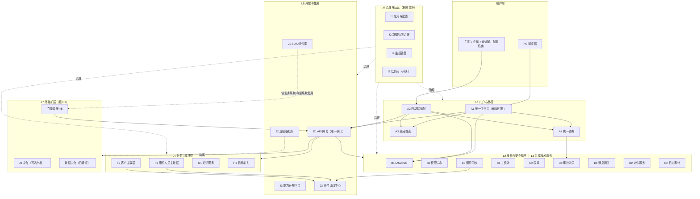

# 麓邦企业业务中台产品规划方案（单企业版）

| 项目 | 内容 |
| --- | --- |
| 文档版本 | v1.0 |
| 编制角色 | 产品经理 |
| 上游文档 | 《麓邦业务中台范围界定与能力盘点》《麓邦企业业务中台目标架构设计》《麓邦业务中台建设方案（AI中台独立版）》 |
| 文档状态 | 待评审 / 待客户拍板 |
| 适用范围 | 将「企业业务中台」从一次性项目升级为可持续演进的**产品**；单企业内部部署，不含多租户 |
| 编号约定 | 延续上游 A1–I5 能力中心编号；新增 J1–J3 产品化增值能力 |

---

## 一、规划总纲（核心结论先行）

### 1.1 一句话定位

> **企业业务中台（BMP，Business Middle Platform）**：面向单个企业内部的、可持续演进的数字化底座产品，为存量与未来业务应用提供「统一门户 + 身份基座 + 共享技术服务 + 业务共享服务 + 开放集成」，一次建设、多系统复用；AI 中台与数据中台作为**可插拔外挂**经统一 API 网关接入。

### 1.2 从项目到产品：为什么与如何

| 维度 | 项目视角（上游方案） | 产品视角（本方案） |
| --- | --- | --- |
| 驱动目标 | 交付麓邦 5 套系统的改造接入 | 沉淀可复用资产，支撑未来新系统低成本接入 |
| 需求口径 | 12 项「待客户确认」 | 转化为**产品配置项 / 实施清单 / 默认架构约束** |
| 代码形态 | 项目代码，随项目结束冻结 | **产品内核 + 配置资产 + 项目定制**三层隔离，版本化演进 |
| 验收方式 | 项目里程碑验收 | 版本火车（3 个月一班）+ 运营度量持续运营 |
| 12 项待确认 | 全部悬置等待拍板 | 仅 4 项需业务拍板（#2/#5/#6/#12），其余产品内消化 |

**关键判断**：上游方案中 P0 阶段的全部能力（IAM/门户/待办/消息/审计）恰好落在「开箱即用层」，是产品内核的最佳孵化期；AI 中台独立开发在产品视角下反而更顺——它就是产品的「可选外挂模块」（与 ADR-02 一致）。

### 1.3 产品边界

**在产品范围内**：统一门户套件、身份与安全基座、共享技术服务（流程/表单/消息/文件/审计）、业务共享服务（两类主数据/知识/目标）、开放集成层（网关/开放平台/连接器/SDK/事件）、治理与运营（配置/数据标准/监控/低代码开关）。

**不在产品范围内**：

| 不在范围 | 归属 | 产品化处理 |
| --- | --- | --- |
| 大模型推理/微调/模型仓库/多模态 API | AI 中台（独立开发） | 外挂模块，经 E1 网关接入，契约冻结 |
| 数据采集/治理/加工/BI | 数据中台（已建成） | 外挂连接：主数据单向供数、分析结果回传统一消费 |
| 各业务系统业务功能本体 | 存量系统 | 保留业务逻辑，只做接入与改造（实施项） |
| 云原生基础设施 | 基础设施层 | 架构依赖声明 |
| **多租户 / SaaS 化** | —— | **本期不做**（见 ADR-08），保留演进友好边界 |

### 1.4 产品目标与北极星指标

| # | 目标 | 北极星指标 | 目标值 |
| --- | --- | --- | --- |
| 1 | 新系统低成本接入 | 新系统接入中台周期 | ≤ 5 人日（V2.5 起） |
| 2 | 研发提效 | 新系统基础模块研发工作量下降 | 一期 ≥30%、二期 ≥70%（沿上游口径） |
| 3 | 用户统一体验 | 工作台日均使用率 | ≥70% |
| 4 | 复用真实发生 | 能力复用率（被调用能力数 / 已发布能力数） | ≥60%（V2.5 起） |
| 5 | 烟囱根治 | 存量重复公共模块停建/下线数 | 100% 执行清单 |

---

## 二、完整中台产品能力全景

### 2.1 七层产品能力模型

回答「完整的中台产品应该包含哪些能力」——按用户可见度自上而下分七层：

```
L7 外挂扩展层      AI 中台（可选）· 数据中台（已建成）· 存量系统接入
L6 治理与运营层    应用配置 · 数据标准治理 · 监控告警 · 低代码（开关）· 运营度量
L5 开放与集成层    API 网关 · 能力开放平台 · SDK/组件库 · 连接器框架 · 事件订阅中心
L4 业务共享层      组织人员主数据 · 客户主数据 · 知识服务 · 目标能力
L3 共享技术服务层  工作流 · 表单 · 审批入口 · 消息网关 · 文件服务 · 日志审计
L2 身份与安全基座  IAM/SSO · 权限中心 · 组织同步 · 会话与令牌治理
L1 门户与体验层    统一工作台 · 统一移动端 · 全局搜索 · 统一待办
```

### 2.2 能力全景清单（层 — 能力中心 — 产品化档位）

| 层 | 能力中心 | 关键能力点 | 产品化档位 | 优先级 |
| --- | --- | --- | --- | --- |
| **L1 门户与体验** | A1 统一工作台（PC） | 应用导航、角色化首页（布局引擎）、消息聚合、公告、个性化布局 | 开箱即用 | P0 |
| | A2 统一移动端 | 钉钉/企微双适配、免登、消息卡片、移动审批、扫码 | 配置化（载体开关） | P0 |
| | A3 全局搜索 | 统一检索、对象索引注册、权限过滤、联想 | 开箱即用（索引范围配置化） | P1 |
| | A4 统一待办 | 多系统待办汇聚、统一处理跳转、已办/我发起、催办 | 开箱即用 | P0 |
| **L2 身份与安全基座** | B1 统一身份认证 IAM | OAuth2/OIDC SSO、MFA（可选）、密码策略、账号生命周期 | 开箱即用 | P0 |
| | B2 统一权限中心 | RBAC（角色/菜单/按钮/接口）、数据权限（组织范围/行级）、权限申请审批 | 开箱即用（数据权限规则配置化） | P0/P1 |
| | B3 组织与用户同步 | 组织/人员异动事件分发、多系统账号映射对齐 | 开箱即用 | P0 |
| | 会话与令牌治理（PRD 编号：**`B1-F07`**） | 全局登出、令牌签发与刷新、在线会话管理 | 开箱即用 | P0 |
| **L3 共享技术服务** | C1 统一工作流引擎 | BPMN 建模、审批矩阵、会签/或签、条件分支、委托代理、超时提醒 | 开箱即用 | P1 |
| | C2 统一表单引擎 | 拖拽设计、字段规则、数据校验、表单-流程贯通 | 开箱即用 | P1 |
| | C3 统一审批入口 | 跨系统审批聚合、统一审批视图（可与 A4 合并） | 开箱即用 | P1 |
| | D1 统一消息通知网关 | 多渠道（站内/邮件/钉钉/企微/短信）、模板管理、去重、送达追踪 | 开箱即用（渠道连接器配置化） | P0 |
| | D2 统一文件存储服务 | 上传下载、在线预览、版本管理、水印/防盗链、生命周期 | 开箱即用 | P1 |
| | E2 统一日志审计中心 | 登录/操作/数据变更日志、检索、留存；审计报表（P2） | 开箱即用 | P0 |
| **L4 业务共享服务** | F1 组织人员主数据 | 组织/岗位/人员唯一源、编码标准、异动订阅分发 | 配置化（权威源连接器 + 映射规则实施配） | P0 |
| | F2 客户主数据 | 客户唯一编码与视图、去重合并、客户-联系人-合同关系、订阅分发 | 配置化 | P1 |
| | G1 知识服务中心 | 文档结构化、全文检索、标签分类、权限密级、版本审阅；推荐/问答调 AI | 配置化 | P1 |
| | H1 目标能力中心 | OKR 目标库、公司-部门-个人拆解、KR 跟踪、复盘、绩效口径 | 配置化 | P1 |
| **L5 开放与集成** | E1 统一 API 网关 | 统一鉴权、路由、限流熔断、灰度、协议转换、API 目录；**跨边界流量唯一收口** | 开箱即用 | P0（最小集）/ P1（完整） |
| | I3 能力开放平台 | 能力目录、开放授权与配额、申请上架、开发者门户 | 开箱即用 | P2 |
| | **J1 SDK 与前端组件库**（新增） | 认证/权限/待办/文件/消息组件，Vue3 组件 + 后端 SDK/Feign；**`J1-F04` 接入指南与示例工程（V1.0）** | 开箱即用 | P1 |
| | **J2 连接器框架**（新增） | 权威源连接器（HR/钉钉/企微/CRM）、渠道连接器、存量系统适配器规范；**`J2-F05` 存量权限采集适配器（V1.5）** | 配置化 | P1 |
| | **J3 事件与订阅中心**（新增） | 平台级事件总线（主数据/业务事件）、发布订阅、Webhook 出口 | 开箱即用 | P1 |
| **L6 治理与运营** | I1 应用与配置管理 | 应用注册与生命周期、配置中心（Nacos）、多环境、功能开关/灰度；**`I1-F05` 应用接入凭证发放与接入指引（V1.0）、`I1-F06` 应用回调域名白名单（V1.0）** | 开箱即用 | P1 |
| | I2 数据标准与治理 | 数据标准定义、质量规则、数据责任人、问题闭环 | 配置化 | P1 |
| | I4 统一运维监控告警 | 应用/接口健康度、链路追踪、告警与值班 | 开箱即用 | P2 |
| | 审计报表与异常行为分析（PRD 编号：**`E2-F06` 审计报表 / `E2-F07` 异常行为分析**） | 审计报表自动输出、异常行为告警 | 配置化 | P2 |
| | I5 低代码/自助搭建 | 表单+流程+页面自助搭建 | **开关化模块**（是否启用待确认） | P2 |
| | 运营度量体系（PRD 编号：**`OPS-F01` 运营度量 / `OPS-F02` 运营报告**） | 复用率、调用量、活跃度、接入周期度量与月报 | 配置化 | P2 |
| **L7 外挂扩展** | AI 中台（可选外挂） | 模型/多模态 API；场景编排归业务中台（G1/H1 牵头） | 外挂（契约冻结 + 网关解耦） | V3.0 |
| | 数据中台（已建成） | 数据底座；主数据单向供数、分析结果以卡片/看板回传 | 外挂（依赖管理） | 持续 |
| | 存量系统 ×5 | 业务逻辑保留；公共模块停建/下线 | 实施接入（七步 checklist） | 分批 |

### 2.3 相对上游方案的产品化新增点（增量清单）

| # | 新增能力 | 来源动因 |
| --- | --- | --- |
| 1 | **J1 SDK 与前端组件库** | ADR-05 的「业务系统改为 SDK/Feign 调用」从架构建议升级为正式产品交付物，否则复用只停留在口头 |
| 2 | **J2 连接器框架** | 权威源适配（待确认 #2/#3）、消息渠道适配（#1）、存量系统接入（#5/#6）三类异构对接统一为一套适配器规范，从「每次定制」变「配置连接器」 |
| 3 | **J3 事件与订阅中心** | B3/F1/F2 的 subscribe 接口泛化为平台级事件总线 + Webhook，主数据分发、业务事件通知、AI 中台异步回调共用一套机制 |
| 4 | **交付工程包** | 部署包、升级脚本、环境检查工具、安装向导——产品区别于项目代码的标志 |
| 5 | **产品文档体系** | 产品手册（用户）、开放 API 文档（研发）、实施指南与接入 checklist（交付）、变更日志 |
| 6 | **门户布局引擎** | A1 角色化首页从「按角色写死」升级为可视化布局配置，新系统接入零前端开发 |

---

## 三、产品化评估：三档分类

| 档位 | 定义 | 覆盖能力 | 建设策略 |
| --- | --- | --- | --- |
| **开箱即用**（Product Core） | 装机自带，升级随产品版本 | B1/B2/B3/C1/C2/C3/D1/D2/E1/E2/A1/A3/A4/I1/I3/I4/J1/J3 + 会话治理 | 以成熟组件集成封装为主（芋道内置模块、Flowable、Spring Cloud Gateway、Nacos），自研聚焦 glue 与产品体验 |
| **配置化**（Configurable） | 产品提供模型/引擎，字段、规则、连接器实施时配置 | A2、F1、F2、G1、H1、B2 数据权限、I2、I5、运营度量、J2 | 坚持配置优先于编码；每个配置项必须有默认值 |
| **实施定制**（Delivery） | 不进产品，属项目交付 | 存量 5 套系统改造、行业字段、AI 场景编排脚本、一次性数据迁移 | 按六.2 checklist 执行，产出物沉淀为实施资产 |

**产品化差距与补强（关键 5 项）**：

| 能力 | 产品化差距 | 补强动作 |
| --- | --- | --- |
| F1/F2 主数据 | 「唯一源 + 订阅分发」有接口设计，无连接器与映射配置化 | J2 连接器框架首版随 V1.5 交付，权威源对接从开发项变配置项 |
| B2 数据权限 | 行级规则模型未定型 | V1.5 定义「组织维/客户维/自定义规则」三类内置模型 + 规则 DSL |
| A1 工作台 | 角色化首页为定制开发 | 布局引擎（卡片注册 + 拖拽配置）随 V1.0 交付 |
| E1 网关 | 原方案 P1 才上线 | **调整**：V1.0 交付「路由 + 鉴权转发」最小集承载老系统认证适配，完整能力（限流/灰度/目录）V2.0 补齐 |
| G1/H1 | 业务语义偏定制 | 产品只交付「文档/目标」标准模型与 API，行业语义放配置层与实施层 |

---

## 四、产品架构（单企业部署形态）

### 4.1 产品逻辑架构图



### 4.2 关键架构决策

| 编号 | 决策 | 结论 | 理由与代价 |
| --- | --- | --- | --- |
| **ADR-08** | **单企业部署，不做多租户** | 本期按单企业私有化部署交付；保留「演进友好」边界：模块化、schema 前缀隔离、配置外置 | **理由**：当前唯一使用主体为麓邦，多租户引入数据隔离/租户管理/计费复杂度，属过早设计。**代价**：未来若产品对外输出需补租户上下文与数据隔离层（评估项：数据层隔离改造 + 租户注入中间件）。**约束**：库名沿用 `bmp_` 前缀（`bmp_sys`/`bmp_md`/`bmp_wf`/`bmp_portal`/`bmp_msg`/`bmp_file`/`bmp_audit`/`bmp_gov`），表名沿用 `sys_`/`md_`/`wf_`/`portal_`/`msg_`/`file_`/`audit_`/`gov_` 等域前缀，禁止跨域直连库（**口径以《V1.0 基座版详细设计》§3 为准**） |
| **ADR-09** | 产品技术形态 | **模块化单体优先**：Spring Boot 3 Maven 多模块（`bmp-auth`/`bmp-portal`/`bmp-workflow`/`bmp-mdm`/`bmp-open`/`bmp-gov`…），内部接口本地调用 + API 防腐层；拆微服务仅在「模块独立伸缩或团队并行冲突」触发 | 单企业流量规模下微服务属过度设计；模块化单体保留拆分选项，运维成本最低 |
| **ADR-10** | 内核/定制隔离 | 代码库物理隔离：`bmp-platform`（内核）+ `bmp-connectors`（连接器/配置资产）+ 项目定制独立仓库；**内核禁止依赖任何客户定制包**（评审红线 + 依赖检查门禁） | 防止「灯塔项目定制化陷阱」——产品化失败的第一原因 |
| 沿用 ADR-01~07 | 广义口径、AI 经网关、主数据单源、绞杀者模式、技术栈增益 | 不变 | 见架构设计文档第四章 |

### 4.3 技术形态明细

| 层 | 选型 | 说明 |
| --- | --- | --- |
| 前端 | Vue3 + TS + Element Plus | 工作台为单体应用 + 模块化路由；J1 组件库发布内部 npm 包；业务系统按需嵌入 |
| 后端 | Spring Boot 3 + 芋道框架 | 芋道内置用户/权限/流程/文件/消息/配置模块抽取为产品服务（沿 ADR-05） |
| 网关 | Spring Cloud Gateway | V1.0 最小集（路由 + 鉴权转发 + 认证适配），V2.0 完整（限流/熔断/灰度/目录） |
| 注册与配置 | Nacos | 承载 I1 配置中心与服务注册 |
| 数据库 | MySQL 多库 | 库名 `bmp_` 前缀分库：`bmp_sys`（身份与权限）/`bmp_md`（主数据域）/`bmp_wf`（流程表单域）/`bmp_portal`（门户待办）/`bmp_msg`（消息）/`bmp_file`（文件）/`bmp_audit`（审计）/`bmp_gov`（治理）；表名按域前缀（`sys_`/`md_`/`wf_`/`portal_`/`msg_`/`file_`/`audit_`/`gov_`）；事件表 + Outbox 模式支撑 J3（**口径以《V1.0 基座版详细设计》§3 为准**） |
| 事件 | 消息队列 + Outbox | J3 事件订阅中心底座；主数据异动准实时（≤10 分钟） |
| 对象存储 | OSS（或 MinIO） | D2 文件服务后端 |
| 审计与日志 | ELK/日志规范 | E2 底座；留存 ≥6 个月 |

### 4.4 产品配置项设计（12 项待确认的产品化转化）

| 原待确认 # | 原问题 | 产品化转化 | 形态 |
| --- | --- | --- | --- |
| 1 | 移动端载体：钉钉/企微/双端 | **双连接器均交付**，后台配置启用哪个作为主载体 | 配置项（A2/D1 渠道开关） |
| 2 | 组织人员权威源 | 权威源连接器可插拔（HR/钉钉/企微/自建），字段映射与异动规则实施配置 | 配置项 + J2 连接器（**仍需业务指定默认源**） |
| 3 | 客户主数据权威源 | 同上 + 去重合并规则配置（相似度阈值、合并策略） | 配置项 + J2 连接器 |
| 4 | 是否要低代码 | I5 做成独立模块 + 功能开关，默认关闭 | 配置项 |
| 5 | 存量改造范围与顺序 | 不属产品问题 → 转为**实施方法论**（七步 checklist，见六.2） | 实施清单 |
| 6 | 重复公共模块处置 | 转为**实施资产**：停建/下线清单模板，逐系统签署 | 实施清单 |
| 7 | 数据标准分工 | I2 内置「主数据标准归业务中台 / 分析指标标准归数据中台」默认规则，可调整 | 默认约束 |
| 8 | AI 中台是否经网关 | **强制架构约束**（不做配置项）：跨边界流量一律经 E1 | 硬约束 |
| 9 | 知识中心与知识系统关系 | 部署模式选项：替代模式 / 补充模式（G1 接入向导中选择） | 配置项 |
| 10 | 目标与绩效边界 | H1 模块边界配置（绩效字段是否启用） | 配置项 |
| 11 | 搜索范围与权限 | A3 索引注册范围配置（按对象类型 + 权限模型选择） | 配置项 |
| 12 | 立项与预算口径 | 非产品问题，**仍需拍板**（本方案主张技术能力纳入） | 业务决策 |

> 转化后：**仍需业务拍板 4 项**（#2 权威源、#5 改造范围、#6 模块处置、#12 预算口径），其余 8 项全部产品内消化。

---

## 五、产品版本路线图

### 5.1 版本规划总表（版本火车：3 个月一班）

> **⚠️ 版本口径以 PRD 为准（统稿裁定 Q2）**：本表为**产品层视角的版本主题概要**；**具体版本归属（含功能点级排期）以《麓邦业务中台产品PRD》§8 版本发布计划为唯一真源**。若本表与 PRD 不一致，**以 PRD 为准**。PRD 版本发布计划另有本表未含的内容（如 D2 最小集、J2 权威源/渠道连接器在 V1.0；首页 v2 / 千人千面 / 通知 Banner / 页面嵌入 / 移动 Tab / 应用运营看板在 V1.5），**详见 PRD §8**。

| 版本 | 时间 | 主题 | 包含模块 | 映射上游 | 关键验收 |
| --- | --- | --- | --- | --- | --- |
| **V1.0 基座版** | M0–M3 | 身份与入口统一 | B1、B3、B2（一期角色+菜单）、F1（基础）、A1（含布局引擎）、A4、A2、D1（一期）、E2（基础留存）、E1（最小集）、J1（首批组件，含 **`J1-F04` 接入指南与示例工程**）、**`I1-F05` 应用接入凭证发放与接入指引**、**`I1-F06` 应用回调域名白名单**、交付工程包 | P0 | 5 套系统 SSO 接入、账号统一率 100%；待办 ≥3 系统接入；工作台日活 ≥70%；异动同步 ≤10 分钟；离职 24h 停用 |
| **V1.5 流程版** | M3–M6 | 流程与文件 | C1、C2、C3、D2、B2（二期数据权限）、J2（连接器框架首版，含 **`J2-F05` 存量权限采集适配器**）、J3（事件中心首版） | P1 前段 | ≥2 审批场景统一引擎承载；零代码表单 ≥5 类；文件迁移率 ≥80%；主数据异动经 J3 分发 |
| **V2.0 业务版** | M6–M9 | 主数据与业务共享 | F2、G1、H1、A3、E1（完整：限流/灰度/目录）、I1 应用与配置管理 | P1 后段 | 客户唯一视图发布、CRM↔数据中台口径一致；全局搜索 ≥3 类对象；新增系统统一走网关；存量 5 套接入完成、停建/下线清单执行 |
| **V2.5 治理版** | M9–M12 | 治理开放运营 | I2、I4、I3、审计报表与异常行为分析（`E2-F06`/`E2-F07`）、运营度量体系（`OPS-F01`/`OPS-F02`） | P2 前段 | 能力目录与开放授权上线；新系统接入周期 ≤5 人日；故障发现时间缩短 ≥50%；月度运营报告输出 |
| **V3.0 智能版** | M12+ | AI 融合与低代码 | AI 场景编排融合（G1 问答/招聘匹配等）、I5 低代码（若启用） | P2 后段 | 业务系统经统一出口调用 AI、≥2 场景落地；业务自助搭建轻应用 |

### 5.2 关键依赖路径（不变）

```
F1 组织人员主数据 → B1 IAM/SSO → B2 权限 → （A1→A4→A2）/（E1→I1→I3）/（C1→C2→I5）/（F2→G1/H1）
B1 → E2 / D1（横向能力越早接入越省改造成本）
F1 → J3 事件中心 → 数据中台单向供数
```

**全局第一阻塞点不变**：F1 权威源未定则 IAM 与全部同步无法开工，V1.0 最先闭环。

### 5.3 与麓邦项目里程碑的对齐

| 上游分期 | 产品版本 | 项目侧动作 |
| --- | --- | --- |
| 阶段一 P0（0–3 月） | V1.0 基座版 | 灯塔实施：5 套系统 SSO/待办/消息接入；同时完成内核/定制代码库隔离与评审红线生效 |
| 阶段二 P1（3–9 月） | V1.5 + V2.0 | CRM/招聘试点迁移（绞杀者模式）；每个实施项交付时反哺为连接器/配置模板 |
| 阶段三 P2（9 月+） | V2.5 + V3.0 | 治理运营常态化；AI 中台契约联调与场景落地 |

---

## 六、交付模型与实施方法论

### 6.1 三层交付结构

| 层 | 内容 | 载体 | 演进方式 |
| --- | --- | --- | --- |
| **产品内核**（Product Core） | 中台各服务代码 | `bmp-platform` 单仓库多模块 | 产品版本火车演进，禁止客户特定逻辑 |
| **产品配置资产**（Configurable） | 连接器、消息/表单/流程/页面模板、SDK、部署包、文档 | `bmp-connectors` + 制品库 | 随版本丰富 |
| **项目定制**（Customer Extension） | 存量系统改造、行业字段、场景编排脚本、一次性迁移工具 | 独立项目仓库 | 随项目交付，不回写内核 |

**反哺机制**：定制层功能在 ≥2 个场景重复出现 → 架构评审 → 抽象进配置层/内核；**每个版本预留 20% 研发容量做反哺重构**。

### 6.2 存量系统接入七步 Checklist（实施方法论）

| 步 | 动作 | 依托能力 |
| --- | --- | --- |
| 1 | 应用注册与接入评审 | I1 + 架构红线 |
| 2 | SSO 接入（OIDC 直连，老系统走网关认证适配层） | B1 + E1 最小集 |
| 3 | 组织人员本地表切换为只读缓存 | B3 |
| 4 | 权限判定切换（引 J1 SDK，权限不复制） | B2 |
| 5 | 待办接入（`/todo/push` + 跳转 + 回写回调） | A4 |
| 6 | 消息接入（D1）与文件接入（D2） | D1/D2 |
| 7 | 日志上报（E2）+ 原生公共模块停建/下线签署 | E2 + 清单模板 |

### 6.3 架构评审红线（自 V1.0 起生效）

1. 新系统**禁止内嵌**登录/权限/流程/消息/文件公共模块，一律复用中台；
2. 所有跨边界流量（↔ AI 中台 / 数据中台 / 存量系统）一律经 E1；
3. 主数据（组织人员/客户）只允许 F1/F2 单源写入，其余系统只读；
4. 内核代码禁止依赖客户定制包（依赖检查门禁强制）。

---

## 七、产品工程要求

| 类别 | 要求 |
| --- | --- |
| 版本管理 | 语义化版本（SemVer）；API 路径带 `/v1/`、`/v2/`；破坏性变更须保留一个版本的 deprecation 期 |
| 数据库升级 | 全部变更走 Flyway/Liquibase 脚本，禁止手工改库；升级脚本随制品交付 |
| 分支策略 | `main` + `release/x.y` + `feature/*`；版本火车 3 个月一班，火车内冻结范围 |
| 质量门禁 | 单测覆盖率门禁、接口契约测试（防 AI/存量接入回归）、接入冒烟清单自动化 |
| 安全合规 | 全量审计留痕（E2）；等保要求自查表纳入版本发布检查单；密钥与配置不入库（Nacos 配置中心托管） |
| 文档体系 | 产品手册 / 开放 API 文档（随 I3 门户）/ 实施指南 / 变更日志，四件套随版本发布 |

---

## 八、组织保障与运营

### 8.1 团队分工（建议）

| 角色 | 人数（建议） | 职责 |
| --- | --- | --- |
| 产品负责人 | 1 | 产品规划、版本火车、12 项转配置项的决策闭环 |
| 平台研发 | 前端 2 + 后端 4（按需调） | 内核与连接器开发、J1 SDK 维护 |
| 实施交付 | 2 | 存量接入七步执行、实施资产沉淀 |
| 架构评审委员会 | 兼职 | 红线评审、反哺评审、ADR 维护 |

### 8.2 运营度量体系（承接 BMP-P2-05 并产品化）

| 指标 | 定义 | 频率 |
| --- | --- | --- |
| 接入系统数 | 已完成七步 checklist 的系统数 | 月 |
| 能力复用率 | 被调用能力数 / 已发布能力数 | 月 |
| API 日调用量 | E1 网关统计 | 日 |
| 工作台日活 / 待办统一处理率 | A1/A4 埋点 | 周 |
| 新系统接入周期 | 注册到上线的平均人日 | 季 |
| 重复模块下线进度 | 停建/下线清单执行率 | 月 |

---

## 九、产品风险与应对

| # | 风险 | 等级 | 应对 |
| --- | --- | --- | --- |
| 1 | **灯塔项目定制化陷阱**（内核被客户逻辑污染，产品化落空） | 高 | ADR-10 三层隔离 + 依赖检查门禁 + 评审红线；反哺机制制度化 |
| 2 | 产品研发与项目交付双线资源冲突 | 高 | 版本火车与项目里程碑对齐（5.3）；每版本预留 20% 反哺容量 |
| 3 | 过度抽象（无第二客户时过早产品化） | 中 | Rule of Three：抽象以第二次真实复用为前提；配置优先于编码；I5 类可选模块开关化 |
| 4 | AI 中台契约不同步（独立开发、时序不一） | 中 | 集成契约冻结（上游 3.1）+ E1 网关解耦 + 中台间接口例会 |
| 5 | 存量改造失控（工作量与周期超预期） | 中 | 绞杀者模式 + 七步 checklist 分批 + 停建清单纳入考核 |
| 6 | 主数据一源化组织阻力 | 高 | 高层授权 + I2 治理机制 + 过渡期双跑对账 |

---

## 十、仍需拍板的 4 项与下一步

### 10.1 仍需业务拍板（产品化无法消化）

| # | 事项 | 影响 | 建议 |
| --- | --- | --- | --- |
| 2 | 组织人员主数据权威源 | **全局第一阻塞点** | 客户指定唯一权威源；连接器已就绪，指定即可开工 |
| 5 | 存量 5 套系统改造范围与顺序 | 工作量、周期、风险 | 接入优先、迁移分批 |
| 6 | 重复公共模块处置 | 复用率与 ROI | 形成停建/下线清单并签署 |
| 12 | 立项与预算口径 | 项目边界与组织形态 | 主张技术能力域纳入「企业业务中台」 |

### 10.2 建议的下一步

1. **确认产品立项**：名称「企业业务中台产品（BMP）」，冻结内核边界（2.2 清单）与 ADR-08/09/10；
2. **拍板 4 项业务问题**（10.1），其中 #2 最先闭环；
3. **建立三层代码库与评审红线**（`bmp-platform` / `bmp-connectors` / 项目定制仓库），门禁随 V1.0 一并上线；
4. **冻结与 AI 中台的集成契约**（接口形态、鉴权、SLA、场景编排归属），网关作为稳定解耦面；
5. **启动 V1.0 需求拆解**：以 BMP-P0-01~08 为输入，叠加产品工程项（交付包、J1 首批组件、布局引擎）；
6. **建立版本火车机制**：3 个月一班，首个版本火车的范围即 V1.0 基座版。
