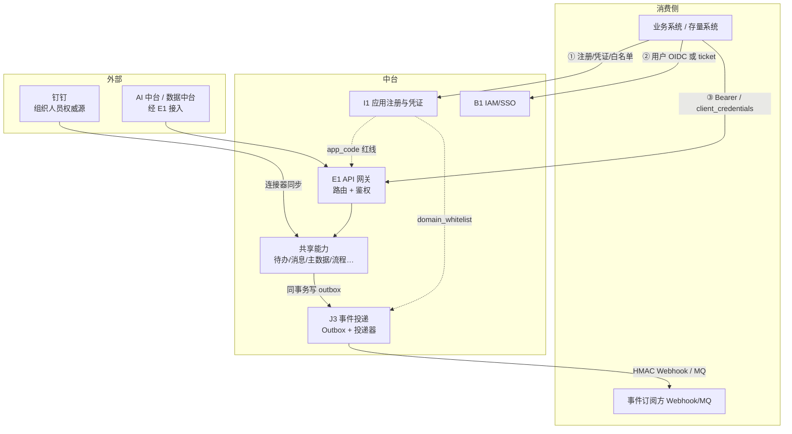
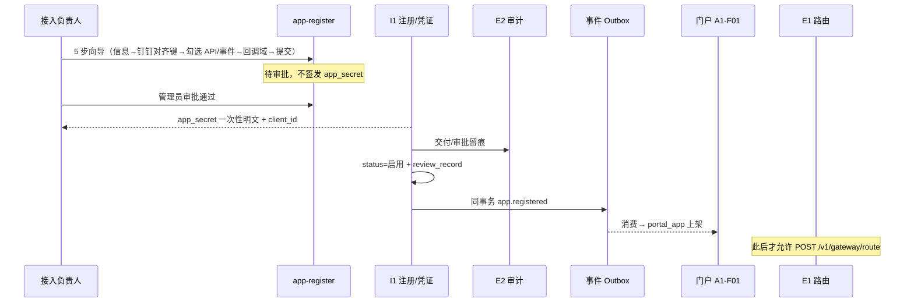
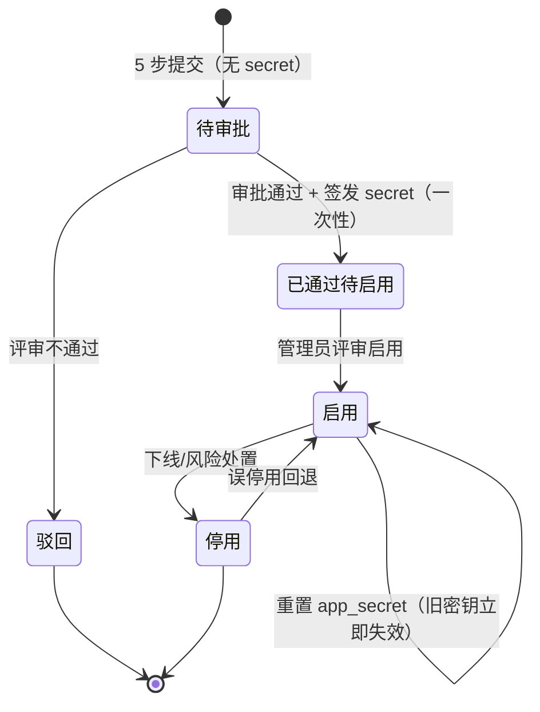
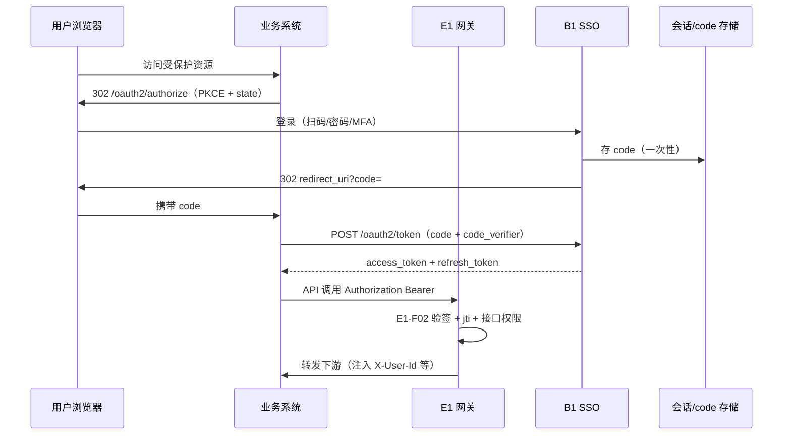
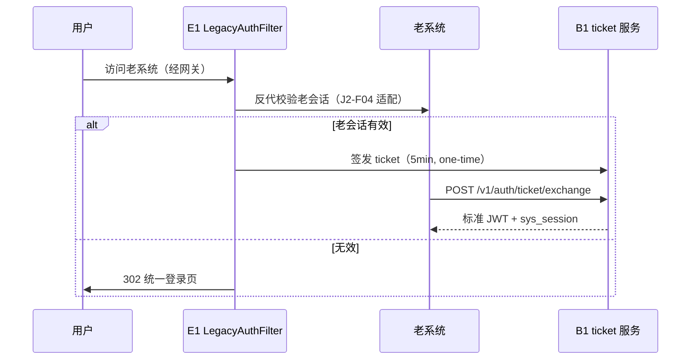
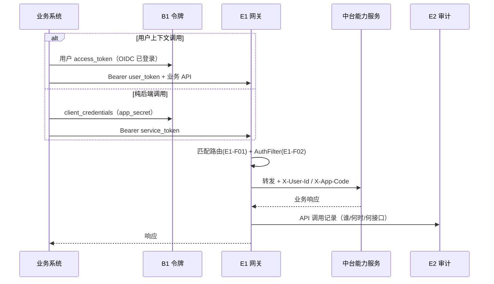
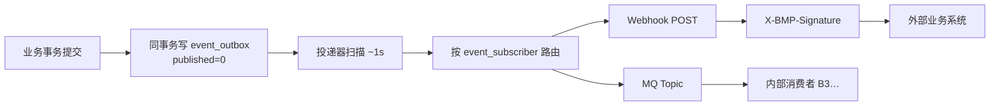
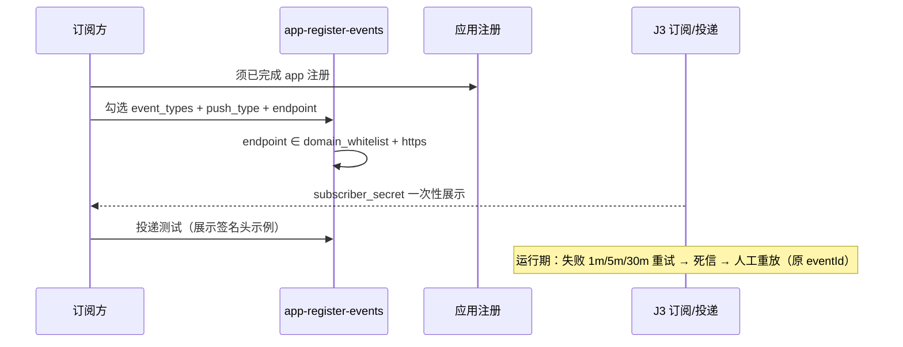
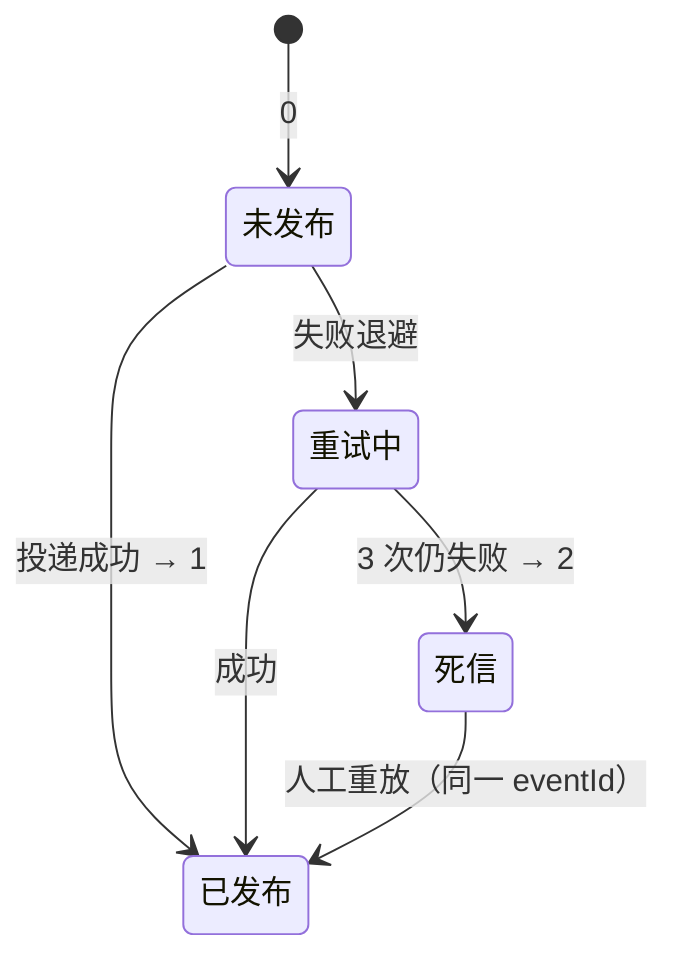
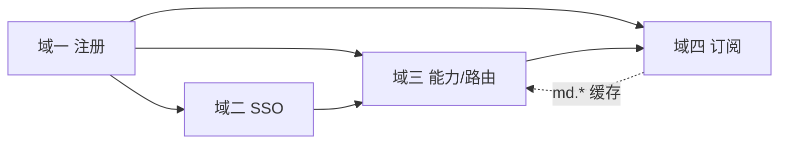

# 应用接入四域 · 产品技术方案

> **文档定位**：面向产品、架构与接入方研发的**逻辑方案**（业务流程、产品规则、数据流、技术机制），**不**展开 OpenAPI 契约与表字段清单。  
> **真源优先级**：《麓邦业务中台产品PRD》（v2.1）> 《01-应用接入集成》流程专项 > 管理端原型 `prototype/docs/menu-structure.md`（2026-10-21）。  
> **生成日期**：2026-10-21

---

## 1. 文档说明与范围

### 1.1 覆盖四域

| 域 | 核心问题 | 主要功能点（PRD） |
| --- | --- | --- |
| **应用注册** | 谁可以接入、用什么身份、回调是否可信 | `I1-F01`、`I1-F05`、`I1-F06` |
| **应用 SSO 登录** | 用户如何一次登录、多系统免登 | `B1-F02`、`B1-F03`、`E1-F03` |
| **应用能力调用** | 应用如何安全调用中台 API | `E1-F01`、`E1-F02`、`J1-F01/F04`；能力目录 `platform-capabilities` |
| **应用事件订阅** | 应用如何接收中台领域事件 | `J3-F01`~`F05`（完整版 V1.5）；V1.0 Outbox 简化投递 |

### 1.2 不在本文展开

- 七步 Checklist 第 3~7 步的**完整**业务规则（组织映射、权限迁移、待办/消息/审计）——见《01-应用接入集成》与专项文档《03-用户权限集成》。
- `I3-F02/F03` 开发者门户与能力自助授权（**V2.5**）的完整产品面。
- 连接器框架 `J2-F01`~`F05` 的实现细节（仅在与四域交界时提及）。

### 1.3 与 PRD / UI 原型对齐说明（2026-10-21）

| 对齐项 | 说明 |
| --- | --- |
| **侧栏** | 管理端 **8 组 / 26 项**；集成与网关组：`platform-capabilities` → `app-register` → `app-register-events` → `gateway`（`menu-structure.md`） |
| **应用注册页** | `app-register` 合并页：**申请中**（5 步向导，提交时不签发 secret）/ **已通过**（凭证、scope、白名单） |
| **默认契约** | 注册向导第 2 步默认 **钉钉对齐键**（`dingtalk_userid` / `dingtalk_dept_id` 或与钉钉绑定的组织键，PRD §10.4 #13） |
| **观测三条链** | **E2 审计**（合规）≠ **J3 事件流排查**（集成排障）≠ **dashboard 埋点**（产品分析，A1-F09） |
| **内链** | `app-register-guide`（J1-F04 接入指南）无侧栏项，从 `app-register` 进入 |

---

## 2. 总体架构逻辑

### 2.1 参与方与职责



### 2.2 架构约束（与 ADR 一致）

| ADR | 对四域的含义 |
| --- | --- |
| **ADR-06** OIDC 为 SSO 标准；老系统走 **B1-F03 + E1-F03** 过渡 |
| **ADR-07** 跨边界流量**一律经 E1**；禁止业务系统与中台能力点对点直连 |
| **ADR-08** 单企业部署，无多租户；`app_code` 为企业内唯一准入标识 |
| **ADR-10** 内核不依赖连接器/定制包；连接器故障须隔离 |

### 2.3 统一身份与凭证模型（概念）

| 逻辑实体 | 含义 | 典型用途 |
| --- | --- | --- |
| **`client_id` / `app_code`** | 应用在治理层的唯一标识 | OIDC 客户端、网关路由绑定、审计归因 |
| **`app_secret`** | 应用机密（AES 存库，**一次性明文展示**） | `client_credentials` 换令牌、服务间调用 |
| **`access_token`（JWT）** | 用户或服务访问令牌 | 经 E1 访问 API；含 `sub`/`jti`/`roles` 等 |
| **`scope`** | 注册时勾选的 API/能力范围（与 `platform-capabilities` 目录对齐） | 授权码流程 scope 校验；能力调用边界（V1.0 以注册勾选 + 接口权限点为主） |
| **`ticket`** | 存量适配用**一次性**票据（TTL 约 5min） | 换标准 JWT：`POST /v1/auth/ticket/exchange` |
| **`subscriber_secret`** | Webhook 验签密钥（与 `app_secret` 同语义：一次性展示） | `X-BMP-Signature = HMAC-SHA256(body, secret)` |
| **`event_outbox` / `eventId`** | 发件箱与幂等键 | 至少一次投递；消费方按 `eventId` 去重 |

---

## 3. 域一：应用注册

### 3.1 业务目标与用户角色

**目标**：建立「**未注册不得接入**」的治理红线；为 SSO、网关、回调、事件订阅提供**单一事实源**（`gov_app_register` 逻辑实体）。

| 角色 | 目标 |
| --- | --- |
| **接入负责人（应用方）** | 5 步向导提交申请、维护回调域、领取凭证单 |
| **平台管理员（`gov:app:manage`）** | 架构评审、审批、启停、重置密钥 |
| **集成/运维** | 白名单策略、订阅与投递运维（与域四衔接） |
| **审计员** | 查凭证交付、密钥重置、白名单变更留痕（E2） |

### 3.2 端到端业务流程



**5 步向导（产品逻辑）**：

1. **应用信息**：`app_code`（注册后不可改）、名称、负责人等。
2. **钉钉对齐键**：`integrationTier`（标准 / 过渡 / Legacy）；标准档默认 `personKey=dingtalk_userid`、`orgKey=dingtalk_dept_id` 或与钉钉绑定的组织键。
3. **勾选 API/事件**：数据来自 **`platform-capabilities`**（Open API 目录、领域事件目录）；写入应用的 scope/订阅意向，供凭证单与后续订阅校验。
4. **回调域名**：`domain_whitelist`（https、精确域名或受控前缀；**禁 IP/内网**）。
5. **确认提交** → **待审批**。

### 3.3 产品逻辑与状态机



**关键产品规则**：

| 规则 | 行为 |
| --- | --- |
| **架构评审红线** | 未完成接入评审的新系统不予立项（PRD §4.6 规则 1） |
| **secret 一次性** | 创建/重置时仅一次明文；丢失只能 **HighRiskConfirm 重置** |
| **凭证单** | 含 `client_id`、令牌端点、鉴权方式、错误码表；**不含 secret 明文**（I1-F05） |
| **白名单唯一源** | `A4` 待办 jump/callback、`C1` 流程 callback、**Webhook endpoint**、（改造期）OIDC `redirect_uri` 均消费同一 **`isWhitelisted(url)`** 语义 |
| **与嵌入白名单分离** | `portal-apps` 嵌入白名单（A1-F08）与 **回调 domain_whitelist 语义不同**，V1.0 保持分离（I1-F06） |

### 3.4 数据流（逻辑实体）

```
接入方提交
  → gov_app_register（app_code, status, grant_types, domain_whitelist, integrationTier, personKey, orgKey, review_record）
  → app_secret（密文落库；明文仅一次）
  → event_outbox：app.registered（与注册/启用事务边界以 PRD/详细设计为准）
  → 消费：portal_app 上架、网关允许绑定 app_code、搜索索引（A3-F02）
运行期：domain_whitelist → 缓存（约 60s TTL + 失效通知）→ 各域 SSRF 校验
```

### 3.5 技术逻辑（概念层）

- **密钥**：TypeHandler 统一 AES；日志与接口**不回显**明文。
- **准入联动**：`E1-F01` 注册路由前强校验 `gov_app_register.status=启用`；未匹配路由 **404、不透传**。
- **事件**：注册/启停发系统事件，门户与路由配置**最终一致**（Outbox 重试，上架失败不阻断注册主事务）。

### 3.6 管理端原型对应

| 菜单 page key | 本域能力 |
| --- | --- |
| **`app-register`** | 申请中 / 已通过 Tab；secret 领取；scope 与白名单维护 |
| **`platform-capabilities`** | 注册第 3 步勾选来源；Open API / 领域事件 / **回调域名校验策略**（全局说明 Tab） |
| **`app-register-guide`** | I1-F05 交付后，J1-F04 接入指南（内链） |

**观测**：凭证交付、密钥重置、白名单变更 → **审计中心 `audit`**（E2），**不是** dashboard 行为埋点。

---

## 4. 域二：应用 SSO 登录

### 4.1 业务目标与用户角色

**目标**：用户**一次登录**，访问工作台与各业务系统；新系统走标准 **OIDC**，存量系统可走**网关认证适配 + ticket 换票**（过渡资产，纳入下线计划）。

| 角色 | 场景 |
| --- | --- |
| **全体员工** | 登录页（扫码默认 / 密码）；访问业务 URL |
| **业务系统（OIDC Client）** | 授权码 + PKCE；后端换 token |
| **存量系统后端** | 消费 ticket，换 JWT |
| **安全/审计** | 登录日志、开放重定向防护、强制下线（B1-F07） |

### 4.2 端到端业务流程

**路径 A：标准 OIDC（B1-F02）**



**路径 B：存量适配（B1-F03 + E1-F03）**



### 4.3 产品逻辑与状态机

**SSO 会话（与令牌）**：

- `access_token` 约 **2h**（可配）；`refresh_token` 约 **7d**；`jti` 绑定 `sys_session`，支持强制下线。
- **授权码**：单次消费；PKCE 强制 **S256**；`redirect_uri` **精确白名单**（防开放重定向）。
- **ticket**：与 Cookie **不共享**；支持 A1-F08 受控内嵌与 #5 新标签跳转**并行**（PRD B1-F02 ⑦）。

**与注册的衔接**：

- `client_id` 须对应 **已启用** 的注册应用；`grant_types` 含 `authorization_code` / `client_credentials` 等登记项。
- 钉钉/企微移动端免登（A2-F02）**复用本域令牌模型**，不在此重复展开。

### 4.4 数据流（逻辑实体）

```
用户凭证 / OIDC 参数
  → B1 校验（策略 B1-F05、MFA B1-F04）
  → sys_session（jti, expire, client_type, revoked）
  → audit_login_log（login_type, result）
  → Redis：code、jti 缓存、失败计数
消费：E1-F02 每请求读 jti；B1-F07 写 revoked；E2-F02 检索
适配路径：local_username → B3-F03 映射 account_id（缺失则拒绝，不静默放行）
```

### 4.5 技术逻辑（概念层）

| 环节 | 机制 |
| --- | --- |
| **签发 vs 校验** | B1-F02 **签发**；E1-F02 **只校验不签发**；B1-F07 **吊销权威** |
| **网关 AuthFilter** | 验签 → jti → `api_pattern` 权限（B2-F05，`/v1/perm/check` 缓存约 60s）→ 注入上下文头 |
| **fail-closed** | 令牌/会话/权限任一失败 **401/403**；Redis 不可用默认拒绝（可配置极短窗口） |
| **服务间** | `client_credentials` 代表**应用身份**；禁止用服务令牌冒充用户查他人数据 |

### 4.6 管理端原型对应

| 入口 | 说明 |
| --- | --- |
| **身份与权限**（`accounts` / `sessions`） | 账号与会话治理；强制下线影响 E1 下一请求 |
| **`gateway`** | 存量路由可配 `auth_policy`；适配路由由 E1-F03 执行 |
| **员工端登录页** | 非 console 菜单；OIDC 与统一登录 UI |

**观测**：登录成功/失败 → **E2 审计**（`audit_login_log`）；与 portal 埋点分离。

---

## 5. 域三：应用能力调用

### 5.1 业务目标与用户角色

**目标**：已注册应用在授权范围内，经 **E1 唯一收口**调用待办、消息、主数据、流程、文件等共享能力；减少各系统重复实现鉴权与 HTTP 客户端。

| 角色 | 目标 |
| --- | --- |
| **接入方研发** | 拿凭证单 + J1-F04 指南 + SDK，完成服务间/用户委托调用 |
| **网关管理员** | 登记路由、启停、连通性测试 |
| **平台管理员** | 维护能力目录、回调策略 |
| **安全** | 未授权路由不可达；API 调用进 E2 |

> **版本边界**：**I3-F02 开放授权与配额**为 V2.5；V1.0/V1.5 以 **注册 scope 勾选 + E1-F02 接口权限点（B2）+ client_credentials** 为主。AI 调用形态见 PRD §4.7（配额 V2.5 完整落地）。

### 5.2 端到端业务流程



**典型能力族（七步 Checklist 第 5~6 步）**：

- 待办：`POST /v1/todo/push`（幂等键 `todo_key`；URL 白名单）
- 消息：`POST /v1/msg/send`（渠道经 J2-F03）
- 权限：`GET /v1/perm/check` + J1 SDK 注解
- 主数据：只读 API + **事件订阅**（域四）
- 文件：`POST /file/upload` 等（D2 最小集，不得直连 OSS）

### 5.3 产品逻辑

| 逻辑 | 说明 |
| --- | --- |
| **先注册后路由** | 无 `app_code` 或未启用 → **拒绝** `POST /v1/gateway/route` |
| **路由默认停用** | 新建路由须显式 enable；探测失败不自动启用 |
| **auth_policy** | `required`（用户令牌）/ `client_credentials`（服务间）/ `none`（高危，须审计） |
| **能力可见性** | 注册勾选 ⊆ `platform-capabilities` 已发布目录；运行期仍以 **权限点 api_pattern** 为准 |
| **幂等** | 写操作带业务幂等键（如 `todo_key`）；网关层可有幂等过滤器兜底 |

### 5.4 数据流（逻辑实体）

```
gov_app_register（app_code, grant_types, scope 勾选快照）
  + gov_gateway_route（path_prefix, target_uri, auth_policy）【表名待架构确认】
  → E1 内存路由表（Nacos 热加载，约 ≤30s）
  → AuthFilter 读 sys_session / sys_permission / Redis jti
  → 下游服务读 X-User-Id / X-App-Code
  → E2：API 调用审计（与业务 audit/log 并存：网关偏访问记录，SDK 偏关键操作语义）
```

### 5.5 技术逻辑（概念层）

- **ADR-07**：业务系统 → 中台、中台 → AI/数据中台/外挂，**均经 E1**。
- **性能目标（PRD）**：路由匹配 P95 &lt;5ms；网关附加延迟 P95 &lt;50ms。
- **失败**：未匹配路由 **404**；下游不可达 **502** + I4 告警；路由热加载失败**保留上一版**。

### 5.6 管理端原型对应

| 菜单 | 能力 |
| --- | --- |
| **`platform-capabilities`** | 能力/Open API/事件目录；注册勾选真源 |
| **`gateway`** | UI-C-15 路由 CRUD、启停、测试 |
| **`app-register` · 已通过** | 查看已选 scope、凭证单入口 |
| **`dashboard`** | A1-F09 **产品分析**（能力调用趋势）；**≠ E2 API 审计明细** |

**观测三条链（本域相关）**：

1. **合规**：E2 `audit` + 网关上报 API 调用记录  
2. **集成排障**：`app-register-events` · 事件流 Tab（Outbox，偏域四）  
3. **产品**：`dashboard` 门户运营与能力分布（`portal_behavior_event`）

---

## 6. 域四：应用事件订阅

### 6.1 业务目标与用户角色

**目标**：主数据、流程、系统等领域事件**可靠发布**；订阅方（业务系统、B3 内部消费者、数据中台等）按注册关系接收 **MQ 或 Webhook**，消费方 **按 eventId 幂等**。

| 角色 | 目标 |
| --- | --- |
| **订阅方研发** | 注册订阅、保存 HMAC 密钥、实现验签与幂等 |
| **平台管理员** | 审核订阅、死信重放 |
| **运维** | 投递成功率、慢端点隔离 |

> **版本**：J3-F01~F05 **完整产品能力 V1.5**；V1.0 已有 **`bmp-server-event` Outbox 简化投递**（读各域 `event_outbox` / `wf_event_outbox`）。V1.0 订阅注册可经 **`POST /v1/md/subscribe`**（F1-F04 载体），V1.5 统一到 **`app-register-events`**（J3-F02）。

### 6.2 端到端业务流程

**发布侧（源域，如 F1 主数据）**



**订阅侧（J3-F02 + J3-F03）**



### 6.3 产品逻辑与状态机

**Outbox 投递状态（`published` 语义）**：



**订阅规则**：

| 规则 | 说明 |
| --- | --- |
| **订阅红线** | 须已 **I1 注册**；`subscriber_code` 唯一 |
| **事件类型** | 须在 **`platform-capabilities` 事件目录**中已定义 |
| **Webhook SSRF** | `endpoint` 命中应用 **domain_whitelist** + https |
| **至少一次** | 消费方必须 **eventId 幂等**；不保证全局顺序 |
| **慢端点隔离** | 单订阅失败不阻塞其他订阅（并发隔离） |

**典型事件（PRD §5.3 摘录）**：`md.org.changed`、`md.employee.*`、`wf.task.completed`、`app.registered` 等；命名 **`域.对象.动作`**。

### 6.4 数据流（逻辑实体）

```
源域业务表 + md_change_log（主数据侧）
  → event_outbox（eventId, eventType, occurredAt, source, data, published）
  → event_subscriber（subscriber_code, event_types, push_type, endpoint, subscriber_secret, status）
  → MQ：bmp-events-md / bmp-events-biz
  → Webhook：HTTP body + X-BMP-Signature
消费：业务系统本地只读缓存、B3 账号联动、门户上架、数据中台 T+1 对账等
```

### 6.5 技术逻辑（概念层）

- **Outbox 原子性**：业务回滚则 outbox 不提交；提交则 eventual 必投。
- **与 F1-F04 分工**：F1 **写 outbox**；J3-F01 **只投递不改业务数据**。
- **HMAC**：`X-BMP-Signature = HMAC-SHA256(body, subscriber_secret)`；密钥发放语义同 I1-F05（G-5）。
- **死信**：`published=2`；管理端可见、可重放；重放仍用**原 eventId**。

### 6.6 管理端原型对应

| 菜单 | Tab / 能力 |
| --- | --- |
| **`app-register-events`** | **订阅与投递**：注册、测试、死信重放 |
| **`app-register-events`** | **事件流排查**（`tab=outbox`；alias `event-monitor`）：Outbox 排障 mock |
| **`platform-capabilities`** | 领域事件目录（注册勾选、订阅校验真源） |

**观测**：集成问题查 **事件流 Tab + 死信**；合规操作（人工重放）仍应 **E2 留痕**；员工行为不看 J3。

---

## 7. 四域依赖与顺序（七步 Checklist 映射）

| Checklist 步 | 名称 | 四域覆盖 | 关键依赖 |
| --- | --- | --- | --- |
| **1** | 应用注册与接入评审 | **域一** 全部 | 通过后才有 secret、白名单、scope |
| **2** | SSO 接入 | **域二** | 依赖步 1 的 `client_id`/grant_types；存量走 ticket |
| **3** | 主数据对齐 + 只读缓存 | 域四 **消费** + B3 | 标准档钉钉键；订阅 `md.*` 事件 |
| **4** | 功能权限切换 | 域三 **调用** `/v1/perm/check` | 非 J2-F05 在线；实施侧 RBAC 导入 |
| **5** | 待办接入 | 域三 API + 域一白名单 | `todo_key` 幂等 |
| **6** | 消息/文件 | 域三 API | D1/D2 |
| **7** | 日志 E2 + 停建清单 | 域三审计链 | `POST /v1/audit/log`；适配层登记下线 |



**最小可运行路径（V1.0 试点）**：步 1 → 2 →（步 3 标准档轻量）→ 步 5/6 → 步 7；步 4 可延后至 RBAC 导入就绪（防权限清空事故）。

---

## 8. 安全与合规要点

| 主题 | 要求 |
| --- | --- |
| **SSRF** | 回调/Webhook/OIDC redirect：**https + 域名白名单**；禁 IP/内网；`isWhitelisted` **fail-closed** |
| **密钥** | `app_secret` / `subscriber_secret`：AES、一次性展示、不落日志、不邮件明文 |
| **高危操作** | 重置密钥、`auth_policy=none`、死信重放 → **二次确认 + E2 审计** |
| **审计 vs 埋点** | **E2**：登录、关键操作、网关 API、凭证交付；**dashboard/A1-F09**：产品使用率；**禁止混存** |
| **跨域** | 禁止跨库 JOIN；跨域只经 **API / 事件**（ADR-10 模块隔离） |
| **适配层** | B1-F03/E1-F03 为**过渡**；老系统校验接口不可信时 **拒绝放行** |

---

## 9. V1.5 边界（明确不做 / 降级）

| 项 | V1.5 口径 |
| --- | --- |
| **J2-F05 在线权限迁移** | **不交付**在线采集 Tab；第 4 步走实施侧导出/脚本导入 + 仲裁 |
| **组织对照控制台** | **无** `app-register-mapping` 菜单；`B3-F03` 离线/连接器 |
| **默认契约** | 注册向导 **钉钉对齐键** 为主路径（§10.4 #13） |
| **J3 完整能力** | 订阅运维 UI、Webhook 死信、事件流排查（J3-F02~F05）标 **V1.5**；V1.0 Outbox 投递仍可用 |
| **I3 开放授权** | 配额与自助授权 **V2.5**；V1.5 不依赖 I3-F02 做核心链路 |
| **开发者门户** | I3-F03 / J1-F03 文档体系 V1.5+；V1.0 以 **`app-register-guide`（J1-F04）** 为承载 |
| **沙箱** | V1.0 无独立沙箱，以 test 环境代偿（G-8） |

---

## 10. 版本记录

| 版本 | 日期 | 作者 | 说明 |
| --- | --- | --- | --- |
| v1.0 | 2026-10-21 | 产品/架构（派生） | 首版：应用注册、SSO、能力调用、事件订阅四域；对齐 PRD v2.1 与原型侧栏 2026-10-21 |

---

## 附录 A · 关联文档

| 文档 | 路径 |
| --- | --- |
| 产品 PRD | `麓邦业务中台产品PRD.md`（§4.6、§5.3~§5.4、§6.1 I1、§6.2 B1、§6.8 J1/J3、§6.9 E1） |
| 流程专项 | `outputs/规范/流程专项/01-应用接入集成.md` |
| 菜单真源 | `prototype/docs/menu-structure.md` |
| 规格简报 | `开发级PRD编写-规格简报.md` |
