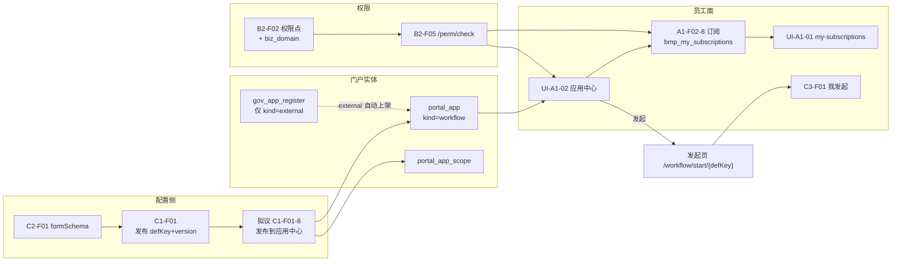
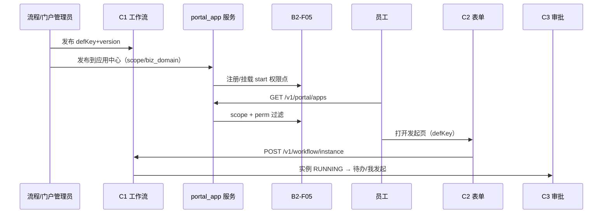
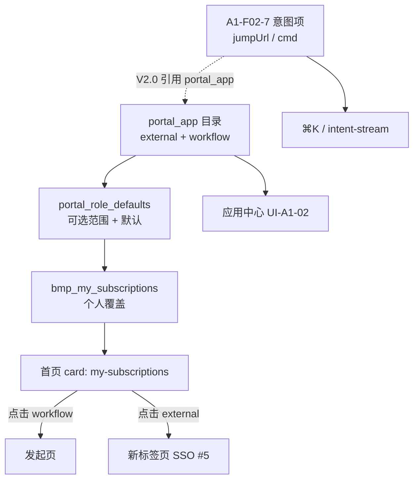

# 流程应用化与分域权限 · 产品方案

> **文档定位**：面向产品、架构、门户与工作流域的**逻辑方案**（用户诉求、能力映射、缺口、拟议实体与分期），**不**展开 OpenAPI 契约与 Flyway 字段清单。  
> **真源优先级**：《麓邦业务中台产品PRD》（v2.1）> 原型 `apps.html` / `portal-apps` / `workflow-defs` / `portal-role-defaults` > 本派生文档。  
> **生成日期**：2026-10-21

---

## 1. 用户诉求解读

| 诉求（用户原话） | 产品化解读 | 成功标准（可验收） |
| --- | --- | --- |
| 配置好的流程**发布到应用中心**，作为**独立应用**可选**业务域** | 已发布 `defKey+version` 的流程定义，经一次「门户发布」动作生成/更新**门户应用**条目；员工在 **UI-A1-02 应用中心**按**业务域**浏览并**发起**（非仅管理员在 `workflow-defs` 点「发起」） | 流程管理员发布定义后 ≤5 分钟内，授权用户在应用中心可见；点击后进入**发起页**（`formSchema` 填报）或明确跳转 **C3 我发起** |
| 用户在**应用中心**操作；可**订阅到首页「我的订阅」** | **A1-F01** 目录 = 应用中心全集；**A1-F02-8** 角色默认 + **`bmp_my_subscriptions`** 个人覆盖 = 首页右栏「我的订阅」子集；流程类应用与外链应用**同一订阅模型** | 角色可选范围内可勾选流程应用；个人设置保存后首页展示一致；无权限项**不展示**（G4） |
| **权限管理**分**系统**、分**业务域** | **B2-F02** 权限点树增加**命名空间/挂载维度**（`app_code` / 平台域 / **biz_domain**）；管理员在 **UI-C-03** 可按系统或业务域筛选维护；角色授权仍走 **B2-F01** | 同一业务域权限点可批量浏览；流程应用可见性 = **`portal_app_scope` + `workflow:instance:start:{defKey}`**（或等价 code）双重约束 |

**一句话目标**：让「中台自研流程」与「I1 注册的外链业务系统」在员工侧**同一套应用中心 + 订阅 + 权限**体验下可发现、可发起、可治理；管理侧**分域**看清权限与入口，避免流程定义与门户入口两套维护。

---

## 2. 现状与缺口（Exists vs Gap）

### 2.1 已有能力（真源已定义或原型已演示）

| 域 | 已有内容 | 真源 / 原型 |
| --- | --- | --- |
| **C1 流程定义** | `defKey` 发布为 `defKey+version`；发布前 8 条校验；停用/版本锁定/删除保护；权限 `workflow:def:manage` / `workflow:instance:start` | PRD **C1-F01**；`console.html?page=workflow-defs`；`wfPublish` / `wfStartInstance` |
| **C2/C3 运行面** | 发起表单 **C2-F01**；统一审批 **C3-F01**（待我审/已办/我发起）；站内办理调 C1 | PRD **C2-F01**、**C3-F01**；`approval.html` |
| **C2-F03（V1.5）** | 「表单-流程贯通」含 **生成零代码审批应用 → 发布 → 可发起**；待确认项 **#2：生成应用命名与上架（I1 联动）** | PRD **C2-F03** ⑪#2（`:7107`） |
| **A1-F01 应用导航** | `gov_app_register` → 自动写 **`portal_app`**；`portal_app_scope`；**UI-A1-02** 应用中心；跳转 **决议 #5** 新标签页 + SSO | PRD **A1-F01**；`apps.html`；详设 `portal_app` 字段 |
| **A1-F02-7/8** | 意图项 Tab；**角色订阅与意图**（`portal-role-defaults`）；个人 **`bmp_my_subscriptions`** / **`bmp_user_intents`** | PRD **§6.1.2**；`mock.js` `portalRoleDefaultsSeed` |
| **portal-apps** / **portal-components** | **`portal-apps`**：应用列表（外链 + **`kind=workflow` 只读**；**＋ 上架应用**）；**`portal-components` 三 Tab**：卡片 / 嵌入 / 意图（**无**白名单 Tab；嵌入 host 随 I1） | `menu-structure.md`；`UI-C-10` |
| **B2** | 功能权限 `{域}:{资源}:{动作}`；**UI-C-03** 左树右表（**无**按系统/业务域 filter）；校验 **B2-F05** | PRD **B2-F02**；UIUX **D-C03-*** 多项未实现 |
| **I1 vs 门户** | **I1-F01** = 外部系统准入（`app_code`、secret、SSO）；**A1-F01** = 门户展示与 scope；红线：**未注册不得走 E1** | 《应用接入四域-产品技术方案》 |

### 2.2 缺口（相对用户诉求）

| # | 缺口 | 影响 | 建议归口 |
| --- | --- | --- | --- |
| G1 | **`portal_app` 仅服务 I1 外链应用**，详设字段无 `entry_type` / `defKey` / `biz_domain` | 已发布流程**不能**作为应用中心卡片出现 | 扩展 **`portal_app`**（见 §4.1） |
| G2 | 流程「发起」仅在 **管理端 `workflow-defs` 列表操作**，员工 **apps.html 无 defKey 启动** | 与「应用中心操作」诉求不符 | **A1-F01-3** + 员工端发起路由 |
| G3 | **C2-F03**「生成应用」与 **I1 注册**关系**待确认**，未规定是否必须 `gov_app_register` | 零代码流程应用入口可能重复造 `app_code` 或误走 SSO | **流程原生应用**走 **门户发布通道**，**不强制** I1 七步（除非需对外 callback） |
| G4 | **订阅目录**（A1-F02-8）原型口径 = **`MOCK.apps` 外链名**，不含流程应用 | 首页「我的订阅」无法勾选流程类入口 | 目录 = **`GET /v1/portal/apps` 全集**（含 `kind=workflow`） |
| G5 | **业务域**在 PRD **2.6** 为架构视图（九模块），**未**落到 `portal_app.group` 枚举或权限树维度 | 用户「选业务域」无统一字典 | **`biz_domain` 字典**（与分组/筛选共用） |
| G6 | **B2-F02** 无「分系统 / 分业务域」管理 UI；`system_code` 仅出现在 **J2 组织映射**等集成表 | 权限点一多难以分域治理 | **B2-F02-1** + UI-C-03 Tab/Filter |
| G7 | **意图项**可跳 `approval.html`，但与 **defKey** 无配置绑定，与流程发布**两套入口** | 运营重复配置、口径分裂 | 意图可 **引用** `portal_app_id`（V2.0），V1.5+ 至少 **bizType=defKey** 对齐 |

---

## 3. 与现有能力映射



| 用户动作 | 主责功能点 | 关联 |
| --- | --- | --- |
| 配置并发布流程 | **C1-F01** | **C2-F01**、**B2-F05** |
| 发布为门户应用 | **拟议 C1-F01-8** / **A1-F01-3** | **portal_app**、**A1-F09** 埋点 |
| 应用中心浏览/发起 | **A1-F01** | **C2-F01-4** 发起、**C1-F07** 实例 |
| 订阅到首页 | **A1-F02-8** | **A1-F02** 布局 card `my-subscriptions` |
| 审批办理 | **C3-F01** | **A4-F02** 待办 |
| 分域授权 | **B2-F02** + **拟议 B2-F02-1** | **B2-F01** 角色勾选 |

---

## 4. 拟议产品方案

### 4.1 门户应用实体（扩展 `portal_app`）

在现有 **`portal_app`（外链上架）** 上增加 **入口类型**，流程类应用**不替代** `wf_process_def`，而是**指向**已发布定义的**门户投影**。

| 字段（逻辑名） | 外链应用（现状） | 流程应用（拟议） | 说明 |
| --- | --- | --- | --- |
| `app_code` | `gov_app_register.app_code` | `wf_{defKey}` 或 ULID | 流程类 **不要求** I1 凭证；**不得**注册 E1 外链 SSO 路由（无 `url` 跳转） |
| `kind` | `external`（默认） | `workflow` | 枚举；决定应用中心点击行为 |
| `name` / `icon` | 注册表同步 | 发布向导可覆盖默认（流程名称） | 展示用 |
| `biz_domain` | 可选，映射 `group` | **必选**（字典） | 应用中心 **Tab/筛选项**；如 `人事`/`采购`/`销售`/`IT`/`通用` |
| `group` | 管理员分组 | 可与 `biz_domain` 一致或二级分组 | 兼容 A1-F01 分组 |
| `def_key` | — | **已发布** `defKey` | 绑定定义；**停用定义** → 应用自动隐藏或置「暂不可用」 |
| `def_version_policy` | — | `latest_published` / `pinned:{n}` | V1.5+ 默认 **latest_published**；运行实例仍按发起时版本（C1-F07） |
| `launch_mode` | `sso_url` | `start_form` / `start_and_list` | 前者仅发起；后者发起 + 快捷进 **我发起** |
| `permission_code` | `portal:app:view` + scope | 上 + **`workflow:instance:start:{defKey}`**（拟议） | **先 B2-F05，后 scope** |
| `status` | 上架/隐藏 | 同左 | 与 `wf_process_def` 停用联动 |

**`portal_app_scope`**：继续 **all / org / role** JSON；与现状一致，**不**引入数据权限行规则（仍归 **B2-F03**）。

**与 `gov_app_register` 边界**：

| 场景 | gov_app_register | portal_app |
| --- | --- | --- |
| CRM 等外链系统 | **必须** | 事件自动上架 `kind=external` |
| 中台纯站内流程 | **不必须** | **C1-F01-8** 发布写入 `kind=workflow` |
| 流程 + **callbackUrl** 调外部系统 | 外部系统仍 **I1 注册**；流程应用 **不**代替业务系统注册 | 流程应用只解决**员工发起入口** |

### 4.2 管理端：发布到应用中心

| 入口 | 行为 |
| --- | --- |
| **`workflow-defs`** 已发布行操作 | 新增 **「发布到应用中心」**；未发布灰置 |
| **C1 向导步骤 ④**（可选 V1.5+） | 校验通过后勾选 **「同步创建门户应用」** → 弹层填 `icon`、`biz_domain`、`scope` |
| **`portal-apps` · 应用 Tab** | 列表 **类型** 列（外链 / 流程）**只读**展示流程；**无**「注册流程应用」入口（链至 `workflow-defs`）；外链仍走 I1 联动 |

**发布校验（拟议 5 条，在 C1 八条之外）**：

1. `defKey` 至少存在一个 **已发布** 版本且非停用  
2. `biz_domain` 在字典内  
3. `app_code`/`wf_{defKey}` 不与其他 `portal_app` 冲突  
4. 若绑定 `workflow:instance:start:{defKey}` 权限点不存在 → **自动注册**权限点（挂 `biz_domain` 节点下，见 §5）  
5. 写 **E2** 审计：`portal_app` create/update + 关联 `defKey`

### 4.3 员工端：应用中心 → 发起 / 我发起

| 步骤 | 规则 |
| --- | --- |
| 1 | `GET /v1/portal/apps?include=workflow`（逻辑名）按 **scope + B2-F05** 过滤 |
| 2 | 支持 **业务域** Chip 筛选（`biz_domain`）；搜索匹配名称/defKey（V1.5 本地；V2.0 接 A3） |
| 3 | 点击 `kind=workflow` → **站内**路由 `/portal/workflow/start/{defKey}`（或 `approval.html?action=start&defKey=`）→ **C2-F01** 渲染 `formSchema` → `POST /v1/workflow/instance` |
| 4 | `launch_mode=start_and_list` 卡片菜单含 **「我发起的」** → **C3-F01** Tab |
| 5 | 埋点 **`app_open`**：`app_code`、`kind=workflow`、`def_key` → **A1-F05** / **A1-F09** |

**决议对齐**：流程发起为**站内**办理入口，**不**违反 #5（外链仍新标签页）；与 **A1-F08** iframe **无关**。

### 4.4 订阅模型（portal-apps + 个人订阅）

| 层级 | 存储（V1.5 原型 → 正式） | 规则 |
| --- | --- | --- |
| **全集目录** | `portal_app` + scope 过滤 | **外链 + 流程** 同一 API |
| **角色可选范围** | `portal_role_defaults_{roleId}.subscriptionAppIds` → 表 **`portal_role_subscription`**（拟议） | 管理员在 **portal-role-defaults** 多选；**仅能从目录中选** |
| **角色默认展示** | 同上数组子集 | 无个人 key 时首页 **my-subscriptions** 展示 |
| **个人覆盖** | `bmp_my_subscriptions` → **`portal_user_subscription`** | 个人设置 · 订阅与意图；**个人优先于角色默认** |
| **意图** | **A1-F02-7** 独立配置；V2.0 可 **`intent.portal_app_id`** 引用流程应用 | 避免与 defKey 双表维护 |

**合并规则（与原型一致）**：

1. 有个人 subscription key → 用个人列表 ∩ 角色可选范围 ∩ 当前用户可见目录  
2. 无个人 key → 用角色默认 ∩ 可见目录  
3. 流程应用被 **停用定义** 或 **取消门户发布** → 从订阅解析结果中**静默移除**（不报错）

### 4.5 分域权限（B2）

**权限点命名空间（树形）**：

```text
platform                          # 中台平台（B1/B2/门户运营）
├── portal                        # A1 域
├── workflow                      # C1 域（可按 defKey 叶子）
│   ├── def:leave_approval
│   └── instance:start:leave_approval
├── md                            # 主数据
└── …
external:{app_code}               # 外链系统挂载（与 J1 接入方一致）
├── crm
│   └── contract:edit
└── oa
biz_domain:{code}                 # 业务域视图（虚节点，聚合展示）
├── HR
├── PROCUREMENT
└── SALES
```

| 概念 | 用途 |
| --- | --- |
| **`app_code`** | 外链权限前缀 `crm:*`；与 **I1**、E1 路由一致 |
| **`domain`（平台域）** | `portal` / `workflow` / `system` 等产品模块 |
| **`biz_domain`** | 业务域标签；权限点 **`sys_permission.biz_domain`**（拟议列）+ **`portal_app.biz_domain`** 对齐 |

**管理端 UI-C-03 设想**：

| Tab / Filter | 内容 |
| --- | --- |
| **按平台域** | 现有左树（增强：根节点 = platform / external:*） |
| **按业务域** | 下拉 `biz_domain` → 右表过滤 `sys_permission.biz_domain` |
| **按接入系统** | 下拉 `app_code`（来自 `gov_app_register`）→ 过滤 `code` 前缀或 `app_code` 列 |
| **高危** | 接口类 `api_pattern` 变更 **二次确认** + E2（沿用 B2-F02） |

**流程应用授权最小集**：

- 可见：`portal:app:view` + scope  
- 可发起：`workflow:instance:start:{defKey}`（或泛化 `workflow:instance:start` + 数据范围）  
- 可配：`workflow:def:manage`（仍限流程管理员）

---

## 5. 业务流程与数据流

### 5.1 配置到员工发起（主路径）



### 5.2 与首页订阅、意图的关系



| 能力 | 与流程应用关系 |
| --- | --- |
| **my-subscriptions** | 展示用户勾选的 **portal_app**（含流程图标） |
| **intent-stream** | 可配置「发起审批」跳 **汇总页**；细粒度发起宜走 **应用中心/订阅** |
| **A1-F05 排序** | `app_open` 对 `kind=workflow` 同样计入 freq |
| **A1-F02-9 助手** | `search_apps` / MCP 读 **portal_app**，可「打开请假流程」 |

---

## 6. 拟议功能点编号与版本

| 拟议编号 | 名称 | 版本 | 优先级 | 说明 |
| --- | --- | --- | --- | --- |
| **A1-F01-3** | 流程类门户应用（应用中心） | V1.5+ | P1 | 扩展 `portal_app.kind=workflow`；UI-A1-02 筛选/发起 |
| **A1-F02-10** | 订阅目录含流程应用 | V1.5+ | P1 | portal-role-defaults / 个人设置目录源改 **portal/apps** |
| **C1-F01-8** | 发布定义联动门户应用 | V1.5+ | P1 | workflow-defs「发布到应用中心」 |
| **C2-F03-1** | 零代码应用与 portal 绑定 | V1.5 | P1 | 落实 C2-F03 待确认 #2；与 C1-F01-8 **同一写入通道** |
| **B2-F02-1** | 权限点分系统/分业务域视图 | V1.5+ | P2 | UI-C-03 Tab/filter；`sys_permission.biz_domain` |
| **B2-F06** | 业务域字典管理 | V2.0 | P2 | 与 `portal_app.biz_domain`、报表维度统一 |
| **I1-F01** | （无变更） | — | — | 外链仍走注册；**不**强迫流程走 I1 |

**依赖**：C1-F01-8 → A1-F01-3 → A1-F02-10；B2-F02-1 可与 A1-F01-3 并行。

---

## 7. 分期交付

| 阶段 | 范围 | 验收要点 |
| --- | --- | --- |
| **V1.5+** | C1-F01-8；A1-F01-3（`start_form`）；A1-F02-10；`biz_domain` 静态字典（5~8 项）；B2 自动注册 `workflow:instance:start:{defKey}` | ≥3 条流程在应用中心可发起；订阅首页可见；停用定义后入口消失；越权 0 可见 |
| **V2.0** | `launch_mode=start_and_list`；UI-C-03 分域 filter；B2-F06；意图引用 `portal_app`；A3 搜索 defKey/名称 | 业务域筛选与权限分域 filter 一致；与 C3 我发起联动 |
| **V2.5+** | 流程应用运营指标（A1-F09 分 kind）；批量发布；与 I5 低代码应用统一 `portal_app` | 看板区分 external/workflow 活跃 |

---

## 8. 非功能与风险

| 主题 | 要求 |
| --- | --- |
| **性能** | `GET /v1/portal/apps` 仍 **P95 <300ms**（A1-F01）；workflow 条目与 external 同缓存失效策略 |
| **一致性** | 定义 **停用** → 门户应用 **不可发起**；运行中实例 **不受影响**（C1-F01-3） |
| **安全** | 发起 API **禁止**客户端指定他人 `initiator`；defKey 枚举不泄露未授权定义 |
| **合规** | 发布/scope/权限变更 **E2** 审计 |

---

## 9. 拟议 PRD 扩展（可选插入，约 5 行）

**建议插入位置**：PRD **§6.1.2** 表格 **A1-F02-8** 之后，或 **§6.3 C1-F01** 边界段。

> **拟议扩展（2026-10-21）**：已发布流程可 **「发布到应用中心」**（**C1-F01-8** / **A1-F01-3**），写入 `portal_app.kind=workflow`（绑定 `defKey`、`biz_domain`、`portal_app_scope`），**不要求** I1 注册即可作为站内发起入口；员工在 **UI-A1-02** 发起，在 **A1-F02-8** / **`bmp_my_subscriptions`** 订阅。权限：**B2-F05** + 拟议 `workflow:instance:start:{defKey}`；管理端 **UI-C-03** 增加按 **接入系统 / 业务域** 筛选（**B2-F02-1**）。逻辑方案见 `outputs/规范/产品技术方案/流程应用化与分域权限-产品方案.md`。

---

## 10. 版本记录

| 版本 | 日期 | 说明 |
| --- | --- | --- |
| v1.0 | 2026-10-21 | 首版：用户诉求、Exists/Gap、portal_app 扩展、订阅与分域权限、分期与功能点编号 |

---

## 附录 · 关联文档

| 文档 | 路径 |
| --- | --- |
| 产品 PRD | `麓邦业务中台产品PRD.md`（A1-F01、§6.1.2、C1-F01、C2-F03、B2-F02） |
| 工作流专项 | `outputs/规范/流程专项/02-工作流配置与集成.md` |
| 工作台配置 | `outputs/规范/流程专项/04-工作台首页配置与使用.md` |
| UI 应用中心 | `outputs/规范/麓邦业务中台UI-UX页面规范.md`（UI-A1-02、UI-C-10、UI-C-03） |
| 应用接入 | `outputs/规范/产品技术方案/应用接入四域-产品技术方案.md` |
| 原型 | `outputs/最终版本/02-UI原型/prototype/apps.html`、`workflow-defs`、`portal-role-defaults` |
