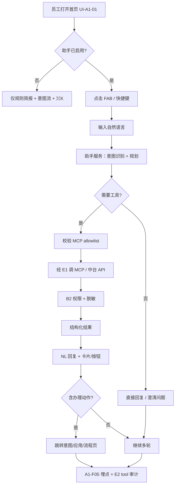
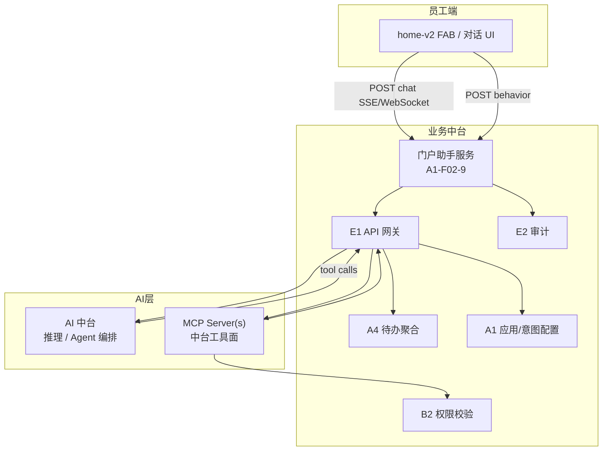
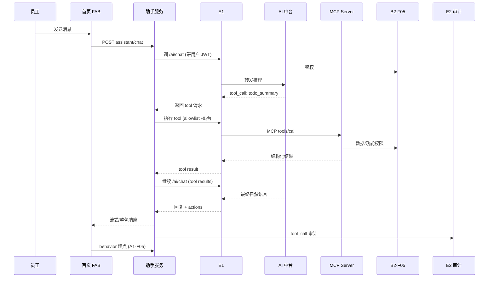

# 首页 AI 助手 · MCP 对接 · 产品技术方案

> **文档定位**：面向产品、架构与门户/AI 集成的**逻辑方案**（业务流程、产品规则、数据流、技术机制），**不**展开 OpenAPI 契约与表字段清单。  
> **真源优先级**：《麓邦业务中台产品PRD》（v2.1）> 原型 `home-v2` / `portal-ai-assistant` > 本派生文档。  
> **客户确认**：2026-10-21 — **首页 AI 助手纳入交付范围**（相对 V1.5 方案 A「不交付 B7」的演进）。  
> **生成日期**：2026-10-21

---

## 1. 背景与目标

### 1.1 相对 V1.5 方案 A 的演进

| 维度 | V1.5 方案 A（已拍板） | 本次确认方向 |
| --- | --- | --- |
| 智能入口 | **规则今日简报** + **意图流** + **⌘K 固定命令** | **保留**，与助手 **并存** |
| AI 助手 | **不交付** B7 多轮对话；原型 FAB 为演示项 | **交付** 员工端助手浮层 + 真实后端链路 |
| 接口 | `POST /v1/portal/assistant/chat` **未定义、不得假装上线** | 定义助手域接口（逻辑名，详规另文） |
| AI 中台 | `/ai/**` 路由 **未就绪** | 经 **E1** 统一路由；**MCP Server(s)** 作为工具面扩展 |
| 管理端 | `portal-ai-assistant` 读 `localStorage` 演示 | **产品化** 持久化配置（启用/降级/欢迎语/MCP 域 allowlist） |

**目标一句话**：让员工在首页用**自然语言**完成「查我有权的数据、找应用、去办理」，工具能力经 **业务中台 MCP 网关** 暴露，**权限与审计与中台一致**，AI 不可用时不阻塞工作台核心链路。

### 1.2 不在本文展开

- 大模型训练、Prompt 实验室、模型微调流水线（归 **AI 中台**）。
- A3 全局搜索索引引擎选型与对象注册细节（见 PRD A3-F02~F03）。
- OpenAPI、表结构、具体 MCP JSON-RPC 字段（见接口专项 / AI 中台契约）。

### 1.3 原型基线（交互与配置项）

| 资产 | 作用 |
| --- | --- |
| `prototype/home-v2.html` / `mobile/home-v2.html` | 右下角 **FAB**、多轮面板、快捷问题；Esc 关闭；与 ⌘K 并列 |
| `prototype/assets/mock.js` | `portalAiAssistantDefault`、`portalAiMockReply`（待办/应用/简报/意图路由演示） |
| `console.html?page=portal-ai-assistant` | 启用 FAB、AI 可用开关、欢迎语、占位符、模型路由标签、不可用文案、E1 链接 |

生产环境将 **localStorage `bmp_portal_ai_config`** 替换为 **`GET/PUT /v1/portal/assistant/config`**（逻辑名）及服务端缓存下发。

---

## 2. 产品功能需求

### 2.1 多轮对话（会话）

| 编号（拟议） | 需求 | 业务规则 |
| --- | --- | --- |
| **A1-F02-9-1** | 员工端浮层/抽屉式 **多轮对话** | 会话绑定 **用户身份**（JWT `sub`）；支持 **新建会话 / 继续最近会话**（V1.5+ 可仅「单会话滚动窗口」）；单轮超时展示友好文案，**不丢已展示内容** |
| | 上下文携带 | 可携带 **首页上下文摘要**（可选）：当前角色、待办条数区间、最近打开的 cardId（**不含他人数据**） |
| | 诚实原则 | 无法确认的事实 **不编造**；数据不足时引导 ⌘K / 意图项 / 联系管理员 |
| | 与简报边界 | **今日简报**仍走 `GET /v1/portal/brief`（V1.5 `source=rule`）；助手可 **引用简报结论**，但 **不替代** 简报卡片为唯一真相源 |

### 2.2 MCP / 工具调用

| 编号（拟议） | 需求 | 业务规则 |
| --- | --- | --- |
| **A1-F02-9-2** | 对接 **业务中台 MCP**（经 AI 中台或门户助手服务编排） | 助手 **不得** 直连业务库或业务系统；**一律** 经注册 MCP Tool / 中台 API（**ADR-07**） |
| | Tool 注册与发现 | MCP Server 在治理层 **登记**（关联 `app_code` / 能力域）；助手只可见 **allowlist 内** 的 server + tool |
| | 调用链 | 用户 utterance → 意图/规划 → **tool call** → MCP → 中台 API → **权限校验（B2-F05/B2-F03）** → 结构化结果 → 自然语言 + **可点击动作** |
| | 失败与降级 | MCP/AI 超时 → **熔断**（对齐 E1-F04 精神）；返回 `unavailableMessage` + 保留 ⌘K/意图流；**不阻塞** 首页渲染 |
| | 配额 | 与 **I3-F02** 开放授权 / AI 配额对齐（V2.5 完整；V1.5+ 可用静态配额表降级） |

### 2.3 对话查数（权限内）

| 编号（拟议） | 需求 | 业务规则 |
| --- | --- | --- |
| **A1-F02-9-4** | **对话式数据查询** | 仅允许调用 **已登记「只读查询」类** MCP 工具（如待办汇总、个人消息未读、应用打开次数 **本人** 等） |
| | 不越权 | 查询参数 **强制注入** 当前用户身份与 **B2-F03 数据范围**；工具层 **不得** 接受任意 `userId` 覆盖（防 prompt 注入） |
| | 结果呈现 | 数字/列表 **带来源与时间**；敏感字段 **脱敏**（对齐 PRD §4.7）；禁止导出超范围明细 |
| | 与数据中台 | 经营/报表类指标走 **数据中台经 E1** 的只读 API（待 MCP 包装）；无权限时 **不暴露对象存在性**（与 A3 一致） |

### 2.4 搜索应用

| 编号（拟议） | 需求 | 业务规则 |
| --- | --- | --- |
| **A1-F02-9-5** | **应用搜索与打开** | 优先 **MCP 工具**：`search_apps` / `open_app`（读 `portal_app` + `portal_app_scope`，**B2-F05 过滤**） |
| | 与 A3 关系 | **V2.0** A3-F01 上线后，助手可 **委托** A3 检索接口做跨对象搜索；**V1.5+ 最小集** 仅 **应用名/分组模糊匹配** |
| | 跳转 | 外链走 **SSO**（决议 #5）；站内走统一路由；助手回复含 **一键打开** 按钮 |

### 2.5 业务操作导航 / 意图执行

| 编号（拟议） | 需求 | 业务规则 |
| --- | --- | --- |
| **A1-F02-9-6** | **操作导航与意图执行** | 识别「我要请假 / 提报销 / 用章…」→ 匹配 **A1-F02-7 意图项** 或 MCP `navigate_intent` |
| | 与意图流 | **同一配置源** `GET /v1/portal/intents`；助手 **不维护第二套** 跳转表 |
| | 执行形态 | **导航型**（jumpUrl/cmd）直接跳转；**表单/流程型** 打开对应发起页（与原型 `bizType` 一致） |
| | 无权限 | 意图项对用户不可见则助手 **不得** 引导办理，仅说明「暂无权限」 |

### 2.6 顶层功能点登记建议

| 拟议编号 | 名称 | 版本建议 | 说明 |
| --- | --- | --- | --- |
| **A1-F02-9** | **首页 AI 助手（MCP 对话入口）** | V1.5+ 最小可用 / V2.0 完整 | 聚合 9-1~9-6；UI 仍属 **UI-A1-01 / UI-M-01** 浮层，不改布局引擎 card 集合 |
| **A1-F02-9-3** | **助手运营配置** | V1.5+ | 产品化 `portal-ai-assistant` |
| **E1-F01 扩展** | `/ai/**` + **`/mcp/**` 或经 AI 中台转发** | V1.5+ 路由 / V2.0 策略完整 | 与 §4.7 一致，**不另开公网 MCP** |

---

## 3. 用户角色与权限

| 角色 | 员工端助手 | 管理端配置 | 数据范围 |
| --- | --- | --- | --- |
| **普通员工** | 启用时可见 FAB；可对话、查 **本人/本范围** 数据、搜应用、执行 **有权限** 意图 | 不可改配置 | **B2-F05 + B2-F03** 强制；工具参数服务端注入 |
| **管理员（门户运营）** | 同员工（无超级查数） | `portal:assistant:manage`（拟议）— 启用/降级、欢迎语、allowlist | 配置变更 **E2 审计** |
| **审计员** | — | 只读查看助手配置变更、tool call 审计 | E2 检索，**不可改** |
| **平台架构/集成** | — | MCP Server 注册、路由、工具清单（与 I1/E1 协同） | 高危操作二次确认 |

**硬规则（产品红线）**：

1. **先权限、后推理**：任何 tool 执行前 **B2-F05**；带数据的 tool 再加 **B2-F03**（或业务 API 等效校验）。
2. **MCP allowlist**：未登记或未启用的 Server/Tool **不可被模型调用**（编排层硬拦截，非 Prompt 约束）。
3. **员工不能通过对话提升权限**；拒绝「查某某的待办/工资」类越权请求（除非角色本身有管理范围）。
4. **管理员助手无「上帝模式查数」** — 管理端能力走既有控制台，不走对话旁路。

---

## 4. 业务流程（员工视角）

**典型场景（验收叙事）**：

1. 「我今天有什么急事？」→ tool：`todo_summary` → 与时间轴一致，附「打开待办」。
2. 「打开 CRM」→ tool：`search_apps` + `open_app` → SSO 新标签。
3. 「我要请假」→ 匹配意图项 `leave` → 跳转发起页。
4. AI/MCP 不可用 → 面板展示配置文案，**⌘K 与意图流仍可用**。

---

## 5. 技术逻辑与架构

### 5.1 组件职责

| 组件 | 职责 |
| --- | --- |
| **门户助手服务** | 会话管理、上下文裁剪、调用 AI 中台、**tool 执行编排**、降级、埋点上报 |
| **E1** | **唯一收口**（ADR-07）：鉴权 E1-F02、路由 `/ai/**`、转发 MCP HTTP/SSE（或 AI 中台代理 MCP） |
| **AI 中台** | 模型推理、Function Calling / Agent 循环；**不持有** 业务主数据写权限 |
| **MCP Server(s)** | 将中台能力封装为 **标准 Tool**（待办、应用、消息、只读指标等）；可分机部署，**必须** 登记 allowlist |
| **A1-F02-7 / A3** | 意图与搜索的 **配置与检索真源**，助手 **只消费** |

### 5.2 与规则简报 / ⌘K / 意图流的关系（并存，非替代）

| 能力 | 定位 | 与助手关系 |
| --- | --- | --- |
| **规则今日简报**（`ai-brief`） | 首屏 **3 秒判断**，无对话 | 助手可读简报结果 **辅助解释**，用户仍可在左栏看卡片 |
| **意图流**（A1-F02-7） | **一跳办理** 显性入口 | 助手 **复用同一 intents**；意图流适合「我知道要干什么」 |
| **⌘K** | 键盘 **命令_palette** | V1.5 固定命令 + 意图；V2.0 可扩展 A3；助手适合 **自然语言**；⌘K 可保留命令「打开 AI 助手」 |
| **A3 统一检索** | 跨对象 **精确找** | V2.0 起助手可调用 A3；顶栏搜索与助手 **并存** |

**结论**：助手是 **L1 自然语言编排层**，不删除 V1.5 已交付的 **规则化入口**；默认配置下 **全部并存**，管理员可 **关闭 FAB** 仅保留方案 A 体验。

### 5.3 时序（一次带 tool 的对话）

---

## 6. 数据流

### 6.1 会话与上下文

| 数据 | 归属 | 保留 | 说明 |
| --- | --- | --- | --- |
| 会话 thread / message | 助手服务（`bmp_portal` 逻辑域） | 建议 30~90 天 | **不含** 他人业务明细落库；必要时只存摘要 hash |
| 助手配置 | `portal_assistant_config`（逻辑表） | 长期 | 替代原型 localStorage |
| 用户 JWT 上下文 | B1 | 会话级 | 每次请求 **重新校验**，不写入 MCP |

### 6.2 Tool call 审计（E2）

与 **A1-F09 埋点分库**（H2）：

| 通道 | 内容 | 用途 |
| --- | --- | --- |
| **E2** `audit_operation_log` / 专用 `audit_ai_tool_call`（拟议） | 谁、何时、调用了哪个 MCP tool、参数摘要（脱敏）、成功/失败、trace_id | 合规、安全调查 |
| **A1-F05** `POST /v1/portal/behavior` | `assistant_open`、`assistant_message`、`assistant_tool_success`、`assistant_navigate` | 产品分析 → A1-F09 |

**禁止**：tool 审计写入 `portal_behavior_event`；行为埋点 **不** 替代 E2 合规留痕。

### 6.3 埋点事件（拟议扩展 A1-F05）

| event | 触发 |
| --- | --- |
| `assistant_open` | 打开 FAB |
| `assistant_message_send` | 用户发送（不含全文时可只记长度档） |
| `assistant_tool_invoke` | tool 名称 + 结果码 |
| `assistant_intent_navigate` | 从助手跳转意图/应用 |

---

## 7. 管理端：`portal-ai-assistant` 产品化

| 配置项 | 说明 | 默认值建议 |
| --- | --- | --- |
| **enabled** | 员工端是否展示 FAB | **false**（V1.5 基线兼容）→ 客户确认后按环境开启 |
| **aiAvailable / degradeMode** | 全局降级：仅展示不可用文案 | true |
| **welcomeText** | 首条 AI 消息 | 对齐原型，注明能力边界 |
| **inputPlaceholder** | 输入框占位 | — |
| **unavailableMessage** | 降级文案 | 引导 ⌘K / 意图流 |
| **allowedMcpServers** | MCP Server ID 多选 allowlist | 空 = 不暴露 tool（仅纯聊天，不推荐生产） |
| **allowedTools** | 可选细粒度 tool 白名单 | 默认「server 下全部只读类」 |
| **modelRouteLabel** | 展示用路由标签 | 非 Prompt 配置（Prompt 归 AI 中台） |
| **maxTurnsPerSession** | 单会话轮次上限 | 防滥用 |
| **publish** | 保存后 **5 分钟内** 员工端生效（对齐意图项） | 变更 **E2 审计** |

**菜单**：侧栏仍为 **门户运营 → 首页 AI 助手**；文案由「（演示）」改为正式能力（保留原型 page key `portal-ai-assistant` 兼容书签）。

---

## 8. 与 PRD 缺口及修订建议

### 8.1 §6.1.1a 修订建议（客户确认 2026-10-21）

| 原表述 | 建议修订 |
| --- | --- |
| V1.5 **不交付** B7 AI 助手浮层 | **V1.5+** 交付 **A1-F02-9** 最小可用（可配置默认关）；原「B7」称谓统一为 **A1-F02-9**，避免与骨架 B7（公告/Banner/D1）混淆 |
| 助手 `POST /v1/portal/assistant/chat` 未定义 | 列入 **A1-F02-9** 接口包（逻辑名），经 E1 调 AI |
| AI 能力 **无** | **V1.5+**：规则简报仍 `source=rule`；助手 **可选** 接 MCP；**V2.0**：简报可 `source=ai` + 助手完整能力 |
| ⌘K 非 A3 | 不变；助手与 A3 **V2.0 协同** |

### 8.2 功能点编号建议（需主 PRD 登记）

| 编号 | 名称 | 优先级 | 版本 |
| --- | --- | --- | --- |
| **A1-F02-9** | 首页 AI 助手（MCP 对话入口） | P1 | V1.5+ MVP / V2.0 完整 |
| A1-F02-9-1 | 多轮对话与会话 | P1 | 同上 |
| A1-F02-9-2 | MCP 工具路由与 allowlist | P0 | V1.5+ MVP |
| A1-F02-9-3 | 助手运营配置（管理端） | P1 | V1.5+ MVP |
| A1-F02-9-4 | 权限内对话查数工具 | P1 | V2.0（MVP 仅待办/应用等少数量 tool） |
| A1-F02-9-5 | 应用搜索与打开 | P1 | V1.5+ MVP |
| A1-F02-9-6 | 意图识别与办理导航 | P1 | V1.5+ MVP |

**依赖（写入 §3.10）**：A1-F02-9(S) 依赖 B1-F01、B2-F05(S)、E1-F02(S)、E1 `/ai/**` 路由(W)；A1-F02-9-6(W) 依赖 A1-F02-7；A1-F02-9-5(V2.0 W) 依赖 A3-F01。

**边界（新增 B 组建议 · B-new-7）**：

| 边界 | A 侧 | B 侧 | 规则 |
| --- | --- | --- | --- |
| **B-new-7** | **A1-F02-9 助手** vs **G1-F05 知识问答** | G1 管 **知识库 RAG**；助手管 **工作台动作与 MCP 工具** | 助手可调 G1 问答 **作为一个 tool**；G1 **不** 承载应用打开/意图跳转 |
| | **A1-F02-9** vs **A1-F02-7 意图流** | 意图流 = 显性固定入口 | **同一 intents 配置**；助手不得私建跳转 |
| | **A1-F02-9 tool 审计** vs **A1-F09 埋点** | 合规 vs 产品 | **分库分权**（同 B9） |

### 8.3 §8 版本计划补充建议

| 版本 | 助手范围 |
| --- | --- |
| **V1.5+ 最小可用** | 配置台；FAB；`chat` 经 E1→AI；**≥3 个 MCP tool**（待办摘要、搜应用、执行意图）；降级；E2 tool 审计；A1-F05 埋点 |
| **V2.0 完整** | 接 A3 跨对象搜索；更多只读查数 tool；简报 `source=ai` 可选；I3 配额；E1-F04 熔断策略联动 |
| **V2.5+** | I3 能力目录登记 MCP；开发者门户文档化 MCP Tool |

---

## 9. 分期交付摘要

| 阶段 | 员工端 | 后端/MCP | 管理端 | 验收要点 |
| --- | --- | --- | --- | --- |
| **V1.5+ MVP** | FAB + 多轮 + 快捷问题 | 助手服务 + E1 `/ai/**` + 1~N 个 MCP Server | `portal-ai-assistant` 持久化 | 越权用例 0 通过；AI 挂掉可降级；意图与应用与 A1-F02-7 一致 |
| **V2.0** | 与顶栏搜索/A3 联动提示 | 扩展 tool；熔断/限流 | allowlist 细粒度到 tool | 对话查数 **3 类** 场景演示；P95 响应可接受 |
| **V3.0** | 与 G1 知识、更多 Agent 场景 | BMP-P2-06 编排 | 与 I3 开放授权联动 | 经统一出口调用 AI（对齐 PRD §8 V3.0） |

---

## 10. 非功能与安全要点

| 主题 | 要求 |
| --- | --- |
| **Prompt 注入** | tool 参数 **服务端构造**；忽略用户提供的 `userId`、orgId 覆盖 |
| **数据出域** | 传给模型的上下文 **最小化**；PII 脱敏；禁止把全量待办明细塞进 system prompt |
| **SSRF** | MCP Server 出站 URL **仅允许** 中台注册路由（同 I1 白名单精神） |
| **密钥** | MCP / AI 密钥 **不进前端**；E1 注入服务身份 |
| **性能** | 首 token / 首屏回复 P95 目标 **<3s**（可配置超时）；tool 并行度上限 |
| **可用性** | AI 失败 **不阻塞** `GET /v1/portal/home` |

---

## 11. 版本记录

| 版本 | 日期 | 作者 | 说明 |
| --- | --- | --- | --- |
| v1.0 | 2026-10-21 | 产品/架构（派生） | 首版：客户确认首页 AI 助手 + MCP 对接；对齐 PRD §6.1.1a、§4.7、§8 V2.0、原型 home-v2 / portal-ai-assistant |

---

## 附录 A · 关联文档

| 文档 | 路径 |
| --- | --- |
| 产品 PRD | `麓邦业务中台产品PRD.md`（§4.7、§6.1.1a、§6.1.2 A1-F02-7、§8、A3、G1-F05） |
| 首页重构说明 | `prototype/home-redesign-brief.md` |
| 工作台配置流程 | `outputs/规范/流程专项/04-工作台首页配置与使用.md` |
| 应用接入（E1 收口参照） | `outputs/规范/产品技术方案/应用接入四域-产品技术方案.md` |
| 规格简报 | `开发级PRD编写-规格简报.md` |
| 菜单真源 | `prototype/docs/menu-structure.md` |
