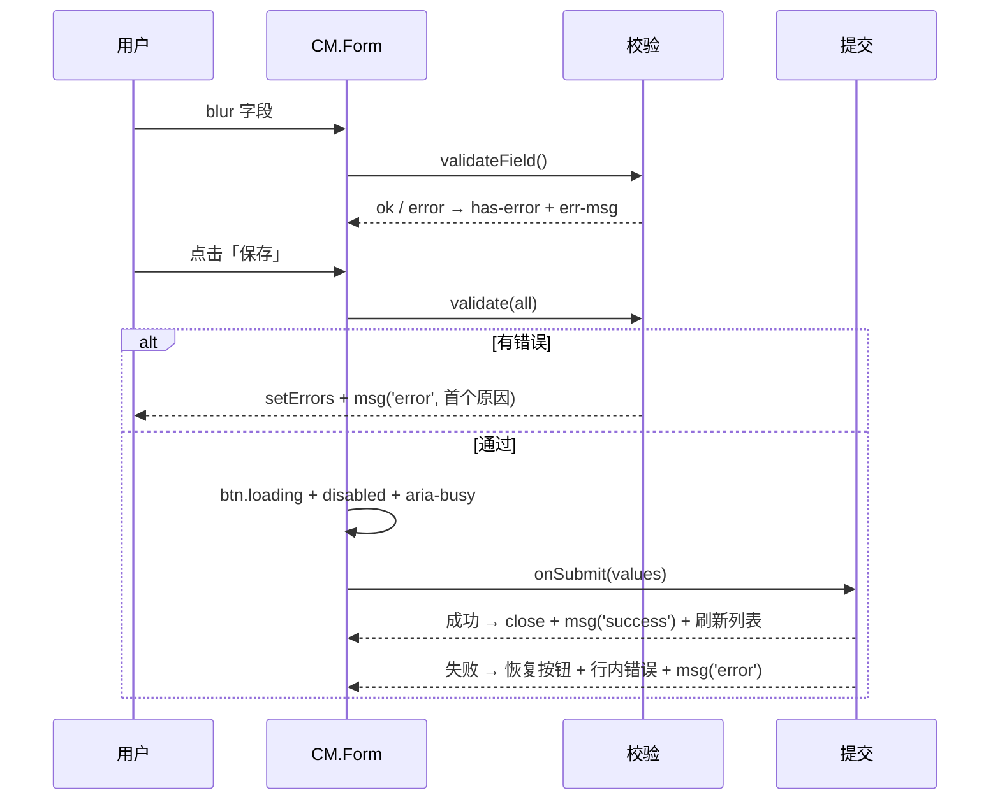
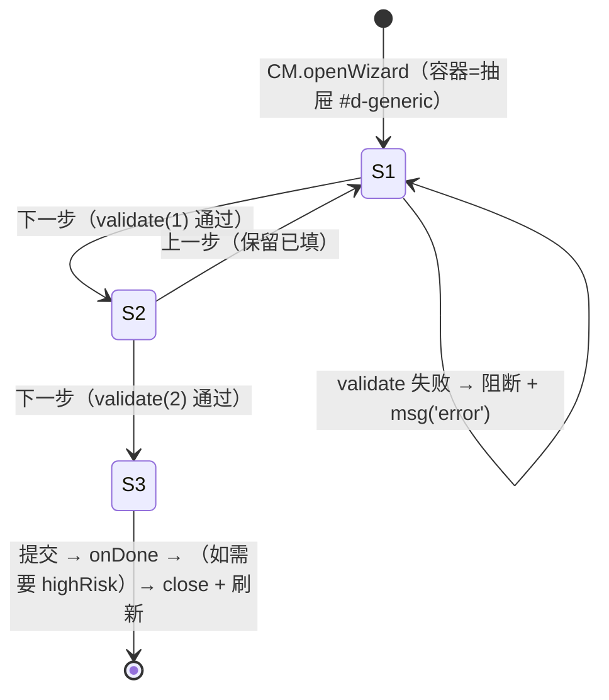
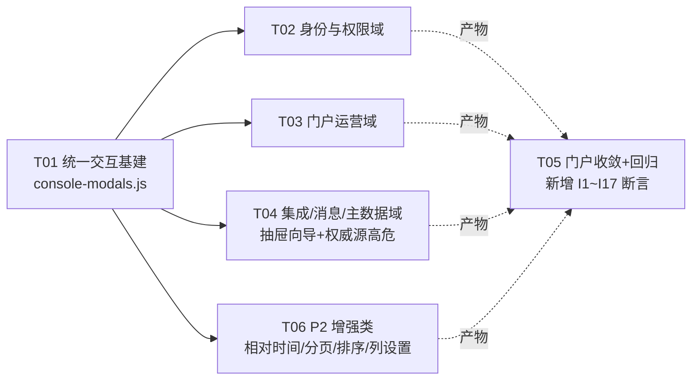

# 原型交互补全 · 架构设计与任务分解

> **产出方**：架构师 高见远（Gao） · **承接**：任务 #2（客户诉求：UI 原型中大量按钮点击无二级页面/无交互效果，应补全）
> **版本**：**v3.4（已按客户 2026-10-15 拍板 + 产品经理任务 #1 前置输入修订）** · v1 五部分齐全 → v2 依 4 项决策修订 → v3 并入 PM 前置输入并自纠 1 处误判 → v3.2 新增 §2.5 交付边界声明 → v3.3 将 §2.5 固化为断言 I17 → **v3.4 加固 I17 锚点（ASCII key `callback-whitelist` + 存在性前置断言）+ 钉死 Tab 命名契约**
> **v3 修订要点**：① 并入 PM 输入——`UI-C-16` 补 `app_secret` 一次性展示 / 密钥重置高危 / **新增「回调域名白名单」Tab**；② `sync-source` 复核后**自纠**——「缺高危确认」不成立（`enableSource` 已有 `highRisk`），真实缺口改为「删 `:966`「（忽略）」选项 + 步骤 2 必映射阻断 + 步骤 3 测试门禁 + keyword 收紧」；③ 澄清 `index.html` 11 处功能点错位**已于 R-52/R-53 修复**，非本轮遗留。
> **v3.2 修订要点**：新增 **§2.5 本轮交付边界（强制声明）**——明确「原型层交付 ≠ 需求/数据层闭合」，列 G-4 四个未动回写点，防期望管理事故。
> **v3.3 修订要点**：新增断言 **I17「§2.5 边界合规」**——将边界声明固化为可自动验证项（`UI-C-16` 白名单 Tab 文案不得伪造"后端已就绪"），供 QA 正向验收；断言总数 16→**17**，回归目标 31→**32**。
> **v3.4 修订要点**：**加固 I17 锚点**——原中文锚点 `回调域名白名单` 的唯一真实失效模式为 **「0 命中 → 静默 PASS」**（Tab 未建 / key 拼错 / 沿用他页标签；实测 `grep -c "回调域名白名单"`=0，长串锚不会误命中短串区段，**无子串歧义**），改为锚定**稳定 ASCII key `callback-whitelist`** 并加**存在性前置断言（≥1，承重、不可删）**；同步**钉死 Tab 命名契约**（§3.6 / T04）——防 I17 踩与 `:966` 同类的"看似有校验、实际不生效"缺陷。
> **输入依据**：`prototype/`（22 HTML + 4 assets，纯 HTML/CSS/JS 零依赖）、`outputs/核查/02-PRD还原度核查.md §3`（I-01~I-18）、`outputs/规范/权威源与应用接入-需求澄清.md`（PM 任务 #1 产出）、`outputs/规范/麓邦业务中台全局UI规范.md`（§3 状态 / §4 组件 / §5 反馈 / §6 表单表格 / §7 权限 / §9 文案）、`outputs/核查/verify-prototype.mjs`（15 项回归基线，当前全 PASS）
> **硬约束声明**：本设计**只读** `prototype/`，未修改任何原型文件；所有"缺失"断言均附 `file:line`；所有"全量/清零"断言均写明扫描命令与口径。

---

## 0. 盘点口径与扫描命令（可复现）

| 编号 | 口径 | 扫描命令（在 `prototype/` 下执行） | 实测结果 |
| --- | --- | --- | --- |
| SCAN-1 | **明确标注「略」的二级形态缺失** | `grep -roE "[^']{0,18}略）" --include=*.js --include=*.html assets/*.js *.html mobile/*.html \| grep -vE "策略\|忽略" \| wc -l` | **20 处**（`console.js` 1 + `pages-config.js` 19） |
| SCAN-2 | **占位式演示交互（点一下只弹 toast）** | `grep -rnoE "（原型演示）\|原型演示\|（演示）" --include=*.js --include=*.html assets/*.js *.html mobile/*.html \| wc -l` | **36 处**（其中 `onclick="…（原型演示）…"` 可点击占位 **13 处**） |
| SCAN-3 | **管理端页 key 总数** | `grep -nE "crumb:" assets/pages-config.js \| wc -l` | **23**（= `console.html?page=` 全部页面） |
| SCAN-4 | **I-16 是否已修复（复核）** | `grep -rn "prefers-reduced-motion" --include=*.css --include=*.html assets/*.css *.html mobile/*.html` | **命中 3**：`common.css:568`/`home-v2.html:736`/`mobile/home-v2.html:791` → **已闭环** |
| SCAN-5 | **提交 loading 防重复现状** | `grep -rn "\.loading\|aria-busy" assets/*.js console.html` | **0 处**（仅 `login.html` 内联脚本有 loading，管理端为 0） |
| SCAN-6 | **焦点圈定现状** | `grep -rn "activeElement\|focus()" assets/*.js` | **0 处** → 未实现 |
| SCAN-7 | **>200ms 动效（I-15，复核行号）** | `grep -nE "(transition\|animation)[^;{}]*\.(2[1-9]\|3\|4\|5\|[6-9])[0-9]*s" home-v2.html mobile/home-v2.html` | `home-v2.html:259/599/675`、`mobile/home-v2.html:371/571/643/686` 等（**核查报告 640/683/368 行号为修复前旧值，已失效**） |
| SCAN-8 | **P2 增强类现状** | `grep -n "relTime" assets/mock.js` ；`grep -n "列设置\|bmp_col_prefs" assets/*.js`；`grep -rn "更多筛选\|sort-ind" assets/*.js` | `relTime` 恒等（`mock.js:604`）；列设置纯 toast；「更多筛选」「排序指示器」**均 0 命中** |

> **SCAN-2 按文件分布**：`mock.js 10` / `pages-config.js 10` / `console.js 5` / `home-v2.html 5` / `mobile/home-v2.html 3` / `approval.html 1` / `home.html 1` / `login.html 1`。

---

# 第一部分：缺口全量盘点矩阵

## 1.1 管理端「略」二级形态缺失（主线索 A，逐页）

| 页面（page key） | 缺口位置 `file:line` | 现状（点了会怎样） | 应补二级形态 | 涉及 PRD 功能点 | 优先级 | 豁免? |
| --- | --- | --- | --- | --- | --- | --- |
| 账号管理 `accounts` | `assets/console.js:300` | 详情抽屉内「分配角色」→ toast「角色分配抽屉（复用 UI-C-02 成员管理，略）」 | 分配角色抽屉（勾选角色多选 + 保存即生效提示） | B1-F01 / UI-C-02 | **P1** | 否 |
| 权限申请登记 `perm-applies` | `assets/pages-config.js:86` | 「拒绝」→ toast「拒绝需填写原因（弹窗略）」 | 拒绝原因弹窗（必填原因，≥10 字，提交后置「已拒绝」） | B2-F04 | **P0** | 否 |
| 权限申请登记 `perm-applies` | `assets/pages-config.js:86` | 「详情」→ toast「详情抽屉（略）」 | 申请详情抽屉（申请单号/权限点/期限/审批链/时间线） | B2-F04 | **P1** | 否 |
| 权限申请登记 `perm-applies` | `assets/pages-config.js:80` | 「＋ 代客登记」→ toast「V1.0 为线上登记+线下审批口径…」 | 代客登记表单弹窗（申请人/权限点/理由/期限） | B2-F04 | **P1** | 否 |
| 应用 / 卡片管理 `portal-apps` | `assets/pages-config.js:132` | 「＋ 上架应用」→ toast「新建应用表单（弹窗略）：名称/图标/分组/URL/可见角色」 | 上架应用表单弹窗（含 URL 连通性校验） | A1-01 / T3-09 | **P0** | 否 |
| 应用 / 卡片管理 `portal-apps` | `assets/pages-config.js:138` | 「编辑」→ toast「编辑应用（弹窗略）」 | 编辑应用表单弹窗（复用上架表单，预填） | A1-01 | **P0** | 否 |
| 公告管理 `notices-admin` | `assets/pages-config.js:195` | 「＋ 新建公告」→ toast「富文本编辑器 + 定时发布 + 置顶设置（弹窗略）」 | 新建公告抽屉（富文本 + 定时发布 + 置顶 + Banner 时段） | A1-04 / UI-C-12 | **P1** | 否 |
| 公告管理 `notices-admin` | `assets/pages-config.js:216` | 「编辑」→ toast「编辑公告（富文本弹窗略）」 | 编辑公告抽屉（复用新建范式，预填） | A1-04 | **P1** | 否 |
| 网关路由管理 `gateway` | `assets/pages-config.js:249` | 「＋ 新建路由」→ toast「路由编辑弹窗：路径/目标/超时/限流QPS/灰度规则（略）」 | 新建路由弹窗（路径/目标/超时/限流/灰度 + 保存前高危确认） | E1 最小集 | **P0** | 否 |
| 网关路由管理 `gateway` | `assets/pages-config.js:259` | 「编辑」→ toast「编辑路由（弹窗略），变更需确认并写审计」 | 编辑路由弹窗（复用新建范式 + 变更高危确认） | E1 | **P0** | 否 |
| 应用注册 `integration` | `assets/pages-config.js:276` | 「＋ 注册应用」→ toast「注册向导：应用信息 → 回调地址 → scope 授权（3 步，略）」 | **3 步注册向导（抽屉内）**：应用信息 → 回调地址 → scope 授权 | B1-F02 / J1 | **P0** | 否 |
| 应用注册 `integration` | `assets/pages-config.js:282` | 「编辑」→ toast「编辑 scope（勾选面板略）」 | scope 勾选面板（分组多选 + 保存） | J1 | **P1** | 否 |
| 应用注册 `integration` | `assets/pages-config.js:282` | 「重置 secret」→ toast 说明（未走高危确认） | 高危确认弹窗（`highRisk`，输入 client_id 确认） | J1 / §5.2 | **P1** | 否 |
| 角色管理 `roles` | `assets/pages-config.js:735` | 「＋ 新建角色」→ toast「新建角色表单（弹窗略）」 | 新建角色表单弹窗（名称/编码/描述/来源） | UI-C-02 | **P1** | 否 |
| 角色管理 `roles` | `assets/pages-config.js:791` | 「＋ 添加成员 / 批量移除」→ toast 提示 | 添加成员抽屉（EmployeeSelect 多选） | UI-C-02 | **P1** | 否 |
| 权限点管理 `permissions` | `assets/pages-config.js:812` | 「＋ 新建权限点」→ toast「新建权限点：编码唯一校验（弹窗略）」 | 新建权限点弹窗（编码唯一校验 + api_pattern） | UI-C-03 | **P1** | 否 |
| 权限点管理 `permissions` | `assets/pages-config.js:815` | 「编辑」→ toast「编辑权限点（弹窗略）」 | 编辑权限点弹窗 | UI-C-03 | **P1** | 否 |
| 权限点管理 `permissions` | `assets/pages-config.js:815` | 「删除」→ toast「无法删除：…（阻断原因列表略）」 | **阻断原因结构化列表**（引用该权限点的角色清单 + 直达解除引用） | UI-C-03 / §3.3 | **P1** | 否 |
| 布局模板管理 `layouts` | `assets/pages-config.js:1130` | 「＋ 新建模板」→ toast「新建模板（弹窗略）：名称 / 适用角色（可多选）」 | 新建模板弹窗（名称 + 适用角色多选 + 布局版本） | UIUX 8.3 | **P1** | 否 |
| 消息管理 `msg` | `assets/pages-config.js:1432` | 「＋ 新建模板」→ toast「新建消息模板（弹窗略）：编码唯一校验」 | 新建模板弹窗（编码唯一校验 / 渠道 / 审核流） | D1-F01 | **P0** | 否 |
| 消息管理 `msg` | `assets/pages-config.js:1444` | 「测试」→ toast「发送测试：输入测试账号 → 实际下发一条测试消息（弹窗略）」 | 发送测试弹窗（账号输入 + 模拟下发结果） | D1-F05 | **P1** | 否 |
| 消息管理 `msg` | `assets/pages-config.js:1480` | 「配置」→ toast「编辑渠道配置（凭证加密存储，弹窗略）」 | 渠道凭证配置抽屉（加密存储说明 + 连通性测试） | J2 / D1 | **P1** | 否 |
| 消息管理 `msg` | `assets/pages-config.js:1480` | 「去配置」→ toast「配置连接器凭证后启用（向导略）」 | 连接器配置向导（**抽屉内** 2~3 步） | J2 | **P1** | 否 |
| 公告详情（门户） | `notices.html:58` | 正文末「（正文支持富文本与附件下载，附件区略 · 已读回执自动上报）」 | 附件区（附件列表 + 下载按钮 + 已读回执） | A1-04 | **P1** | 否 |

> **口径**：上表覆盖 SCAN-1 命中的 **20 处「略）」**（`console.js:300` + `pages-config.js` 的 `:86×2 / :132 / :138 / :195 / :216 / :249 / :259 / :276 / :282 / :735 / :812 / :815 / :1130 / :1432 / :1444 / :1480` + `notices.html:58`）。

## 1.2 占位式演示交互（主线索 B，逐页）

> 口径：SCAN-2 命中 36 处。下表仅列**需要收敛**的项；「跨系统新标签页打开」「异步导出已提交」等属**设计意图**（决议 #5：图标点击走新标签页；导出为异步任务），**保留为演示终态**。

| 页面 | 缺口位置 `file:line` | 现状 | 应补二级形态 | 优先级 | 豁免? |
| --- | --- | --- | --- | --- | --- |
| 在线会话 `sessions` | `assets/pages-config.js:63` | 「批量强制下线」→ toast「请先勾选会话（原型演示）」 | 勾选交互 + 批量高危确认 | **P1** | 否 |
| 审计检索 `audit` | `assets/pages-config.js:232` | 快速标签「🔥仅看高危操作 / 今日登录失败」→ toast | 就地筛选（就地重渲染，应用筛选态） | **P2** | 否 |
| 应用运营看板 `app-analytics` | `assets/pages-config.js:331` | 「口径设置」→ toast「口径设置：数据窗口 / 环比基准（原型演示）」 | 口径设置弹窗（数据窗口 + 环比基准） | **P2** | 否 |
| 应用运营看板 `app-analytics` | `assets/pages-config.js:3407-3408` | 「查看埋点配置 / 重新检测」→ toast | —— | **P2** | **是**（A1-F05 埋点属 V1.5，`05-原型修复记录.md §四-2` 已显式标注"待 V1.5 接入"，不伪造） |
| 流程定义 `workflow-defs` | `assets/pages-config.js:1559` | 「⚙ 列设置」→ toast「列设置：勾选可见列（原型演示）」 | 列设置弹窗（勾选 + **localStorage 记忆**） | **P2** | 否（并入 I-07） |
| 委托代理 `workflow-delegate` | `assets/console.js:220`（通用列表页「查询」） | 通用「查询」→ toast「筛选已应用（原型演示）」 | 就地筛选（应用筛选态 + 计数） | **P2** | 部分（通用渲染器，见 §3.6） |
| 通用列表「列设置」 | `assets/console.js:228` / `assets/pages-config.js:1559` | 同上（两处独立实现） | 统一为列设置弹窗（I-07） | **P2** | 否 |
| 待办中心 | `assets/mock.js:9-14`（jumpUrl） | 待办卡「去处理」→ toast「新标签页打开…（决议 #5）」 | —— | — | **是**（决议 #5：新标签页打开为设计终态） |
| 首页 home-v2 | `home-v2.html:759 / 1935 / 1985 / 2314` | 消息铃/待办/意图/公告 → toast「原型演示…」 | 铃铛跳消息中心；其余保留 | **P1**（仅铃铛） | 部分 |
| 审批中心 | `approval.html:272` | 跳转审批 → toast「新标签页打开源系统处理页」 | —— | — | **是**（跨系统跳转，决议 #5） |
| 消息中心 | `messages.html:80` | 分类空态 `state-box` **无引导动作** | 空态补「去待办中心」动作按钮 | **P0** | 否（违反 §3.2【强制】） |
| 应用中心 | `apps.html:61` | 搜索无结果空态有说明但**无「清除筛选」按钮** | 补「清除筛选」次要按钮 | **P1** | 否（§3.2 no-result 模板） |

## 1.3 交互规范缺口（主线索 C，I-01~I-18 复核）

> 复核：**I-16 已闭环**（SCAN-4：`common.css:568` 全局 + 两处 home-v2）；**I-13 已实现**（`mock.js` Esc + home-v2）。故最新口径：**未实现 3 项 / 部分 11 项 / 已实现 4 项**（原报告"未实现 4 项"含 I-16，现更新）。**客户已拍板：P2 项本轮全量纳入（见 §2.2）。**

| # | 检查项 | 现状 `file:line` | 判定 | 优先级 | 本次处置 |
| --- | --- | --- | --- | --- | --- |
| I-01 | 表单失焦校验 | 全站仅提交时校验；`approval.html:252-261`、`login-forgot.html:83-94` | ⚠️ 部分 | **P0** | 建 `Form.bindBlur` 统一嵌入（T01） |
| I-02 | 提交 loading 防重复 | SCAN-5 = **0 处**（管理端）；仅 `login.html:449` | ⚠️ 部分 | **P0** | 建 `Form.submit` 统一嵌入（T01） |
| I-03 | 无权限「禁用+tooltip」范式 | 散点存在（`pages-config.js:559/855/1546`、`todos.html:120`）但不系统 | ⚠️ 部分 | **P1** | 建 `.disabled[title]` 统一类（T01） |
| I-04 | 空态必带下一步动作 | `messages.html:80` 缺动作；`apps.html:61` 无清除筛选 | ⚠️ 部分 | **P0** | 补齐（T01/T05，见 §3.5） |
| I-05 | 列表相对时间 + hover 绝对时间 | `mock.js:604` `relTime()` 恒等 | ❌ 未实现 | **P2（本轮纳入）** | 增强：相对时间 + `title` hover（T06） |
| I-06 | 金额 ¥ 右对齐 | 表格无 `text-align:right`（`mock.js:445` 有 ¥ 前缀） | ⚠️ 部分 | **P2（本轮纳入）** | 表格数字列右对齐（T06） |
| I-07 | 列设置记忆（localStorage） | 纯 toast（`console.js:228`/`pages-config.js:1559`） | ❌ 未实现 | **P2（本轮纳入）** | 列设置弹窗 + `bmp_col_prefs`（T06） |
| I-08 | 分页器交互（10/20/50/100） | `console.js:241` 仅渲染「共 N 条 + 页码 1」 | ⚠️ 部分 | **P2（本轮纳入）** | 分页器组件化（T06） |
| I-09 | 排序指示器 | 表头无排序 UI（SCAN-8 `sort-ind` 0 命中） | ⚠️ 未实现 | **P2（本轮纳入）** | `.sort-ind` 表头指示（T06） |
| I-10 | 筛选区「更多筛选」折叠 | accounts 恰 4 项，无折叠（SCAN-8 0 命中） | ⚠️ 部分 | **P2（本轮纳入）** | `.more-filter` 折叠（T06） |
| I-11 | ⌘K / Ctrl+K | `home-v2.html:963-965` | ✅ 已实现 | — | 保持 |
| I-12 | 自然语言指令直达 | `home-v2.html:2017` 关键词匹配 | ⚠️ 部分 | P2（本轮纳入） | 保持（原型可接受，不改） |
| I-13 | Esc 关抽屉/弹窗 | `mock.js:596-601`；`home-v2.html:2105-2116` | ✅ 已实现 | — | 保持 + 纳入基建栈 |
| I-14 | 弹窗焦点圈定 | SCAN-6 = **0 处** | ❌ 未实现 | **P1** | `A11y.focusTrap` 统一（T01） |
| I-15 | 动效 ≤200ms | `home-v2.html:259(.45s)/599(.28s)/675(.35s)`、`mobile/home-v2.html:371/571/643/686` | ⚠️ 部分 | **P2（本轮纳入）** | 收敛为 ≤200ms（T06） |
| I-16 | `prefers-reduced-motion` | SCAN-4 命中 3（已闭环） | ✅ **已实现** | — | 保持 |
| I-17 | 文案：动词开头 / 含原因+解法 | 大体达标 | ✅ 已实现 | — | 保持 |
| I-18 | i18n key | 全站硬编码中文 | ⚠️ 未实现 | — | **豁免**（PRD 决议 #4「i18n 架构保留」，原型阶段可接受） |

## 1.4 架构师补充（主线索之外主动发现）

| 页面 | 缺口位置 `file:line` | 现状 | 应补形态 | 优先级 |
| --- | --- | --- | --- | --- |
| 网关路由 `gateway` | `assets/pages-config.js:253` | 启停开关点击仅 toast「路由已停用（变更写审计）」 | 停用走高危确认；启用即时生效 | P1 |
| 人员管理 `employees` | `assets/pages-config.js:895 / :909` | 「开通账号」→ toast「联动新建账号弹窗（UI-C-01）」 | 直接调 `newAccount()` 联动弹窗（工号预填） | P1 |
| 组织管理 `orgs` | `assets/pages-config.js:859` | 「详情」→ toast「只读模式：详情抽屉…」 | 组织详情抽屉（信息 + 变更记录时间线） | P2 |
| 角色管理 `roles` | `assets/pages-config.js:776-777` | 「API 权限点」Tab 无点击行为（`onclick` 缺失） | 补齐 API 权限点面板 | P2 |
| 公告管理 `notices-admin` | `assets/pages-config.js:204`（「已读统计 326/512」） | 静态文本，不可点 | 已读明细抽屉 | P2 |
| 消息中心 `messages.html` | `messages.html:80` | 分类空态无动作（同 I-04） | 补动作 | **P0** |
| **应用注册 `integration`** | `assets/pages-config.js:276` | 「＋ 注册应用」3 步向导未实现（仅 toast，同 §1.1） | 3 步向导（抽屉内）+ **`app_secret` 一次性明文展示弹窗**（含"关闭后不可再查看"+ 复制） | **P0** |
| **应用注册 `integration`** | `assets/pages-config.js:282` | 「重置 secret」仅 toast，**未走 `highRisk`** | 密钥重置 `HighRiskConfirm`（输入 client_id 确认） | **P1** |
| **应用注册 `integration`** | 归入 `integration` 页（现仅 2 Tab：应用注册 / 事件订阅） | **缺「回调域名白名单」子页（Tab）**：V1.0 `callback_url`（`A4-F01`/`C1-F06` 消费，均 V1.0）无白名单数据源 → SSRF 防护断链（PRD:12743/12744 注「V1.0 简版无此列」） | 新增「回调域名白名单」Tab（最小集：精确域名 + 强制 https + 拒 IP/内网段）；归 `I1-F01`（现用独立 `I1-F06`） | **P1（本任务新增页面）** |

> **⚠️ 两类白名单必须区分（PM 任务 #1 复核补充，防重复建）**：
> - **① 嵌入白名单（已存在，勿重复建）**：位于 **`UI-C-10 portal-apps`**（`pages-config.js:128/172-187`，4 Tab 之「域名白名单」），服务 **`A1-F08` 首页嵌入（V1.5）**，对应前端 `EMBED_WHITELIST_HOSTS`（8 个 `.local` 域名）。**这不是回调白名单**。
> - **② 回调白名单（缺失，本任务新建）**：位于 **`UI-C-16 integration`**（新增 Tab），服务 **`A4-F01`（待办 callbackUrl）+ `C1-F06`（流程 callbackUrl）**，均 **V1.0**（PRD:3142-3143 / 6435 / 6504）。**不得建在 `UI-C-10`。**
>
> **⚠️ 边界提醒**：本轮仅交付**原型层 Tab（目标态可视化）**；`PRD:12743` 版本前移、`gov_app_register` 增列、Flyway 脚本等**需求/数据层回写本轮不执行** —— 详见 **§2.5 本轮交付边界**。

> **⚠️ 自纠（重要·诚实原则）**：本文件 **v1/v2 曾把「启用权威源缺高危确认」列为 P0（客户据此拍板 Q3）**。经复核 `assets/pages-config.js:988-989`，`enableSource()` **已调用 `highRisk('启用权威源', …, '启用', cb)`** ——「无高危确认」的原始断言**不成立**。真实残留缺口为**向导内的前置校验缺失**（见下表），故 Q3 的最终落点由「补 highRisk」修正为「补前置校验 + 收紧 keyword」，避免工程师重复添加已存在的确认框。

### 1.4.1 权威源配置向导 `sync-source` 复核（UI-C-08，P0）—— 修正后结论

| 缺口位置 `file:line` | 现状（复核） | 应补形态 | 优先级 |
| --- | --- | --- | --- |
| `assets/pages-config.js:966`（**根因·最硬证据**，PM 复核补充） | 必映射行的 `<select>` **同时渲染「必填」红标与「（忽略）」选项**——“UI 明确告知必填，同时又提供忽略入口，且提交不拦截”，属**交互设计与校验规则自相矛盾**（非"少写一个校验"） | **删除必映射行的「（忽略）」选项**（必映射项不可忽略）+ 页面标注必映射字段 | **P0** |
| `assets/pages-config.js:938-943`（`wizGo`） | **仅校验步骤 1**（`!wizSource` → `msg('error')`）；**步骤 2 无校验**——必映射字段可被选为「（忽略）」而**不被阻断** | `wizGo` 补步骤 2 校验：必映射字段未映射 → **阻断 + `msg('error','必映射字段未映射：…')`** | **P0** |
| `assets/pages-config.js:975-976`（步骤 3） | 「启用权威源」**不检查连接测试是否已跑通**（`runTest` 为异步流式，`:983-987`），测试未做/失败仍可启用 | 连接测试未通过前 **禁用「启用权威源」**（或点击时阻断提示先跑测试）；呈"步骤3失败态"（UIUX:831 已定义该状态） | **P1** |
| `assets/pages-config.js:989` | `highRisk` 已存在，但确认 keyword 为 **`"启用"`**（单字，过弱；§5.2 要求可辨识对象名） | keyword 收紧为 **`"启用权威源"`**（或权威源名称） | **P2** |

> **结论**：`sync-source` 三项**均不需新建确认框**；`enableSource` 的 `highRisk` **保持**。Q3 修正为「**删 `:966`「（忽略）」选项** + 补步骤 2 必映射阻断 + 步骤 3 测试门禁 + keyword 收紧」。
> **正向流程已还原**（来源卡 / 映射 / 连接测试 / 试拉取，核查确认）；**缺的是失败分支**——不推翻 UIUX 口径描述，仅补原型实现。
> **证据来源**：`:966` 自相矛盾由产品经理许清楚复核补充（引 `pages-config.js:966` 原始 `<select><option>（忽略）</option></select>` 与 `tag-danger 必填` 并存）。

---

# 第二部分：补全范围与优先级判定

## 2.1 判定原则

| 级别 | 判定原则（任一命中即计入） |
| --- | --- |
| **P0** | ① 违反 UI 规范**【强制】**条款（§3.2 空态必带动作、§4.4/§6.1 失焦校验+提交防重复、§5.2 高危二次确认）；② PRD **核心主流程**当前**完全不可达**（新建/编辑/注册/向导）；③ 涉合规（审计留痕、高危确认） |
| **P1** | ① 二级形态「略」但主流程可绕过；② 高危/确认范式不统一（应补未补）；③ 可访问性基础（焦点圈定）；④ 空态动作不全 |
| **P2** | ① 增强类交互（相对时间、右对齐、分页器、排序、更多筛选、列设置记忆、动效收敛）；② 影响面小、非强制条款 |
| **豁免** | 见 §2.3 |

## 2.2 本次补全范围（一句话）— **已按客户拍板更新**

> **以「统一交互基建（T01）」为底座，对 23 个管理页 + 门户页执行 P0 / P1 / P2 全量补全**：① 全部「略」二级形态（新建/编辑/注册向导/拒绝/配置抽屉，共 20 余处）改为**真实内联二级形态（弹窗/抽屉，不跳独立页）**；② 3 项【强制】规范缺口（空态必带动作、失焦校验+提交 loading、高危二次确认）+ 焦点圈定 I-14 纳入基建；③ **P2 增强类全量纳入**（I-05 相对时间、I-06 金额右对齐、I-07 列设置 localStorage 记忆、I-08 分页器交互、I-09 排序指示器、I-10「更多筛选」折叠、I-15 动效收敛 ≤200ms）；④ **含产品经理任务 #1 前置输入新增项**：`UI-C-16` 应用注册的 **`app_secret` 一次性展示弹窗**、密钥重置高危、及 **`UI-C-16` 新增「回调域名白名单」子页（Tab）**（V1.0 SSRF 防护最小集）；⑤ `sync-source` 补步骤 2 必映射阻断 + 步骤 3 测试门禁；⑥ i18n（I-18）与明确豁免项除外。

## 2.3 明确豁免项与依据

| 豁免项 | 依据 |
| --- | --- |
| `style-samples/*`（5 个样稿） | 风格选型归档件，非交付页面（`index.html:285` 归入「归档」） |
| `home.html` / `mobile/index.html` | 历史版本归档（`index.html:279/291` 归档区；`05-原型修复记录.md R-63`） |
| 移动端抽屉无 Esc | 触屏无键盘，可接受（核查报告 I-13 已注） |
| i18n key（I-18） | PRD 决议 #4「i18n 架构保留」；原型阶段可接受 |
| A1-F05 埋点在原型未承载 | `05-原型修复记录.md §四-2`：属 V1.5，显式标注"待 V1.5 接入"，**不伪造埋点能力** |
| 「新标签页打开源系统」toast | 属决议 #5 设计终态（图标点击走新标签页），非缺口 |
| 「异步导出已提交」toast | 导出为异步任务，toast 即正确终态 |
| 自然语言指令（I-12）关键词匹配 | 原型无 NLP，三类动作均可达，可接受（保持不改） |

## 2.4 「补全完成」的可验证定义（**含 P2**）

补全视为**完成**，当且仅当同时满足：

1. **零残留**：`grep -roE "略）" assets/*.js *.html` 在**非豁免**范围内为 **0**（豁免仅 `style-samples/`、`home.html`、`mobile/index.html`）。
2. **主流程可达**：§1.1 表中所有 **P0/P1** 行的按钮，点击后**渲染出二级形态**（弹窗/抽屉/向导 DOM 出现），而非仅 toast。
3. **规范达标**：§1.3 中 **P0/P1** 项（I-01/I-02/I-03/I-04/I-14）在管理端**统一生效**（由 T01 基建保证，一处覆盖多页）。
4. **P2 增强达标（本轮新增）**：
   - I-05：`relTime()` **非恒等**（含相对时间格式与 `title` hover 绝对时间）；扫描 `grep -n "function relTime" assets/mock.js` 函数体内含换算逻辑。
   - I-06：表格金额/数字列含 `text-align:right`（类或内联）；扫描 `grep -rn "num-col\|text-align:right" assets/common.css assets/pages-config.js` ≥ 1。
   - I-07：列设置写入 `localStorage` 键 **`bmp_col_prefs`**；扫描 `grep -rn "bmp_col_prefs" assets/*.js` ≥ 1。
   - I-08：分页器 `.pg` **可点击**（含页码/每页条数切换）；扫描 `grep -n "pagination" assets/console.js` 渲染含 `onclick`。
   - I-09：排序指示器类 **`.sort-ind`** 存在；扫描 `grep -rn "sort-ind" assets/*.js` ≥ 1。
   - I-10：「更多筛选」折叠类 **`.more-filter`** 存在；扫描 `grep -rn "more-filter" assets/*.js` ≥ 1。
   - I-15：管理端与 home-v2/mobile 的 `transition`/`animation` **无 >200ms**（排除循环骨架 `shimmer`/`spin`）；扫描 SCAN-7 命令输出仅剩循环动画。
5. **回归不破**：`node outputs/核查/verify-prototype.mjs` 仍 **PASS 15 / FAIL 0**（且新增断言全 PASS，目标 **15+17=32**）。
6. **零依赖/零硬编码**：新增代码不含 CDN/外链字体；不含硬编码十六进制色值（全部走 `var(--*)`）。

## 2.5 本轮交付边界（重要 — 原型层 ≠ 需求层闭合）

> **【强制边界声明】** **本轮为「原型层（前端交互）补全」，不等于「需求/数据层闭合」。** 凡涉及**上游需求文档或数据层回写**的缺口，**本轮不执行**（受"只读上游"硬约束 + 需客户拍板），原型中的对应 UI 仅为 **V1.0 目标态可视化**，**不代表需求层已闭合**。

**典型示例（G-4 回调域名白名单）**：T04 会在 `UI-C-16` 新增「回调域名白名单」Tab，**但从原型看"已解决"≠ 需求层闭合**——以下 4 个回写点本轮**均不动**：

| G-4 回写点（上游 / 数据层） | 本轮状态 | 说明 |
| --- | --- | --- |
| `PRD:12743` 版本栏「V2.0 起必填」→ 前移「V1.0 必填」 | ❌ **未动** | PRD 属上游只读件，需客户拍板 |
| 详细设计 `gov_app_register` 字段清单增列 `domain_whitelist` + `callback_url` | ❌ **未动** | 上游只读件 |
| Flyway 迁移脚本建列 + 存量 `callbackUrl` 回填 | ❌ **无脚本** | 数据层，非原型范围 |
| UIUX `:268` 页面地图补标 `I1-F01` | ❌ **未动** | 上游只读件 |

> **完整回写清单**见 PM 文档 `outputs/规范/权威源与应用接入-需求澄清.md` §2.5。
> **汇报口径提醒**：向客户汇报 T04 成果时，须明确区分「**原型已有入口（可视化）**」与「**需求/数据层已闭合**」，避免上线时后端缺列导致期望管理事故（客户 Q2 原话「应该提供接入的方法和说明吧？」对"是否真补齐"敏感）。
> **本节边界声明由产品经理许清楚提示补充（2026-10-15）；架构师采信。**

---

# 第三部分：统一交互基建约定（CRITICAL — 防各页各写一套）

> **总原则**：**一处定义、全管理端复用**。所有二级形态必须调用统一 API，禁止各页手写 `document.getElementById(...).classList.add('show')`。

## 3.1 弹窗 / 抽屉 / 向导的统一开合 API（最终签名）

**沿用现有（不重造）**：`mock.js` 的 `msg/openModal/closeModal/openDrawer/closeDrawer`；`console.js` 的 `highRisk/showDrawer`。

**新增统一门面**（新文件 `assets/console-modals.js`，挂在 `window.CM`）：

```js
window.CM = {
  /* 弹窗：字段 ≤8 用 Dialog；>8 或长配置用 Drawer（§5.1 边界表） */
  openDialog({ id, title, body, width = 480, submitText = "保存", onSubmit, danger = false }),
  openDrawer({ id, title, body, width = 640, submitText = "保存", onSubmit, danger = false }),
  /* 向导：3~4 步。dom 默认渲染进共享抽屉 #d-generic（客户决策：一律抽屉内，不跳独立页） */
  openWizard({ id, title, steps: [{ title, render(ctx) -> html, validate(ctx) -> string|null }],
               onDone(ctx), container = "drawer", width = 720 }),
  close(id),                       // 统一关闭（清焦点栈 + 移除 a11y）
};
```

**开合实现**：复用 `console.html` 现有 `#m-form`（Dialog）与 `#d-generic`（Drawer）作为**共享宿主**；`CM.openWizard` 默认把步骤条 + 步骤体渲染进 `#d-generic` 的 `#dBody`（**客户决策：向导一律抽屉内完成**），不再新增独立页宿主。**理由**：现有宿主已验证（B1/B2 断言通过），复用可避免新增 id 破坏 DOM 断言。

## 3.2 表单范式（`window.CM.Form`）

| 能力 | 签名 | 规范依据 |
| --- | --- | --- |
| 字段渲染 | `Form.fields(fields)` → HTML；`fields = [{ name, label, type:'text\|select\|number\|date\|textarea\|checkbox', required, options, tip, placeholder, validators:[] }]` | §6.1 |
| 失焦校验 | `Form.bindBlur(rootEl, fields)`：对每个字段 `blur` / `input` 触发单字段校验，`has-error` + `.err-msg` | §4.4 / I-01 |
| 全量校验 | `Form.validate(fields, values)` → `[{name, message}]` | §4.4 |
| 提交防重复 | `Form.submit(btnEl, fn)`：置 `btnEl.classList.add('loading')` + `disabled` + `aria-busy="true"`，`fn` resolve 后恢复 | §4.4/§5.4 / I-02 |
| 失败行内错误 | `Form.setErrors(rootEl, errors)`：标红字段 + 定位首个错误 | §5.1 |
| 成功范式 | `msg('success', ...)` + 刷新列表（`PAGES[key].render()` 重渲染 + toast） | §5.3 |

**统一提交时序（CRITICAL）**：



## 3.3 高危操作确认（复用 `highRisk`）+ 焦点圈定 + Esc

- **高危统一入口**：**复用 `console.js:248` 的 `highRisk(title, desc, keyword, successMsg, cb)`**（不重造）。触发面：停用账号、强制下线、重置密码、停用/删除流程、**切换权威源**、重置 secret、编辑路由、撤回公告、下架应用、移除白名单域名。
- **文案规范**（§5.2【强制】）：标题=**具体动词**；输入提示=`请输入 {对象名} 以确认`；按钮=具体动词（**禁**「确定」「是」）；含 `auditTip`。
- **焦点圈定**（I-14，新增 `window.CM.A11y`）：
  - `A11y.focusTrap(maskEl)`：打开时记录 `document.activeElement`；将初始焦点置于**首个非危险控件**（§4.7「危险按钮初始焦点不在其上」）；`keydown` Tab/Shift+Tab 在弹窗内循环；关闭时**归还焦点**。
  - `A11y.esc()`：全局 `keydown` 监听 `Escape`，按**栈**关闭最上层（弹窗 → 抽屉 → 向导）；已有 `mock.js:596-601` Esc 逻辑**并入栈管理**。
  - `aria-modal="true"` + `role="dialog"` 注入共享宿主。

## 3.4 向导范式（`window.CM.openWizard`）— **默认抽屉内**

用于：**应用注册向导**（`integration:276`）、**渠道配置向导**（`msg:1480`）。**客户决策：一律抽屉内完成，不跳独立页**。既有 `sync-source`（`pages-config.js:919-952`）与 `workflow-designer`（4 步）为历史独立页实现，**本次保持不动**（避免回归）；新向导复用相同视觉（`.steps` / `.step` / `.line`，`common.css:302-312`），但**容器为 `#d-generic` 抽屉**。



约束：步骤条 `.steps` 渲染进 `#d-body` 顶部；底部「上一步 / 下一步 / 提交」；每步 `validate` 不通过则**阻断并提示**（对齐现有 `wizGo` 的 `msg('error')` 范式）；最后一步 `submitText` 用具体动词（如「完成注册」「启用连接器」）。

## 3.5 空态 / 加载 / 错误（复用 `renderStateBox` / `renderConsoleState`）

- **门户页**：复用 `mock.js` 的 `renderStateBox(el, state, opt)`；**空态必须传 `action` + `actionHref`**。
- **管理端**：复用 `console.js` 的 `renderConsoleState(st, page)` 与 `renderListPage` 的 rows 空兜底。
- **【强制】空态必带动作**（§3.2）：统一口径为 `opt.action`（按钮文案）+ `opt.actionHref`（去向）。**修复点**：`messages.html:80` 分类空态补动作、`apps.html:61` 补「清除筛选」、`renderListPage` 空态「＋新建」改为**真实入口**（不再 toast）。
- **错误态**：必须含**错误码**（§3.3【强制】），现有 `renderConsoleState` 已含 `5500`，保持。

## 3.6 命名与文件组织（**决定**）

**决定：新建 `assets/console-modals.js`**（独立文件），并入 `console.html` 的脚本链（**置于 `pages-config.js` 之后、`console.js` 之前**）。

| 方案 | 评估 | 结论 |
| --- | --- | --- |
| 并入 `pages-config.js` | 该文件已 **3558 行**（schema 密集），再塞基建会持续膨胀且耦合数据与行为 | ✗ |
| 并入 `console.js` | 已 585 行（外壳+渲染器+业务辅助），职责已较杂 | ✗ |
| **新建 `assets/console-modals.js`** | 基建（Modal/Wizard/Form/A11y/Table增强）为**横切关注点**，独立文件便于单测与回归；`console.html` 仅 +1 `<script>` | **✓ 采纳** |

**命名规范（跨文件共享知识）**：

| 类别 | 规范 | 示例 |
| --- | --- | --- |
| 新增 DOM id 前缀 | `cm-`（console-modals） | `#cm-wizard`、`#cm-step-body` |
| 表单项 name | 语义小驼峰 | `appName`、`callbackUrl` |
| **Tab key** | **ASCII kebab-case；`UI-C-16` 回调白名单 Tab 固定 `callback-whitelist`**（与 `:128` 现有 `whitelist` 同风格，**禁**用中文作 key） | `callback-whitelist` |
| 函数命名 | 打开 `open*` / 保存 `*Save` / 校验 `*Validate` | `openAppForm` / `appSave` |
| CSS 类 | 复用 `common.css`，**禁止新造**同义类；P2 新增类固定名 | `.sort-ind`（排序指示）/ `.more-filter`（更多筛选）/ `.num-col`（数字右对齐） |
| 色值/圆角 | **全部走 Token**（`var(--accent)` / `var(--bmp-*)`），**零硬编码** | `var(--bmp-color-danger)` |
| localStorage key | `bmp_` 前缀 | `bmp_col_prefs`（列设置，I-07） |

## 3.7 验收断言建议（为 `verify-prototype.mjs` 新增）— **含 P2**

> 现有 **15 项**（A1/A2/B1/B2/C1/D1/D2/E1/F1/F2/F3/G1/H1/H2/H3）**保持不变**，新增以下断言（**17 项**，全部可执行）：

**P0/P1 组（I1~I9）**

| 新断言语义 | id | 检查逻辑（伪代码） | 预期 |
| --- | --- | --- | --- |
| 无残留「略」占位 | **I1** | `grep -roE "略）" assets/*.js *.html mobile/*.html`，排除 `style-samples/`、`home.html`、`mobile/index.html` | **= 0** |
| 二级形态 API 已挂载 | **I2** | `console.html` 含 `<script src="assets/console-modals.js">`；`console-modals.js` 存在且 `node --check` 通过 | PASS |
| 提交按钮 loading 范式 | **I3** | 管理端 `*.js` 中 `classList.add('loading')` 或 `aria-busy` 命中数 ≥ 新建/编辑弹窗数 | ≥ 阈值 |
| 高危走 `highRisk` | **I4** | 扫描 `onclick` 含破坏性操作的按钮，未走 `highRisk` 的 = 0（白名单：跨系统跳转） | = 0 |
| 空态必带动作 | **I5** | `state-box` 渲染模板内必含 `<button` 或 `<a`（扫描 `renderStateBox`/`renderConsoleState` 与各页 `state-box`） | 无缺 |
| 焦点圈定 | **I6** | `console-modals.js` 含 `focusTrap` + `Escape` 栈处理；`assets/*.js` 中 `activeElement` 命中 ≥ 1 | PASS |
| 硬编码色值为 0（新文件） | **I7** | `console-modals.js` 内 `#[0-9A-Fa-f]{6}` 命中 = 0 | = 0 |
| 「原型演示」主操作清零 | **I8** | `onclick="…（原型演示）…"` 中，属「新建/编辑/详情/配置/向导」类 = 0（白名单：跨系统跳转/异步导出） | = 0 |
| 表单失焦校验 | **I9** | 管理端弹窗表单含 `onblur` 或 `Form.bindBlur` 绑定 | ≥ 阈值 |

**P2 组（I10~I16，客户已拍板全量纳入）**

| 新断言语义 | id | 检查逻辑（伪代码） | 预期 |
| --- | --- | --- | --- |
| 相对时间非恒等（I-05） | **I10** | `assets/mock.js` 的 `relTime` 函数体**含换算逻辑**（非 `return abs`）；且渲染含 `title=` hover 绝对时间 | PASS |
| 金额/数字右对齐（I-06） | **I11** | `grep -rn "num-col\|text-align:right" assets/common.css assets/pages-config.js` ≥ 1 且金额列套用 | ≥ 1 |
| 列设置 localStorage 记忆（I-07） | **I12** | `grep -rn "bmp_col_prefs" assets/*.js` ≥ 1（读写各一处） | ≥ 1 |
| 分页器可交互（I-08） | **I13** | `console.js` 分页器渲染含 `.pg` + `onclick`（页码/每页条数），非纯静态 | PASS |
| 排序指示器（I-09） | **I14** | `grep -rn "sort-ind" assets/*.js` ≥ 1 | ≥ 1 |
| 「更多筛选」折叠（I-10） | **I15** | `grep -rn "more-filter" assets/*.js` ≥ 1 | ≥ 1 |
| 动效 ≤200ms（I-15） | **I16** | SCAN-7 扫描 `home-v2.html`/`mobile/home-v2.html` 的 `transition/animation` 时长，**非循环骨架**项均 ≤0.2s | = 0 超标 |

**边界合规组（I17，将 §2.5 声明固化为可验证断言，PM 建议采纳 + 锚点加固）**

> **⚠️ 锚点加固（防 I17 自身"静默失效"，PM 复核发现）**：以中文标签 `回调域名白名单` 作锚点的**唯一真实失效模式 = 「0 命中 → 静默 PASS」**（工程师未建该 Tab / 命名或拼写不同 / 沿用 `UI-C-10` 的 `域名白名单` 标签）。**实测** `grep -c "回调域名白名单"` = **0**（长串锚只会命中含长串的行，**不会 over-match** 只有短串的 `UI-C-10` 区段，故锚定长串时**无匹配失效**；`grep -c "域名白名单"`=16 仅反映短串出现多，与前无关）。**改锚定「稳定 ASCII key `callback-whitelist`」**（与现有 `portalTab(this,'whitelist')` `:128` 命名风格一致），并**必须先做存在性前置断言**（`≥1`，否则 FAIL）。**承重说明**：若只换 ASCII key 而**去掉**存在性断言，仍会漏掉"工程师没建此 Tab / key 拼错"的情形——**存在性断言是唯一能捕获该失效模式的断言，不可在后续精简中误删。**

| 新断言语义 | id | 检查逻辑（伪代码） | 预期 |
| --- | --- | --- | --- |
| §2.5 边界合规（原型层≠需求层闭合） | **I17** | ① **存在性**：`grep -cE "portalTab\(this,'callback-whitelist'\)" assets/pages-config.js` **≥ 1**（= 0 则直接 FAIL，防"0 命中静默 PASS"）；② **文案**：在锚点命中的 `UI-C-16` 区段内，**不得含**"已生效/后端已就绪/已上线/SSRF 已防护"类**误导表述**；③ 须显式标注 **"V1.0 目标态"** 或"待后端字段就绪"类边界提示 | PASS |

> **命名契约（强制，供工程师 T04 与 QA 遵循）**：`UI-C-16` 新增 Tab 的 **`portalTab`/`swTab` key 固定为 `callback-whitelist`**（唯一、ASCII、无歧义）；标签文案固定为 **`回调域名白名单`**（须与 `UI-C-10` 的「域名白名单」**区分**，避免同屏两个"域名白名单"Tab 致用户混淆）。
> **力证锚点必要性**：本条即 I17 的**自证案例**——中文锚点在"Tab 未建 / key 拼错 / 沿用他页标签"时**0 命中会静默 PASS**（实测 `grep -c "回调域名白名单"`=0；长串锚不会 over-match 短串区段）。**子串关系真实存在**（`域名白名单` ⊂ `回调域名白名单`，这是两 Tab 易被用户混淆的根源，已由命名契约区分），但**机制上不构成匹配失效**（仅当误锚「短串」时才会 over-match；锚定长串/ASCII key 时无此风险）。本条与 `pages-config.js:966`（"看似有校验、实际不生效"）**属同一类缺陷**；I17 必须自证不踩此坑。

> 断言新增后，回归目标：**15 + 17 = 32 项全 PASS**。
> **说明**：I17 价值——把 §2.5「原型层 ≠ 需求层闭合」从**文档声明**升级为**可自动验证**，固化本轮口径成果；同时供 QA（任务 #4）**正向验收**：T04 白名单 Tab 不得伪造"后端已就绪"假象（防 QA 误判为 P0 缺陷 / 防期望管理事故）。**来源：产品经理许清楚建议（§2.5 声明 / I17 断言化 / 锚点加固，2026-10-15）；架构师采纳。**

---

# 第四部分：任务分解（工程师可直接执行）— **已按客户拍板扩至 6 项**

> **说明**：客户已确认 **P0/P1/P2 全量补全**，故任务数由 5 扩至 **6**（超出原「≤5」限制，属客户授权）。T01 仍为基础设施（阻塞其余）；T02~T04、T06 均只依赖 T01，**可并行**；T05 收口。

## T01 · 统一交互基建（P0，阻塞其余）⭐

| 项 | 内容 |
| --- | --- |
| **目标** | 落地 `window.CM`（Dialog/Drawer/Wizard/Form/A11y），并把 3 项【强制】规范缺口（失焦校验、提交 loading、空态动作）**一处覆盖全域** |
| **涉及文件** | 新建 `prototype/assets/console-modals.js`；改 `prototype/console.html:122-124`（脚本链插入 `<script src="assets/console-modals.js">`，置于 `pages-config.js` 后、`console.js` 前）；改 `prototype/assets/console.js:148/209`（空态「＋新建」接真实入口）、`console.js:220`（通用查询就地筛选）、`console.js:228`（列设置接弹窗）；改 `prototype/assets/mock.js`（`renderStateBox` 空态动作兜底）；改 `prototype/messages.html:80`（分类空态补动作） |
| **依赖** | 无（首位） |
| **验收标准** | ① `node --check assets/console-modals.js` 通过；② `console.html` 含新 script；③ 断言 I2/I3/I5/I6/I7 通过；④ `verify-prototype.mjs` 15 项不破 |
| **预估改动** | 新增 ~320 行 JS + 5 处改动（约 40 行）（含表增强骨架，供 T06 复用） |

## T02 · 身份与权限域二级形态（P0/P1）

| 项 | 内容 |
| --- | --- |
| **目标** | 补齐 accounts / perm-applies / roles / permissions / sessions 的弹窗与抽屉 |
| **涉及文件** | 改 `prototype/assets/console.js:300`（分配角色抽屉）；改 `prototype/assets/pages-config.js:80/86`（代客登记 / 拒绝原因 / 详情）、`:735/791`（新建角色 / 添加成员）、`:812/815`（新建/编辑权限点 / 阻断原因列表）、`:63`（批量强制下线勾选+高危）、`:776-777`（API 权限点 Tab 补齐，P2） |
| **依赖** | **T01** |
| **验收标准** | 上述按钮点击**渲染二级形态**（DOM，非仅 toast）；拒绝原因必填校验；断言 I4/I8/I9 通过；I1（该页无「略」）通过 |
| **预估改动** | ~200 行（弹窗/抽屉 + 表单绑定） |

## T03 · 门户运营域二级形态（P0/P1）

| 项 | 内容 |
| --- | --- |
| **目标** | 补齐 portal-apps / notices-admin / layouts / app-analytics 的弹窗 |
| **涉及文件** | 改 `prototype/assets/pages-config.js:132/138`（上架 / 编辑应用）、`:195/216`（新建 / 编辑公告抽屉）、`:1130`（新建模板）、`:331`（口径设置，P2）、`:204`（已读明细抽屉，P2）；改 `prototype/notices.html:58`（附件区） |
| **依赖** | **T01** |
| **验收标准** | 上架应用含 URL 连通性校验提示；公告抽屉含富文本+定时+置顶字段；断言 I1 通过 |
| **预估改动** | ~220 行 |

## T04 · 集成 / 消息 / 主数据域二级形态（P0/P1）— **含抽屉内向导 + 权威源校验 + 应用注册密管**

| 项 | 内容 |
| --- | --- |
| **目标** | 补齐 integration / msg / gateway / sync-source / employees 的向导、弹窗与高危；**客户决策：向导一律 `CM.openWizard` 渲染进 `#d-generic` 抽屉内** |
| **涉及文件** | 改 `prototype/assets/pages-config.js:276/282`（**注册向导 3 步（抽屉内，含 `app_secret` 一次性明文展示** + 复制/关闭提示** + scope 勾选面板 + 重置 secret 高危**）、`:1432/1444/1480`（新建模板 / 发送测试 / 渠道凭证配置（抽屉内向导）/ 连接器向导（抽屉内））、`:249/259/253`（新建 / 编辑路由 + 启停高危）、**`:966`（删必映射行「（忽略）」选项，`emp_name`/`emp_no`/`dept_path`）+ `:938-943`（`sync-source` 步骤 2 必映射阻断）、`:975-976`（步骤 3 连接测试门禁）、`:989`（keyword 收紧「启用权威源」）**、`:895/909`（开通账号联动 `newAccount`）、**新增 `UI-C-16`「回调域名白名单」Tab（归 `I1-F01`，**勿建在 `UI-C-10`**，后者已有嵌入白名单）** |
| **依赖** | **T01** |
| **验收标准** | ① 注册向导 3 步在**抽屉内**可走通且每步校验阻断（**不跳独立页**）；② **注册成功展示 `app_secret` 一次性明文弹窗**（含「关闭后不可再查看」+ 复制）；③ **重置 secret 走 `highRisk`**；④ **`UI-C-16` 增「回调域名白名单」Tab（**勿建在 `UI-C-10`**）**：Tab key **固定 `callback-whitelist`**、标签固定 **`回调域名白名单`**（与 `UI-C-10`「域名白名单」区分，防同屏同名混淆）；明文标注 **"V1.0 目标态"** 边界（满足 I17）；精确域名 + 强制 https + 拒 IP/内网段；⑤ **`:966` 必映射行删除「（忽略）」选项**（消除"必填却又可忽略"自相矛盾）；⑥ **`sync-source` 步骤 2** 必映射字段未映射时**阻断 + 提示**；⑦ **步骤 3** 连接测试未通过前**不可启用**、呈"步骤3失败态"；⑧ **`enableSource` 的 `highRisk` 保持**，keyword 收紧为「启用权威源」；⑨ 断言 I4 / **I17** 通过 |
| **预估改动** | ~340 行（含新增白名单 Tab） |

## T05 · 门户页收敛 + 回归验证（P0/P1，收口）

| 项 | 内容 |
| --- | --- |
| **目标** | 门户页空态/占位收敛；补 `verify-prototype.mjs` 新断言（**17 条**）；跑全量回归 |
| **涉及文件** | 改 `prototype/apps.html:61`（清除筛选）、`prototype/home-v2.html:759`（铃铛跳消息中心）、`prototype/assets/mock.js`（占位文案收敛白名单）；改 `outputs/核查/verify-prototype.mjs`（新增 **I1~I17** 断言） |
| **依赖** | **T01**（断言需在 T02~T04/T06 产物上验证，故**实际执行顺序在 T02~T04、T06 之后**） |
| **验收标准** | `node verify-prototype.mjs` → **PASS 32 / FAIL 0**；I1「略）清零」实现；**I17「§2.5 边界合规」**：`UI-C-16` 白名单 Tab 文案不含"已生效/后端已就绪"类误导表述、且显式标注 V1.0 目标态 |
| **预估改动** | ~60 行（页面）+ ~240 行（断言脚本） |

## T06 · P2 增强类（本轮纳入，客户拍板）⭐

| 项 | 内容 |
| --- | --- |
| **目标** | 补齐 P2 增强类：相对时间、金额右对齐、列设置 localStorage 记忆、分页器交互、排序指示器、「更多筛选」折叠、动效收敛 |
| **涉及文件** | 改 `prototype/assets/mock.js:604`（`relTime` 非恒等 + hover 绝对时间）；改 `prototype/assets/console.js:213-223`（筛选区「更多筛选」`.more-filter` 折叠）、`:230`（表头排序指示 `.sort-ind`）、`:241`（分页器 `.pg` 可点 + 每页条数）、`:228`（列设置 `bmp_col_prefs` localStorage 读写）；改 `prototype/assets/common.css`（`.num-col` 右对齐、`.sort-ind`、`.more-filter` 样式）；改 `prototype/assets/pages-config.js:1559`（列设置接统一实现）、数字/金额列套 `.num-col`；改 `prototype/home-v2.html:259/599/675` + `prototype/mobile/home-v2.html:371/571/643/686`（动效收敛 ≤200ms） |
| **依赖** | **T01**（复用 `CM` 的表格增强与 `bmp_` 前缀约定） |
| **验收标准** | 断言 **I10~I16** 全通过（`relTime` 非恒等 / `num-col` 右对齐 / `bmp_col_prefs` 存在 / 分页器可点 / `sort-ind` 存在 / `more-filter` 存在 / 动效无 >200ms）；`verify-prototype.mjs` 15 项不破 |
| **预估改动** | ~180 行 |

### 任务依赖图



> **并行建议**：T02 / T03 / T04 / T06 **四线可并行**（均只依赖 T01；文件改动区间：T02 集中在 `console.js:300` + `pages-config.js:63~815`；T03 在 `pages-config.js:119~1180` + `notices.html`；T04 在 `pages-config.js:249~1480`；T06 在 `mock.js:604` + `console.js:213~241` + `common.css` + `home-v2.html`/`mobile/home-v2.html`，**与 T02~T04 无重叠**）。T05 收口。

### 共享知识（跨文件约定）

```
1) 统一门面：window.CM.{openDialog,openDrawer,openWizard,close}；表单 window.CM.Form；无障碍 window.CM.A11y
2) 共享宿主：Dialog 复用 #m-form，Drawer 复用 #d-generic；向导一律渲染进 #d-generic（客户决策：不跳独立页）
3) 高危统一调用 highRisk(title, desc, keyword, successMsg, cb)（不重造）
4) 色值/圆角/字号一律 var(--accent)/var(--bmp-*)；禁止硬编码
5) DOM id 前缀 cm-；localStorage key 前缀 bmp_（列设置固定 bmp_col_prefs）
6) P2 固定类名：.sort-ind（排序指示）/ .more-filter（更多筛选折叠）/ .num-col（数字右对齐）
7) 提交时序：失焦单校验 → 提交全量校验 → loading+disabled → 成功 close+toast+刷新 / 失败恢复+行内错误
8) 空态必带 opt.action + opt.actionHref；错误态必带错误码
9) 交互优先内联抽屉（drawer）；≤8 字段用 Dialog；查询条件排一行（.filter-bar grid-template-columns）；动效 ≤200ms
```

---

# 第五部分：风险与待明确

## 5.1 技术风险

| # | 风险 | 影响 | 缓解 |
| --- | --- | --- | --- |
| R1 | **改动面大**（`pages-config.js` 3558 行 + `console.js`） | 回归风险高 | 严格「只增不改」既有渲染逻辑；所有新形态走 `CM` 门面，不碰既有 `render()` |
| R2 | **共享宿主冲突** | 同页并发打开 Dialog+Drawer/向导，焦点栈错乱 | `CM.A11y` 用**栈**管理 Esc 与焦点归还 |
| R3 | **DOM id 断言**（B1/B2） | 新 id 若被 `getElementById` 引用但未声明会 FAIL | 新 id 一律 `cm-` 前缀并在 `console.html` 声明静态宿主 |
| R4 | **回归基线破坏** | 15 项 PASS 变 FAIL | 每任务结束即跑 `verify-prototype.mjs`；T01 先行验证基建不破基线 |
| R5 | **零依赖/硬编码红线** | F1/E1/I7 FAIL | 新文件禁用十六进制色值/外链；CI 前置 grep |
| R6 | **`console-modals.js` 脚本顺序** | 若置于 `pages-config.js` 前，`PAGES` 内引用 `CM` 会 undefined | **必须**置于 `pages-config.js` 之后、`console.js` 之前（或 `DOMContentLoaded` 后惰性调用） |
| R7 | **P2 全量纳入后工作量↑**（约 +180 行 / T06） | 交付周期拉长 | T06 与 T02~T04 并行；P2 断言独立成组，可分批验证 |

## 5.2 与 PRD/规范冲突或需拍板处 — **4 项已拍板，仅 1 项待定**

| # | 事项 | 决策状态 | 结论 |
| --- | --- | --- | --- |
| Q1 | **向导落位**：抽屉内 vs 独立页 | ✅ **已拍板（客户 2026-10-15）** | **一律抽屉内完成**（遵循「交互优先内联抽屉」偏好）。应用注册 3 步向导、渠道凭证配置等 `CM.openWizard(container:"drawer")` 渲染进 `#d-generic`，**不跳独立页**。已落 §3.4 / T04 |
| Q2 | **P2 增强类是否本轮纳入** | ✅ **已拍板（客户 2026-10-15）** | **P0/P1/P2 一次补全**。I-05/I-06/I-07/I-08/I-09/I-10 全量纳入，新增 **T06** 承载。已落 §2.2 / §2.4-4 / T06 |
| Q3 | **「切换权威源」高危确认** | ✅ **已拍板（客户 2026-10-15）· ⚠️ 落点已自纠** | 客户拍板「补上」。**复核发现 `pages-config.js:988-989` 的 `enableSource()` 已调用 `highRisk`**，故最终落点修正为：**补步骤 2 必映射阻断（`:938-943`）+ 步骤 3 连接测试门禁（`:975-976`）+ keyword 收紧为「启用权威源」（`:989`）**，**不新建**确认框（对齐 PRD F1-F03「super_admin + 二次确认 + 手工数据被覆盖提示」，后者已具备）。已落 §1.4.1 / T04 验收标准 |
| Q5 | **I-15 动效收敛** | ✅ **已拍板（客户 2026-10-15）** | **顺带收敛**为 ≤200ms（P2 已纳入）。`home-v2.html:259/599/675`、`mobile/home-v2.html:371/571/643/686` → ≤200ms。已落 §2.4-4 / T06 |
| Q4 | **`canvas-formcard-preview.html` 孤儿页** | ⚠️ **待定**（唯一未决） | `05-原型修复记录.md §四-6` 未处置；是否纳入本轮导航/删除。**不在本任务范围**，待产品决策 |

## 5.3 待明确事项汇总（供主理人/产品裁定）

1. **Q4（唯一待定）** 孤儿页 `canvas-formcard-preview.html` 处置——补入口 or 删除？
2. **备注**：Q1/Q2/Q3/Q5 已于 2026-10-15 由客户拍板，本文件 v2 已据此落文，无需再议。

---

## 附：缺口统计汇总

| 分类 | 数量 | 说明 |
| --- | --- | --- |
| 线索 A「略」二级形态 | **20 处**（`console.js`1 + `pages-config.js`19，其中 `:86`/`:1480` 各含 2 子项 + `notices.html:58`） | SCAN-1 |
| 线索 B 占位演示 | **36 处**（可点击占位 13 处） | SCAN-2 |
| 线索 C 规范缺口 | **未实现 3 / 部分 11 / 已实现 4**（I-16 复核已闭环） | 核查报告二 §3 + SCAN-4 |
| 架构师补充 | **7 处**（§1.4）+ **PM 前置输入 3 处**（§1.4：`app_secret` 展示 / 密钥重置高危 / 新增白名单 Tab）+ **`sync-source` 校验缺口 3 处**（§1.4.1，自纠后） | 主动发现 + PM 输入 |
| **优先级分布** | **P0 ≈ 9 / P1 ≈ 24 / P2 ≈ 13 / 豁免 ≈ 10** | 见 §1.1~§1.4 |
| 本轮补全范围 | **P0 + P1 + P2 全量**（i18n 及豁免项除外），**含新增 1 个子页（回调域名白名单 Tab）** | §2.2（客户 2026-10-15 拍板） |
| 任务数 | **6**（T01 基建 + T02~T04 三域 + **T06 P2** + T05 收口；T02/03/04/06 可并行） | §4 |
| `verify-prototype.mjs` 新增断言 | **17 项**（I1~I9 规范组 + I10~I16 P2 组 + **I17 §2.5 边界合规**），回归目标 **32 项全 PASS** | §3.7 |
| 待拍板事项 | **1 项**（Q4 孤儿页）；其余 4 项已拍板（Q3 落点已自纠） | §5.2 |
| 自纠记录 | v3 修正 v1/v2 的 **1 处误判**（`sync-source`「缺高危确认」不成立，`enableSource` 已有 `highRisk`） | §1.4 / §5.2-Q3 |