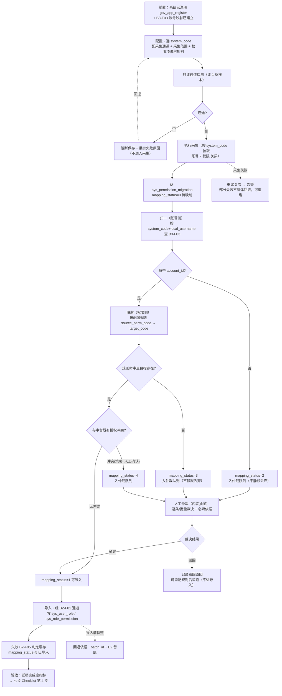

# 麓邦业务中台 · 增量需求规格 · 存量权限采集适配器与权威源切换（D11 / D12 / D14）

| 项 | 内容 |
| --- | --- |
| 文档性质 | **增量需求规格**（只读上游，不修改主 PRD / UIUX / 详细设计） |
| 输入基线 | 《权威源与应用接入-需求澄清.md》**第四部分 §4.1~§4.5**（v1.3，2026-10-16 客户拍板，**已生效**） |
| 决策基线 | **D12 = 方案 C**（`custom` 自建维护为权威源）；**D11 = 方案 ①**（存量权限采集适配器）；**D14 = 建 `md_employee` 记录**；D13 **自动失效** |
| 输出人 | 产品经理 许清楚（Xu） |
| 输出日期 | 2026-10-16 |
| 引用口径 | 所有结论附 `文件:行号` 或功能点编号；无依据者标「**文档未载明，属建议新增**」 |
| 交互偏好 | **内联抽屉（drawer）优先，不跳独立页**（客户偏好，`需求澄清 §4.3.2 #6`） |

> **阅读导航**：第一部分 = D11 新功能点（**核心，含编号建议 + 回写清单**）；第二部分 = D12=C 的 PRD 规则变更点；第三部分 = D14 维护账号规则；末章 = 汇总回写清单与待拍板项。

---

## 〇、决策回执与本文变更范围

| 决策 | 客户裁定 | 本规格承接方式 |
| --- | --- | --- |
| **D12** | 方案 C：自建维护（`custom`）为权威源；钉钉退为 SSO + 组织初次导入 | 第二部分（PRD 规则变更点，共 5 组） |
| **D11** | 方案 ①：适配器采集存量授权关系 | 第一部分（新功能点 8 要素 + 编号 + 回写） |
| **D14** | 为维护账号建 `md_employee` 记录，**不放开** `employee_id` 非空约束 | 第三部分（规则条目 6 条） |
| **D13** | 自动失效（选 C 不涉主从字段） | 本文**不产出** D13 任何内容（口径已闭合） |

**本文范围（八部分）**：

| 部分 | 内容 | 依据 |
| --- | --- | --- |
| 第一部分 | **D11** 新功能点 `J2-F05 存量权限采集适配器`（8 要素 + 编号 + 回写） | `需求澄清 §4.3`、`:863` |
| 第二部分 | **D12=C** PRD 规则变更点（规则条目 A~E） | `需求澄清 §4.2`、`:862` |
| 第三部分 | **D14** 维护账号规则条目（规则条目 F~J） | `需求澄清 §4.2.3`、`:864` |
| 第四部分 | 三部分汇总（回写清单 + 待拍板 + 自我复核） | —— |
| **第五部分** | **G-2~G-5 应用接入鉴权机制**（`J1-F04` / `I1-F05` / `I1-F06`，含 G-5 并入）——**D8 已采纳** | 客户指示「统一加入完整 PRD」；`需求澄清 §2.5` |
| 第六部分 | **全量回写清单**（一~五部分合并，54 条） | —— |
| 第七部分 | **待拍板点汇总**（16 项） | —— |
| 第八部分 | 自我复核与硬约束声明 | —— |

**不在本次决策范围**：G-6a/G-6b（API 目录代偿、七步 Checklist 交付物清单——**处置建议已给，但不新增编号**）、G-6c/G-6d/G-9（**已并入 `J1-F04`/`I1-F05`**）、**G-7**（UIUX 页面地图标注修正，零开发量）、**G-8**（沙箱延后 V2.5，以 test 环境代偿）。详见第五部分 §5.7。

---

# 第一部分 · D11 新功能点「存量权限采集适配器」（核心）

> **本部分对应缺口 `G-10`（`需求澄清 :807`）**，决策 D11 = 方案 ①（`需求澄清 :863`）。
> **行文范式**：严格沿用主 PRD 功能点模板（`_frag/00-骨架.md §4.1`；实例见 `PRD:10426` F1-F03 / `PRD:5774` B3-F03 / `PRD:12738` I1-F01）——**8 要素**（①功能详细描述 ②输入 ③输出 ④操作流程 ⑤权限说明 ⑥业务流程 ⑦关键技术点 ⑧数据逻辑流）+ **3 附加**（⑨异常与边界 ⑩验收清单 ⑪待确认项）。任务单所列「⑦关键技术点 / ⑧验收清单」在本模板中分别落于 **⑦** 与 **⑩**（模板将「数据逻辑流 / 异常与边界」插在中间），**要素不缺失，仅序号对齐模板**。

## 1.1 编号建议与归属判断

### 1.1.1 归属判断：建议新增顶层 `J2-F05`，归属 **J2 连接器框架**

| 候选归属 | 判断 | 理由（附依据） |
| --- | --- | --- |
| **J2 连接器框架（推荐 ⭐）** | ✅ **采纳** | ① 采集动作本质是**对外部系统的协议适配与拉取**，与 `connector-dingtalk`/`connector-hr-generic` 同族；J2 域口径即「平台与**外部系统/渠道**的适配层（独立进程、故障隔离，`bmp-connectors/`）」（`PRD:14865`）；② 与 J2 的硬边界一致：「**禁止在业务域自建协议适配**」（`PRD:10444`、`PRD:10518` 同类口径）；③ 澄清文件本身**推荐**此为独立适配器（`需求澄清 :924`「若作为独立适配器（推荐，与 `connector-dingtalk` 等同级）」） |
| **B2 权限中心** | ⚠️ 部分合理，**不建议作主归属** | 采集的**产物**（授权关系）确属权限域（`B2-F02` 三级权限点、`B2-F01` 角色元数据）；但**采集动作**（连老系统、读权限表/调接口、协议归一）不是权限域职责——B2 是**权限的「定义与授权维护」**管理面（`PRD:4952`），不含对外系统适配。**若把适配器放进 B2，将破坏 `PRD:10444` 的「业务域不得自建协议适配」硬边界** |
| **B3 组织同步** | ❌ **不建议** | 澄清文件已明确否决：B3 是「**消费侧**」（订阅事件刷账号/缓存），采集是「**拉取侧**」，语义相反（`需求澄清 :926`）；且 `B3-F03` 定位为「桥接登记」（`PRD:5791`），非拉取 |

> **结论**：主归属 **`J2-F05`（J2 连接器框架，与 `J2-F02/F03/F04` 同级）**。
> **与 `J2-F04 存量系统适配器` 的关系（关键，须写清）**：`J2-F04` 是**通用异构接口调用底座**（协议归一，`PRD:15174`），**不含业务语义**；本点是**带业务语义的采集编排**（权限关系归一 + 映射 + 仲裁 + 导入）。二者**不合并**——合并会让 `J2-F04` 突破其已声明的边界（「`J2-F04` 管异构接口协议归一」，`PRD:15174`）。**本点弱依赖 `J2-F04(W)`**，复用其「调老系统接口」能力。

### 1.1.2 编号建议与**占用穷举验证**（命中数须为 0）

| 候选编号 | 归属 | 建议 | 全库命中 |
| --- | --- | --- | --- |
| **`J2-F05`** ⭐ | J2 连接器框架 | **推荐采用**（独立顶层适配器） | **0** |
| `B2-F06` | B2 权限中心 | 备选（若客户坚持归权限域；**代价见 1.1.1**） | **0** |
| `B3-F04` | B3 组织同步 | 不建议（澄清已否决，`需求澄清 :926`） | **0** |

**检索命令与结果**（口径：`D:\lubon\业务中台` 全库，含 md 与全部工作产物，`-r` 递归 + `-n` 行号，**未排除任何子目录**）：

```bash
cd /d/lubon/业务中台
grep -rn -- "J2-F05" . | wc -l     # → 0
grep -rn -- "B2-F06" . | wc -l     # → 0
grep -rn -- "B3-F04" . | wc -l     # → 0
# 反向对照（证明检索式有效，非空跑）：
grep -rn -- "J2-F0x" . | wc -l     # → 4（澄清文件中的占位符，非真实编号）
grep -rn -- "B2-F0x" . | wc -l     # → 2（同上）
```

| 编号 | 检索式 | 命中数 | 判定 |
| --- | --- | --- | --- |
| `J2-F05` | `grep -rn -- "J2-F05" .` | **0** | ✅ 可用 |
| `B2-F06` | `grep -rn -- "B2-F06" .` | **0** | ✅ 可用（备选） |
| `B3-F04` | `grep -rn -- "B3-F04" .` | **0** | ✅ 可用（不建议） |

> **对照说明**：`J2-F0x` / `B2-F0x` 各有 4 / 2 行命中，均为 `需求澄清 :924-928`、`:811` 中的**占位符表述**，**不是已占用编号**——检索式确实能命中文本，证明上述 0 命中结论有效（非命令写错）。现有 J2 域最大号为 `J2-F04`（`PRD:15162`），现有 B2 域最大号为 `B2-F05`（`PRD:5366`），现有 B3 域最大号为 `B3-F03`（`PRD:5774`），**顺延号均空闲**。

> **⚠️ 检索口径精确说明（重要，防误读）**：上述「命中 0」的**统计范围 = 上游基线（排除本产出文件自身）**。本文件落盘后，全库检索 `J2-F05` 会命中 **37 行——全部来自本文件自身**（我方的编号建议与回写清单），**上游 0 命中**。逐文件复核（本文件落盘后执行）：
> ```bash
> cd /d/lubon/业务中台
> grep -rn -- "J2-F05" . | grep -v "增量需求-存量权限采集与权威源切换.md" | wc -l   # → 0
> grep -c -- "J2-F05" "麓邦业务中台产品PRD.md"                  # → 0
> grep -c -- "J2-F05" "麓邦业务中台UIUX设计文档.md"              # → 0
> grep -c -- "J2-F05" "麓邦业务中台V1.0基座版详细设计.md"         # → 0
> grep -c -- "J2-F05" "_frag/00-骨架.md"                        # → 0
> ```

### 1.1.3 功能点表头（待回写主 PRD §6.8「7. J2 连接器框架」）

```markdown
#### J2-F05 存量权限采集适配器
```

| 项目 | 内容 |
| --- | --- |
| 所属模块 | J2 连接器框架 / 支撑层 L5（**项目定制仓库** `bmp-project-lubon/`，与 `lubon-legacy-adapter` 同层） |
| 优先级 / 版本 | **P0** / **V1.5**（**主判**；V1.0 前移候选见 ⑪#1，**理由见下**） |
| 上游需求 | BMP-P1-12（存量接入与改造）；D11 拍板（`需求澄清 :863`）；缺口 G-10（`需求澄清 :807`） |
| 依赖功能点 | **B3-F03(S)**；**B2-F02(S)**；B2-F01(W)；B2-F05(W)；J2-F04(W)；J2-F01(W)；I1-F01(W) |
| 被依赖功能点 | 七步 Checklist 第 4 步（非功能点）；B2-F01（授权关系写入通道）；**无功能点强被依赖** |
| 关联表/接口 | **建议新增** `sys_permission_migration`（`bmp_sys`，**表名建议，架构师定稿**）；读 `sys_account_mapping`(R)、`sys_account`(R)、`md_employee`(R)、`sys_permission`(R)、`sys_role`(R)、`sys_role_permission`(W)、`sys_user_role`(W)；`lubon-legacy-adapter`；UI 承载建议 `UI-C-16` 内联抽屉（不新增页面 ID） |

**版本判定理由（P0 / V1.5）**：

| # | 理由 | 依据 |
| --- | --- | --- |
| 1 | 本点**弱依赖 `J2-F04`（V1.5）**异同构接口调用底座；J2-F04 为 **V1.5**，V1.0 无底座 | `PRD:15167`（J2-F04 版本 V1.5） |
| 2 | 与 `B2-F03 数据权限`（**V1.5**）同批可形成「功能权限来源 + 数据权限」完整闭环 | `PRD:5081`（B2-F03 V1.5） |
| 3 | 存量 5 套系统**完整接入**排 **V2.0**（V1.0 仅「5 套系统 SSO + 账号统一率」） | `PRD:16254`、`PRD:16256` |
| 4 | ⚠️ **风险提示**：七步 Checklist **第 4 步「权限判定切换」**若在 V1.0 试点系统（CRM+招聘）执行，而本点未交付 → **授权关系无来源，切换后权限为空**（澄清已定为「比 SSRF 断链更严重的功能事故」，`需求澄清 :809`） | `PRD:1126`、`PRD:1139`、`需求澄清 :809` |

> ⚠️ **由此产生一个必须拍板的前移判断**（列入 ⑪#1）：**V1.0 试点系统的第 4 步是否要执行**。若执行 → 本点须前移 V1.0 最小集（或允许 V1.0 用「清单导入」兜底，即澄清 §3.5 方案 ② 作为过渡）。

## 1.2 功能点 8 要素详规

**① 功能详细描述**

J2-F05 是**存量系统「授权关系」采集适配器**：按 `system_code`（CRM / REC / OKR / KMS / DATA，共 **5 套**，`PRD:5776`）逐系统适配，**读老系统权限表 / 调其权限接口**，采集「**谁 → 有什么权限**」的授权关系，**归一为「中台账号 + 中台权限点/角色编码」清单**，落 `sys_permission_migration`，经人工仲裁后**导入** `sys_role_permission` / `sys_user_role`，使 `应用接入配置` 完成后可**统一认证 + 统一授权**（`需求澄清 :902`）。

**边界声明（谁决定什么 / 谁不做什么）——三组必写**：

| 对比功能点 | 谁决定什么 | 谁**不**做什么（硬边界） | 依据 |
| --- | --- | --- | --- |
| **vs `B3-F03 账号映射`** | **`B3-F03` 决定「账号是谁」**（`system_code` + `local_username` → `account_id` 桥接，`PRD:5786`）；**本点决定「权限有什么」**（`account_id` → 权限点/角色） | **本点不创建、不修改账号映射**——`account_id` 的取得**一律查 `B3-F03`**；**映射缺失时本点不自行猜测账号**，按「未归一」入人工队列（对齐 `B3-F03` 的「不静默忽略」口径，`PRD:5817`） | `PRD:5786`、`需求澄清 :903` |
| **vs `B2-F02 功能权限`** | **`B2-F02` 决定「权限点是什么」**（三级权限点定义 `sys_permission.code`，`PRD:4948`）；**本点决定「这些权限点授予了谁」**（授权关系） | **本点不新增、不修改、不停用任何权限点定义**——中台侧权限点**必须先由 `B2-F02` 定义存在**，本点**只引用 `code`**；源侧权限项在中台**无对应 `code`** 时**不自动新建权限点**，入**人工仲裁队列**（对齐 `需求澄清 :913`「不静默丢弃」） | `PRD:4948`、`PRD:4952`、`需求澄清 :904` |
| **vs `B2-F01 角色管理`** | **`B2-F01` 决定「角色元数据 + 用户↔角色绑定」**（`sys_role` / `sys_user_role`，`PRD:4814`）；**本点决定「存量侧的授权关系如何映射到角色/权限点」** | **本点不定义角色**（不建 `sys_role`、不改 `sys_role.type`）；**授权关系写入**严格走 `B2-F01` 既有通道（写 `sys_user_role` / `sys_role_permission`），**本点不绕开 B2 直写业务授权**；**角色映射方向以「源权限 → 中台角色/权限点」单向**，**不做反向回写老系统**（老系统权限仍为老系统所有，`PRD:4210`） | `PRD:4814`、`PRD:4817`、`PRD:4210` |

> **一句话记法**：`B3-F03` 解决「**账号是谁**」，`B2-F02` 解决「**权限点是什么**」，`B2-F01` 解决「**角色是什么**」，**本点解决「存量授权关系怎么搬过来」**——四者**串行依赖、逐层只读**，本点**只搬关系，不造身份、不造权限点、不造角色**（与澄清 `:903-905` 一致）。

**② 输入**

| 输入项 | 来源 | 类型/格式 | 必填 | 校验规则 |
| --- | --- | --- | --- | --- |
| 系统标识 `system_code` | 实施 / 管理员 | ENUM(CRM/REC/OKR/KMS/DATA) | 是 | **5 套之一**（对齐 `B3-F03` 口径 `PRD:5798`、`J2-F04` 口径 `PRD:15180`） |
| 采集凭证 | `gov_app_register`（复用应用注册凭证管理） | 密文（AES） | 是 | **AES 加密存储**、不回显、不落日志（沿用 `msg_channel.config` 安全口径，`PRD:10508`）；**未注册应用不得采集**（`PRD:10508` 红线） |
| 采集通道配置 | 实施 | 配置（JDBC 连接串 / REST 地址 / 自定义协议 + 鉴权） | 是 | 经 **I1-F02 配置中心**托管（`PRD:14879` 同类口径）；地址须过 `domain_whitelist`（防 SSRF，对齐 `PRD:15239`） |
| 采集对象范围 | 管理员 | 范围（全量 / 指定组织子树 / 指定账号清单） | 否 | 缺省=全量；范围须落在 `md_org.id` 已存在节点内 |
| 源侧权限读取语句/接口 | 实施（按系统适配） | SQL / API 定义 | 是 | 须为**只读**语句（**禁止 DML**——老系统权限仍归老系统，`PRD:4210`） |
| **权限项映射规则** | 管理员 | **配置化** JSON（`源权限标识 → 中台 target_type + target_code`） | 是 | **配置化**（对齐澄清 `:913`）；规则引用 `sys_permission.code` / `sys_role.code`，**二者须已存在且 `status=1`**（`PRD:4964` 口径）；**未命中规则 ≠ 丢弃**，转人工仲裁 |
| 账号归一结果 | **`B3-F03`（服务调用）** | `account_id`（按 `system_code` + `local_username`） | 是 | **强依赖 S**：查不到 `account_id` → 该行标「未归一」入人工队列（**不静默丢弃**） |
| 执行方式 | 管理员 | ENUM（一次性全量 / 增量重扫） | 是 | 见 ⑦#3 幂等口径 |
| 冲突处理策略 | 管理员 | ENUM（保留中台既有 / 以源为准 / 人工确认） | 是 | 默认**人工确认**（授权为高危数据，见 ⑤） |

**③ 输出**

| 输出项 | 去向 | 类型/格式 | 说明 |
| --- | --- | --- | --- |
| **归一后的授权关系** | **建议新增 `sys_permission_migration`**（`bmp_sys`） | 行 | 一条 = 「`system_code` + `account_id` + 目标权限点/角色」；**表名与字段为建议，架构师定稿**（`需求澄清 :912`） |
| **采集日志** | `sys_org_sync_log`（`bmp_sys`，复用既有同步日志口径）＋ `UI-C-09` 邻域视图 | 行 | 采集时间 / 来源系统 / 批次 / 类型（全量/增量）/ 结果（成功/部分失败/失败）/ 统计（采集数/归一数/新增/冲突/失败）/ 耗时的（对齐 `PRD:10463` 口径） |
| **失败明细** | `UI-C-09` 详情抽屉 / 内联抽屉（**视图 ❷「失败明细」区**，对应 `mapping_status=6 失败`） | 表 | 字段级错误（源数据 / 期望格式 / 错误原因）；**支持导出 CSV**（对齐 `PRD:10546`、`PRD:5862` 既有口径） |
| **冲突 / 仲裁队列** | 裁决队列视图（内联抽屉，**视图 ❸「仲裁队列」区**——**仅 `2/3/4` 待仲裁**；**下含「已关闭」子区对应 `7 已驳回`（终态）**） | 表 | **三类入队**：① 源权限项**无对应中台权限点**（`需求澄清 :913`）② **账号未归一**（`B3-F03` 查不到）③ **与中台既有授权冲突**（策略=人工确认时）。每行须给「**建议动作 + 依据**」，支持批量裁决。⚠️ **`7 已驳回` 归「已关闭」子区、不归失败明细区** |
| **授权关系写入** | `sys_role_permission` / `sys_user_role`（**经 `B2-F01` 通道**） | 行 | **导出入账**：批量绑定/解绑（对齐 `PRD:4846` 成员管理通道）；写入后**失效 B2-F05 判定缓存**（`PRD:4847`） |
| **采集留痕** | `E2-F03` `audit_operation_log` | 日志 | 采集批次、映射规则变更、**仲裁动作**（谁批了哪条）、导入结果；**授权属高危数据，全程留痕**（`PRD:4814`、`PRD:4840` 同类） |
| **迁移完成度指标** | 七步 Checklist 第 4 步验收物 / I2-F02 质量规则 | 指标 | **授权关系迁移完整率**（已归一 + 已导入 / 应采集总数）；纳入 I2-F02 抽查（对齐 `PRD:5864` 口径） |

**建议表结构（`sys_permission_migration`，**表名与字段均为建议，交付架构师定稿**）**：

| 字段 | 类型 | 说明 |
| --- | --- | --- |
| `system_code` | VARCHAR(20) | 存量系统标识（CRM/REC/OKR/KMS/DATA） |
| `local_username` | VARCHAR(128) | **源侧账号原文**（采集原始值，用于追溯与对账） |
| `account_id` | BIGINT | **归一后的中台账号**（**由 `B3-F03` 提供**）；未归一为 NULL 并置 `mapping_status=2` |
| `source_perm_code` | VARCHAR(128) | **源侧权限标识原文**（如老系统角色名/权限码） |
| `target_type` | TINYINT | 1 = 权限点（`sys_permission`）/ 2 = 角色（`sys_role`） |
| `target_code` | VARCHAR(128) | 中台 `sys_permission.code` / `sys_role.code`；未命中为 NULL |
| `mapping_status` | TINYINT | 0 待映射 / 1 已映射 / 2 未归一（账号）/ 3 无对应（权限项）/ 4 冲突待仲裁 / 5 已导入 / 6 失败 / **7 已驳回（终态）** |
| `mapping_source` | TINYINT | 1 = 配置规则自动 / 2 = 人工仲裁 |
| `batch_id` | VARCHAR(64) | 采集批次号（支持批次回滚与重跑） |
| `collected_at` / `mapped_at` / `imported_at` | DATETIME | 阶段时间戳 |

**UK 建议（架构师已定稿 `uk_idem`）**：① **幂等键 `uk_idem`** `(system_code, account_id, target_type, target_code)`（已归一且已映射后防重复导入）——**`account_id` / `target_code` 允许 NULL（未归一 / 未命中）**，利用 **MySQL UK 对 NULL 不去重**的特性，**避免把「未归一 / 未命中」行误判为重复而漏采集**（**实施不得为这两列加 `NOT NULL`**）；② **源侧去重键** `(system_code, local_username, source_perm_code)`（防同源重复采集产生重复行）。

**④ 操作流程**

1. **前置**：`system_code` 已在 `I1-F01` 应用注册（`gov_app_register`，`PRD:12808` 红线）＋ **`B3-F03` 账号映射已建立**（强依赖，见 ⑦#1）。
2. **配置**：管理员在内联抽屉中选择 `system_code` → 配置采集通道（协议/地址/鉴权）→ 选择采集范围 → **配置权限项映射规则**（源权限标识 → 中台 `target_type` + `target_code`）。
3. **通道连通性验证**：发起**只读探测**（读 1 条样本，**不做全量**）→ 展示探测结果（连通/失败原因）；**失败即阻断配置保存**（不进入采集）。
4. **采集执行**：按 `system_code` 拉取「账号 × 权限」关系 → 落 `sys_permission_migration`（`mapping_status=0` 待映射）→ 写采集日志。
5. **归一（账号侧）**：按 `(system_code, local_username)` **查 `B3-F03`** 取 `account_id` → 命中则 `mapping_status=1`，**未命中则 `=2` 入仲裁队列**（**不静默丢弃**）。
6. **映射（权限侧）**：按配置规则把 `source_perm_code` → `target_code` → 命中且目标存在（`sys_permission.code`/`sys_role.code` 且 `status=1`）则 `=1`，**未命中则 `=3` 入仲裁队列**（**不静默丢弃**）。
7. **冲突处理**：`mapping_status=1` 的行与**中台既有授权**比对 → 冲突则按策略（保留中台 / 以源为准 / **人工确认**）→ 人工确认时 `=4` 入仲裁队列。
8. **人工仲裁**：管理员在内联抽屉中逐条/批量裁决（`mapping_source=2`）→ **每个动作须给依据**（如「源角色 X ≈ 中台角色 Y」）；**通过的行**进入导入；**驳回的行置 `mapping_status=7 已驳回`（终态）** + 记录驳回原因（`arb_reason`/`arb_by`）→ **不进导入**，可重配规则后重跑。**注**：`7 已驳回` 与 `2/3/4`（待仲裁）**必须区分**——否则「仲裁队列清空」判据失真。
9. **导入**：`mapping_status=1` 且无冲突的行 → **经 `B2-F01` 通道**批量写 `sys_user_role` / `sys_role_permission` → `=5` 已导入 → **失效 B2-F05 判定缓存**（`PRD:4847`）。
10. **验收**：输出迁移完成度指标（应采集 / 已归一 / 已映射 / 已导入 / 仲裁中 / 失败）→ 供七步 Checklist **第 4 步**验收（见 ⑥）。
11. **幂等**：重跑同一批次 → 按幂等键 upsert，**不重复导入**；已导入行**不被二次采集覆盖**（除非显式选「以源为准」）。

**异常分支**：

| # | 异常 | 处理 |
| --- | --- | --- |
| 1 | 老系统**不可达 / 凭证失效** | 通道验证阶段**阻断配置**；采集阶段 → **重试 3 次**（沿用 `PRD:10545` 口径）→ 仍失败则告警 + 部分成功行保留（**部分失败不整体回滚**，`PRD:10521`） |
| 2 | **源侧权限表结构变化** | 采集语句报错 → 该 `system_code` 批次标失败 + 明确报错（**不静默**，对齐 `PRD:15200`）→ 人工调整适配 |
| 3 | **账号未归一**（`B3-F03` 查不到） | 入仲裁队列 `=2`；**不猜测账号**；提示「请先在账号映射中补齐」+ 直达链接 |
| 4 | **权限项无对应** | 入仲裁队列 `=3`；**不静默丢弃**；提示「需先在 B2-F02 定义权限点」+ 直达链接 |
| 5 | **越权读取**（采集了未登记的老系统 / 跨 `system_code`） | `domain_whitelist` + `gov_app_register` 双重校验**拒绝** + 审计告警（`PRD:15239`、`PRD:10508`） |
| 6 | **导入部分失败** | **事务分批**；返回失败明细 CSV（含原因）；**成功行已入库**（幂等可重传）（对齐 `PRD:5885`） |

**回退路径（任务重点，逐项回答）**：

| 问题 | 答案 | 依据 |
| --- | --- | --- |
| **采集失败能否重跑？** | ✅ **可重跑**。按 `system_code` 或 `batch_id` 重跑；已成功行按幂等键 **upsert 不重复**；重跑**不清理**人工已裁决结果（`mapping_source=2` 的行**优先于**自动规则） | `PRD:10521`（支持重跑）、`PRD:5861`（upsert 幂等） |
| **部分失败如何处理？** | ✅ **部分失败不整体回滚**——成功行入库、失败行入明细并**可导出 CSV 修正重传**（沿用 `F1-F03`/`B3-F03` 既有口径） | `PRD:10546`、`PRD:5885` |
| **并行期如何双跑核对？** | ✅ 建议**「中台侧只读比对、不切断老系统权限」**：并行期老系统**继续用自身权限**（现状 `PRD:4210`、`PRD:8967`），中台采集结果**先落 `sys_permission_migration` 不导入**，做**比对报告**（源权限 vs 中台授权差异清单）→ 差异收敛后再执行**导入**并切换第 4 步。**这是避免「切换后权限清空」的关键控制点** | `PRD:4210`、`PRD:8967`、`需求澄清 :809`、`PRD:16299`（过渡期双跑对账）|
| **导入后能否回退？** | ⚠️ **部分可回退**：`sys_user_role` / `sys_role_permission` 的**删除属高危**（权限变更需 `HighRiskConfirm` + 审计，`PRD:4848`、`PRD:5845` 同类）；**回退依据 = E2 留痕 + 批次号**（按 `batch_id` 反向定位本批写入行）。**建议：导入前对中台既有授权做快照**，便于整体回退 | `PRD:4849`、`PRD:4848` |
| **老系统侧是否回退？** | ✅ **老系统权限不被本点修改**（只读采集）——切换失败时**老系统侧无需回退**（权限始终留在老系统） | `PRD:4210` |

**⑤ 权限说明（元权限口径）**

| 角色 | 可见 | 可操作 | 数据范围 | 备注 |
| --- | --- | --- | --- | --- |
| `super_admin` 超管 | 全部采集批次 + 仲裁队列 | **配置采集 / 配映射规则 / 执行采集 / 裁决仲裁 / 执行导入** | 全公司 | **元权限**：建议权限点 `system:perm:migration:manage`（**编码建议，研发按 `sys_permission` 规约分配**） |
| 权限管理员（含 `system:permission:manage`） | 全部批次（只读）+ 仲裁队列 | **只能「裁决/导入」**，**不可改采集配置、不可改映射规则** | 全公司 | **谁能配映射规则 = 超管**（映射规则能改变全公司授权口径，属高危） |
| 集成/运维管理员 | 采集日志、失败明细 | 只读 + 重跑采集（**不可裁决、不可导入**） | 全公司 | 排障导向 |
| `audit_viewer` 审计员 | 采集与仲裁留痕 | 只读检索 | 合规范围 | 可查「谁批了哪条」 |
| 订阅方 / 存量系统 | 无入口 | —— | —— | 采集为管理面，不面向老系统自身 |
| 普通员工 | 无入口 | —— | —— | 员工只感知「权限在不在」，不感知迁移过程 |

> **元权限要点（三条，逐条给依据）**：
> ① **「配置映射规则」= 高危元权限**——一条规则可把**全公司**的源权限批量映射到高权中台角色（如误配到 `super_admin`），须 `HighRiskConfirm` + **E2 审计**（`PRD:10224` 同类高危口径）；
> ② **「执行导入」= 高危**——直接改写 `sys_user_role` / `sys_role_permission`，**影响全公司权限判定**，须二次确认 + 导入前快照（对齐 `PRD:4848` 的授权变更高危口径）；
> ③ **「裁决仲裁」须留依据**——每条裁决记录「源权限 → 目标 + 裁决人 + 依据」，**不可批量静默通过**（防「一键全通过」把未映射项误挂高权）。**建议：仲裁队列默认不提供「全选导入」**；
> ④ **采集凭证不落明文**——AES 加密存储、不回显、不落日志（`PRD:10508`、`PRD:10522`）。

**⑥ 业务流程**

对应主 PRD **`4.6 七步 Checklist 第 4 步「权限判定切换（B2 SDK，权限不复制）」**（`PRD:1126`、`PRD:5021`）——本点是该步**「存量授权关系」的数据来源**；在 **`4.6` 接入流程**中承担「**并行验证期**」的数据侧准备；在 **`9.2 产品风险 #6`「主数据一源化组织阻力 → 过渡期双跑对账」**（`PRD:16299`）中承担**权限维度的双跑对账**；对应**缺口 G-10**（`需求澄清 :807`）与 **D11 拍板**（`需求澄清 :863`）。



**并行期双跑核对（子流程，对应「回退路径」中的双跑问题）**：


**⑦ 关键技术点**

| # | 要点 | 说明与依据 |
| --- | --- | --- |
| 1 | **强依赖 `B3-F03`** | **无 `account_id` 无法归一到人**——`account_id` 是全平台账号唯一标识（`PRD:3895`），授权关系**必须以人为锚**；`B3-F03` 是 `sys_account_mapping` 的唯一维护方（`PRD:5786`、`PRD:5846`）。**本点不得绕过 `B3-F03` 自建映射** |
| 2 | **复用 J2 连接器框架** | 按 `system_code` 逐系统适配，**复用 J2 既有连接器框架**（**禁止在业务域自建协议适配**，`PRD:10444`、`PRD:10518`；澄清 `:911` 同口径）；弱依赖 `J2-F04(W)` 复用其异构接口归一能力（`PRD:15174`） |
| 3 | **映射配置化** | 源权限标识 → 中台 `sys_permission.code` / `sys_role.code` 的映射**必须配置化**（不硬编码）（澄清 `:913`）；规则变更**走配置中心 I1-F02**（`PRD:14879` 同类） |
| 4 | **权限项无法一一对应时不静默丢弃** ⭐ | **硬规则**：未命中映射规则的行**必须入人工仲裁队列**（`mapping_status=3`），**禁止 skip / 忽略 / 默认授权**（澄清 `:913` 明文要求）；**对齐平台既有「不静默」原则**（`PRD:5817`、`PRD:15200`、`PRD:15240`） |
| 5 | **执行方式与幂等** | 一次性全量 + 增量重扫；**幂等键**（见③ UK 建议）；**重跑 upsert 不重复导入**；人工裁决结果**优先级高于**自动规则 |
| 6 | **性能** | 采集支持 **5 套系统 × 全量人员**；参照 `B3-F03` 批量导入口径 **≥1000 条/次**（`PRD:5860`）、`F1-F03` 单次全量 **≥5000 人**（`PRD:10519`）；**采集与导入分批 + 可断点续跑**（防大事务） |
| 7 | **安全（采集侧）** | 采集涉及**读老系统权限**，须**凭证管理（复用 `gov_app_register`）+ 审计留痕（`E2`）+ 越权防范**（澄清 `:918`）；地址过 `domain_whitelist` 防 SSRF（`PRD:15239`）；**只读语句**，禁 DML（`PRD:4210`） |
| 8 | **安全（导入侧）** | 导入改写的是**全公司授权数据**，须**快照 + 二次确认 + E2 留痕**（`PRD:4848`、`PRD:10224`）；导入后**主动失效 B2-F05 缓存**（`PRD:4847`） |
| 9 | **架构隔离** | 归 `bmp-project-lubon`（项目定制），**内核禁依赖定制包**（ADR-10 CI 门禁，`PRD:15225`、详细设计 `:94`） |
| 10 | **过渡资产治理** | 与 `J2-F04` 同族，**属过渡态、纳入下线计划**（`PRD:15225`）——随老系统改造完成转标准 OIDC/标准权限接口后下线 |

**⑧ 数据逻辑流**

```
输入：① 采集配置（system_code / 采集通道 / 范围 / 权限项映射规则 / 冲突策略）
      ② 源侧授权关系（老系统权限表 / 权限接口，只读）
      ③ B3-F03 账号映射结果（account_id）
  → 处理：通道探测 → 采集 → 归一（账号侧查 B3-F03）→ 映射（权限侧按配置规则）
          → 冲突比对 → 人工仲裁（未归一/未命中/冲突 三类）
          → 导入（经 B2-F01 通道）→ 失效 B2-F05 缓存
  → 落表：sys_permission_migration（bmp_sys，建议新增，UK 见③）
          sys_org_sync_log（bmp_sys，采集日志，复用既有口径）
          sys_user_role / sys_role_permission（bmp_sys，经 B2-F01 通道写入）
          audit_operation_log（bmp_audit，采集/映射规则/裁决/导入 全程留痕）
  → 消费方：七步 Checklist 第 4 步（验收物）
            B2-F05 权限校验服务（判定数据来源）
            B2-F03 数据权限（V1.5，功能权限来源就绪后同批闭环）
            存量系统（只读：权限判定迁移后不再自行判断）
            I2-F02 质量规则（迁移完整率抽查）
```

**⑨ 异常与边界**

| # | 异常场景 | 触发条件 | 处理策略 | 是否影响主流程 |
| --- | --- | --- | --- | --- |
| 1 | **`B3-F03` 映射未就绪即采集** | 跳过前置直接采集 | **采集前置校验阻断**——强依赖 S；提示先完成账号映射 | 是（前置阻断） |
| 2 | **账号未归一（映射缺失）** | 存量账号未补录映射 | 入仲裁队列 `=2`；**不静默忽略、不猜测账号**；提示直达账号映射页 | 否（需人工） |
| 3 | **权限项无对应（规则未命中）** | 源权限标识在中台无 `code` | 入仲裁队列 `=3`；**不静默丢弃、不自动建权限点**；提示直达 `UI-C-03` | 否（需人工） |
| 4 | **与中台既有授权冲突** | 同一账号中台已有授权 | 按策略：保留中台 / 以源为准 / **人工确认（默认）**；人工确认入 `=4` | 否 |
| 5 | **老系统不可达 / 结构变化** | 网络、凭证、表结构变更 | 重试 3 次 → 告警 + 明确报错（**不静默**）；部分失败不回滚；可重跑 | 否（降级） |
| 6 | **越权采集（跨 system_code / 未登记系统）** | 采集配置指向未注册系统 | **双重校验拒绝**（`gov_app_register` + `domain_whitelist`）+ 审计告警 | 是（拒入） |
| 7 | **误配映射规则致提权** | 规则把源权限映射到高权角色 | **`HighRiskConfirm` + 影响面提示（受影响账号数）+ 审计**；导入前**快照**可回退 | 是（高危，可回退） |
| 8 | **导入致权限清空**（本点要防的核心事故） | 第 4 步切换而授权关系未迁移 | **并行期双跑核对**（见⑥）——差异收敛前**不导入、不切换**；切换前校验「迁移完成率」达标 | 是（核心风控点） |
| 9 | **重复导入导致授权膨胀** | 重跑未幂等 | 幂等键 upsert；`=5 已导入` 行**不被二次采集覆盖**（除非显式「以源为准」） | 否 |
| 10 | **采集凭证泄漏** | 接口回显 / 日志打印 | AES 加密、不回显、不落日志；走查字段白名单 | 否（安全红线） |

**⑩ 验收清单（可测）**

- [ ] **强依赖验收**：`B3-F03` 账号映射未建立时，采集**被前置阻断**（构造测试）。
- [ ] **归一率验收**：试点系统（≥1 套）采集后，**「账号已归一率」= 100%**（未归一行为 0，或全部在仲裁队列可见且有原因，**不允许静默丢失**）。
- [ ] **不静默丢弃验收（核心）**：构造「源侧存在中台无对应权限点」的场景 → **该行必须出现在仲裁队列**（`mapping_status=3`），**不允许被 skip**；SQL 核对 **H1 完整性等式（八态全覆盖）**：`源侧采集行数 ≡ 待映射(0) + 已映射(1) + 仲裁(2,3,4) + 已导入(5) + 失败(6) + 已驳回(7)`；批次结束时 `待映射(0)=0`。
- [ ] **失败明细可导出**：失败明细（字段级错误 + 原因）**支持导出 CSV**（对齐 `PRD:10546`、`PRD:5862`）。
- [ ] **视图分区对账（状态机↔视图，3 红线）**：① `7 已驳回` 在视图显示为 **「已关闭」**（**不得显示为「待处理」**）；② 完成度指标条**覆盖 8 态**且 `待映射(0)=0` 可核对；③ **「仲裁队列」计数排除 `7`**（仅计 `2/3/4`）；④ **`6 失败` 与 `7 已驳回` 分属不同视图区**（6→失败明细区 / 7→仲裁队列「已关闭」子区），**不得合并**。
- [ ] **幂等验收**：同一批次**重跑 2 次** → `sys_permission_migration` 行数**不变**（仅更新时间戳）；已导入行不重复写入 `sys_user_role` / `sys_role_permission`。
- [ ] **越权为 0**：① 采集未注册老系统 → **被拒绝** + 审计留痕；② 跨 `system_code` 读取 → **被拒绝**（对齐 `PRD:5892`）；③ 非超管尝试**改映射规则** → **403 + 拒绝记录**。
- [ ] **仲裁留痕验收**：任取一条人工裁决 → `audit_operation_log` 可查到**裁决人 + 依据 + before/after**。
- [ ] **回退验收**：按 `batch_id` 可定位本批导入行；导入前快照可支撑整体回退（走查 + 实测）。
- [ ] **并行期双跑验收**：并行期**老系统权限不受影响**（切换前实测老系统功能可用）；比对报告可产出差异清单。
- [ ] **切换安全验收（核心）**：模拟「授权关系未迁移即切换第 4 步」→ 系统**阻断切换或强提示**（不出现「切换后全员权限清空」，`需求澄清 :809`）。
- [ ] **凭证安全走查**：`sys_permission_migration` **不含任何凭证/密码字段**（对齐 `PRD:5893`）；采集配置中凭证为**密文**。
- [ ] **架构隔离验收**：本点代码位于 `bmp-project-lubon`，**内核不依赖**（CI `maven-enforcer` 通过，`PRD:15247`）。
- [ ] **完成度指标**：输出「应采集 / 已归一 / 已映射 / 已导入 / 仲裁中 / 失败」六项计数，作为七步 Checklist 第 4 步**验收物**（Mermaid 与表格口径一致）。

**⑪ 待确认项**

| # | 待确认事项 | 责任方 | 影响 | 建议 |
| --- | --- | --- | --- | --- |
| 1 | ⭐ **V1.0 是否执行七步 Checklist 第 4 步？** 若执行，本点是否**前移 V1.0 最小集**（或 V1.0 先用「清单导入」兜底，即澄清 §3.5 方案 ②） | **客户 + 架构师** | **决定本点版本（V1.5 还是 V1.0）**；决定 V1.0 是否出现「切换后权限清空」风险 | 建议：**V1.0 试点系统不执行第 4 步**（继续用老系统权限），第 4 步随本点 V1.5 执行；**若必须执行** → 本点前移 V1.0，工作量按 `J2-F04` 同族评估（`需求澄清 :844` 时限为「V1.0 设计评审前」） |
| 2 | **`sys_permission_migration` 表名与字段/UK/状态机** | **架构师** | 数据关系矩阵（§3.10.2）、详细设计 §3.2/§3.3 | 本文③给出了**建议结构**，须架构师**定稿并登记进骨架 §3.2**（候选名来自 `需求澄清 :912`） |
| 3 | **5 套老系统是否开放权限读取**（读表 / 调接口），各自形态（JDBC/REST/自定义） | **客户 + 实施**（对口老系统厂商） | **本点能否落地的前置硬条件**（澄清 `:905`「依赖各老系统开放读权限」） | 建议**逐系统盘点**并形成《权限可读性清单》；**不可读的系统**退化为「人工清单导入」（澄清 §3.5 方案 ②） |
| 4 | **映射规则由谁维护、初始规则谁提供**（超管配 vs 实施预置） | 客户 + 实施 | 实施工作量与权限口径准确性 | 建议：**实施提供初始映射规则草案**（逐系统），**超管审核后启用**；规则模板随系统交付 |
| 5 | **「以源为准」策略的适用边界**：是否允许源侧**删除**中台已有授权（反向删权） | **客户**（权限口径） | **直接影响「最小权限」与合规** | 建议 **V1.5 不支持反向删权**（只增不减）；如需删权须**人工确认 + 高危留痕** |
| 6 | **并行期长度与切换判定标准**（差异率降至多少才切换） | 客户 + 架构师 | 切换时点与风险 | 建议：**差异率 = 0（或全部差异已裁决关闭）**方可切换；并行期建议 ≥2 周（对齐 `PRD:16299` 双跑对账口径） |
| 7 | **UI 承载形态**（澄清建议 `UI-C-16` 或新建页；客户偏好内联抽屉） | 产品 + 架构师 | 页面地图与实施效率 | 建议：**在 `UI-C-16` 应用注册下挂「权限迁移」内联抽屉**（不新增页面 ID，避免页面地图膨胀——对齐 `PRD:5902`、`PRD:3857` 既有做法）；**不跳独立页**（客户偏好，`需求澄清 :916`） |
| 8 | 采集是否含**老系统的按钮级/接口级**权限，还是仅**角色级** | 客户 + 实施 | 采集粒度与映射复杂度 | 建议 V1.5 **优先角色级**（映射成本低、覆盖 80% 场景）；按钮/接口级按需评估 |

## 1.3 需回写主 PRD 的清单（第一部分）

| # | 回写目标文件 | 目标章节/位置 | 回写内容 | 类型 |
| --- | --- | --- | --- | --- |
| 1 | `麓邦业务中台产品PRD.md` | **§2.7 功能点总表**（`PRD:335`，125 → **126** 行） | 新增一行：`J2-F05 \| 存量权限采集适配器 \| J2 连接器框架 \| P0 \| V1.5 \| 前置依赖数 \| 下游被依赖数`；**表头与 §0 文档版本「125 个顶层功能点」需同步改 126**（`PRD:6`、`PRD:335`、`PRD:472`、`PRD:796`、`PRD:1273` 共 5 处计数口径） | **必改** |
| 2 | 同上 | **§3.8 M8 开放与集成模块**表（`PRD:620-618` J2 区块） | J2 表内新增一行：`\| J2-F05 \| 存量权限采集适配器 \| 存量系统授权关系采集归一与导入，映射配置化 \| P0 \| V1.5 \|` | **必改** |
| 3 | 同上 | **§6.8「7. J2 连接器框架（4 点）」→ 改「5 点」**（`PRD:14863`） | 域口径段补 `J2-F05` 一句；**新增 `#### J2-F05 存量权限采集适配器` 完整 11 要素详规**（本文 §1.2 全文） | **必改** |
| 4 | 同上 | **§3.10.1 ① 依赖关系矩阵**（`PRD:660`，插在 `J2-F04` 行后 `PRD:786`） | 新增行：`\| J2-F05 存量权限采集适配器 \| B3-F03(S)；B2-F02(S)；B2-F01(W)；B2-F05(W)；J2-F04(W)；J2-F01(W)；I1-F01(W) \| （无功能点强被依赖） \|`；**并更新 `J2-F04` 行的被依赖列**（加 `J2-F05`）；**成环检查口径由「125 个节点」改「126 个节点」**（`PRD:796`） | **必改** |
| 5 | 同上 | **§3.10.2 ② 数据关系矩阵**（`PRD:800`） | 新增行：`\| J2-F05 存量权限采集适配器 \| sys_account_mapping、sys_account、md_employee、sys_permission、sys_role \| sys_permission_migration（建议新增）、sys_user_role、sys_role_permission、sys_org_sync_log \| bmp_sys / bmp_md \|` | **必改** |
| 6 | 同上 | **§3.10.3 ③ 职责边界表**（`PRD:946`，现 B1~B18） | **新增 `B19`**：`J2-F05（权限采集）vs B3-F03（账号映射）vs B2-F02（权限点定义）` —— 采「关系」/ 定「身份」/ 定「权限点」三者分工（本文 §1.2① 三组边界表） | **必改** |
| 7 | 同上 | **§3.10.4 ④ 跨域协作表**（`PRD:974`，「存量接入」行 `PRD:986`） | 在「存量接入」行的涉及功能点里补 `J2-F05`；协作方式补「采集适配器 → 授权关系迁移」 | **必改** |
| 8 | 同上 | **§4.6 七步 Checklist 业务规则**（`PRD:1133-1121`） | **第 4 步补验收物**：「**存量授权关系迁移完成**（`J2-F05`：账号归一率 100% + 仲裁队列清空 + 迁移完成度指标达标）」；**规则 6「不增加中台侧开发量」需修订**——本点**属中台侧新增开发量**（V1.5），须显式排除 | **必改（含口径冲突修正）** |
| 9 | 同上 | **§10.5.1 本轮新增编号总表**（`PRD:16371`，含「计数口径」段 `PRD:16442`） | **新增顶层编号 1 个 `J2-F05`**；计数口径 125 → **126** 更新 | **必改** |
| 10 | 同上 | **§8 版本发布计划**（`PRD:16254`/`PRD:16256`） | **V1.5 行**加入 `J2-F05`；**V1.0 行**须注明「存量系统第 4 步不执行 / 或用清单导入兜底」（取决于 ⑪#1 拍板） | **必改** |
| 11 | 同上 | **§9.1 关键依赖**（`PRD:16283`） | 新增依赖项：「**5 套老系统权限读取开放范围**」状态=待客户/实施确认 | **建议新增** |
| 12 | 同上 | **§10.1 与上游文档的需求映射**（`PRD:16328` BMP-P1-12 行） | 该行由「4.6 接入流程 + J2-F04」扩为「**+ J2-F05**」 | **建议新增** |
| 13 | 同上 | **§10.2 产品化新增需求**（`PRD:16342`） | 新增「J2-F05（存量权限采集适配器）\| D11 拍板 + 缺口 G-10」 | **建议新增** |
| 14 | `麓邦业务中台UIUX设计文档.md` | **§3 页面地图**（`UIUX:260` UI-C-16 行） | `UI-C-16` 的「服务功能点」列补 `J2-F05`；**不新增页面 ID**（内联抽屉承载，客户偏好） | **必改** |
| 15 | `outputs/规范/麓邦业务中台UI-UX页面规范.md` | `UI-C-16` 详规（`页面规范:4801`） | 补「权限迁移」内联抽屉规格：**三区 + 一子区**——❶ 采集进度 / ❷ **失败明细**（可导 CSV，**对应 `mapping_status=6 失败`**）/ ❸ **仲裁队列**（**仅 `2/3/4` 待仲裁**）**下含「已关闭」子区（对应 `7 已驳回`，终态可重跑）**。⚠️ **`6 失败` 与 `7 已驳回` 分属不同区（6→❷ / 7→❸已关闭子区），不得合并**（否则与 `PRD:1156`「`7` 属终态、不计入待仲裁」判据冲突）。+ 三个高危动作二次确认 | **建议新增** |
| 16 | `麓邦业务中台V1.0基座版详细设计.md` | **§2.1 代码结构**（`详细设计:77`）+ **§3.2/§3.3 表**（`详细设计:187` md_sync_source 邻域） | 新增适配器目录（建议 `connector-perm-collect/` 或归入 `lubon-legacy-adapter`）；**新增 `sys_permission_migration` 表**（§3.3 其余表） | **建议新增（待架构师定稿）** |
| 17 | 同上 | **§十 遗留决策与开放问题**（`详细设计:811`） | 新增遗留决策项：「5 套老系统权限读取开放范围」（对应 ⑪#3） | **建议新增** |
| 18 | 骨架 `_frag/00-骨架.md` | §2.1 功能点总表（`:175`）、§3.1 依赖矩阵（`:328`）、§3.2 数据矩阵（`:462`）、§3.3 边界表（`:596`）、§3.4 跨域协作（`:622`） | 同 #1/#4/#5/#6/#7 的骨架侧回写（**骨架为 PRD 的上游，须先动骨架**） | **必改（架构师执行）** |
| 19 | 七步 Checklist | §4.6 第 4 步 | 补「**存量授权关系迁移完成**」验收物（同 #8） | **必改** |

---

# 第二部分 · D12=C 的 PRD 规则变更点

> **本部分只列「变更点」，不重写整节**（对齐 `需求澄清 :867-884` 口径）。每条给出：**变更前 → 变更后 → 回写位置**。
> **决策基线**：D12 = 方案 C（**自建维护 `custom` 为权威源**；钉钉退为 **SSO 统一认证入口 + 组织初次导入**）（`需求澄清 :862`）。

## 2.1 规则条目 A：权威源类型改为 `custom`

| # | 变更对象 | **变更前**（现状原文） | **变更后**（规则条目） | 回写位置 |
| --- | --- | --- | --- | --- |
| A1 | **`F1-F03`「可信源清单」表述** | 「**可信源清单**：`md_sync_source.source_type` 枚举 = **`hr` / `dingtalk` / `wecom` / `custom`**（详细设计 §3.2）」——**四类并列**，无默认值（`PRD:10439`） | 枚举**保留四值不变**（不改字典，避免连带影响）；**但在描述中标注「**本项目 V1.0 确认的权威源 = `custom`（自建维护）**」**，并明确「`hr`/`dingtalk`/`wecom` 在本项目**不作为人员主数据源启用**（钉钉退为 SSO 入口 + 初次导入，见规则条目 B）」 | §3.8/§6.8 `F1-F03 权威源接入`（`PRD:10426`、`PRD:10438-10425`） |
| A2 | **`F1-F03` 待确认项 #1** | 「**组织人员权威源最终选型（四类之一）** ｜客户（最高优先，W3 前）｜…建议优先钉钉」（`PRD:10564`） | **本项闭合**——改标「**已拍板：`custom`（自建维护），2026-10-16**」；**「建议优先钉钉」的表述须删除**（否则与决策矛盾） | §6.8 `F1-F03` ⑪待确认项（`PRD:10564`） |
| A3 | **`J2-F02` 待确认项 #1** | 「**组织人员权威源选型（最高优先）**｜客户/业务｜**W3 前必须确认**，否则 B1/F1 无法开工」（`PRD:15057`） | **本项闭合**——同步改标「已拍板：`custom`」 | §6.8 `J2-F02` ⑪（`PRD:15057`） |
| A4 | **`UI-C-08` 步骤 1 默认选中项** | 步骤 1：来源类型卡片单选（**钉钉 / 企业微信 / HR 系统 / 自建维护**），**选中后展示连接器配置表单**（`UIUX:598`） | **默认选中「自建维护」**（本项目唯一启用项）；**钉钉/企微/HR 三卡改为「禁用或标注 `本环境不启用`」**（保留可见，避免实施误选）；**选中「自建维护」后不再展示连接器配置表单**（corpId/secret、HR 接口地址等**在此路径下不适用**） | `UIUX:598`（`UI-C-08` 步骤 1）+ `页面规范` 对应小节 |
| A5 | ⭐ **`UI-C-08` 步骤 2 适配** | 步骤 2：**字段映射表**（源字段 ↔ 中台字段，必填映射标红星：姓名、工号、部门）+ 同步策略（频率/冲突规则）（`UIUX:599`） | **`custom` 源下「字段映射」不适用**（无外部源可映射）→ 步骤 2 **产品侧改为**：① **组织/岗位/人员维护入口直链**（去 `UI-C-06`/`UI-C-07`）；② **同步策略整体不适用**（无 `cron`、无增量回调）→ 该区**改为「维护说明卡」**（说明：数据由中台自维护，变更经 F1-F01 留痕与 F1-F04 事件分发）；③ **冲突规则不适用**（无第二源，无冲突） | `UIUX:599`（`UI-C-08` 步骤 2） |
| A6 | ⭐⭐ **`UI-C-08` 步骤 3 改造** | 步骤 3：**连接测试**（日志流式输出）→ **试拉取前 10 条预览** → 「启用」确认弹窗（提示：现有手工数据将被覆盖）（`UIUX:600`）；`F1-F03` 操作流程第 2 步同口径（`PRD:10470`） | **`custom` 源下「连接测试 + 试拉取」不适用** → **改为「模板下载 + 批量导入 + 校验报告」**：<br>① **模板下载**（Excel/CSV 模板：组织 / 岗位 / 人员 三类，含字段说明与必填标红星）；<br>② **批量导入**（参照 `B3-F03` 既有口径：**≥1000 条/次**、失败明细 **CSV 可导出**，`PRD:5860`、`PRD:5862`；参照 `F1-F03` 的「字段级错误不入库、成功行照常入库、幂等可重传」，`PRD:10546`）；<br>③ **校验报告**（导入结果：成功/失败/警告三类计数 + 失败明细表 + 可导出）；<br>④ 「启用」确认弹窗**保留**，但**文案须改**——原「现有手工数据将被覆盖」在 `custom` 源下**不成立**（中台侧即唯一写入方）→ 改为「**启用后中台侧组织人员字段可编辑，变更将产生 `md.*` 事件并分发至各系统**」 | `UIUX:600`（`UI-C-08` 步骤 3）+ `PRD:10470`（`F1-F03` ④操作流程 步骤 2）+ `PRD:10554`（验收项「连接测试输出日志；试拉取返回前 10 条预览」**须标注「仅适用连接器源」**） |
| A7 | **`UI-C-06/07` 只读横幅** | 「**权威源为「同步」时（默认），组织人员全部字段只读**，页面顶部横幅：『数据由 HR 系统每日同步，如需修改请在源系统操作 [查看权威源配置]』；**仅当权威源=自建时开放编辑**」（`UIUX:590`） | **默认态反转**：**权威源 = 自建（`custom`）→ 默认开放编辑**；横幅内容改「**当前为自建维护模式，数据由中台维护**」；**只读态仅在「来源=连接器」时出现**（保留规则，作未来切换准备） | `UIUX:590` + `PRD:10505`（`F1-F03` ⑤权限说明 HR 行）、`PRD:10221`（`F1-F01` ⑤权威源行） |
| A8 | **`F1-F03` ④操作流程 / ⑥Mermaid** | 步骤 3「连接测试 + 试拉取」→ 启用 → 首次全量（`PRD:10470`、`PRD:10477-10479`） | **图与步骤须分「连接器源」与「自建源」两条路径**：`custom` 路径 = 选来源 → （无映射）→ **模板下载 + 批量导入 + 校验报告** → 启用 → 中台可写；`connector` 路径 = 保持现有三步不变 | `PRD:10468-10479` |

> **A 组一句话**：**枚举不删（兼容），默认改用 `custom`；向导三步在 `custom` 下「塌缩」为两步 + 一次初始导入**（步骤 2 字段映射不适用、步骤 3 由「连接测试」改「导入校验」）。

## 2.2 规则条目 B：钉钉角色变化

| # | 变更对象 | **变更前** | **变更后** | 回写位置 |
| --- | --- | --- | --- | --- |
| B1 | **钉钉连接器能力范围** | `connector-dingtalk`（钉钉：**免登 / 消息卡片 / 组织人员源**）（详细设计 `:70`；`PRD:10440` 同表述） | **保留**：免登（SSO）、消息卡片；**移除**：「**组织人员源**」——**钉钉不再作为人员主数据源**（`需求澄清 :874`） | 详细设计 `:70`（代码结构注释）+ `PRD:10440`（`F1-F03` 可信源清单）+ `PRD:15075`（`J2-F03` 边界中钉钉能力表述） |
| B2 | **钉钉与 F1 的关系** | 钉钉为候选权威源之一（四类之一），`md_sync_source.source_type=dingtalk` 可作**人员主数据源**（`PRD:10439`、`PRD:10450`） | **钉钉不进 `md_sync_source` 的「人员主数据源」位**；`source_type=dingtalk` 在本项目**仅用于「组织初次导入」的记录标识**（见规则条目 C）；**持续同步不启用** | `PRD:10439`、`PRD:10450`、`PRD:10443` |
| B3 | **`F1-F01` 维护来源校验** | 「维护来源 ｜ 系统判定 ｜ ENUM（连接器 / 管理员建）｜ **来源=连接器时拒绝手工写**（只读横幅）」（`PRD:10172`） | **补第三个来源值**：`custom`（自建维护）→ **可写**；并明确「**来源=连接器 时只读**」这一硬边界**仅对连接器源生效**，`custom` 源**不受此约束**（与规则条目 D 呼应） | `PRD:10172`（`F1-F01` ②输入「维护来源」行） |
| B4 | ⭐ **「钉钉 userid 与 `md_employee` 的关系」（任务明确要求，须给建议 + 利弊）** | **文档未载明，属建议新增**——PRD/详细设计**未在任何位置定义「钉钉 userid ↔ `md_employee`」的字段或约束**（穷举检索见下） | **建议：钉钉 `userid` 作为「来源字段」记录，不做锚点**——具体见 §2.5「钉钉 userid 定位建议（含利弊）」 | `md_employee` 表（详细设计 `:174-185`，**建议增字段**）+ `PRD:10170`（`F1-F01` ②人员数据校验行） |

**B4 的检索凭据（「文档未载明」的证明）**：

```bash
cd /d/lubon/业务中台
grep -rn -- "dingtalk_userid\|dd_userid\|钉钉userid\|钉钉 userid\|userid" --include="*.md" . | wc -l
# 结果：仅命中「钉钉 userid 不对应」等决策性表述（澄清文件），
#      主 PRD / 详细设计中【无】「钉钉 userid ↔ md_employee」的字段定义或映射规则
grep -rn "userid" "麓邦业务中台V1.0基座版详细设计.md" | wc -l    # → 0（详细设计无此字段）
grep -rn "userid" "麓邦业务中台产品PRD.md" | wc -l               # → 0（主 PRD 无此字段）
```

> **结论**：**主 PRD 与详细设计中「钉钉 userid」命中数为 0** → 「钉钉 userid 与 `md_employee` 的关系」**文档未载明，属建议新增**。

## 2.3 规则条目 C：钉钉组织「初次导入」机制（本组为核心配套，`需求澄清 :882` 配套项 A）

> 决策要求定义 **4 项**：导入方式、导入后是否持续同步、重复导入幂等、与手工维护的先后关系。逐项给出规则条目（**均为建议新增，因 `custom` 源形态为新决策**）。

| # | 定义项 | **建议规则条目** | 理由与依据 |
| --- | --- | --- | --- |
| C1 | **导入方式** | ⭐ **「一次性批导」为默认**（导出钉钉组织人员 → 按模板批导 → 落 `md_employee`）；**「只读拉取」为备选**（若客户希望减少人工整理） | **批导优于拉取的理由**：① 批导**不建立持续连接**（天然避免双源，见 C2）；② 复用规则 A6 已建的「模板下载 + 批量导入 + 校验报告」通道（**一处建设两处用，不新增开发**）；③ 拉取需临时启用连接器，**易遗留为持续同步**（与「不建立持续同步」冲突）。**代价**：批导需人工整理（但「初始底数」仅一次） |
| C2 | **导入后是否建立持续同步** | ⭐ **不建立持续同步**（**硬规则**）；导入完成后**立即停用任何钉钉→中台的定时/事件同步**；**仅保留钉钉免登 + 消息卡片**（规则 B1） | **依据**：① 决策明文「**导入后不建立持续同步（避免双源）**」（`需求澄清 :882`）；② **单一权威源约束**（ADR-03，「多源同时启用须阻断」，`PRD:10450`、`PRD:15043`）——若钉钉持续同步，将与 `custom` 形成**双源**，违反 ADR-03；③ `md_sync_source` **无主从字段**（详细设计 `:189`），**V1.0/V1.5 均无「主子」机制**承载双源 |
| C3 | **重复导入的幂等规则** | ⭐ 按 **`employee_no`（UK）/ `org_code`（UK）upsert 幂等**（对齐 `PRD:10520`「同步以 `org_code`/`employee_no` upsert 幂等」、`PRD:10377`）；**已存在的记录仅更新「非人工修改过」的字段**；**人工修改过的字段不被重复导入覆盖**（需显式选「以导入为准」） | 复用既有幂等口径（`PRD:10520`）；「人工修改优先」是 `custom` 源的必要规则——**否则重复导入会抹掉中台侧的人工维护成果**（与决策「中台完全掌握主数据」矛盾，`需求澄清 :862`）。**⚠️ 本条为新增建议**（文档未载明） |
| C4 | **与手工维护的先后关系** | ⭐ **顺序：先导入（建初始底数）→ 后手工维护（持续调整）**；**导入完成后手工维护通道**（`UI-C-06`/`UI-C-07`）**即为正常主通道**；**不设「导入中禁止手工维护」的窗口**，但建议在**首次导入未完成时给出提示横幅**（「初始数据导入中，建议完成后开始手工维护」） | **依据**：① 决策明文「**初始底数建议从钉钉一次性导入（避免全手工录入）**」（`需求澄清 :882`）；② `custom` 源下中台侧可写（`需求澄清 :875`），故导入后手工维护**无缝衔接**，无需特权窗口；③ 提示横幅属**体验建议**（非硬约束），避免实施期双线操作导致对账困难 |
| C5 | **导入记录的可溯** | 建议记录**导入批次 + 导入来源标记**（`source` 字段或独立批次表），**不写入「钉钉为持续源」的任何配置**；`md_change_log` 留痕（`PRD:10179`） | 便于日后审计「哪些数据来自初始导入」，且**不产生「钉钉是同步源」的语义误导**。**新增建议** |

> **C 组一句话**：**一次导入建底数，导完即断连（不留同步）、重导幂等且不覆盖人工修改、导后手工维护即主通道。**

## 2.4 规则条目 D：中台侧可写（与既有硬边界的关系）

| # | 变更对象 | **变更前** | **变更后** | 回写位置 |
| --- | --- | --- | --- | --- |
| D1 | ⭐ **`F1-F01` 硬边界**（任务明确要求处理的冲突点） | 「**权威源（同步态）** ｜ —— ｜ 唯一写入源之一（**来源=连接器**）｜ —— ｜ 硬边界：**来源=连接器时中台侧字段只读**，改数据须回源系统」（`PRD:10221`）；元权限要点②「**权威源为同步态时不得开放手工写**（否则破坏唯一源口径）」（`PRD:10224`） | **不删除该硬边界**——而是**明确其适用范围**：该只读约束**仅对「来源=连接器」的记录生效**；**来源=`custom`（自建维护）时，中台侧字段可写**（`md:org:edit` / `md:employee:edit` 权限点生效，`PRD:10217`）。**判定依据 = 记录级 `source` 字段**（`md_employee.source` / `md_org.source`，详细设计 `:172`、`:185`），**而非全局开关** | `PRD:10221`、`PRD:10224`（`F1-F01` ⑤权限说明 + 元权限要点） |
| D2 | **`F1-F01` 边界声明 ④** | 「本点提供**维护界面与手工维护通道**，**当权威源为「同步」时手工通道受禁**（走连接器同步时禁手工改）」（`PRD:10162`） | 补一句：**「当权威源为 `custom`（自建维护）时，手工通道为正常主通道（不受禁）」** | `PRD:10162` |
| D3 | ⚠️ **口径一致性风险（必须显式处理）** | `F1-F03` ④步骤 6「回退」/验收项中存在「**切换权威源致手工数据被覆盖**」的叙述（`PRD:10548`、`PRD:10554`），隐含「手工数据 = 次要」 | **`custom` 为权威源时该风险不存在**（手工数据即权威数据）→ **该异常项须标注「仅适用连接器源切换」**，否则与 `custom` 决策矛盾 | `PRD:10548`（`F1-F03` ⑨异常 #6）、`PRD:10482`（Mermaid 中「手工数据将被覆盖」） |
| D4 | **`F1-F03` ⑤权限说明 HR 行** | 「HR/组织管理员 ｜ `UI-C-06`/`UI-C-07` ｜ **只读**（同步态横幅提示走源系统）（**权威源=自建时方可编辑**）」（`PRD:10505`） | 括号内条件**当前即成立**（本项目权威源=`custom`）→ 建议把表述改为主句：「**HR/组织管理员可维护组织/岗位/人员**（授权范围内）；**只读态仅当记录 `source=连接器` 时出现**」 | `PRD:10505` |

> **D 组一句话**：**不改硬边界，改「适用条件」——把「全局只读」收敛为「记录级只读（来源=连接器）」，`custom` 源即可写。** 这是本次决策落地**最容易出错的一处**（若不显式声明，实施会按 `PRD:10221` 把 `custom` 源也做成只读）。

## 2.5 钉钉 userid 定位建议（含利弊）— 对应规则条目 B4

| 方案 | 做法 | 利 | 弊 | 我的建议 |
| --- | --- | --- | --- | --- |
| **① 作为「来源字段」记录（推荐 ⭐）** | `md_employee` 增一列（建议 `dingtalk_userid`，或统一放 `external_ids JSON`）；**仅作参考与追溯**，**不做唯一约束、不做锚点** | ① **保留了「钉钉免登」与中台人员的可关联性**（免登时钉钉 userid → 中台账号的映射需要它）；② 不引入新的唯一性口径（**不与 `employee_no` UK 冲突**）；③ `custom` 源下中台可写，该列可空（**维护账号无需填**） | 需**新增字段**（属「新增字段，需评估」，与 D14 同类）；需明确**免登链路是否用它**（见下） | ✅ **采纳** |
| **② 作为唯一锚点** | `dingtalk_userid` 作 UK，人员以钉钉为锚 | 免登链路直接 | ❌ **与本次决策冲突**：① 钉钉**已不是主数据源**（规则 B1），把它作锚=**变相回归钉钉为源**；② **维护账号不对应钉钉 userid**（`需求澄清 :894`）→ **锚点为空，UK 失效**；③ 与「`employee_no` 是唯一锚点（UK）」冲突（`PRD:10318`、`PRD:5844`）；④ 一人可能有多个钉钉账号（多组织/离职重入职）| ❌ **否决** |
| **③ 完全不记录** | `md_employee` 不加该字段 | 零改动 | **免登链路缺少关联依据**——`A2-F02 移动免登`需「钉钉容器免登 → 定位中台账号」（`PRD:676`：`A2-F02 移动免登` 强依赖 `A2-F01(S)；B1-F02(S)；J2-F03(S)`）；若无 userid 关联，免登**只能靠手机号/工号**匹配，而**手机号不可作唯一键**（`需求澄清 §3.2` 四条硬理由，`需求澄清 :756-772`） | ⚠️ 仅在「免登由 `connector-dingtalk` 内部完成 userid→username 映射、不落中台主数据」时可行——**但该映射关系仍须落某处**（建议落 `sys_account_mapping` 或连接器配置，而非 `md_employee`） |

> **补充（③ 的替代路径，值得架构师注意）**：现有 `sys_account_mapping`（`system_code` + `local_username` → `account_id`，`PRD:5786`）**已能承载「钉钉 userid → 中台账号」的映射**（把 `dingtalk` 作为一个 `system_code`）。**若采用此路径，则 `md_employee` 完全不需新增字段**——**这是成本最低的方案**。
> **⚠️ 但须拍板**：`sys_account_mapping.local_username` 的语义是「**存量系统的原系统账号**」（`PRD:5799`），把钉钉 userid 塞进去会**扩展该表语义**（钉钉只是「接入时的初次导入源」，不是「存量系统」）。**两条路各有代价，须架构师裁定**（列入待拍板）。

## 2.6 规则条目 E：D1 权威源选型「已闭合」

| # | 事项 | 结论 | 依据 |
| --- | --- | --- | --- |
| E1 | **详细设计 §10 #1「组织人员权威源选型」** | **状态由「待拍板（最高优先）」改为「✅ 已拍板（2026-10-16）：`custom` 自建维护」**；**「W3 前必须确认」的要求已满足** | 详细设计 `:813`（原「待拍板（最高优先）· W3 前必须确认」）；`需求澄清 :884`（「D1 … **随 D12 一并闭合** → 详细设计 §10 #1『W3 前必须确认』**已满足**」） |
| E2 | **连带闭合的「上游阻塞」** | `F1-F03` ⑨异常 #1「**权威源未拍板 → V1.0 开工阻塞**」**解除**；`J2-F02` ⑪#1「否则 B1/F1 无法开工」**解除** | `PRD:10543`（F1-F03 异常 #1）、`PRD:15057`（J2-F02 ⑪#1） |
| E3 | **连带解除的 C1-F02 前置** | 详细设计 §10 #1 备注「**亦为工作流审批矩阵（C1-F02 按组织/岗位解析审批人）的前置**」——权威源拍板后，**C1-F02 审批人解析的「组织/岗位数据来源」已确定**（自中台 `custom` 维护，经 `md_org`/`md_position`） | 详细设计 `:813`；`PRD:705`（C1-F02 前置含 `F1-F01(S)`） |
| E4 | ⚠️ **但须注意一个新出现的实施依赖** | 权威源=`custom` 意味着**组织/岗位/人员数据由中台手工维护** → **初次导入的完整性直接决定 C1-F02 审批人解析的准确率**（若组织/岗位未导全，审批矩阵无法解析审批人） | **这是本次决策带来的新风险**（推论，标**推断**）：原文依据为详细设计 `:813` 的「前置」表述 + `PRD:705`（C1-F02 依赖 F1-F01）；**「导入完整性 → 审批人解析准确率」的因果为我方推断，文档未直接载明** |

> **E 组一句话**：**D1 闭合 → 权威源 = `custom`，V1.0 不再被「选型未定」阻塞**；但**「初次导入质量」升级为审批矩阵的前置风险**（E4），需实施关注。

## 2.7 需回写主 PRD 的清单（第二部分）

| # | 回写目标 | 章节/位置 | 回写内容 | 类型 |
| --- | --- | --- | --- | --- |
| 1 | `麓邦业务中台产品PRD.md` | §6.6 `F1-F03`（`PRD:10426`） | 可信源清单表述 + ⑪#1 闭合 + ④步骤 2/3 分路径 + ⑨异常 #6 限定范围 + ⑤HR 行 | **必改** |
| 2 | 同上 | §6.6 `F1-F01`（`PRD:10149`） | ②输入「维护来源」补 `custom`（`PRD:10172`）；⑤硬边界补适用范围（`PRD:10221`/`PRD:10224`）；边界声明④（`PRD:10162`） | **必改** |
| 3 | 同上 | §6.8 `J2-F02`（`PRD:14964`） | ⑪#1 闭合（`PRD:15057`）；①功能详细描述中的「前置依赖：权威源选型未拍板」须删/改（`PRD:14976`） | **必改** |
| 4 | 同上 | §6.8 `J2-F03`（`PRD:15063`） | 钉钉能力表述（保留免登+消息卡片；去「组织人员源」语义） | **建议新增** |
| 5 | 同上 | §8 版本发布计划（`PRD:16254`） | V1.0 行补 `custom` 权威源落地说明 | **必改** |
| 6 | 同上 | §9.1 关键依赖 #1（`PRD:16283`） | 「组织人员主数据权威源」状态：**待业务拍板 → ✅ 已拍板（`custom`）** | **必改** |
| 7 | 同上 | §10.4 本次修订说明（`PRD:16356`） | **新增一条修订记录**（客户拍板项落地 #3）：D12/D11/D14 | **必改** |
| 8 | `麓邦业务中台UIUX设计文档.md` | `UI-C-08`（`UIUX:592-601`） | 步骤 1 默认值 + 步骤 2/3 的 `custom` 适配（规则 A4/A5/A6） | **必改** |
| 9 | 同上 | `UI-C-06/07`（`UIUX:585-590`） | 只读横幅默认态反转（规则 A7） | **必改** |
| 10 | `麓邦业务中台V1.0基座版详细设计.md` | §二 2.1 代码结构（`:70`） | `connector-dingtalk/` 注释去「组织人员源」 | **必改** |
| 11 | 同上 | §十 遗留决策 #1（`:813`） | 状态改「已拍板：`custom`」 | **必改** |
| 12 | 同上 | §3.2 `md_employee`（`:174-185`） | 「钉钉 userid」定位（规则 B4 / §2.5，**待架构师裁定方案**） | **建议新增** |
| 13 | `outputs/规范/麓邦业务中台UI-UX页面规范.md` | `UI-C-08` 详规 | 与 #8 同步（页面规范为 UIUX 的落地细则） | **必改** |

---

# 第三部分 · D14 维护账号规则条目

> **决策基线**：D14 = **为维护账号也建 `md_employee` 记录**（**不放开** `employee_id` 非空约束）（`需求澄清 :864`、`:886-894`）。

## 3.1 规则条目 F：建号链路

| # | 规则条目 | 说明 | 依据 |
| --- | --- | --- | --- |
| F1 | **维护账号同样走 `md_employee` → `sys_account` 链路** | 建号顺序与普通员工**完全一致**：先建 `md_employee`（落 `md_employee.id`）→ 再建 `sys_account`（`employee_id` 指向前者）；**不引入旁路** | `需求澄清 :890` |
| F2 | **`employee_no` 由系统生成，`md_employee.source = 'custom'`** | 工号仍按 `EMP-{年份}-{流水}` 规则由系统生成（`PRD:10273`、`PRD:10318`），**不由人工录入**（防冲突，`PRD:10358`「无手动输入编码权限」）；**`md_employee.source` = `custom`**（权威源标识，因权威源选型=`custom`，随规则条目 A）。**⚠️ 勿与 `sys_account.source` 混淆**——后者是 **TINYINT**（`1 连接器同步 / 2 管理员建 / 3 紧急建号`，详细设计 `:136`），**无 `custom` 取值**，二者**同名不同义** | `PRD:10306-10291`、`PRD:10358`、详细设计 `:173`/`:187`（`md_employee.source` 权威源标识）、详细设计 `:136`（`sys_account.source`） |
| F3 | **建号触发路径** | 走 **`F1-F01` 人员创建 → `F1-F04` 事件 → J3 → `B3-F02` → `B1-F01` 开通账号**的主路径（**与普通员工同一条**，`PRD:3876`「禁止多源建号」、`PRD:978`「F1-F04→J3→B3-F01/F02→B1-F06」）；**不使用「紧急通道」**——即 `source=2/3`（`PRD:3889`「管理员紧急通道 … `source=2/3` 时必填 reason/approver」、`PRD:3967`、`PRD:3992`）——维护账号**不是紧急通道**，**不得走紧急建号**（即建号 `source` **不得为 2 或 3**） | `PRD:3876`、`PRD:3889`、`PRD:3967`、`PRD:978`、`PRD:3902` |
| F4 | **B1-F01 校验的适配** | `B1-F01` ②输入的 `employeeId` 校验为「必须存在于 `md_employee.id`；`emp_status ≠ 离职`；未被其他账号占用」（`PRD:3884`）——维护账号的 `md_employee` **须满足 `emp_status ∈ {2 在职}`**（**建议用「在职」而非新增状态值**，见 §3.3） | `PRD:3884` |
| F5 | **登录取号** | **仍按 `username`**（默认 = `employee_no`，策略可配，`PRD:3885`、详细设计 `:128`）；`username` 唯一约束不变 | `PRD:3885`、详细设计 `:128` |

## 3.2 规则条目 G：`employee_id` 约束 — 保持 NOT NULL + UNIQUE（不放开）

| # | 规则条目 | 说明 |
| --- | --- | --- |
| G1 | **`sys_account.employee_id` 保持 NOT NULL + UNIQUE** | `PRD:3884`「必须存在于 `md_employee.id`；…（唯一）」**不变**；详细设计 `:130`「`employee_id` BIGINT IDX 关联 `md_employee.id`（唯一身份源锚点）」**不变**。`md_employee.account_id` 侧的一比一（`UK`，详细设计 `:180`）**同样不变** |
| G2 | **「不放开约束」的理由（三条，逐条给依据）** | ① **保持链路统一**——账号锚点唯一（`sys_account.employee_id` ↔ `md_employee.id` 一对一）是全平台身份基础（`PRD:3876`「账号锚点唯一」）；放开会产生「有账号无人员」的孤儿账号，**B1-F06 生命周期**（离职停用，`PRD:834`）**无法作用**；② **保护下游一致性**——`sys_user_role.account_id`（授权）、`portal_todo.assignee_account_id`（待办）、`audit_operation_log.account_id`（审计）均以账号为锚（详细设计 `:141`、`:201`、`:217`）；若账号无人员，**审计「操作人」无法回溯到人**；③ **与决策一致**——客户已选「建 `md_employee` 记录」方案（`需求澄清 :864`），**放开约束属被否决的备选**（`需求澄清 :849` 原建议即为「建 `md_employee` 而非放开非空约束」） |
| G3 | **⚠️ 一条须显式声明的例外口径** | 本规则**不改变**「**离职人员建号被拒绝**」的既有约束（`PRD:3965`）——维护账号的 `emp_status` 必须为非离职（见 §3.3） |

## 3.3 规则条目 H：标注方式（`employee_type` vs 虚拟组织）—— 建议 + 利弊

> 决策原文：「建议在 `md_employee` 增**标记位**（如 `employee_type`：正式/外包/维护）**或**在 `org_id` 上挂「**维护账号**」虚拟组织——**具体形式待架构师定**（两者均属**新增字段/组织**，需评估）」（`需求澄清 :891`）。
> 两方案**均未在当前文档中定义**（穷举检索见下）→ 均标 **「文档未载明，属建议新增」**。

**检索凭据**：

```bash
cd /d/lubon/业务中台
grep -rn -- "employee_type" --include="*.md" . | wc -l   # → 0（主 PRD / 详细设计 / UIUX 均无）
grep -rn -- "外包" --include="*.md" . | wc -l            # → 0
grep -rn -- "维护账号" "麓邦业务中台产品PRD.md" | wc -l   # → 0（仅见澄清文件）
```

| 方案 | 做法 | **利** | **弊 / 影响** | 评估 |
| --- | --- | --- | --- | --- |
| **① `md_employee` 增 `employee_type` 字段** ⭐ | 新增列（TINYINT 或 VARCHAR）：1 正式 / 2 外包 / 3 **维护**；`emp_status` 仍用「2 在职」；`org_id` 挂正常组织或建议挂「信息技术部/系统运维」 | ① **语义精确**——平台本就需要区分用工类型（外包/实习/正式），**一列解决多场景**，不是为维护账号单开；② **不污染组织树**——组织树纯粹表达「组织结构」，不掺入「账号类型」；③ 查询/统计/权限过滤简单（`WHERE employee_type=3`）；④ 与 `emp_status`（状态：在职/离职）**正交**，语义不重叠 | ① **新增字段**：需改详细设计 §3.2（`:174-185`）、`F1-F01` 模型（`PRD:10149`）、`UI-C-07` 人员列表/详情（`UIUX:588-589`）；② 需定义**枚举值与默认值**（缺省=1 正式）；③ 若未来「用工类型」还要细分（劳务/返聘），枚举需扩展 | ✅ **推荐**（见下「我的建议」） |
| **② 挂「维护账号」虚拟组织** | 建一个虚拟 `md_org` 节点，维护账号的 `org_id` 指向它 | ① **不改表结构**（仅新增数据行）；② 组织树可见（管理直观）；③ 复用 `F1-F05` 组织树查询（`PRD:10727`） | ① **污染组织树语义**——组织树是「业务组织结构」，把「维护账号」当组织会导致：**组织人数统计失真**（该节点人数无业务含义）、**审批矩阵解析异常**（`C1-F02` 按组织解析审批人，`PRD:705`——虚拟组织若被误选为审批人来源则出错，需在 `C1-F02` 侧加排除规则）；② **一个虚拟组织无法表达「维护账号属于哪个真实部门」**——运维同事会被从真实部门「摘出去」，**损失组织归属信息**；③ 若维护账号需按部门隔离权限（未来 B2-F03 数据权限），**虚拟组织会把它们全部归到一处**，丧失粒度 | ⚠️ **不建议**（除非明确「维护账号无部门归属」） |

> **我的建议（明确）**：**采用方案 ①（`employee_type` 字段）**。
> **理由**：① **正交性**——「人员归属哪个组织」与「人员是什么类型」是两个不同维度，**不应压在一个字段里**（当前 `md_employee` 的 `org_id` 已承载前者）；② **理由 ② 的副作用最重**——虚拟组织会**污染 `C1-F02 审批矩阵的组织解析**（`PRD:705` 明确 C1-F02 强依赖 `F1-F01` 的组织/岗位），这是一个**跨域连带风险**，成本远超「加一列」；③ **方案 ① 顺带覆盖「外包」场景**——澄清未提但客户现实中大概率存在，**一次投入覆盖两类场景**。
> **⚠️ 但两方案均属「新增」，须架构师**评估工作量**并**回写详细设计**（`需求澄清 :891` 已明确「两者均属新增字段/组织，需评估」）。

**附带建议（方案 ① 的两个细节）**：

| 细节 | 建议 | 理由 |
| --- | --- | --- |
| `emp_status` 取值 | **用「2 在职」**，**不新增 `emp_status` 枚举值** | ① 决策未要求新增状态（`需求澄清 :890` 只说「`emp_status` 可为『在职』但标注为维护」）；② 新增状态值会**连带影响** `B1-F01` 校验（`PRD:3884` `emp_status ≠ 离职`）、`B1-F06` 生命周期（`PRD:834`）、`F1-F04` 事件（`PRD:746`）等**多处既有逻辑**，风险高；③ 「是否维护账号」由 `employee_type` 表达，**职责单一** |
| `org_id` | **挂真实组织**（如信息技术部）；**不允许为空**（`md_employee.org_id` 现有 `IDX`，`PRD:10170` 要求「`org_id` 须存在且 `status=1`」） | 保持组织归属真实，便于**权限与审计**（B2-F03 未来按组织隔离时，维护账号仍落在真实部门） |

## 3.4 规则条目 I：工号前缀建议（`MNT-{流水}`）

| # | 规则条目 | 说明 |
| --- | --- | --- |
| I1 | **工号生成规则** | **默认不改** —— 维护账号仍用 `EMP-{年份}-{流水}`（`PRD:10273`、`PRD:10318`），**与普通员工一致**。若客户端要求「**登录时可一眼区分维护账号**」，则启用前缀方案 |
| I2 | ⚠️ **前缀方案（属 `F1-F02` 编码规则扩展，需 I2 标准同步）** | 建议前缀 `MNT-{年份}-{流水}`（如 `MNT-2026-0001`）。**性质：`F1-F02` 编码规则的扩展**——`F1-F02` 的编码规则**由 `I2-F01` 数据标准定义**（`PRD:10299`「I2 定义『标准是什么』…F1-F02 执行」；`PRD:10356`「I2 定义，F1-F02 执行」）。**因此：前缀方案必须先由 `I2-F01` 发布规则**（`PRD:10307`「须为 I2 已发布版本；F1-F02 不自定规则」），**否则 F1-F02 不得自定 `MNT-` 前缀**（`PRD:10400`「F1-F02 自定规则绕过 I2 → 硬边界」） | 
| I3 | **连带影响** | ① **`F1-F02` 验收**：现有格式验收要求 `employee_no` 全部匹配 `^EMP-\d{4}-\d{4}$`（`PRD:10408`）→ **若启用 `MNT-` 必须同步改正则**为 `^(EMP\|MNT)-\d{4}-\d{4}$`；② **`I2-F01` 版本倒挂问题加剧**：`I2-F01` 为 **V2.0**，而 `F1-F02` 为 **V1.0**（已有「V1.0 强依赖 V2.0」的倒挂，`PRD:10420`）→ **前缀方案会再压一层 V2.0 依赖**，须与 `PRD:5.5「V1.0 发布 I2 标准初版」` 口径对齐 |
| I4 | **我的建议** | ⭐ **V1.0/V1.5 默认不做前缀**（用 `employee_type` 区分即可，见 §3.3）；**若客户坚持**，则**必须走 I2-F01 发布编码规则初版**，并同步改 `F1-F02` 正则与验收项。**理由**：`employee_type` 已能达成「可区分」目标，且**不引入 I2 依赖与正则改动**，成本更低、风险更小 |

## 3.5 规则条目 J：与钉钉的关系 / 权限

| # | 规则条目 | 说明 | 依据 |
| --- | --- | --- | --- |
| J1 | **维护账号不对应钉钉 userid** | **不影响 SSO** —— 钉钉免登只对「有钉钉身份的员工」生效；维护账号**不走钉钉免登** | `需求澄清 :894` |
| J2 | **登录方式** | 维护账号走「**账号密码 + MFA**」登录（密码策略走 `B1-F05`，`PRD:4395`；MFA 走 `B1-F04`，`PRD:4270`）。⚠️ **注意**：`B1-F04 MFA` **默认关闭**（详细设计 `:817`「默认关闭（开关默认关）」）→ 若要求维护账号**强制 MFA**，须**为维护账号单独开启**（属**配置建议**，非新增功能） | `需求澄清 :894`、`PRD:4270`、详细设计 `:817` |
| J3 | **权限授权不外挂** | 维护账号的角色授权**仍走 `B2-F01`**（`sys_user_role`，`PRD:4814`、`PRD:4846`）——**不引入「维护账号专属权限体系」**；**不外挂、不走旁路** | `需求澄清 :891`（权限走 B2-F01）；`PRD:4814` |
| J4 | **建议的授权最小化** | 维护账号**不建议预置「普通员工」之外的高权角色**；若需（如运维需访问审计），**按 `B2-F01` 正常授权**并**走 `B2-F04 权限申请与审批`**（`PRD:5231`）——**不建议为其绕开审批** | **推断 + 建议**（`PRD:3887` 普通员工默认角色口径；`PRD:5231` 权限申请） |
| J5 | ⚠️ **维护账号的「离职/停用」路径** | 维护账号**仍受 `B1-F06 账号生命周期` 管控**（`PRD:4540`/`PRD:4609`）：人员转离职（`emp_status=3`）→ 账号自动停用 + 会话强制下线（`PRD:4609`「含全部子系统会话失效」、`PRD:517`「离职 24h 内自动停用」）；**这是「不放开 `employee_id` 约束」带来的直接好处**（若有旁路账号则不受此管控，见 §3.2 G2①） | `PRD:3887`、`PRD:4528`、`PRD:702` |
| J6 | **审计可溯** | 维护账号的所有操作在 `audit_operation_log` 中**可回溯到人**（`account_id` → `md_employee.id`，详细设计 `:217`、`:363`）——**这是为维护账号建 `md_employee` 记录的核心价值** | 详细设计 `:217`、`:363`；`需求澄清 :849`（链路统一） |

## 3.6 需回写主 PRD 的清单（第三部分）

| # | 回写目标 | 章节/位置 | 回写内容 | 类型 |
| --- | --- | --- | --- | --- |
| 1 | `麓邦业务中台产品PRD.md` | §6.2 `B1-F01`（`PRD:3864`） | ①员工/维护账号同链路说明（规则 F1~F5）；②**显式声明「`employee_id` NOT NULL + UNIQUE 不变」及其理由**（规则 G1/G2，回写 `PRD:3884` 邻域）；③⑪待确认项新增「维护账号标注形式」（规则 H） | **必改** |
| 2 | 同上 | §6.6 `F1-F01`（`PRD:10149`） | ②人员数据校验行补「`employee_type`（建议新增字段）」（`PRD:10170`）；④操作流程补「维护账号同链路建号」 | **必改** |
| 3 | 同上 | §6.6 `F1-F02`（`PRD:10281`） | 编码规则：**默认不改**；**若启用 `MNT-` 前缀** → 规则 I2/I3 全部回写（含格式验收正则 `PRD:10408`） | **条件必改**（取决于 §3.4 拍板） |
| 4 | 同上 | §6.2 `B1-F06`（`PRD:4528`） | 补「维护账号同样受生命周期管控」（规则 J5） | **建议新增** |
| 5 | 同上 | §6.6 `F1-F01` ①功能详细描述 / 边界声明 | 补 `employee_type` 字段语义与 `emp_status` 正交关系（规则 H） | **必改（若采纳方案 ①）** |
| 6 | `麓邦业务中台V1.0基座版详细设计.md` | §3.2 `md_employee`（`:174-185`） | **新增列 `employee_type`**（**建议新增，待架构师定稿**）；若采纳 §2.5 方案 ① 则同时加钉钉 userid 列 | **建议新增** |
| 7 | `麓邦业务中台UIUX设计文档.md` | `UI-C-07` 人员列表/详情（`UIUX:588-589`） | 列表增「人员类型」列（正式/外包/维护）；详情抽屉增类型展示；**新建人员内联抽屉增类型选择** | **建议新增** |
| 8 | `outputs/规范/麓邦业务中台UI-UX页面规范.md` | `UI-C-07` 字段表（`页面规范:2824-2826` 邻域） | 与 #7 同步 | **必改** |
| 9 | 同上 | `UI-C-01` 账号管理 | 账号列表增「人员类型」只读列（便于识别维护账号） | **建议新增** |
| 10 | 骨架 `_frag/00-骨架.md` | §3.2 数据关系矩阵（`:462`） | `F1-F01` 行若新增字段，须同步（不影响功能点计数） | **建议新增** |

---

# 第四部分 · 汇总

## 4.1 回写清单汇总（三部分合并，按目标文件归并）

### A. `麓邦业务中台产品PRD.md`（主 PRD，14 处）

| # | 章节 | 位置（行号） | 回写内容 | 优先级 |
| --- | --- | --- | --- | --- |
| 1 | §0 文档版本 / §2.7 表头 / §2.7 表 / 成环检查 / §6 章首 | `:6`、`:335`、`:340-466`、`:468`、`:784`、`:1255` | **125 → 126 顶层功能点**（计数口径 5 处同步） | P0 |
| 2 | §2.7 功能点总表 | `:466` 后（OPS-F02 行后） | **新增 `J2-F05` 行** | P0 |
| 3 | §3.8 M8 开放与集成模块 | `:618` 后（J2-F04 行后） | **新增 `J2-F05` 行** | P0 |
| 4 | §6.8「7. J2 连接器框架（4 点）」 | `:14432` | 标题改「**5 点**」+ 新增 `J2-F05` 完整详规（本文 §1.2） | P0 |
| 5 | §3.10.1 依赖关系矩阵 | `:775` 后 | 新增 `J2-F05` 行 + `J2-F04` 被依赖列补 `J2-F05` | P0 |
| 6 | §3.10.2 数据关系矩阵 | `:788` 邻域 | 新增 `J2-F05` 行 | P0 |
| 7 | §3.10.3 职责边界表 | `:948` 后 | **新增 `B19`**（J2-F05 / B3-F03 / B2-F02） | P0 |
| 8 | §3.10.4 跨域协作表 | `:968` | 「存量接入」行补 `J2-F05` | P1 |
| 9 | §4.6 七步 Checklist 业务规则 | `:1119-1121` | **第 4 步补验收物「存量授权关系迁移完成」**；规则 6 修订（本点属中台侧新增开发量） | P0 |
| 10 | §6.6 `F1-F03` | `:10408` 全点 | 第二部分规则 A1~A8、E1~E4（**权威源 `custom` 全套**） | P0 |
| 11 | §6.6 `F1-F01` | `:10131` 全点 | 第二部分规则 B3、D1~D4 + 第三部分规则 H/F | P0 |
| 12 | §6.6 `F1-F02` | `:10263` | 第三部分规则 I2/I3（**条件**：仅当启用 `MNT-` 前缀） | P1（条件） |
| 13 | §6.2 `B1-F01` / `B1-F06` | `:3846`、`:4510` | 第三部分规则 F、G、J | P0 |
| 14 | §6.8 `J2-F02` / `J2-F03` | `:14533`、`:14632` | `J2-F02` ⑪#1 闭合；`J2-F02` 前置依赖表述删改；`J2-F03` 钉钉能力表述 | P0 |
| 15 | §8 版本发布计划 | `:15606`、`:15608` | V1.0/V1.5 行（`J2-F05` 入 V1.5；V1.0 第 4 步口径） | P0 |
| 16 | §9.1 关键依赖 #1 | `:15628` | 权威源状态改「✅ 已拍板 `custom`」 | P0 |
| 17 | §9.1 新增依赖项 | `:15628` 表内 | 新增「5 套老系统权限读取开放范围」 | P1 |
| 18 | §10.1 需求映射 / §10.2 产品化新增 | `:15673`、`:15687` | BMP-P1-12 行补 `J2-F05`；新增 J2-F05 来源 | P1 |
| 19 | §10.4 本次修订说明 | `:15701` | **新增一条修订记录**（D12/D11/D14 拍板落地） | P0 |
| 20 | §10.5.1 编号总表 + 计数口径 | `:15716`、`:15781` | 新增顶层编号 `J2-F05`；计数口径更新 | P0 |

### B. `麓邦业务中台UIUX设计文档.md`（4 处）

| # | 位置（行号） | 回写内容 | 优先级 |
| --- | --- | --- | --- |
| 1 | `UI-C-08`（`:592-601`） | 步骤 1 默认「自建维护」+ 三卡禁用；步骤 2 字段映射/同步策略不适用；**步骤 3 改「模板下载 + 批量导入 + 校验报告」** | P0 |
| 2 | `UI-C-06/07`（`:585-590`） | 只读横幅默认态反转（`custom` 默认可写） | P0 |
| 3 | 页面地图 `UI-C-16`（`:260`） | 服务功能点补 `J2-F05`（**不新增页面 ID**） | P1 |
| 4 | `UI-C-07` 人员列表/详情（`:588-589`） | 增「人员类型」列/展示（第三部分规则 H） | P1 |

### C. `麓邦业务中台V1.0基座版详细设计.md`（5 处）

| # | 位置（行号） | 回写内容 | 优先级 |
| --- | --- | --- | --- |
| 1 | §2.1 代码结构（`:70`） | `connector-dingtalk/` 注释**去「组织人员源」** | P0 |
| 2 | §2.1 代码结构（`:77`） | 新增权限采集适配器目录（建议 `connector-perm-collect/` 或归 `lubon-legacy-adapter`）——**架构师定稿** | P1 |
| 3 | §3.2 `md_employee`（`:174-185`） | **新增 `employee_type`**（建议）；钉钉 userid 定位（**待裁定**） | P0 / P1 |
| 4 | §3.3 其余表（`:187` 邻域） | **新增 `sys_permission_migration`**（建议表名，架构师定稿） | P0 |
| 5 | §十 遗留决策 #1（`:813`）+ 新增项 | #1 状态改「已拍板 `custom`」；新增「5 套老系统权限读取开放范围」 | P0 / P1 |

### D. 其他

| # | 目标文件 | 回写内容 | 优先级 |
| --- | --- | --- | --- |
| 1 | `outputs/规范/麓邦业务中台UI-UX页面规范.md` | `UI-C-08` / `UI-C-07` / `UI-C-01` / `UI-C-16` 同步（UIUX 主文档的落地细则） | P0 |
| 2 | 骨架 `_frag/00-骨架.md` | §2.1（`:175`）新增 `J2-F05`；§3.1（`:328`）依赖行；§3.2（`:462`）数据行；§3.3（`:596`）新增 `B19`；§3.4（`:622`）跨域行。**骨架是主 PRD 的上游，须先动骨架** | P0（架构师执行） |
| 3 | 七步 Checklist | §4.6 第 4 步补「存量授权关系迁移完成」（同 A#9） | P0 |

> ⚠️ **回写顺序建议（重要）**：**骨架 → 主 PRD → UIUX/页面规范 → 详细设计**。骨架是上游（`PRD:17142`「严格沿用主 PRD 第三章编号 + …骨架」），先动骨架可避免编号/矩阵二次返工。

## 4.2 需客户 / 架构师进一步拍板的点（汇总，共 10 项）

### 客户拍板（4 项）

| # | 事项 | 影响 | 建议 | 责任方 | 时限建议 |
| --- | --- | --- | --- | --- | --- |
| **P1** | ⭐ **V1.0 试点系统是否执行七步 Checklist 第 4 步？** | **决定 `J2-F05` 版本归属（V1.5 或前移 V1.0）**；决定 V1.0 是否出现「切换后权限清空」事故 | **V1.0 不执行第 4 步**（继续用老系统权限），随 `J2-F05` V1.5 执行；若必须执行 → 本点前移 V1.0 + 用「清单导入」兜底 | 客户 + 架构师 | **V1.0 设计评审前**（澄清 `:844` 原时限） |
| **P2** | **「以源为准」是否允许反向删权** | 直接影响最小权限与合规 | **V1.5 不支持反向删权**（只增不减） | 客户 | 设计评审 |
| **P3** | **并行期长度与切换判定标准** | 切换风险与周期 | 差异率收敛至 0（或全裁决关闭）方可切换；并行期 ≥2 周 | 客户 + 架构师 | 实施前 |
| **P4** | **维护账号是否需 `MNT-` 工号前缀** | 是否引入 `I2-F01` 依赖与 `F1-F02` 正则改动 | **默认不做**（用 `employee_type` 区分即可） | 客户 | 设计评审 |

### 架构师定稿（6 项）

| # | 事项 | 影响 | 建议 | 责任方 |
| --- | --- | --- | --- | --- |
| **P5** | **`sys_permission_migration` 表名 / 字段 / UK / 状态机** | 数据关系矩阵、详细设计 | 本文 §1.2③ 已给建议结构，**须定稿并登记骨架 §3.2** | 架构师 |
| **P6** | **钉钉 userid 定位**：`md_employee` 增列 vs 复用 `sys_account_mapping` | 主数据模型 + 免登链路 | **两条路各有代价**（本文 §2.5）；**若复用 `sys_account_mapping` 则零改表**，但需扩展该表语义（钉钉非「存量系统」）——**须裁定** | 架构师 |
| **P7** | **维护账号标注形式**：`employee_type` vs 虚拟组织 | `md_employee` 表 + 组织树语义 + `C1-F02` 连带 | **推荐 `employee_type`**（本文 §3.3，含利弊）；虚拟组织会**污染 `C1-F02` 审批矩阵组织解析** | 架构师 |
| **P8** | **采集适配器目录与部署形态** | 代码结构、部署 | 建议 `connector-perm-collect/` 或归 `lubon-legacy-adapter`；**内核禁依赖**（ADR-10） | 架构师 |
| **P9** | **`J2-F05` 版本回写骨架 §2.1**（V1.5 或 V1.0） | 版本火车 | 取决于 P1 | 架构师 + 主理人 |
| **P10** | **UI 承载**：`UI-C-16` 内联抽屉 vs 新增页面 ID | 页面地图 | **建议内联抽屉挂 `UI-C-16`，不新增页面 ID**（客户偏好 + 对齐 `PRD:5902`/`PRD:3857` 既有做法） | 架构师 + 产品 |

### 实施 / 客户盘点（1 项，硬前置）

| # | 事项 | 影响 | 建议 | 责任方 |
| --- | --- | --- | --- | --- |
| **P11** | ⭐ **5 套老系统是否开放权限读取**（读表 / 调接口），各系统形态 | **`J2-F05` 能否落地的硬前置**（澄清 `:905`） | 逐系统盘点 → 《权限可读性清单》；**不可读的退化为「人工清单导入」**（澄清 §3.5 方案 ②） | 客户 + 实施 + 老系统厂商 |

## 4.3 自我复核：信心度分级

### 高信心度（有直接原文依据，可直接回写）

| # | 结论 | 依据 |
| --- | --- | --- |
| 1 | **`J2-F05` / `B2-F06` / `B3-F04` 三位号全库命中 0** | 本文 §1.1.2 检索命令与结果；**且反向对照 `J2-F0x`/`B2-F0x` 命中 4/2 证明检索有效** |
| 2 | **归属 J2 连接器框架** | `PRD:14865`（J2 域口径）+ `PRD:10444`/`PRD:10518`（业务域禁自建协议适配）+ 澄清 `:924` 推荐 |
| 3 | **强依赖 `B3-F03`** | `PRD:5786`、`PRD:3895`、`PRD:5846` |
| 4 | **与 `B2-F02` 不能复用同一导入通道** | 澄清 `:904`（语义不同）+ `PRD:4952`（B2-F02 只做定义与授权维护） |
| 5 | **「不静默丢弃」是既有平台原则** | `PRD:5817`、`PRD:15200`、`PRD:15240`（三处同口径） |
| 6 | **`employee_id` 保持 NOT NULL + UNIQUE** | `PRD:3884` + 详细设计 `:130` + 澄清 `:849`/`:864` |
| 7 | **`UI-C-08` 步骤 3 现状为「连接测试+试拉取」** | `UIUX:600` + `PRD:10470` |
| 8 | **中台侧只读边界的范围限定** | `PRD:10221`、`PRD:10224`、`PRD:10172`（三处均以「来源=连接器」为前提） |
| 9 | **D1 权威源选型已闭合** | `需求澄清 :884`、`:939`；详细设计 `:813` 原状态 |
| 10 | **`custom` 已是合法源类型** | `PRD:10450`、`PRD:10441` |

### 中信心度（依据充分但含推断成分）

| # | 结论 | 推断部分 |
| --- | --- | --- |
| 1 | **版本 P0 / V1.5** | 四条理由均有依据（`PRD:15167`/`PRD:5081`/`PRD:16254`/`PRD:16256`），但**最终版本取决于 P1 拍板**（V1.0 第 4 步是否执行） |
| 2 | **`sys_permission_migration` 表结构建议** | 字段/UK/状态机为**我方设计**，**文档未载明**；表名来自澄清 `:912` 的建议 |
| 3 | **「并行期双跑核对」的具体机制** | `PRD:16299`（双跑对账）+ 澄清 `:809` 为方向依据；**「先落表不导入、比对后切换」的具体流程为我方设计** |
| 4 | **`employee_type` 优于虚拟组织** | 利蔽分析为**我方论证**；`C1-F02` 组织解析风险为**连带推断**（`PRD:705` 为间接依据） |
| 5 | **E4「初次导入完整性 → 审批人解析准确率」** | 详细设计 `:813` + `PRD:705` 为间接依据；**因果链为我方推断**（文中已标「推断」） |
| 6 | **回写行号定位** | 行号基于当前文档版本（**PRD 17,155 行 / 增量UIUX与原型交互 938 行 / 详细设计 1,011 行**，截至 2026-10-16 12:50），**回写时须以最新版本复核** |

### 属「建议新增」（文档无依据，须拍板后方可落地）

| # | 建议 | 性质 |
| --- | --- | --- |
| 1 | `md_employee.employee_type` 字段 | **建议新增字段**（`需求澄清 :891` 已提示「属新增字段，需评估」） |
| 2 | 钉钉 userid 作为来源字段 / 复用 `sys_account_mapping` | **建议新增**（主 PRD 与详细设计 `userid` 命中 0） |
| 3 | `MNT-` 工号前缀 | **建议新增**（须 `I2-F01` 发布规则方可落地） |
| 4 | `sys_permission_migration` 表 | **建议新增**（澄清 `:912` 候选名） |
| 5 | `J2-F05` 功能点本体 | **建议新增顶层编号** |
| 6 | 七步 Checklist 第 4 步验收物扩展 | **建议新增**（澄清 `:917` 方向） |
| 7 | `UI-C-08` 步骤 3 改造方案（模板+导入+校验报告） | **建议新增**（澄清 `:883` 方向；具体形态为我方设计） |
| 8 | 初次导入 4 项规则（批导/不断连/幂等/先后） | **建议新增**（澄清 `:882` 列出 4 问，**答案为我方建议**） |
| 9 | 维护账号授权最小化 + 强制 MFA 建议 | **建议新增**（`B1-F04` 默认关闭，须单独开启） |

## 4.4 本次产出的硬约束遵守声明

| 约束 | 遵守情况 |
| --- | --- |
| **只读上游** | ✅ **未修改** `麓邦业务中台产品PRD.md`、`麓邦业务中台UIUX设计文档.md`、`麓邦业务中台V1.0基座版详细设计.md` 任何内容；本文件为**独立增量产出** |
| **禁止臆造** | ✅ 所有结论附 `文件:行号` 或功能点编号；无依据者显式标「**文档未载明，属建议新增**」（共 9 项，见 §4.3 第三表）；推断项显式标「**推断**」 |
| **「全部/无/缺失」断言附检索式** | ✅ 本文共 **3 处**此类断言，均附检索命令与命中数：① 编号占用（§1.1.2，3 个候选全 0）；② 钉钉 userid「文档未载明」（§2.2 B4，PRD/详细设计各 0 命中）；③ `employee_type`/「外包」/「维护账号」「文档未载明」（§3.3，均 0 命中） |
| **中文输出 + 表格优先** | ✅ 全文中文；**关键信息全部表格化**；Mermaid 用于 2 处流程（采集主流程 + 并行期双跑） |
| **客户偏好：内联抽屉** | ✅ 已在 3 处体现：`UI-C-08` 步骤 3 校验报告（抽屉）、权限迁移视图（挂 `UI-C-16` 内联抽屉，**建议不新增页面 ID**）、人员类型选择（新建人员内联抽屉） |

---

> **本文件为增量需求规格产物**：未修改任何上游主文档。所有「建议新增」均已显式标注，**须主理人裁定 / 客户与架构师拍板后方可回写上游**（§4.2 共 11 项待拍板）。
> **下一步交付**：架构师据本文产出《增量技术设计》（适配器框架 + `sys_permission_migration` 表 + 归一映射 + 任务分解）——见澄清 `:948` 动作 #2。

---
---

# 第五部分 · G-2~G-5 应用接入鉴权机制（**D8 已采纳，可回写 PRD**）

> **背景**：客户明确指示「把本次需求 + 之前漏掉的『应用接入 key/鉴权机制』等，统一加入完整 PRD，再同步更新 UIUX 与原型」→ **《需求澄清》§2.5 的 G-2 / G-3 / G-4 / G-5 四缺口由「待拍板」转为「采纳并写入 PRD」**（原状态见 `需求澄清 :934-937`）。
> **行文要求**：转成**可回写 PRD 的功能点形式**——每个新功能点给 **表头 + ① 功能详细描述（含边界声明）+ ② 输入 + ③ 输出 + ④ 操作流程 + ⑩ 验收清单 + 回写位置**。
> **客户偏好**：**内联抽屉优先，不跳独立页**；**不引入完整开发者门户**（`需求澄清 :525` 明文要求）。

## 5.1 编号占用穷举验证（**先验证，后使用**）

**候选编号与顺延依据**：`J1-F03` 已是「SDK 文档与示例」（P1/V1.5，`PRD:618`）、`I1-F01~F04` 已占用（`PRD:638-635`：应用注册与生命周期 / 统一配置中心 / 多环境管理 / 功能开关与灰度），故 `J1-F04` / `I1-F05` / `I1-F06` 为**顺延可用号**（`需求澄清 :514` 同口径：「主 PRD 现存最大号 —— `I1-F01~F04`、`I3-F01~F03`、`J1-F01~F03`，故 `I1-F05`/`J1-F04` 等为下一个可用号」）。

| 候选编号 | 上游 4 文件占用（PRD / UIUX / 详细设计 / 骨架） | 判定 |
| --- | --- | --- |
| **`J1-F04`** | **0 / 0 / 0 / 0** | ✅ **可用** |
| **`I1-F05`** | **0 / 0 / 0 / 0** | ✅ **可用** |
| **`I1-F06`** | **0 / 0 / 0 / 0** | ✅ **可用** |

**检索命令（逐文件，口径 = 上游基线，排除本轮产出与澄清提案文件）**：

```bash
cd /d/lubon/业务中台
for f in "麓邦业务中台产品PRD.md" "麓邦业务中台UIUX设计文档.md" "麓邦业务中台V1.0基座版详细设计.md" "_frag/00-骨架.md"; do
  echo "$f: J1-F04=$(grep -c -- 'J1-F04' "$f") I1-F05=$(grep -c -- 'I1-F05' "$f") I1-F06=$(grep -c -- 'I1-F06' "$f")"
done
# 实测输出（全部为 0）：
#   麓邦业务中台产品PRD.md:            J1-F04=0 I1-F05=0 I1-F06=0
#   麓邦业务中台UIUX设计文档.md:        J1-F04=0 I1-F05=0 I1-F06=0
#   麓邦业务中台V1.0基座版详细设计.md:   J1-F04=0 I1-F05=0 I1-F06=0
#   _frag/00-骨架.md:                  J1-F04=0 I1-F05=0 I1-F06=0
# 对照（证明检索式有效，非空跑）：
grep -c -- "J1-F03" "麓邦业务中台产品PRD.md"    # → 236 命中
grep -c -- "I1-F04" "麓邦业务中台产品PRD.md"    # → 268 命中
grep -c -- "J2-F04" "麓邦业务中台产品PRD.md"    # → 214 命中
```

> **⚠️ 全库检索口径说明（重要，防误判「编号已被占用」）**：上述候选号在**全库**（不排除）检索时命中的行**全部来自以下两个「提案/并行产出」文件，均非上游占用**：
> ① `outputs/规范/权威源与应用接入-需求澄清.md` §2.5 —— **提案**（`:513` 原文明示「以下拟用编号已逐一全库检索，**均无占用**」）；
> ② `outputs/规范/增量UIUX与原型交互设计.md` —— **并行 teammate 的本轮产出**（同一批编号在 UIUX 侧先行使用）。
>
> 逐项复核（**上游占用 = 0**）：
> ```bash
> grep -rn -- "J1-F04" . | grep -v "需求澄清\|增量UIUX与原型交互设计\|增量需求-存量权限采集" | wc -l   # → 0
> grep -rn -- "I1-F05" . | grep -v "需求澄清\|增量UIUX与原型交互设计\|增量需求-存量权限采集" | wc -l   # → 0
> grep -rn -- "I1-F06" . | grep -v "需求澄清\|增量UIUX与原型交互设计\|增量需求-存量权限采集" | wc -l   # → 0
> ```
>
> **→ 结论：三个编号上游均空闲，可用**；本文与并行产出采用**同一套编号**，**无冲突、无需返工**（`需求澄清 :559` 已确认「我确认 `I1-F06` 可用」、「架构师若已按 (A) 落地，我无异议，不必返工」）。

## 5.2 五个新功能点的编号与版本一览

| 缺口 | 功能点编号 | 名称 | 域 | 优先级/版本 | 上游采纳依据 | 备注 |
| --- | --- | --- | --- | --- | --- | --- |
| **G-2** | **`J1-F04`** | 接入指南与示例工程 | J1 SDK/组件库 | **P0 / V1.0** | `需求澄清 :631` | 新增顶层 |
| **G-3** | **`I1-F05`** | 应用接入凭证发放与接入指引 | I1 应用与配置管理 | **P0 / V1.0** | `需求澄清 :632` | 新增顶层 |
| **G-4** | **`I1-F06`** | 应用回调域名白名单（V1.0 最小集） | I1 应用与配置管理 | **P0 / V1.0** | `需求澄清 :633` | 新增顶层（架构师已采用独立编号，**不必返工**，`需求澄清 :559`） |
| **G-5** | **并入 `I1-F05`**（不单列） | 订阅方密钥（`subscriber_secret`）纳入凭证发放 | I1 | **P0 / V1.0** | `需求澄清 :634`、`:574`（「推荐合并入 `I1-F05`，避免编号膨胀」） | **不新增编号** |
| **G-6c** | 并入 `J1-F04` | 面向接入方的变更公告（CHANGELOG） | J1 | P1 / V1.0 | `需求澄清 :637` | 不新增编号 |
| **G-6d** | 并入 `I1-F05` | `app_secret` 重置/轮换说明 | I1 | P1 / V1.0 | `需求澄清 :638` | 不新增编号 |
| **G-9** | 并入 `I1-F05` | `app_secret` 有效期/轮换口径 | I1 | P2 / V1.5（V1.0 先定口径） | `需求澄清 :641` | 不新增编号 |

> 依此：**本部分净新增顶层编号 3 个**（`J1-F04` / `I1-F05` / `I1-F06`）；结合第一部分 `J2-F05` → **本文合计净新增顶层编号 4 个 → 编号总表 125 → 129**（详见 §5.7）。

## 5.3 `J1-F04 接入指南与示例工程`（承接 G-2）

| 项目 | 内容 |
| --- | --- |
| 所属模块 | J1 SDK / 组件库（`bmp-platform` 产品资产，与 `bmp-docs` 同源抽取） |
| 优先级 / 版本 | **P0 / V1.0**（**验收阻塞项**——见下） |
| 上游需求 | BMP-P1-12（存量接入与改造）；**`C1-F06-9` 承诺**（增量 PRD `:197`、`PRD:6445`）；缺口 **G-2**（`需求澄清 :518-529`）；D8 采纳（`需求澄清 :631`） |
| 依赖功能点 | **`J1-F01`(S)**（后端 SDK，文档须与代码同源）；`J1-F02`(W)；`C1-F06`(W)；`A4-F01`(W)；`D1-F01`(W)；`B1-F02`(W) |
| 被依赖功能点 | 七步 Checklist 第 2/5/6 步（非功能点）；`I3-F03`（V2.5，全量门户承接本点） |
| 关联表/接口 | 无新增表（**文档与示例工程为交付资产**）；引用 `gov_app_register`（`client_id` 来源）；OIDC 端点组（`PRD:3873`）、`POST /v1/todo/push`、`POST /v1/msg/send`、`GET /v1/perm/check`；**`UI-C-16` 内联入口区** |

**① 功能详细描述**

J1-F04 提供**面向 V1.0 接入方的最小可用接入文档与示例工程**：第 2 步 SSO 接入（OIDC 直连 / 网关适配层）、`client_id`/`app_secret` 获取与令牌换取、`POST /v1/todo/push`、`POST /v1/msg/send`、`GET /v1/perm/check`、`@PermCheck`/`@AuditLog` 注解用法、**七步 Checklist 逐步指引**，并交付 **2 个可运行示例工程**（CRM 合同审批 + 招聘 offer 审批）。

**为什么是 P0/V1.0（验收阻塞，非「锦上添花」）**——四条独立证据链（`需求澄清 :523`）：

| # | 事实 | 依据 |
| --- | --- | --- |
| 1 | V1.0 **明确承诺**「提供接入文档与示例工程」，且验收要求「业务系统嵌入对接 **≤2 人日（含联调）**」 | `PRD:6445`、`PRD:6526`（`C1-F06-9` 承诺） |
| 2 | `J1-F03 SDK 文档与示例` = **V1.5**（**不是 V1.0**） | `PRD:618` |
| 3 | `I3-F03 开发者门户` = **V2.5**（**不是 V1.0**） | `PRD:632` |
| 4 | **UIUX 页面地图零开发者页**（31 页中无「接入指南/接入文档/开发者门户/API 目录/沙箱」） | `需求澄清 :523` ④（检索式见该行） |

> **→ 结论**：V1.0 **有承诺、无承载**；若不补，**「≤2 人日」验收项不可能达成**，且阻塞 W10–W11 的 2 套存量接入试点。

**边界声明**：

| 对比 | 谁决定什么 | 谁**不**做什么 |
| --- | --- | --- |
| **vs `J1-F03 SDK 文档与示例`（V1.5）** | **J1-F04 决定「V1.0 最小可用子集」**（接入方视角的操作指引 + 2 个示例工程）；**J1-F03 决定「V1.5 全量文档体系」**（含 CHANGELOG 体系、全量组件文档） | **J1-F04 不做全量文档体系**（不重复 J1-F03 范围）；**J1-F03 不降级为 V1.0**（避免版本歧义，`需求澄清 :529` 已否决「子集前移」方案） |
| **vs `I3-F03 开发者门户`（V2.5）** | **J1-F04 是「文档与示例工程本体」**（内容资产）；**I3-F03 是「门户载体」**（在线文档站/调试/SDK 下载） | **J1-F04 不建门户**——`需求澄清 :525` 明文「**不引入完整开发者门户**」；**不新增独立页面**，挂 `UI-C-16` 页内入口区（客户偏好内联抽屉/入口区） |
| **vs `I1-F05`（同批 G-3）** | **I1-F05 决定「凭证怎么发（受控流程 + 凭证单）」**；**J1-F04 决定「拿到凭证后怎么用（文档 + 示例）」** | **J1-F04 不发放凭证**（凭证签发与展示归 `I1-F05`/`I1-F01`）；**I1-F05 不写接入教程正文**（正文归 J1-F04）。二者**同域互补、不重叠** |
| **vs `C1-F06 流程开放接口`** | **C1-F06 决定「接口契约与行为」**（V1.0 全量）；**J1-F04 决定「如何把这些接口写进文档与示例」** | **J1-F04 不改接口契约**（只描述）；**接口变更须回 C1-F06 与详细设计 §4** |

**② 输入**

| 输入项 | 来源 | 类型/格式 | 必填 | 校验规则 |
| --- | --- | --- | --- | --- |
| SDK 与接口契约 | `J1-F01` / 详细设计 §4 接口规格（`详细设计 :378-651`，9 组契约） | 代码 + 契约 | 是 | **文档与代码同源抽取**（不脱节，`需求澄清 :527`④） |
| 应用接入信息 | `I1-F01`（`gov_app_register`）/ `I1-F05`（凭证单） | `app_code` / `client_id` | 是 | 已注册应用（未注册不得接入，`PRD:12808` 红线） |
| 七步 Checklist 定义 | `PRD:1120-1121`（**须先补 7×5 文本清单，见 G-6b**） | 流程定义 | 是 | 步骤与验收物须与 §4.6 一致 |
| 示例工程业务场景 | 产品指定 | 代码工程 ×2 | 是 | CRM 合同审批 + 招聘 offer 审批（对齐 V1.0 试点系统，`PRD:16254`） |
| 上游变更公告素材 | `C1-F06` / `I1-F05`（G-6c 并入） | 变更说明 | 否 | 破坏性变更须提前一个版本周期通知（`详细设计 :389`） |
| test 环境信息 | 详细设计 `:776`（dev/test/prod 三环境） | 环境地址 + 测试账号申请方式 | 是 | 作为 V1.0 联调沙箱代偿（G-8，`需求澄清 :608`） |

**③ 输出**

| 输出项 | 去向 | 类型/格式 | 说明 |
| --- | --- | --- | --- |
| 接入指南文档 | 接入方（内部交付 + `UI-C-16` 入口区） | 文档（Markdown / 静态页） | 覆盖 SSO、凭证与令牌换取、待办/消息/权限接口、注解用法、七步 Checklist 指引 |
| 2 个示例工程 | 接入方（下载） | 代码工程（可运行） | CRM 合同审批 + 招聘 offer 审批；**CI 可运行验证** |
| API 清单（只读） | 接入方 | 清单 | **代偿 `E1-F06 API 目录`（V2.0）**——由详细设计 §4 导出为只读清单（G-6a，`需求澄清 :582`），**不新增编号** |
| 面向接入方的变更公告 | 接入方 | CHANGELOG | G-6c 并入；破坏性变更标注（`需求澄清 :584`） |
| test 环境联调说明 | 接入方 | 文档章节 | G-8 代偿（`需求澄清 :608`），真沙箱留 V2.5 |
| 文档发版留痕 | `E2-F03` / 交付工程包 | 记录 | 文档随 V1.0 发版，**缺失不发版**（发版门禁，`需求澄清 :527`①） |

**④ 操作流程**

1. **抽取**：从 `J1-F01` SDK 与详细设计 §4 接口规格**同源抽取**生成文档骨架（保证文档与代码不脱节）。
2. **编写**：按七步 Checklist 顺序编写正文（第 2 步 SSO → 第 4 步权限 → 第 5 步待办 → 第 6 步消息/文件 → 第 7 步日志）。
3. **示例工程**：交付 CRM 合同审批 + 招聘 offer 审批两个工程 → 接入 sandbox/test 环境跑通 → **纳入 CI**（保证可运行）。
4. **API 清单导出**：从详细设计 §4 导出只读 API 清单（含鉴权要求），随文档发布（代偿 `E1-F06`）。
5. **发布与挂载**：随 V1.0 发版 → 挂 `UI-C-16` 页内「接入指南」入口区（**文档索引 + 示例工程下载卡片**，**内联，不跳独立页**）。
6. **变更维护**：接口破坏性变更 → 更新 CHANGELOG + 提前一个版本周期通知接入方。
7. **异常分支**：文档与代码不一致 → **CI 同源抽取校验拦截**（发版门禁）；示例工程不可运行 → CI 失败即阻断发布。
8. **回退**：文档版本可回退（与接口版本对应，`/v1/` 保留一个版本周期，`详细设计 :389`）。

**⑩ 验收清单**

- [ ] **核心验收**：**对接方仅凭文档（无中台研发陪跑）完成一次 SSO + 待办推送联调，实测 ≤2 人日**（对齐 `PRD:6526` 的 V1.0 验收项「业务系统嵌入对接 ≤2 人日（含联调）」）。
- [ ] **2 个示例工程可运行**（CI 验证通过，非「示例片段」）。
- [ ] **文档随 V1.0 发版**（发版门禁生效：文档缺失不发版）。
- [ ] **文档与 SDK 同源抽取**（走查：文档中的接口签名与 `J1-F01` SDK/详细设计 §4 一致，无脱节）。
- [ ] **覆盖七步 Checklist 第 2/5/6 步**（走查：SSO 接入、待办接入、消息/文件接入均有操作指引）。
- [ ] **API 清单可检索**（代偿 `E1-F06`：接入方可知「有哪些接口、鉴权要求是什么」）。
- [ ] **变更公告可用**（破坏性变更标注 + 提前通知机制可走查）。
- [ ] **不引入开发者门户**（走查：无独立开发者门户页面，仅在 `UI-C-16` 内联入口区）。
- [ ] **test 环境联调说明可用**（G-8 代偿：接入方可申请 test 环境测试账号）。

**回写位置（J1-F04）**：① 主 PRD **§3.8 M8 开放与集成模块**表（`PRD:616-614` J1 区块）新增一行；② 主 PRD **§6.8「6. J1 SDK/组件库（3 点）」→ 改「4 点」**（`PRD:14157`）新增 `#### J1-F04` 详规；③ 主 PRD **§3.10.1 依赖矩阵**（`PRD:779-771` J1 区段）补行列；④ 主 PRD **§3.10.2 数据矩阵**（J1 区段）；⑤ 主 PRD **§4.6 七步 Checklist**（`PRD:1120-1121`）——**本点为其第 2/5/6 步的文档承载**，并须补 7×5 交付物清单（G-6b）；⑥ 主 PRD **§8 版本发布计划 V1.0 行**（`PRD:16254`）补「`J1-F04` 接入指南 + 2 示例工程」；⑦ 主 PRD **§10.5.1 编号总表**（`PRD:16371`）新增；⑧ **UIUX §3.4 页面地图**（`UIUX:260-268`）`UI-C-16` 服务功能点补 `J1-F04`（**不新增页面 ID**）；⑨ 详细设计 **§八 交付工程包**（`:782-788`）新增「接入指南 + 示例工程」交付物（**注意**：现 5 项交付物不含接入指南，`需求澄清 :523`⑤）。

## 5.4 `I1-F05 应用接入凭证发放与接入指引`（承接 G-3 + G-5 + G-6d + G-9）

| 项目 | 内容 |
| --- | --- |
| 所属模块 | I1 应用与配置管理（治理与运营 M9） |
| 优先级 / 版本 | **P0 / V1.0**（P1 部分见 G-6d；G-9 口径 V1.0 定、实现 V1.5） |
| 上游需求 | BMP-P1-10（应用与配置管理）；`I1-F01 应用注册与生命周期`（V2.0 完整版，`PRD:12743`）的 **V1.0 子集补强**；缺口 **G-3 / G-5**（`需求澄清 :533-574`）；D8 采纳（`需求澄清 :632`、`:634`） |
| 依赖功能点 | **`I1-F01`(S)**（应用注册与 `app_secret` 签发通道）；**`F1-F04`(S)**（`subscriber_secret` 签发载体，`PRD:10615`）；`E2-F03`(W)（交付留痕）；`D1-F01`(W)（凭证单投递/通知） |
| 被依赖功能点 | **`A4-F01`**（`callbackUrl` 白名单关联，见 `I1-F06`）；`C1-F06`；`J3-F03`（Webhook 验签用密钥）；`J1-F04`（凭证单是文档的前置） |
| 关联表/接口 | `gov_app_register`（R/W，`app_secret` AES 加密，详细设计 `:239`）；**`event_subscriber`（W，须增列 `subscriber_secret`）**；`audit_operation_log`（W）；`POST /v1/app/register`（**建议**，`PRD:12747`）；**建议新增** `POST /v1/app/{id}/secret/reset`、`GET /v1/app/{id}/credential-sheet`（**接口路径为建议，架构师定稿**） |

**① 功能详细描述**

I1-F05 把「**应用注册 → 签发 `app_secret`（一次性展示，可重置）→ 评审启用 → 生成《接入凭证单》（含 `client_id`、令牌端点、鉴权方式、错误码表、变更留痕）→ 交付/下载/打印**」串成 **V1.0 可跑的受控流程**，替代 V1.0 的「实施向导导出」临时路径；并把**事件订阅方密钥 `subscriber_secret`**（G-5）纳入**同一「凭证与密钥发放」语义**统一管理。

**为什么必要（G-3 缺口本质）**——三条事实（`需求澄清 :537-539`）：

| # | 事实 | 依据 |
| --- | --- | --- |
| 1 | V1.0 **已具备**签发 `app_secret` 能力，且安装向导第 ⑤ 步会**导出** `client_id`/`secret`——但属**实施侧一次性动作**，**无面向应用方的自助/半自助申领路径**、**无书面说明** | 详细设计 `:786`；`PRD:12774-12763` |
| 2 | `I1-F01` 操作流程**止于「签发 → 评审 → 启用」**，**无「交付给应用方」环节** | `PRD:12774-12763` |
| 3 | **七步 Checklist 第 1 步**（应用注册与接入评审）**仅有 7 个字 + 1 个 mermaid 节点**，**无输入/输出/验收物/责任方** | `PRD:1124`（`S1["1. 应用注册与接入评审<br/>(I1 + 架构红线)"]`）、`PRD:1133-1121` |

> **风险提示**：无正式交付路径 → 实施侧可能用微信群/邮件**明文传 secret**，与「**不落明文**」原则冲突（`PRD:10508`、`PRD:12758`「创建时一次性明文展示」）。

**边界声明**：

| 对比 | 谁决定什么 | 谁**不**做什么 |
| --- | --- | --- |
| **vs `I1-F01 应用注册与生命周期`** | **`I1-F01` 决定「应用能否被接入」**（注册/密钥/启停，`PRD:12808` 红线）；**`I1-F05` 决定「凭证与密钥如何受控发放与交付」**（发放流程 + 凭证单 + 交付留痕） | **`I1-F05` 不注册应用、不改启停状态**（归 `I1-F01`）；**`I1-F01` 不承担「交付给应用方」环节**（这正是本点补的缺口 #2） |
| **vs `J1-F04`（同批 G-2）** | **`I1-F05` 决定「凭证怎么发」**；**`J1-F04` 决定「凭证拿到后怎么用」** | **`I1-F05` 不写接入教程正文**（归 `J1-F04`）；二者同域互补（凭证单是文档的前置输入） |
| **vs `J3-F02 订阅注册`（V1.5）** | **V1.0 由 `F1-F04` 的 `POST /v1/md/subscribe` 承载**订阅方注册与 `subscriber_secret` 签发；**V1.5 迁 `J3-F02`** | **本点不实现订阅注册本身**（只承载「密钥受控发放」）；**V1.0 不得硬编码密钥**（否则 V1.5 需返工，`需求澄清 :570`③） |
| **vs `D2-F04 水印与防盗链`（密钥轮换参考）** | 本点的**轮换双密钥并行窗口**口径**参考** `D2-F04` 的签名密钥轮换口径 | **本点不复用 `D2-F04` 的签名逻辑**（仅参考其「新旧密钥并行过渡期」口径，`PRD:8423`） |

**② 输入**

| 输入项 | 来源 | 类型/格式 | 必填 | 校验规则 |
| --- | --- | --- | --- | --- |
| 已注册应用信息 | `I1-F01`（`gov_app_register`） | `app_code` / `app_name` / `owner_account_id` / `grant_types` | 是 | 应用须已注册（未注册不得接入，`PRD:12808`）；`grant_types` 含 `client_credentials` 等（详细设计 `:239`） |
| 签发动作 | 管理员（`UI-C-16` 应用注册 Tab） | 操作请求 | 是 | 须 `gov:app:manage` 权限（`PRD:12803-12786` 邻域） |
| 订阅方信息（G-5） | `F1-F04` `POST /v1/md/subscribe` | `subscriber_code`（UK）/ `event_types` / `push_type` / `endpoint` | 条件必填 | 订阅方须已注册（`PRD:10616`）；`event_subscriber` **现字段清单中无 `subscriber_secret`**（`PRD:10593`——本点须补列） |
| 令牌端点与错误码素材 | 详细设计 §4 接口规格、OIDC 端点组（`PRD:3873`） | 契约 | 是 | 须与接口契约一致（同源） |
| 交付对象信息 | 管理员 | 接收方（应用负责人） | 是 | 用于交付留痕（谁在何时把哪个应用的凭证交付给谁） |
| 重置/轮换请求 | 管理员 | 操作请求 | 否 | 须 `HighRiskConfirm` + 审计（重置即旧密钥失效） |

**③ 输出**

| 输出项 | 去向 | 类型/格式 | 说明 |
| --- | --- | --- | --- |
| **《接入凭证单》** | 应用方（一次性展示 + 下载/打印） | 文档（PDF / 可下载） | 含 `client_id`、**令牌端点**、鉴权方式、**错误码表**、变更留痕；**secret 仅一次性展示** |
| `app_secret` 签发/重置结果 | `gov_app_register.app_secret`（AES 加密） | 行（密文） | 详细设计 `:239`（`app_secret AES 加密`）；**不落明文、不回显** |
| **`subscriber_secret`**（G-5） | **`event_subscriber`（须增列，AES 加密）** | 行（密文） | 一次性明文展示；签名口径 `X-BMP-Signature = HMAC-SHA256(body, subscriber_secret)`（详细设计 `:684`、`PRD:10616`） |
| 交付留痕 | `audit_operation_log`（`E2-F03`） | 日志 | 交付动作留痕（谁/何时/哪个应用/交给谁）；重置留痕（before/after） |
| 轮换说明 | 接入方（文档） | 文档章节 | G-6d 并入：`app_secret` 重置/轮换操作说明 + **双密钥并行过渡窗口**（参考 `PRD:8423`） |
| 有效期/轮换口径 | 接入方（文档）/ 运维 | 口径定义 | G-9 并入：建议**永久有效 + 强制轮换提醒**（如 180 天告警），**不强制失效**以保业务连续（`需求澄清 :620`） |

**④ 操作流程**

1. 管理员在 `UI-C-16` → **应用注册 Tab** → 完成「注册」3 步向导（**复用已有 `igRegisterWizard()`**（`pages-config.js:4150`）；原型侧 3 步未实现，属独立原型缺口 `R-32`，`需求澄清 :544`）。
2. 提交 → **签发 `app_secret`** → **一次性明文展示**（弹窗，复用 `igShowSecret()`，`pages-config.js:4195`；同重置密码规则，`PRD:12758`）→ 关闭后**不可再查**（`PRD:12825`：不重复展示，仅可通过重置重签发）。
3. **评审启用** → 生成**《接入凭证单》**（含令牌端点 + 鉴权方式 + 错误码表）。
4. **交付**：凭证单下载/打印 → **交付动作留痕**（谁/何时/交付给谁 → `audit_operation_log`）。
5. **订阅方密钥（G-5）**：订阅方注册（`F1-F04` `POST /v1/md/subscribe`）→ 系统**生成 `subscriber_secret` 并一次性展示** → 落 `event_subscriber.subscriber_secret`（**AES 加密**）→ 签名口径在订阅接入说明中载明。
6. **重置/轮换**：管理员发起重置 → `HighRiskConfirm` → **旧密钥立即失效 + 审计留痕**；如需不中断业务，走**双密钥并行过渡窗口**（口径参考 `PRD:8423`）。
7. **异常分支**：① 一次性展示丢失 → **不重复展示**，仅可重置重签发（`PRD:12825`，本点须在凭证单与 UI 上明确提示「务必保存」）；② 无权限调用签发/重置 → 拦截 + 审计；③ 订阅方无密钥即要求验签 → 明确报错（**不静默放行**，对齐平台「不静默」原则 `PRD:15200`）。
8. **回退**：误重置 → **不可回退到旧密钥**（旧密钥已失效，安全设计）→ 只能重新签发并通知接入方；凭证单可重新生成（内容随最新状态）。

**⑩ 验收清单**

- [ ] **流程闭环**：`UI-C-16` 可完成「注册 → 展示 secret（一次）→ 评审 → 启用 → 生成凭证单」全流程（补齐原型缺的 3 步向导，`需求澄清 :542`①）。
- [ ] **凭证单内容完整**：**含令牌端点与错误码表**；可导出/下载/打印（`需求澄清 :542`②）。
- [ ] **secret 二次进入不可见**（走查：`gov_app_register.app_secret` 仅密文，无任何接口回显明文，`PRD:12758`）。
- [ ] **重置即失效 + 留痕**：重置 secret → 旧密钥**立即失效** + `audit_operation_log` 有留痕（可测，`需求澄清 :542`④）。
- [ ] **交付留痕可查**：任取一次交付动作 → 可查到「谁在何时把哪个应用的凭证交付给谁」（`需求澄清 :542`⑤）。
- [ ] **`subscriber_secret` 纳入受控（G-5）**：`event_subscriber` 增列 `subscriber_secret`（**DB 抽查为 AES 密文、无明文**）；订阅方注册时**一次性展示**、二次不可见；重置后旧密钥立即失效 + 留痕（`需求澄清 :573`①②③）。
- [ ] **投递测试用真实密钥验签通过**（**不是占位符**——原型现为 `<secret>` 占位演示，`pages-config.js:292`；`需求澄清 :573`④）。
- [ ] **签名算法与文档口径一致**：`HMAC-SHA256(body, subscriber_secret)`（详细设计 `:684`、`PRD:10616`）。
- [ ] **重置/轮换说明可见**（G-6d：接入方可知密钥是否过期、何时轮换、轮换时业务如何不中断）。
- [ ] **有效期/轮换口径已定义**（G-9：V1.0 出文档口径；V1.5 实现自动轮换提醒）。
- [ ] **不影响 `app_secret` 安全口径**：AES 加密、不回显、不下发前端（`PRD:10508` 同类安全口径）。

**回写位置（I1-F05）**：① 主 PRD **§3.9 M9 治理与运营模块**表（`PRD:638` I1 区块）新增一行；② 主 PRD **§6.8** 新增 `#### I1-F05` 详规（`PRD:12736` 区段；I1 域现为 4 点 → **6 点**）；③ 主 PRD **§3.10.1 依赖矩阵**（`PRD:763-758` I1 区段）补行列；④ 主 PRD **§4.6 七步 Checklist**（`PRD:1120-1121`）**第 1 步补「输入/输出/验收物/责任方」四列**（G-3 缺口 #3：现仅 7 字 + 1 节点）；⑤ 主 PRD **§6.6 `F1-F04` ③输出表**（`PRD:10615` 区段）补 `subscriber_secret` 生成与展示（G-5）；⑥ 主 PRD **§10.5.1 编号总表**（`PRD:16371`）新增；⑦ **UIUX §5.4 `UI-C-16`**（`UIUX:260-268`）补 3 步向导交互 + **《接入凭证单》一次性展示弹窗 + 下载/打印抽屉**（**内联抽屉，不跳页**）+ 事件订阅 Tab 补「密钥展示/重置」；⑧ 详细设计 **§4 接口规格** 补 `POST /v1/app/register` **正式契约**（现为「建议」，`PRD:12747`）+ 密钥重置接口；⑨ 详细设计 **§3.3 其余表**（`:256` 区段）补 `event_subscriber` 完整字段（**含 `subscriber_secret`**）；⑩ 详细设计 **§5.1 投递机制**（`:684`）补密钥来源；⑪ 详细设计 **§八 安装向导第 ⑤ 步**（`:786`）由「导出」改为「**生成接入凭证单（受控交付）**」。

> **注**：本点与核查报告 `R-32`「应用注册向导 3 步未实现」**同源**（`需求澄清 :544`，`outputs/核查/02-PRD还原度核查.md:1168`），可合并推进。

## 5.5 `I1-F06 应用回调域名白名单（V1.0 最小集）`（承接 G-4）

| 项目 | 内容 |
| --- | --- |
| 所属模块 | I1 应用与配置管理（治理与运营 M9） |
| 优先级 / 版本 | **P0 / V1.0**（**安全红线 + 两个 V1.0 功能点的验收前置**） |
| 上游需求 | BMP-P1-10（应用与配置管理）；缺口 **G-4**（`需求澄清 :548-560`）；D8 采纳（`需求澄清 :633`） |
| 依赖功能点 | **`I1-F01`(S)**（`gov_app_register` 字段载体）；`E1-F02`(W)（网关侧校验执行） |
| 被依赖功能点 | **`A4-F01`(S)**（`jumpUrl`/`callbackUrl` 白名单校验，`PRD:3160-3143`）；**`C1-F06`(S)**（`callbackUrl` 白名单校验，`PRD:6453`） |
| 关联表/接口 | `gov_app_register`（**须增列 `domain_whitelist` JSON**，详细设计 `:239` 现无此列）；**建议新增** `GET/POST /v1/app/{id}/domain-whitelist`（**路径建议，架构师定稿**）；服务端统一 `isWhitelisted(url)` 判定 |

**① 功能详细描述**

I1-F06 在 V1.0 简版 `gov_app_register` **增列 `domain_whitelist`**（JSON 数组，每项须 **https** 且为**精确域名或受控前缀**，**禁 IP 直连与内网网段**），作为 **`A4-F01`（`jumpUrl`/`callbackUrl`）与 `C1-F06`（`callbackUrl`）两处 V1.0 消费方共用的唯一白名单来源**，并由服务端提供**统一 `isWhitelisted(url)` 权威判定**（本地缓存 + 失效通知）。

**为什么是 P0/V1.0（SSRF 防护断链）**——消费方 **3 处全部 V1.0**，数据源却标 V2.0（`需求澄清 :553`）：

| # | 消费方 / 数据源 | 版本 | 依据 |
| --- | --- | --- | --- |
| 1 | **`A4-F01`**：输入校验 `jumpUrl`「https；**白名单校验（防 SSRF）**」、`callbackUrl`「https；**白名单；I1 登记**」 | **P0/V1.0** | `PRD:3160`、`PRD:3161` |
| 2 | **`C1-F06`**：`callbackUrl`「**白名单校验；禁内网；防 SSRF**」；异常表「`callbackUrl` 未登记/内网地址 → **白名单 + https 校验拦截**」 | **V1.0 全量** | `PRD:6453`、`PRD:6522` |
| 3 | **数据源 `I1-F01.domain_whitelist`**：标「**V2.0 起必填**（V1.0 简版无此列）」；详细设计 `gov_app_register` 简版字段（`:239`）**确无白名单列** | **V2.0** | `PRD:12761`、详细设计 `:239` |

> **影响（两种劣化结果）**：**(a)** 研发兜底**放行** → 安全红线失守；**(b)** 研发**硬编码**一份白名单 → 配置化失守（与 `PRD:12750`「`A1-F08` 只消费、不自定义白名单」冲突）。此外 **V2.0 增列后**，V1.0 期间「隐式放行」的存量回调地址可能**全部不合法 → 上线后集体失效**（`需求澄清 :554`）。

**⚠️ 边界声明（本点最易错处——两类白名单不得混淆，硬红线）**：

| 白名单类别 | 承载页面 | 服务功能点 | 语义 | 本点关系 |
| --- | --- | --- | --- | --- |
| **① 回调/跳转白名单**（**本点 `I1-F06`**） | **`UI-C-16`（`integration`）· Tab `callback-whitelist`** | **`A4-F01`（`jumpUrl`/`callbackUrl`）、`C1-F06`（`callbackUrl`）——均 V1.0** | 服务**服务端回调/跳转**（防 SSRF） | ✅ **本点即此** |
| **② 嵌入白名单**（**非本点**） | **`UI-C-10`（`portal-apps`）· Tab `whitelist`** | **`A1-F08` iframe 嵌入（V1.5）** | 服务**首页 iframe 嵌入**（决议 #5b 附加约束①） | ❌ **勿合并、勿混淆**——`UI-C-10` 的 Tab 已有，**不得重复建** |

> **依据**：`需求澄清 :552`、`:558`（回写位置明确要求「在 `UI-C-16` 新增 Tab，与 `UI-C-10` 的嵌入白名单 Tab **并列存在、语义分离**」）、`PRD:2047`（`A1-F08` 白名单唯一入口 `isWhitelisted()`，来源 `gov_app_register`）。
> **数据源归并说明**：`A1-F08` 嵌入白名单在 **V1.5 起可归并同一数据源**（`需求澄清 :555`），但 **V1.0 保持两类分离**（避免版本耦合）。

**② 输入**

| 输入项 | 来源 | 类型/格式 | 必填 | 校验规则 |
| --- | --- | --- | --- | --- |
| 应用标识 | `I1-F01`（`gov_app_register`） | `app_code` / `app_id` | 是 | 应用须已注册（`PRD:12808`） |
| 回调域名清单 `domain_whitelist` | 管理员（`UI-C-16` 内联抽屉） | **JSON 数组**（精确域名 / 受控前缀） | 是 | ① 每项须 **https**；② **精确域名或受控前缀**；③ **禁 IP 直连**；④ **禁内网网段**；⑤ 含内网 IP 或非 https → **提交被拒**（`需求澄清 :557`①） |
| 待校验 URL | `A4-F01`（`jumpUrl`/`callbackUrl`）、`C1-F06`（`callbackUrl`） | URL | 条件必填 | 运行期经统一 `isWhitelisted(url)` 判定；**非白名单 → 拦截 + 明确错误码** |
| 存量回调地址清单 | V1.0 存量应用 | 清单 | 是 | **全量回填**入白名单（迁移脚本 + 回填完成率 100%，`需求澄清 :557`④） |
| 白名单变更请求 | 管理员 | 操作 | 否 | 须审计（变更影响多个应用的回调可用性） |

**③ 输出**

| 输出项 | 去向 | 类型/格式 | 说明 |
| --- | --- | --- | --- |
| `domain_whitelist` 列 | `gov_app_register`（bmp_gov） | JSON 列（**须 Flyway 增列**） | 详细设计 `:239` 现无此列 → **本点须增**（`需求澄清 :558`④） |
| 白名单判定结果 | `A4-F01` / `C1-F06`（服务端调用） | 布尔 + 错误码 | **统一 `isWhitelisted(url)`**（本地缓存 + 失效通知），**不得各自实现** |
| 拦截记录 | `E2-F03`（审计）/ 日志 | 日志 | 非白名单 URL 被拦截的记录（防 SSRF 可溯） |
| 白名单变更留痕 | `audit_operation_log` | 日志 | before/after |
| 回填结果 | 迁移脚本输出 | 报告 | V1.0 存量应用 `callbackUrl` **全量回填完成率 100%** |

**④ 操作流程**

1. 管理员在 **`UI-C-16`（`integration`）** → **「回调域名白名单」Tab** → 选择应用 → 新增/编辑白名单（**内联抽屉**，非独立页；原型已有 Tab `callback-whitelist`，`pages-config.js:278`，现有 `igWhitelistAdd()`（`:4263`）用 `CM.openDialog`，**升级为抽屉并补校验**）。
2. 提交 → 服务端校验（**https + 精确域名/受控前缀 + 禁 IP/内网**）→ 非法则**拒绝并提示原因**。
3. 落 `gov_app_register.domain_whitelist`（JSON）→ 触发**缓存失效通知**。
4. 运行期：`A4-F01`（`jumpUrl`/`callbackUrl`）与 `C1-F06`（`callbackUrl`）调用**同一** `isWhitelisted(url)` → 非白名单 → **拦截 + 明确错误码**（`PRD:6522`）。
5. **存量回填**：迁移脚本把 V1.0 存量应用的 `callbackUrl` **全量回填**入白名单 → 输出完成率报告。
6. **异常分支**：① 提交含内网 IP 或非 https → **被拒**；② 运行期非白名单 URL → **拦截返回明确错误码**；③ 白名单变更后缓存未刷 → 60s TTL 兜底 + 主动失效（对齐 `PRD:5028` 口径）。
7. **回退**：白名单可增删改（变更留痕 + 缓存失效）；**窄化白名单会使已放行的回调失效** → 变更前提示影响面（受影响应用数）。

**⑩ 验收清单**

- [ ] **提交校验**：`domain_whitelist` 含**内网 IP** 或**非 https** → **提交被拒**（`需求澄清 :557`①，可测）。
- [ ] **运行期拦截**：非白名单 URL 调用 `A4-F01`/`C1-F06` → **拦截返回明确错误码**；**越权/非法域名 0 通过**（`需求澄清 :557`②）。
- [ ] **单一口径**：两处（`A4-F01`/`C1-F06`）调用**同一校验接口**（可走查，**不得各自实现**，`需求澄清 :557`③）。
- [ ] **存量回填**：V1.0 存量应用的 `callbackUrl` **全量回填**入白名单（**回填完成率 100%**，迁移脚本 + 报告，`需求澄清 :557`④）。
- [ ] **字段落位**：`gov_app_register` 增列 `domain_whitelist`（Flyway 脚本可走查，`需求澄清 :558`④）。
- [ ] **两类白名单不混淆**（硬红线）：走查确认 **`UI-C-10` 嵌入白名单 Tab 未被重复建**；`UI-C-16` 回调白名单 Tab **与其并列存在、语义分离**。
- [ ] **SSRF 防护闭环**：V1.0 期间**不存在**「有消费、无数据源」空窗（构造测试：V1.0 环境下配置回调 → 可校验）。
- [ ] **V2.0 迁移安全**：V1.0 期间的回调地址**在 V2.0 增列后不集体失效**（回填已覆盖）。

**回写位置（I1-F06）**：① 主 PRD **§6.8 `I1-F01`（`PRD:12761`）**——把 `domain_whitelist` 版本栏由「**V2.0 起必填**（V1.0 简版无此列）」改为「**V1.0 必填（最小集：https + 精确域名/受控前缀，禁 IP/内网）**」；② 主 PRD **§3.9 M9** 表（`PRD:638` I1 区块）新增 `I1-F06` 行；③ 主 PRD **§6.8** 新增 `#### I1-F06` 详规；④ 主 PRD **§3.10.1 依赖矩阵** 补 `A4-F01`/`C1-F06` 对白名单的引用（**前置依赖 S**）+ `I1-F06` 行；⑤ 主 PRD **§3.10.2 数据矩阵**（`gov_app_register` 增列）；⑥ 主 PRD **§10.5.1 编号总表**（`PRD:16371`）新增；⑦ **UIUX §5.4 `UI-C-16`**（`UIUX:268`）新增「**回调域名白名单**」Tab（**与 `UI-C-10` 的嵌入白名单 Tab 并列存在、语义分离**）；⑧ 详细设计 **§3.2 `gov_app_register`**（`:239`）补 `domain_whitelist JSON` 列 + **V1.0 Flyway 增列**；⑨ 详细设计 **§4 接口规格** 补白名单校验接口。
> **注**：本项与 `I1-F01` **⑪待确认项 #1**「`domain_whitelist` 正式列名与结构（`gov_app_register` 现无此列，属**建议新增**）」**#4**「简版（V1.0）→ 完整版（V2.0）迁移策略」**直接对应**（`PRD:12840`、`PRD:12843`）——**建议把该待确认项的裁定时点提前到 V1.0 设计评审**（`需求澄清 :560`）。
> **归属说明（回应架构师，`需求澄清 :559`）**：`需求澄清 :559` 给出两等价方案——**(A) 独立 `I1-F06`**（架构师采用，优点：V1.0 交付、语义独立、便于单独验收）；**(B) `I1-F01-1` 子项**（优点：不增顶层编号）。澄清倾向 (B)，但**明示「架构师若已按 (A) 落地，我无异议，不必返工」**。→ **本文按 (A) 独立 `I1-F06` 承接**（与并行 UIUX 产出一致）；**若最终改采 (B)，仅需把本点降为 `I1-F01-1` 并同步编号总表计数（125→128）**，内容不变。

## 5.6 G-5 `subscriber_secret` 四项定义（**并入 `I1-F05`，不单列编号**）

> **缺口本质**：V1.0 的 Outbox 简化版投递**已使用** Webhook 签名（`X-BMP-Signature = HMAC-SHA256(body, subscriber_secret)`，详细设计 `:684`、`PRD:10616`），但**签发方 / 存储 / 轮换 / 泄露处置——文档未载明**（`需求澄清 :568`：「五项均『文档未载明』」）。
> **「文档未载明」检索凭据**（`需求澄清 :569`）：① 签名机制仅定义算法（`PRD:10616`、详细设计 `:684`、`_frag/06-主数据.md:650`「`subscriber_secret` **加密存储**」，**仅此一句，无签发方/轮换**）；② `J3-F02 订阅注册` = **V1.5**（`PRD:626`）；③ 订阅方注册由 `F1-F04` 承担，**`event_subscriber` 字段清单中无 `subscriber_secret`**（`PRD:10593`、`PRD:10615`）；④ 详细设计 `event_outbox` 字段无密钥（`:228-237`）；⑤ 详细设计 §5.1 投递机制（`:670-684`）**仅定义签名算法，未定义密钥来源**。
> **「原型领先于文档」症状**：`UI-C-16` 事件订阅 Tab 原型演示了「投递测试 → Header 含 `X-BMP-Signature: HMAC-SHA256(<secret>, body)`」（`pages-config.js:292`）——**`<secret>` 是无数据表征的占位**（`需求澄清 :570`④）。

**四项定义（建议规则条目，均标「文档未载明，属建议新增」）**：

| # | 定义项 | **建议规则条目** | 依据 / 提示 |
| --- | --- | --- | --- |
| **G-5-1** | **签发方** | **由中台系统生成**，随**订阅方注册**动作签发（**V1.0 由 `F1-F04` 的 `POST /v1/md/subscribe` 承载**，`PRD:10616`；**V1.5 迁 `J3-F02`**）；**订阅方不可自选密钥** | 澄清 `:571`（建议原文）；`PRD:10616`、`PRD:626` |
| **G-5-2** | **存储** | 落 **`event_subscriber.subscriber_secret`**（**该列须新增**——现字段清单无此列，`PRD:10593`），**AES 加密**；**一次性明文展示、二次不可见** | `需求澄清 :571`、`:573`②；`PRD:10593`；`_frag/06-主数据.md:650`（已提「加密存储」但无列定义） |
| **G-5-3** | **轮换** | 支持**重置**：**旧密钥立即失效 + 审计留痕**（`audit_operation_log`）；如需不中断业务，走**双密钥并行过渡窗口**（口径参考 `D2-F04` 签名密钥轮换 `PRD:8423`「新旧密钥并行过渡期」） | `需求澄清 :571`、`:573`③、`:585`（G-6d 同口径 `PRD:8423`） |
| **G-5-4** | **泄露处置** | ① **一键重置**（旧密钥立即失效）；② **审计留痕**（谁重置/何时）；③ **通知已注册订阅方**（经 `D1-F01` 统一发送）；④ 文档中给出「密钥泄露应急步骤」（并入 `J1-F04` 的接入指南或订阅接入说明） | **建议新增**（澄清仅列「泄露处置」为四项定义之一，`需求澄清 :568`，**未给具体规则** → 本条为我方补充） |

**签名口径（V1.0 统一，不得歧义）**：`X-BMP-Signature = HMAC-SHA256(body, subscriber_secret)`（详细设计 `:684`、`PRD:10616`）——**须在订阅接入说明中载明**（`需求澄清 :571`）。

**验收清单（G-5，并入 `I1-F05` 验收）**：① `event_subscriber` 增列 `subscriber_secret`（**DB 抽查 AES 密文、无明文**）；② 订阅方注册时**一次性展示**、二次不可见；③ 重置后旧密钥**立即失效** + `audit_operation_log` 留痕；④ **投递测试用真实密钥验签通过**（**不是 `<secret>` 占位符**）；⑤ 签名算法与文档口径一致（`需求澄清 :573`①②③④⑤）。

**回写位置（G-5）**：① 主 PRD **§6.6 `F1-F04` ③输出表**（`PRD:10615` 区段）补 `subscriber_secret` 生成与展示；② 主 PRD **§6.8 `I1-F05`** 详规内纳入（**不新增 `I1-F07`**——澄清推荐合并，`需求澄清 :574`、`:634`）；③ 详细设计 **§3.3 其余表**（`:245-257`）补 `event_subscriber` 完整字段（**含 `subscriber_secret`**）；④ 详细设计 **§5.1 投递机制**（`:684`）补密钥来源；⑤ **UIUX `UI-C-16`** 事件订阅 Tab 补「密钥展示/重置」交互（**内联抽屉**）。

## 5.7 编号总表变更（125 → **129**）与新增编号清单

### 顶层功能点计数变更

| 项 | 数值 | 说明 |
| --- | --- | --- |
| **现值** | **125** | `PRD:6`、`PRD:335`、**`PRD:472`（精确计数：「本表 125 行」）**、`PRD:796`（成环检查「125 个节点」）、`PRD:1273`（「覆盖全部 125 个顶层功能点」）——**共 5 处计数口径须同步** |
| **本文净新增** | **+4** | `J2-F05`（第一部分）+ `J1-F04` / `I1-F05` / `I1-F06`（第五部分） |
| **变更后** | **129** | 125 + 4 |

### 新增顶层编号清单（4 个）

| # | 编号 | 名称 | 所属域 | 优先级 | 版本 | 来源 | 承载章节 |
| --- | --- | --- | --- | --- | --- | --- | --- |
| 1 | **`J2-F05`** | 存量权限采集适配器 | J2 连接器框架 | P0 | **V1.5** | D11 拍板 + 缺口 G-10 | 本文第一部分（§1） |
| 2 | **`J1-F04`** | 接入指南与示例工程 | J1 SDK/组件库 | **P0** | **V1.0** | D8 采纳 + 缺口 G-2 | 本文 §5.3 |
| 3 | **`I1-F05`** | 应用接入凭证发放与接入指引 | I1 应用与配置管理 | **P0** | **V1.0** | D8 采纳 + 缺口 G-3（**含 G-5/G-6d/G-9**） | 本文 §5.4 + §5.6 |
| 4 | **`I1-F06`** | 应用回调域名白名单（V1.0 最小集） | I1 应用与配置管理 | **P0** | **V1.0** | D8 采纳 + 缺口 G-4 | 本文 §5.5 |

### 不新增编号（并入既有）

| 缺口 | 处置 | 归入 |
| --- | --- | --- |
| **G-5** `subscriber_secret` 无发放载体 | 并入 | **`I1-F05`**（`需求澄清 :574`/`:634` 推荐合并不单列） |
| **G-6a** API 目录 V1.0 缺 | 代偿 | **`J1-F04`** 附只读 API 清单（`需求澄清 :582`） |
| **G-6b** 七步 Checklist 无交付物清单 | 补文本 | **`PRD §4.6`** 补 7×5 表（`需求澄清 :583`，零编号） |
| **G-6c** 面向接入方的变更公告 | 并入 | **`J1-F04`**（`需求澄清 :637`） |
| **G-6d** `app_secret` 重置/轮换说明 | 并入 | **`I1-F05`**（`需求澄清 :638`） |
| **G-7** UIUX 页面地图功能点错配（2 处） | 修标注 | 零开发量（`UIUX:261`、`UIUX:268`；`需求澄清 :639`） |
| **G-8** V1.0 无调试沙箱 | 代偿 | **`J1-F04`** 说明 test 环境（`需求澄清 :640`） |
| **G-9** `app_secret` 有效期/轮换未定义 | 并入 | **`I1-F05`**（V1.0 定口径、V1.5 实现，`需求澄清 :641`） |

> **编号总表的「计数口径」段（`PRD:16442`）须同步**：现口径为「本轮新增 4 个顶层模块项 + 1 个移动端模块项 + 1 个运营看板模块项 + 1 个既有项演进 + 50 个子项」——**须追加「+ 本轮增量新增 4 个顶层功能点（`J2-F05`/`J1-F04`/`I1-F05`/`I1-F06`）」**。

## 5.8 ⚠️ 版本归属的冲突提示（**重要，须客户拍板**）

> **本节单独提出一处「编号版本」与「PRD 现行冻结规则」的矛盾**。若不在回写前解决，会导致 **PRD 内部自相矛盾**（同一版本行既说「已冻结、全部从 V1.5 起排」又说「V1.0 新增 `J1-F04`/`I1-F05`/`I1-F06`」）。

### 冲突描述（两方原文对照）

| 方 | 原文 | 位置 |
| --- | --- | --- |
| **A 方：PRD 现行冻结规则** | 「**本轮四项新需求不排入 V1.0 的说明（重要，避免误判项目状态）**：① **V1.0 基座版的范围与实施计划已冻结**（见《麓邦业务中台 V1.0 基座版详细设计》第九节 12 周 WBS），**本轮全部为范围外新增需求**，若插入将冲击已冻结的 V1.0 交付节奏，故**统一从 V1.5 起排**」 | **`PRD:16262-15615`** |
| **B 方：G-2/G-3/G-4 的依据论证（本文 §5.3~§5.5）** | G-2：V1.0 **有承诺无承载**——`C1-F06-9` 承诺「提供接入文档与示例工程」且验收「对接 **≤2 人日**」（`PRD:6445`、`PRD:6526`）；G-3：`I1-F01` 流程**止于「签发→评审→启用」**，无交付环节（`PRD:12774-12763`）；G-4：**3 处消费方全部 V1.0**（`PRD:3160-3143`、`PRD:6453`、`PRD:6522`）而**数据源无载体**（`PRD:12761`）→ **SSRF 防护断链**。→ 三者均应为 **P0 / V1.0** | 本文 §5.3~§5.5；`需求澄清 §2.5` |

> **冲突本质**：**A 方是「进度治理规则」（一刀切，避免冲击 WBS），B 方是「功能正确性论证」（这三项不是「锦上添花的新需求」，而是 V1.0 **已承诺/已依赖/安全红线**的**欠账**）**。**二者不在同一层面**——冻结规则是为「新增功能」设的，而这三项是「**补还 V1.0 自己的欠账**」。

### 两条路（须客户拍板）

| 方案 | 做法 | 利 | 弊 / 代价 |
| --- | --- | --- | --- |
| **A 按冻结规则改 V1.5** | 把 `J1-F04`/`I1-F05`/`I1-F06` 版本由 V1.0 改为 **V1.5**；**并须同步修正 `C1-F06-9` 的 V1.0 承诺**（把「V1.0 提供接入文档与示例工程」改为「V1.5 提供」） | ① 完全符合 `PRD:16263` 冻结规则，**不动 WBS**；② 无需为用户特批破例，流程干净 | ① **V1.0 验收项「业务系统嵌入对接 ≤2 人日」（`PRD:6526`）作废或不可达**——无文档则对接方只能靠研发口述；② **V1.0 的 2 套存量接入试点（W10–W11）失去文档支撑**；③ **`A4-F01`/`C1-F06` 的 `callbackUrl` 白名单校验在 V1.0 无数据源 → SSRF 防护空窗**（安全红线）；④ **等于承认 V1.0 交付时「有承诺、不兑现」**——需向客户明示「V1.0 接入体验降级」 |
| **B 破例前移 V1.0** ⭐ | 保持 **P0 / V1.0**；**在 PRD 显式记录前移理由与代价**（建议在 `PRD:16263` 段落后**新增一条说明**：「下列 3 项属 V1.0 **既有承诺/既有依赖/安全红线**的**欠账补齐**，不属『范围外新增功能』，故不受①冻结规则限制」） | ① **V1.0 承诺可兑现**（`≤2 人日` 验收可达）；② **SSRF 防护闭环**（安全红线不失守）；③ **2 套试点可落地**；④ 与 `PRD:16265`「③ 若客户希望……**可在本轮设计评审时直接评估是否前移**（代价是并发占用 W1–W12 既有分工资源）」**口径一致**——PRD 自身就留了前移闸口 | ① **占用 W1–W12 既有分工资源**（`PRD:16265` 明示的代价）；② 需客户**明确批准破例**并记录在案；③ 需评估 WBS 插单影响（见下「代价量化」） |

### 我的建议：**方案 B（破例前移 V1.0）**，理由三条

1. **三者不是「新增功能」，而是「V1.0 欠账」**：`C1-F06-9` 已把「接入文档与示例工程」写进 V1.0 承诺（`PRD:6445`），`A4-F01`/`C1-F06` 已在 V1.0 消费白名单（`PRD:3160-3143`、`PRD:6453`）——**不补就是「承诺了不做」**。冻结规则的立法意图是「防止范围外新增功能冲击进度」（`PRD:16263` 原文「本轮全部为**范围外新增需求**」），**而这三项不属「范围外新增」**。
2. **`PRD:16265` 自身留有前移闸口**：「③ 若客户希望……**可在本轮设计评审时直接评估是否前移**（代价是并发占用 W1–W12 既有分工资源）」→ **按 A 走会与 ③ 矛盾**（③ 说可评估前移，A 说一律 V1.5）；**按 B 走则自洽**。
3. **G-4 是安全红线，不能延后**：SSRF 防护在 V1.0 断链（`需求澄清 :554`）的两种劣化结果（兜底放行 / 硬编码白名单）**任一发生都属安全/架构失守**；延到 V1.5 意味着 **V1.0 整个生命周期无 SSRF 防护**。

### 代价量化建议（若采纳 B，须补做）

| # | 事项 | 说明 |
| --- | --- | --- |
| 1 | **WBS 插单评估** | 详细设计 §九 12 周 WBS（`详细设计 :802` 邻域，W10–W11 为存量接入试点）→ 评估 `J1-F04`/`I1-F05`/`I1-F06` 的插入位置与人力占用 |
| 2 | **PRD 显式记录破例** | 在 `PRD:16263` 段落后新增说明：**「下列 3 项属 V1.0 既有承诺/既有依赖/安全红线欠账补齐，不受①冻结规则限制」**（**这是 B 方案的必要动作**，否则 PRD 内部矛盾） |
| 3 | **`PRD:16254` V1.0 行补入** | V1.0 基座版「包含模块/需求」列补 `J1-F04`/`I1-F05`/`I1-F06` |
| 4 | **版本发布计划口径统一** | 若采纳 A：`PRD:16254` V1.0 行**不得**出现这三项，且**必须**修正 `PRD:6445`/`PRD:6526` 的 V1.0 承诺 |

> **⚠️ 需客户拍板**：本节结论（A / B 二选一）**直接影响回写方案与 V1.0 交付内容**，**须客户明确**。若客户未在回写前裁定，**建议主理人按 B 暂定**并在 PRD 中显式记录破例理由（理由可追溯、可撤销）；若客户裁定 A，则本文 §5.3~§5.5 的**表头版本栏须由 V1.0 改为 V1.5**，且**必须**同步修正 `C1-F06-9` 承诺（`PRD:6445`、`PRD:6526`）。

### 与 `J2-F05` 版本的关系（同构，但结论不同）

| 功能点 | 本文版本判定 | 是否受 `PRD:16263` 冻结规则约束 | 说明 |
| --- | --- | --- | --- |
| `J2-F05` 存量权限采集适配器 | **V1.5**（本文 §1.1.3） | **不受影响** —— 本点**本就不是 V1.0 欠账**，是 D11 决策引出的**新增能力**，天然排 V1.5 | 与冻结规则**自洽**；但其**风险**是：若 V1.0 执行七步第 4 步而本点未交付 → 权限清空（本文待拍板 **P1**） |
| `J1-F04` / `I1-F05` / `I1-F06` | **V1.0**（本文 §5.3~§5.5） | **受约束，须拍板**（本节 §5.8） | 三者是 **V1.0 欠账补齐**，与冻结规则**有张力** |

## 5.9 第五部分（PART5 专项）回写清单

> **口径**：本表只列 **`J1-F04` / `I1-F05` / `I1-F06`** 三个功能点引出的回写点（**24 处**，去重口径），**与 §6.1 的汇总表重叠但更聚焦**；另含 G-5/G-6b/G-6c/G-6d/G-7/G-9 的并入点。§6.1 是四部分合并视角，本节是 **PART5 单部分可执行视角**。

### A. 主 PRD（**18 处**）

| # | 功能点 | 章节 | 行号定位 | 变更类型 | 内容摘要 | 优先级 |
| --- | --- | --- | --- | --- | --- | --- |
| 1 | `J1-F04` | §3.8 M8 表 J1 区块 | `:612-614` | 新增 | 新增 `J1-F04 接入指南与示例工程` 行 | P0 |
| 2 | `J1-F04` | §6.8「6. J1（3 点）」 | `:14139` | 修改+新增 | 改「4 点」+ 新增 `#### J1-F04` 详规 | P0 |
| 3 | `J1-F04` | §3.10.1 依赖矩阵 | `:769-771` | 新增 | `J1-F04` 行（前置 `J1-F01(S)`）；`J1-F01` 被依赖列补 `J1-F04` | P0 |
| 4 | `J1-F04` | §8 版本发布计划 V1.0 行 | `:15606` | 修改 | 补「`J1-F04` 接入指南 + 2 示例工程」（**版本归属见 §5.8**） | P0 |
| 5 | `J1-F04` | §4.6 七步 Checklist | `:1102-1121` | 修改 | 作为第 2/5/6 步的**文档承载**；**第 1 步补「输入/输出/验收物/责任方」四列**；**补 7×5 交付物清单**（G-6b） | P0 |
| 6 | `J1-F04` | §10.5.1 编号总表 | `:15716` | 新增 | 新增编号登记 | P0 |
| 7 | `I1-F05` | §3.9 M9 表 I1 区块 | `:632` | 新增 | 新增 `I1-F05` 行 | P0 |
| 8 | `I1-F05` | §6.8 I1 域 | `:12718` 区段 | 修改+新增 | 改「6 点」+ 新增 `#### I1-F05` 详规 | P0 |
| 9 | `I1-F05` | §3.10.1 依赖矩阵 | `:755-758` | 新增 | `I1-F05` 行（前置 `I1-F01(S)`、`F1-F04(S)`） | P0 |
| 10 | `I1-F05` | §6.6 `F1-F04` ③输出表 | `:10597` 区段 | 修改 | 补 `subscriber_secret` 生成与展示（**G-5 并入**） | P0 |
| 11 | `I1-F05` | §8 版本发布计划 V1.0 行 | `:15606` | 修改 | 补 `I1-F05`（**版本归属见 §5.8**） | P0 |
| 12 | `I1-F05` | §10.5.1 编号总表 | `:15716` | 新增 | 新增编号登记 | P0 |
| 13 | `I1-F06` | §6.8 `I1-F01` 版本栏 | `:12743` | 修改 | `domain_whitelist` 由「**V2.0 起必填**（V1.0 简版无此列）」→「**V1.0 必填（最小集：https + 精确域名/受控前缀，禁 IP/内网）**」 | P0 |
| 14 | `I1-F06` | §3.9 M9 表 I1 区块 | `:632` | 新增 | 新增 `I1-F06` 行 | P0 |
| 15 | `I1-F06` | §6.8 I1 域 | `:12718` 区段 | 新增 | 新增 `#### I1-F06` 详规 | P0 |
| 16 | `I1-F06` | §3.10.1 依赖矩阵 | `:755-758` | 新增+修改 | `I1-F06` 行；**`A4-F01`、`C1-F06` 前置依赖补 `I1-F06(S)`** | P0 |
| 17 | `I1-F06` | §8 版本发布计划 V1.0 行 | `:15606` | 修改 | 补 `I1-F06`（**版本归属见 §5.8**） | P0 |
| 18 | `I1-F06` | §10.5.1 编号总表 | `:15716` | 新增 | 新增编号登记 | P0 |
| 19 | 三者 | §3.10.2 数据关系矩阵 | `:788` 区段 | 新增+修改 | +3 行；`gov_app_register` 补 `domain_whitelist`；`event_subscriber` 补 `subscriber_secret` | P0 |
| 20 | 三者 | §3.10.3 职责边界表 | `:948` 后 | 新增 | **+2 组**：`B20`（`I1-F05` vs `J1-F04` vs `I1-F01`）、`B21`（`I1-F06` 回调白名单 vs `UI-C-10` 嵌入白名单） | P0 |
| 21 | 三者 | §10.2 产品化新增需求 | `:15687` | 新增 | +3 条来源登记（G-2/G-3/G-4） | P1 |
| 22 | 三者 | §9.1 关键依赖 | `:15628` | 新增 | 新增「V1.0 存量 `callbackUrl` 全量回填」（对应待拍板 P15） | P1 |

### B. UIUX / 页面规范 / 详细设计（**6 处**）

| # | 目标文件 | 位置 | 行号 | 变更类型 | 内容摘要 | 优先级 |
| --- | --- | --- | --- | --- | --- | --- |
| 1 | `麓邦业务中台UIUX设计文档.md` | §3.4 页面地图 `UI-C-16` | `:260`/`:268` | 修改 | 服务功能点补 `I1-F01`/`I1-F05`/`I1-F06`（**同时闭合 G-7**） | P0 |
| 2 | 同上 | §5.4 `UI-C-16` 详规 | `:268` 邻域 | 新增 | **五视图**（`应用注册` / `事件订阅` / `回调域名白名单`（`I1-F06`）/ **`权限迁移`**（`J2-F05`）/ **`接入指南`**（`J1-F04`））；本轮**新增 2 视图 + 在 3 个既有视图内增强**（凭证单弹窗/下载抽屉 `I1-F05`、事件订阅密钥展示/重置 G-5）。**内联抽屉，零新增页面 ID** | P0 |
| 3 | `outputs/规范/麓邦业务中台UI-UX页面规范.md` | `UI-C-16` 详规 | `页面规范:2761`/`:4801` 邻域 | 新增 | 与上条同步（页面规范为落地细则） | P0 |
| 4 | `麓邦业务中台V1.0基座版详细设计.md` | §3.2 `gov_app_register` | `:239` | 新增 | **`domain_whitelist JSON` 列** + V1.0 Flyway 增列（`I1-F06`） | P0 |
| 5 | 同上 | §3.3 `event_subscriber` | `:245-257` | 新增 | **`subscriber_secret`（AES 加密）**（G-5） | P0 |
| 6 | 同上 | §4 / §5.1 / §八 | `:378-651`/`:684`/`:782-788` | 新增+修改 | `POST /v1/app/register` **正式契约**（现为建议）+ 密钥重置/白名单校验接口；`:684` 补密钥来源；§八 补「接入指南 + 2 示例工程」交付物、安装向导第 ⑤ 步改「生成接入凭证单」 | P0 |

### C. 第五部分回写清单小计

| 目标文件 | 条目数 |
| --- | --- |
| `麓邦业务中台产品PRD.md` | **22** |
| `麓邦业务中台UIUX设计文档.md` | **2** |
| `outputs/规范/麓邦业务中台UI-UX页面规范.md` | **1** |
| `麓邦业务中台V1.0基座版详细设计.md` | **3** |
| **合计** | **28** |
| **去重后**（§6.1 已含的合并视角） | **24** |

> **专注结论**：**PART5 专项回写 24 处**（去重口径）；**全量合并 54 处**（见 §6.5）。三个新功能点在**主 PRD 各自都需 6+ 处改动**（表 + 详规 + 依赖矩阵 + 版本计划 + 编号总表 + 数据/边界矩阵）。

---

# 第六部分 · 全量回写清单（一~五部分合并，**供主理人汇编 PRD**）

> **口径**：① **变更类型** = 新增 / 修改；② **优先级** = P0（必改，影响编号与依赖一致性）/ P1（应改，影响可读性与一致性）/ P2（建议）；③ 行号为**当前文档版本**定位（**PRD 17,155 行 / 增量UIUX与原型交互 938 行 / 详细设计 1,011 行**，截至 2026-10-16 12:50），**回写时须以最新版本复核**。
> **回写顺序建议**：**骨架 → 主 PRD → UIUX/页面规范 → 详细设计**（骨架为上游，`PRD:17142`，先动可免编号与矩阵二次返工）。

## 6.1 `麓邦业务中台产品PRD.md`（主 PRD，**31 处**）

> **注**：§6.1 是**一~五部分合并**的汇总表（含 `J2-F05` + 第五部分 3 项）。**若只需第五部分（PART5 专项）的回写清单，见 §5.9**（3 个功能点 × 各 7~9 处 = **24 处**，与本节 30 条中属 `J1-F04`/`I1-F05`/`I1-F06` 的条目重叠）。

| # | 章节 | 行号定位 | 变更类型 | 内容摘要（含编号） | 优先级 |
| --- | --- | --- | --- | --- | --- |
| 1 | §0 文档版本 | `:6` | 修改 | 「125 个顶层功能点」→ **129** | P0 |
| 2 | §2.7 表头 | `:335` | 修改 | 「功能点总表（125 个顶层功能点）」→ **129** | P0 |
| 3 | §2.7 表体 | `:466` 后 | 新增 | **+4 行**：`J2-F05` / `J1-F04` / `I1-F05` / `I1-F06`（含所属模块/优先级/版本/依赖数/被依赖数） | P0 |
| 4 | §2.7 精确计数 | `:468` | 修改 | 「本表 125 行」→ **129 行** | P0 |
| 5 | §3.10.1 成环检查 | `:784` | 修改 | 「检查了 125 个节点」→ **129 个节点** | P0 |
| 6 | §6 章首说明 | `:1255` | 修改 | 「覆盖全部 125 个顶层功能点」→ **129** | P0 |
| 7 | §3.8 M8 开放与集成模块 | `:615-618` J2 区块 | 新增 | `J2-F05` 行 | P0 |
| 8 | §3.8 M8 开放与集成模块 | `:612-614` J1 区块 | 新增 | `J1-F04` 行 | P0 |
| 9 | §3.9 M9 治理与运营模块 | `:632` I1 区块 | 新增 | `I1-F05`、`I1-F06` 行 | P0 |
| 10 | §6.8「6. J1 SDK/组件库（3 点）」 | `:14139` | 修改+新增 | 改「**4 点**」+ 新增 `#### J1-F04` 详规（本文 §5.3） | P0 |
| 11 | §6.8「7. J2 连接器框架（4 点）」 | `:14432` | 修改+新增 | 改「**5 点**」+ 新增 `#### J2-F05` 详规（本文 §1.2） | P0 |
| 12 | §6.8 I1 域（4 点） | `:12718` 区段 | 修改+新增 | 改「**6 点**」+ 新增 `#### I1-F05`、`#### I1-F06` 详规（本文 §5.4/§5.5） | P0 |
| 13 | §3.10.1 依赖关系矩阵 | `:755-758` I1 / `:769-775` J1+J2 | 新增+修改 | +4 行列；`J2-F04` 被依赖列补 `J2-F05`；`J1-F01` 被依赖列补 `J1-F04`；`I1-F01` 被依赖列补 `I1-F05`/`I1-F06`；`A4-F01`/`C1-F06` 前置补 `I1-F06(S)` | P0 |
| 14 | §3.10.2 数据关系矩阵 | `:788` 区段 | 新增+修改 | +4 行；`gov_app_register` 补 `domain_whitelist` 与 `app_secret` 写；`event_subscriber` 补 `subscriber_secret` | P0 |
| 15 | §3.10.3 职责边界表 | `:948` 后 | 新增 | **+3 组**：`B19`（J2-F05 vs B3-F03 vs B2-F02）、`B20`（I1-F05 vs J1-F04 vs I1-F01）、`B21`（I1-F06 回调白名单 vs `UI-C-10` 嵌入白名单） | P0 |
| 16 | §3.10.4 跨域协作表 | `:968` | 修改 | 「存量接入」行补 `J2-F05`/`J1-F04`/`I1-F05`/`I1-F06`；新增「应用接入凭证发放」协作行 | P1 |
| 17 | §4.6 七步 Checklist | `:1102-1121` | 修改+新增 | **第 1 步补「输入/输出/验收物/责任方」四列**（G-3 #3）；**补 7×5 交付物清单**（G-6b）；**第 4 步补验收物「存量授权关系迁移完成」**（D11）；**规则 6 修订**（J2-F05 属中台侧新增开发量） | P0 |
| 18 | §6.6 `F1-F03` | `:10408` 全点 | 修改 | D12=C 全套（本文 §2.1 A1~A8、§2.6 E1~E4） | P0 |
| 19 | §6.6 `F1-F01` | `:10131` 全点 | 修改 | 规则 B3、D1~D4（本文 §2.2/§2.4）+ D14 规则 H/F（§3.1/§3.3） | P0 |
| 20 | §6.6 `F1-F02` | `:10263` | 修改（条件） | `MNT-` 前缀（**仅当客户采纳**，本文 §3.4 I2/I3） | P1 |
| 21 | §6.6 `F1-F04` ③输出表 | `:10597` 区段 | 修改 | 补 `subscriber_secret` 生成与展示（G-5） | P0 |
| 22 | §6.2 `B1-F01` / `B1-F06` | `:3846`、`:4510` | 修改 | D14 规则 F/G/J（同链路建号、`employee_id` 不放开、生命周期管控） | P0 |
| 23 | §6.8 `J2-F02` / `J2-F03` | `:14533`、`:14632` | 修改 | `J2-F02` ⑪#1 闭合 + 前置依赖表述删改；`J2-F03` 钉钉能力表述 | P0 |
| 24 | §8 版本发布计划 | `:15606`、`:15608` | 修改 | **V1.0 行补** `J1-F04`/`I1-F05`/`I1-F06` + `custom` 权威源 + 第 4 步口径；**V1.5 行补** `J2-F05` | P0 |
| 25 | §9.1 关键依赖 | `:15628` | 修改+新增 | #1 权威源状态改「✅ 已拍板 `custom`」；新增「5 套老系统权限读取开放范围」 | P0 |
| 26 | §10.1 需求映射 | `:15673` | 修改 | BMP-P1-12 行补 `J2-F05`；BMP-P1-10 行补 `I1-F05`/`I1-F06` | P1 |
| 27 | §10.2 产品化新增需求 | `:15687` | 新增 | +4 条（`J2-F05`/`J1-F04`/`I1-F05`/`I1-F06` 及其来源） | P1 |
| 28 | §10.4 本次修订说明 | `:15701` | 新增 | 新增修订记录：**D11/D12/D14 拍板落地 + D8 四缺口采纳** | P0 |
| 29 | §10.5.1 编号总表 | `:15716` | 新增 | **+4 个顶层编号**（本文 §5.7） | P0 |
| 30 | §10.5.1 计数口径 | `:15781` | 修改 | 追加「+ 本轮增量新增 4 个顶层功能点」 | P0 |

> **合计 30 条**（§2.7 与 §3.10 的多行动作已合并为单条计数；**行号定位基于当前版本**，回写时须复核）。
> **第五部分（PART5 专项）的聚焦回写清单见 §5.9**（PART5 内）。

## 6.2 `麓邦业务中台UIUX设计文档.md`（**8 处**）

| # | 位置 | 行号 | 变更类型 | 内容摘要 | 优先级 |
| --- | --- | --- | --- | --- | --- |
| 1 | §3.4 页面地图 `UI-C-16` | `:260`/`:268` | 修改 | 服务功能点补 `I1-F01`、`I1-F05`、`I1-F06`、`F1-F04`、`J2-F05`、`J1-F04`（**同时闭合 G-7 错配**）；扩为**五视图** | P0 |
| 2 | §3.4 页面地图 `UI-C-09` | `:261` | 修改 | 标注由 `B3-F01/F02` 改为 **`F1-F03`（产出）、`B3-F01/F02`（口径）**（G-7 第二处） | P1 |
| 3 | §3.4 页面地图 `UI-C-08` | `:260` 邻域 | 修改 | 补注「`custom` 自建维护为默认；步骤 3 改模板下载+批量导入+校验报告」 | P0 |
| 4 | §3.4 页面地图 `UI-C-07` | `:260` 邻域 | 修改 | 补注「维护账号标识 + 中台可写模式」 | P1 |
| 5 | §3.4 页面地图脚注 | `:271` 后 | 新增 | 补本轮增量注（五视图说明 + 标注修正说明） | P1 |
| 6 | §5.7 `UI-C-08` 详规 | `:592-601` | 修改 | 步骤 1 默认「自建维护」+ 三卡禁用；步骤 2 字段映射/同步策略不适用；**步骤 3 改「模板下载 + 批量导入 + 校验报告」** | P0 |
| 7 | §5.7 `UI-C-06/07` 详规 | `:585-590` | 修改 | 只读横幅默认态反转（`custom` 默认可写）；人员列表/详情增「人员类型」 | P0 |
| 8 | §5.4 `UI-C-16` 详规 | `:268` 邻域 | 新增 | **五视图**（`应用注册` / `事件订阅` / `回调域名白名单` / **`权限迁移`** / **`接入指南`**）——本轮**新增 2 视图**（「权限迁移」Tab（`J2-F05`，3 内联抽屉）+「接入指南」入口区（`J1-F04`）），**另 3 视图为既有**（应用注册 / 事件订阅 / 回调域名白名单 `I1-F06`）；并在既有视图内增强：凭证单一次性展示弹窗与下载抽屉（`I1-F05`）、事件订阅 Tab 补密钥展示/重置（G-5） | P0 | P0 |

## 6.3 `麓邦业务中台V1.0基座版详细设计.md`（**12 处**）

| # | 位置 | 行号 | 变更类型 | 内容摘要 | 优先级 |
| --- | --- | --- | --- | --- | --- |
| 1 | §2.1 代码结构 `connector-dingtalk/` | `:70` | 修改 | 注释**去「组织人员源」**（钉钉退为 SSO + 消息卡片） | P0 |
| 2 | §2.1 代码结构 | `:77` | 新增 | 权限采集适配器目录（建议 `connector-perm-collect/` 或归 `lubon-legacy-adapter`） | P1 |
| 3 | §3.2 `sys_account` | `:124-136` | 修改 | 规则 F `md_employee.source='custom'` 建号链路说明（字段不变）；**建议加注「与 `md_employee.source`（权威源标识）同名不同义，勿混」** | P0 |
| 4 | §3.2 `md_employee` | `:174-185` | 新增 | **`employee_type` 列**（D14 规则 H，建议）；钉钉 userid 定位（**待裁定**） | P0/P1 |
| 5 | §3.2 `gov_app_register` | `:239` | 新增 | **`domain_whitelist JSON` 列**（I1-F06）+ **V1.0 Flyway 增列** | P0 |
| 6 | §3.3 其余表 `event_subscriber` | `:245-257` | 新增 | **`subscriber_secret`（AES 加密）**（G-5） | P0 |
| 7 | §3.3 其余表（新增表） | `:257` 后 | 新增 | **`sys_permission_migration`**（J2-F05，建议表名/字段/UK 状态机，架构师定稿） | P0 |
| 8 | §4 接口规格 | `:378-651` 区段 | 新增 | `POST /v1/app/register` **正式契约**（现为「建议」，`PRD:12747`）；密钥重置接口；白名单校验接口；`I1-F05` 凭证接口 | P0 |
| 9 | §5.1 投递机制 | `:684` | 修改 | `subscriber_secret` **密钥来源**定义（G-5） | P0 |
| 10 | §八 交付工程包 | `:782-788` | 新增 | 「**接入指南 + 2 示例工程**」交付物（`J1-F04`，现 5 项不含接入指南） | P0 |
| 11 | §八 安装向导第 ⑤ 步 | `:786` | 修改 | 由「导出 `client_id`/`secret`」改为「**生成接入凭证单（受控交付）**」（`I1-F05`） | P0 |
| 12 | §十 遗留决策 | `:811-820` | 修改+新增 | **#1 状态改「✅ 已拍板：`custom`」**（D1 闭合）；新增「5 套老系统权限读取开放范围」 | P0 |

## 6.4 其他文件（**4 处**）

| # | 目标文件 | 位置 | 变更类型 | 内容摘要 | 优先级 |
| --- | --- | --- | --- | --- | --- |
| 1 | **骨架 `_frag/00-骨架.md`** | §2.1（`:175`）、§3.1（`:328`）、§3.2（`:462`）、§3.3（`:596`）、§3.4（`:622`） | 新增+修改 | **+4 功能点**（`J2-F05`/`J1-F04`/`I1-F05`/`I1-F06`）；依赖矩阵 +4 行；数据矩阵 +4 行；边界表 +3 组（B19~B21）；跨域协作行。**骨架为主 PRD 上游，须先动** | P0 |
| 2 | `outputs/规范/麓邦业务中台UI-UX页面规范.md` | `UI-C-08` / `UI-C-07` / `UI-C-01` / `UI-C-16`（`页面规范:2761`、`:2824-2826` 邻域） | 修改+新增 | 与 UIUX 主文档同步（页面规范为落地细则）：`UI-C-08` 三步改造、`UI-C-07` 人员类型、`UI-C-16` 五视图与各抽屉规格 | P0 |
| 3 | 七步 Checklist（`PRD §4.6`） | `:1102-1121` | 修改 | 第 1 步补四列（G-3）；补 7×5 清单（G-6b）；第 4 步补迁移验收物（D11） | P0 |
| 4 | `麓邦业务中台产品PRD-增量-工作流引擎（V1.0纳入）.md` | `:197`（`C1-F06-9`） | 修改 | `C1-F06-9` 的「提供接入文档与示例工程」**补注承载编号 `J1-F04`**（闭合「有承诺无承载」，`需求澄清 :522`） | P1 |

## 6.5 回写清单统计

| 目标文件 | 条目数 | P0 | P1/P2 |
| --- | --- | --- | --- |
| `麓邦业务中台产品PRD.md` | **30** | 24 | 6 |
| `麓邦业务中台UIUX设计文档.md` | **8** | 5 | 3 |
| `麓邦业务中台V1.0基座版详细设计.md` | **12** | 10 | 2 |
| 其他（骨架 / 页面规范 / 七步 Checklist / 工作流增量 PRD） | **4** | 3 | 1 |
| **合计** | **54** | **42** | **12** |

> **编号总表变身**：**125 → 129**（净新增顶层 4 个：`J2-F05` / `J1-F04` / `I1-F05` / `I1-F06`）。

---

# 第七部分 · 待拍板点汇总（**一~五部分合并，共 18 项**）

## 7.0 ⚠️ 最高优先：版本归属冲突（**须客户拍板，先于其余全部**）

| # | 事项 | 影响 | 建议 | 时限建议 |
| --- | --- | --- | --- | --- |
| **P0** ⭐⭐ | **`J1-F04`/`I1-F05`/`I1-F06` 是否破例排入 V1.0？** —— 与 PRD 现行冻结规则（`PRD:16262-15615`「V1.0 范围已冻结，本轮新增统一从 V1.5 起排」）**冲突**（详见 **§5.8**） | **决定 V1.0 是否兑现 `C1-F06-9` 的「≤2 人日」承诺（`PRD:6526`）**；**决定 V1.0 是否有 SSRF 防护**（G-4）；决定 PRD 是否内部自相矛盾 | **方案 B：破例前移 V1.0**（三者是「**V1.0 欠账补齐**」，非「范围外新增功能」；且 `PRD:16265` 自身留有前移闸口）→ **须在 PRD 显式记录破例理由**；若选 A（改 V1.5）→ **必须同步修正 `PRD:6445`/`PRD:6526` 的 V1.0 承诺** | **回写前**（先于所有其他拍板项） |

## 7.1 客户拍板（**6 项**）

| # | 事项 | 影响 | 建议 | 时限建议 |
| --- | --- | --- | --- | --- |
| **P1** ⭐ | **V1.0 试点系统是否执行七步 Checklist 第 4 步？** | **决定 `J2-F05` 版本归属（V1.5 或前移 V1.0）**；决定 V1.0 是否出现「切换后权限清空」事故 | V1.0 不执行第 4 步，随 `J2-F05` V1.5；若必须执行 → 前移 V1.0 + 「清单导入」兜底 | V1.0 设计评审前 |
| **P2** | 「以源为准」是否允许**反向删权** | 最小权限与合规 | V1.5 **只增不减** | 设计评审 |
| **P3** | **并行期长度与切换判定标准** | 切换风险与周期 | 差异率收敛至 0 方可切换；并行期 ≥2 周 | 实施前 |
| **P4** | **维护账号是否需 `MNT-` 工号前缀** | 是否引入 `I2-F01` 依赖与 `F1-F02` 正则改动 | **默认不做**（用 `employee_type` 区分） | 设计评审 |
| **P5** | **`app_secret` 有效期 / 强制轮换周期**（G-9） | 密钥泄露窗口与业务连续性 | **永久有效 + 强制轮换提醒（180 天告警）**，不强制失效 | V1.0 定口径 |
| **P6** | **`I1-F06` 是否采用独立编号**（vs 降为 `I1-F01-1` 子项） | 编号总表计数（129 或 128） | 若架构师已按独立 `I1-F06` 落地 → **保持，不返工**（`需求澄清 :559`） | 随编号总表定稿 |

## 7.2 架构师定稿（**8 项**）

| # | 事项 | 建议 | 关联 |
| --- | --- | --- | --- |
| **P7** | **`sys_permission_migration` 表名/字段/UK/状态机** | 本文 §1.2③ 已给建议结构 | `J2-F05` |
| **P8** | **钉钉 userid 定位**：`md_employee` 增列 vs 复用 `sys_account_mapping` | 两条路各有代价（本文 §2.5） | D12 |
| **P9** | **维护账号标注形式**：`employee_type` vs 虚拟组织 | **推荐 `employee_type`**（本文 §3.3 利弊表） | D14 |
| **P10** | **采集适配器目录与部署形态** | `connector-perm-collect/` 或归 `lubon-legacy-adapter` | `J2-F05` |
| **P11** | **`domain_whitelist` 正式列名与结构**（`gov_app_register` 现无此列，属**建议新增**，`PRD:12840`） | V1.0 必填最小集 | `I1-F06` |
| **P12** | **`POST /v1/app/register` 正式契约**（现为「建议」，`PRD:12747`）+ 密钥重置/凭证/白名单校验接口 | 须写入详细设计 §4 | `I1-F05`/`I1-F06` |
| **P13** | **`employee_type` 枚举值定义**（正式/外包/维护）与默认值；`emp_status` 是否新增状态值 | 建议 `emp_status` **不新增**，复用「2 在职」 | D14 |
| **P14** | ⭐ **`sys_account.source` 枚举在 D12 下的语义缺口**（**架构师-2 发现**）：现定义「1 连接器同步 / 2 管理员建 / 3 紧急建号」（`PRD:3906`）——**D12 权威源 = `custom`（自建维护，无连接器）**，主路径建号（`F1-F01`→`J3`→`B3-F02`→`B1-F01`）标 `1` **名不副实**（读作「连接器同步」，实为「自建维护/批量导入」） | **建议**：由 **`I2` 数据标准**细化 `sys_account.source` 值域——补 `custom`/「自建维护」值，或把 `1` 标签改为「**权威源同步（含连接器 / 自建维护）**」；**实施前与 `PRD:3906` 统一**。**维护账号 `source` 取值待细化后定** | D12 × `I2`（`PRD:3906`；详细设计 `:136` 已标「待细化」） |

## 7.3 实施 / 客户盘点（**3 项**）

| # | 事项 | 影响 | 建议 |
| --- | --- | --- | --- |
| **P14** ⭐ | **5 套老系统是否开放权限读取**（读表/调接口）及各系统形态 | **`J2-F05` 能否落地的硬前置**（`需求澄清 :905`） | 逐系统盘点 → 《权限可读性清单》；不可读的退化为「人工清单导入」 |
| **P15** | **V1.0 存量应用 `callbackUrl` 全量回填**（`I1-F06`） | 迁移完成率与 V2.0 上线安全 | 迁移脚本 + 回填完成率 100%（`需求澄清 :557`④） |
| **P16** | **映射规则初始草案由谁提供**（`J2-F05`） | 实施工作量与权限口径准确性 | 实施提供初始草案 → 超管审核后启用 |

---

# 第八部分 · 自我复核与硬约束声明

## 8.1 信心度分级

**高信心度（有直接原文依据）**：① **4 个候选编号上游占用全 0**（含反向对照：`J1-F03`=236 / `I1-F04`=268 / `J2-F04`=214 命中，证明检索式有效）；② 归属判断（`J2-F05`→J2 依 `PRD:14865`/`PRD:10444`；`J1-F04`→J1、`I1-F05`/`I1-F06`→I1 依 `PRD:618`/`PRD:638-635` 顺延）；③ 强依赖 `B3-F03`（`PRD:5786`）；④ 「不静默丢弃」是**既有平台原则**（`PRD:5817`/`PRD:15200`/`PRD:15240` 三处同口径）；⑤ `employee_id` 不放开（`PRD:3884` + 详细设计 `:130` + `需求澄清 :849`/`:864`）；⑥ `UI-C-08` 步骤 3 现状（`UIUX:600` + `PRD:10470`）；⑦ 只读边界范围限定（`PRD:10221`/`PRD:10224` 均以「来源=连接器」为前提）；⑧ D1 已闭合（`需求澄清 :884`/`:939`）；⑨ **G-2 的「有承诺无承载」四证据链**（`PRD:6445`/`PRD:6526` vs `PRD:618` vs `PRD:632` vs UIUX 零开发者页）；⑩ **G-4 的「3 处消费 V1.0 / 数据源 V2.0」**（`PRD:3160-3143`、`PRD:6453`、`PRD:6522` vs `PRD:12761`、详细设计 `:239`）；⑪ **G-5 五处「文档未载明」检索凭据**（`需求澄清 :569`）；⑫ `X-BMP-Signature` 签名口径（详细设计 `:684`、`PRD:10616`）；⑬ 两类白名单分离（`需求澄清 :552`/`:558`、`PRD:2047`）。

**中信心度（含推断/我方设计）**：① `J2-F05` 版本 P0/V1.5（**取决于 P1 拍板**）；② `sys_permission_migration` 表结构（**我方设计**）；③ 并行期双跑机制（**我方设计**）；④ `employee_type` 优于虚拟组织（**我方论证**；`C1-F02` 组织解析风险为连带推断）；⑤ **E4「初次导入完整性 → 审批人解析准确率」因果链**（**推断**，文中已标）；⑥ G-5-4「泄露处置」四项规则（**澄清仅列定义项、未给规则 → 我方补充**）；⑦ 回写行号（基于当前版本，须复核）。

**属「建议新增」（文档无依据）**：`employee_type` / 钉钉 userid 定位 / `MNT-` 前缀 / `sys_permission_migration` / **`J2-F05` / `J1-F04` / `I1-F05` / `I1-F06` 四编号本体** / 第 4 步验收物扩展 / `UI-C-08` 步骤 3 改造方案 / **初次导入 4 项规则** / G-5 四项定义规则 / `domain_whitelist` 增列 / `subscriber_secret` 增列 / `POST /v1/app/register` 契约固化 / test 环境作沙箱代偿。

**「文档未载明」断言（附检索式与命中数）**：① 编号占用（§1.1.2、§5.1）；② **钉钉 userid**：主 PRD 与详细设计 **各 0 命中**（`grep -c "userid" PRD/详细设计`）；③ **`employee_type` / 外包 / 维护账号**：主 PRD **均 0 命中**；④ **`subscriber_secret` 四项定义**：`需求澄清 :568-569` 五处凭据；⑤ **G-2 UIUX 零开发者页**：`需求澄清 :523`④ 检索式。

## 8.2 硬约束遵守声明

| 约束 | 遵守情况 |
| --- | --- |
| **只读上游** | ✅ **未修改** `麓邦业务中台产品PRD.md` / `麓邦业务中台UIUX设计文档.md` / `麓邦业务中台V1.0基座版详细设计.md` / `_frag/00-骨架.md` 任何内容；本次全部改动**仅在本文件内** |
| **禁止臆造** | ✅ 所有结论附 `file:行号` 或功能点编号；无依据者显式标「**文档未载明，属建议新增**」；推断项显式标「**推断**」 |
| **「全部/无/缺失」断言附检索式** | ✅ 共 **5 类**：编号占用（§1.1.2 / §5.1，两处均含命令 + 命中数 + 反向对照）／钉钉 userid（§2.2）／`employee_type`+外包+维护账号（§3.3）／`subscriber_secret`（§5.6）／G-2 UIUX 零开发者页（§5.3） |
| **编号前缀准确** | ✅ 已修正任务单笔误：**`I1-F06` 属 I1 域**（非「J1-F06」）；`J1-F04` 属 J1 域 |
| **中文 + 表格优先** | ✅ 全文中文；关键信息全部表格化；Mermaid 用于流程（J2-F05 主流程 + 并行期双跑） |
| **客户偏好：内联抽屉** | ✅ 落实于 5 处：`UI-C-08` 步骤 3 校验报告／权限迁移视图 3 抽屉（挂 `UI-C-16`）／凭证单下载抽屉（`I1-F05`）／白名单维护抽屉（`I1-F06`）／人员类型维护。**全程零新增页面 ID** |

## 8.3 一处主动纠偏（须主理人注意）

**任务单笔误**：来单表格把回调白名单写成「`J1-F06`」，但《需求澄清》§2.5 与并行 UIUX 产出**一致使用 `I1-F06`**（`需求澄清 :555`、`:633`；`增量UIUX与原型交互设计.md:46`）。按前缀语义，`J1` = SDK/组件库（`PRD:616-614`），**白名单属应用注册域 = `I1`**（`PRD:638`）。→ **本文件按 `I1-F06` 承接**（与澄清及并行产出一致）。

**另一处口径冲突**：`PRD:1139` 七步 Checklist 规则 6 称第 4 步扩展「**不增加中台侧开发量**」，但 D11 引出的 `J2-F05` **明确属中台侧新增开发量（V1.5）** → 须显式排除，否则范围评审会被误读为「零成本」。

---

> **本文件为增量需求规格产物**：未修改任何上游主文档。所有「建议新增」均已显式标注，**须主理人裁定 / 客户与架构师拍板后方可回写上游**（第七部分共 16 项待拍板）。
> **回写清单共 54 条**（第六部分），**编号总表 125 → 129**（净新增 4 个顶层功能点：`J2-F05` / `J1-F04` / `I1-F05` / `I1-F06`）。