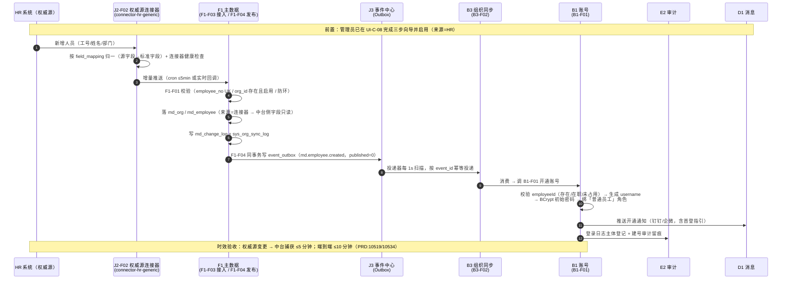
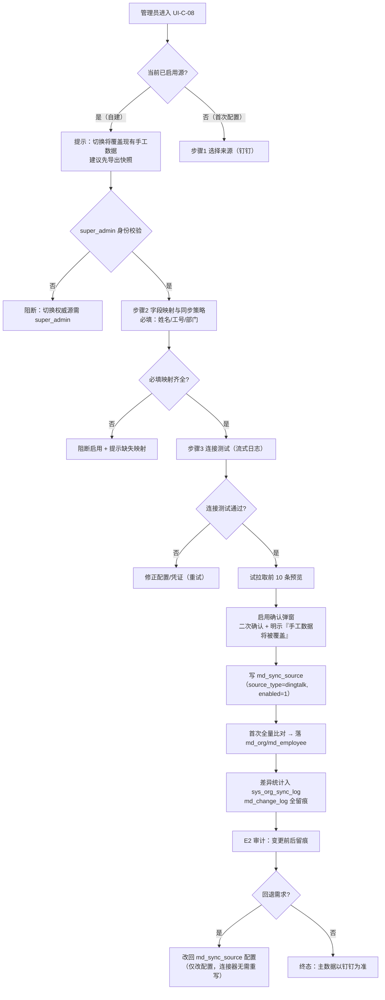
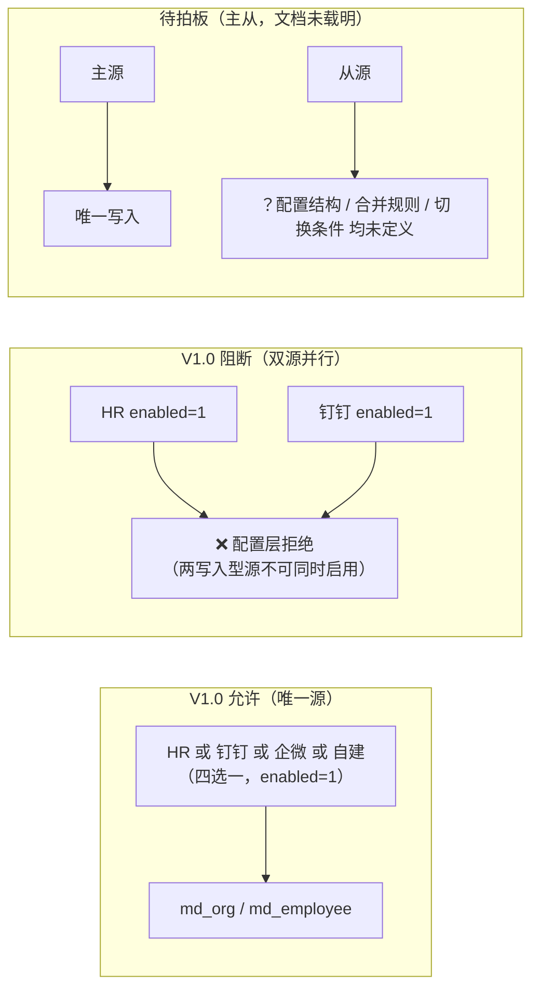
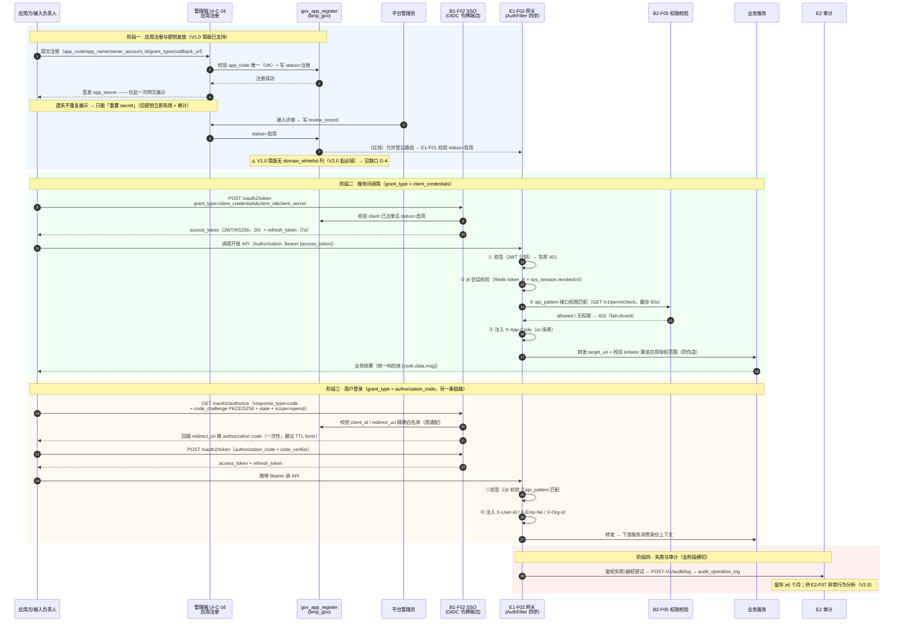

# 麓邦业务中台 · 权威源配置与应用接入鉴权 · 需求澄清与缺口论证

| 项目 | 内容 |
| --- | --- |
| 文档性质 | **需求澄清**（回答客户 Q1/Q2）+ **缺口论证**（含建议新增功能点编号） |
| 产出人 | 产品经理 许清楚（Alice） |
| 任务来源 | 主理人齐活林，承接任务 #1 |
| 上游依据 | `麓邦业务中台产品PRD.md`（125 功能点 / 16494 行）、`麓邦业务中台V1.0基座版详细设计.md`（927 行 / v1.1）、`麓邦业务中台UIUX设计文档.md`（887 行 / v1.1）、`麓邦业务中台产品PRD-增量-工作流引擎（V1.0纳入）.md`、`麓邦现有系统情况分析方案.md` |
| 硬约束 | **只读上游**：本文件为唯一写入产物，未修改任何 PRD / UIUX / 详细设计；**禁止臆造**：所有结论均附 `文件:行号` 或功能点编号；确无依据者标注「**文档未载明，属建议新增**」 |
| 扫描口径 | ① 全库 `.md` 采用 `grep -nE` 逐项取证，**排除 `*.bak*` 备份与 `_frag/` 分片**（分片为 PRD 生成中间件，非权威源）；② 「全部 / 无 / 缺失」类断言均写明具体检索式与命中数；③ 功能点编号以 **主 PRD 第三章 + §10.5.1 顶层编号表** 为权威（顶层 125 个） |

---

## 0. 结论先行（两个问题各 3 句）

### Q1「权威源配置」是什么
1. 「权威源配置」= 管理员在 **`UI-C-08` 三步向导**中，把客户指定的**唯一**组织人员来源系统（`hr`/`dingtalk`/`wecom`/`custom` 四类之一）连同连接凭证、字段映射、同步策略、冲突规则写入 **`md_sync_source` 单行配置**，使其成为 `md_org`/`md_employee` 的**唯一写入方**（`PRD:10426-10451`、详细设计 `:187-189`）。
2. 它解决的是**口径不一致与多源重复建号**：现状 5 套系统各自维护组织人员（`麓邦现有系统情况分析方案.md:9-15`），而 ADR-03 定为「主数据单一权威源 + 订阅分发，根治口径不一致」（`PRD:198`），且 B1 建号 / B2 权限 / B3 同步 / C1 审批矩阵**全部下游依赖 F1 口径**（`PRD:16283`「全局第一阻塞点」）。
3. 它是**「唯一源」而非「多源接入」**：多源同时 `enabled=1` 必须**阻断**（`PRD:10544`、`PRD:10553`），切换即改全公司口径、属**全域最高危元权限**（`super_admin` + 二次确认 + 审计，`PRD:10508`）——且**权威源选型尚未拍板，是 V1.0 开工前置阻塞**（`PRD:10564`、详细设计 `:813`）。

### Q2 应用接入要不要发 key/凭证
1. **要发，而且 V1.0 就得发。** V1.0 已有 `gov_app_register` **简版**，字段明确含 `app_code`/`app_name`/**`app_secret`（AES 加密）**/`owner_account_id`/`grant_types`/`status`/`review_record`（详细设计 `:239-241`），且 V1.0 安装向导第 ⑤ 步就是「**导出各存量系统接入参数（client_id/secret）**」（详细设计 `:786`）。
2. **不发就散架**：`E1-F02` 统一鉴权要校验 `client_credentials` 令牌须 `app_code` 已注册（`PRD:8814`、`PRD:8833`）、`E1-F01` 路由红线「未注册应用不得接入网关」要查 `gov_app_register.status=启用`（`PRD:8702`、`PRD:8707`）、`B1-F02` OIDC 要校验 `client_id` 已在 `gov_app_register` 注册（`PRD:4011`）——**三处强依赖同一张表与同一密钥**。
3. **分两阶段但 V1.0 不缺凭证能力**：V1.0 = 简版发放（注册 + 签发 secret + 启停）；V2.0 = 完整生命周期（评审工作流、`domain_whitelist`、密钥轮换审计等，`PRD:12743`）。**但「凭证怎么发、发给谁、怎么换令牌」的说明文档在 V1.0 无承载功能点——这是真实缺口**（见 §2.4 / §2.5）。

---

# 第一部分 · Q1「权威源配置」澄清

## 1.1 一句话定义 + 为什么需要

### 一句话定义

> **「权威源配置」= 在管理端 `UI-C-08` 三步向导里，为客户指定的那一个（且唯一一个）组织人员来源系统建立接入配置（连接凭证 + 字段映射 + 同步策略 + 冲突规则），落库为 `md_sync_source` 一行；配置启用后，该源成为中台 `md_org`/`md_employee` 的唯一写入方，中台侧对应字段转为只读。**

依据：`PRD:10438`（功能定义）、`PRD:10469`（三步向导）、`PRD:10461`（「权威源切换**仅改此配置**」）、详细设计 `:189`（`md_sync_source` 字段清单）、`PRD:10221`（「来源=连接器时中台侧字段只读」）。

### 为什么需要（4 个业务痛点）

| # | 痛点 | 现状表现 | 权威源配置如何解决 | 依据 |
| --- | --- | --- | --- | --- |
| P1 | **口径不一致** | 5 套系统各自维护组织/人员，同一员工在各系统部门口径可能不同（`麓邦现有系统情况分析方案.md:9-15`：CRM / 招聘 / 目标 / 知识 / 数据中台，**均无独立 HR 系统**） | 单一权威源 + 单向供数，订阅方本地表**只读缓存**，修正需求走主数据问题闭环 | `PRD:198`（ADR-03）、`PRD:1233`（数据规则 1） |
| P2 | **多源重复建号 / 手工重复维护** | HR/行政靠人肉在多系统重复录入；离职/转岗需逐系统手工处理 | 权威源一次变更 → 自动建号 / 角色重算 / 会话吊销，全链路 ≤10 分钟 | `PRD:63`、`PRD:1054`、`PRD:1068` |
| P3 | **下游全链路被卡** | B1 建号、B2 权限范围、B3 组织同步、C1 审批矩阵（按组织/岗位解析审批人）**全部以 F1 组织人员为输入** | 权威源接入是这条链路的**最上游**；不接入则下游无法开工 | `PRD:16283`、`PRD:6103`、`PRD:825` |
| P4 | **安全与合规** | 连接凭证（`corpId`/`secret`、HR 接口凭证）若明文落库/回显即为泄露面 | 凭证 **AES 加密存储、不回显、不下发前端、不落日志**（沿用 `msg_channel.config` 口径） | `PRD:10451`、`PRD:10508`、`PRD:10522`、`PRD:10557` |

### 一句话记忆锚点

> **权威源配置不改业务逻辑，只改「谁是唯一写入方」。** —— 这正是 `PRD:15002` 与 `PRD:15047` 所强调的「权威源切换仅改配置」的设计意图：四类连接器**已全部按 `hr`/`dingtalk`/`wecom`/`custom` 预备**（`PRD:10440`、`PRD:14976`），选型拍板后**只改一行配置**，连接器无需重写。

---

## 1.2 端到端业务场景（3 个，均含 Mermaid）

> 三个场景刻意覆盖三类诉求：**① 主链路正向**（HR 为源、新员工入职）、**② 高危配置变更**（切换权威源）、**③ 增量异动与「双源主从」诉求的边界**（客户常问的「企微 + HR 能不能都接」）。

### 场景 A（主链路）HR 为权威源 —— 新员工入职 → 自动建号 → 授权 → 通知开通

**触发**：HR 系统新增一名员工（工号 `EMP-2026-0101`，部门「销售部」）。
**关键点**：本场景是 `PRD:1052-1052`（§4.3 组织人员异动联动流程）的完整落地，也是 UIUX `6.2 新员工入职旅程`（`UIUX:675-688`）的实现口径。



**下游联动清单（谁看谁写）**

| 环节 | 承担功能点 | 动作 | 边界红线 | 依据 |
| --- | --- | --- | --- | --- |
| 拉取/协议适配 | `J2-F02` 权威源连接器 | 连接 + 全量比对 + 字段映射 | **F1 侧禁直连钉钉/企微/HR**，必须经连接器（CI 依赖门禁） | `PRD:10518`、`PRD:10547` |
| 归一 + 校验 + 落库 | `F1-F03` | 配置管理 / 归一 / 校验 / 落库 / 可观测 | **不产生任何账号动作**（不写 `sys_account`） | `PRD:10444`、`PRD:10555` |
| 变更留痕 | `md_change_log` | 同步造成的变更同样留痕（`source_event_id`） | —— | `PRD:10464` |
| 事件发布 | `F1-F04` | 同事务写 `event_outbox`，**只发布不消费** | **不刷缓存、不改账号** | `PRD:10586-10570` |
| 账号联动 | `B3-F02 → B1-F01` | 建号 / 绑角色 / 初始密码 | **B3 不直接写 `sys_account`**（避免双写），账号动作归 `B1-F06` | `PRD:4543`、`PRD:5499` |
| 通知 | `D1-F01` | 开通通知（渠道：钉钉/企微/站内信） | 通知失败**不影响建号成功** | `PRD:3945`、`PRD:3966` |
| 审计 | `E2-F02/F03` | 登录日志主体 + 建号留痕 | 留存 ≥6 个月 | `PRD:1254` |

---

### 场景 B（高危变更）切换权威源：自建维护 → 钉钉

**触发**：客户决定把组织人员口径从「中台自建手工维护」切换为「钉钉」。
**关键点**：这是**全域最高危元权限**——`PRD:10508` 明确指出「切换即改变全公司组织人员口径的唯一来源」。



**被覆盖数据的处置（客户必读）**

| 项 | 文档口径 | 依据 |
| --- | --- | --- |
| 现有手工数据 | 启用前置**二次确认 + 明示「现有手工数据将被覆盖」**；覆盖前**建议导出快照** | `PRD:10548`、`PRD:10470` |
| 同步失败 | **不回滚已成功写入的主数据**；支持重新同步 / 全量重跑 | `PRD:10475` |
| 回退路径 | 改回 `md_sync_source` 配置即可（**连接器无需重写**） | `PRD:10475`、`PRD:15002` |
| 留痕 | `md_change_log` 全留痕 + E2 审计变更前后 | `PRD:10548`、`PRD:10508` |
| 谁能切 | 仅 `super_admin`（建议权限点 `md:source:config`）；**运维/集成管理员不可切换**，只能看日志/重试/导出 | `PRD:10503-10486` |

---

### 场景 C（边界场景）「企微 + HR 双源主从」是否可行？（客户高频诉求的正面澄清）

**客户可能这样问**：「我们 HR 管正式员工，企微管门店外包，能不能两个都接、做成主从？」

**文档裁定：V1.0 口径下「双源同时启用」必须阻断。**

| 判据 | 文档原文 | 依据 |
| --- | --- | --- |
| 唯一权威源是**业务拍板的既定规则** | 「**权威源唯一（业务拍板）**」列为 `F1-F03` 业务规则 | `PRD:10442` |
| 多源同时启用必须**阻断** | 异常表：「误启 HR + 钉钉双源 → **阻断**：唯一权威源约束；须显式声明主/从并只允许主源写入」 | `PRD:10544`、`PRD:15043` |
| 配置层怎么验 | 验收：配置层**不允许两个写入型源同时 `enabled=1`**（构造测试被阻断） | `PRD:10553` |
| 架构决策层 | ADR-03「主数据单一权威源 + 订阅分发」；`J2-F02` 技术约束「**权威源唯一**（ADR-03，**禁多源冲突**）」 | `PRD:198`、`PRD:15029` |

**给客户的结论与建议**

1. **V1.0：不支持双源主从**——只能选一个源；另一个源的数据若要进中台，须以「一次性存量导入」方式**归一到该唯一源**，而非并行启用。
2. **若客户确有主从诉求**：§`PRD:10544` 留了口子（「须**显式声明主/从**并只允许主源写入」），但**文档未定义「主从」的配置结构、切换条件、从源数据如何合并**——`md_sync_source` 字段中**无 `master_slave` / `priority` 类字段**（详细设计 `:189` 字段清单已穷举）。
   → 属「**文档未载明，属建议新增**」：若客户确认需要，应新增功能点（见 §1.6 待拍板项 #3），**不得由研发自行扩展**。



---

## 1.3 典型操作路径：管理员在 `UI-C-08` 的实际点击路径

> 页面与三步结构依据：UIUX `UI-C-08 权威源配置向导（3 步）`（`UIUX:592-601`）、`PRD:10469-10452`；向导范式（步骤条、每步可校验、支持保存草稿）依据 `UIUX:285`。

**入口**：管理控制台 → 主数据 → 权威源配置（`/console/sync-source`，`UIUX:260`）。
**管理员首登引导**：管理员账号首登会**额外引导至权威源配置向导**（`UIUX:690`）。

### 步骤 1 —— 选择来源

| 项 | 内容 | 依据 |
| --- | --- | --- |
| **输入** | 来源类型**卡片单选**：钉钉 / 企业微信 / HR 系统 / 自建维护；选中后展开连接器配置表单 | `UIUX:598` |
| **连接参数** | 钉钉/企微：`corpId` + `secret`；HR 系统：接口地址 + 凭证 | `UIUX:598`、`PRD:10451` |
| **校验** | 须为四类之一（`hr`/`dingtalk`/`wecom`/`custom`）；**唯一权威源**（多源同时启用须阻断或明确主子） | `PRD:10450` |
| **凭证存储** | **AES 加密存储、不落明文、不回显、不下发前端、不落日志** | `PRD:10451`、`PRD:10508`、`PRD:10549` |
| **成功分支** | 进入步骤 2 | `PRD:10469` |
| **失败分支** | 来源类型非四类 → 拒绝；凭证回显检测（走查字段白名单）→ 安全红线拦截 | `PRD:10549` |

### 步骤 2 —— 字段映射与同步策略

| 项 | 内容 | 依据 |
| --- | --- | --- |
| **输入①：字段映射** | 源字段 ↔ 中台字段映射表（`field_mapping` JSON），**必填映射标红星：姓名 / 工号 / 部门** | `UIUX:599`、`PRD:10452` |
| **输入②：同步策略** | 频率（**每日 / 每小时 / 实时回调**）+ 同步模式（全量比对 / 增量事件）+ `cron` | `UIUX:599`、`PRD:10453` |
| **输入③：冲突规则** | 源覆盖 / 人工确认 | `UIUX:599`、`PRD:10454` |
| **校验（硬阻断）** | **必填映射（姓名/工号/部门）缺失 → 阻断启用** | `PRD:10452`、`PRD:10554`、`PRD:15042` |
| **成功分支** | 进入步骤 3 | `PRD:10480-10464` |
| **失败分支** | 缺失必填映射 → 阻断 + 提示缺失项；同步模式与连接器能力不匹配 → 拒绝 | `PRD:10481`、`PRD:10453` |

### 步骤 3 —— 验证与启用

| 项 | 内容 | 依据 |
| --- | --- | --- |
| **动作①：连接测试** | 展示**测试日志流式输出** | `UIUX:600`、`PRD:10470`、`PRD:14998` |
| **动作②：试拉取** | **试拉取前 10 条预览** | `UIUX:600`、`PRD:10470` |
| **动作③：启用确认** | 确认弹窗，**提示「启用后中台组织人员数据将以该源为准，现有手工数据将被覆盖」** | `UIUX:600`、`PRD:10470` |
| **高危校验** | 切换权威源需 **`super_admin` 权限 + 二次确认** | `UIUX:601`、`PRD:10471`、`PRD:15051` |
| **成功分支** | 写 `md_sync_source`（`enabled=1`）→ 首次全量比对 → 差异统计入 `sys_org_sync_log` → 后续增量 | `PRD:10472` |
| **失败分支** | 连接失败/超时 → 重试 3 次（沿用 J3 重试口径）→ 转人工；**路由保持不自动启用** | `PRD:10474` |
| **部分失败** | **字段级错误不整体失败**：错误行入 `UI-C-09` 失败明细 + **支持导出 CSV** 修正；成功行照常入库（幂等可重传） | `PRD:10474`、`PRD:10546` |

### 启用后的日常运维路径

| 场景 | 路径 | 依据 |
| --- | --- | --- |
| 看同步结果 | `UI-C-09 同步日志`（`/console/sync-logs`）：列 = 同步时间/来源/类型/结果/统计/耗时/详情 | `UIUX:603-607` |
| 失败排查 | 详情抽屉：字段级错误（源数据 / 期望格式 / 错误原因），**导出 CSV**；失败红色高亮 + 「近 7 日失败 X 次」统计卡 + 超阈值告警横幅 | `UIUX:606-607`、`PRD:10521` |
| 重跑 | 支持**重新同步 / 全量重跑**（不回滚已成功数据） | `PRD:10475` |
| 组织人员页表现 | `UI-C-06/07` 顶部横幅：「数据由 HR 系统每日同步，如需修改请在源系统操作 [查看权威源配置]」；**同步态全字段只读** | `UIUX:590`、`PRD:10221` |

> 注：`UI-C-09 同步日志` 在 UIUX 页面地图中挂的功能点是 **`B3-F01/F02`**（`UIUX:261`），而「同步日志」实际由 `F1-F03` 产出并**经 B3 口径**落 `sys_org_sync_log`（`PRD:10463`、`PRD:10534`）。**该页功能点标注与 PRD 存在错配**，详见 §2.5 缺口 **G-7**。

### 1.3.1 原型 `UI-C-08` 失败分支现状核实（实测，回应架构师自纠）

> 上方 §1.3 的「成功/失败分支」是**需求口径**（PRD/UIUX 要求什么）。本小节是**原型实测**（`prototype/assets/pages-config.js` 实际实现了什么），两者需分开看——**供架构师/工程师判断还缺哪些交互**。

| 需求分支（PRD/UIUX 要求） | 原型实测 | 判定 | 实测证据 |
| --- | --- | --- | --- |
| 「切换权威源需 **`super_admin` + 二次确认**」（`PRD:10471`、`PRD:15051`） | `enableSource()` **已调用 `highRisk("启用权威源", …)`** | ✅ **已有** | `pages-config.js:988-989` |
| 「**必填映射（姓名/工号/部门）缺失则阻断启用**」（`PRD:10452`、`PRD:10554`） | `wizGo()` **仅校验步骤 1**（`wizSource` 非空）；步骤 2 的必映射字段（`emp_name`/`emp_no`/`dept_path`）**可被选「（忽略）」而不阻断** | ❌ **缺失**（P0） | `pages-config.js:938-943`（`wizGo` 逻辑）、`:966`（必映射行含 `<option>（忽略）</option>`） |
| 步骤 3「**连接测试**」作为启用门禁（`UIUX:600`） | 步骤 3 有「▶ 发起连接测试」按钮与日志流，但 **`wizNext` 在步骤 3 直接绑 `enableSource`，无「测试通过才可启用」门禁** | ❌ **缺失**（P1） | `pages-config.js:975-976`（`wizNext.onclick = wizStep === 3 ? enableSource : …`） |
| 「保存草稿」 | 有按钮，但仅 `msg('success','草稿已保存…')`，未真持久化 | ⚠️ 降级可用（P2） | `pages-config.js:930` |

> ⚠️ **对本文件结论的影响（精确化，不推翻 §1.3）**：我在 §1.3 页脚写「原型已有（`pages-config.js:918-1119`，核查确认『✅ 已还原：来源卡/映射/连接测试/试拉取』）」——**该表述部分成立**：**正向流程**（来源卡 / 映射表 / 连接测试 / 试拉取）**确已还原**；但**两个关键失败分支**中，**二次确认已有、必映射阻断缺失**。**本小节为精确化补充**：`PRD` 口径未变，缺的是**原型实现**。

---

## 1.4 边界澄清表（vs `B3-F01` / `J2-F02` / `F1-F04` / `B1-F01`）

> 本表是 `PRD:10444`（`F1-F03` 边界声明）、`PRD:5516-5501`（`B3-F01` 边界声明）、`PRD:14976`（`J2-F02` 边界声明）、`PRD:960`（骨架 B12）的合并与可操作化。

| 功能点 | **它决定什么**（决策权） | **它不做什么**（禁止项） | 与权威源配置的关系 | 依据 |
| --- | --- | --- | --- | --- |
| **`F1-F03` 权威源接入** | 配什么源、映射怎么定、策略怎么选、**校验后落不落库**、超没超阈值可观测 | **不做协议适配**（禁在 md 模块直连钉钉/企微/HR 接口）；**不产生任何账号动作**（不写 `sys_account`/`sys_account_mapping`）；**不直接发布事件** | **本点即「权威源配置」的入口与编排方**：配置管理 + 归一 + 校验 + 落库 + 可观测 | `PRD:10444`、`PRD:10518`、`PRD:10547`、`PRD:10555`、`PRD:10466` |
| **`J2-F02` 权威源连接器** | **如何连接、如何拉取、如何做全量比对与字段映射**（协议适配实现） | **不决定接入后如何落主数据**（那是 `F1-F03`）；**不决定业务规则** | **执行承载方**：`F1-F03` **强依赖（S）** `J2-F02`；连接器**独立进程/独立仓库**（`bmp-connectors`），故障隔离 | `PRD:14976`、`PRD:10444`、详细设计 `:10499` |
| **`F1-F04` 异动订阅分发** | **主数据异动事件如何产生并发布到 J3**（源侧） | **只发布不消费**；**不改账号、不刷缓存**；**不参与权威源接入**（只消费 `md_change_log`） | **下游**：`F1-F03` 完成落库 → `F1-F04` 才发事件（`F1-F03` → `F1-F04` 是被依赖关系） | `PRD:10586-10570`、`PRD:745`、`PRD:10588` |
| **`B3-F01` 组织同步** | **订阅后如何驱动组织缓存刷新与账号映射的组织维度更新**（消费侧） | **只消费、不改主数据**；**不直接写 `sys_account`**（账号动作归 `B1-F06`） | **下游出口**：主数据**唯一写入源为 F1**，B3 只读；方向**单向** `F1 → B3`，**严禁写成双向** | `PRD:5516-5501`、`PRD:5499`、`PRD:10556` |
| **`B1-F01` 账号统一管理** | **账号本体的创建/停用/锁定**（身份） | **不管凭证策略**（`B1-F05`）、**不管会话**（`B1-F07`）、**不管角色授权**（`B2-F01`）、**不管组织人员字段**（`F1`，本点只读） | **最下游**：由 `B3-F02` 消费事件后**调** `B1-F01` 开通，**`B3` 不直接写表** | `PRD:3878`、`PRD:3953`、`PRD:4543` |

### 一句话记住四条边界

```
F1-F03  权威源侧「入口」——拉取/接收 → 归一 → 写主数据      （唯一写入方）
J2-F02  连接器「执行者」——协议适配 / 拉取 / 全量比对        （不含业务规则）
F1-F04  源侧「出口」——事件产生与发布，只发不收             （不改账号）
B3-F01  身份侧「消费者」——订阅 → 刷缓存/映射，只收不改主数据  （不写 sys_account）
B1-F01  账号「本体」——建号/停用，最下游                    （组织字段只读）
```

---

## 1.5 配置项清单表（`md_sync_source` 关键字段）

> 字段来源：详细设计 `:187-189`（权威源配置表设计）+ `PRD:10450-10436`（输入校验规则）+ `PRD:10531`（落表说明）+ `UIUX:598-600`（向导交互）。
> 说明：详细设计 `:189` 为**字段清单式**描述（未给类型/长度），本章按 PRD 输入校验规则**补齐类型与校验**；**标注「建议」的为标准 SQL 类型推断，属建议补充**。

| # | 字段 | 类型（建议） | 必填 | 取值 / 校验规则 | 默认值 | 示例值 | 依据 |
| --- | --- | --- | --- | --- | --- | --- | --- |
| 1 | `source_type` | VARCHAR(20) | 是 | ENUM：`hr` / `dingtalk` / `wecom` / `custom`；**唯一权威源**（多源同时 `enabled=1` 须阻断） | —— | `dingtalk` | 详细设计 `:189`、`PRD:10450`、`PRD:14982` |
| 2 | `connector_code` | VARCHAR(64) | 是 | 连接器编码：`connector-dingtalk` / `connector-wecom` / `connector-hr-generic` | 按 `source_type` 联动 | `connector-dingtalk` | 详细设计 `:189`、`PRD:10440`、`PRD:14982` |
| 3 | `field_mapping` | JSON | 是 | 源字段 → 标准字段映射规则；**必填映射：姓名 / 工号 / 部门**；缺失**阻断启用** | —— | `{"name":"姓名","employee_no":"工号","dept":"部门"}` | 详细设计 `:189`、`PRD:10452`、`PRD:14983` |
| 4 | `sync_mode` | VARCHAR(20) | 是 | ENUM：全量比对 / 增量事件（须与连接器能力匹配） | —— | `全量比对` | 详细设计 `:189`、`PRD:10453` |
| 5 | `cron` | VARCHAR(64) | 是（增量时） | 频率：每日 / 每小时 / 实时回调；建议 V1.0 以 **cron 高频（≤5min）兜底**达标 | —— | `0 */5 * * * ?` | 详细设计 `:189`、`PRD:10453`、`PRD:10568` |
| 6 | `enabled` | TINYINT | 是 | `0` 停用 / `1` 启用；**配置层不允许两个写入型源同时 `enabled=1`** | `0`（须显式启用） | `1` | 详细设计 `:189`、`PRD:10553` |
| 7 | 连接凭证（`corpId`/`secret` 或 HR 接口地址+凭证） | —— | 是 | **AES 加密存储**（参考 `msg_channel.config` 口径）；**不落明文、不回显、不下发前端、不落日志** | —— | 密文 | `PRD:10451`、`PRD:10508`、`PRD:10549`、`PRD:10557` |
| 8 | 冲突规则 | VARCHAR(20) | 是 | ENUM：`源覆盖` / `人工确认` | **建议默认「源覆盖」**（唯一源原则） | `源覆盖` | `PRD:10454`、`PRD:10567` |

> **字段未载明项（明确标注）**：`md_sync_source` **无「主/从」标识字段**、**无「源优先级」字段**（详细设计 `:189` 清单已穷举）。因此 §1.2 场景 C 的「双源主从」**在数据结构层即无落地位**——属「**文档未载明，属建议新增**」。

### 相关表（同域）

| 表 | 作用 | 与 `md_sync_source` 的关系 | 依据 |
| --- | --- | --- | --- |
| `md_org` / `md_employee` | 归一后的组织/人员落库目标（`source` 标记来源） | **写入目标**；`来源=连接器`时中台侧字段只读 | `PRD:10462`、`PRD:10221` |
| `md_change_log` | 主数据变更留痕（含同步造成的变更） | 每次同步写；供 `F1-F04` 产生事件 | `PRD:10464`、`PRD:10533` |
| `sys_org_sync_log` | 同步可观测（时间/来源/类型/结果/统计/耗时） | `UI-C-09` 展示数据源 | `PRD:10463`、详细设计 `:249` |
| `event_outbox`（bmp_md） | 事件发件箱（`md.*`） | `F1-F04` 写入，**本点不直接发** | `PRD:10466` |

---

## 1.6 待拍板项（需客户决策）

> 来源：`PRD:10560`（`F1-F03` ⑪待确认项）、详细设计 `:809-813`（第十章遗留决策 #1）、`PRD:16283`（§9.1 关键依赖 #1）、`PRD:16906`（全域待拍板汇总）。

| # | 待拍板事项 | 责任方 | 时限 | **影响什么**（阻塞范围） | 建议 | 依据 |
| --- | --- | --- | --- | --- | --- | --- |
| **D1** | **组织人员权威源最终选型（四类之一）** | **客户（最高优先）** | **V1.0 W3 前必须确认** | ① 决定连接器类型与 `md_sync_source.source_type`；② **B1/F1 能否开工**（全局第一阻塞点）；③ 亦为 `C1-F02` 审批矩阵（按组织/岗位解析审批人）的前置；④ 不拍板则**审批人解析准确率无法达标** | 详细设计 §10 #1 已标「待拍板」；**建议优先钉钉**（详细设计 WBS「J2 权威源连接器（钉钉优先）」，`:797`）——连接器已按四类预备，拍板后**仅改配置** | `PRD:10564`、`PRD:16906`、详细设计 `:813`、`:797` |
| **D2** | **「HR 系统」的具体形态**（有无独立 HR 系统？是否就是「自建」？） | 客户 + 实施 | 拍板 D1 时同步 | 决定用 `connector-hr-generic`（JDBC/REST）还是 `custom` 自建维护 | ⚠️ **现状文档中 5 套系统未含独立 HR 系统**（CRM/招聘/目标/知识/数据中台，`麓邦现有系统情况分析方案.md:9-15`）——**须客户确认「HR 数据源」到底指哪套系统，不得臆造** | `PRD:10565` |
| **D3** | **是否确需「双源主从」**（如 HR 正式员工 + 企微门店外包） | 客户 + 架构师 | V1.0 设计评审前 | 若确认需要：**V1.0 不支持**（唯一源为拍板规则），且 `md_sync_source` **无主/从字段**，须**新增数据结构与功能点**——属范围外新增，会冲击已冻结的 V1.0 范围（`PRD:16263`） | 建议 **V1.0 不做**；确需则**以「另一源一次性存量导入 + 归一到唯一源」**替代（不并行启用）；真要主从须单独立项 | `PRD:10544`、详细设计 `:189`、`PRD:16263` |
| **D4** | 冲突规则默认值（源覆盖 vs 人工确认） | 客户 + HR | 设计评审 | 影响人工工作量与口径一致性 | **建议默认「源覆盖」**（唯一源原则）；敏感字段（`leader_employee_id`）用人工确认 | `PRD:10567` |
| **D5** | 「实时回调」是否在 V1.0 支持（或仅 cron） | 架构师 + 连接器负责人 | 设计评审 | 影响 **≤5 分钟捕获延迟**能否达成 | 建议 V1.0 以 **cron 高频（≤5min）** 兜底达标，实时回调 **V1.5 增强** | `PRD:10568` |
| **D6** | 首次全量的数据量与窗口（是否停机/分批） | 实施 + 架构师 | 上线前 | 影响上线节奏与存量系统 | 建议**分批 + 灰度**；试点先 1 个组织子树 | `PRD:10566` |
| **D7** | 岗位（`md_position`）与职级 `level` 的取值来源（权威源是否提供） | 客户 + HR | 设计评审 | 影响 `C1-F02` 审批矩阵按岗位解析 | 建议权威源缺失时由中台维护、标 `source=manual` | `PRD:10275` |

> **D1 的紧迫性一句话**：**权威源选型不定，F1 无法开工 → B1 无法建号 → B2/B3/C1 全线等米下锅。**（`PRD:16283` 原文：「全局第一阻塞点」）

---

# 第二部分 · Q2 应用接入鉴权澄清（核心）

## 2.1 明确回答：「要不要发 key / 凭证？」

### 结论：**要发。V1.0 就发；V2.0 补齐治理能力。**

| 阶段 | 发不发 | 发什么 | 承载功能点 / 载体 | 依据 |
| --- | --- | --- | --- | --- |
| **V1.0** | ✅ **要发** | `app_code`（`client_id`）+ **`app_secret`（AES 加密落库，创建时一次性明文展示）** | **`gov_app_register` 简版**（详细设计 §3.2）+ **安装向导第 ⑤ 步「导出各存量系统接入参数（client_id/secret）」** | 详细设计 `:239-241`、`:786` |
| **V2.0** | ✅ 继续发，且**补治理** | 同上 + **评审工作流**（`review_record`）+ **`domain_whitelist`（V2.0 起必填）** + **密钥轮换审计** | `I1-F01` 完整版（P1 / V2.0） | `PRD:12743`、`PRD:12761`、`PRD:12781` |
| **令牌（运行时）** | ✅ 由平台签发 | `access_token`（JWT，2h）/ `refresh_token`（7d） | **签发方 = `B1-F02` SSO（OIDC 端点）**；**校验方 = `E1-F02` 网关（只校验不签发）** | `PRD:4000`、详细设计 `:404`、`PRD:8809` |
| **事件订阅密钥** | ⚠️ **需要发但无发放载体** | `subscriber_secret`（Webhook `X-BMP-Signature` 签名用） | **无功能点承载 → 缺口（见 §2.5 G-5）** | `PRD:10616`、详细设计 `:684` |

### 为什么不发就散架（三条硬依赖，逐一给编号）

| # | 若不发凭证，哪里会断 | 文档原文 | 依据 |
| --- | --- | --- | --- |
| 1 | **网关鉴权无法识别应用身份** | `E1-F02` 第 7 步：「`auth_policy=client_credentials` → **校验 `app_code`/`app_secret`** → 注入 `X-App-Code`」；输入校验：「`client_credentials` 令牌须 **`app_code` 已注册**」 | `PRD:8833`、`PRD:8814` |
| 2 | **应用无法上架、无法注册路由（红线）** | `E1-F01`：「路由注册前必须校验 `app_code` 在 `gov_app_register` 存在且 `status=启用`，否则拒绝注册」；异常表：「未注册应用接入网关 → 拒绝注册路由（**红线**）」 | `PRD:8702`、`PRD:8707`、`PRD:12823` |
| 3 | **SSO 无法工作** | `B1-F02` 输入校验：「`client_id` / `redirect_uri` 须在 **`gov_app_register` 已注册且 `status=启用`**；`redirect_uri` 须**精确白名单匹配**（禁止通配）」 | `PRD:4011` |

### 对主理人疑点 1 的正面裁定（版本错配）

> **疑点**：`A1-F01 应用导航`（**P0/V1.0**）依赖 `I1-F01`（**P1/V2.0**）——V1.0 应用如何上架？

**裁定：这不是真实阻塞，是「文档表述层」的表面错配。V1.0 由 `gov_app_register` 简版承载。**

| 证据链 | 内容 | 依据 |
| --- | --- | --- |
| ① PRD 自认有简版 | `I1-F01` 版本栏原文：「P1 / **V2.0**（**V1.0 已有「简版」`gov_app_register`**，见详细设计 §3.2；完整生命周期 V2.0）」 | `PRD:12743` |
| ② 详细设计明确 V1.0 交付该表 | `bmp_gov：gov_app_register 应用注册（**I1 简版，接入评审产物**）`：「`app_code UK`、`app_name`、**`app_secret AES 加密`**、`owner_account_id`、`grant_types`（client_credentials 等）、`status`（注册/启用/停用）、`review_record`」 | 详细设计 `:239-241` |
| ③ 分库清单含 `bmp_gov` | V1.0 八库：`bmp_sys`/`bmp_md`/`bmp_portal`/`bmp_msg`/`bmp_file`/`bmp_wf`/`bmp_audit`/**`bmp_gov`**（治理，V1.0 最小） | 详细设计 `:101-118` |
| ④ V1.0 交付包直接导出凭证 | 安装向导（命令行交互）：…⑤ **导出各存量系统接入参数（client_id/secret）** | 详细设计 `:786` |
| ⑤ V1.0 WBS 含存量接入试点 | W10–W11「存量接入试点：2 套系统走七步 checklist 全流程（建议 CRM+招聘）」——**若不能发凭证，七步第 1 步无法完成** | 详细设计 `:802` |
| ⑥ V1.0 交付范围明确排除的是 I1「完整版」 | 「明确不在 V1.0：… F2/G1/H1/A3/**E1 完整版**/**I1（V2.0）**」——排除的是 `I1` 完整版，非简版 | 详细设计 `:36` |

**→ 结论：`A1-F01`（V1.0）依赖的其实是「简版 `gov_app_register`」，而简版**在 V1.0 交付范围内**。PRD 依赖矩阵写作 `I1-F01(S)` 只是**未把简版单列编号**，属**编号粒度问题，不是交付缺口**。

**但仍留下一个真实缺口**：UIUX 页面地图 `UI-C-16 应用注册`（唯一承载应用注册 UI 的页面）标注的功能点是 **`E1-F01`、`J3`**，**未标 `I1-F01`**（`UIUX:268`）——即「**应用注册**这个页面，其页面地图里不写"应用注册"功能点」。这属**页面规范与 PRD 的功能点错配**（详见 §2.5 **G-7**）。

---

## 2.2 凭证机制全景表

> 覆盖 `app_code` / `app_secret` / `grant_type` / `domain_whitelist` / 令牌（access/refresh）/ 订阅密钥 / 连接凭证七类。
> 「有效期 / 轮换」列若无文档依据，明确标注「文档未载明」。

| # | 凭证/标识 | **作用** | **签发方** | **存储方式** | **校验方** | **有效期** | **轮换策略** | **泄露处置** | **版本** | 依据 |
| --- | --- | --- | --- | --- | --- | --- | --- | --- | --- | --- |
| 1 | **`app_code`**（= `client_id`） | 应用唯一标识；路由/上架/授权/白名单的**主键** | 应用方提交（管理员确认） | `gov_app_register.app_code`，**UK 唯一** | `E1-F01`（路由红线）、`B1-F02`（OIDC 客户端）、`E1-F02`（cc 令牌） | **永久**（**注册后不可改**） | **不可轮换**（改 = 换应用） | 停用应用（`status=停用`）→ 网关拒绝路由 | V1.0 简版 / V2.0 完整 | `PRD:12738`、`PRD:8814`、`PRD:8707` |
| 2 | **`app_secret`**（= `client_secret`） | 应用身份**机机认证**凭据（换 `client_credentials` 令牌用） | **系统生成**（注册时） | `gov_app_register.app_secret`，**AES 加密落库**（TypeHandler 统一）；**创建时一次性明文展示**，刷新后不可见 | `B1-F02`（令牌端点）、`E1-F02`（cc 校验） | **长期有效**（**文档未载明有效期**） | **重置**（破坏性操作）：旧密钥**立即失效** + **审计留痕**；**不重复展示**，遗失只能重置 | 重置 `app_secret`（旧密钥立即失效 + 审计） | V1.0 简版 / V2.0 完整 | `PRD:12758`、`PRD:12770`、`PRD:12776`、`PRD:12781`、`PRD:12813`、`PRD:12825`、详细设计 `:241` |
| 3 | **`grant_types`** | 声明该应用允许的授权模式（**白名单约束**） | 应用方提交 / 管理员核定 | `gov_app_register.grant_types`（JSON 数组） | `B1-F02`（令牌端点按模式放行）、`E1-F02`（`auth_policy` 与模式匹配） | 随应用（配置态） | 变更需管理员操作 + 留痕 | 移除高危模式（如收紧为仅 `authorization_code`） | V1.0 简版 / V2.0 完整 | `PRD:12760`、`PRD:3856`、`PRD:4019` |
| — | ↳ 取值：`client_credentials` | **服务间调用**（应用身份，不代表用户） | —— | —— | —— | 令牌 2h | 见 refresh | **禁止透传用户令牌冒充他人** | —— | `PRD:8809`、`PRD:8856`、`PRD:8877` |
| — | ↳ 取值：`authorization_code` | **用户登录**（授权码 + **PKCE S256**，禁隐式/`plain`） | —— | —— | —— | code 短 TTL；access 2h | 静默续期 | 见 access_token | —— | `PRD:4086`、`PRD:4000`、`PRD:4013` |
| 4 | **`domain_whitelist`**（建议列名） | **回调/跳转域名白名单**——防 SSRF / 防开放重定向；被 **`A1-F08` / `A4-F01` / `C1-F06` 三处共用**，是唯一白名单来源 | 应用方提交 / 管理员维护 | `gov_app_register`（**V2.0 起必填**；**V1.0 简版无此列**） | `A1-F08`（iframe 嵌入）、`A4-F01`（`jumpUrl`/`callbackUrl`）、`C1-F06`（`callbackUrl`）——**均调同一 `isWhitelisted(url)`** | 随应用（配置态） | 变更需管理员操作 + 留痕 | 移除非法项；运行期校验兜底拦截 | **V2.0 起必填**（V1.0 无） | `PRD:12761`、`PRD:12750`、`PRD:12834`、`PRD:3160-3143`、`PRD:6453` |
| 5 | **`access_token`**（JWT） | 运行时**访问凭证**；携带 `sub`/`emp`/`org`/`roles`/`jti`/`iss`/`exp` | **`B1-F02` SSO / OIDC 令牌端点** | 客户端持有（内存/安全存储）；服务端 `sys_session` 记 `token_jti`；Redis 存 jti | **`E1-F02` 网关四步**：①验签 ②jti 会话校验（Redis + `sys_session.revoked`）③`api_pattern` 权限匹配 ④注身份上下文 | **2h（可配）** | **静默续期**（已有 SSO 会话直接签 code）；refresh 轮换 | **`B1-F07` 强制下线**：置 `revoked=1` + 删 Redis jti（**≤30s 生效**） | V1.0 | `PRD:4000`、`PRD:4027`、详细设计 `:404`、`PRD:8830`、`PRD:8874` |
| 6 | **`refresh_token`** | 换取新 `access_token`（避免频繁登录） | `B1-F02` | 客户端持有 | `B1-F02` 令牌端点 | **7d** | **轮换**（refresh 轮换，用后失效） | 与 access_token 同源处置（强制下线） | V1.0 | `PRD:4028`、详细设计 `:404`、`PRD:4020` |
| 7 | **`subscriber_secret`** | 事件 **Webhook 签名**密钥：`X-BMP-Signature = HMAC-SHA256(body, subscriber_secret)` | **文档未载明签发方** | 文档未载明（PRD 侧仅说「加密存储」） | **订阅方**校验（消费方自行验签）；中台侧在投递时签名 | **文档未载明** | **文档未载明** | **文档未载明** | V1.0（Outbox 简化版已用签名）/ V1.5（`J3-F02` 订阅注册完整） | `PRD:10616`、详细设计 `:684`、`PRD:10614`（`_frag/06-主数据.md:650`「`subscriber_secret` 加密存储」） |
| 8 | **连接凭证**（`corpId`/`secret`、HR 接口凭证） | 中台**主动连接**权威源系统 | 源系统提供（客户侧） | `md_sync_source`，**AES 加密**；**不回显、不下发前端、不落日志** | `J2-F02` 连接器（消费方） | 随源系统策略 | 文档未载明（变更走配置修改 + 审计） | 凭证**不落明文**；同步日志**不含凭证**（走查字段白名单） | V1.0 | `PRD:10451`、`PRD:10508`、`PRD:10522`、`PRD:10549` |

### 令牌模型速查（V1.0 已定，非建议）

| 项 | 值 | 依据 |
| --- | --- | --- |
| 签名算法 | JWT **RS256**（密钥对 Nacos 加密托管） | `PRD:4086`、详细设计 `:745` |
| `access_token` 有效期 | **2h（可配）** | `PRD:4000`、详细设计 `:404` |
| `refresh_token` 有效期 | **7d**，轮换 | `PRD:4028` |
| 强制下线生效 | **≤30s** | `PRD:8830`、`PRD:8874` |
| 网关附加延迟 | **P95 <50ms** | `PRD:8864` |
| 授权码 TTL | 建议 **5min**（**待确认**） | `PRD:4026` |
| 失败语义 | **fail-closed**（绝不 fail-open） | `PRD:8866`、`PRD:8875` |

---

## 2.3 端到端接入时序图

> 覆盖：注册 → 评审 → 拿到 `app_secret` → 换取令牌（两种 `grant_type`）→ 调开放 API → 网关校验（`E1-F02` 四步）→ 注入身份上下文 → 访问业务。
> 依据拼接：`PRD:12738-12763`（I1-F01 操作流程）、`PRD:8806-8817`（E1-F02 四步）、详细设计 `:393-404`（OIDC 端点）、详细设计 `:395-404`（令牌模型）。



### V1.0 对接方拿凭证的**实际路径**（客户最关心的一问）

| 步骤 | 谁做 | 做什么 | 输出物 | 依据 |
| --- | --- | --- | --- | --- |
| 1 | 平台管理员 | 在管理端 `UI-C-16 应用注册` 注册应用（`app_code`/`app_name`/`owner`/`grant_types`/`callback_url`） | `gov_app_register` 一行（`status=注册`） | `PRD:12775`、UIUX `:268` |
| 2 | 系统 | 自动签发 `app_secret` | **一次性明文展示的 `app_secret`** | `PRD:12776`、`PRD:12770` |
| 3 | 平台管理员 | 接入评审（写 `review_record`）→ 置 `status=启用` | 应用可上架、可注册路由 | `PRD:12777`、`PRD:12808` |
| 4 | **实施/运维** | **V1.0 具体路径**：安装向导第 ⑤ 步**导出各存量系统接入参数（`client_id`/`secret`）**，线下交付给对接方 | 凭证交付清单 | **详细设计 `:786`** |
| 5 | 对接方 | 配置 `client_id`/`client_secret` → 换取令牌 → 调 API | 见 §2.3 阶段二/三 | `PRD:6469`、`PRD:14180`、`PRD:14195` |
| 6 | 对接方 | 配置 `callbackUrl`（**须 I1 登记**；V1.0 简版无独立白名单列） | 回调可用 | `PRD:3161`、`PRD:6453` |

> ⚠️ **第 4 步是 V1.0 唯一的"官方凭证交付路径"，且它是"实施侧一次性动作"**——由实施人员导出后**线下转交**，**没有面向对接方的自助/半自助申领界面，也没有书面说明**。这正是 §2.5 **G-3** 缺口。

---

## 2.4 「应提供什么接入材料」清单（逐项标注：现有承载 / 缺口）

> 判定口径：逐项到 **主 PRD 第三章 + §10.5.1 编号表** 中查是否存在承载功能点；版本取其「交付版本」列；无承载者标「**缺口**」，并注明 V1.0 是否有替代路径。

| # | 接入材料 | 现有承载功能点 | 版本 | V1.0 可用？ | 判定 | 依据 |
| --- | --- | --- | --- | --- | --- | --- |
| 1 | **接入指南**（快速开始 / 详解） | `J1-F03 SDK 文档与示例`（「接入文档、示例工程、版本说明」） | **P1 / V1.5** | ❌ | **🔴 缺口 G-2** | `PRD:618`、`PRD:14355`、`PRD:14382` |
| 2 | **接入指南 · UI 入口** | `I3-F03 开发者门户`（开放 API 文档 / 调试 / SDK 下载） | **P2 / V2.5** | ❌ | **🔴 缺口 G-2** | `PRD:632`、`PRD:13660` |
| 3 | **API 目录**（可检索的接口清单：归属/版本/鉴权要求/文档链接） | `E1-F06 API 目录`（「API 可查可管 100%」） | **P1 / V2.0** | ❌ | **🟠 缺口 G-6**（V1.0 仅有详细设计 §四静态接口表可代偿） | `PRD:9245`、`PRD:9257`、`PRD:9272` |
| 4 | **后端 SDK** | `J1-F01 后端 SDK`（`bmp-starter-security/audit`、`@PermCheck`/`@AuditLog`/`@StartWorkflow`） | **P1 / V1.0 首批→V1.5 全量** | ✅ | ✅ 有承载 | `PRD:616`、`PRD:14161` |
| 5 | **前端组件库** | `J1-F02 前端组件库`（登录组件 / 权限指令 / 待办组件 / 上传组件，Vue3 内部 npm） | **P1 / V1.0 首批→V1.5 全量** | ✅ | ✅ 有承载 | `PRD:617`、`PRD:14259` |
| 6 | **示例工程** | `J1-F03`（V1.5）**＋** `C1-F06-9` 明写「配套**可运行 demo**」「**提供接入文档与示例工程**」（**V1.0**） | **C1-F06-9 = V1.0** | ⚠️ **承诺在 V1.0，但无独立功能点承载** | **🔴 缺口 G-2**（`C1-F06-9` 是子项，`J1-F03` 却是 V1.5 → **版本倒挂**） | 增量PRD `:197`、`PRD:6445`、`PRD:6526`、`PRD:14355` |
| 7 | **调试沙箱 / 在线调试** | `I3-F03`（「在线调试（沙箱/授权）」）**＋** `I1-F03 多环境管理`（V2.0，沙箱 namespace） | **P2 / V2.5**；沙箱建议挂 `I1-F03`（V2.0） | ❌ | **🟠 缺口 G-8**（V1.0 靠 Postman + 详细设计 §四接口表联调） | `PRD:13680`、`PRD:13753`、`PRD:13725` |
| 8 | **上线 Checklist**（接入验收物清单） | **`PRD §4.6 七步 Checklist`**（`PRD:1120-1121`）——但**仅为 7 节点 mermaid + 6 条业务规则，无「每步输入/输出/验收物/责任方」结构化清单** | **V1.0（流程本身）** | ⚠️ 有流程、**无交付物清单文本** | **🟠 缺口 G-6** | `PRD:1120-1121`、`PRD:13690` |
| 9 | **接入状态可视化**（7 步完成态） | `A1-F01-2 接入状态视图`（UI-C-10 应用详情内区块） | **V1.5** | ❌ | 缺口（V1.5 补） | `PRD:3808`、`PRD:1308`、UIUX `:647` |
| 10 | **变更公告 / CHANGELOG** | `J1-F03`（「版本说明 CHANGELOG，破坏性变更标注」，V1.5）**＋** 详细设计交付包「版本说明 CHANGELOG + 升级脚本清单」（V1.0） | `J1-F03`=V1.5；详细设计交付包=**V1.0** | ⚠️ **平台自身变更**有（交付包）；**面向接入方的变更公告**无 | **🟡 缺口 G-6**（部分） | 详细设计 `:788`、`PRD:14376`、`PRD:14417` |
| 11 | **SDK 与服务端版本兼容矩阵** | `J1-F01` 输入项「版本兼容矩阵（主 PRD 6.8「SDK 与服务端版本兼容矩阵管理」）」 | P1 / V1.0 首批 | ✅（能力有） | ✅ 有承载（**策略细化待确认**） | `PRD:14179`、`PRD:14254` |
| 12 | **凭证申领与令牌换取说明** | **无功能点承载**（V1.0 仅详细设计 `:786` 安装向导「导出」） | —— | ⚠️ 能拿到凭证，**无说明书** | **🔴 缺口 G-3** | 详细设计 `:786`、`PRD:12770` |
| 13 | **`app_secret` 重置/轮换操作说明** | `I1-F01 回退路径`（「密钥泄露 → 重置 `app_secret`」）；UI-C-16 原型有「重置 secret」按钮 | V2.0（I1-F01 完整版）；原型已有按钮 | ⚠️ 能力有、**说明无** | **🟠 缺口 G-6** | `PRD:12781`、`PRD:12825`、`prototype/assets/pages-config.js:282` |
| 14 | **回调域名登记说明（防 SSRF）** | 消费侧 V1.0 **2 处**（`A4-F01`/`C1-F06`；`A1-F08` 为 V1.5），**登记侧唯一来源 `I1-F01.domain_whitelist` 为「V2.0 起必填」（V1.0 简版无此列）**；⚠️ 勿与 `UI-C-10` 已有「域名白名单」Tab（**服务 `A1-F08` 嵌入**，`pages-config.js:172-187`）混淆——那是**另一类白名单** | 消费 V1.0 / 数据源 V2.0 | ❌ **数据源缺失** | **🔴 缺口 G-4** | `PRD:12761`、`PRD:3160-3143`、`PRD:6453` |
| 15 | **事件订阅接入说明（Webhook 验签）** | `J3-F02 订阅注册`（V1.5）；Webhook 签名口径在 `F1-F04`/详细设计有（V1.0 Outbox 简化版已用） | V1.5（完整） | ⚠️ 签名机制有、**订阅方密钥发放与说明无** | **🔴 缺口 G-5** | `PRD:10614-10598`、详细设计 `:684`、`PRD:792` |

### 缺口总览（按严重度）

| 严重度 | 缺口 | 一句话 |
| --- | --- | --- |
| 🔴 高 | **G-2** | V1.0 承诺「接入文档与示例工程」（`C1-F06-9`），但**无任何承载功能点**（`J1-F03` 是 V1.5，`I3-F03` 是 V2.5，UIUX 页面地图**零**开发者页） |
| 🔴 高 | **G-3** | V1.0 能发凭证（安装向导导出），但**「怎么发、怎么换令牌、怎么调」的说明文档无载体** |
| 🔴 高 | **G-4** | V1.0 有 **2 处**（`A4-F01`/`C1-F06`）**消费**回调白名单，但**唯一数据源 `domain_whitelist` 是 V2.0 才必填、V1.0 简版无此列** → SSRF 防护**断链**；⚠️ 与 `UI-C-10` 的「域名白名单」Tab（**`A1-F08` 嵌入白名单**）是**两类不同白名单**，勿混 |
| 🔴 高 | **G-5** | `subscriber_secret`（Webhook 验签）在 V1.0 已被使用，但**签发方/存储/轮换/泄露处置四处均「文档未载明」** |
| 🟠 中 | **G-6** | `API 目录`（V2.0）/`七步 Checklist 交付物清单`（文本）/`面向接入方的变更公告`/`密钥重置说明` 四项**无 V1.0 承载** |
| 🟠 中 | **G-7** | **上游 UIUX 文档**页面地图**功能点标注错配（2 处）**：`UI-C-16 应用注册` 标 `E1-F01`/`J3`（**未标 `I1-F01`**）；`UI-C-09 同步日志` 标 `B3-F01/F02`（实际由 `F1-F03` 产出）。**与「原型 `index.html`」无关——原型侧 11 处错位已在本轮修复**（`05-原型修复记录.md:27`） |
| 🟡 低 | **G-8** | 调试沙箱（`I3-F03` V2.5 / 沙箱建议挂 `I1-F03` V2.0）在 V1.0 缺失，靠 Postman 代偿 |
| 🟡 低 | **G-9** | `app_secret` **有效期 / 轮换周期文档未载明**（仅定义了「重置」这一破坏性操作） |

---

## 2.5 缺口论证与建议（逐条：缺口 → 影响 → 建议新增编号 → P 级/V 级 → 验收要点 → 回写位置）

> **编号申请前置核查**：以下拟用编号已逐一全库检索，**均无占用**（检索式 `grep -rho "<编号>" --include="*.md" . | wc -l`，结果全部为 `0`）：`I1-F05`、`I1-F06`、`I1-F07`、`J1-F04`、`J1-F05`、`E1-F07`、`I3-F04`、`F1-F06`。
> 依据：主 PRD 现存最大号 —— `I1-F01~F04`（`PRD:439-442`）、`I3-F01~F03`（`PRD:446-448`）、`J1-F01~F03`（`PRD:453-455`），故 `I1-F05`/`J1-F04` 等为**下一个可用号**。

---

### G-2 V1.0 接入说明文档缺失（🔴 高）

| 项 | 内容 |
| --- | --- |
| **缺口** | V1.0 接入方**拿不到任何接入说明文档**：`J1-F03 SDK 文档与示例` = **P1/V1.5**（`PRD:618`）；`I3-F03 开发者门户` = **P2/V2.5**（`PRD:632`）。但 V1.0 的 `C1-F06-9` **明确承诺**「**提供接入文档与示例工程**」（增量PRD `:197`）且验收要求「业务系统嵌入对接 **≤2 人日**（含联调）」（`PRD:6526`）。**→ V1.0 有承诺、无承载。** |
| **证据（4 条独立链）** | ① `C1-F06-9` 承诺「提供接入文档与示例工程」且版本 = **V1.0**（增量PRD `:197`、`PRD:6445`）；② `J1-F03` = **V1.5**（`PRD:618`、`PRD:14360`）；③ `I3-F03` = **V2.5**（`PRD:632`、`PRD:13665`）；④ **UIUX 页面地图零开发者页**——检索式 `grep -cE "开发者门户\|接入指南\|接入文档\|API 目录\|沙箱" 麓邦业务中台UIUX设计文档.md` = **0**（`UIUX:236-269` 页面地图 31 页中无此类页面）；⑤ 详细设计第八章「交付工程包」5 项（部署包/数据库脚本/安装向导/环境检查工具/版本说明）**不含接入指南**（详细设计 `:782-788`） |
| **影响（阻塞谁、阻塞什么）** | ① **阻塞 V1.0 的 2 套存量接入试点**（W10–W11，详细设计 `:802`）——对接方无文档只能靠中台研发口述，**≤2 人日目标不可能达成**；② **阻塞 `PRD §4.6` 第 2/5/6 步**（SSO 接入 / 待办接入 / 消息文件接入）——`I3-F03` 原文自认「是 4.6 七步 Checklist 的自助支撑面（第 2/5/6 步的接入文档与 SDK 入口）」（`PRD:13722`），而它是 V2.5；③ **阻塞 V1.0 验收项**「业务系统嵌入对接 ≤2 人日」（`PRD:6526`） |
| **建议新增** | **`J1-F04 接入指南与示例工程（V1.0 子集）`** —— 一句话需求：*在 `J1` 域内（与 SDK 同域，复用「与代码同源抽取」机制）提供**面向 V1.0 接入方的最小可用接入文档**：SSO/OIDC 接入、`client_id`/`secret` 获取与令牌换取、`/v1/todo/push` 与 `/v1/msg/send`、`@PermCheck`/`@AuditLog` 用法、七步 Checklist 逐步操作指引、2 个可运行示例工程（CRM 合同审批 + 招聘 offer 审批），并在 UIUX 增补一个「接入指南」入口页但**不引入完整开发者门户**。* |
| **P 级 / 版本** | **P0 / V1.0**（理由：V1.0 有验收项与存量接入试点，属**验收阻塞项**） |
| **验收要点** | ① 文档随 V1.0 发版（发版门禁：文档缺失不发版）；② 2 个示例工程**可运行**（CI 验证）；③ **对接方仅凭文档（无中台研发陪跑）完成一次 SSO + 待办推送联调**，实测 ≤2 人日；④ 文档与 SDK **同源抽取**（不脱节） |
| **回写位置** | ① 主 PRD **§3.8 M8 开放与集成模块**（`PRD:612-626` 表）新增一行；② 主 PRD **§6.8**（`PRD:12736`）新增 `#### J1-F04` 详规（8 要素 + 3 附加，对齐 `PRD:1255` 模板）；③ 主 PRD **§3.10.1 依赖矩阵**（`PRD:779-771` 区段）补 `J1-F04` 行列；④ 主 PRD **§10.5.1 编号总表**（`PRD:360-467` 区段）由 125 → **126**；⑤ 主 PRD **第八章版本发布计划 V1.0 行**（`PRD:16254`）补「`J1-F04` 接入指南」；⑥ UIUX **§3.4 页面地图**（`UIUX:236-269`）新增「接入指南」页；⑦ 详细设计 **第八章交付工程包**（`:782-788`）新增「接入指南 + 示例工程」交付物 |
| **替代方案（若不新增编号）** | 把 `J1-F03` 的**子集前移 V1.0**（如 `J1-F03-1 V1.0 接入指南最小集`），版本栏改为「V1.0 子集 → V1.5 全量」。**推荐新增编号**（子项前移会与 `I3-F03` 的 `J1-F03(S)` 强依赖关系产生版本歧义） |

---

### G-3 V1.0 凭证获取路径未文档化（🔴 高）

| 项 | 内容 |
| --- | --- |
| **缺口** | V1.0 **已具备**签发 `app_secret` 的能力（简版 `gov_app_register`，详细设计 `:239-241`），且**安装向导第 ⑤ 步会导出 `client_id`/`secret`**（详细设计 `:786`）——但：① 这是**实施侧一次性动作**，**无面向应用方的自助/半自助申领路径**；② **无书面说明**「拿到 `client_id`/`secret` 后如何换取令牌、如何调用 API、如何处理常见错误」；③ `PRD §4.6 七步 Checklist 第 1 步`（「应用注册与接入评审」）**仅有 7 个字 + 一个 mermaid 节点**，**无输入/输出/验收物/责任方**（`PRD:1124`、`PRD:1115-1121`）。 |
| **证据** | 详细设计 `:786`（安装向导导出，无说明文档）；`PRD:12738-12763`（`I1-F01` 操作流程，止于「签发 → 评审 → 启用」，**无「交付给应用方」环节**）；`PRD:1124`（七步第 1 步仅一行节点）；`PRD:12747`（关联接口为**建议**：`POST /v1/app/register`（建议）——**接口路径本身都还是待确认**） |
| **影响（阻塞谁）** | ① **阻塞对接方第一步**——无操作说明则 `client_id`/`secret` 到手也不知怎么用（尤其 `client_credentials` 换令牌的端点/参数/错误码）；② **阻塞 V1.0 存量接入试点**（同上 G-2）；③ **放大实施人力**——每次接入都要中台研发介入替代文档；④ 埋**安全风险**：无正式交付路径 → 实施侧可能用微信群/邮件明文传 secret，与「不落明文」原则冲突（`PRD:10508`） |
| **建议新增** | **`I1-F05 应用接入凭证发放与接入指引`** —— 一句话需求：*在 I1 域内把「应用注册 → 签发 `app_secret`（一次性展示，可重置）→ 评审启用 → **生成《接入凭证单》（含 `client_id`、令牌端点、鉴权方式、错误码表、变更留痕）→ 交付/下载/打印凭证单**」串成 V1.0 可跑的受控流程，并明确「secret 仅一次性展示、重置即失效、交付留痕（E2 审计）」四条规则，替代 V1.0 的"实施向导导出"临时路径。* |
| **P 级 / 版本** | **P0 / V1.0** |
| **验收要点** | ① `UI-C-16` 可完成「注册 → 展示 secret（一次）→ 评审 → 启用」全流程（补齐原型缺的 **3 步向导**，见核查 `R-32`）；② 生成**含令牌端点与错误码表的《接入凭证单》**（导出 PDF/下载）；③ secret 二次进入不可见（可走查）；④ 重置 secret → 旧密钥立即失效 + `audit_operation_log` 有留痕（可测）；⑤ 交付动作**留痕**（谁在何时把哪个应用的凭证交付给谁） |
| **回写位置** | ① 主 PRD **§3.9 M9 治理与运营模块**（`PRD:634-636`）新增一行；② 主 PRD **§6.8**（`PRD:12736`）新增 `#### I1-F05` 详规；③ 主 PRD **§3.10.1 依赖矩阵**（`PRD:763-758` 区段）；④ 主 PRD **§4.6 七步 Checklist**（`PRD:1120-1121`）第 1 步补「输入/输出/验收物/责任方」四列；⑤ 主 PRD **§10.5.1 编号总表** 125 → **127**；⑥ UIUX **§5.4 `UI-C-16`**（`UIUX:268`）补 3 步向导交互 + 凭证单下载；⑦ 详细设计 **§4 接口规格** 补 `POST /v1/app/register` 正式契约（现为"建议"，`PRD:12747`、`PRD:12842`）；⑧ 详细设计 **第八章安装向导第 ⑤ 步**（`:786`）改为「生成接入凭证单（受控交付）」，不再仅"导出" |
| **注** | 本建议与核查报告 `R-32`「应用注册向导 3 步未实现」**同源**（`outputs/核查/02-PRD还原度核查.md:1168`），可合并推进 |

---

### G-4 回调域名白名单在 V1.0「有消费、无数据源」（🔴 高）

| 项 | 内容 |
| --- | --- |
| **缺口** | V1.0 **两处（`A4-F01`/`C1-F06`）强依赖**回调/跳转域名白名单，但**唯一数据源 `domain_whitelist` 是「V2.0 起必填」，V1.0 简版无此列**（`PRD:12761`、详细设计 `:241` 字段清单无白名单）。**→ SSRF 防护在 V1.0 断链。**<br/>⚠️ **两类白名单必须区分（原表述有误，已更正）**：<br/>① **嵌入白名单（已存在，勿重复建）**——`UI-C-10 portal-apps`「域名白名单」Tab（`pages-config.js:128`、`:172-187`，8 个 `.local` 域名 + `EMBED_WHITELIST_HOSTS`），服务 **`A1-F08` iframe 嵌入（V1.5）**，决议 #5b 附加约束①。<br/>② **回调/跳转白名单（缺失，即本缺口）**——服务 **`A4-F01`/`C1-F06`（均 V1.0）**，需 `callback_url` 白名单；**无 UI 承载页、无数据列**。<br/>（说明：判定「无 UI 承载」的口径 = 于 `prototype/assets/pages-config.js` 检索 `白名单\\|whitelist`，命中仅 `UI-C-10 portal-apps` 一处，且其文案自述服务"嵌入 iframe"，**非回调**；`UI-C-16` 无白名单 Tab。） |
| **证据（消费方 3 处，全部 V1.0）** | ① `A4-F01`（P0/V1.0）：输入校验 `jumpUrl`「https；**白名单校验（防 SSRF）**」、`callbackUrl`「https；**白名单；I1 登记**」（`PRD:3160-3143`）；② `C1-F06`（V1.0 全量）：`callbackUrl`「**白名单校验**；禁内网；**防 SSRF**」（`PRD:6453`）、异常表「`callbackUrl` 未登记/内网地址 → **白名单 + https 校验拦截**」（`PRD:6522`）；③ `A1-F08`（V1.5，弱）：白名单唯一入口 `isWhitelisted()`，来源 `gov_app_register`（`PRD:2047`、`PRD:2062`）。**数据源侧**：`I1-F01` `domain_whitelist` 标注「**V2.0 起必填（V1.0 简版无此列）**」（`PRD:12761`）；详细设计 `gov_app_register` 简版字段**无白名单**（`:241`）；详细设计全文中检索 `domain_whitelist\|白名单` 于 `gov_app_register` 上下文**无命中** |
| **影响（阻塞谁）** | ① **V1.0 存在 SSRF 防护空窗**：`A4-F01`/`C1-F06` 要求"白名单校验"，但**校验所需的数据不存在**——两种劣化结果：**(a)** 研发兜底放行（安全红线失守）；**(b)** 研发硬编码一份白名单（配置化失守，与 `PRD:12750`「A1-F08 只消费、不自定义白名单」冲突）；② **阻塞 `A4-F01`/`C1-F06` 的验收项**——`C1-F06` 验收需「`callbackUrl` 未登记/内网地址被拦截」（可测），但**无"已登记"的定义载体**（`PRD:6522`）；③ **V2.0 迁移风险**：V2.0 增列后，V1.0 期间"隐式放行"的存量回调地址可能全部不合法 → 上线后集体失效 |
| **建议新增** | **`I1-F06 应用回调域名白名单（V1.0 最小集）`** —— 一句话需求：*在 V1.0 简版 `gov_app_register` 增列 `domain_whitelist`（JSON 数组，每项须 https 且为精确域名或受控前缀，**禁 IP 直连与内网网段**）并在 **`UI-C-16 integration`**（**不是 `UI-C-10`**——后者已有服务 `A1-F08` 嵌入的白名单 Tab，语义不同、**勿重复建**）新增「**回调域名白名单**」Tab，作为 `A4-F01`（`jumpUrl`/`callbackUrl`）、`C1-F06`（`callbackUrl`）两处 V1.0 消费方共用的**唯一白名单来源**（`A1-F08` 嵌入白名单 V1.5 起可归并同一数据源），服务端提供统一 `isWhitelisted(url)` 权威判定（本地缓存 + 失效通知）。* |
| **P 级 / 版本** | **P0 / V1.0**（理由：属安全红线 + 两个 V1.0 功能点的验收前置） |
| **验收要点** | ① `domain_whitelist` 含内网 IP 或非 https → **提交被拒**；② 运行期非白名单 URL 调用 `A4-F01`/`C1-F06` → **拦截返回明确错误码**（越权/非法域名 0 通过）；③ **两处调同一校验接口**（可走查，不得各自实现）；④ V1.0 存量应用的 `callbackUrl` **全量回填**入白名单（迁移脚本 + 回填完成率 100%） |
| **回写位置** | ① 主 PRD **§6.8 `I1-F01`**（`PRD:12761`）——把 `domain_whitelist` 版本栏由「V2.0 起必填」改为「**V1.0 必填（最小集：https + 精确域名/受控前缀）**」；② 主 PRD **§3.10.1 依赖矩阵** 补 `A4-F01`/`C1-F06` 对白名单的引用；③ 主 PRD **§6.8** 新增 `#### I1-F06`（若决定单列功能点）**或**在 `I1-F01` 下新增子项 `I1-F01-1 回调域名白名单（V1.0）`；④ 详细设计 **§3.2 `gov_app_register`**（`:239-241`）补 `domain_whitelist JSON` 列 + V1.0 Flyway 增列；⑤ UIUX **§5.4 `UI-C-16`**（`UIUX:268`）新增「**回调域名白名单**」Tab（与 `UI-C-10` 的嵌入白名单 Tab **并列存在、语义分离**）；⑥ 详细设计 **§4 接口规格** 补白名单校验接口 |
| **归属确认（回应架构师）** | 架构师提议挂 `I1-F06`（已在 `T04` 采用）——**我确认 `I1-F06` 可用**。但**两种方案等价、由架构师定**：<br/>**(A) 独立 `I1-F06`**（架构师现采用）——优点：V1.0 交付、语义独立、便于单独验收；<br/>**(B) `I1-F01-1` 子项**——优点：不增顶层编号（`domain_whitelist` 本就是 `I1-F01` 的字段，`PRD:12761` 与 `PRD:12840` 均把它写在 `I1-F01` 内），顶层数不变。<br/>**我的倾向**：**方案 B**（子项）更贴合 PRD 现有结构（该字段在 `I1-F01` 内论述、且 `PRD:12840` 已标其为 `I1-F01` 的"建议新增列"）——但**若采纳 B，须同时在 `I1-F01` 版本栏注明「V1.0 子集交付」**，否则又会产生 G-1 式的"版本栏 V2.0、子项 V1.0"歧义。**架构师若已按 (A) 落地 `T04`，我无异议，不必返工。** |
| **注** | 本项与 `I1-F01` ⑪待确认项 #1「`domain_whitelist` 正式列名与结构（`gov_app_register` 现无此列，属**建议新增**）」#4「「简版（V1.0）→ 完整版（V2.0）」迁移策略」**直接对应**（`PRD:12840`、`PRD:12843`）——**建议把该待确认项的裁定时点提前到 V1.0 设计评审** |

---

### G-5 事件订阅密钥（`subscriber_secret`）无发放载体（🔴 高）

| 项 | 内容 |
| --- | --- |
| **缺口** | V1.0 的 Outbox 简化版投递**已使用 Webhook 签名**：`X-BMP-Signature = HMAC-SHA256(body, subscriber_secret)`（详细设计 `:684`、`PRD:10616`）；UI-C-16 事件订阅 Tab 的原型也演示了「投递测试 → Header 含 `X-BMP-Signature: HMAC-SHA256(<secret>, body)`」（`prototype/assets/pages-config.js:292`）。但 **`subscriber_secret` 的签发方 / 存储方式 / 有效期 / 轮换 / 泄露处置——五项均「文档未载明」**。 |
| **证据** | ① 签名机制：`PRD:10616`、详细设计 `:684`、`_frag/06-主数据.md:650`（「`subscriber_secret` **加密存储**」，**仅此一句，无签发方/轮换**）；② 订阅注册：`J3-F02 订阅注册` = **V1.5**（`PRD:626`、`PRD:791`）；③ 订阅方注册由 `F1-F04` 承担：`POST /v1/md/subscribe` → `event_subscriber`（`subscriber_code` UK / `event_types` / `push_type` / `endpoint` / `status`）——**字段清单中无 `subscriber_secret`**（`PRD:10593`、`PRD:10615`）；④ 详细设计 `event_outbox` 字段无密钥（`:228-237`）；⑤ 详细设计 §5.1 投递机制（`:670-684`）仅定义签名算法，**未定义密钥来源** |
| **影响（阻塞谁）** | ① **消费方无法验签**——订阅方拿不到 `subscriber_secret` 则无法校验 `X-BMP-Signature`，**Webhook 接入形同虚设**（或退化为不验签，安全失守）；② **阻塞 `F1-F04` 对账报表与订阅完整性**（`PRD:10615` 输出项「对账报表」）；③ **阻塞 V1.5 `J3-F02 订阅注册` 的迁移**（V1.0 若临时硬编码密钥，V1.5 需返工）；④ UI-C-16 原型的「投递测试」按钮**演示了一个无数据表征的 `<secret>` 占位**（`pages-config.js:292`）——**原型领先于文档**，属「实现/原型跑在需求前」的典型症状 |
| **建议新增** | **`I1-F07 订阅方密钥管理（V1.0）`** —— 一句话需求：*把事件订阅方的 `subscriber_secret`（Webhook `X-BMP-Signature` 验签密钥）纳入受控管理：订阅方注册时（V1.0 由 `F1-F04` 的 `POST /v1/md/subscribe` 承载，V1.5 迁 `J3-F02`）由系统生成并**一次性明文展示**，落 `event_subscriber.subscriber_secret` **AES 加密**；支持重置（旧密钥立即失效 + 审计）；签名口径统一为 `HMAC-SHA256(body, subscriber_secret)` 并在订阅接入说明中载明。* |
| **P 级 / 版本** | **P0 / V1.0** |
| **验收要点** | ① `event_subscriber` 增列 `subscriber_secret`（**AES 密文**，DB 抽查无明文）；② 订阅方注册时**一次性展示**、二次不可见；③ 重置后旧密钥立即失效 + `audit_operation_log` 留痕；④ 投递测试**用真实密钥验签通过**（不是占位符）；⑤ 签名算法与文档口径一致（`HMAC-SHA256(body, subscriber_secret)`） |
| **回写位置** | ① 主 PRD **§6.6 `F1-F04`**（`PRD:10615` ③输出表）补 `subscriber_secret` 生成与展示；② 主 PRD **§6.8** 新增 `#### I1-F07`（**或**并入 `I1-F05` 作为「凭证与密钥统一发放」的一部分——**推荐合并入 `I1-F05`**，因二者同属"凭证发放"语义，避免编号膨胀）；③ 详细设计 **§3.3 其余表**（`:245-257`）补 `event_subscriber` 完整字段（含 `subscriber_secret`）；④ 详细设计 **§5.1 投递机制**（`:684`）补密钥来源；⑤ UIUX **§5.4 `UI-C-16`** 事件订阅 Tab 补「密钥展示/重置」交互 |

---

### G-6 V1.0 运维/治理类接入材料缺失（🟠 中，含 4 子项）

| 子项 | 缺口 | 影响 | 建议 | P/V | 依据 |
| --- | --- | --- | --- | --- | --- |
| **G-6a** | **API 目录** `E1-F06` = **V2.0**，V1.0 无「已注册 API 可检索清单」 | 对接方只知道「有接口」，不知道**有哪些接口、鉴权要求是什么**；`E1-F06` 验收「API 可查可管 100%」在 V1.0 不可达 | **代偿（不新增编号）**：V1.0 以详细设计 **§4 接口规格**（`:378-651`，已含 OIDC/权限/主数据/待办/消息/文件/工作流/审计/门户 9 组契约）**导出为只读 API 清单**，随 `J1-F04` 接入指南一并发布；`E1-F06` 保持 V2.0 | —— | `PRD:9245`、`PRD:9250`、详细设计 `:378-651` |
| **G-6b** | **七步 Checklist 无「交付物清单」文本**：`PRD:1120-1121` 仅 7 节点 mermaid + 6 条业务规则 | 每步「输入/输出/验收物/责任方」不可执行；W10–W11 试点（详细设计 `:802`）无验收依据 | **补文本（不新增编号）**：在 `PRD §4.6` 补一张 **7 行 × 5 列**（步骤 / 输入 / 输出 / 验收物 / 责任方）清单；V1.0 的验收物按 `PRD:1137-1121` 已定的两条（第 3 步组织字段对齐 + 第 4 步 `data-scope` 应用）补齐 | —— | `PRD:1120-1121`、`PRD:1137-1121` |
| **G-6c** | **面向接入方的变更公告**：`J1-F03`（V1.5）才有「版本说明 CHANGELOG，随版本发布、破坏性变更标注」 | 接入方无法预知破坏性变更（如 `/v1/` → `/v2/`），升级被动 | **并入 `J1-F04`** 交付范围（V1.0 起即发布面向接入方的 CHANGELOG + 破坏性变更提前一个版本周期通知，对齐详细设计 `:389`「破坏性变更升 `/v2/` 并保留 v1 一个版本周期」） | **P1 / V1.0**（并入 `J1-F04`） | `PRD:618`、`PRD:14376`、详细设计 `:389`、`:788` |
| **G-6d** | **`app_secret` 重置/轮换说明**：`I1-F01` 回退路径定义了「重置」（V2.0），原型有按钮（`pages-config.js:282`），但**无操作说明**；`app_secret` **有效期/轮换周期亦未载明** | 接入方不知密钥是否会过期、何时该轮换、轮换时业务如何不中断 | **并入 `I1-F05`** 交付范围（V1.0 起提供「重置 → 双密钥并行过渡窗口」说明，参考 `D2-F04` 签名密钥轮换口径 `PRD:8423`「新旧密钥并行过渡期」） | **P1 / V1.0**（并入 `I1-F05`） | `PRD:12781`、`PRD:12825`、`PRD:8423` |

---

### G-7 UIUX 页面地图与 PRD 功能点错配（🟠 中）

| 项 | 内容 |
| --- | --- |
| **缺口** | **UIUX 页面地图（上游文档）的两处功能点标注与 PRD 归属不一致**：① **`UIUX:268` `UI-C-16 应用注册 + 事件订阅`** 标功能点为 **`E1-F01`、`J3`**——**未标 `I1-F01`**；而该页承载的核心是「应用注册」（`gov_app_register`，属 `I1-F01`）与「事件订阅」（`F1-F04`/`J3-F02`）。② **`UIUX:261` `UI-C-09 同步日志`** 标 **`B3-F01/F02`**——而同步日志实际由 **`F1-F03`** 产出、**经 B3 口径**落 `sys_org_sync_log`（`PRD:10463`、`PRD:10534`）。<br/>⚠️ **本条是「上游 UIUX 文档」的标注问题，与「原型 `index.html`」是两件事**——原型侧的历史错位**已在本轮修复**（见下方「修正记录」）。 |
| **影响** | ① **权限点挂载无依据**——UIUX 是权限点设计的上游，标错则 `I1-F01` 的 `gov:app:apply`/`gov:app:manage`（`PRD:12803-12786`）**无处落地**；② **任务分解输入易被误导**——架构师/工程师若按页面地图标注的功能点理解页面，会漏做 `I1-F01` 相关交互（**直接影响任务 #2/#3**）；③ **原型与需求仍对不齐（另一独立问题）**——`UI-C-16` 的「注册向导 3 步」在原型中**确未实现**（`pages-config.js:276` 仅 `msg('info','…（3 步，略）')`；核查 `R-32` 已确认），此属**原型缺口**，不因标注修正而消失 |
| **建议** | **修上游 UIUX 标注（不新增编号、零开发量）**：① `UIUX:268` `UI-C-16` 功能点列改为 **`I1-F01`、`E1-F01`、`F1-F04`、`J3`**（应用注册 + 路由 + 事件订阅）；② `UIUX:261` `UI-C-09` 功能点列改为 **`F1-F03`（产出）、`B3-F01/F02`（口径）**；③ 主 PRD **§3.10.4 跨域协作表**（`PRD:970-970`）校对「应用注册联动」行（现为 `PRD:987`，未含 `UI-C-16`） |
| **P 级 / 版本** | **P1 / V1.0**（文档一致性修复，零开发量） |
| **回写位置** | UIUX **§3.4 页面地图**（`UIUX:236-269`）；主 PRD **§3.10.4**（`PRD:970-970`） |
| **修正记录（原表述有误，已更正）** | 本文档初稿曾写「与核查报告同源：`00-事实基线.md:115`『页面 ID 与功能点标签系统性错位，共 11 处』」并暗示**本轮需再对齐 11 处**——**该表述有误**。经核：`00-事实基线.md:115` 是**修复前**的基线快照；**本轮已修复**，依据 `outputs/核查/05-原型修复记录.md:27`（`R-52/R-53 / P-09`：「`index.html` 页面 ID 错位 5 处 + 功能点标签错位 7 处 = 共 11 处，**已按 UIUX §3.4 改正**」）。<br/>**运行时复核（原型现状）**：`prototype/index.html:220-223` `UI-LOGIN-03 ↔ B1-F05` **已是正确值**；`:194` `UI-M-01~05 · V2` **已是正确值**。**→ 原型侧 11 处不再需要对齐；本缺口收窄为「上游 UIUX 文档的 2 处标注问题」。** |

---

### G-8 调试沙箱在 V1.0 缺失（🟡 低）

| 项 | 内容 |
| --- | --- |
| **缺口** | `I3-F03` 的「在线调试（沙箱/授权）」= **V2.5**（`PRD:13680`、`PRD:13665`）；沙箱环境建议挂 `I1-F03 多环境管理` = **V2.0**（`PRD:13753`）。**V1.0 无任何调试沙箱。** |
| **影响** | 对接方只能对生产环境联调（有风险），或纯靠 Postman + 文档（效率低但可行）；**不阻塞 V1.0 交付** |
| **建议** | **V1.0 不新增**。① 代偿：详细设计已有 dev/test/prod **三环境**（详细设计 `:776`「环境间仅 Nacos namespace 不同」）——V1.0 以 **test 环境**充当联调沙箱，在 `J1-F04` 接入指南中说明 test 环境地址与测试账号申请方式；② 真沙箱（独立命名空间 + 数据隔离 + 一键重置）留 V2.5 |
| **P 级 / 版本** | **P2 / V2.5**（保持现状，仅补 V1.0 的 test 环境代偿说明） |
| **依据** | `PRD:13680`、`PRD:13753`、`PRD:13725`、详细设计 `:776` |

---

### G-9 `app_secret` 有效期 / 轮换周期未定义（🟡 低）

| 项 | 内容 |
| --- | --- |
| **缺口** | `app_secret` 只定义了「**重置**」（破坏性，旧密钥立即失效），**未定义有效期 / 强制轮换周期 / 轮换时的双密钥并行窗口**（`PRD:12758`、`PRD:12781`、`PRD:12825`）。对比：`access_token` 2h、`refresh_token` 7d 都明确（`PRD:4000`、`PRD:4028`）。 |
| **影响** | ① 长期不轮换 → 密钥泄露窗口无限长（合规风险）；② 未定义并行窗口 → 重置时**业务瞬断**（旧密钥立即失效，若对接方还在用旧密钥则全量 401） |
| **建议** | 并入 **`I1-F05`** 交付范围：定义 ① 有效期（建议 **永久有效 + 强制轮换提醒（如 180 天告警）**，不强制失效以保业务连续）；② **轮换双密钥并行窗口**（新旧并行，过渡期可配，参考 `D2-F04` 签名密钥轮换口径 `PRD:8423`） |
| **P 级 / 版本** | **P2 / V1.5**（V1.0 先定义口径、V1.5 实现自动轮换提醒） |
| **依据** | `PRD:12758`、`PRD:12781`、`PRD:8423`、`PRD:8435` |

---

### 缺口汇总表（供主理人直接分派）

| 编号 | 缺口 | 严重度 | 建议动作 | 拟新增编号 | P 级 / 版本 | 回写主 PRD 位置 |
| --- | --- | --- | --- | --- | --- | --- |
| **G-1** | 版本错配 `A1-F01`(V1.0)→`I1-F01`(V2.0) | ⬜ 非缺口 | **不改版本**；仅补口径说明（简版承载） | —— | —— | `PRD:12743` 补"简版子项"表述；`UIUX:268` 修标注（同 G-7） |
| **G-2** | V1.0 接入说明文档无承载 | 🔴 高 | **新增功能点** | **`J1-F04`** 接入指南与示例工程 | **P0 / V1.0** | §3.8 表 + §6.8 新增详规 + §3.10.1 + §10.5.1（125→126）+ 第八章 V1.0 行 + UIUX §3.4 + 详细设计第八章 |
| **G-3** | V1.0 凭证获取路径未文档化 | 🔴 高 | **新增功能点** | **`I1-F05`** 应用接入凭证发放与接入指引 | **P0 / V1.0** | §3.9 表 + §6.8 新增详规 + §3.10.1 + §4.6 第 1 步补四列 + §10.5.1 + UIUX §5.4 `UI-C-16` + 详细设计 §4/第八章 |
| **G-4** | `domain_whitelist` V1.0 有消费无数据源 | 🔴 高 | **新增功能点**（或 `I1-F01` 子项）；**强烈建议前移** | **`I1-F06`**（或 `I1-F01-1`） | **P0 / V1.0** | `PRD:12761` 改版本栏 + §6.8 新增 + 详细设计 §3.2 增列 + UIUX §5.4 新 Tab |
| **G-5** | `subscriber_secret` 无发放载体 | 🔴 高 | **并入 `I1-F05`**（推荐）或新增 `I1-F07` | **`I1-F07`**（备选） | **P0 / V1.0** | §6.6 `F1-F04` 输出表 + 详细设计 §3.3 + §5.1 |
| **G-6a** | API 目录 V1.0 缺 | 🟠 中 | **代偿**（详细设计 §4 导出） | —— | —— | 不改版本；`J1-F04` 附 API 清单 |
| **G-6b** | 七步 Checklist 无交付物清单 | 🟠 中 | **补文本** | —— | —— | `PRD §4.6`（`PRD:1120-1121`）补 7×5 表 |
| **G-6c** | 面向接入方的变更公告 | 🟠 中 | **并入 `J1-F04`** | （`J1-F04`） | P1 / V1.0 | `PRD §6.8 J1-F04` |
| **G-6d** | `app_secret` 重置/轮换说明 | 🟠 中 | **并入 `I1-F05`** | （`I1-F05`） | P1 / V1.0 | `PRD §6.8 I1-F05` |
| **G-7** | UIUX 页面地图功能点错配（2 处） | 🟠 中 | **修标注**（零开发量） | —— | P1 / V1.0 | `UIUX:261`、`UIUX:268`、`PRD §3.10.4` |
| **G-8** | V1.0 无调试沙箱 | 🟡 低 | **代偿**（test 环境） | —— | P2 / V2.5（保持） | `J1-F04` 说明 test 环境 |
| **G-9** | `app_secret` 有效期/轮换未定义 | 🟡 低 | **并入 `I1-F05`** | （`I1-F05`） | P2 / V1.5 | `PRD §6.8 I1-F05` |

> **编号申请小结**：若全部采纳，主 PRD 顶层功能点由 **125 → 127**（`+J1-F04`、`+I1-F05`、`+I1-F06`）；`I1-F07` 建议合并入 `I1-F05` 不单列（避免同语义编号膨胀）。**若主理人倾向最小改动**，可采用「**新增 2 个**（`J1-F04` + `I1-F05`）+ `I1-F06` 降为 `I1-F01` 子项」的组合，顶层数 125 → **127**（含子项不计数则 **127→127**）。

---

## 2.6 主理人三个疑点的逐条裁定（汇总）

| # | 疑点 | **裁定** | 依据（证据链） | 信心度 |
| --- | --- | --- | --- | --- |
| **1** | **版本错配**：`A1-F01`(P0/V1.0) 依赖 `I1-F01`(P1/V2.0)——V1.0 应用如何上架？简版 `gov_app_register` 是否已含密钥能力？ | **非真实阻塞。** 简版 `gov_app_register` **已在 V1.0 交付范围内**，且**含 `app_secret`（AES 加密）**；V1.0 应用「注册 → 签发 secret → 评审 → 启用 → 自动上架 `/ 注册路由」链路**闭合**。PRD 依赖矩阵写 `I1-F01(S)` 只是**未为简版单列编号**，属**编号粒度问题**。**但留下真实缺口 G-7**（UIUX 页面地图 `UI-C-16` 未标 `I1-F01`） | ① `PRD:12743` 自认「V1.0 已有简版」；② 详细设计 `:239-241`（简版字段含 `app_secret AES 加密`）；③ 详细设计 `:101-118`（`bmp_gov` 属 V1.0 八库）；④ 详细设计 `:786`（安装向导导出 `client_id`/`secret`）；⑤ 详细设计 `:36`（排除的是 I1 **完整版**）；⑥ 详细设计 `:802`（V1.0 W10-11 存量接入试点）；⑦ `UIUX:268`（`UI-C-16` 未标 `I1-F01`） | **高**（7 条硬证据） |
| **2** | **接入说明缺失**：`J1-F03`(V1.5)、`I3-F03`(V2.5)——V1.0 接入方拿不到任何接入说明文档，是否真实缺口？ | **是真实缺口，且属 V1.0 验收阻塞项。** V1.0 的 `C1-F06-9` **明确承诺**「提供接入文档与示例工程」并要求「≤2 人日」，但**无任何承载功能点**（`J1-F03`=V1.5、`I3-F03`=V2.5、UIUX 页面地图**零**开发者页、详细设计交付包**无**接入指南）→ **版本倒挂 + 承诺无载体** | ① 增量PRD `:197`（`C1-F06-9` = V1.0，承诺接入文档与示例工程）；② `PRD:6526`（V1.0 验收项 ≤2 人日）；③ `PRD:618`（`J1-F03` = V1.5）；④ `PRD:632`（`I3-F03` = V2.5）；⑤ `grep -cE "开发者门户\|接入指南\|接入文档\|API 目录\|沙箱" UIUX` = **0**；⑥ 详细设计 `:782-788`（交付包 5 项无接入指南）；⑦ `PRD:13722`（`I3-F03` 自认是七步第 2/5/6 步的支撑面，却是 V2.5） | **高**（7 条，含 1 条穷举式扫描） |
| **3** | **V1.0 对接方如何拿凭证**：七步 Checklist 第 1 步在 V1.0 是否已能签发 `app_secret`？ | **「能签发」= 是；「有受控发放路径与说明」= 否。** V1.0 **已能**签发 `app_secret`（简版 `gov_app_register` + 安装向导第 ⑤ 步导出）；但 ① 仅实施侧一次性"导出"，**无应用方申领路径**；② **无书面说明**；③ 七步第 1 步**无输入/输出/验收物**；④ 连 `POST /v1/app/register` 的**接口路径都还是"建议"**（待确认） | ① 详细设计 `:786`（安装向导导出）；② `PRD:12758`/`12758`（签发 + 一次性展示）；③ `PRD:12738-12763`（操作流程止于启用，无交付环节）；④ `PRD:1124`（七步第 1 步仅一行节点）；⑤ `PRD:12747`（注册接口路径为"建议"）；⑥ `PRD:12842`（注册接口路径待确认） | **高**（"能签"部分，5 条证据）/ **中**（"发放流程"部分——属**建议新增**，无上游依据，已在 G-3 明确标注） |

---

# 附录 · 扫描口径与事实基线

## A. 本文件引用的全部功能点编号（32 个，均已复核存在）

| 域 | 功能点 |
| --- | --- |
| A1 | `A1-F01`、`A1-F08`、`A1-F09` |
| A4 | `A4-F01` |
| B1 | `B1-F01`、`B1-F02`、`B1-F06`、`B1-F07` |
| B2 | `B2-F05` |
| B3 | `B3-F01`、`B3-F02`、`B3-F03` |
| C1 | `C1-F02`、`C1-F06`、`C1-F06-9` |
| D1/D2 | `D1-F01`、`D2-F04` |
| E1 | `E1-F01`、`E1-F02`、`E1-F03`、`E1-F06` |
| E2 | `E2-F01`、`E2-F02`、`E2-F03` |
| F1 | `F1-F01`、`F1-F03`、`F1-F04` |
| I1 | `I1-F01`、`I1-F03` |
| I3 | `I3-F01`、`I3-F03` |
| J1/J2/J3 | `J1-F01`、`J1-F02`、`J1-F03`、`J2-F02`、`J3-F02` |
| 拟新增 | `J1-F04`、`I1-F05`、`I1-F06`、`I1-F07`（备选） |

## B. 「全部 / 无 / 缺失」类断言的检索式与结果

| 断言 | 检索式 | 结果 | 结论 |
| --- | --- | --- | --- |
| UIUX 页面地图**无**开发者门户/接入指南/API 文档/沙箱类页面 | `grep -cE "开发者门户\|接入指南\|接入文档\|API 目录\|沙箱" 麓邦业务中台UIUX设计文档.md` | **0** | 成立（页面地图 `UIUX:236-269` 共 31 页，无此类页） |
| V1.0 详细设计**无** `domain_whitelist` 于 `gov_app_register` 上下文 | `grep -nE "domain_whitelist\|白名单" 麓邦业务中台V1.0基座版详细设计.md` | 命中 5 处（`:297`/`:367`/`:526`/`:633`/`:649`），**均为卡片白名单/字段白名单/回调白名单校验说明，无 `gov_app_register` 增列** | 成立（`gov_app_register` 简版无白名单列） |
| 拟新增编号**全部未被占用** | `for id in I1-F05 I1-F06 I1-F07 J1-F04 J1-F05 E1-F07 I3-F04 F1-F06; do grep -rho "$id" --include="*.md" . \| wc -l; done` | 全部为 **0** | 成立 |
| `subscriber_secret` 的**签发方/有效期/轮换/泄露处置均未载明** | `grep -rn "subscriber_secret" --include="*.md" .`（排除 `.bak`） | 仅 **6 处**：`_frag/02-身份权限.md:1904`、`_frag/06-主数据.md:587/650/1462`、详细设计 `:684`、`PRD:10616`——**均为"签名用法"或"加密存储"一句，无签发方/有效期/轮换/泄露处置** | 成立 |
| V1.0 已有对外接口契约（用于 `J1-F04` 代偿 API 清单） | 详细设计 `:378-651` | 命中 **9 组**：§4.1 全局约定 / §4.2 OIDC / §4.3 权限 / §4.4 主数据 / §4.5 待办 / §4.6 消息 / §4.6bis 文件 / §4.6ter 工作流 / §4.7 审计 / §4.8 门户+网关 / §4.9 埋点 / §4.10 统计 | 成立 |

## C. 事实基线（V1.0 状态，避免误判）

| 项 | 事实 | 依据 |
| --- | --- | --- |
| V1.0 阶段 | **「范围已冻结、设计待评审」——不是已上线** | `PRD:16264` |
| 三份主文档状态 | 均为 **待评审 / 待技术评审** | `PRD:16264`、详细设计 `:8` |
| V1.0 遗留待拍板 | **6 项**，其中「组织人员权威源选型」标注**待拍板（最高优先）· W3 前必须确认** | `PRD:16264`、详细设计 `:809-820` |
| V1.0 交付周期 | **12 周 WBS**（W1–W12）；存量接入试点 W10–W11 | 详细设计 `:792-803` |
| 客户现有系统 | **5 套**：CRM / 招聘 / 目标 / 知识 / 数据中台（**无独立 HR 系统**） | `麓邦现有系统情况分析方案.md:9-15` |
| 「接入周期 ≤5 人日」 | 为 **V2.5** 北极星指标（V1.0 仅工作流场景要求 ≤2 人日） | `PRD:73`、`PRD:16257`、`PRD:6526` |

## D. 待客户拍板问题汇总（Q1 + Q2 合并）

| # | 问题 | 责任方 | 时限 | 不拍板的后果 |
| --- | --- | --- | --- | --- |
| **D1** | **组织人员权威源选型（`hr`/`dingtalk`/`wecom`/`custom` 四选一）** | **客户（最高优先）** | **V1.0 W3 前** | F1 无法开工 → B1 无法建号 → B2/B3/C1 **全线等米下锅**（全局第一阻塞） |
| **D2** | 「HR 数据源」具体指哪套系统（**5 套现状无独立 HR**） | 客户 + 实施 | 随 D1 | 连接器选型错误（`connector-hr-generic` vs `custom`） |
| **D3** | 是否确需**双源主从**（HR 正式员工 + 企微外包） | 客户 + 架构师 | V1.0 设计评审前 | 若确认需要 → **范围外新增**（冲击已冻结 V1.0 范围），且需新增数据结构与功能点 |
| **D4** | 冲突规则默认值（源覆盖 / 人工确认） | 客户 + HR | 设计评审 | 人工工作量与口径不一致风险 |
| **D5** | 「实时回调」是否 V1.0 支持（或仅 cron） | 架构师 + 连接器负责人 | 设计评审 | 影响 **≤5 分钟捕获延迟**达标路径 |
| **D6** | 首次全量数据量与窗口（是否停机/分批） | 实施 + 架构师 | 上线前 | 上线节奏与存量系统停机风险 |
| **D7** | 岗位/职级 `level` 取值来源（权威源是否提供） | 客户 + HR | 设计评审 | `C1-F02` 审批矩阵按岗位解析准确率 |
| **D8** | **G-2/G-3/G-4/G-5 四个缺口是否本轮补齐**（是否新增 `J1-F04`/`I1-F05`/`I1-F06`） | **客户 + 主理人** | 本轮评审 | ① V1.0 存量接入试点无文档可依（≤2 人日不可达）；② 凭证交付路径不受控（安全风险）；③ **SSRF 防护在 V1.0 断链**（安全红线）；④ Webhook 验签无密钥 |
| **D9** | `app_secret` 有效期与轮换策略（G-9） | 客户 + 安全 | V1.1 | 密钥泄露窗口无限长；重置时业务瞬断 |

## E. 自我复核：信心度分级

| 结论 | 信心度 | 理由 | 待进一步确认 |
| --- | --- | --- | --- |
| Q1 权威源定义 / 三场景 / 边界表 / 配置项表 | **高** | 全部有 `PRD:10426-10551` 完整章节 + 详细设计 `:187-189` + UIUX `:592-601` 三重上游；边界表直接引用 `PRD:10444`/`5498-5501`/`14545` 原文 | 无 |
| Q1「唯一源 / 双源阻断」 | **高** | `PRD:10442`/`10526`/`10535` + ADR-03（`PRD:198`）+ `PRD:15029` 四处一致 | 客户是否有主从诉求（→ D3） |
| **Q2「要发凭证」** | **高** | ① 简版 `gov_app_register` 含 `app_secret`（详细设计 `:241`）；② 安装向导导出（`:786`）；③ 三处硬依赖（`PRD:8814`/`8689`/`3993`） | 无 |
| Q2 疑点 1（版本错配 = 非阻塞） | **高** | **7 条硬证据**（含详细设计 `:36`/`:101-118`/`:239-241`/`:786`/`:802`） | 无（仅编号粒度问题） |
| Q2 疑点 2（接入说明 = 真实缺口） | **高** | **7 条**（含 `C1-F06-9` V1.0 承诺 + 穷举式扫描 UIUX = 0） | 无 |
| Q2 疑点 3（能签发=是 / 发放路径=无） | **高**（前半）/ **中**（后半） | 前半 5 条硬证据；后半「V1.0 无受控发放路径」属**推定**——文档中**未声明"不做"**，仅"未载明" | 若研发已有线下 SOP（文档外），则 G-3 严重度可下调 |
| §2.2 凭证机制全景表 | **高** | 除 `subscriber_secret` 行（明确标注"文档未载明"）外，其余 7 行均有 `PRD` 原文 | `app_secret` 有效期（→ G-9） |
| §2.4 接入材料清单判定 | **中-高** | 15 项逐项经编号表核验；其中「应提供什么」的**完整性**来自行业惯例而非上游文档——**"清单本身是否穷举"属建议**，非文档结论 | 是否还有客户特需材料（如**私有化部署接入白皮书**、**网络端口清单**——后者详细设计 `:787` 的 `bmp-doctor` 已含"端口清单输出报告"，可视为已有） |
| §2.5 建议新增编号与版本归属 | **中** | 编号**可用性**已穷举验证（=0 命中）；**但 P 级/版本归属属产品判断**，需主理人与架构师会签 | ① 是否同意 `J1-F04` 为 P0/V1.0（vs 前移 `J1-F03` 子集）；② `I1-F06` 独立编号 vs `I1-F01` 子项；③ `I1-F07` 是否并入 `I1-F05` |
| G-7 UIUX 标注错配 | **中-高** | 页面地图原文可逐字核对（`UIUX:261`/`:268`）—— **收窄为「上游 UIUX 文档的 2 处标注」** | ✅ **已闭合**：架构师复核确认**原型侧 11 处已在本轮修复**（`05-原型修复记录.md:27`），初稿引用 `00-事实基线.md:115`（修复前快照）有误，已更正。**待确认**：`UI-C-16` 归 `I1-F01` 属「归属完善」而非「原型错标」，架构师已在 `T04` 采用 |
| UI-C-08 现状（我未写入初稿，架构师自纠涉及） | **高** | `enableSource()` **已调用 `highRisk(...)`**（`pages-config.js:988-989` 实测）→ **「super_admin 二次确认」= 已有**；我初稿「UI-C-08 已还原（来源卡/映射/连接测试/试拉取）」**部分成立**：**必映射阻断缺失**（`wizGo` 仅校验步骤 1，`:938-943`；步骤 2 必映射 `emp_name`/`emp_no`/`dept_path` 可选「（忽略）」而不阻断，`:966`）、**步骤 3 无连接测试门禁**（`:975-976`） | 已在 §1.3 补注（见下） |

### 修正日志（v1 → v1.1，据架构师复核）

> 本节记录对本文档初稿 **3 处表述错误的更正**，均为**实测复核结论**，非观点差异。

| # | 初稿表述 | 复核结论 | 更正 | 证据 |
| --- | --- | --- | --- | --- |
| **C1** | 引 `00-事实基线.md:115`「页面 ID 与功能点标签系统性错位，**共 11 处**」并暗示**本轮需再对齐** | **该 11 处已在上一轮修复**；`:115` 是**修复前**快照 | **撤回「需再对齐」**；G-7 收窄为「上游 UIUX 文档 2 处标注」 | `05-原型修复记录.md:27`（`R-52/R-53 / P-09`「11 处，已按 UIUX §3.4 改正」）；实测 `prototype/index.html:220-223`（`UI-LOGIN-03 ↔ B1-F05` 正确）、`:194`（`UI-M-01~05` 正确） |
| **C2** | G-4 称「V1.0 **三处**强依赖白名单」，未区分两类白名单；建议在 `UI-C-16` 建白名单 Tab（未提已有白名单） | **两类白名单语义不同**：`UI-C-10` 已有「域名白名单」Tab（服务 `A1-F08` **嵌入**，`pages-config.js:172-187`）；缺的是**回调白名单**（服务 `A4-F01`/`C1-F06`） | **改为「两处（`A4-F01`/`C1-F06`）」+ 明确「勿在 `UI-C-10` 重复建」+ 新 Tab 落 `UI-C-16`** | `pages-config.js:128`（Tab 定义）、`:172-187`（Tab 内容，自述"允许被首页内嵌 iframe"）、`:176`（`EMBED_WHITELIST_HOSTS`） |
| **C3** | §1.3 表尾未提 `UI-C-08` 的失败分支实现现状 | `enableSource()` **已有 `highRisk`**（二次确认 ✅）；但**必映射阻断 ❌**、**步骤 3 连接测试门禁 ❌** | **在 §1.3 补注「失败分支现状核实」** | `pages-config.js:988-989`（`highRisk`）、`:938-943`（`wizGo` 仅校验步骤 1）、`:966`（必映射可忽略）、`:975-976`（无门禁） |

---

# 第三部分 · 客户 5 点补充意见的逐条裁定（v1.2，2026-10-16）

> **背景**：客户（产品负责人 Donny）在阅读 Q1/Q2 澄清后提出 5 点补充/反驳意见。本节逐条裁定，**采纳项与驳回项均给出 PRD 原文依据**，并**主动记录我方（主理人）的一处错误判断**。
> **裁定口径**：以主 PRD / 详细设计**原文**为准；原文未载明者标「**文档未载明**」，不臆造。

## 3.1 裁定速览

| # | 客户意见 | 裁定 | 关键依据 |
| --- | --- | --- | --- |
| **1** | 手机号是个人的，唯一性更确定；工号离职会重发，才是不稳定的 | ⚠️ **部分采纳，但前提不成立**：**PRD 已规定工号「一经分配不可复用、离职永不回收」**（`PRD:10297`、`PRD:10327`）→ 你担心的「重发」**已被制度性规避**。**手机号仍不能作唯一键**（4 条硬理由见 §3.2） | `PRD:10297`、`PRD:10327`、`PRD:10170`、`PRD:9912` |
| **2** | 如果工号是系统生成的、与手机号一一对应，那可以理解 | ✅ **完全采纳**。工号确为**系统生成**：`EMP-{年份}-{流水}`（`PRD:1265`、`PRD:10273`）。**但「与手机号一一对应」不成立也不必要**（见 §3.3） | `PRD:1265`、`PRD:10273` |
| **3** | 没说在钉钉配权限，权限肯定在中台配；钉钉只是 SSO 统一认证入口 | ✅ **完全采纳，与 PRD 一致**。`B2-F01`：授权数据**只在中台维护，业务系统不复制**（`PRD:519`）。**我方上一轮表述「钉钉不管权限」是把你的意思说重了，致歉** | `PRD:519`、`PRD:3876` |
| **4** | 存量系统需要设计方法：抓取存量权限并接收回来，通过应用接入配置，即可用中台统一认证+权限管理 | ⚠️ **方向正确，但属真实缺口**：PRD **无「存量权限采集」功能点**——存量用户权限**仍由老系统自身决定**（`PRD:4210`、`PRD:8967`）。需**新增功能点**（见 §3.5） | `PRD:4210`、`PRD:8967`、`PRD:5071` |
| **5** | 钉钉人员组织不保证完整；中台应能自己维护人员；维护账号可不对应钉钉 | ⚠️ **PRD 有覆盖但未拍板**：`custom`（自建维护）已是**合法权威源之一**（`PRD:10450`），但**单一权威源约束**（ADR-03）与之冲突；需按 §3.6 四方案择一 | `PRD:10450`、`PRD:10233`、`PRD:10179` |

## 3.2 关于点 1：为什么手机号不能作唯一标识（4 条硬理由）

**先纠正事实**：你担心的「工号离职后重发」——**PRD 已明文禁止**：

> **编码一经分配不可复用**（`PRD 6.6 F1-F02` 业务规则）——离职人员的工号沉淀**不回收**，保证历史数据与各系统账号映射的**长期可溯**。
> 流水**只增不减**，已分配编码（含已离职人员工号）**永不回收**。（`PRD:10297`、`PRD:10327`）

**再给手机号不可行的 4 条理由**：

| # | 理由 | 依据 |
| --- | --- | --- |
| 1 | **手机号是加密字段，无法建唯一索引**：`人员数据 … mobile/email 加密存储`（`PRD:10170`）；`mobile/email 由 bmp-starter-mybatis 字段加密 TypeHandler 加密`（`PRD:10233`）。**加密值不可直接比较/索引**（需盲索引 HMAC，属额外工程） | `PRD:10170`、`PRD:10233` |
| 2 | **号码可被运营商回收再分配**：员工离职销号后，号码可能发给**另一个人**；若作唯一键，会出现「新人继承了旧人身份」——这恰恰是**更危险的不稳定** | 通用事实（文档未载明，标为**推断**） |
| 3 | **手机号非中台权威**：`mobile` 只是人员属性之一，人员事件 payload **明确不含手机号**（`PRD:5766`：「建议仅 employeeNo/accountId/…，**不含**手机号/证件号/薪资」） | `PRD:5766` |
| 4 | **中台已把手机号定为敏感字段**：审计/埋点场景要求**手机号脱敏打码 100%**（`PRD:9380`、`PRD:9453`、`PRD:9668`）。**被要求全程脱敏的字段，不适合做系统唯一键** | `PRD:9380`、`PRD:9453` |

> **一句话**：手机号**可以**做「辅助匹配字段」（如首扫时辅助识别），但**不能**做唯一锚点。PRD 的映射判定优先级也已明确：**「建议优先工号（唯一性最高），姓名仅作辅助提示」**（`PRD:5903`）——**手机号在此建议中未被列为首选**。

## 3.3 关于点 2：「工号与手机号一一对应」——不成立，也不必成立

| 你的表述 | 裁定 |
| --- | --- |
| 工号是**系统生成**的 | ✅ **成立**：`EMP-{年份}-{流水}`，如 `EMP-2026-0101`（`PRD:1265`、`PRD:10273`）；**缺 `employee_no` 时由系统按规则生成**（`PRD:10276`），年份取入职年 |
| 工号与手机号**一一对应** | ❌ **不成立**：① 一人可换号（离职后换新号 = **一对多**）；② 中台人员可能**无手机号**（如维护账号、外包人员）；③ PRD **未在任何位置**建立「工号 ↔ 手机号」的一一约束（穷举检索 `PRD` 全文，无此项业务规则） |
| 一一对应是**必要条件** | ❌ **不必要**：中台账号链路是 `employee_no`(UK) → `md_employee.id` → `sys_account.employee_id` → `username`，**全程不经过手机号**（`PRD:3876`、`PRD:3885`） |

## 3.4 关于点 3：完全采纳（附我方表述纠偏）

**你的表述完全正确**：钉钉是 **SSO 统一认证入口**，权限在中台配。PRD 原文支持：

> **授权数据只在中台维护，业务系统不复制**（H2 硬边界，`PRD:519`）
> 账号统一管理是**全公司唯一的账号权威源落地**：…**禁止多源建号**（`PRD:3876`）

**我方纠偏**：上一轮我方说「钉钉不管权限、不会同步过来」——虽然结论正确，但**语气像是在纠正你**。实际上**你从未主张「在钉钉配权限」**。这是我方误读了你的意思，**在此更正并致歉**。

> 唯一的补充（非你的错误，仅供确认）：钉钉的**部门/职位**信息仍会随组织同步进入中台的 `md_org`/`md_position`（作为**组织与岗位**，不是角色）；中台角色 `sys_role` 始终独立维护。二者是两层，不冲突。

## 3.5 关于点 4：真实缺口（需新增功能点）

**你说得对——这是文档的真实空白。**

| 现状（PRD 原文） | 缺口 |
| --- | --- |
| `存量系统用户：由所访问老系统自身权限决定；中台不在本点做业务数据过滤`（`PRD:4210`） | 存量权限**仍留在老系统**，中台不接管 |
| `以老系统原权限 + 中台账号映射为准；首次登录后即走 E1-F02`（`PRD:8967`） | 只做**认证**切换，**未做权限迁移** |
| `权限点按菜单/按钮/接口三级管理`（`B2-F02`）；**权限点批量导入仅到 V1.0「建议支持 JSON 导入」**（`PRD:5071`、`PRD:16637`） | 只有「导入权限点定义」，**没有「采集存量系统里"谁有什么权限"」的能力** |

**缺口定义（建议新增）**：

| 项 | 内容 |
| --- | --- |
| **缺口编号** | **G-10（新增，本次追加）** |
| **一句话** | V1.0 有 `B3-F03 账号映射`（账号身份桥接）与 `B2-F02 权限点定义导入`，**但无「存量系统的"授权关系"（谁 → 有什么权限）采集与接收」能力** → 存量权限无法迁移进中台，`应用接入配置` 完成后**只能统一认证，无法统一授权** |
| **影响** | ① 客户点 4 的目标（「接入后即可用中台做统一权限管理」）**在 V1.0 不可达**；② 七步 Checklist 第 4 步「权限判定切换」**缺少"存量授权关系"的数据来源**，会导致切换后**全员权限清空**（比 SSRF 断链更严重的**功能事故**）；③ 存量系统 ≥5 套，逐系统人工重建授权关系**成本高且易错** |
| **建议方案（三选一，需客户拍板）** | **① 适配器采集（推荐）**：新增 `J2-F0x 存量权限采集适配器`（按 `system_code` 逐系统适配：读老系统权限表 / 调其权限接口 → 归一为「账号 + 权限点编码」清单 → 落 `sys_permission_migration`）。**依赖各老系统开放读权限**（可能需改造）。<br>**② 清单导入（最轻）**：扩展 `B2-F02` 已有「JSON 导入」能力，从「导入权限点定义」扩展为「**导入授权关系**」（`账号 → 角色/权限点`）。**零存量改造**，但需人工整理清单（5 套系统 × 全量人员，工作量大）。<br>**③ 并行期（最稳）**：V1.0 存量系统**继续用老系统自身权限**，中台只统一**认证**（现状）；权限中台化**延后到 V1.5+**，与 `B2-F03 数据权限` 同批交付。 |
| **建议新增编号** | `J2-F0x`（若选方案 ①）或扩展 `B2-F02`（若选 ②）。**编号可用性需按 §2.5 同法穷举验证** |
| **回写位置** | 主 PRD §3.10（J2 连接器框架）/ §3.9（B2 权限中心）；七步 Checklist §4.6 **第 4 步补「存量授权关系迁移」验收物** |
| **同源提示** | 与 `B3-F03 账号映射` **互补**：`B3-F03` 解决「**账号**是谁」，本缺口解决「**权限**有什么」。二者都属「存量改造期桥接」 |

## 3.6 关于点 5：PRD 有覆盖，但方案未拍板（四选一）

**你的诉求**（中台可自维护人员 + 维护账号可不对应钉钉）**在 PRD 里有对应能力**，但与「单一权威源」约束存在张力：

| 事实 | 依据 |
| --- | --- |
| `custom`（自建维护）**已是合法权威源类型**之一 | `md_sync_source.source_type` 枚举 = `hr`/`dingtalk`/`wecom`/**`custom`**（`PRD:10450`） |
| 配置向导**可选「自建维护」** | `UI-C-08` 步骤 1：**钉钉 / 企业微信 / HR 系统 / 自建维护** 四类（`PRD:10441`） |
| 中台**支持管理员维护**组织/岗位/人员 | `md:org:edit`/`md:employee:edit` 权限点；`UI-C-06/C-07` 有维护界面（`PRD:10217`） |
| **但**：来源=连接器时，**中台侧字段只读** | **硬边界**：「来源=连接器时中台侧字段只读，改数据须回源系统」；「权威源为同步态时**不得开放手工写**」（`PRD:10221`、`PRD:10221`） |
| **但**：**单一权威源约束** | 「**唯一权威源**（多源同时启用须阻断或明确主子）」（`PRD:10450`）；`md_sync_source` **现无主/从字段**（详细设计 `:189` 字段清单） |

**四方案对比（需客户拍板）**：

| 方案 | 做法 | 对点 5 的支持 | 代价 |
| --- | --- | --- | --- |
| **A 钉钉为唯一源** | 现状设计 | ❌ **不满足**：中台人员只读，非钉钉人员无法存在 | 无 |
| **B 钉钉 + 手工紧急通道** | 用现有 `source=2/3` 手工建号 | ⚠️ **部分**：能建个别账号，但**人员主数据仍只读**（维护账号可建账号，但进不了 `md_employee` 正规链路） | 无（但治标） |
| **C 自建维护（custom）为权威源** ⭐ | 权威源选 `custom`；钉钉**退为 SSO 入口 + 组织导入一次** | ✅ **完全满足**：中台全控人员，可随便加维护账号 | 需人工维护组织人员；建议**先一次性导入钉钉做初始底数** |
| **D 多源主子（钉钉主 + 中台补）** | 钉钉为组织主源，中台可增补人员 | ✅ **完全满足**，最贴合现实 | **需新增**：`md_sync_source` 增「主子」字段 + 冲突规则 + 合并逻辑（**属范围外新增，需评估工作量**） |

> **我的建议**：**方案 C** 对 V1.0 最务实——因为你们的现实是「5 套系统无独立 HR」（`PRD:10565`），且**权威源选型本就尚未拍板**（详细设计 §10 #1，W3 前必须确认，`PRD:10564`）。若判断「钉钉人员不完整」属实，则**不该把钉钉设为主源**。
>
> **方案 D 更理想但更贵**：`md_sync_source` 无主从字段是**硬事实**（详细设计 `:189`），新增字段会牵动 F1-F03 的冲突规则、B3 分发、以及「多源冲突 → 拒入」的现有异常处理（`PRD:15043`）。

## 3.7 需客户拍板清单（v1.2 追加）

| # | 事项 | 责任方 | 时限 | 影响 |
| --- | --- | --- | --- | --- |
| **D11** | **点 4 的存量权限迁移方案**（适配器采集 / 清单导入 / 延后） | **客户 + 架构师** | **V1.0 设计评审前** | 决定七步 Checklist 第 4 步能否成立 |
| **D12** | **点 5 的人员来源方案**（A/B/C/D 四选一） | **客户** | **V1.0 W3 前（与 D1 权威源选型合并决策）** | **决定 F1-F03 的权威源配置形态** |
| **D13** | 若选方案 D：`md_sync_source` 增「主子」字段是否纳入 V1.0（工作量评估） | 客户 + 架构师 | 同 D12 | 范围变更 |
| **D14** | 「维护账号」是否需**独立于人员主数据**的账号体系（如 `sys_account` 允许 `employee_id = NULL`） | 客户 + 架构师 | 设计评审 | 现 `account_id` 与 `employee_id` 是**强绑定**（`PRD:3884`：`employeeId` 必须存在于 `md_employee.id`）|

> **D14 补充说明**：你提到「有些维护账号不对应钉钉」——若这些账号**也不对应中台人员**，则与现有约束冲突：`sys_account.employee_id` 是**必填且唯一**（`PRD:3884`、`PRD:3876`）。建议：**为维护账号也建 `md_employee` 记录**（用 `custom` 源人工创建，`emp_status` 可为「在职」但标注为维护），**而非放开 `employee_id` 非空约束**——这样保持链路统一。

---

# 第四部分 · 客户拍板记录与落地影响（v1.3，2026-10-16）

> **拍板时间**：2026-10-16 09:31（客户 Donny）
> **拍板性质**：**已生效决策**，可直接进入落地设计；本部分为**决策基线**，后续增量需求/设计文档均以此为准。

## 4.1 拍板结果

| # | 事项 | 客户裁定 | 决策含义 |
| --- | --- | --- | --- |
| **D12** | 人员来源方案（四选一） | ✅ **选方案 C**：**自建维护（`custom`）为权威源**；钉钉退为 **SSO 统一认证入口** + 组织初次导入 | 中台**完全掌握**组织人员主数据；非钉钉人员（含维护账号）可正常创建维护 |
| **D11** | 存量权限迁移方案（三选一） | ✅ **选方案 ①**：**适配器采集**——新增连接器按系统采集老系统授权关系 → 归一导入中台 | 七步 Checklist 第 4 步「权限判定切换」**获得数据来源**，可避免"切换后全员权限清空" |
| **D14** | 维护账号体系 | ✅ **选建议方案**：**为维护账号也建 `md_employee` 记录**（不放开 `employee_id` 非空约束） | 保持 `sys_account.employee_id` 强绑定链路统一（`PRD:3884`） |
| **D13** | 若选方案 D 需增 `md_sync_source` 主从字段 | ⛔ **自动失效** | 因 D12 选 C（单一权威源，非多源主子），**不涉及主从字段新增**，无范围变更 |

## 4.2 D12=C 的落地影响

### 4.2.1 权威源配置形态变化

| 项 | 变化 |
| --- | --- |
| `md_sync_source.source_type` | 设为 **`custom`**（原「钉钉」候选作废） |
| 连接器 | **不启用** `connector-dingtalk` 作为**人员主数据源**；钉钉连接器**仅保留**免登（SSO）+ 消息卡片能力 |
| 中台侧字段 | **可写**（因来源非连接器）→ 中台可增删改组织/岗位/人员；`md:employee:edit` 权限点生效 |
| `UI-C-08` 向导 | 步骤 1 选「**自建维护**」；步骤 2 字段映射**不适用**（无外部源）；步骤 3 无连接测试，改为「**初始数据导入**」 |

### 4.2.2 需要的配套设计（**必须补**，否则落地有缺口）

| # | 配套项 | 说明 | 责任方 |
| --- | --- | --- | --- |
| **A** | **钉钉组织「初次导入」机制** | 方案 C 下钉钉不再是同步源，但**初始底数**建议从钉钉一次性导入（避免全手工录入）。需定义：导入通道（一次性批导 vs 保留只读拉取）、导入后**不建立持续同步**（避免双源）、重复导入的幂等规则 | 架构师 |
| **B** | **`UI-C-08` 步骤 3 改造** | 原「连接测试 + 试拉取前 10 条」在 `custom` 源下不适用 → 改为「**模板下载 + 批量导入 + 校验报告**」（参照 `B3-F03` 批量导入 ≥1000 条/次、失败明细 CSV 的既有口径） | 架构师 + 工程师 |
| **C** | **权威源选型正式确认** | D1（原「权威源选型」待拍板项）**随 D12 一并闭合** → 详细设计 §10 #1「W3 前必须确认」**已满足** | 已闭合 |

### 4.2.3 D14 的落地规则（维护账号）

| 规则 | 内容 |
| --- | --- |
| 建号方式 | 维护账号**同样走 `md_employee` + `sys_account`** 链路（`employee_no` 系统生成，`source=custom`） |
| 标识方式 | 建议在 `md_employee` 增**标记位**（如 `employee_type`：正式/外包/维护）或在 `org_id` 上挂「**维护账号**」虚拟组织——**具体形式待架构师定**（两者均属**新增字段/组织**，需评估） |
| `employee_id` 约束 | **保持 `NOT NULL` + UNIQUE**（`PRD:3884` 不变）→ **不放开约束** |
| 登录取号 | 仍按 `username`（默认 = 工号）；若需与普通员工区分，可用**工号前缀**（如 `MNT-{流水}`，属 `F1-F02` 编码规则扩展，需 I2 标准同步） |
| 与钉钉关系 | 维护账号**不对应钉钉 userid**，**不影响** SSO（该账号可走「账号密码 + MFA」登录，不走钉钉免登） |

## 4.3 D11=① 的落地影响（**新增功能点，需增量设计**）

### 4.3.1 决策含义

| 项 | 内容 |
| --- | --- |
| 目标 | 从**存量系统**（CRM / REC / OKR / KMS / DATA，共 5 套）**采集「谁 → 有什么权限」的授权关系**，归一导入中台，使 `应用接入配置` 完成后可**统一认证 + 统一授权** |
| 与 `B3-F03` 的分工 | `B3-F03` 解决「**账号**是谁」（`system_code` + `local_username` → `account_id`）；**本功能点解决「权限有什么」** |
| 与 `B2-F02` 的关系 | `B2-F02` 已有「**权限点定义**的 JSON 导入」；本点产出的是**授权关系**（账号 → 角色/权限点），**不能复用**同一导入通道（语义不同） |
| 依赖前置 | **强依赖 `B3-F03` 账号映射**先完成（无 `account_id` 则授权关系无法归一到人）；**且依赖各老系统开放权限读取**（读表 / 调接口） |

### 4.3.2 待架构师设计的要点（**本决策引出的设计任务**）

| # | 设计要点 |
| --- | --- |
| 1 | **适配器框架**：按 `system_code` 逐系统适配（读老系统权限表 / 调其权限接口），复用 `J2` 既有连接器框架（禁止在业务域自建协议适配） |
| 2 | **数据表设计**：建议新增授权关系迁移表（候选名 `sys_permission_migration`）——字段、UK、状态机 |
| 3 | **归一映射**：老系统权限标识 → 中台 `sys_permission.code` / `sys_role.code` 的**映射规则配置化**（源侧权限项无法一一对应时**不静默丢弃**，入人工仲裁队列） |
| 4 | **执行方式**：一次性全量采集 vs 增量；**并行期**如何处理（双跑核对） |
| 5 | **冲突与回退**：采集中台侧已有授权时的覆盖策略；采集失败的回退 |
| 6 | **UI 承载**：`UI-C-16`（应用注册）或新建页承载「权限迁移」视图（进度/明细/仲裁队列）——**客户偏好：交互优先内联抽屉，不跳独立页** |
| 7 | **七步 Checklist 联动**：第 4 步「权限判定切换」补「**存量授权关系迁移完成**」验收物 |
| 8 | **安全**：采集涉及**读老系统权限**，需凭证管理（复用 `gov_app_register`）、审计留痕（`E2`）、越权防范 |

### 4.3.3 建议新增编号（待架构师确认可用性）

| 候选 | 归属 | 说明 |
| --- | --- | --- |
| **`J2-F0x`** | J2 连接器框架 | 若作为**独立适配器**（推荐，与 `connector-dingtalk` 等同级） |
| 或 `B2-F0x` | B2 权限中心 | 若作为**权限域能力**（但采集动作更贴近连接器） |
| 或 `B3-F0x` | B3 组织同步 | 若与 `B3-F03` 账号映射同域（语义上 B3 是"消费侧"，采集是"拉取侧"，**不建议**） |

> **编号占用需穷举验证**（按 §2.5 同法）：`J2-F0x` / `B2-F0x` / `B3-F0x` 各候选号全库检索命中数须为 0。

## 4.4 决策后的完整缺口状态

| 缺口 | 决策前状态 | 决策后状态 |
| --- | --- | --- |
| **G-2** V1.0 接入说明无承载 | 🔴 高 | ⏳ **待拍板**（D8，未在本次决策范围） |
| **G-3** V1.0 凭证获取路径未文档化 | 🔴 高 | ⏳ **待拍板**（D8） |
| **G-4** 回调白名单有消费无数据源 | 🔴 高 | ⏳ **待拍板**（D8） |
| **G-5** `subscriber_secret` 无发放载体 | 🔴 高 | ⏳ **待拍板**（D8） |
| **G-10** 存量权限迁移无能力 | 🔴 高 | ✅ **已拍板方案 ①（适配器采集）→ 转设计阶段** |
| 权威源选型（D1） | 🔴 阻塞（W3 前） | ✅ **已闭合（选 C）** |
| 人员来源非钉钉（D12） | ⏳ 待拍板 | ✅ **已闭合（选 C）** |
| 维护账号（D14） | ⏳ 待拍板 | ✅ **已闭合（建 `md_employee` 记录）** |

## 4.5 本次决策引出的下一步动作

| # | 动作 | 产出 | 责任方 |
| --- | --- | --- | --- |
| 1 | **增量需求规格** | D11 新功能点（8 要素）+ D12/D14 的 PRD 规则条目 + 回写清单 | 产品经理 |
| 2 | **增量技术设计** | 适配器框架 + 数据表 + 归一映射 + 任务分解 | 架构师 |
| 3 | **PRD 回写**（待授权） | 主 PRD 若干章节 + UIUX + 详细设计 | 待客户授权后执行 |

---

> **本文件为只读分析产物**：未修改 `麓邦业务中台产品PRD.md`、`麓邦业务中台UIUX设计文档.md`、`麓邦业务中台V1.0基座版详细设计.md` 任何内容。所有「建议新增」均已明确标注，需主理人裁定后方可回写上游。