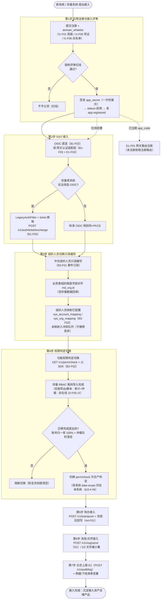
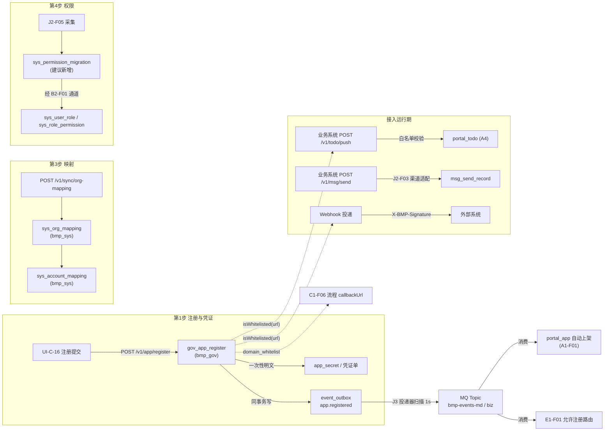
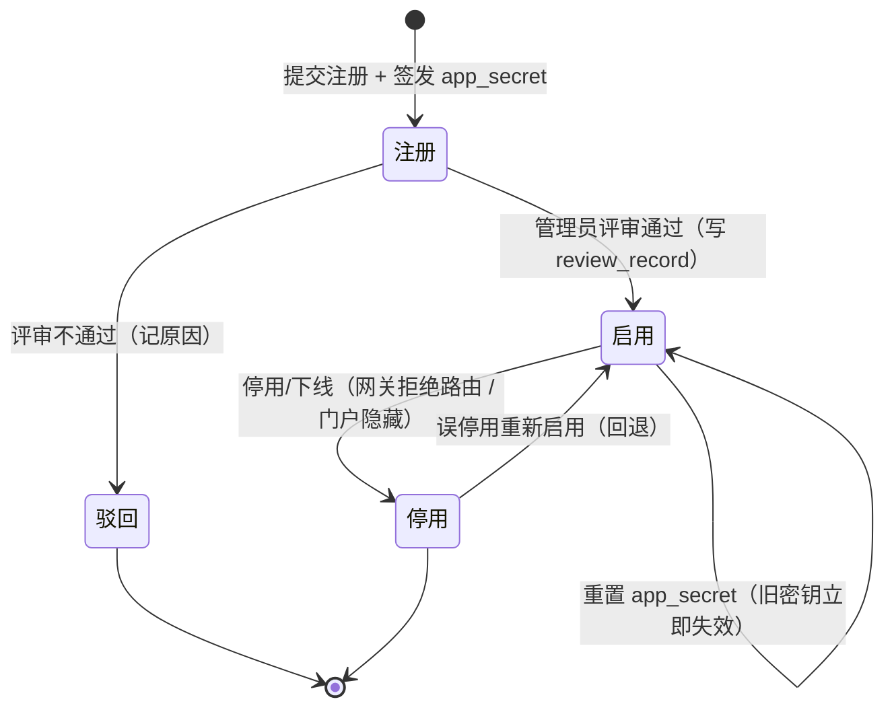
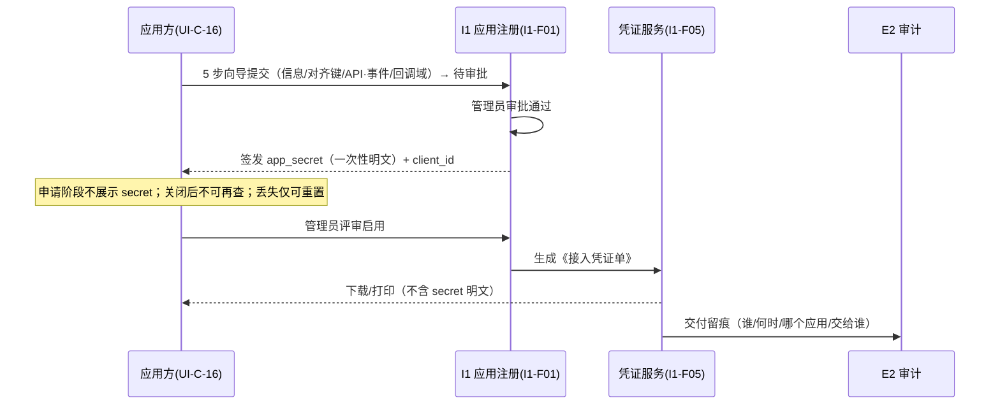

# 01-应用接入集成 · 流程专项文档

> **文档定位**：本文件是《业务流程专项文档集》第 1 份，覆盖「应用接入集成」全流程（5 功能点域 + 七步 Checklist）。
> **真源声明**：本文件为**派生文档（视图层）**，不是权威源。功能点编号、表结构、规则、版本归属**一律以《麓邦业务中台产品PRD》（下称 `PRD`）与《麓邦业务中台V1.0基座版详细设计》（下称 `详细设计`）为准**；如冲突，**以真源为准**。
> **生成日期**：2026-10-19　|　**母版**：`00-专项文档写作规格（统一模板）.md`

---

## §0 文档说明

**覆盖范围**（功能点 / 名称 / 版本）：
- 应用注册与凭证：`I1-F01`（V1.0 有简版 `gov_app_register`，完整生命周期 **V2.0**）、`I1-F05` 应用接入凭证发放与接入指引（**P0/V1.0**）、`I1-F06` 应用回调域名白名单（**P0/V1.0 最小集**）
- 接入指南与示例工程：`J1-F04`（**P0/V1.0，验收阻塞项**）
- 连接器框架：`J2-F01`（V1.5 框架规范）、`J2-F02` 权威源连接器（**P0/V1.0**）、`J2-F03` 渠道连接器（**P0/V1.0**）、`J2-F04` 存量系统适配器（V1.5）
- 事件订阅中心：`J3-F01`/`F02`/`F03`/`F04`（均 **V1.5**；V1.0 已有 Outbox 简化投递）
- 网关路由：`E1-F01`（**P0/V1.0 最小集**）；认证适配层：`B1-F03`（**P0/V1.0**，过渡态）
- **七步 Checklist 全流程**（`PRD` §4.6）

**不在范围内**（防误读）：
- 存量权限采集适配器 `J2-F05` 的**业务规则细节**（采集/归一/映射/仲裁/导入）归《03-用户权限集成》；本文件**仅在 §3.1 作为七步 Checklist 第 4 步的一环提及**。
- 工作流接入（`C1-F06` 开放接口契约）归《02-工作流配置与集成》；本文件仅提及其回调 `callbackUrl` **消费本流程的回调白名单**。
- 待办（`A4`）/消息（`D1`）/文件（`D2`）的**业务规则**归对应专项；本文件只写「接入所需的最小接口契约」。
- 系统人员组织映射 `B3-F03` 的完整口径归《03-用户权限集成》；本文件将其作为七步 Checklist 第 3 步前置提及。

**真源索引**：`PRD` §4.6 / §6.1（`I1-F01`/`F05`/`F06`）/ §6.2（`B1-F03`）/ §6.8（`J1`/`J2`/`J3`）/ §6.9（`E1-F01`）/ §5.2~§5.5 / §9.2；`详细设计` §2（工程结构）、§3.2/§3.3（表）、§4.1~§4.6quater（接口）、§5（事件）；`增量UIUX与原型交互设计.md` §1.1/§3.1/§3.2/§3.5；原型页 **`UI-C-16`**（`platform-capabilities` · **`app-register`** 等；旧 `?page=integration` 由 `console.js` 重定向）。**四域产品技术方案（视图）**：`outputs/规范/产品技术方案/应用接入四域-产品技术方案.md`（注册 / SSO / 能力调用 / 事件订阅，不含 OpenAPI 级契约）。

**术语表**（本流程特有，≤6）：

| 术语 | 定义 |
| --- | --- |
| 七步 Checklist | `PRD` §4.6 定义的新系统/存量系统接入七步流程（注册评审 → SSO → 组织只读缓存 → 权限切换 → 待办 → 消息/文件 → 日志上报/下线签署） |
| Outbox | 事件发件箱模式：业务写入与事件发布**同事务**写 `event_outbox`，投递器扫描投递（`PRD` §5.3） |
| `domain_whitelist` | 回调/跳转域名白名单（`gov_app_register` 建议新增列），`A4-F01`/`C1-F06` 共用唯一来源（`I1-F06`） |
| 《接入凭证单》 | `I1-F05` 交付物：含 `client_id`、令牌端点、鉴权方式、错误码表；**不含 `app_secret` 明文** |
| `app_secret` / `subscriber_secret` | 应用密钥 / Webhook 验签密钥（HMAC-SHA256）；均 **AES 加密存储 + 一次性明文展示** |
| SSRF | Server-Side Request Forgery；本流程以「禁 IP 直连与内网网段 + https 精确域名」防护 |

---

## §1 产品价值

### 1.1 业务痛点

| # | 现状 | 后果 |
| --- | --- | --- |
| P1 | 新系统/存量系统接入**无统一准入与评审流程**：`PRD` §4.6 第 1 步只有 7 个字 + 1 个 mermaid 节点，无输入/输出/验收物/责任方（`PRD` `I1-F05` 功能描述，关键词「七步 Checklist 第 1 步仅有 7 个字」） | 接入靠口头约定，**未评审即接入**；重复公共模块无法收敛，治理红线失守 |
| P2 | V1.0 具备签发 `app_secret` 能力，但**无面向应用方的自助/半自助申领路径**、**无书面说明**；安装向导第 ⑤ 步属实施侧一次性动作 | 实施侧可能用**微信群/邮件明文传 secret**，与「不落明文」原则冲突（`PRD` `I1-F05` 风险提示，关键词「明文传 secret」） |
| P3 | 回调/跳转地址**白名单数据源缺位**：消费方 `A4-F01`（`jumpUrl`/`callbackUrl`）与 `C1-F06`（`callbackUrl`）**均 V1.0 且已要求白名单校验**，但唯一数据源 `domain_whitelist` 原仅标「V2.0 起必填」 | **V1.0 出现 SSRF 防护空窗**：研发只能**兜底放行**（安全红线失守）或**硬编码白名单**（配置化失守）（`PRD` §9.2 / `I1-F06` 功能描述） |
| P4 | V1.0 **有「接入文档 ≤2 人日」承诺、无承载**：`C1-F06-9` 已承诺 V1.0 提供接入文档与示例工程，但 `J1-F03` 文档体系 = V1.5、`I3-F03` 开发者门户 = V2.5、UIUX 页面地图**零开发者页**（`PRD` `J1-F04`，关键词「有承诺、无承载」） | 两套存量接入试点（CRM+招聘）**无法在 ≤2 人日完成对接**，阻塞 W10–W11 里程碑 |
| P5 | 连接器与内核**未物理隔离**时，连接器故障（HR/钉钉源不可用、渠道超时）会**拖垮主链路**；事件投递无 Outbox 保障则会**丢事件** | 主数据同步中断、订阅方状态不一致；存量系统接入后「数据不更新、待办不推进」 |

### 1.2 价值主张

- **业务用户**：接入后的应用在统一工作台**自动上架**（`A1-F01` 服务 `app.registered` 事件），待办/消息**统一入口、免登进入**（`B1-F02`/`B1-F03`），不再多套账号、多个入口。
- **研发（接入方）**：拿到**《接入凭证单》**（`I1-F05`）+ **接入指南与 2 个可运行示例工程**（`J1-F04`），按七步 Checklist 自助接入，**对接 ≤2 人日**；接口契约与文档**同源抽取**不脱节。
- **运维与管理员**：应用注册**红线**（未注册不得接入网关，`E1-F01` 强校验）、凭证**受控发放/重置留痕**（`I1-F05`）、回调**白名单防 SSRF**（`I1-F06`）、连接器**独立进程故障隔离**（`J2-F01`），接入全生命周期可管、可控、可溯。

### 1.3 量化收益

| 指标（`PRD` §1.4 北极星，`:69`） | 目标值 | 本流程直接贡献 |
| --- | --- | --- |
| 新系统接入中台周期 | ≤5 人日（V2.5 起） | **直接贡献**：七步 Checklist + 接入指南（`J1-F04`）使接入方自助完成 |
| 存量重复公共模块停建/下线执行率 | 100% | **直接贡献**：第 7 步「停建/下线清单签署」（`PRD` §4.6 业务规则 3） |
| 新系统基础模块研发工作量下降 | 一期 ≥30% | 间接：注册/鉴权/待办/消息经中台复用 |
| 工作台日均使用率 | ≥70% | 间接：应用自动上架 + 待办统一入口 |
| 能力复用率 | ≥60%（V2.5 起） | 间接 |

- **定性收益（无法量化，说明原因）**：安全类收益（SSRF 拦截、secret 不落明文）**无业务指标可映射**，以「0 放行 / 0 明文」作为验收红线（见 §6.4）。

### 1.4 不做会怎样（量化风险）

| # | 风险 | 真源引用 |
| --- | --- | --- |
| R1 | **新系统立项失控**：「未完成接入评审的新系统**不予立项**（架构评审红线）」→ 不做则红线无落点 | `PRD` §4.6 业务规则 1（`:1134`，关键词「架构评审红线」） |
| R2 | **SSRF 断链**：V1.0 期间不存在「有消费、无数据源」空窗；不做 → **越权/非法域名 0 通过**无法保证，回调校验形同虚设 | `PRD` `I1-F06` 验收（`:14876`/`:14881`，关键词「0 通过」「SSRF 防护闭环」） |
| R3 | **权限清空（更严重）**：第 4 步切换而存量授权关系未迁移 → **切换后全员权限清空**，比 SSRF 断链更严重的**功能事故** | `PRD` §4.6 业务规则 5（`:1138`）/ `J2-F05` 功能描述（`:15306`） |
| R4 | **验收项不可能达成**：接入文档缺失 → 「业务系统嵌入对接 ≤2 人日」**不可能达成**，且阻塞 W10–W11 两套存量接入试点 | `PRD` `J1-F04`（`:14496`/`:14590`） |
| R5 | **主链路被拖垮 / 事件丢失**：连接器与内核不隔离 → 连接器故障拖垮主链路；无 Outbox → 事件丢失、投递成功率 <99.9% | `PRD` `J2-F01` 异常表（关键词「连接器故障拖垮主链路」）/ `J3-F01` 验收（关键词「投递成功率 ≥99.9%」） |
| R6 | **凭证明文外泄**：无受控交付路径 → 微信群/邮件明文传 secret，责任不清 | `PRD` `I1-F05` 风险提示（`:14627`）/ 异常表 4（`:14729`） |

---

## §2 用户故事（≥6 条，可验收）

> 格式：`作为 <角色>，我希望 <做什么>，以便 <获得什么价值>`；每条附**验收标准**与**关联功能点**。

### US-01（主流程 · Happy Path）
**作为接入方研发**，我希望**按接入指南与示例工程，用《接入凭证单》自助完成 SSO + 待办推送联调**，以便**在 ≤2 人日内把系统接入中台**。
- **验收标准**：对接方**仅凭文档（无中台研发陪跑）**完成一次 SSO + 待办推送联调，**实测 ≤2 人日**；2 个示例工程（CRM 合同审批 / 招聘 offer 审批）**CI 可运行**。
- **关联**：`J1-F04`、`I1-F05`、`I1-F01`
- **真源**：`PRD` `J1-F04` 验收（`:14590`，关键词「对接方仅凭文档…≤2 人日」）

### US-02（主流程 · Happy Path）
**作为应用负责人**，我希望**在 `app-register` 用 5 步向导提交注册申请，审批通过后一次性拿到 `client_secret`**，以便**快速开始接入**。
- **验收标准**：`app-register` 可完成「5 步申请 → 待审批 → **审批通过后**展示 secret（仅一次）→ 启用 → 生成《接入凭证单》」全流程；申请提交阶段**不签发** secret；`client_secret` 默认掩码，**二次进入不可见**（无接口回显明文）。
- **关联**：`I1-F01`（V1.0 简版）、`I1-F05`
- **真源**：`PRD` `I1-F05` 验收（`:14734`/`:14736`）；原型 `pages-config.js:4330`（`igRegisterWizard`）、`:4378`（`igShowSecret`）

### US-03（管理员视角）
**作为平台管理员（`gov:app:manage`）**，我希望**对应用做评审、启用/停用、重置密钥**，以便**把住接入准入红线并处置密钥泄露**。
- **验收标准**：① **未注册 `app_code` 无法注册网关路由**（`E1-F01` 拒绝，返回明确错误码）；② 停用后网关拒绝其路由 + `portal_app` 自动隐藏；③ **重置即旧密钥立即失效 + `audit_operation_log` 留痕**（`HighRiskConfirm`）。
- **关联**：`I1-F01`、`E1-F01`、`I1-F05`
- **真源**：`PRD` `I1-F01` 验收（`:12861`/`:12864`）；`E1-F01` 验收（`:8811`）；`I1-F05` 验收（`:14737`）

### US-04（管理员视角）
**作为集成/运维管理员**，我希望**维护回调域名白名单并拒收内网/IP 地址**，以便**阻断 SSRF 且让合法回调可用**。
- **验收标准**：① `domain_whitelist` 含**内网 IP 或非 https** → **提交被拒**；② 运行期非白名单 URL → **拦截 + 明确错误码**；③ `A4-F01`/`C1-F06` 调用**同一 `isWhitelisted(url)`**（不得各自实现）；④ V1.0 存量 `callbackUrl` **全量回填完成率 100%**。
- **关联**：`I1-F06`
- **真源**：`PRD` `I1-F06` 验收（`:14875`~`:14882`）；`详细设计` §4.6quater #5/#6（`:677`-`:678`）

### US-05（管理员视角）
**作为订阅方/集成管理员**，我希望**注册事件订阅（MQ/Webhook）、拿到一次性 HMAC 密钥并做投递测试**，以便**在组织人员异动时（≤10 分钟）收到事件**。
- **验收标准**：① 订阅**须已完成 I1 应用注册**（红线）；② Webhook `endpoint` **白名单 + https 校验**（防 SSRF）；③ HMAC 密钥**一次性展示**；④ 投递测试**展示 `X-BMP-Signature` 签名头示例**；⑤ 死信**可见 + 人工重放**。
- **关联**：`J3-F02`、`J3-F03`（V1.5；V1.0 由 `F1-F04` `/v1/md/subscribe` 承载）
- **真源**：`PRD` `J3-F02` 验收（`:15698`~`:15702`）；`J3-F03` 验收（`:15797`/`:15799`）

### US-06（异常/边界）
**作为接入方**，我希望**在 secret 一次性展示丢失后能通过「重置密钥」重新获取**，以便**不因失误卡死接入**。
- **验收标准**：一次性展示丢失 → **不重复展示**（UI 明确提示「务必保存」）；仅可重置重签发，**旧密钥立即失效 + 审计**；重置失败时**保持旧密钥有效**（不出现「无密钥可用」空窗）。
- **关联**：`I1-F05`
- **真源**：`PRD` `I1-F05` 异常表 1/2（`:14726`/`:14727`）、关键技术点（`:14706`）

### US-07（异常/边界）
**作为平台管理员**，我希望**当 Webhook 端点宕机时事件进入死信而非丢失，并可人工重放**，以便**订阅方恢复后不丢数据**。
- **验收标准**：失败**重试 3 次（1m/5m/30m）→ 转死信**；死信列表可见 + 人工重放；**重放使用原 `eventId`**（消费方按 `eventId` 幂等）；**慢端点不阻塞其他订阅**（并发隔离）。
- **关联**：`J3-F03`、`J3-F01`
- **真源**：`PRD` `J3-F03` 验收（`:15798`/`:15800`）、异常表 1/4（`:15791`/`:15794`）

### US-08（异常/边界）
**作为研发（接入方）**，我希望**未注册 `app_code` 的网关路由注册请求被明确拒绝**，以便**及早发现「未走准入」的错误并修正**。
- **验收标准**：用未注册 `app_code`（或 `status≠启用`）调 `POST /v1/gateway/route` **100% 被拒**；未注册路由的请求返回 **404 且无任何透传**。
- **关联**：`E1-F01`（红线）
- **真源**：`PRD` `E1-F01` 异常表 1/2（`:8804`/`:8805`）、验收（`:8811`/`:8812`）

### US-09（管理员视角 · 连接器治理）
**作为平台管理员/运维**，我希望**连接器以独立进程运行并做健康检查，故障时被隔离**，以便**连接器崩溃不影响中台主链路**。
- **验收标准**：① **新连接器开发 ≤5 人日**；② 连接器**独立进程/模块，故障隔离**（故障注入验证主链路不受影响）；③ **内核禁依赖连接器**门禁生效（CI/maven-enforcer，ADR-10）。
- **关联**：`J2-F01`（V1.5 框架；`J2-F02`/`F03` V1.0 已交付）
- **真源**：`PRD` `J2-F01` 验收（`:14981`~`:14984`）；`详细设计` §2.3（`:91`-`:98`）

---

## §3 业务流程

### 3.1 主流程（七步 Checklist 全流程）

> 依据 `PRD` §4.6（`:1120`-`:1139`）重绘，节点标注**承载功能点编号**。脚本口径：`I1`（注册评审）→ `B1`（SSO）→ `B3-B/F03`（组织只读缓存 + 映射）→ `J2-F05`（权限迁移）→ `A4`（待办）→ `D1`（消息/文件）→ `E2`（日志上报）。

**七步角色-功能点对照**（`PRD` §4.6）：

| 步 | 名称 | 承载功能点 | 版本 |
| --- | --- | --- | --- |
| 1 | 应用注册与接入评审 | `I1-F01` / `I1-F05` / `I1-F06` | V1.0 简版 + V2.0 完整 |
| 2 | SSO 接入 | `B1-F02` / `B1-F03` / `E1-F03` | V1.0 |
| 3 | 组织人员切换只读缓存（+映射） | `B3-F01` / `B3-F03` | V1.0 |
| 4 | 权限判定切换（+存量 RBAC 离线导入） | `B2-F02` / 实施导入通道 / `B2-F05` 校验 | V1.5（**非** J2-F05 在线 UI） |
| 5 | 待办接入 | `A4-F01` | V1.0 |
| 6 | 消息/文件接入 | `D1` / `D2` | V1.0 |
| 7 | 日志上报 + 停建/下线清单签署 | `E2` | V1.0 |

### 3.2 角色与职责

| 角色 | 在本流程中的动作 | 涉及界面/接口 |
| --- | --- | --- |
| 应用方（接入负责人） | 提交应用注册、更新白名单、查看 secret 一次、下载凭证单、按指南联调 | **`app-register`**（申请中/已通过 Tab）；`POST /v1/app/register` |
| 平台管理员（`gov:app:manage`） | 评审/启用/停用应用、重置密钥、维护白名单、配置订阅 | **`app-register`** + **`platform-capabilities`**；`POST /v1/app/{id}/toggle` / `secret/reset` / `whitelist` |
| 集成/运维管理员 | 平台回调策略、查看投递状态/死信、人工重放、连接器健康监控 | **`platform-capabilities`（回调域名校验）** + **`app-register-events`**；`E1-F01` 路由管理 `UI-C-15` |
| 网关管理员（`gateway:route:manage`，待确认） | 注册/启停网关路由（须 `app_code` 已启用） | `UI-C-15`；`POST /v1/gateway/route` / `{id}/toggle` |
| 主数据管理员 / 超级管理员 | 配置权威源连接器（`J2-F02`）；切换权威源（高危） | `UI-C-08` 向导；`md_sync_source` 配置 |
| `audit_viewer` 审计员 | 只读检索凭证交付/白名单变更/路由变更留痕 | E2 `audit_operation_log` |
| 订阅方 / 存量系统后端 | 注册事件订阅、验签消费、以 ticket 换标准令牌 | `event_subscriber`；`POST /v1/md/subscribe`、`/v1/auth/ticket/exchange` |
| 连接器（J2 独立进程） | 拉取权威源数据、渠道协议适配、异构接口归一 | `bmp-connectors/`、`bmp-project-lubon/` |

### 3.3 分步说明

**步骤 1 · 应用注册与接入评审**
- **触发条件**：新系统/存量系统提出接入需求。
- **执行动作**：**`app-register` · Tab「申请中」** → **5 步向导**（应用信息 → 钉钉对齐键 → 勾选 API/事件 → 回调域名 → 提交）→ **待审批**（此步不签发 secret）→ 管理员审批通过 → **已通过 Tab** 一次性 `app_secret` + 《接入凭证单》→ 启用 → 交付留痕。
- **关键规则**：**BR-1 未完成接入评审的新系统不予立项（架构评审红线）**（`PRD` §4.6 规则 1）；**BR-2 `app_code` 唯一、注册后不可改**（`I1-F01` 输入校验）；**BR-3 回调地址须命中 `domain_whitelist` 且为 https**（`I1-F05`/`I1-F06`）。
- **异常分支**：`app_code` 重复 → **8001 唯一冲突**；回调含内网 IP/非 https → **8002 拦截**；评审驳回 → 记 `review_record` 不通过原因。

**步骤 2 · SSO 接入**
- **触发条件**：应用已启用。
- **执行动作**：标准系统走 OIDC 授权码+PKCE（`B1-F02`）；存量老系统经网关反向代理 → `LegacyAuthFilter`（`E1-F03`）→ 签发一次性 ticket（5min）→ 老系统后端调 `POST /v1/auth/ticket/exchange` 换标准 JWT（`B1-F03`）。
- **关键规则**：**ticket one-time + TTL 5min**；`local_username` 经 `B3-F03` 映射为 `account_id`，**映射缺失则拒绝（不得静默放行）**。
- **异常分支**：ticket 已消费/超时 → `invalid_ticket`；老系统校验接口不可用 → **按「不可信」处理，拒绝放行**（不降级为放行）。

**步骤 3 · 组织人员切换只读缓存（+ 可选对照）**
- **触发条件**：SSO 打通。
- **执行动作**：订阅 `md.*` 事件（`B3-F01`）建立**只读缓存**。**默认路径（§10.4 #13）**：应用侧持久化 **`dingtalk_userid` / `dingtalk_dept_id`（或与钉钉绑定的 `md_org_id`）**，中台 outbound API/事件与 inbound（待办/消息/日志等）**同一套标识**——**不要求**全量 `sys_org_mapping`。**改造期**：仍持非钉钉本地部门编码 / legacy 登录名时，由**实施/连接器**离线导入 `sys_org_mapping` / 必要时 `sys_account_mapping`（**`B3-F03`**；**V1.5 无控制台独立页**）。
- **关键规则**：**BR-4 第 3 步验收物**按注册 **`integrationTier`** 分档——**标准档**验收「对齐键 + 只读缓存 + 事件订阅」；过渡/Legacy 档另验收对照完成度或兜底方案；对照未命中**入冲突队列（不静默丢弃）**（`PRD` §4.6 第 3 步、#12/#13）。
- **异常分支**：改造期账号/组织未映射 → 冲突队列（`sync_status ∈ {0,2,3}`）；缓存未就绪 → 保持上次一致状态。

**步骤 4 · 权限判定切换（+ 存量 RBAC 离线导入）**
- **触发条件**：第 3 步验收通过。
- **执行动作**：功能权限判定切 `GET /v1/perm/check` + J1 SDK；存量「谁→有什么权限」由 **实施阶段经审批的数据库导出 / 受控脚本** 导入 `sys_user_role` / `sys_role_permission`（保留归一、映射、人工仲裁与 E2 审计；**V1.5 不提供 J2-F05 在线采集 UI**，见 PRD §10.4 #4）。各业务系统 **data-scope 仍在本系统维护**（§10.4 #6）。
- **关键规则**：**BR-5 第 4 步验收物**须含「**perm/check 切换完成**」与「**存量功能授权关系已导入中台 RBAC**」；**达标口径 = 账号归一率 100% + 仲裁队列清空**；**BR-6 该步为接入规范层面前置要求**（`PRD` §4.6 规则 5/6）。
- **异常分支**：未迁移即切换 → **阻断切换或强提示**（防「全员权限清空」）；权限项无对应 → 入仲裁队列（不静默丢弃）。

**步骤 5 · 待办接入**
- **触发条件**：权限判定已切换。
- **执行动作**：存量/业务系统推送待办 `POST /v1/todo/push`（幂等键 `todo_key`）；完成后原系统回调或调 `POST /v1/todo/{todoId}/complete`。
- **关键规则**：`assignees` 支持工号/账号/角色编码三种；**重复推送同 `todo_key` 幂等覆盖**；`jumpUrl`/`callbackUrl` 须过白名单（`I1-F06`）。
- **异常分支**：`jumpUrl`/`callbackUrl` 非白名单/内网 → **拦截（防 SSRF）**；重复推送 → 幂等覆盖。

**步骤 6 · 消息/文件接入**
- **触发条件**：待办通路可用。
- **执行动作**：调 `POST /v1/msg/send` 发消息（`D1`）；文件经 `D2` 上传下载最小集（`POST /file/upload`）。
- **关键规则**：消息渠道经 `J2-F03` 渠道连接器适配（钉钉/企微/短信/邮件）；**文件不得直连对象存储**，下载 URL 有效期默认 30 分钟。
- **异常分支**：渠道不可用 → 回执写 `send_status`，重试；文件越权访问 → `B2` 校验拒绝。

**步骤 7 · 日志上报 + 停建/下线清单签署**
- **触发条件**：前 6 步完成。
- **执行动作**：接入系统经 SDK `@AuditLog` 或 `POST /v1/audit/log` 上报关键操作（`E2`）；签署**停建/下线清单**。
- **关键规则**：**BR-3' 接入完成后原系统重复公共模块进入停建/下线清单管理**（`PRD` §4.6 规则 3）；审计失败**不阻断业务**。
- **异常分支**：审计上报失败 → 本地队列兜底，不阻断；未签下线清单 → 接入未闭环。

### 3.4 异常与边界（≥4 条）

| # | 场景 | 系统行为 | 用户可见结果 | 是否阻断 |
| --- | --- | --- | --- | --- |
| E1 | **未注册应用接入网关**（越权） | `E1-F01` 校验 `gov_app_register.status`，拒绝注册路由 | 提示「应用未注册/未启用，不得接入网关」+ 明确错误码 | **是（拒入，100% 拦截）** |
| E2 | **白名单含内网 IP / 非 https** | 提交时格式校验拒绝；已存在的运行期 `isWhitelisted` 拦截 | 提交被拒 + 提示原因；运行期拦截 + 审计 | 否（拒该项） |
| E3 | **密钥一次性展示丢失** | 不重复展示 | 提示「务必保存」；仅可走「重置密钥」（旧密钥失效 + 审计） | 否（需人工） |
| E4 | **权限项无对应 / 账号未归一** | 入人工仲裁队列（`mapping_status=2/3`） | 仲裁队列可见 + 每条给建议动作与依据 | 否（需人工，拦截第 4 步切换） |
| E5 | **Webhook 端点宕机/超时** | 重试 3 次（1m/5m/30m）→ 转死信；并发隔离慢端点 | 死信列表可见 + 人工重放（原 `eventId`） | 否（不丢事件） |
| E6 | **连接器崩溃** | 框架**隔离该连接器**，主链路继续（降级用缓存） | 主数据/消息主链路不中断 | 否（隔离） |
| E7 | **内核依赖连接器（越界）** | `maven-enforcer` CI 门禁拦截（ADR-10） | 构建失败 | **是（构建失败）** |
| E8 | **权威源不可用** | 重试 + 告警；**主数据保持上次一致状态（不误删）** | 同步告警；不误删数据 | 否（降级保留） |
| E9 | **停用后仍请求** | 网关 401/403 拒绝；`A1-F08` 渲染降级卡 | 「该应用已停用」 | 否 |
| E10 | **路由热加载失败（Nacos 不可用）** | 保留上一版本路由表（不空表）+ 告警 + 重试 | 已生效流量不中断 | 否 |

### 3.5 版本归属

| 步骤 / 能力 | 功能点 | 版本 | 说明 |
| --- | --- | --- | --- |
| 应用注册与生命周期（简版） | `I1-F01` | **V1.0**（简版 `gov_app_register`） | 完整生命周期 = **V2.0** |
| 应用接入凭证发放与接入指引 | `I1-F05` | **P0/V1.0** | 含 `subscriber_secret`（G-5） |
| 应用回调域名白名单 | `I1-F06` | **P0/V1.0（最小集）** | `domain_whitelist` 须 Flyway 增列 |
| 接入指南与示例工程 | `J1-F04` | **P0/V1.0**（验收阻塞项） | 与 `J1-F03`（V1.5）/`I3-F03`（V2.5）区分 |
| 连接器框架 | `J2-F01` | **V1.5** | 框架/规范 |
| 权威源连接器 | `J2-F02` | **P0/V1.0** | |
| 渠道连接器 | `J2-F03` | **P0/V1.0** | 短信通道 V1.0 实接 |
| 存量系统适配器 | `J2-F04` | **V1.5** | 过渡资产，纳入下线计划 |
| 存量 RBAC 受控导入（离线） | 实施导入 + `B2-F01` | **P0/V1.5** | 第 4 步必做；**非**在线 Tab |
| 存量权限在线采集适配器 | `J2-F05` | **V2.0 备选** | V1.5 **不交付**在线 UI；详见《03-用户权限集成》 |
| 事件总线/订阅注册/Webhook 出口/重试幂等 | `J3-F01`~`F04` | **V1.5** | V1.0 已有 Outbox 简化投递（`bmp-server-event`） |
| 网关路由管理 | `E1-F01` | **P0/V1.0（最小集）** | 未注册不得接入网关（红线） |
| 认证适配层 | `B1-F03` | **P0/V1.0** | 过渡态，纳入下线计划 |
| 数据权限 | `B2-F03` | **V1.5** | 第 4 步「顺手对齐」为 V1.5 铺路，版本不变 |

> **版本注意**：`I1-F01` 完整版 = V2.0，但 **V1.0 有简版 `gov_app_register`**；`J2-F05` = **V1.5**。版本口径严格照抄 `PRD`（`I1-F01` `:12775`、`J2-F05` `:15296`）。

---

## §4 数据流

### 4.1 数据流图

**关键流向说明**：`gov_app_register`（`bmp_gov`）是**接入准入的单一事实源**——`app_code` 一经启用，即联动 `portal_app`（上架）、E1 路由（放行）、`domain_whitelist`（回调白名单，供 `A4-F01`/`C1-F06` 共用）。事件经 **Outbox** 落各域 `event_outbox`，由 `bmp-server-event` 投递器统一投递。

### 4.2 数据实体清单

| 实体 / 表名 | 所属库 | 用途 | 读 / 写 | 关联功能点 |
| --- | --- | --- | --- | --- |
| `gov_app_register` | `bmp_gov` | 应用注册（`app_code UK`/`app_secret AES`/`status`/`review_record`/`domain_whitelist` 建议新增） | R/W | `I1-F01`/`I1-F05`/`I1-F06` |
| `portal_app` | `bmp_portal` | 应用中心（注册→自动上架） | W | `A1-F01`（消费 `app.registered`） |
| `portal_app_scope` | `bmp_portal` | 应用可见范围 | W | `A1-F01` |
| `event_outbox` | `bmp_md`/`bmp_portal`/`bmp_msg` | 事件发件箱（Outbox 投递） | R/W | `J3-F01` |
| `wf_event_outbox` | `bmp_wf` | 流程事件发件箱（复用同一投递器） | W | `J3-F01` |
| `event_subscriber` | `bmp_md`（详情设计归属待确认） | 订阅注册（`subscriber_code UK`/`event_types`/`push_type`/`endpoint`/`subscriber_secret` 建议新增） | R/W | `J3-F02`、`I1-F05`（G-5） |
| `sys_org_mapping` | `bmp_sys` | 组织级映射（**建议新增，待实施确认**） | R/W | `B3-F03`（第 3 步） |
| `sys_account_mapping` | `bmp_sys` | 账号级映射 | R/W | `B3-F03`（第 3 步） |
| `sys_permission_migration` | `bmp_sys` | 存量授权关系迁移（**建议新增，待实施确认**） | R/W | `J2-F05`（第 4 步，详见《03》） |
| `md_org` / `md_employee` | `bmp_md` | 组织人员主数据（唯一源） | W（连接器） | `J2-F02`/`F1`（第 3 步数据源） |
| `md_sync_source` | `bmp_md` | 权威源配置（`source_type`/`field_mapping`） | R/W | `J2-F02` |
| `msg_send_record` | `bmp_msg` | 消息发送记录（回执 `send_status`） | W | `D1`、`J2-F03` |
| `audit_operation_log` | `bmp_audit` | 凭证交付/重置、白名单变更、路由变更留痕 | W | `I1-F05`/`I1-F06`/`E1-F01` |
| `sys_session` / `audit_login_log` | `bmp_sys` / `bmp_audit` | 会话/登录审计（适配票据 `login_type`） | W | `B1-F03` |

### 4.3 接口清单

> 除 `POST /v1/app/register`（`PRD` 标「建议」）外，`详细设计` §4.6quater 其余接口**均为本轮新增建议，待实施确认**。

| 接口 | 方法 | 用途 | 调用方 | 详细设计章节 |
| --- | --- | --- | --- | --- |
| `POST /v1/app/register` | POST | 注册应用 → 生成 `client_id` + 签发 `app_secret`（AES 加密，响应体一次性返回） | 应用方/管理员 | §4.6quater #1（`:673`） |
| `POST /v1/app/{id}/toggle` | POST | 应用启停（`status`：注册/启用/停用），写审计 | 管理员 | §4.6quater #2（`:674`） |
| `GET /v1/app/{id}/credential-sheet` | GET | 生成/下载《接入凭证单》（**不含 secret 明文**） | 管理员/应用方 | §4.6quater #3（`:675`） |
| `POST /v1/app/{id}/secret/reset` | POST | 重置 `app_secret`（旧密钥立即失效；`highRisk`；双密钥并行过渡窗口） | 超管 | §4.6quater #4（`:676`） |
| `POST /v1/app/{id}/whitelist` | POST | 维护 `domain_whitelist`（增/改/删；https + 精确域名/受控前缀；禁 IP/内网） | 管理员 | §4.6quater #5（`:677`） |
| `POST /v1/app/whitelist/check` | POST | **统一白名单校验** `isWhitelisted(url)`（`A4-F01`/`C1-F06` 共用） | 服务端消费方 | §4.6quater #6（`:678`） |
| `POST /v1/gateway/route` | POST | 路由注册（红线校验 `app_code` 已启用） | 网关管理员 | §4.8（`:736`） |
| `GET /v1/gateway/routes` / `POST /v1/gateway/route/{id}/toggle` | GET/POST | 路由查询与启停 | 网关管理员 | §4.8（`:737`） |
| `GET /oauth2/authorize` / `POST /oauth2/token` / `GET /oauth2/userinfo` | GET/POST | OIDC 标准端点（授权码+PKCE / 令牌换取） | 接入系统 | §4.2（`:476`-`:478`） |
| `POST /v1/auth/ticket/exchange` | POST | 老系统适配：一次性 ticket 换标准令牌 | 存量系统后端 | §4.2（`:481`） |
| `POST /v1/md/subscribe` | POST | 注册 `event_subscriber`（V1.0 承载订阅注册 + `subscriber_secret` 签发） | 订阅方 | §4.4（`:508`） |
| `GET /v1/md/org/tree` | GET | 组织树（映射选择数据源） | 管理端 | §4.4（`:502`） |
| `GET /v1/sync/org-mapping` / `POST /v1/sync/org-mapping` | GET/POST | 组织映射查询/登记（**建议新增**） | 管理端 | §4.4bis（`:523`-`:524`） |
| `POST /v1/todo/push` | POST | 待办推送（幂等键 `todo_key`，第 5 步核心契约） | 业务系统 | §4.5（`:545`） |
| `POST /v1/todo/{todoId}/complete` | POST | 待办完成回写 | 业务系统 | §4.5（`:565`） |
| `POST /v1/msg/send` | POST | 消息发送（第 6 步） | 业务系统 | §4.6（`:569`） |
| `POST /v1/audit/log` | POST | 审计上报（批量 ≤100 条，第 7 步） | 全部系统 | §4.7（`:708`） |
| `GET /v1/perm/check` | GET | 功能权限校验（`@PermCheck`） | 业务系统 | §4.3（`:488`） |
| `POST /v1/perm/data-scope` | POST | 数据权限范围（V1.5，第 4 步） | 业务系统 | §4.3（`:491`） |
| `POST /file/upload` / `GET /file/{id}/url` | POST/GET | 文件上传下载（D2 最小集，第 6 步） | 业务系统 | `PRD` §4.8（`:1168`-`:1187`） |
| `POST /v1/portal/behavior` | POST | 行为埋点上报（应用使用统计，v1.1） | 前端 | §4.9（`:759`） |

### 4.4 关键字段与约束

| 表.字段 | 关键约束 | 说明 |
| --- | --- | --- |
| `gov_app_register.app_code` | **UK**；`[a-z0-9-]{2,32}`；**注册后不可改** | 唯一准入标识 |
| `gov_app_register.app_secret` | **AES 加密存储**；一次性明文展示、不回显、不落日志 | 密钥安全红线 |
| `gov_app_register.status` | 枚举（注册/启用/停用）；**仅「启用」允许网关路由注册** | 红线联动 `E1-F01` |
| `gov_app_register.domain_whitelist` | JSON 数组；每项 **https + 精确域名/受控前缀**；**禁 IP 直连与内网网段**；**建议新增，待实施确认** | `I1-F06` |
| `gov_app_register.review_record` | JSON；接入评审结论（架构评审红线） | `PRD` §4.6 第 1 步 |
| `event_subscriber.subscriber_code` | **UK**；重复注册幂等覆盖 | `J3-F02` |
| `event_subscriber.endpoint` | **须命中 `domain_whitelist` + https** | 防 SSRF |
| `event_subscriber.subscriber_secret` | **AES 加密**；一次性展示；重置即失效；**建议新增，待实施确认** | G-5 |
| `event_outbox.event_id` | **UK，UUID 幂等键** | 至少一次投递的幂等锚点 |
| `event_outbox.published` | TINYINT；0 未发布 / 1 已发布 / **2 死信** | 投递状态机 |
| `sys_org_mapping` UK `uk_org` | `(system_code, source_org_code)`；**`target_org_id` 允许 NULL**（禁加 `NOT NULL`） | 未映射行不受幂等误判 |
| `sys_permission_migration` UK `uk_idem` | `(system_code, account_id, target_type, target_code)`；**`account_id`/`target_code` 允许 NULL** | 详见《03》 |

> **枚举值**：`mapping_type`（1 精确 / 2 前缀 / 3 默认归属）；`mapping_status`（0 待映射/1 已映射/2 未归一/3 无对应/4 冲突待仲裁/5 已导入/6 失败/**7 已驳回**，共八态）；`push_type`（`mq`/`webhook`）；`grant_types`（`client_credentials`/`authorization_code`）。

### 4.5 数据生命周期

1. **产生（第 1 步）**：应用注册提交 → 校验（唯一性 + 白名单格式）→ 写 `gov_app_register`（`status=注册`）→ **同事务**写 `event_outbox`（`app.registered`）→ 签发 `app_secret`（AES 密文落库 + 一次性明文返回）。
2. **流转（准入联动）**：投递器每 1s 扫描 `published=0` → 按 `event_subscriber` 路由投递 MQ/Webhook → 消费方 `portal_app`（自动上架）、E1 路由表、`portal_search_index`。
3. **运行期消费**：`domain_whitelist` 经缓存（**60s TTL + 主动失效通知**）供 `isWhitelisted(url)` 高频判定；订阅方按 `event_id` 幂等消费。
4. **归档 / 失效**：应用停用/下线 → `status=停用` → 网关拒绝路由、门户隐藏（事件 `app.disabled`）；密钥重置 → **旧密钥立即失效**；事件投递超限 → `published=2` 死信 → **人工重放（原 `eventId`）**。
5. **幂等键汇总**：应用注册 `app_code`（UK）；事件 `event_id`（UK）；待办 `todo_key`；订阅 `subscriber_code`（UK）；组织映射 `uk_org`；权限迁移 `uk_idem`（详见《03》）。

---

## §5 技术逻辑方案

### 5.1 架构落点

依据 `详细设计` §2.1（`:46`-`:80`）三层代码库：

| 层 | 仓库 / 模块 | 本流程承载 |
| --- | --- | --- |
| 产品内核 | `bmp-platform/bmp-server-auth` | `I1-F01`/`I1-F05`/`I1-F06`（`bmp_gov` 代管应用注册）、`B1-F03` 票据换取 |
| 产品内核 | `bmp-platform/bmp-server-event`（J3 简化版投递器） | Outbox 统一投递（无独立库，读各域 `*_outbox`） |
| 产品内核 | `bmp-platform/bmp-server-gateway`（含 `LegacyAuthFilter`） | `E1-F01` 路由、`E1-F03` 认证适配执行点 |
| 产品内核 | `bmp-platform/bmp-server-mdm` / `bmp-server-msg` / `bmp-server-portal` | `F1` 主数据、`D1` 消息、`A4` 待办（第 3/5/6 步消费方） |
| 产品配置资产 | `bmp-connectors/`（**独立仓库**） | `connector-dingtalk`/`connector-wecom`/`connector-hr-generic`/`connector-sms`/`connector-email`（`J2-F02`/`F03`） |
| 项目定制 | `bmp-project-lubon/`（**独立仓库**） | `lubon-legacy-adapter`（`J2-F04`）、`connector-perm-collect/`（`J2-F05`，建议新增）、`lubon-migration/` |
| 前端 | `bmp-platform/bmp-ui` | `UI-C-16` 集成与网关页面 |

**服务与库**：`bmp_gov`（治理，`gov_app_register`）；`bmp_sys`（`sys_account_mapping`/`sys_org_mapping`/`sys_permission_migration`）；`bmp_md`/`bmp_portal`/`bmp_msg`（各域 `event_outbox`）；`bmp_audit`（留痕）。**部署形态**：默认 all-in-one 单体（`bmp-boot`），按需拆分（`详细设计` §2.2 `:82`-`:89`）。

### 5.2 关键机制（每条写「机制 → 解决什么问题 → 不这么做会怎样」）

**M1 · `app_secret` 一次性展示 + AES 加密存储**
- **机制**：`app_secret` 创建时**仅一次性明文返回**（同重置密码规则），落库经 `bmp-starter-mybatis` 的 **TypeHandler 统一 AES 加密**；数据库存密文、接口不回显、日志不落明文。
- **解决问题**：杜绝密钥在「存储/传输/日志」三处的明文暴露。
- **不这么做会怎样**：实施侧将用微信/邮件明文传 secret（`PRD` `I1-F05` `:14627`），与「不落明文」原则冲突，责任不清、易泄漏。

**M2 · 回调白名单防 SSRF（拒 IP 直连与内网网段）**
- **机制**：管理员在 `UI-C-16` **回调域名白名单 Tab** 登记 `domain_whitelist`（https + 精确域名/受控前缀）；服务端提供**统一 `isWhitelisted(url)`**（本地缓存 60s TTL + 主动失效）供 `A4-F01`（`jumpUrl`/`callbackUrl`）与 `C1-F06`（`callbackUrl`）**共用**；**匹配失败 fail-closed（拒绝）**，缓存不可用则回源查询。
- **解决问题**：阻断服务端请求伪造（SSRF）；保证「有消费、有数据源」不出现空窗。
- **不这么做会怎样**：V1.0 研发只能**兜底放行**（安全红线失守）或**硬编码白名单**（配置化失守，违反「`A1-F08` 只消费不自定义」）；V2.0 增列后 V1.0 期间隐式放行的存量回调地址会**集体失效**（`PRD` `I1-F06` `:14771`）。

**M3 · 事件幂等（`event_id`）+ Outbox 至少一次投递**
- **机制**：业务写入与事件发布**同事务**写 `event_outbox`（`published=0`）；投递器每 1s 扫描、按 `event_id` 幂等投递 MQ；**至少一次**语义，消费方按 `event_id` 幂等；失败重试 3 次（1m/5m/30m）→ 超限 `published=2` 死信 + 人工重放。
- **解决问题**：保证「业务提交即事件必投、业务回滚即事件不投」的原子性，且不丢事件。
- **不这么做会怎样**：事件丢失（投递器崩溃即丢）→ 门户不上架、订阅方状态不一致；且出现「业务成功但事件未发」的不一致（`PRD` `J3-F01` `:15591`）。

**M4 · 连接器独立进程/独立仓库 + 内核禁依赖（故障隔离）**
- **机制**：连接器落 `bmp-connectors/`（独立仓库、可独立进程）；**`bmp-platform` 各 pom 禁止出现 `bmp-project-*`/`connector-*` 依赖**，CI 用 `maven-enforcer` 检查依赖树（ADR-10）；框架定期健康检查 + 异常隔离。
- **解决问题**：连接器故障（源不可用、渠道超时）**不拖垮中台主链路**。
- **不这么做会怎样**：连接器崩溃导致主数据/消息主链路中断（`PRD` `J2-F01` `:14975`）；内核与定制/连接器耦合，无法独立发布与隔离（CI 门禁构建失败 `:14976`）。

### 5.3 时序 / 状态机

**应用状态机**（`gov_app_register.status`，`I1-F01`）：

**投递状态**（`event_outbox.published`）：`0 未发布` → `1 已发布`；失败经 3 次重试后 `2 死信`（人工重放，使用原 `eventId`）。

**注册→凭证领取时序**：

### 5.4 性能与容量

| 指标 | 目标值 | 来源 |
| --- | --- | --- |
| 注册/启用接口 | P95 <300ms | `PRD` `I1-F01`（`:12844`） |
| 白名单判定 | P95 <10ms（本地缓存） | `PRD` `I1-F06`（`:14846`） |
| 路由匹配 | P95 <5ms（网关附加延迟总 P95 <50ms） | `PRD` `E1-F01`（`:8794`） |
| 路由热加载生效 | ≤30s | `PRD` `E1-F01`（`:8794`） |
| 事件投递延迟 | P95 <5s（扫描间隔 1s） | `PRD` `J3-F01`（`:15580`） |
| 事件投递成功率 | ≥99.9% | `PRD` `J3-F01`（`:15580`） |
| 异动同步 | ≤10 分钟 | `PRD` `J2-F02`（`:15062`） |
| 新连接器开发 | ≤5 人日 | `PRD` `J2-F01`（`:14981`） |
| 接入联调 | ≤2 人日 | `PRD` `J1-F04`（`:14590`） |
| Webhook 投递超时 | ≤10s | `PRD` `J3-F03`（`:15780`） |
| 凭证单生成 | <1s（PDF 渲染除外） | `PRD` `I1-F05`（`:14704`） |

### 5.5 安全与合规

| 项 | 措施 | 来源 |
| --- | --- | --- |
| 鉴权 | 一律经 E1 网关；`Authorization: Bearer`；服务间 `client_credentials` | `详细设计` §4.1（`:466`） |
| 密钥存储 | `app_secret`/`subscriber_secret` **AES 加密**、一次性展示、不回显、不落日志 | `PRD` `I1-F05`（`:14703`/`:14707`） |
| 高危操作 | 重置密钥/导入授权/路由 `auth_policy=none` 须 `HighRiskConfirm` + **审计留痕** | `PRD` `I1-F05`（`:14694`）/`E1-F01`（`:8743`） |
| SSRF 防护 | `domain_whitelist`：**禁 IP 直连与内网网段**、仅 https 精确域名/受控前缀；fail-closed | `PRD` `I1-F06`（`:14849`） |
| 幂等 | 写操作必带业务幂等键；网关层幂等过滤器兜底 | `详细设计` §4.1（`:467`） |
| 审计留痕 | 凭证交付/重置、白名单变更、路由增改启停 **100% 写 E2**（≥6 个月） | `PRD` `E1-F01`（`:8815`）/§5.4 |
| 模块隔离 | 表前缀隔离；跨域只经 API/事件，**禁止跨库 JOIN** | `详细设计` §2.3（`:98`） |

### 5.6 已知限制与技术债（如实写）

| # | 限制 / 技术债 | 标注 | 来源 |
| --- | --- | --- | --- |
| 1 | `gov_app_register.domain_whitelist` 列 —— **建议新增，待实施确认**（现表无此列，须 Flyway 增列） | **建议新增，待实施确认** | `详细设计` `:286`/`:288` |
| 2 | `event_subscriber.subscriber_secret` 列 —— **建议新增，待实施确认**（现字段清单无此列） | **建议新增，待实施确认** | `详细设计` `:337`/`:340` |
| 3 | `sys_org_mapping` —— **建议新增，待实施确认** | **建议新增，待实施确认** | `详细设计` §3.2（`:171`） |
| 4 | `sys_permission_migration` —— **建议新增，待实施确认**（表名/字段/UK 待架构师定稿） | **建议新增，待实施确认** | `详细设计` `:290` |
| 5 | `connector-perm-collect/`（`J2-F05` 连接器）—— **建议新增**（待实施确认） | **建议新增，待实施确认** | `详细设计` `:78` |
| 6 | `POST /v1/app/register` 等 §4.6quater 接口**除 #1 外均为建议**，待实施确认 | **建议新增，待实施确认** | `详细设计` `:669` |
| 7 | `J2-F01` 连接器注册表真实落表未定义（建议 `gov_connector`，待确认） | 待确认 | `PRD` `J2-F01` `:14990` |
| 8 | 网关段错误码区段未定义（建议入 1xxx 或新增 `8xxx`） | 待确认 | `PRD` `E1-F01` `:8823` |
| 9 | MQ 选型 RocketMQ vs RabbitMQ **待技术评审** | 待确认 | `PRD` `J3-F01` `:15607` |
| 10 | `J2-F02` 权威源选型为**最高优先前置**（未拍板则无法确定默认源，W3 前须确认） | 待确认 | `PRD` `J2-F02` `:15089` |
| 11 | `app_secret` 有效期/轮换周期（G-9）：建议**永久有效 + 180 天轮换提醒**，不强制失效 | 待确认 | `PRD` `I1-F05` `:14749` |
| 12 | 双密钥并行过渡窗口默认时长（建议 7 天，可配） | 待确认 | `PRD` `I1-F05` `:14752` |
| 13 | V1.0 联调**无独立沙箱**，以 **test 环境代偿**（真沙箱留 V2.5，G-8） | 已知限制 | `PRD` `J1-F04` `:14606` |
| 14 | 两类白名单**语义分离**（`UI-C-16` 回调白名单 vs **I1 登记的嵌入 host**）；**`portal-apps`/`portal-components` 无白名单 Tab**（2026-10-21） | 已知限制 | `PRD` `I1-F06` |
| 15 | `I1-F01` 简版（V1.0）→ 完整版（V2.0）迁移策略：建议 V2.0 增列 + 存量置默认白名单（空=禁止嵌入） | 待确认 | `PRD` `I1-F01` `:12875` |
| 16 | `J2-F04`/`J2-F05` 适配器属**过渡资产**，登记下线清单，随系统改造转标准后下线 | 已知限制 | `PRD` `J2-F04` `:15257` |
| 17 | `event_subscriber` 的**库归属未在真源明确**（`详细设计` §3.3「其余表概览」未给库列；本文件保守标注 `bmp_md`，**待实施确认**） | **未找到，待确认** | `详细设计` §3.3（`:337`） |

---

## §6 验收与度量

### 6.1 功能验收清单（≥10 条，带 P0/P1/P2）

| # | 验收项 | 判据 | 优先级 | 关联功能点 |
| --- | --- | --- | --- | --- |
| 1 | 注册准入红线 | 未注册/未启用 `app_code` 调 `POST /v1/gateway/route` **100% 被拒**；未注册路由请求返回 **404 无透传** | **P0** | `E1-F01` |
| 2 | 密钥一次性展示 | `app_secret` 仅创建时一次性明文；二次进入不可见（无接口回显明文，DB 抽查为 AES 密文） | **P0** | `I1-F01`/`I1-F05` |
| 3 | 回调 SSRF 防护 | `domain_whitelist` 含内网 IP/非 https → **提交被拒**；运行期非白名单 URL → **拦截 + 明确错误码**，越权/非法域名 **0 通过** | **P0** | `I1-F06` |
| 4 | 白名单单一口径 | `A4-F01`/`C1-F06` 调用**同一 `isWhitelisted(url)`**（走查，不得各自实现）；**门户页不得重复建回调/嵌入白名单 Tab** | **P0** | `I1-F06` |
| 5 | 存量回填 | V1.0 存量应用 `callbackUrl` **全量回填完成率 100%**（含报告） | **P0** | `I1-F06` |
| 6 | 凭证单完整 | 《接入凭证单》含**令牌端点 + 鉴权方式 + 错误码表**；可导出/下载/打印；**不含 secret 明文** | **P0** | `I1-F05` |
| 7 | 重置即失效 + 留痕 | 重置 secret → **旧密钥立即失效** + `audit_operation_log` 留痕；重置失败保持旧密钥有效（无空窗） | **P0** | `I1-F05` |
| 8 | 交付留痕可查 | 任取一次交付动作 → 可查「谁在何时把哪个应用的凭证交付给谁」 | **P1** | `I1-F05` |
| 9 | 接入文档自助联调 | 对接方**仅凭文档**完成 SSO + 待办推送联调，**实测 ≤2 人日**；**2 个示例工程 CI 可运行** | **P0** | `J1-F04` |
| 10 | 文档同源 + 不引入门户 | 文档接口签名与 J1 SDK/详细设计 §4 一致（CI 同源抽取）；**无独立开发者门户页**；接入文档 **`app-register-guide`（无侧栏，自 `app-register` 内链）** | **P1** | `J1-F04` |
| 11 | 事件投递可靠性 | 投递成功率 **≥99.9%**；Outbox 原子性（业务回滚则事件不投）；同 `eventId` 投 3 次消费**仅生效 1 次** | **P0** | `J3-F01`/`J3-F04` |
| 12 | Webhook 签名 + 死信 | 请求带 `X-BMP-Signature`（HMAC-SHA256）可验签；失败重试 3 次后**转死信**；死信**可见 + 人工重放（原 `eventId`）** | **P0** | `J3-F02`/`J3-F03` |
| 13 | 订阅红线 + 密钥 | 订阅须已完成 I1 注册；`endpoint` 白名单 + https 校验；HMAC 密钥一次性展示；投递测试展示签名头示例 | **P1** | `J3-F02` |
| 14 | 连接器隔离 + 门禁 | 新连接器 **≤5 人日**；独立进程**故障隔离**（故障注入）；**内核禁依赖连接器** CI 门禁生效 | **P0** | `J2-F01` |
| 15 | 权威源可配 + 不误删 | 切换权威源**仅改 `md_sync_source` 配置**；**异动同步 ≤10 分钟**；源不可用时**主数据不误删** | **P0** | `J2-F02` |
| 16 | 应用自动上架 | 新应用注册后 **10 分钟内**出现在工作台（`portal_app` 联动） | **P1** | `I1-F01`/`A1-F01` |
| 17 | 接入不改业务逻辑 | 存量系统接入**不改动业务逻辑**；适配器**登记进下线清单**并有下线计划 | **P1** | `J2-F04` |
| 18 | 步骤 4 防权限清空 | 模拟「授权关系未迁移即切换第 4 步」→ 系统**阻断切换或强提示**（不出现全员权限清空） | **P0** | `J2-F05`（详见《03》） |
| 19 | 路由变更全留痕 | 路由增/改/启停 **100% 写 E2 审计**（`audit_operation_log` 可检索） | **P2** | `E1-F01` |
| 20 | 认证适配不放行 | 老系统校验接口不可用 → **按不可信处理拒绝放行**；映射缺失 → 拒绝 + 告警（**不得静默放行**） | **P0** | `B1-F03` |

### 6.2 端到端验证场景（≥3 个）

**CT-1 · 新系统从 0 完成接入（第 1~7 步）**
- **前置条件**：中台 V1.0 环境可用；`domain_whitelist` 已就绪；主数据权威源已配置。
- **操作**：① **`app-register` 5 步申请 → 审批通过** → 已通过 Tab 领取 `app_secret` + 《接入凭证单》；② 按 `J1-F04`（`app-register-guide`）完成 OIDC；③ 全钉钉标识路径**无需**组织对照表；改造期 **`B3-F03`** 走**实施/连接器离线导入**（非控制台菜单）；④ 功能权限切换 + **实施侧 RBAC 导入**（非 J2-F05 在线 Tab）；⑤~⑧ 待办/消息/审计/停建清单同前。
- **期望结果**：应用 10 分钟内在工作台自动上架；SSO 免登可进入；待办出现在统一待办；审计可查；下线清单签署完成。

**CT-2 · 回调白名单防 SSRF 闭环**
- **前置条件**：`platform-capabilities` · **回调域名校验** Tab（及/或应用 `domain_whitelist`）已登记 `https://crm.lubon.com`。
- **操作**：① 提交含 `http://192.168.1.10/cb`（内网 IP + 非 https）→ 观察；② 提交含 `https://evil.example.com/cb`（未登记）→ 观察；③ 用未登记域名调 `POST /v1/todo/push`（`callbackUrl`）→ 观察；④ 移除已被引用的白名单域名 → 观察。
- **期望结果**：①②**提交被拒**（8002）；③运行期**拦截 + 明确错误码**；④移除时**强提示被引用**（Q-5）。

**CT-3 · 事件投递失败 → 死信 → 人工重放**
- **前置条件**：订阅方 Webhook 端点已注册并命中白名单。
- **操作**：① 制造端点宕机；② 触发 `md.org.changed` 事件；③ 观察重试与死信；④ 恢复端点后点「重放死信」。
- **期望结果**：重试 3 次（1m/5m/30m）后**转死信**；死信列表可见；重放**使用原 `eventId`**，消费方按 `eventId` 幂等**仅处理一次**；主流程不受影响。

**CT-4 · 密钥泄漏应急处置**
- **前置条件**：应用 A 已在用 `app_secret`。
- **操作**：① 管理员对 A 发起「重置 secret」（`HighRiskConfirm`）；② 用旧密钥调接口；③ 查审计。
- **期望结果**：旧密钥**立即失效**（8004）；新密钥**一次性明文返回**；`audit_operation_log` 有重置留痕（before/after）；可走双密钥并行过渡窗口不中断业务。

### 6.3 度量指标

| 指标 | 目标值 | 采集方式 | 归属功能点 |
| --- | --- | --- | --- |
| 新系统接入周期 | ≤5 人日（V2.5 起） | 接入工单/项目记录 | 七步 Checklist |
| 接入联调耗时 | ≤2 人日 | 联调记录 | `J1-F04` |
| 事件投递成功率 | ≥99.9% | `event_outbox` 投递统计 | `J3-F01` |
| 异动同步时延 | ≤10 分钟 | 计时/埋点 | `J2-F02`/`B3` |
| 白名单非法提交拦截率 | 100% | 拦截记录（E2） | `I1-F06` |
| 存量回调回填完成率 | 100% | 迁移脚本报告 | `I1-F06` |
| 新连接器开发工时 | ≤5 人日 | 开发工时记录 | `J2-F01` |
| 路由变更审计覆盖率 | 100% | E2 检索 | `E1-F01` |
| 凭证明文外泄事件 | **0** | 安全走查 | `I1-F05` |

### 6.4 回归红线（≥3 条）

1. **密钥不得出现明文**：`app_secret`/`subscriber_secret` 一律 **AES 加密存储、一次性展示、不回显、不落日志、不下发前端**（`PRD` `I1-F05` `:14707`）。
2. **未注册不得接入网关**：`app_code` 未注册/未启用时，路由注册与调用**一律拒绝**（架构评审红线，`PRD` `E1-F01` `:8804`）。
3. **回调白名单 0 放行**：`domain_whitelist` 含内网 IP/非 https **必拒**；运行期非白名单 URL **fail-closed 拦截**，**越权/非法域名 0 通过**（`PRD` `I1-F06` `:14876`）。
4. **事件不丢**：Outbox 同事务保证原子性；至少一次投递 + 消费方按 `event_id` 幂等；失败进死信可重放，**不丢事件**（`PRD` `J3-F01` `:15582`）。
5. **内核禁依赖连接器/定制**：`bmp-platform` 不得依赖 `connector-*`/`bmp-project-*`，CI 门禁必须生效（ADR-10，`详细设计` §2.3 `:95`）。
6. **两类白名单不得混淆**：回调走 **`app-register`/`platform-capabilities`**；嵌入 host 随 **I1 登记**；**`portal-apps`/`portal-components` 无独立白名单 Tab**（2026-10-21 · `PRD` `I1-F06`）。
7. **映射未命中不静默丢弃**：账号未归一/权限项无对应 → **必须入人工仲裁队列**，**禁止 skip/忽略/默认授权**（`PRD` `J2-F05` `:15439`）。

---

## §7 附录

### 7.0 接入三档模型（对齐键 · 2026-10-20）

**背景**：钉钉为组织人员权威源 → 中台 master；各应用保留本地组织/人员副本，编码可能不一致。

| 档位 | 注册字段 | 人员策略 | 组织策略 | `sys_org_mapping` | 审批 / Checklist 第 3 步 |
| --- | --- | --- | --- | --- | --- |
| **标准档** | `integrationTier=standard`；`personKey`；`orgKey` | 应用存对齐键，事件/API 同步 | 同上 | **非全量必填**（例外可选） | **不**因组织对照未完成阻塞审批 |
| **过渡档** | `transition`；工号 + SSO | `employee_no` + userid 绑定 | 一次性 bulk 或 ≤20 前缀/默认规则 | **例外队列** | 须 `orgBulkImportDone` |
| **Legacy 档** | `legacy`；5 套存量短期 | `sys_account_mapping` | `sys_org_mapping` 全量 + 例外 | **全量 + 例外** | 例外清空或接受兜底；**须 sunset → 标准档** |

**页面**：**`app-register`** 向导第 2 步默认 **钉钉对齐键**（§10.4 #13）；**V1.5 不提供**组织对照独立菜单；**`B3-F03`** 由实施/连接器离线交付。

### 7.1 关联文档索引

| 类型 | 位置 |
| --- | --- |
| `PRD` | §4.6 七步 Checklist（`:1120`）；§1.4 北极星（`:69`）；§6.1 `I1-F01`（`:12770`）/`I1-F05`（`:14612`）/`I1-F06`（`:14756`）/`J1-F04`（`:14482`）；§6.2 `B1-F03`（`:4137`）；§6.8 `J2-F01`~`F05`（`:14899`-`15506`）/`J3-F01`~`F04`（`:15512`-`15811`）；§6.9 `E1-F01`（`:8721`）；§5.2~§5.5；§9.2 风险 |
| `详细设计` | §2.1 三层代码库（`:46`）；§2.3 内核隔离门禁（`:91`）；§3.2 `gov_app_register`（`:284`）/`sys_org_mapping`（`:171`）/`sys_permission_migration`（`:290`）；§3.3 `event_subscriber`（`:337`）/`event_outbox`（`:273`）；§4.1 全局约定（`:459`）；§4.2 OIDC（`:472`）；§4.4/§4.4bis/§4.5/§4.6/§4.6quater（`:498`-`:704`）；§4.7 审计（`:706`）；§5 事件设计（`:812`） |
| UIUX | `增量UIUX与原型交互设计.md` §3.1《接入凭证单》（`:82`）/§3.2 回调白名单维护（`:131`）/§3.3 权限迁移（`:189`）/§3.5 接入指南入口（`:320`）；§5 功能点↔交互（`:418`）；§7 原型任务 T01~T05（`:479`） |
| 原型页 | **`UI-C-16`**：`platform-capabilities` · **`app-register`（申请中/已通过）** · `app-register-events` · `app-register-guide`；旧 `app-register-mapping` / `?page=integration&tab=mapping` **重定向** `app-register`；旧 `app-register-apply|approved` 与 `?page=integration&tab=*` 由 `console.js` 重定向 |
| 关联原型页 | `UI-C-15` 网关路由（`E1-F01`）；`UI-C-10` **`portal-apps` 应用管理** / **`portal-components` 首页组件**（**非**本流程注册）；`UI-C-08` 权威源向导（`J2-F02`）；**D2** **`file-admin`**（主数据 · **文件管理** · 见 §7.2.1） |
| 相关专项 | 《03-用户权限集成》（账号映射）；**V1.5 不做 J2-F05 在线权限迁移**；《02-工作流配置与集成》（`C1-F06` 回调校验） |

### 7.2 原型操作路径

**菜单入口**（左侧「集成与网关」；全站 **8 组 / 27 项** 见 `prototype/docs/menu-structure.md`）：

| 菜单 | page key | 说明 |
| --- | --- | --- |
| 中台能力目录 | `platform-capabilities` | Open API / 领域事件 / 回调域名校验策略 |
| 应用注册 | `app-register` | Tab **申请中**：5 步向导 → 审批；Tab **已通过**：`gov_app_register`、secret/scope；页内链 **接入文档** |
| 事件订阅运维 | `app-register-events` | Tab「订阅与投递」：投递测试 / 死信重放；Tab「事件流排查」（J3-F05 · `event_outbox` mock）；别名 `?page=event-monitor` |
| （页内链 / 书签）接入文档 | `app-register-guide` | `J1-F04` 指南与示例工程；**侧栏无独立项**，从 `app-register` 进入；旧 `integration&tab=guide` 仍跳转 |

**兼容**：`console.html?page=integration`（及 `&tab=applications|registered|mapping|events|guide`）自动跳转到上表对应页。

### 7.2.1 文件管理（D2 · V1.5 治理面）

**菜单入口**（左侧「**主数据**」→「**文件管理**」；页内 Tab 与「消息管理」`msg` 同范式）：

| 入口 | page key | 说明 |
| --- | --- | --- |
| 文件管理 | `file-admin` | 默认 Tab「文件元数据」· `file_object` 浏览 / 详情 mock（**D2-F01** 运维视角） |
| （页内 Tab）下载审计 | `file-admin&tab=audit` | 书签 alias `file-audit` → 同上（取 URL / 下载 / 预览留痕；可跳转 E2） |
| （页内 Tab）上传与安全策略 | `file-admin&tab=policy` | 书签 alias `file-policy` → 同上（**V1.5 占位** · D2-F04/F05 策略说明） |

接入方第 6 步仍用 API `POST /file/upload`、`GET /file/{id}/url`；上表为**平台侧排障与策略只读**，非应用注册向导内步骤。

**应用注册主路径**（`app-register` · Tab「申请中」）：

1. 点「＋ 新建注册申请」（`igApplyRegisterWizard()`）→ **应用信息 → 钉钉对齐键 → 勾选 API/事件 → 回调域名 → 确认** → 状态「待审批」。
2. 行内「审批通过」→ 《完整接入说明》（`igShowIntegrationPack`）+ 「领取 client_secret」（`igShowSecret`）。
3. 回调域名在申请中填写；全局校验策略见 `platform-capabilities` →「回调域名校验」Tab。

### 7.3 未决问题

| # | 未决问题 | 建议 owner |
| --- | --- | --- |
| 1 | **`domain_whitelist` 正式列名与结构**（现无此列，建议新增）；白名单粒度「按应用整列 vs 按用途分列」 | 架构师 + 研发 |
| 2 | `I1-F06` **独立编号 vs `I1-F01-1` 子项**（编号总表计数） | 主理人 |
| 3 | `§4.6quater` 接口**正式契约冻结**（现除 `register` 外均为建议） | 架构师 |
| 4 | `event_subscriber.subscriber_secret` 列名与 AES 实现是否合规 | 架构师 |
| 5 | **权威源选型（最高优先，W3 前须确认）** | 客户/业务 |
| 6 | **MQ 选型** RocketMQ vs RabbitMQ | 架构师 |
| 7 | `app_secret` 有效期/强制轮换周期（G-9）；双密钥并行窗口默认时长 | 客户 + 架构师 |
| 8 | `POST /v1/app/register` 等 8xxx 错误码段正式定稿 | 架构师 |
| 9 | 网关段错误码区段（建议入 1xxx 或新增 8xxx） | 架构师 |
| 10 | 连接器注册表真实落表（建议 `gov_connector`） | 架构师 |
| 11 | V1.0 是否执行七步 Checklist 第 4 步（决定 `J2-F05` 是否前移 V1.0） | 客户 + 架构师 |
| 12 | `J1-F04` 文档载体形态（Markdown 仓库 vs 静态站） | 架构师 |

---

> **文档结束**。本文件为视图层派生文档；所有事实性结论以 `PRD` / `详细设计` / `UIUX` 为准。凡标「**建议新增，待实施确认**」处**不得视为既定事实**。