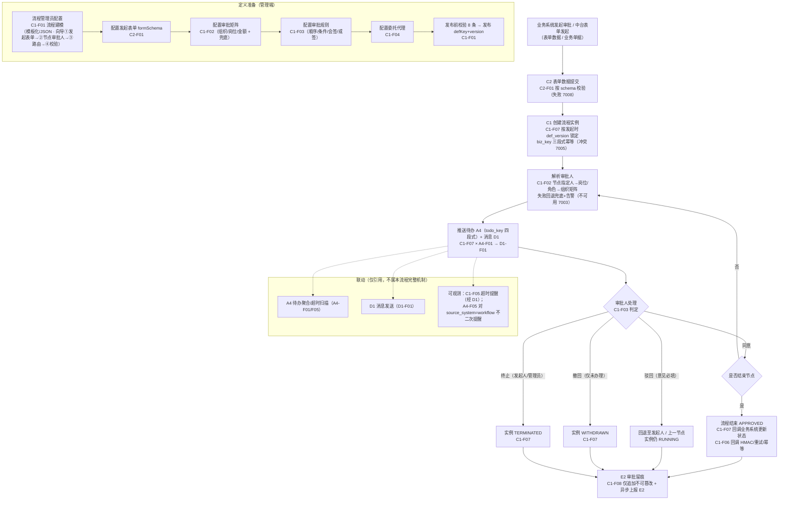
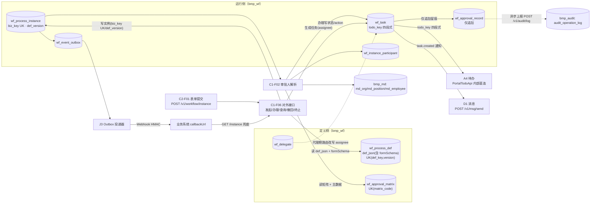
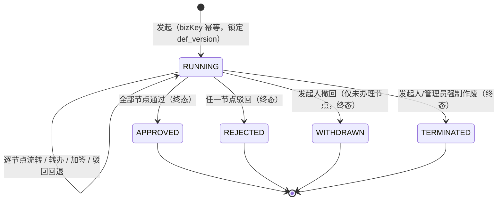
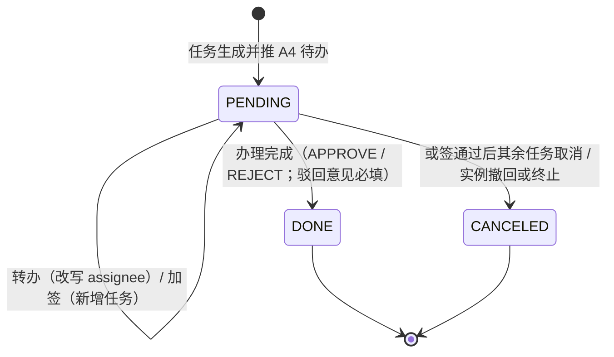
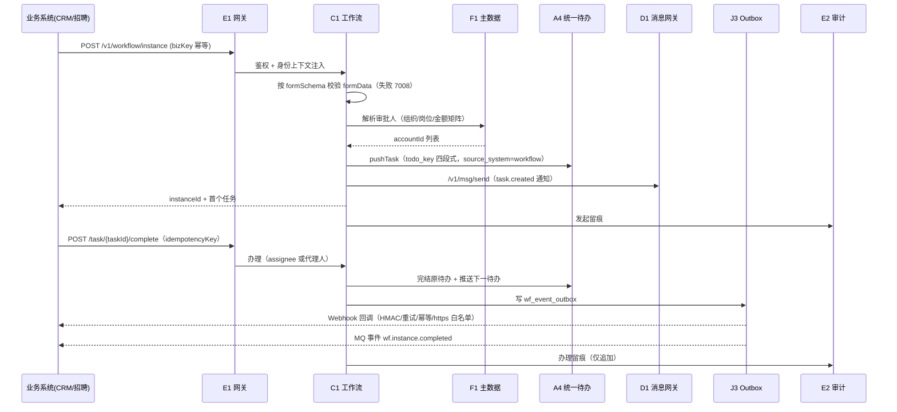

# 02-工作流配置与集成 · 流程专项文档

> **文档定位**：本文件是《业务流程专项文档集》第 2 份，覆盖「工作流配置与集成」全流程（`C1` 工作流引擎 + `C2` 表单引擎 + `C3` 审批入口，共 15 个功能点）。
> **真源声明**：本文件为**派生文档（视图层）**，不是权威源。功能点编号、表结构、规则、版本归属**一律以《麓邦业务中台产品PRD》（下称 `PRD`）与《麓邦业务中台V1.0基座版详细设计》（下称 `详细设计`）为准**；如冲突，**以真源为准**。
> **生成日期**：2026-10-19　|　**母版**：`00-专项文档写作规格（统一模板）.md`

---

## §0 文档说明

**覆盖范围**（功能点 / 名称 / 版本，版本严格照抄 `PRD`）：

| 功能点 | 名称 | 版本（照抄 `PRD`） |
| --- | --- | --- |
| `C1-F01` | 流程建模 | V1.5 完整版（**V1.0 交付 MVP 子集**：模板化 + JSON 定义 + 发布/版本/删除保护/配置向导/空白模板） |
| `C1-F02` | 审批矩阵 | V1.5 完整版（**V1.0 交付 MVP 子集**：组织/岗位/金额三维 + 兜底告警） |
| `C1-F03` | 审批规则 | V1.5 完整版（**V1.0 交付 MVP 子集**：顺序多级 + 条件分支 + 会签/或签 + 退回/驳回 + 撤回） |
| `C1-F04` | 委托代理 | V1.5 完整版（**V1.0 交付 MVP 子集**：委托设置 + 代理路由与留痕） |
| `C1-F05` | 超时提醒 | V1.5 完整版（**V1.0 交付 MVP 子集**：节点 SLA 默认 48h + 复用 A4 超时扫描提醒） |
| `C1-F06` | 流程开放接口 | V1.5 完整版（**V1.0 交付全量**：对外集成是核心诉求；**前移 V1.0**） |
| `C1-F07` | 流程实例与任务管理 | **V1.0** |
| `C1-F08` | 审批留痕与追溯 | **V1.0** |
| `C2-F01` | 表单设计器 | V1.5 完整版（**V1.0 交付 MVP 子集**：列表式字段配置 + 渲染 + 必填校验） |
| `C2-F02` | 字段规则 | **V1.5**（V1.0 不交付） |
| `C2-F03` | 表单-流程贯通 | **V1.5**（V1.0 不交付；V1.0 为「手动贯通」） |
| `C2-F04` | 表单数据管理 | V1.5 完整版（**V1.0 交付 MVP 子集**：实例数据查询/导出（含水印）/基础权限控制） |
| `C3-F01` | 统一审批视图 | V1.5 完整版（**V1.0 交付基础版**：站内 + 跳转聚合、三视图 Tab） |
| `C3-F02` | 批量审批 | V1.5 完整版（**V1.0 交付基础版·可选**：同类批量同意/驳回，逐条生效留痕） |
| `C3-F03` | 移动端审批（中台自有流程） | **V1.0** |

> **说明**：工作流整体 = **V1.0 MVP**（`PRD` 工作流增量前移裁定）；`C1-F06` 前移 V1.0 且**交付全量**（`PRD` `C1-F06` 「V1.0 交付全量」；`详细设计` §4.6ter）。

**不在范围内**（防读者误读）：
- **待办聚合**（`A4-F01~F05`）与**消息发送**（`D1-F01~F05`）的**完整机制**归各自主模块（《04-工作台首页配置与使用》等）；本文件仅在 §3.1/§3.3/§5.2 的**联动点**引用（`A4` 待办推送、`D1` 结果通知、`C1-F05` 与 `A4-F05` 超时去重边界）。
- **工作流引擎内核**（芋道 Flowable 二次开发细节、`ACT_*` 原生表结构）**不在本产品文档范围**；本文件只写「引擎对外只暴露中台 API」的架构约束（`详细设计` §2 `:62`、ADR-12）。
- **应用回调域名白名单** `I1-F06`（`domain_whitelist`）的**完整管理界面**归《01-应用接入集成》；本文件仅在 §3.1/§5.5 引用其作为 `C1-F06` `callbackUrl` 校验的**唯一数据源**（`PRD` `C1-F06` 依赖 `I1-F06(S)`）。
- **文件服务** `D2` 的完整口径归对应专项；本文件只声明「审批意见附件与表单附件**一律经 D2**，仅存 `fileId` 数组」（`详细设计` §3.3 `:596`、审查报告 A2）。
- **`E2` 审计的承载/检索/留存机制**归审计域；本文件只写 `C1-F08` **产留痕 + 异步上报 E2**（非双写，`PRD` `C1-F08` 边界）。

**真源索引**：
- `PRD`：§4.4 统一审批流程（`:1072`，含 3 条业务规则）；§6.3 `C1-F01`~`F08`（`:5958`~`:6792`）、`C2-F01`~`F04`（`:6797`~`:7155`）、`C3-F01`/`F02`/`F03`（`:7160`/`:7358`/`:7262`）；§6.4 表映射（`:844`~`:857`）；§1.4 北极星（`:69`）
- `详细设计`：§2 工程结构 `bmp-server-workflow/`（`:62`）；§3.1 分库分域（`:113`，`bmp_wf`）；§3.3 8 张 `wf_*` 核心表（`:342`~`:355`）；§4.6ter 工作流开放接口（`:598`）；§5 流程域事件（`:848`~`:860`）
- 专项技术文档：《工作流引擎集成契约与前移评估》（下称 `契约`）：§2.2 接口契约、§2.5 待办与消息联动（`:216`）、§3.1 能力裁剪表（`:264`）；《工作流增量 PRD-技术一致性审查报告》（下称 `审查报告`）：A10③（`:169`）；《工作流发起表单-技术设计与实现规格》（下称 `表单规格`）：§2.1 `formSchema`（`:39`）
- UIUX：`UI-WF-01`~`UI-WF-08`（页面地图：《工作流UIUX增量设计》`UI-WF-01` `:111`~`UI-WF-08` `:118`）
- 原型：`prototype/assets/console.js:45`~`:50`（流程与表单 **4 侧栏项**；**`workflow-designer` 无侧栏**）；`prototype/assets/pages-config.js`（`workflow-defs` / `workflow-designer` / `workflow-matrix` / `workflow-instances` / `workflow-delegate`）

**向导步骤 1 两态（2026-10-21 · 原型）**：配置向导第 1 步「发起表单」发起方式 **中台表单 | 外部应用页面** — **中台表单**（`formSchema` 字段列表，默认）或 **外部应用页面**（`launchMode=external`，必填 http(s) 的 **外部应用填写页面** `fillUrl` 与 **外部应用查看页面** `viewUrl`，可不配置 formSchema 字段）。发起时跳转 `fillUrl`（新标签 + SSO/`{bizKey}` 占位）；审批/我发起查看跳转 `viewUrl`；仍走 C1 节点与 A4 待办，表单数据在业务系统，中台存 URL + 实例关联。

**术语表**（本流程特有，≤6）：

| 术语 | 定义 |
| --- | --- |
| `bizKey`（三段式幂等键） | `{sourceSystem}:{bizType}:{bizId}`，`wf_process_instance.biz_key` 唯一键；发起幂等（0 重复实例）（`详细设计` §4.6ter `:602`） |
| `todo_key`（四段式关联键） | `{sourceSystem}:{bizType}:{bizId}:{nodeKey}`，工作流→A4 内部推送待办的关联键；**前三段 = `bizKey`**（`详细设计` §4.6ter `:602`、`:348`） |
| `def_version`（版本锁定） | 实例创建时锁定发起时版本；运行中实例按发起版本执行，新版本仅对新实例生效（`PRD` §4.4 规则 1 `:1091`） |
| `proxy_flag` | 委托代理标记：`wf_approval_record.proxy_flag` 为真表示「由代理人 X 代理委托人 Y 办理」（`PRD` `C1-F04` `:6282`） |
| 可视化配置画布 | V1.0 向导步骤 2/3 的「列表 / 画布」双视图；**≠ BPMN 设计器**（术语口径强制，`PRD` `C1-F01` `:5971`） |
| 兜底审批人 | 审批矩阵解析失败时回退的默认审批人（默认流程管理员），失败触发解析失败告警（`PRD` `C1-F02` `:6080`） |

---

## §1 产品价值

### 1.1 业务痛点

| # | 现状 | 后果 |
| --- | --- | --- |
| P1 | **审批能力各自造流、重复建设**：存量 5 套系统（CRM/招聘/目标/知识/数据中台）的审批（合同、offer、权限申请等）各系统自建、口径不一；工作流无统一引擎承载（`PRD` §1.2.1 研发痛点「每套系统重复造轮子」，`:43`） | 审批体验与留痕口径分裂；新增审批场景需重复开发；「≥2 审批场景统一引擎」的复用目标落空（`PRD` `C1-F06` 验收「≥1 个真实审批场景由 C1 承载」`：6559`） |
| P2 | **审批散落各系统、进度看不见**：审批人需在各业务系统间切换处理审批，无统一入口、无统一时间轴（`PRD` §1.2.1 管理者/审批人痛点「审批散落各系统、进度看不见」，`:43`） | 审批人跨系统切换、易遗漏；跨系统进度不可追溯；日常办公效率提升 ≥30% 的目标（`PRD` §1.2.2 `:51`）无着力点 |
| P3 | **无版本语义的流程变更会破坏运行中实例**：若流程定义修改直接作用于运行中实例，审批链会中途改变 | 运行中实例的审批人/节点在办理过程中被改写，**合规性与可追溯性崩塌**；这正是 `PRD` §4.4 规则 1（`:1091`）与 `C1-F07` 技术约束（`:6648`）必须显式约束「按发起时版本执行」的原因 |
| P4 | **审批人解析无兜底会静默卡死**：组织/岗位/人员主数据缺失或异动未同步时，若无兜底与告警，任务无法生成 | 流程**静默阻断**、无人工介入路径；`PRD` `C1-F02` 因此要求「解析失败 **0 阻断**（100% 有兜底）」并回退兜底审批人 + 告警（`:6138`/`:6154`） |
| P5 | **审批留痕可被篡改则合规不成立**：审批记录若可改可删，审计无法追溯「谁在何时以何意见办理」 | 合规基线失守；`PRD` `C1-F08` 因此要求留痕**仅追加、不可篡改、不可删除**（`:6710`/`:6782`），且「留痕写入失败则阻断该动作」（`:6766`） |

### 1.2 价值主张

- **业务用户（发起人/审批人）**：审批**统一入口、统一处理**——`C3-F01` 统一审批中心聚合「站内（已接 C1）+ 跳转（未接 C1）」；`C3-F03` 支持钉钉/企微 H5 免登办理；`C1-F04` 委托代理让出差/休假期间任务自动路由，不漏审（`PRD` `C3-F01` `:7172`、`C3-F03` `:7274`、`C1-F04` `:6282`）。
- **研发（接入方）**：工作流以 **API + SDK + 回调/事件** 供给（「工作流即服务」），业务系统**不感知引擎实现**（ADR-12）；**嵌入对接 ≤2 人日（含联调）**，仅写 3 段代码（加 `@StartWorkflow` 注解发起、实现回调更新单据状态、配置 `client_id/secret`）（`PRD` `C1-F06` `:6474`/`:6558`、`契约` §2.6 `:250`）。
- **运维与管理员**：流程管理员可自助配置（模板化/JSON 定义 + 审批矩阵 + 委托代理），**5 分钟建一条简单审批流**；定义**删除保护**（有实例拒绝删除）、**版本锁定**（运行实例不受新版本影响）、**审批留痕不可篡改**、**解析失败 0 静默通过**，全生命周期可管可控可溯（`PRD` `C1-F01` `:6049`、`C1-F02` `:6138`、`C1-F08` `:6782`）。

### 1.3 量化收益

| 指标（`PRD` §1.4 北极星 `:69`） | 目标值 | 本流程直接贡献 |
| --- | --- | --- |
| 新系统接入中台周期 | ≤5 人日（V2.5 起） | **直接贡献**：`C1-F06` 「业务系统嵌入对接 ≤2 人日」（V1.0 验收项 `:6558`） |
| 存量重复公共模块停建/下线执行率 | 100% | **直接贡献**：审批流统一由 C1 承载，各业务系统自建审批进入停建/下线清单（`PRD` §4.6 业务规则 3 `:1136`） |
| 新系统基础模块研发工作量下降 | 一期 ≥30% | **直接贡献**：审批/表单能力以 API + SDK 复用，业务系统不再自建审批模块（`PRD` §1.2.1 `:43`） |
| 工作台日均使用率 | ≥70% | 间接：统一审批中心（`C3-F01`）+ 移动审批（`C3-F03`）提升入口使用频次 |
| 能力复用率 | ≥60%（V2.5 起） | 间接：`C1-F06` 开放接口被业务系统调用（`PRD` `C1-F06` 被依赖 B2-F04/C2-F03） |

- **定性收益（无法量化，说明原因）**：合规类收益（留痕不可篡改、审批可追溯到人）**无北极星指标可映射**，以「留痕覆盖率 100% / 越权修改 0 通过」作为验收红线（见 §6.4）。

### 1.4 不做会怎样（量化风险）

| # | 风险 | 真源引用 |
| --- | --- | --- |
| R1 | **审批人解析静默阻断**：不做兜底 → 主数据缺失时任务无法生成、流程卡死；`PRD` 明确「解析失败 **0 阻断**（100% 有兜底）；兜底不可用时返回 **`7003`** 并升级告警」 | `PRD` `C1-F02` 关键技术点（`:6138`）、异常表 3（`:6148`） |
| R2 | **运行中实例被新版本改写**：不做版本锁定 → 运行中实例的节点/审批人被中途改变，审批链失效；`PRD` 强制「运行中实例按发起时版本执行，新版本仅对新实例生效」 | `PRD` §4.4 规则 1（`:1091`）、`C1-F07` 技术约束（`:6648`） |
| R3 | **留痕可篡改则合规失守**：不做 append-only → 审批记录可改可删，审计不可信；`PRD` 强制留痕「仅追加、不可篡改、不可删除」，且「留痕写入失败则**阻断该动作**」 | `PRD` `C1-F08` 功能描述（`:6710`）、关键技术点（`:6766`）、验收（`:6782`） |
| R4 | **重复发起产生重复实例/重复审批**：不做 `bizKey` 幂等 → 同一业务单据重复发起审批；`PRD` 强制「发起 `bizKey` 幂等（**0 重复实例**）」，冲突返回 **`7005`** | `PRD` `C1-F06` 关键技术点（`:6542`）、异常表 2（`:6552`） |
| R5 | **回调断链、业务单据状态不更新**：不做回调重试+白名单 → 审批结束后业务系统单据状态不同步；`PRD` 要求回调失败「重试 3 次（1m/5m/30m）→ 死信 + 人工重放」，且 `callbackUrl` 须**白名单校验防 SSRF** | `PRD` `C1-F06` 关键技术点（`:6543`）、异常表 1/4（`:6551`/`:6554`） |
| R6 | **重复打扰审批人**：不做 `C1-F05` 与 `A4-F05` 超时去重 → 同一工作流待办被双向重复提醒；骨架 B3-b 强制「工作流来源待办（`source_system=workflow`）的超时由 `C1-F05` 主责，`A4-F05` 不二次提醒」 | `PRD` 骨架 B3-b（`:951`）、`C1-F05` 边界（`:6378`）、验收（`:6451`） |

---

## §2 用户故事（≥6 条，可验收）

> 格式：`作为 <角色>，我希望 <做什么>，以便 <获得什么价值>`；每条附**验收标准**与**关联功能点**。

### US-01（主流程 · Happy Path）
**作为审批发起人（业务用户）**，我希望**在统一入口按表单发起审批并全程跟踪进度**，以便**不必登录各业务系统即可完成审批发起与追踪**。
- **验收标准**：① 中台自建流程可经向导配置发起表单并成功发起（`PRD` `C2-F01` 验收 `:6887`）；② 发起后可在 `C3-F01` 「我发起」Tab 查看进度并撤回（仅未办理节点）；③ 发起失败（必填缺失）返回 **`7008`** 并**字段级定位**（`PRD` `C2-F01` `:6872`）。
- **关联**：`C2-F01`、`C1-F07`、`C3-F01`
- **真源**：`PRD` `C2-F01` 验收（`:6887`）、`C1-F07` 验收（`:6684`）、`C3-F01` 验收（`:7247`）

### US-02（主流程 · Happy Path）
**作为审批人（管理者）**，我希望**在统一审批中心一处处理站内与跳转审批，并在移动端免登办理**，以便**不漏审、随时可审**。
- **验收标准**：① 三视图 Tab（待我审批/已办/我发起）全部可用（`PRD` `C3-F01` 验收 `:7247`）；② 站内直接办理成功率 ≥99%；③ 移动端免登直达办理成功率 ≥99%，且**移动/PC 状态实时一致率 100%**（`PRD` `C3-F03` 验收 `:7343`/`:7345`）。
- **关联**：`C3-F01`、`C3-F03`、`C1-F06`
- **真源**：`PRD` `C3-F01` 验收（`:7246`）、`C3-F03` 验收（`:7343`）

### US-03（主流程 · Happy Path）
**作为业务系统研发（接入方）**，我希望**通过开放接口/SDK 发起审批、接收回调更新单据状态**，以便**在 ≤2 人日内把审批能力嵌入业务系统**。
- **验收标准**：① 业务系统嵌入对接 **≤2 人日（含联调）**（`PRD` `C1-F06` 验收 `:6558`）；② 发起成功率 ≥99.9%、**0 重复实例**；③ 回调成功率 ≥99%，业务系统按 `eventId` 幂等；④ **≥1 个真实审批场景由 C1 承载**（试点 CRM 合同审批 / 招聘 offer 审批，`:6559`）。
- **关联**：`C1-F06`、`C1-F07`
- **真源**：`PRD` `C1-F06` 验收（`:6558`/`:6560`）、`详细设计` §4.6ter（`:606`/`:612`）

### US-04（管理员视角）
**作为流程管理员**，我希望**用模板化/JSON 定义在 5 分钟内配置并发布一条简单审批流，且发布前有 8 条校验拦截不合规定义**，以便**业务侧可自助建流程、不合规定义 0 上线**。
- **验收标准**：① 业务管理员**5 分钟内**完成一条简单审批流配置并发布（模板化路径，`PRD` `C1-F01` 验收 `:6049`）；② 发布前校验**拦截率 100%**（8 条规则，`:6051`）；③ **删除保护拦截率 100%**（存在实例时 0 误删，`:6053`）；④ 空白模板可选中且节点被清空，从零配置 ≥1 审批节点后可发布（`:6054`）。
- **关联**：`C1-F01`、`C2-F01`
- **真源**：`PRD` `C1-F01` 验收（`:6049`~`:6054`）

### US-05（管理员视角）
**作为流程管理员**，我希望**按组织/岗位/金额配置审批矩阵并设兜底审批人**，以便**审批人自动解析、解析失败不静默卡死**。
- **验收标准**：① **审批人解析准确率 100%**（矩阵 + F1 主数据，`PRD` `C1-F02` 验收 `:6152`）；② 解析成功率 ≥99.5%、**P95 解析耗时 <200ms**；③ 解析失败 **0 阻断**（100% 有兜底）+ 告警触达率 ≥99%；④ **矩阵变更后运行实例既有任务办理人不变**（不回溯，`:6155`）。
- **关联**：`C1-F02`、`F1-F01`（主数据）
- **真源**：`PRD` `C1-F02` 验收（`:6152`~`:6155`）、§4.4 规则 2（`:1092`）

### US-06（管理员视角）
**作为流程管理员**，我希望**设置委托代理（起止时间必填、到期自动失效）并留痕区分代理**，以便**出差/休假期间审批不中断、且可追溯实际处理人**。
- **验收标准**：① **代理期任务路由准确率 100%**（`PRD` `C1-F04` 验收 `:6352`）；② 到期**自动失效，无需手工**（`:6353`）；③ 留痕可区分代理（`proxy_flag` 正确，「由 X 代理 Y 办理」可追溯，`:6354`）。
- **关联**：`C1-F04`、`C1-F08`
- **真源**：`PRD` `C1-F04` 验收（`:6352`~`:6354`）、§4.4 规则 3（`:1093`）

### US-07（异常/边界）
**作为流程管理员**，我希望**当审批人解析失败时回退兜底审批人并收到告警，兜底本身不可用时实例挂起升级我**，以便**流程不静默卡死、有人工介入路径**。
- **验收标准**：① 无规则命中/主数据缺失 → 回退兜底审批人 + 告警（`PRD` `C1-F02` 异常表 1/2 `:6146`/`:6147`）；② 兜底审批人本身不可用 → 返回 **`7003`**，实例挂起并升级流程管理员（`:6148`）；③ **审批人解析不到时不得静默通过**（回归红线，见 §6.4）。
- **关联**：`C1-F02`
- **真源**：`PRD` `C1-F02` 异常表（`:6146`~`:6149`）、关键技术点（`:6138`）

### US-08（异常/边界）
**作为接入方研发**，我希望**重复发起同一业务单据不产生重复实例、撤回条件不满足时明确报错**，以便**幂等安全、及早发现错误**。
- **验收标准**：① 同 `bizKey` 重复发起 → 幂等（**0 重复实例**），冲突返回 **`7005`**（`PRD` `C1-F06` 异常表 2 `:6552`）；② 撤回时已有节点办理 → 返回 **`7007` 撤回条件不满足**（`C1-F03` 异常表 1 `:6250`）；③ 越权办理 → 返回 **`7004` 无办理权限**（`:6553`）。
- **关联**：`C1-F06`、`C1-F07`、`C1-F03`
- **真源**：`PRD` `C1-F06` 异常表（`:6551`~`:6555`）、`详细设计` §4.6ter 错误码（`:618`~`:629`）

### US-09（异常/边界 · 版本）
**作为流程管理员**，我希望**修改流程定义时新建版本而非改动已发布版本，且运行中实例不受新版本影响**，以便**变更安全、历史实例可追溯**。
- **验收标准**：① 已发布版本**不可回退为草稿**，修改须**新建版本**（原型 `pages-config.js:1815` 状态机横幅）；② 停用后**不再产生新实例**（API 与 UI 双验证），**运行中实例状态不变**（`PRD` `C1-F01` 验收 `:6052`）；③ 新版本发布后**运行中实例仍按发起版本执行**（回归红线，见 §6.4）。
- **关联**：`C1-F01`、`C1-F07`
- **真源**：`PRD` `C1-F01` 验收（`:6052`）、§4.4 规则 1（`:1091`）、`C1-F07` 技术约束（`:6648`）

---
## §3 业务流程

### 3.1 主流程（审批全链路 · flowchart）

> 节点标注承载**功能点编号**；对照 `PRD` §4.4 统一审批流程（`:1072`）主干，扩写定义准备与联动点。

> **阅读要点**：① 定义准备（`DEF`）与运行态（主链）**解耦**——定义只产 `wf_process_def`，不产实例（`PRD` `C1-F01` 边界 `:5971`）；② 运行中实例**锁定发起时 `def_version`**（`PRD` §4.4 规则 1 `:1091`）；③ 待办/消息/超时为**联动引用**，其完整机制归 `A4`/`D1` 各自专项（本文件不展开）。

### 3.2 角色与职责

| 角色 | 在本流程中的动作 | 涉及界面/接口 |
| --- | --- | --- |
| 流程管理员 | 新建/编辑草稿/发布/停用/启用/删除保护/新建版本；维护审批矩阵与兜底；配置委托代理与节点 SLA | `UI-WF-01`（`workflow-defs`）、`UI-WF-02`（`workflow-designer`）、`UI-WF-03`（`workflow-matrix`）、`UI-WF-05`（`workflow-delegate`）；`/v1/workflow/def*`、`/v1/workflow/matrix*`、`/v1/workflow/delegate*` |
| 发起人（业务用户） | 按 `formSchema` 填报发起；撤回（仅未办理）；查看进度 | `UI-WF-08`（`workflow-start`，形态待确认）、`UI-WF-06`（`approval.html`）；`POST /v1/workflow/instance`、`POST /v1/workflow/instance/{id}/withdraw` |
| 审批人（管理者） | 同意/驳回/加签/转办；批量审批；移动端免登办理 | `UI-WF-06`（统一审批中心）、`UI-WF-07`（`mobile/index.html` 移动审批）；`POST /v1/workflow/task/{taskId}/complete`、`GET /v1/workflow/task/list` |
| 代理人 | 代理期内接收委托人新任务并办理（留痕 `proxy_flag`） | `UI-WF-05`（委托代理管理，查看/详情）；`/v1/workflow/delegate` |
| 业务系统（服务间） | 经 E1 发起/办理/查询/撤回/终止；接收回调/事件更新单据状态 | `E1` 网关 → `POST /v1/workflow/instance`、`GET /v1/workflow/instance/{id}`、`callbackUrl`、`wf_event_outbox`→J3 |
| 运维/集成管理员 | 死信管理与人工重放；矩阵解析失败告警处置；实例监控 | `UI-WF-04`（`workflow-instances`）；`GET /v1/workflow/instance?pageNo=&status=&sourceSystem=&bizKey=`、死信列表 |
| F1 主数据（支撑） | 提供组织/岗位/人员解析依据；异动事件刷新（≤10 分钟） | `md_org`/`md_position`/`md_employee`；`md.*` 事件 |

### 3.3 分步说明

| # | 触发条件 | 执行动作 | 关键规则（BR 引用） | 异常分支 |
| --- | --- | --- | --- | --- |
| 1 | 流程管理员有审批需求 | 选配置方式（模板化/JSON）→ 走 A′ 四步向导（① 发起表单 ② 节点与审批人 ③ 路由条件 ④ 校验与发布） | **BR1** 定义版本管理：运行中实例按发起版本执行，新版本仅对新实例生效（`PRD` §4.4 规则 1 `:1091`）；`defKey` 一经发布不可改（`PRD` `C1-F01` `:5977`） | 校验不通过 → 逐条错误定位 → 返回草稿编辑（`:5998`） |
| 2 | 向导步骤 4 触发发布 | 执行**发布前校验 8 条** → `POST /v1/workflow/def/{id}/publish` → `status=已发布`，返回 `defKey+version` | 发布前校验拦截率 100%（`:6051`）；`UK(def_key,version)` 全局唯一（`:6034`） | 并发发布同 `defKey` → 唯一约束拦截，后者返回版本冲突（`:6043`） |
| 3 | 业务系统/发起人提交发起 | `C2-F01` 按 `formSchema` 校验 `formData` → `C1-F07` 创建实例（`status=RUNNING`）、写 `wf_process_instance`（`biz_key` UK、`def_version` 锁定） | **BR2** `biz_key` 三段式幂等（0 重复实例，冲突 `7005`，`PRD` `C1-F06` `:6542`）；有 schema 时必填校验失败 `7008` 原子回滚（`:6555`） | 重复发起 `7005`；`formData` 必填缺失 `7008` + `fields[]`；定义未发布 `7001` |
| 4 | 实例到达审批节点 | `C1-F02` 按 `priority` 升序匹配矩阵 → 按 `resolver` 结合 F1 主数据解析 `accountId[]` → 生成 `wf_task` + 登记 `wf_instance_participant` | **BR3** 审批人解析顺序：节点指定人 → 岗位/角色 → 组织矩阵；审批人即发起人时按「自动通过/上级代审」策略（`PRD` §4.4 规则 2 `:1092`） | 无命中/主数据缺失 → 回退兜底 + 告警；兜底不可用 → `7003` 挂起升级（`:6148`） |
| 5 | 任务生成 | 经 `PortalTodoApi` **内部直连**推 A4 待办（`todo_key` 四段式）+ 经 D1 通知；按 SLA 写 `wf_task.overdue_time` | **BR4** 工作流→A4 内部 `todo_key` 四段式（前三段=`bizKey`），不改 A4 对外三段式契约（`详细设计` §4.6ter `:602`）；`C1-F05` 节点超时由 C1 主责，`A4-F05` 不二次提醒（骨架 B3-b `:951`） | A4 推送失败 → 重试 + 告警，实例状态不受影响（`PRD` `C1-F07` `:6662`）；D1 失败 → 重试 ≤2 次 |
| 6 | 审批人办理 | `C1-F03` 判定（顺序/条件/会签/或签）→ 更新 `wf_task`/实例状态 → 或签通过后其余任务置 `CANCELED` | 驳回意见必填（`:6187`）；撤回仅限后续节点均未办理（`:6178`）；条件分支**必须含默认分支** | 驳回意见缺失 → 参数校验错误阻断；撤回不满足 `7007`；条件无命中 `7006`（默认分支缺失应被发布校验拦截 `:6242`） |
| 7 | 实例收敛（终态） | 全部通过 `APPROVED`；任一驳回终判 `REJECTED`；撤回 `WITHDRAWN`；终止 `TERMINATED` | 终态集合 = `{APPROVED, REJECTED, WITHDRAWN, TERMINATED}`，`RUNNING` 为唯一非终态（`PRD` `C1-F07` 状态机 `:6681`） | 终止已终态实例 → `7002`（`:6663`） |
| 8 | 状态变更 | 写 `wf_event_outbox` → J3 投递器 → Webhook 回调（`callbackUrl`）/ MQ 事件；写 `wf_approval_record`（仅追加）+ 异步上报 E2 | 回调 HMAC-SHA256 签名、重试 3 次（1m/5m/30m）、死信 + 人工重放、消费方按 `eventId` 幂等（`详细设计` §4.6ter `:631`）；留痕写入失败则**阻断该动作**（`PRD` `C1-F08` `:6737`） | 回调端点不可用 → 重试 → 死信 + 重放，业务系统按 `eventId` 幂等 + `GET /instance` 兜底（`:6551`） |

> **BR 锚点**：BR1/BR2/BR3 直接对应 `PRD` §4.4 三条业务规则（`:1091`~`:1093`）；BR4 为 `详细设计` 的 `bizKey`/`todo_key` 口径与骨架 B3-b 联动边界。

### 3.4 异常与边界（≥4 条）

| # | 场景 | 系统行为 | 用户可见结果 | 是否阻断 |
| --- | --- | --- | --- | --- |
| E1 | **重复发起**（同 `bizKey` 重复调用） | `wf_process_instance` 的 `biz_key` UK 拦截；幂等返回既有实例 | 返回 **`7005` 幂等键冲突**；**0 重复实例**（`PRD` `C1-F06` 异常表 2 `:6552`） | 否（阻断后者） |
| E2 | **审批人解析失败且兜底不可用** | 回退兜底审批人失败 → 实例挂起 + 升级流程管理员告警 | 返回 **`7003` 审批人解析失败**；流程临时阻断待人工介入（`PRD` `C1-F02` 异常表 3 `:6148`） | **是**（临时阻断） |
| E3 | **撤回时已有节点办理** | 校验存在 `status=DONE` 任务 → 拒绝撤回 | 返回 **`7007` 撤回条件不满足**（`PRD` `C1-F03` 异常表 1 `:6250`） | 否（阻断撤回） |
| E4 | **发布非法 JSON 定义/空白模板未加审批节点** | 发布前校验即时定位（行号/节点 key）+ 第 8 条「至少 1 个审批节点」拦截 | 阻断发布；逐条错误定位，返回草稿继续编辑（`PRD` `C1-F01` 异常表 3/4 `:6045`/`:6046`） | 否（阻断发布） |
| E5 | **删除存在运行/历史实例的定义** | 服务端二次校验实例数 → 拒绝删除 | 按钮禁用 + tooltip「已有运行/历史实例，不可删除」（`PRD` `C1-F01` 异常表 2 `:6044`） | 否 |
| E6 | **回调端点不可用（SSRF/未登记域名）** | 重试 3 次（1m/5m/30m）→ 死信 + 人工重放；`callbackUrl` 非白名单/非 https/内网地址 → 直接拦截 | 死信列表可见 + 人工重放；业务系统按 `eventId` 幂等 + `GET /instance` 兜底（`PRD` `C1-F06` 异常表 1/4 `:6551`/`:6554`） | 否 |
| E7 | **矩阵变更后查询运行实例** | 矩阵变更**不回溯**运行实例；既有任务办理人不变 | 运行实例状态与办理人不变（`PRD` `C1-F02` 验收 `:6155`） | 否 |
| E8 | **`C1-F05` 与 `A4-F05` 重复超时提醒** | 约定 `source_system=workflow` 的超时由 `C1-F05` 主责，`A4-F05` 跳过 | 同一工作流待办**仅一条超时提醒记录**（`PRD` `C1-F05` 验收 `:6451`） | 否（需跨域联调验证） |
| E9 | **留痕写入失败** | **阻断该动作**（保证「有办理必有留痕」） | 办理未成功，提示失败；E2 上报失败则本地队列重试、不阻断业务 | **是**（临时阻断，合规优先） |
| E10 | **移动端办理越权/并发** | 返回 **`7004` 无办理权限**；并发办理由 `idempotencyKey` 保证仅首次生效 | 提示并刷新；待办保留（`PRD` `C3-F03` 异常表 2 `:7337`） | 否 |

### 3.5 版本归属

| 步骤 | 功能点 | 版本（照抄 `PRD`） | 说明 |
| --- | --- | --- | --- |
| 1 定义配置 | `C1-F01` 流程建模 | **V1.0（MVP 子集）** | 模板化 + JSON 定义 + 发布/版本/删除保护/向导/空白模板；可视化 BPMN 设计器 `C1-F01-6` = V1.5（`PRD` `:5963`） |
| 1 发起表单配置 | `C2-F01` 表单设计器 | **V1.0（MVP 子集）** | 列表式字段配置 + 渲染 + 必填校验；拖拽式 `C2-F01-2` = V1.5（`PRD` `:6802`） |
| 1 字段规则 | `C2-F02` 字段规则 | **V1.5** | V1.0 不交付（仅必填 + 类型约束）（`PRD` `:6911`） |
| 1 表单-流程贯通 | `C2-F03` 表单-流程贯通 | **V1.5** | V1.0 表单字段 key 可作条件变量属「手动贯通」（`PRD` `:6994`） |
| 2 发布 | `C1-F01` | **V1.0** | 发布前校验 8 条（`:5988`） |
| 3 发起 | `C2-F01` + `C1-F07` + `C1-F06` | **V1.0** | `C1-F06` **交付全量**（前移 V1.0，`PRD` `:6467`） |
| 4 解析审批人 | `C1-F02` 审批矩阵 | **V1.0（MVP 子集）** | 组织/岗位/金额三维 + 兜底告警（`PRD` `:6073`） |
| 5 推送待办/消息 | `C1-F07` × `A4`/`D1` | **V1.0** | 联动引用，完整机制归 A4/D1 |
| 6 办理判定 | `C1-F03` 审批规则 | **V1.0（MVP 子集）** | 顺序/条件/会签/或签/退回/撤回（`PRD` `:6171`） |
| 6 委托代理 | `C1-F04` 委托代理 | **V1.0（MVP 子集）** | 委托设置 + 代理路由与留痕（`PRD` `:6275`） |
| 7 实例收敛 | `C1-F07` | **V1.0** | 实例五态状态机（`PRD` `:6581`） |
| 8 留痕 | `C1-F08` 审批留痕与追溯 | **V1.0** | 仅追加不可篡改（`PRD` `:6703`） |
| 8 回调/事件 | `C1-F06` | **V1.0** | 回调 + 事件双通道（`详细设计` §4.6ter） |
| 辅助 超时 | `C1-F05` 超时提醒 | **V1.0（MVP 子集）** | 节点 SLA 默认 48h + 复用 A4 超时扫描；节点级升级上级 = V1.5（`PRD` `:6370`） |
| 辅助 统一视图 | `C3-F01` 统一审批视图 | **V1.0（基础版）** | 站内 + 跳转聚合、三视图 Tab（`PRD` `:7165`） |
| 辅助 批量审批 | `C3-F02` 批量审批 | **V1.0（基础版·可选）** | 同类批量同意/驳回，逐条生效留痕（`PRD` `:7363`） |
| 辅助 移动审批 | `C3-F03` 移动端审批 | **V1.0** | 中台自有流程移动端免登办理（`PRD` `:7267`） |
| 辅助 表单数据 | `C2-F04` 表单数据管理 | **V1.0（MVP 子集）** | 查询/导出（含水印）/基础权限（`PRD` `:7074`） |

> **版本口径注意**：`C1-F06` **前移 V1.0 且交付全量**（`PRD` `:6467`）；`C2-F02`/`C2-F03` = **V1.5**（V1.0 不交付）；`C1-F07`/`C1-F08`/`C3-F03` = **V1.0**（增量 PRD §8.2 正式登记项）。

---

## §4 数据流

### 4.1 数据流图

### 4.2 数据实体清单

| 实体/表名 | 所属库 | 用途 | 读/写 | 关联功能点 |
| --- | --- | --- | --- | --- |
| `wf_process_def` | `bmp_wf` | 流程定义与版本管理；`def_json` 内含 `formSchema`（随 `def_key+version` 锁定） | 读/写 | `C1-F01`、`C1-F03`、`C2-F01`、`C2-F02`、`C2-F03` |
| `wf_process_instance` | `bmp_wf` | 流程实例（业务映射）；`biz_key`(UK) 幂等键；`form_data` 结构由发起版本 `formSchema` 约束 | 读/写 | `C1-F06`、`C1-F07`、`C2-F01`、`C2-F04`、`C3-F01` |
| `wf_task` | `bmp_wf` | 任务（待办来源）；`todo_key` 四段式 | 读/写 | `C1-F03`、`C1-F05`、`C1-F07`、`C3-F01`、`C3-F02`、`C3-F03` |
| `wf_approval_record` | `bmp_wf` | 审批留痕（**仅追加不可篡改**）；附件仅存 `fileId` 数组（与 D2 同源） | 写（仅追加） | `C1-F08`、`C1-F04`（`proxy_flag`） |
| `wf_approval_matrix` | `bmp_wf` | 审批矩阵（审批人解析） | 读/写 | `C1-F02` |
| `wf_instance_participant` | `bmp_wf` | 实例参与者可见性（V1.0 数据权限降级方案） | 读/写 | `C1-F07`、`C2-F04`、`C3-F01` |
| `wf_delegate` | `bmp_wf` | 委托代理（到期自动失效） | 读/写 | `C1-F04` |
| `wf_event_outbox` | `bmp_wf` | 流程事件发件箱（复用 J3 投递器） | 读/写 | `C1-F06`、`C1-F07`、`C1-F05` |
| `md_org`/`md_position`/`md_employee` | `bmp_md` | 组织/岗位/人员主数据（解析依据） | 读 | `C1-F02`（F1-F01 依赖） |
| `portal_todo` | `bmp_portal` | 跨系统待办聚合（`source_system=workflow` 标识工作流来源） | 读/写 | `C1-F07` × A4 联动、`C3-F01`、`C3-F03` |
| `audit_operation_log` | `bmp_audit` | E2 审计（留痕承载/检索，非双写） | 写 | `C1-F08`、`C2-F04`（导出上报） |
| `ACT_*`（Flowable 原生） | `bmp_wf` | 引擎原生表，`business_key = bizKey` 与 `wf_process_instance` 关联 | 引擎内部 | `C1-F07`（详细设计 §3.3 `:355`） |

> 前 8 张 `wf_*` 表为**流程域核心表**（`详细设计` §3.3 `:342`~`:355`，依据增量 PRD 3.9 / 契约 4.2）；`bmp_wf` 库归属 `bmp-server-workflow`（`详细设计` §3.1 `:113`）。

### 4.3 接口清单

| 接口 | 方法 | 用途 | 调用方 | 详细设计章节 |
| --- | --- | --- | --- | --- |
| `/v1/workflow/instance` | POST | 发起流程实例（`bizKey` 幂等；有 schema 时校验 `formData`，失败 `7008`） | 业务系统（经 E1）/ 中台前端 | §4.6ter C1-F06-1（`:606`） |
| `/v1/workflow/task/{taskId}/complete` | POST | 办理任务（同意/驳回/加签/转办；驳回意见必填；`idempotencyKey`） | 审批人（PC/移动）/ 业务系统 | §4.6ter C1-F06-2（`:607`） |
| `/v1/workflow/instance/{instanceId}` | GET | 查询实例状态（当前节点、已办/待办、审批记录、表单快照） | 业务系统 / 管理端 | §4.6ter C1-F06-3（`:608`） |
| `/v1/workflow/instance?bizKey=&sourceSystem=` | GET | 按业务键反查实例 | 业务系统 | §4.6ter C1-F06-4（`:609`） |
| `/v1/workflow/instance/{instanceId}/withdraw` | POST | 撤回（仅限后续节点均未办理；不满足 `7007`） | 发起人 | §4.6ter C1-F06-5（`:610`） |
| `/v1/workflow/instance/{instanceId}/terminate` | POST | 终止（发起人/管理员强制作废；**写留痕**） | 发起人/管理员 | §4.6ter C1-F06-6（`:611`） |
| `/v1/workflow/task/list?view=todo\|done\|initiated` | GET | 「我待办/已办/我发起」三视图查询 | 审批人/发起人 | §4.6ter 规则（`:665`）、`PRD` `C1-F07`（`:6585`） |
| `/v1/workflow/instance?pageNo=&pageSize=&status=&sourceSystem=&bizKey=` | GET | 实例监控分页查询 | 流程管理员（`UI-WF-04`） | `PRD` `C1-F07`（`:6585`） |
| `/v1/workflow/instance/{instanceId}/records` | GET | 查询审批留痕（时间轴） | 参与者/管理员 | `PRD` `C1-F08`（`:6707`） |
| `/v1/workflow/def` | POST/PUT | 新建/更新流程定义 | 流程管理员 | `PRD` `C1-F01`（`:5967`） |
| `/v1/workflow/def/{id}/publish` | POST | 发布（`defKey+version`） | 流程管理员 | `PRD` `C1-F01`（`:5967`） |
| `/v1/workflow/def/{id}/disable` | POST | 停用 | 流程管理员 | `PRD` `C1-F01`（`:5967`） |
| `/v1/workflow/def/{id}/clone` | POST | 克隆（新建版本） | 流程管理员 | `PRD` `C1-F01`（`:5967`） |
| `/v1/workflow/def/{id}` | DELETE | 删除（**删除保护**：有实例拒绝） | 流程管理员 | `PRD` `C1-F01`（`:5967`） |
| `/v1/workflow/def` / `/v1/workflow/def/{defKey}/versions` | GET | 定义列表 / 版本历史 | 流程管理员 | `PRD` `C1-F01`（`:5967`） |
| `/v1/workflow/matrix` | GET/POST/PUT | 审批矩阵查询/新建/编辑 | 流程管理员 | `PRD` `C1-F02`（`:6077`） |
| `/v1/workflow/def/fallback-config` | GET/PUT | 兜底审批人/告警接收人配置 | 流程管理员 | `PRD` `C1-F02`（`:6077`） |
| `/v1/workflow/delegate` | GET/POST/PUT | 委托代理查询/新建/编辑 | 流程管理员/个人 | `PRD` `C1-F04`（`:6279`） |
| `/v1/workflow/delegate/{id}/disable` | POST | 停用委托（提前终止） | 流程管理员 | `PRD` `C1-F04`（`:6279`） |
| `POST /v1/msg/send`（经 D1） | POST | 超时提醒/结果通知（工作流不自建发信通道） | C1 → D1 | `详细设计` §4.6ter（`:631`）；`PRD` `C1-F05`（`:6374`） |
| `PortalTodoApi`（内部直连） | 内部 | 推 A4 待办（`todo_key` 四段式） | C1 → A4 | `PRD` `C1-F07`（`:6606`）；`契约` §2.5（`:244`） |
| `POST /v1/audit/log` | POST | 留痕异步上报 E2（失败不阻断业务） | C1 → E2 | `PRD` `C1-F08`（`:6707`） |

> **口径**：`bizKey` 三段式 `{sourceSystem}:{bizType}:{bizId}`；工作流→A4 内部 `todo_key` 四段式 `{sourceSystem}:{bizType}:{bizId}:{nodeKey}`（前三段=`bizKey`）（`详细设计` §4.6ter `:602`）。

### 4.4 关键字段与约束

| 字段 | 所属表 | 语义/约束 | 关联功能点 |
| --- | --- | --- | --- |
| `def_key` + `version` | `wf_process_def` | **`UK(def_key, version)` 全局唯一**；`defKey` 一经发布**不可修改**（4–32 位字母/数字/下划线） | `C1-F01`（`PRD` `:5977`/`:6034`） |
| `def_json` | `wf_process_def` | 内含 `formSchema`（发起表单定义，随 `def_key+version` 同版本锁定）；发布后不可改 | `C1-F01`、`C2-F01`（`详细设计` `:346`） |
| `status`（定义） | `wf_process_def` | 枚举 `草稿/已发布/停用`；**已发布不可回退为草稿** | `C1-F01`（原型 `pages-config.js:1815`） |
| `biz_key` | `wf_process_instance` | **UK 幂等键（三段式）**；重复发起 0 重复实例，冲突 `7005` | `C1-F06`、`C1-F07`（`详细设计` `:347`） |
| `def_version` | `wf_process_instance` | 实例**锁定发起时版本**；运行中实例按发起版本执行，新版本仅对新实例生效 | `C1-F07`（`PRD` §4.4 规则 1 `:1091`、`:6648`） |
| `form_data` | `wf_process_instance` | 实例表单值；结构由**发起版本** `formSchema` 约束；发起后**只读**（与定义分离，0 数据迁移） | `C2-F01`、`C2-F04`（`PRD` `:6871`/`:6883`） |
| `status`（实例） | `wf_process_instance` | 枚举 `{RUNNING, APPROVED, REJECTED, WITHDRAWN, TERMINATED}`；**终态集合** = 后 4 个，`RUNNING` 唯一非终态 | `C1-F07`（`PRD` `:6681`、`详细设计` `:616`） |
| `status`（任务） | `wf_task` | 枚举 `{PENDING, DONE, CANCELED}`；`action` 枚举 `{APPROVE, REJECT}` | `C1-F03`、`C1-F07`（`契约` §4.2 `:360`） |
| `sign_mode` | `wf_task` | 枚举 `{SINGLE, ALL, OR}`（单人/会签/或签） | `C1-F03`（`契约` §4.2 `:360`） |
| `assignee_account_id` / `original_assignee_id` | `wf_task` | 当前办理人 / **委托前原审批人** | `C1-F02`、`C1-F04`（`详细设计` `:348`） |
| `overdue_time` | `wf_task` | 超时判定依据（= 推送时间 + `overdueHours`，缺省 48h） | `C1-F05`（`PRD` `:6385`） |
| `todo_key`（**派生**） | `wf_task` → A4 | **四段式** `{sourceSystem}:{bizType}:{bizId}:{nodeKey}`（前三段=`bizKey`） | `C1-F07`（`详细设计` `:348`） |
| `proxy_flag` | `wf_approval_record` | 布尔；真表示「由代理人 X 代理委托人 Y 办理」 | `C1-F04`、`C1-F08`（`详细设计` `:349`） |
| `attachment` | `wf_approval_record` | **仅存 `fileId` 数组**（与 D2 同源，不新建存储） | `C1-F08`（`详细设计` `:349`/`:596`） |
| `operator_account_id` + `trace_id` | `wf_approval_record` | **留痕可追溯到人**（`operator_account_id` + `proxy_flag` + `trace_id` 齐全） | `C1-F08`（`PRD` `:6783`） |
| `matrix_code` | `wf_approval_matrix` | **UK**；保存后不可改 | `C1-F02`（`PRD` `:6086`） |
| `dimension` | `wf_approval_matrix` | 枚举 `{ORG, POSITION, AMOUNT}`（V1.0 仅此三维） | `C1-F02`（`PRD` `:6087`） |
| `status`（委托） | `wf_delegate` | 三态：待生效 / 生效中 / 已失效（到期自动失效） | `C1-F04`（`PRD` `:6282`） |
| `role` | `wf_instance_participant` | 枚举 `{INITIATOR, APPROVER, CC, ADMIN}`；`UK(instance_id, account_id, role)` | `C1-F07`、`C2-F04`（`详细设计` `:351`） |
| `event_id` | `wf_event_outbox` | **UK**；消费方按 `eventId` 幂等（至少一次投递） | `C1-F06`、`C1-F07`（`详细设计` `:353`/`:860`） |

### 4.5 数据生命周期

| 阶段 | 数据 | 说明 |
| --- | --- | --- |
| 产生（定义） | `wf_process_def`（`status=草稿`→发布） | 发布前校验 8 条通过后 `status=已发布`，返回 `defKey+version`；旧版本只读 |
| 流转（定义） | 新建 `version` / 停用 / 重新启用 / 删除保护 | 已发布不可改 → 新建版本；停用后不再产生新实例，运行中实例不受影响；存在实例时**拒绝删除** |
| 产生（实例） | `wf_process_instance`（`biz_key` UK） | 发起时锁定 `def_version` 与 `form_data`；幂等（0 重复实例） |
| 流转（任务） | `wf_task` → A4 待办（`todo_key` 四段式） | 任务生成即推 A4；办理/取消/转办改写状态；`original_assignee_id` 留存委托人 |
| 幂等键 | `biz_key`（发起）/ `idempotencyKey`（办理/撤回/终止）/ `eventId`（事件/回调） | **三段式 `bizKey` 对外不变**；工作流→A4 内部四段式 `todo_key` 前三段=`bizKey`（`详细设计` §4.6ter `:602`/`:665`） |
| 留痕 | `wf_approval_record`（**仅追加**） | 无 update/delete 权限；异步上报 E2（`bmp_audit`）承载/检索/留存 **≥6 个月**（`PRD` `C1-F08` `:6789`） |
| 失效/归档 | 委托代理到期自动失效；实例终态收敛 | 终态集合 `{APPROVED, REJECTED, WITHDRAWN, TERMINATED}`；`RUNNING` 为唯一非终态；终止写留痕不可恢复 |

---

## §5 技术逻辑方案

### 5.1 架构落点

| 维度 | 落点 | 真源 |
| --- | --- | --- |
| 服务模块 | **`bmp-server-workflow/`**（C1+C2+C3：工作流引擎；芋道 Flowable 内核 + `wf_` 扩展表） | `详细设计` §2 `:62`、§4 变更表 `:998` |
| 数据库 | **`bmp_wf`** 库（`wf_` 前缀，8 张 `wf_*` 核心表 + Flowable `ACT_*` 原生表同库，`business_key=bizKey` 关联） | `详细设计` §3.1 `:113`、§3.3 `:342`~`:355` |
| 依赖库 | `bmp_md`（`md_org`/`md_position`/`md_employee` 解析依据）、`bmp_portal`（`portal_todo`）、`bmp_msg`（`msg_send_record`）、`bmp_file`（`file_object`）、`bmp_audit`（`audit_operation_log`） | `PRD` §6.4 表映射 `:844`~`:857` |
| 外部集成 | `E1` 网关（跨边界唯一出入口，ADR-07）；`D1` 消息网关（不自建发信通道）；`A4` 待办（`PortalTodoApi` 内部直连）；`J3` Outbox 投递器（`wf_event_outbox` 复用，无独立基建）；`D2` 文件服务（附件仅存 `fileId`） | `详细设计` §4.6ter `:600`/`:631`；`契约` §2.5 `:244` |
| 引擎边界 | **引擎对外只暴露中台 API**（ADR-12）；定义产物可**转译为 BPMN XML**（V1.5 演进手段，非 V1.0 交付物） | `PRD` `C1-F01` 技术约束 `:6032` |
| 前端落点 | 管理控制台 5 页（`UI-WF-01`~`05`）+ `UI-WF-08`；门户 `approval.html`（`UI-WF-06`）；移动端 `mobile/index.html`（`UI-WF-07`） | 《工作流UIUX增量设计》`:111`~`:118` |

### 5.2 关键机制（机制 → 解决什么 → 不做会怎样）

| # | 机制 | 解决什么问题 | 不这么做会怎样 |
| --- | --- | --- | --- |
| M1 | **流程定义版本管理**：`UK(def_key, version)`；运行中实例**锁定发起时 `def_version`**，新版本仅对新实例生效；已发布版本**不可回退为草稿**，修改须新建版本 | 流程定义演进与运行中实例的解耦；变更安全、历史实例可追溯 | 运行中实例的节点/审批人在办理过程中被新版本改写 → **审批链中途变更，合规与可追溯性崩塌**（`PRD` §4.4 规则 1 `:1091`、`C1-F07` 技术约束 `:6648`） |
| M2 | **审批人解析顺序**：节点指定人 → 岗位/角色 → 组织矩阵；`priority` 升序匹配，命中即停；**解析失败回退兜底审批人 + 告警**；审批人即发起人时按「自动通过/上级代审」策略 | 审批人自动解析、矩阵变更不回溯运行实例；解析失败不静默卡死 | 主数据缺失时任务无法生成 → **流程静默阻断、无人工介入路径**；且**审批人解析不到时静默通过**会造成越权审批（`PRD` `C1-F02` `:6080`/`:6138`） |
| M3 | **委托代理（`proxy_flag`）**：代理期内委托人**新任务自动路由至代理人**（改写 `assignee_account_id`，`original_assignee_id` 留存委托人），实际办理人留痕 `proxy_flag`；到期自动失效 | 出差/休假期间审批不中断；可追溯「由 X 代理 Y 办理」 | 审批人休假期间任务堆积 → 流程停滞；且**无法区分实际处理人与委托关系**，合规追溯失效（`PRD` `C1-F04` `:6282`、§4.4 规则 3 `:1093`） |
| M4 | **`biz_key` 三段式幂等**：`{sourceSystem}:{bizType}:{bizId}` 为 `wf_process_instance` UK；重复发起返回既有实例（冲突 `7005`） | 防同一业务单据重复发起产生重复实例/重复审批 | 同一合同/offer 被重复发起 → **重复实例、重复审批、重复待办**（`PRD` `C1-F06` `:6542`/`:6552`） |
| M5 | **`todo_key` 四段式**：`{sourceSystem}:{bizType}:{bizId}:{nodeKey}`，**前三段=`bizKey`**；工作流→A4 **内部直连** `PortalTodoApi`（非 HTTP `/v1/todo/push`） | 工作流任务待办与 A4 聚合的同构幂等关联；免二次鉴权与网络开销 | 任务待办无法与 A4 稳定关联 → **待办重复/幂等失效**；跨域边界不清会导致待办不同步（`详细设计` §4.6ter `:602`；`契约` §2.5 `:244`） |
| M6 | **审批留痕不可篡改**：`wf_approval_record` **仅追加（append-only）**，无 update/delete 权限；留痕按 `eventId`/`trace_id` 幂等；**留痕写入失败则阻断该动作** | 合规基线：有办理必有留痕、可追溯到人 | 审批记录可改可删 → **审计不可信、合规不成立**；若留痕失败仍放行办理 → 出现「无留痕的办理」（`PRD` `C1-F08` `:6710`/`:6737`/`:6782`） |
| M7 | **回调与事件双通道**：回调 HTTP（主，`callbackUrl`，HMAC-SHA256 签名、重试 3 次 1m/5m/30m、死信+人工重放）+ 事件订阅（辅，`wf_event_outbox`→J3→MQ/Webhook）；消费方按 `eventId` 幂等 | 审批结果可靠回传业务系统更新单据状态 | 回调断链 → **业务单据状态不更新**（审批完成但单据仍显示待审）；无重试/死信 → 事件丢失（`详细设计` §4.6ter `:631`；`PRD` `C1-F06` `:6543`） |
| M8 | **超时提醒去重（跨域联调）**：`wf_task` 推 A4 时带 `source_system=workflow`；`C1-F05` 按 `wf_task.overdue_time` 每小时扫描主责提醒，**`A4-F05` 对 `source_system=workflow` 跳过**（同一任务同一小时只提醒一次，去重键） | 避免同一工作流待办被 `A4-F05` 与 `C1-F05` 双向重复提醒 | 审批人被**重复打扰**；两条超时记录 → 体验与统计口径混乱（骨架 B3-b `:951`；`PRD` `C1-F05` `:6438`/`:6451`） |
| M9 | **或签并发安全**：会签 ALL / 或签 OR 由节点 `sign_mode` 决定；或签通过后**其余任务置 `CANCELED`**，以**乐观锁**保证仅首次生效；办理幂等键 `idempotencyKey` | 并发办理的判定一致性 | 两审批人同时点同意 → **重复流转/重复通过**；或签其余任务未取消 → 待办残留（`PRD` `C1-F03` `:6241`/`:6252`） |
| M10 | **定义删除保护**：`DELETE /v1/workflow/def/{id}` 服务端**二次校验实例数**，存在运行/历史实例则拒绝删除 | 数据一致性：防误删导致实例悬空 | 误删定义 → 历史实例无法反查定义（`formSchema`/节点），**实例数据悬空、时间轴不可渲染**（`PRD` `C1-F01` `:6035`/`:6044`） |

### 5.3 时序/状态机

#### 5.3.1 流程实例状态机（`wf_process_instance.status`）

> `PRD` `C1-F07` 为**唯一权威定义**（`:6656`）。

**实例状态枚举**：`{RUNNING, APPROVED, REJECTED, WITHDRAWN, TERMINATED}`（`详细设计` §4.6ter `:616`）。

| 枚举值 | 语义 | 是否终态 | 备注 |
| --- | --- | --- | --- |
| `RUNNING` | 运行中 | 否（**唯一非终态**） | 驳回回退**仍为 `RUNNING`**（非终态） |
| `APPROVED` | 全部节点通过 | 是 | 触发 `wf.instance.completed` 回调 |
| `REJECTED` | 任一节点驳回（终判） | 是 | 触发 `wf.instance.rejected` |
| `WITHDRAWN` | 发起人撤回 | 是 | 仅限后续节点均未办理，否则 `7007` |
| `TERMINATED` | 发起人/管理员强制作废 | 是 | 终止已终态实例返回 `7002`；终止**写留痕不可恢复** |

> **终态集合** = `{APPROVED, REJECTED, WITHDRAWN, TERMINATED}`；撤回失败 `7007`；终止写留痕不可恢复（`PRD` `:6681`）。

#### 5.3.2 任务状态机（`wf_task.status`）

> 依据 `契约` §4.2 `:360`（`status`(PENDING/DONE/CANCELED)、`sign_mode`(SINGLE/ALL/OR)）与 `PRD` `C1-F03` 流转规则（`:6193`/`:6200`）。

**任务状态枚举**：`{PENDING, DONE, CANCELED}`；**动作枚举** `action ∈ {APPROVE, REJECT}`；**签核模式** `sign_mode ∈ {SINGLE, ALL, OR}`（`契约` §4.2 `:360`）。

| 枚举值 | 语义 | 是否终态 | 备注 |
| --- | --- | --- | --- |
| `PENDING` | 待办理 | 否 | 超时扫描命中条件：`overdue_time < now` 且 `status=PENDING`（`PRD` `C1-F05` `:6398`） |
| `DONE` | 已办理 | 是 | 存在 `status=DONE` 任务则**撤回条件不满足**（返回 `7007`，`PRD` `C1-F03` `:6250`） |
| `CANCELED` | 已取消 | 是 | 或签通过后其余任务取消（`:6200`）；实例撤回/终止连带取消 |

> **签核模式**：`SINGLE` 单人（顺序下一节点）；`ALL` 会签（全部同意才通过，否则节点驳回）；`OR` 或签（一票通过，通过后其余任务 `CANCELED`）（`PRD` `C1-F03` `:6200`/`:6209`~`:6213`）。

#### 5.3.3 关键时序：发起 → 办理 → 回调 → 留痕

> 依据 `PRD` `C1-F06` 时序图（`:6505`）与 `契约` §2.5（`:218`）。

### 5.4 性能与容量

| 环节 | 指标 | 出处 |
| --- | --- | --- |
| 定义提交→校验→发布 | ≤10 分钟；列表查询 P95 <500ms | `PRD` `C1-F01` `:6033` |
| 审批人解析 | **P95 <200ms**；解析成功率 ≥99.5% | `PRD` `C1-F02` `:6136` |
| 任务办理 | P95 <500ms；条件路由命中率 100% | `PRD` `C1-F03` `:6240` |
| 委托路由判定 | P95 <200ms（随任务生成链路） | `PRD` `C1-F04` `:6336` |
| 发起/办理（对外） | **P95 <500ms**；查询 P95 <200ms；核心链路可用性 ≥99.9% | `PRD` `C1-F06` `:6541` |
| 任务列表 / 实例详情 | P95 <500ms；待办推送成功率 ≥99.9% | `PRD` `C1-F07` `:6649` |
| 留痕写入 / 时间轴 | 留痕写入 P95 <100ms；时间轴查询 P95 <500ms；E2 上报批量 ≤100 条/次 | `PRD` `C1-F08` `:6764` |
| 表单渲染 | P95 <300ms（含 schema 反查） | `PRD` `C2-F01` `:6870` |
| 表单查询 / 导出 | 查询 P95 <200ms；导出大数据量异步 + 分批 | `PRD` `C2-F04` `:7129` |
| 统一审批中心 | 列表加载 P95 <1s；办理 P95 <500ms | `PRD` `C3-F01` `:7229` |
| 批量审批 | 批量 N≤50 条，总耗时 P95 <5s | `PRD` `C3-F02` `:7422` |
| 移动审批 | 移动页加载 P95 <1.5s（弱网）；办理 P95 <800ms | `PRD` `C3-F03` `:7326` |
| 部署容量 | MySQL `bmp_wf` 含 Flowable `ACT_*` 原生表，**资源占用需在 V1.0 部署规格中预留评估** | `详细设计` §7 `:917` |

> 说明：以上指标均取自 `PRD` 各功能点「⑦ 关键技术点」的既有性能要求，**未新增臆造指标**。

### 5.5 安全与合规

| 维度 | 措施 | 真源 |
| --- | --- | --- |
| 跨边界鉴权 | 业务系统经 **E1 网关**（跨边界唯一出入口，ADR-07）；服务间用 `client_credentials` 令牌，**禁透传用户令牌冒充他人** | `详细设计` §4.6ter `:600`/`:665`；`PRD` `C1-F06` 权限 `:6532` |
| 防伪发起 | 发起人须**锚定真实身份**（from 鉴权上下文，不接受请求体伪造） | `PRD` `C1-F06` 输入校验 `:6482` |
| 越权防护 | 办理人须为 `assignee` 或其代理人，否则返回 **`7004`**；参与者可见性由 `wf_instance_participant` 显式控制（V1.0 数据权限降级；V1.5 接 `B2-F03`） | `PRD` `C1-F06` `:6553`、`C1-F07` `:6642` |
| 回调安全（防 SSRF） | `callbackUrl` 须在 `I1` 应用注册时登记并**白名单校验**、**仅允许 https**、**禁内网地址与未登记域名**（`I1-F06` `domain_whitelist` 为唯一数据源） | `详细设计` §4.6ter `:631`；`PRD` `C1-F06` 依赖 `I1-F06(S)` |
| 回调/事件验签 | `X-BMP-Signature = HMAC-SHA256(body, secret)`；消费方按 `eventId` 幂等 | `详细设计` §4.6ter `:631` |
| 审计留痕 | `wf_approval_record` **仅追加不可篡改**；留痕**可追溯到人**（`operator_account_id` + `proxy_flag` + `trace_id`）；异步上报 E2，留存 ≥6 个月 | `PRD` `C1-F08` `:6763`/`:6783`/`:6789` |
| 敏感数据 | 附件**仅存 `fileId` 数组**（与 D2 同源，不新建存储）；表单附件上传 D2，业务系统**不得直连对象存储**；导出**含水印** + 行为**上报 E2** | `详细设计` §3.3 `:596`；`PRD` `C2-F04` `:7095`/`:7128` |
| 导出越权防护 | 导出**先权限后功能**（B2-F05 校验）；**导出越权测试 0 泄漏**（V1.0 验收项） | `PRD` `C2-F04` `:7088`/`:7145` |
| 防注入 | 条件表达式仅支持**受限白名单语法**（`> < >= <= == != && ||`）；`match_json`/`resolver_json` 变量须已声明 | `PRD` `C1-F03` `:6239`、`C1-F02` `:6088` |
| 审批意见合规 | 驳回**意见必填**（服务端参数校验阻断） | `PRD` `C1-F03` `:6187`/`:6253` |

### 5.6 已知限制与技术债（如实写）

| # | 限制/技术债 | 影响 | 建议/状态 |
| --- | --- | --- | --- |
| L1 | **可视化配置画布交付节奏待定**（V1.0 内 vs V1.0.x feature flag） | V1.0 体验 | **待确认**；工期紧走 V1.0.x（`PRD` `C1-F01` 待确认 1 `:6059`） |
| L2 | **画布库选型待定**（AntV X6 主选 / LogicFlow 备选） | 前端开发量 | **待确认**；1–2 天 spike 后拍板（`:6060`） |
| L3 | **发起表单交付节奏待定**（必须进 V1.0 vs V1.0.x feature flag） | V1.0 范围 | **待确认**（`PRD` `C2-F01` 待确认 2 `:6896`） |
| L4 | **组织人员主数据权威源（P1）未拍板** | 审批人解析准确率达标前提 | M0 前拍板（`PRD` `C1-F02` 待确认 1 `:6160`） |
| L5 | **发起人=审批人的策略枚举**（自动通过 / 上级代审）未定 | 解析分支 | **待确认**；建议按流程定义可配置（`:6161`） |
| L6 | **`todo_key` 四段式 vs A4 对外三段式兼容**（A4 侧 4 段键幂等/唯一性支持） | 待办幂等 | **待确认**；对外的 `bizKey` 三段式不变（`PRD` `C1-F06` 待确认 1 `:6567`、`C1-F07` `:6692`） |
| L7 | **`A4-F05` 与 `C1-F05` 重复边界的落地机制**（跳过条件字段/联调口径）未冻结 | 重复打扰 | **跨域联调项**；骨架 §6 #4 建议 workflow 来源由 `C1-F05` 主责（`PRD` `C1-F05` 待确认 1 `:6456`） |
| L8 | **委托优先级规则未定**：同委托人同一时段多条委托优先级；**链式代理 V1.0 不支持** | 路由准确性 | **待确认**；明确「最新/最高优先级」；建议 V1.0 不支持链式（`PRD` `C1-F04` 待确认 2/3 `:6360`/`:6361`） |
| L9 | **个人端自建委托权限点未定**（`workflow:delegate:self`？） | 权限 | **待确认**；建议 V1.0 由管理端配置（先窄后宽）（`:6359`） |
| L10 | **V1.0 是否放行系统内置变量**（`initiator` 等）参与矩阵匹配 | 匹配面 | **待确认**；建议仅 `formSchema` 字段 key ∪ 内置白名单（`PRD` `C1-F02` 待确认 3 `:6162`） |
| L11 | **`C1-F08` 与 `E2` 边界**：矩阵变更留痕是否进 `wf_approval_record` 还是独立表；留存策略是否统一 ≥6 个月 | 表设计/合规 | **待确认**；建议复用同表 + `action=MATRIX_CHANGED`，留存一致（`PRD` `C1-F08` 待确认 2/3 `:6790`/`:6791`） |
| L12 | **C2 完整表单引擎（C2-F02 字段规则 / C2-F03 贯通）= V1.5**；V1.0 以 `formSchema` 静态能力承载 | 表达力 | 既定裁剪；`formSchema` 为 V1.5 设计器的**数据契约**，不产生技术债（`表单规格` §5.1 `:357`） |
| L13 | **Flowable `ACT_*` 资源占用未评估**（审查报告 A8） | 部署容量 | **待评估**；`详细设计` §7 提示「需在 V1.0 部署规格中预留评估」（`:917`）；审查报告风险表 `:174` |
| L14 | **芋道不含 BPM 模块的退化路径未入风险**（审查报告 A7） | 技术选型 | **待确认**；见 `契约` §4.5 技术选型三选一（`:398`） |
| L15 | **批量审批条数上限/同类判定口径未定**（按 `defKey`？按 `bizType`？） | 批量范围/性能 | **待确认**；建议按 `bizType` + 同一节点类型，≤50 条/次（`PRD` `C3-F02` 待确认 2/3 `:7446`/`:7447`） |
| L16 | **UI-WF-08 形态待确认**（独立页 vs `UI-WF-01` 抽屉） | 页面地图 | **待确认**；建议抽屉（`PRD` `C2-F01` 待确认 5 `:6899`） |

> **说明**：以上限制均可在 `PRD` 各功能点「⑪ 待确认项」与专项文档中查到；本文件**不粉饰**，逐条保留「待确认/待评估」标注（母版 §三 约束 2）。

---

## §6 验收与度量

### 6.1 功能验收清单（≥10 条，带 P0/P1/P2）

| # | 验收项 | 判据 | 优先级 | 关联功能点 |
| --- | --- | --- | --- | --- |
| AC-01 | 简单审批流配置并发布 | 业务管理员**5 分钟内**完成一条简单审批流配置并发布（模板化路径） | **P0** | `C1-F01`（`PRD` `:6049`） |
| AC-02 | 发布前校验拦截 | 发布前校验**拦截率 100%**（8 条规则，不合规定义 0 上线） | **P0** | `C1-F01`（`:6051`） |
| AC-03 | 定义删除保护 | 删除保护**拦截率 100%**（存在运行/历史实例时 0 误删） | **P0** | `C1-F01`（`:6053`） |
| AC-04 | 停用不产生新实例 | 停用后**不再产生新实例**（API 与 UI 双验证），**运行中实例状态不变** | **P0** | `C1-F01`（`:6052`） |
| AC-05 | 审批人解析准确率 | **审批人解析准确率 100%**（矩阵 + F1 主数据）；解析成功率 ≥99.5%；**P95 解析耗时 <200ms** | **P0** | `C1-F02`（`:6152`/`:6153`） |
| AC-06 | 解析失败 0 阻断 | 解析失败 **0 阻断**（100% 有兜底）；告警触达率 ≥99%；兜底不可用返回 `7003` | **P0** | `C1-F02`（`:6154`） |
| AC-07 | 矩阵变更不回溯 | 矩阵变更后运行实例的**既有任务办理人不变** | **P0** | `C1-F02`（`:6155`） |
| AC-08 | 规则引擎覆盖 | 规则引擎覆盖 **100% 声明场景**（顺序/条件/会签/或签/退回/撤回）；会签/或签判定准确率 100% | **P0** | `C1-F03`（`:6256`/`:6257`） |
| AC-09 | 驳回意见校验 | **驳回意见校验覆盖率 100%**；撤回条件判定准确率 100%（返回 `7007`）；条件路由 100% 命中（0 无分支死锁） | **P0** | `C1-F03`（`:6258`/`:6259`） |
| AC-10 | 代理期路由准确率 | **代理期任务路由准确率 100%**；到期**自动失效**（无需手工）；`proxy_flag` 可追溯 | **P0** | `C1-F04`（`:6352`~`:6354`） |
| AC-11 | 超时提醒触达与去重 | **超时提醒触达率 ≥99%**；未配置 SLA 时按**默认 48h** 生效；**同一工作流待办不出现 A4/C1 双提醒** | **P0** | `C1-F05`（`:6449`~`:6451`） |
| AC-12 | 开放接口接入成本 | **业务系统嵌入对接 ≤2 人日（含联调）**；**≥1 个真实审批场景由 C1 承载**（V1.0 验收项） | **P0** | `C1-F06`（`:6558`/`:6559`） |
| AC-13 | 开放接口成功率与幂等 | 发起成功率 ≥99.9%、**0 重复实例**；办理成功率 ≥99.9%、越权办理 0 通过；回调成功率 ≥99% | **P0** | `C1-F06`（`:6560`/`:6561`） |
| AC-14 | 表单校验拦截 | 有 schema 时必填校验**拦截率 100%**（返回 `7008`） | **P0** | `C1-F06`（`:6562`） |
| AC-15 | 实例创建与幂等 | 创建实例成功率 ≥99.9%、重复发起 **0 重复实例**（`bizKey` 幂等）；待办推送成功率 ≥99.9% | **P0** | `C1-F07`（`:6684`/`:6685`） |
| AC-16 | 实例五态流转 | 实例五态状态流转**正确率 100%**（含 4 个终态收敛）；撤回/终止条件判定 100% | **P0** | `C1-F07`（`:6686`） |
| AC-17 | 三视图查询一致 | 「我待办/已办/我发起」三视图查询**正确率 100%**；移动/PC 状态实时一致 | **P0** | `C1-F07`（`:6687`） |
| AC-18 | 留痕覆盖率与不可篡改 | **审批留痕覆盖率 100%**（全动作）；留痕**不可篡改**（越权修改/删除测试 0 通过）；**可追溯到人** | **P0** | `C1-F08`（`:6781`~`:6783`） |
| AC-19 | E2 上报覆盖率 | E2 上报覆盖率 100%，**上报失败不阻断业务** | **P1** | `C1-F08`（`:6784`） |
| AC-20 | 发起表单成功发起 | **≥1 个中台自建流程经向导配置发起表单并成功发起**（V1.0 验收项）；发起必填校验拦截率 100% | **P0** | `C2-F01`（`:6887`/`:6888`） |
| AC-21 | 表单只读渲染完整率 | **各审批节点表单数据展示完整率 100%**（按 schema 只读渲染；无 schema 降级可用） | **P0** | `C2-F01`（`:6889`） |
| AC-22 | 表单导出越权 0 泄漏 | **导出越权测试 0 泄漏**（V1.0 验收项）；导出行为 100% 上报 E2 | **P0** | `C2-F04`（`:7145`/`:7147`） |
| AC-23 | 统一审批视图可用 | V1.0 **站内 + 跳转均可用**；站内直接办理成功率 ≥99%；三视图 Tab 全部可用；移动/PC 一致性 100% | **P0** | `C3-F01`（`:7246`~`:7248`） |
| AC-24 | 批量审批逐条留痕 | **批量操作成功率 100%、逐条留痕**；批量驳回意见必填校验覆盖率 100% | **P1**（V1.0 基础版·可选） | `C3-F02`（`:7438`/`:7439`） |
| AC-25 | 移动审批免登与消除 | 移动端**免登直达办理**成功率 ≥99%；移动办理**待办即时消除**；**移动/PC 状态实时一致率 100%** | **P0** | `C3-F03`（`:7343`~`:7345`） |
| AC-26 | 移动端可访问性 | 触控区 ≥44px；滑动操作有按钮等价（可访问性走查） | **P2** | `C3-F03`（`:7346`） |
| AC-27 | 空白模板从零配置 | 空白模板可选中且节点被清空（`nodes: []`），从零配置 ≥1 审批节点后可成功发布 | **P1** | `C1-F01`（`:6054`） |
| AC-28 | 回调死信可重放 | 回调失败**重试 3 次（1m/5m/30m）→ 死信**，死信列表可见 + **人工重放**（按 `eventId` 幂等） | **P1** | `C1-F06`（`:6551`） |

### 6.2 端到端验证场景（≥3 个）

#### E2E-1：CRM 合同审批全链路（业务系统发起 · V1.0 试点）
- **前置条件**：① `C1-F01` 已发布 `contract_approval_v1`（含金额分级条件分支 + 财务/法务会签节点）；② `C1-F02` 已配置组织/岗位/金额矩阵 + 兜底审批人；③ CRM 已在 `I1` 注册、登记 `callbackUrl`（白名单内 https）；④ `F1` 主数据中组织/岗位/人员齐备。
- **操作**：CRM 调 `POST /v1/workflow/instance`（`bizKey=CRM:contract_approval:CT-2026-0918-001`）→ 判断审批人 → 待办出现在 `A4` 与 `C3-F01` → 审批人在 `C3-F01` 站内办理（金额 >5 万走会签）→ 全部通过 → CRM 接收回调更新单据状态。
- **期望结果**：① 返回 `instanceId` + 首个任务；② **重复发起同 `bizKey` → `7005`，0 重复实例**；③ 会签 ALL 全部同意才通过，否则节点驳回；④ 实例终态 `APPROVED`，CRM 单据状态同步更新（回调成功率 ≥99%）；⑤ `wf_approval_record` 全动作留痕可见于时间轴。
- **关联**：`C1-F06`、`C1-F02`、`C1-F03`、`C1-F07`、`C1-F08`
- **真源**：`PRD` `C1-F06` 验收（`:6558`~`:6562`）

#### E2E-2：委托代理 + 移动端办理（跨域联动）
- **前置条件**：① 审批人 A 设置了委托代理（代理人 B，代理期覆盖当前时间）；② 移动端容器（`A2-F03`）可用、免登直达 `UI-WF-07`；③ `C3-F03` 移动审批页可用。
- **操作**：A 收到新任务 → 引擎按 `wf_delegate` 路由至 B（`original_assignee_id` 留存 A）→ B 从移动待办卡片免登直达 → 按 `formSchema` 只读查看 → 点「同意」提交 `POST /v1/workflow/task/{id}/complete`。
- **期望结果**：① **代理期任务路由准确率 100%**；② 留痕 `proxy_flag=true`、可追溯「由 B 代理 A 办理」；③ **待办即时消除**；④ **移动/PC 状态实时一致率 100%**；⑤ 代理期到达 `end_time` → **自动失效**，后续新任务路由回 A。
- **关联**：`C1-F04`、`C3-F03`、`C1-F08`
- **真源**：`PRD` `C1-F04` 验收（`:6352`~`:6354`）、`C3-F03` 验收（`:7343`~`:7345`）

#### E2E-3：版本演进 + 运行中实例不受影响（回归关键场景）
- **前置条件**：① `contract_approval_v1` 已有若干 `RUNNING` 实例；② 流程管理员需新增一个会签节点。
- **操作**：管理员**新建 `version=2`**（不改 v1，已发布不可回退为草稿）→ 发布 v2 → 检查既有 `RUNNING` 实例（按 v1 执行）→ 用新定义发起一个新实例（按 v2 执行）→ 尝试删除 v1（有实例）。
- **期望结果**：① **运行中实例仍按发起时 `def_version=v1` 执行，节点/审批人不变**（回归红线）；② 新实例按 v2 执行；③ 删除请求被**拒绝**（删除保护，存在实例）；④ 旧版本只读、可查看版本历史。
- **关联**：`C1-F01`、`C1-F07`
- **真源**：`PRD` §4.4 规则 1（`:1091`）、`C1-F01` 验收（`:6052`/`:6053`）

#### E2E-4：审批人解析失败的兜底与升级
- **前置条件**：① 某流程节点依赖的岗位在 `F1` 主数据中缺失（或异动未同步）；② 兜底审批人已配置（默认流程管理员）。
- **操作**：发起实例 → 到达该节点 → 解析失败 → 观察兜底与告警 → 再模拟兜底审批人账号停用 → 再次发起。
- **期望结果**：① 无命中/主数据缺失 → **回退兜底审批人 + 触发解析失败告警**（告警触达率 ≥99%）；② 兜底不可用 → 返回 **`7003`，实例挂起并升级流程管理员**；③ **绝不静默通过**（回归红线）。
- **关联**：`C1-F02`
- **真源**：`PRD` `C1-F02` 异常表 1/2/3（`:6146`~`:6148`）

#### E2E-5：超时提醒跨域去重
- **前置条件**：① 工作流任务已推送 A4（`portal_todo.source_system=workflow`）；② 节点 SLA 未配置（应按默认 48h）；③ `A4-F05` 每小时扫描任务运行。
- **操作**：将 `wf_task.overdue_time` 调整为已过期 → 触发扫描 → 检查消息记录。
- **期望结果**：① `C1-F05` 经 D1 发出**唯一一条**超时提醒；② **`A4-F05` 对 `source_system=workflow` 跳过**（不二次提醒）；③ 同一任务同一小时**只提醒一次**（去重键）。
- **关联**：`C1-F05`（× `A4-F05` 联动）
- **真源**：`PRD` `C1-F05` 验收（`:6449`~`:6451`）、骨架 B3-b（`:951`）

### 6.3 度量指标

| 指标 | 目标值 | 采集方式 | 归属功能点 |
| --- | --- | --- | --- |
| 业务系统嵌入对接成本 | ≤2 人日（含联调） | 试点接入工时记录（CRM/招聘） | `C1-F06`（`:6558`） |
| 真实审批场景承载数 | ≥1（V1.0） | 实例统计（按 `source_system`） | `C1-F06`（`:6559`） |
| 审批人解析成功率 | ≥99.5% | 解析日志（成功/失败计数） | `C1-F02`（`:6153`） |
| 解析失败兜底率 | 100%（0 阻断） | 兜底回退记录 + 告警记录 | `C1-F02`（`:6154`） |
| 重复发起率 | 0（0 重复实例） | `wf_process_instance` 按 `biz_key` 去重统计 | `C1-F07`（`:6684`） |
| 待办推送成功率 | ≥99.9% | `PortalTodoApi` 调用成功计数 | `C1-F07`（`:6685`） |
| 回调成功率 | ≥99% | 回调投递日志（成功/失败/死信） | `C1-F06`（`:6561`） |
| 审批留痕覆盖率 | 100% | `wf_approval_record` 动作计数 vs 动作事件计数 | `C1-F08`（`:6781`） |
| 超时提醒触达率 | ≥99% | `msg_send_record` 送达状态 | `C1-F05`（`:6449`） |
| 工作流待办双提醒数 | 0 | `portal_todo.source_system=workflow` 的来源筛选 + 消息记录 | `C1-F05` × `A4-F05`（`:6451`） |
| 导出越权泄漏数 | 0 | 导出越权测试用例结果 | `C2-F04`（`:7145`） |
| 移动/PC 状态一致率 | 100% | 同任务双端状态比对 | `C3-F03`（`:7345`） |
| 批量审批条数上限 | ≤50 条/次 | 批量接口入参校验记录 | `C3-F02`（`:7447`） |

### 6.4 回归红线（≥3 条 · 绝对不能破坏）

| # | 红线约束 | 判据 | 真源 |
| --- | --- | --- | --- |
| **RL-1** | **运行中实例不得被新版本定义影响** | 发布新版本后，既有 `RUNNING` 实例的节点/审批人/`formSchema`**均不变**（按发起时 `def_version` 执行）；停用定义后运行中实例状态不变 | `PRD` §4.4 规则 1（`:1091`）、`C1-F07` 技术约束（`:6648`）、`C1-F01` 验收（`:6052`） |
| **RL-2** | **审批留痕不可篡改** | `wf_approval_record` **仅追加（append-only）**，越权修改/删除测试 **0 通过**；且**留痕写入失败必须阻断该动作**（不得出现「无留痕的办理」） | `PRD` `C1-F08` 功能描述（`:6710`）、异常表 1/3（`:6774`/`:6776`）、验收（`:6782`） |
| **RL-3** | **审批人解析不到时不得静默通过** | 解析失败必回退兜底并告警；兜底不可用返回 `7003` 挂起升级；**任何情况下不得把「解析不到」当作「自动通过」** | `PRD` `C1-F02` 关键技术点（`:6138`）、异常表 3（`:6148`）、§4.4 规则 2（`:1092`） |
| **RL-4** | **`bizKey` 三段式幂等不得破坏** | 同 `bizKey` 重复发起 **0 重复实例**；对外 `bizKey` 保持三段式（内部 `todo_key` 四段式不得外泄改变对外契约） | `PRD` `C1-F06`（`:6542`）、`详细设计` §4.6ter（`:602`/`:665`） |
| **RL-5** | **越权办理 0 通过** | 非 `assignee` 且非代理人的办理请求 **100% 返回 `7004`**；导出越权 **0 泄漏** | `PRD` `C1-F06`（`:6553`/`:6560`）、`C2-F04`（`:7145`） |
| **RL-6** | **回调安全不得降级** | 非白名单/非 https/内网地址的 `callbackUrl` **必须拦截**；不得为「联调方便」放开白名单（防 SSRF） | `详细设计` §4.6ter（`:631`）、`PRD` `C1-F06` 异常表 4（`:6554`） |
| **RL-7** | **工作流来源待办不得被重复提醒** | `portal_todo.source_system=workflow` 的超时**仅由 `C1-F05` 提醒**，`A4-F05` 跳过；不得出现双提醒记录 | 骨架 B3-b（`:951`）、`PRD` `C1-F05` 验收（`:6451`） |

---

## §7 附录

### 7.1 关联文档索引

| 类型 | 索引 |
| --- | --- |
| `PRD` §号 | §4.4 统一审批流程（`:1072`）；§6.3 流程与表单模块（`:5956`）：`C1-F01`~`F08`（`:5958`~`:6792`）、`C2-F01`~`F04`（`:6797`~`:7155`）、`C3-F01`/`F03`/`F02`（`:7160`/`:7262`/`:7358`）；§6.4 表映射（`:844`~`:857`）；§1.4 北极星（`:69`）；§5.3 事件流（`:1237`）；§4.6 七步 Checklist（`:1120`） |
| `详细设计` §号 | §2 工程结构（`:62`）；§3.1 分库分域（`:113`）；§3.3 8 张 `wf_*` 表（`:342`~`:355`）；§4.6ter 工作流开放接口（`:598`~`:665`）；§5 流程域事件（`:848`~`:860`）；§7 部署架构（`:905`/`:917`） |
| 专项技术文档 | 《工作流引擎集成契约与前移评估》：§2.2 接口契约（`:71`）、§2.5 待办与消息联动（`:216`）、§2.6 SDK（`:250`）、§3.1 能力裁剪表（`:264`）、§3.2 三档配置方式（`:288`）、§3.3 MVP 不做（`:325`）、§4.2 数据模型（`:350`）；《工作流增量 PRD-技术一致性审查报告》：A10③（`:169`）；《工作流发起表单-技术设计与实现规格》：§2.1 `formSchema`（`:39`）、§2.2 字段类型枚举（`:153`）、§2.3 落库设计（`:187`）、§5.1 演进（`:357`） |
| UIUX 页面 ID | `UI-WF-01`（流程定义管理）、`UI-WF-02`（流程配置向导，A′ 四步）、`UI-WF-03`（审批矩阵管理）、`UI-WF-04`（流程实例监控）、`UI-WF-05`（委托代理管理）、`UI-WF-06`（统一审批中心）、`UI-WF-07`（移动审批办理）、`UI-WF-08`（发起审批，v1.4 新增）——《工作流UIUX增量设计》`:111`~`:118` |
| 原型页面 key | `workflow-defs`（`console.js:30`、`pages-config.js:1784`）、`workflow-designer`（`console.js:31`、`pages-config.js:1915`）、`workflow-matrix`（`console.js:32`、`pages-config.js:3330`）、`workflow-instances`（`console.js:33`、`pages-config.js:3359`）、`workflow-delegate`（`console.js:34`、`pages-config.js:3388`） |
| 关联专项文档 | 《01-应用接入集成》（`C1-F06` 回调白名单复用 `I1-F06`）、《03-用户权限集成》（`C1-F02` 依赖 `F1` 主数据；`C1-F07` 数据权限 V1.5 接 `B2-F03`）、《04-工作台首页配置与使用》（`A4` 待办聚合） |

### 7.2 原型操作路径

> 菜单组「流程与表单」，**4 项侧栏**（`workflow-defs` / `workflow-matrix` / `workflow-instances` / `workflow-delegate`）；**`workflow-designer`** 为向导 page key，自 **`workflow-defs`**「＋ 新建审批流」进入，**无独立侧栏**。

| # | 页面 key | 菜单 | 操作路径 | 关键原型函数/页面 ID |
| --- | --- | --- | --- | --- |
| 1 | `workflow-defs` | 流程与表单 → **流程定义管理** | `console.html?page=workflow-defs` → 工具栏「＋ 新建审批流（配置向导）」→ 抽屉「选择配置方式」（模板化 / JSON）→ 进入向导；行内操作：「发起」（仅已发布且含 `formSchema`）/「编辑」（草稿）/「发布」（草稿）/「停用」/「重新启用」/「查看版本」/「删除」（`instances>0` 时禁用） | `UI-WF-01`；`pages-config.js:1784`；`wfNewDef()`（`:1832`）、`wfNewDefGo(mode)`（`:1846`）、`wfStartInstance()`（`:1852`）、`wfEditDraft()`（`:1912`） |
| 2 | `workflow-designer` | **自 `workflow-defs` 进入**（无侧栏「流程配置向导」） | `workflow-defs` →「＋ 新建审批流」→ 选模板/JSON → `console.html?page=workflow-designer&mode=TEMPLATE`（或 `JSON`）→ A′ 四步：① 发起表单 → ② 节点与审批人 → ③ 路由条件 → ④ 校验与发布 | `UI-WF-02`；`pages-config.js:1915`；`wfdInit()`、`wfdGo()`、`wfdStep1()`、`wfdFormEditor()`、`wfdFormAddField()` |
| 3 | `workflow-matrix` | 流程与表单 → **审批矩阵管理** | `console.html?page=workflow-matrix` → 筛选（维度/状态/关键词）→ 工具栏「＋ 新建规则」→ 填规则编码/维度（组织/岗位/金额）/匹配条件/解析规则/优先级/状态 → 保存即生效（**不影响运行实例**）；行内「编辑规则」 | `UI-WF-03`；`pages-config.js:3330`；`wfMatrixNew()`、`wfMatrixEdit(code)` |
| 4 | `workflow-instances` | 流程与表单 → **流程实例监控** | `console.html?page=workflow-instances` → 筛选（来源系统/状态/发起时间/`bizKey`）→ 行内「详情」（详情抽屉表单按 `formSchema` 渲染 + 审批时间轴）/「终止」（仅 `RUNNING`） | `UI-WF-04`；`pages-config.js:3359`；`wfInstanceDetail(id)`、`wfTerminate(id)` |
| 5 | `workflow-delegate` | 流程与表单 → **委托代理管理** | `console.html?page=workflow-delegate` → 筛选（状态/关键词）→ 工具栏「＋ 新建委托」→ 填委托人/代理人/起止时间（`start < end`）/事由 → 保存（待生效）；行内「详情」/「终止委托」（仅生效中） | `UI-WF-05`；`pages-config.js:3388`；`wfNewDelegate()`、`wfDelegateDetail(id)`、`wfEndDelegate(id,...)` |
| 6 | `approval.html`（门户） | 顶栏「待办」默认落点 | 进入门户 → 点「待办」→ 默认进统一审批中心 → 三视图 Tab（待我审批/已办/我发起），站内🟥直接办理（表单按 `formSchema` 只读）/ 跳转🟦新标签页带 SSO | `UI-WF-06`；《工作流UIUX增量设计》`:116` |
| 7 | `mobile/index.html`（H5） | 移动端统一入口 | 钉钉/企微待办卡片点击 → 免登直达移动审批页 → 按 `formSchema` 只读 + 时间轴 → 底部固定操作栏 `[驳回] [同意]`（触控 ≥44px）→ 提交后待办即时消除 | `UI-WF-07`；《工作流UIUX增量设计》`:117` |

> **注意**：`UI-WF-08`（发起审批）形态为**待确认**（独立页 `console.html?page=workflow-start` vs `UI-WF-01` 内联抽屉，Q22）；原型当前以**内联抽屉**承载（`wfStartInstance()`，`pages-config.js:1852`）——《工作流UIUX增量设计》`:118`/`:190`。

### 7.3 未决问题

| # | 未决问题 | 责任方（建议） | 影响 | 处理方式 |
| --- | --- | --- | --- | --- |
| Q1 | 可视化配置画布交付节奏（V1.0 内 vs V1.0.x feature flag） | 团队/产品 | 排期 | 工期紧走 V1.0.x（`PRD` `C1-F01` 待确认 1 `:6059`） |
| Q2 | 画布库选型（AntV X6 / LogicFlow） | 前端 + 架构师 | 开发量 | 1–2 天 spike 后拍板（`:6060`） |
| Q3 | 发起表单交付节奏（进 V1.0 vs V1.0.x） | 团队 | 范围 | `PRD` `C2-F01` 待确认 2（`:6896`） |
| Q4 | 组织人员主数据权威源（P1）拍板 | 客户/业务 | 解析准确率前提 | M0 前拍板（`PRD` `C1-F02` 待确认 1 `:6160`） |
| Q5 | 发起人=审批人策略枚举（自动通过/上级代审） | 产品 + 业务 | 解析分支 | 按流程定义可配置（`:6161`） |
| Q6 | `todo_key` 四段式与 A4 对外三段式兼容落地 | 架构师 + A4 负责人 | 待办幂等 | 对外的 `bizKey` 三段式不变（`PRD` `C1-F06` 待确认 1 `:6567`） |
| Q7 | `A4-F05` 与 `C1-F05` 去重落地机制（跳过条件字段/联调口径） | 架构师 + A4/C1 负责人 | 重复打扰 | 骨架 §6 #4；`PRD` `C1-F05` 待确认 1（`:6456`） |
| Q8 | 委托优先级规则 + 是否支持链式代理 | 产品 | 路由准确性 | 建议 V1.0 不支持链式（`PRD` `C1-F04` 待确认 2/3 `:6360`/`:6361`） |
| Q9 | 个人端自建委托权限点 | 产品 + B2 | 权限 | 建议 V1.0 管理端配置（`:6359`） |
| Q10 | V1.0 内置变量参与矩阵匹配的范围 | 架构师 | 匹配面 | 建议仅 `formSchema` 字段 key ∪ 内置白名单（`PRD` `C1-F02` 待确认 3 `:6162`） |
| Q11 | 矩阵变更留痕归属表 + 留存策略统一 ≥6 个月 | 架构师 + E2 负责人 | 表设计/合规 | 建议复用同表 + `action=MATRIX_CHANGED`（`PRD` `C1-F08` 待确认 2/3 `:6790`/`:6791`） |
| Q12 | 内部发起是否新增可选 `defVersion` 参数 | 架构师 | 版本锁定 | 建议加（可选，缺省取最新已发布）（`PRD` `C1-F06` 待确认 3 `:6569`） |
| Q13 | 实例表单查询：复用 `GET /instance/{id}` 扩 `formSchema` vs 新增 `/form` 轻量接口 | 架构师 | 接口面 | 建议复用扩展（`:6570`） |
| Q14 | 实例可见性默认过滤口径（全量 vs 参与者） | 产品 | 数据范围 | 流程管理员全量，普通用户参与者（`PRD` `C1-F07` 待确认 2 `:6693`） |
| Q15 | Flowable `ACT_*` 资源占用评估 + 芋道不含 BPM 的退化路径 | 架构师 | 部署容量/选型 | `详细设计` §7 `:917`；审查报告 A7/A8（`:174`）；`契约` §4.5（`:398`） |
| Q16 | `UI-WF-08` 形态（独立页 vs 抽屉） | 设计/产品 | 页面地图 | 建议抽屉（`PRD` `C2-F01` 待确认 5 `:6899`） |
| Q17 | V1.0 是否交付批量审批（增量 PRD 标「基础版·可选」） | 团队 | 范围 | 建议 V1.0 交付基础版（`PRD` `C3-F02` 待确认 1 `:7445`） |
| Q18 | 首页/门户「待办」入口默认落点（`UI-WF-06` vs `UI-A4-01`） | 产品 | 导航 | 建议默认 `UI-WF-06`（`PRD` `C3-F01` 待确认 1 `:7254`） |

---

> **文档结束**。本文件为派生视图层，如与 `PRD` / `详细设计` 冲突，**以真源为准**。生成日期 2026-10-19。
