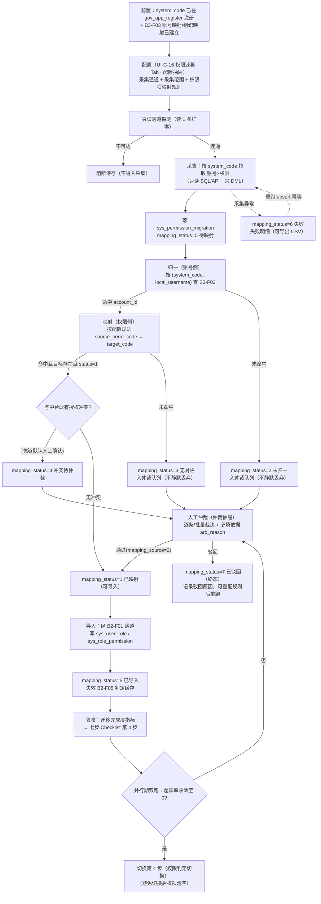
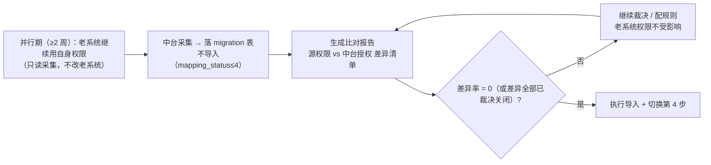
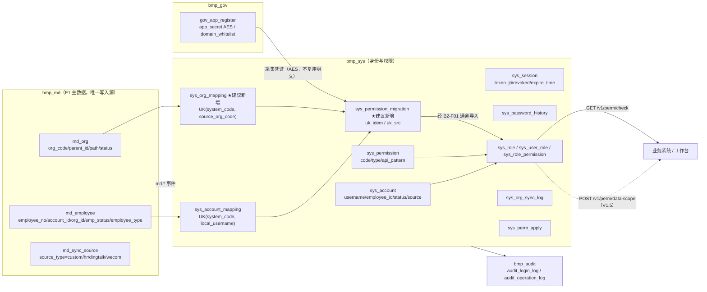
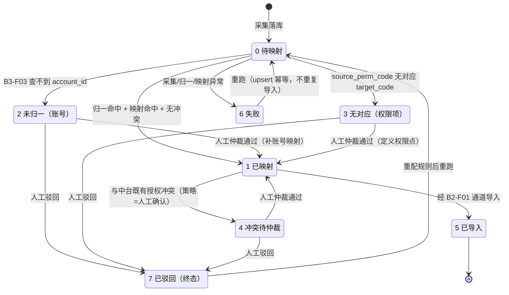
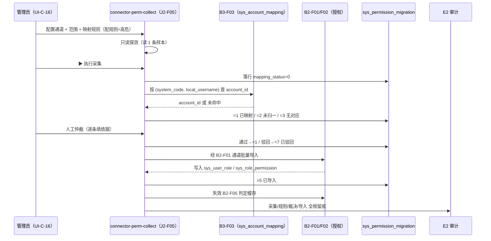

# 03 · 用户权限集成（流程专项文档）

> **文档性质**：**派生文档（视图层）**，非权威源。所有编号、表结构、接口、版本**一律以《麓邦业务中台产品PRD》+《V1.0 基座版详细设计》为准**；冲突时以真源为准。
> **母版**：`00-专项文档写作规格（统一模板）.md`（7 章结构，顺序不变）。
> **生成日期**：2026-10-19 ｜ 撰写角色：产品经理 + 解决方案架构师

---

## §0 文档说明

**覆盖范围（V1.5 口径 · 2026-10-21 与 PRD §10.4 #4 对齐）**：`B1-F01`~`F07`（身份认证与会话，均 V1.0；`B1-F02-1~4` 子项 V1.5）｜`B2-F01` 角色管理 / `B2-F02` 功能权限 / `B2-F05` 权限校验服务（V1.0）｜**`B2-F03` 数据权限（⚠️ V1.5，非 V1.0）**｜`B2-F04` 权限申请与审批（P1/V1.5）｜`B3-F01`/`B3-F02`/`B3-F03`（P0/V1.0）｜**七步第 4 步：存量 RBAC **离线导入** + `/v1/perm/check` 切换（实施 Runbook + 审计）**｜**`J2-F05` 在线采集适配器 = V2.0 备选，V1.5 不交付管理端 Tab**。

**不在范围内**：① 应用注册与凭证发放（`I1-F01`/`I1-F05`/`I1-F06` 的 secret 签发与白名单）归《01-应用接入集成》——本流程**仅提及「权限判定切换」在七步 Checklist 中的位置**，不写 secret 明细；② F1 主数据建模与写入（`F1-F01`~`F05`）——本流程**只读** `md_org`/`md_employee`/`md_sync_source`；③ 工作流引擎（C1）流程定义与审批矩阵（`B2-F04` V1.5 **消费** C1，不定义）；④ E1 路由管理（仅引用其**鉴权执行点**角色）。

**真源索引**：PRD §4.1（`PRD:992`）/§4.3（`PRD:1052`）/§4.6 七步 Checklist（`PRD:1120`）/§6.2（`PRD:3862`）/§1.4（`PRD:69`）｜详细设计 §3.2（`详细设计:123`）/§4.2（`:472`）/§4.3（`:485`）/§4.4bis（`:517`）/§6.3（`:884`）｜`增量需求-存量权限采集与权威源切换.md`（D11/D12/D14）｜`增量UIUX与原型交互设计.md`（§13 表定稿 / §14 `system_code` 值域 / §15 `employee_type` / §16 目录 / §17 版本裁定）｜UIUX：`UI-C-01`~`05`、`UI-C-07`、`UI-C-09`、`UI-C-14`、`UI-C-16` 域（**无 V1.5 组织对照独立页**；**无 V1.5 权限迁移 Tab**，J2-F05 在线采集已废止 §10.4 #4）。

**派生方案指针（2026-10-21 · 客户确认）**：**UI-C-03** 按 **接入系统（`app_code`）** 与 **业务域（`biz_domain`）** 筛选权限点（**B2-F02-1**），与流程应用 `portal_app.biz_domain`、`workflow:instance:start:{defKey}` 挂载对齐 —— 见 `outputs/规范/产品技术方案/流程应用化与分域权限-产品方案.md`；原型 `console.html?page=permissions`。

**术语表（5 条）**：

| 术语 | 含义 |
| --- | --- |
| 权威源（`custom`） | D12：**自建维护为人员/组织唯一写入源**；钉钉退为 SSO 入口 + 组织初次导入（`md_sync_source.source_type=custom`）。 |
| 账号归一 | 用 `(system_code, local_username)` 查 `sys_account_mapping` 得 `account_id`（`J2-F05` 账号侧）。 |
| `mapping_status` | `J2-F05` 迁移行的**八态**（0~7），`7 已驳回` 为**终态**。 |
| H1 完整性等式 | 任意批次须满足「源侧采集行数 ≡ 八态计数之和」，可 SQL 核对。 |
| 不静默丢弃 | 横切原则：未归一/未命中/未映射一律**入队可查**，禁止 skip、默认授权、静默过滤。 |

---

## §1 产品价值

### 1.1 业务痛点（现状 → 后果）

| # | 现状 | 后果 | 依据 |
| --- | --- | --- | --- |
| 1 | **5 套存量系统各自建号**，账号无统一权威源，登录名/工号口径各异 | 同一人存在多套账号；**人员离职后子系统账号与权限残留**，「人已走、权限还在」，越权与合规风险；无法统计「统一账号覆盖率」 | `PRD §6.2 B1-F01`（`PRD:3876`「禁止多源建号」）；`PRD §4.1` 业务规则 1（`PRD:1020`） |
| 2 | **存量授权关系不清楚**（谁在老系统有什么权限，无台账） | 七步 Checklist **第 4 步「权限判定切换」无数据来源** → 切换后**全员权限清空**；客户定性为「**比 SSRF 断链更严重的功能事故**」 | `PRD §4.6` 第 5 条（`PRD:1138`）；`PRD:15306`；`需求澄清(权威源) :809` |
| 3 | **应用的组织结构与中台组织对不上**（仅有账号映射，无组织映射） | 中台不掌握「该应用的组织 A = 中台的组织 B」；B2-F03 数据权限（V1.5）**无法判定组织范围**，范围下发后落到查询上仍为**静默失效** | `PRD §6.2 B3-F03`（`PRD:5789`「组织/部门映射缺失」）；`详细设计 §3.2`（`:173`）；`PRD §4.6` 第 4 条（`PRD:1137`） |
| 4 | **登录策略、密码策略、锁定策略散落各系统**（复杂度/有效期/失败锁定各配一套） | 凭证安全口径不一致；管理员无法全局配置「失败 5 次锁 30 分钟」；清 Cookie 即可绕过单系统锁定 | `PRD §6.2 B1-F05`（`PRD:4407`）、`B1-F02 ⑨#5`（`PRD:4111`） |
| 5 | **权限校验由各系统自行实现**（硬编码判断、缓存不管、异常时默认放行） | 同一权限码在不同系统结果不一致；服务异常时 **fail-open 放行**造成越权；无统一拒绝留痕 | `PRD §6.2 B2-F05`（`PRD:5440`、`PRD:5470`）、`PRD §4.6` 第 4 步 |

### 1.2 价值主张（三类角色分述）

| 角色 | 获得什么 |
| --- | --- |
| **业务用户** | 一次登录访问全部授权系统（免登直达）；转岗/离职后**权限自动收敛**（不残留、不越权）；无权限时按钮隐藏、可一键发起权限申请（V1.5 接 C1 审批）。 |
| **研发（接入方）** | 不再自建账号/登录/权限模块：SSO 走标准 OIDC，权限判定**一行注解**（`@PermCheck`）+ 前端 `v-perm` 指令；接入验收物明确（七步 Checklist 第 3/4 步）。 |
| **运维与管理员** | 账号/角色/权限点/**组织映射**集中配置；存量授权关系**可采集、可仲裁、可对账**再由中台统一授权；授权变更**全程 E2 留痕**（before/after 快照）。 |

### 1.3 量化收益

**引用 PRD §1.4 北极星指标**（`PRD:69`）：

| 指标 | 目标值 | 本流程关系 |
| --- | --- | --- |
| 工作台日均使用率 ≥70% | PRD 已有 | **本流程直接贡献**（SSO 免登 + 统一入口降低使用门槛） |
| 存量重复公共模块停建/下线执行率 100% | PRD 已有 | **本流程直接贡献**（身份/权限/组织同步由中台统一承接后，子系统公共模块方可停建） |
| 新系统接入周期 ≤5 人日（V2.5 起） | PRD 已有 | **本流程间接贡献**（接入方无需自建权限模块；`B2-F05` 验收项「接入方仅加 `@PermCheck` 即可生效」，`PRD:5479`） |
| 新系统基础模块研发工作量下降 ≥30%/≥70% | PRD 已有 | **间接贡献**（同上） |

**本流程特有指标**（PRD 验收项，非 §1.4 北极星）：组织人员口径一致率 **≥99%**（`PRD:5582`）、账号唯一率 **100%**（`PRD:3971`）、权限校验 **P95<50ms**（`PRD:5478`）、**5 套存量系统 SSO 接入**为 V1.0 验收线（`PRD:4115`）。

### 1.4 不做会怎样（量化风险）

| 不做 | 后果（引用 PRD 已有表述） | 依据 |
| --- | --- | --- |
| 不做存量权限迁移（`J2-F05`）而切换第 4 步 | **切换后全员权限清空**——「比 SSRF 断链更严重的功能事故」 | `PRD:1138`、`PRD:15306`、`PRD:15474` |
| 不做组织映射（`sys_org_mapping`） | 数据权限**静默失效**：范围不生效、不报错、事后才发现（高等级风险 R1/R2） | `PRD §6.2 B2-F03 ⑨#1`（`PRD:5198`）、`PRD:5204` |
| 不做统一账号（`B1-F01`） | 离职后**子账号与权限残留**；无统一停用+会话踢出 → 「人已离职但仍持有效令牌」 | `PRD:4618`、`PRD:4635` |
| 不做统一权限校验（`B2-F05`） | 各系统判定口径不一致；服务异常时 **fail-open 放行** → 越权 | `PRD:5470`、`PRD:5481` |
| 不做 `B3-F03` 映射而分发 | 账号动作**定位失败** → 离职账号留活（「不静默忽略」为硬要求） | `PRD:4639`、`PRD:5748` |

---

## §2 用户故事（≥6 条，含管理员视角 ≥2、异常场景 ≥2）

### US-1（主流程·普通员工）统一登录
> 作为**存量系统用户**，我希望**一次登录后免登直达全部授权系统**，以便**不再逐系统重复登录**。

- **验收标准（Given-When-Then）**：Given 用户拥有 5 套系统访问权；When 完成一次 OIDC 登录（`/oauth2/authorize` → `POST /oauth2/token`）；Then 点击 5 个系统图标**均免登录直达**（V1.0 验收线）。
- **关联功能点**：`B1-F02`（`PRD:4115`）、`E1-F02`、`B1-F03`（老系统走票据换取）。

### US-2（主流程·员工）离职安全闭环
> 作为**离职员工**（及其直管上级），我希望**离职后账号立即停用且全部会话失效**，以便**组织资产与权限不被带走**。

- **验收标准**：Given F1 发布 `md.employee.deactivated`；When B3-F02 分发 → B1-F06 执行；Then `sys_account.status=0` 且 `sys_session.revoked=1` 全量置位，既有令牌**全部校验失败（≤30s）**。
- **关联功能点**：`B1-F06`（`PRD:4643`、`PRD:4644`）、`B1-F07`（`PRD:4747`）。

### US-3（管理员·账号）统一建号与应急通道
> 作为**账号管理员**，我希望**常规建号只走主数据事件驱动、应急时可手工建号并留痕**，以便**账号来源可审计、不出现多源建号**。

- **验收标准**：Given 管理员在 `UI-C-01` 建号；When `source=2/3`（紧急通道）；Then 必须填 `reason` + `approver` 且 `audit_operation_log` 可查到；`source=4`（中台自建，D12 配套）**不走审批留痕**。
- **关联功能点**：`B1-F01`（`PRD:3889`、`PRD:3974`）；`md_employee.employee_type=3` 维护账号（`详细设计:228`）。

### US-4（管理员·权限）角色/权限点/授权集中维护
> 作为**权限管理员**，我希望**在 `UI-C-02`/`UI-C-03` 集中维护角色、权限点与授权关系**，以便**子系统不再自建权限模块**。

- **验收标准**：Given 管理员配置角色权限；When 保存；Then 写 `sys_role_permission` / `sys_user_role`（联合唯一），**失效 B2-F05 判定缓存**，被授权用户**下一次请求**即生效（≤60s）；非超管**不得修改 `system:*` 权限点**、**不得授予 `system:role:grant`**。
- **关联功能点**：`B2-F01`（`PRD:4847`、`PRD:4918`）、`B2-F02`（`PRD:5058`）、`B2-F05`（`PRD:5483`）。

### US-5（实施·映射）组织对照离线导入（`B3-F03` · V1.5 无控制台页）
> 作为**集成/实施管理员**，我希望**经审批的连接器或脚本批量导入源系统组织 ↔ 中台组织对照**，以便**改造期非钉钉编码可收敛**；**全钉钉标识应用不必维护对照表**（§10.4 #13）。

- **验收标准**：Given 应用仍使用非钉钉 `source_org_code`；When 实施按 `mapping_type`（1 精确 / 2 前缀 / 3 默认归属）批量导入；Then 落 `sys_org_mapping`（UK `(system_code, source_org_code)`），**未映射行 `sync_status=0` 入冲突队列、不静默丢弃**；收敛判据 `count(sync_status ∈ {0,2,3}) = 0`。**Given 标准路径且对齐键为钉钉**；When 接入七步第 3 步验收；Then **不要求**全量对照表。**V1.5 控制台不提供** `app-register-mapping` 菜单。
- **关联功能点**：`B3-F03`（`PRD:5789`、`PRD:5834`、`PRD:5838`）。

### US-6（管理员·迁移）存量授权关系迁移
> 作为**权限管理员/实施**，我希望**采集 5 套存量系统的授权关系、经人工仲裁后导入中台**，以便**第 4 步切换时权限不为空**。

- **验收标准**：Given `B3-F03` 账号映射与组织映射已建立；When 执行采集 → 归一 → 映射 → 仲裁 → 导入；Then 迁移完成度六项计数可核对，**H1 等式成立且批次结束 `待映射(0)=0`**；**仲裁队列清空（`mapping_status ∈ {2,3,4}` 为 0，`7 已驳回` 不计入）**。
- **关联功能点**：`J2-F05`（`PRD:1138`、`PRD:15488`）。

### US-7（异常·映射缺失不静默丢弃）
> 作为**集成管理员**，我希望**映射缺失/冲突时不静默忽略而是入队告警**，以便**事故可发现、可补齐**。

- **验收标准**：Given 新增存量账号未补录映射 / 源组织无对应映射；When 分发或同步执行；Then **告警 + 冲突队列**，分发侧**降级为延迟处理而非丢弃**；`J2-F05` 侧对应 `mapping_status=2 未归一` 或 `=3 无对应`（均入仲裁队列）。
- **关联功能点**：`B3-F03`（`PRD:5905`、`PRD:5838`）、`J2-F05`（`增量需求 :290`「不静默丢弃」、`需求澄清(权威源) :913` 归一映射规则配置化）。

### US-8（异常·校验服务不可用须拒绝）
> 作为**安全负责人**，我希望**权限校验服务异常时一律拒绝而非放行**，以便**故障不演变为越权**。

- **验收标准**：Given 模拟 `B2-F05` 服务不可用 / `permission code` 不存在 / Redis 故障；When 业务请求到达；Then **fail-closed 拒绝**（返回失败），**绝不 fail-open 放行**，并告警。
- **关联功能点**：`B2-F05`（`PRD:5470`、`PRD:5481`）、`B2-F02`（`PRD:5051`）、`B1-F07`（`PRD:4776` Redis 不可用 fail-closed）。

### US-9（异常·采集通道不可达可重跑）
> 作为**实施管理员**，我希望**采集失败可重跑、部分失败不整体回滚**，以便**不因一次网络抖动推翻已成功的数据**。

- **验收标准**：Given 老系统不可达/源表结构变化；When 采集执行；Then **重试 3 次 → 告警 + 明确报错（不静默）**，**部分失败不整体回滚**，成功行保留且按幂等键可重跑（**不重复导入**）。
- **关联功能点**：`J2-F05`（`增量需求 :202`、`PRD:15382`「可重跑」、`PRD:15383`「部分失败不整体回滚」）。

### US-10（管理员·审计）授权变更全留痕
> 作为**审计员**，我希望**授权/映射/仲裁的每次变更都可检索**，以便**合规追溯「谁在何时改了谁的权限」**。

- **验收标准**：Given 任一授权变更、组织映射更正、仲裁裁决；When 查询 `audit_operation_log`；Then 可查到**操作人/目标/原因/时间**与 before/after 快照。
- **关联功能点**：`B2-F01`（`PRD:4922`）、`B3-F03`（`PRD:5830`）、`J2-F05`（`增量需求 :164`）、`E2-F03`。

---
## §3 业务流程

### 3.1 主流程（**两条链路**，节点标注功能点编号）

**链路 A · 身份与权限主链路**（F1 主数据 → B3 分发 → B1 账号 → B2 授权 → E1 网关校验）

```mermaid
flowchart TD
    F1["F1 主数据（权威源 = custom）<br/>md_org / md_employee<br/>唯一写入源，B1/B2/B3 只读"] -->|"F1-F04 写 event_outbox"| J3["J3 事件中心<br/>md.org.* / md.employee.*<br/>event_id 幂等 · 至少一次"]
    J3 --> B3F01["B3-F01 组织同步<br/>组织维度消费 → 刷缓存 + 映射组织维度"]
    J3 --> B3F02["B3-F02 人员异动分发<br/>人员维度消费 → 触发账号动作"]
    B3F03["B3-F03 系统人员组织映射<br/>sys_account_mapping（账号级）<br/>sys_org_mapping（组织树级）"] --> B3F01
    B3F03 --> B3F02
    B3F02 --> B1F01["B1-F01 账号统一管理<br/>开通 sys_account（source=1/4）"]
    B3F02 --> B1F06["B1-F06 账号生命周期<br/>转岗重算 / 离职停用"]
    B1F01 --> B1F05["B1-F05 密码策略<br/>BCrypt + 复杂度/锁定"]
    B1F01 --> B1F07["B1-F07 会话与令牌治理<br/>sys_session / jti 吊销"]
    B1F06 --> B1F07
    B1F07 --> B1F02["B1-F02 SSO 单点登录<br/>OIDC 授权码 + PKCE"]
    B1F02 --> B1F04["B1-F04 MFA（默认关）"]
    B1F02 --> B1F03["B1-F03 认证适配层<br/>一次性 ticket 换令牌"]
    B1F03 --> E1F03["E1-F03 网关 LegacyAuthFilter<br/>（执行点在网关）"]
    B1F01 --> B2F01["B2-F01 角色管理(RBAC)<br/>sys_role / sys_user_role"]
    B2F02["B2-F02 功能权限<br/>sys_permission 三级权限点"] --> B2F01
    B2F04["B2-F04 权限申请与审批<br/>V1.0 登记版 / V1.5 接 C1"] --> B2F01
    B2F01 --> B2F05["B2-F05 权限校验服务<br/>GET /v1/perm/check"]
    B2F02 --> B2F05
    B2F05 --> E1F02["E1-F02 统一鉴权<br/>验签 → jti → api_pattern → 注入上下文"]
    B1F07 --> E1F02
    B2F03["B2-F03 数据权限（V1.5）<br/>POST /v1/perm/data-scope"] -.V1.0 仅预留列.-> B2F05
    B2F05 --> APP["业务系统 / 工作台（A1）<br/>@PermCheck · v-perm 指令"]
    B2F03 -.范围下发.-> APP
    B1F02 --> E2["E2 审计<br/>audit_login_log / audit_operation_log"]
    B1F06 --> E2
    B2F01 --> E2
    B3F01 --> E2
```

**链路 B · 存量 RBAC 离线导入链路（V1.5）**——导出/脚本 → 归一 → 映射 → 仲裁 → 导入，**含 `mapping_status` 八态流转**（**非** J2-F05 在线 UI；V2.0 可选在线方案见 `J2-F05` 详规）



**并行期双跑核对（防「权限清空」关键控制点）**



### 3.2 角色与职责

| 角色 | 在本流程中的动作 | 涉及界面/接口 |
| --- | --- | --- |
| 普通员工 | 登录（密码/扫码）、改密、查看本人会话、按 `v-perm` 看到可见菜单/按钮、发起权限申请 | `UI-LOGIN-01`/`03`/`04`、`UI-C-05`、前端 `v-perm` |
| 存量系统用户 | 经适配层票据换取免登录进入老系统（无感知） | `POST /v1/auth/ticket/exchange`、`UI-C-16` |
| 业务系统（接入方） | 发起 OIDC；调 `/v1/perm/check`；`@PermCheck` / `v-perm` | `GET /oauth2/authorize`、`POST /oauth2/token`、`GET /v1/perm/check` |
| `super_admin` 超管 | 配置登录/密码/会话/生命周期策略；角色与权限点定义；授予角色；映射与采集总控 | `UI-C-01/02/03/04`、`UI-C-16` |
| 账号管理员 | 紧急通道建号、更正、停用、重置密码（高危确认） | `UI-C-01` |
| 权限管理员 | 裁决仲裁、执行导入；**不可改采集配置/映射规则** | `UI-C-16` 权限迁移 Tab |
| 集成/运维管理员 | 账号映射 + **组织映射**维护、采集重跑、同步日志排障 | `UI-C-16` 组织映射 Tab、`UI-C-09` |
| `audit_viewer` 审计员 | 只读检索授权变更、映射变更、仲裁留痕、登录日志 | `UI-C-14`、`UI-C-09` |
| F1 主数据 | **唯一写入源**（B3/B1/B2 只读）；发布 `md.*` 事件 | `event_outbox`、`POST /v1/md/subscribe` |
| E1 网关 | 执行鉴权（验签 → jti → `api_pattern` → 注入上下文）；**只校验、不自签、不吊销** | `E1-F02`、`LegacyAuthFilter`（`E1-F03`） |
| 存量系统（订阅方） | 订阅组织/人员事件、更新只读缓存；只读查询本系统映射 | `POST /v1/sync/org`、`POST /v1/sync/user`、`GET /v1/sync/mapping` |

### 3.3 分步说明

**A. 身份与权限主链路**

| # | 触发条件 | 执行动作 | 关键规则（BR 引用） | 异常分支 |
| --- | --- | --- | --- | --- |
| A1 | F1 组织/人员变更 | F1-F04 写 `event_outbox` → J3 投递（每 1s 扫描 unpublish） | 单向 F1→B3；至少一次；`event_id` 幂等（`PRD:5586`） | 投递失败重试 3 次（1m/5m/30m）→ 死信 + 人工重放（`PRD:5589`） |
| A2 | 收到 `md.org.*` | B3-F01 消费 → 更新映射组织维度 + 失效组织树缓存 → 分发给订阅方 | 同步时效 **≤10 分钟**；口径一致率 **≥99%**（`PRD:5582`） | 订阅方不可达 → 重试 3 次 → 死信（`PRD:5611`） |
| A3 | 收到 `md.employee.created` | B3-F02 → 经 B3-F03 解析 `account_id` → 触发 B1-F01 开通 | 常规建号**仅此一条路径**；预置「普通员工」角色（`PRD:3902`） | 员工已离职 → 拒绝建号（`PRD:3965`）；已有账号 → 幂等返回 `accountId`（`PRD:3964`） |
| A4 | 收到 `md.employee.transferred` | B1-F06 角色重算（回收敏感角色）+ 数据范围重算标记（V1.0 仅记标记） | 默认回收敏感角色（`PRD:4571`）；V1.0 无 B2-F03（`PRD:4655`） | 事件乱序 → 以最终 `emp_status` 为准（`PRD:4616`） |
| A5 | 收到 `md.employee.deactivated` | B1-F06 置 `status=0` → 全量 `sys_session.revoked=1` → 待办转交 → 审计+通知 | 离职 **≤24h 内停用**（实测秒级）；**会话踢出 ≤30s**（`PRD:4615`） | 映射缺失 → 告警 + 人工队列（**不静默忽略**，`PRD:4639`） |
| A6 | 用户访问业务系统（未登录） | 302 → `/oauth2/authorize`（PKCE）→ 登录页 → code → `POST /oauth2/token` | 仅授权码 + PKCE（S256）；code 单次消费；refresh 轮换（`PRD:4086`） | `redirect_uri` 非白名单 → **不跳转**（防开放重定向，`PRD:4041`） |
| A7 | 用户访问老系统（无标准令牌） | `LegacyAuthFilter` → 反代校验老系统会话 → 签一次性 ticket → 换标准 JWT | ticket **one-time + 5min + 不共享 Cookie**（`PRD:4223`） | 校验接口超时 → **fail-closed 拒绝放行**，绝不 fail-open（`PRD:4227`） |
| A8 | 配置角色/权限/成员 | `UI-C-02` 保存 → 写 `sys_role` / `sys_role_permission` / `sys_user_role` → **失效 B2-F05 缓存** | 内置角色 `type=1` 不可删；`system:role:grant` 仅超管（`PRD:4880`） | 非超管改 `system:*` → 硬拦截（`PRD:4918`） |
| A9 | 业务请求到达 | E1-F02 接口级校验 → 业务代码 `@PermCheck` → B2-F05 判定 | 网关粗粒度 + 服务细粒度**双层不重复**（`PRD:5382`） | `code` 不存在/服务不可用/缓存故障 → **全部拒绝 fail-closed**（`PRD:5452`） |
| A10 | 转岗/组织调整（V1.5） | B2-F03 读角色范围配置 + `md_employee.org_id` + `md_org.path` → **实时重算** `orgIds` | 不落地快照（防范围漂移，`PRD:5175`） | 账号无角色/无组织 → 返回**最小范围 SELF**，不返回全量（`PRD:5120`） |

**B. 存量权限迁移链路（`J2-F05`）**

| # | 触发条件 | 执行动作 | 关键规则 | 异常分支 |
| --- | --- | --- | --- | --- |
| B1 | 管理员开启配置抽屉 | 选 `system_code` → 配通道/范围/映射规则 → **只读探测** | 未注册应用**不得采集**；地址过 `domain_whitelist` 防 SSRF（`增量需求 :146`、`:147`） | 探测失败 → **阻断保存**（`增量需求 :188`） |
| B2 | 执行采集 | 只读拉取「账号 × 权限」→ 落 `sys_permission_migration`（`mapping_status=0`） | **只读语句，禁 DML**（老系统权限仍归老系统，`PRD:4210`） | 源表结构变化 → 该批次标失败 + 明确报错（**不静默**，`增量需求 :203`） |
| B3 | 采集行落库后 | 归一：`(system_code, local_username)` 查 `B3-F03` | 强依赖 `B3-F03`；**不猜测账号**（`增量需求 :190`） | 未命中 → `=2` 入仲裁队列 + 直达账号映射链接（`增量需求 :204`） |
| B4 | 归一成功后 | 映射：`source_perm_code` → `target_code`（配置规则） | 规则**必须配置化**；目标须存在且 `status=1`（`增量需求 :191`） | 未命中 → `=3` 入仲裁队列，**不自动建权限点**（`增量需求 :205`） |
| B5 | 映射成功 | 与中台既有授权比对 | 冲突策略默认**人工确认**（`增量需求 :192`） | 冲突 → `=4` 入仲裁队列 |
| B6 | 入队后 | 人工仲裁：逐条/批量裁决 + **必填依据** | **默认无「整批通过」**；`mapping_source=2` 优先于自动规则（`增量需求 :233`、`:213`） | 驳回 → `=7 已驳回`（**终态**），记录 `arb_reason`/`arb_by`（`详细设计:304`） |
| B7 | 无冲突且已映射 | 经 **B2-F01 通道**批量导入 → 失效 B2-F05 缓存 | **只搬授权关系**：不造身份/不造权限点/不造角色（`增量需求 :139`） | 部分失败 → **事务分批，成功行已入库**、失败明细可导 CSV（`增量需求 :207`） |
| B8 | 批次结束 | 输出迁移完成度六项计数 → 供第 4 步验收 | **H1 等式成立**；`待映射(0)=0`；仲裁队列清空判据**不含 `7`**（`详细设计:315`、`PRD:1138`） | 未收敛 → **不导入、不切换**（`增量UIUX §18.3`） |

### 3.4 异常与边界（≥4 条）

| # | 场景 | 系统行为 | 用户可见结果 | 是否阻断 |
| --- | --- | --- | --- | --- |
| E1 | **映射缺失致账号动作定位失败**（`sys_account_mapping` 无记录） | 告警 + 入人工队列；分发侧**降级为延迟处理而非丢弃** | 同步日志可见告警；`J2-F05` 侧行落 `=2 未归一` 并给「去映射」直达链接 | **是**（需人工补齐） |
| E2 | **未映射组织不静默丢弃**（`sync_status ∈ {0,2,3}`） | 入冲突队列 + 告警；**该系统的组织映射不可启用**，其权限迁移被前置阻断 | 组织映射 Tab 显示「待映射」并给出收敛判据 | **是**（前置阻断） |
| E3 | **权限判定服务异常 / 权限码不存在 / Redis 故障** | **fail-closed**：一律拒绝 + 告警 + 拒绝留痕 | 用户见无权限提示（可发起申请） | **是**（安全红线，不阻断系统但拒绝访问） |
| E4 | **`uk_idem` 相关列被加 `NOT NULL`**（实施误操作） | 未归一/未命中行（`account_id`/`target_code` 为 NULL）被判重**漏采集** | 迁移计数异常、H1 等式不成立 | **是**（实施红线） |
| E5 | **老系统不可达 / 凭证失效 / 表结构变化** | 探测阶段阻断配置；采集阶段重试 3 次 → 告警 + 明确报错；**部分失败不整体回滚**，可重跑 | 失败明细（字段级原因）可导出 CSV | 否（降级，可重跑） |
| E6 | **越权采集**（采集未登记系统 / 跨 `system_code`） | `gov_app_register` + `domain_whitelist` **双重校验拒绝** + 审计告警 | 配置无法保存 | **是**（拒入） |
| E7 | **误配映射规则致提权**（源权限批量映射到高权角色） | `HighRiskConfirm` + **影响面提示（受影响账号数）** + E2 审计；导入前快照可回退 | 二次确认弹窗显示影响面 | **是**（高危二次确认） |
| E8 | **并行期差异未收敛即尝试切换第 4 步** | 阻断切换或强提示，**不出现「切换后全员权限清空」** | 进度条显示迁移完整率未达标、差异清单未清零 | **是**（核心风控） |
| E9 | **事件乱序**（先离职后收到转岗） | **离职为终态优先**：停用账号不被转岗事件复活；冲突记异常 + 告警 | 账号保持停用 | 否 |
| E10 | **清 Cookie 绕过登录锁定** | 锁定以**账号维度**服务端累计（Redis + `sys_account.status=2`），与 Cookie 无关 | 重新登录仍提示锁定 | 否 |

### 3.5 版本归属

| 步骤 | 功能点 | 版本 | 说明 |
| --- | --- | --- | --- |
| A1 事件投递（J3 Outbox 简化版） | `J3` / `F1-F04` | V1.0 | 仅主数据域 5 事件（`详细设计:36`、`:862`） |
| A2 组织同步 | `B3-F01` | V1.0 | (`PRD:5507`) |
| A3 人员异动分发 | `B3-F02` | V1.0 | (`PRD:5641`) |
| A3 账号开通/变更/停用 | `B1-F01` / `B1-F06` | V1.0 | (`PRD:3869`、`PRD:4533`) |
| A3/A5 映射（账号级 + 组织级） | `B3-F03` | **P0 / V1.0** | `sys_org_mapping` **建议新增，待实施确认**（`详细设计:966`） |
| A4 密码策略 | `B1-F05` | V1.0 | (`PRD:4400`) |
| A4 MFA | `B1-F04` | P1 / V1.0（**开关默认关闭**） | (`PRD:4275`、`PRD:4282`) |
| A5 会话与令牌治理 | `B1-F07` | V1.0 | (`PRD:4668`) |
| A6 SSO 单点登录 | `B1-F02` | V1.0（**子项 1~4 为 V1.5**） | (`PRD:3993`) |
| A7 认证适配层 | `B1-F03` | V1.0 | (`PRD:4142`)；过渡态**纳入下线计划** |
| A8 角色管理 / 功能权限 | `B2-F01` / `B2-F02` | V1.0 | (`PRD:4807`、`PRD:4941`) |
| A8 权限申请与审批 | `B2-F04` | P1 / **V1.5**（V1.0 线上登记版） | (`PRD:5236`) |
| A9 权限校验服务 | `B2-F05` | V1.0 | (`PRD:5371`) |
| A10 数据权限 | `B2-F03` | ⚠️ **P1 / V1.5**（**非 V1.0**） | (`PRD:5081`)；V1.0 仅预留 `sys_role.data_scope_reserved` 列 + 接入规范前置 |
| B1~B8 存量权限迁移 | `J2-F05` | P0 / **V1.5**（V1.0 前移待拍板） | (`增量需求 :108`、`增量UIUX §十七`） |
| 权限迁移 UI 承载 | `UI-C-16` 第「权限迁移」Tab | V1.5（承载已实现） | `增量UIUX §3.3`（`增量UIUX:191`） |

---

## §4 数据流

### 4.1 数据流图



### 4.2 数据实体清单

| 实体/表名 | 所属库 | 用途 | 读/写 | 关联功能点 |
| --- | --- | --- | --- | --- |
| `sys_account` | bmp_sys | 统一账号（`employee_id` 一对一锚点） | 写（B1-F01/F05/F06） | `B1-F01`/`F05`/`F06` |
| `sys_password_history` | bmp_sys | 历史密码限制（近 3 次） | 写 | `B1-F05` |
| `sys_session` | bmp_sys | 在线会话（`jti` 与 Redis 同步） | 写（B1-F02/F07），读（E1-F02） | `B1-F02`/`F06`/`F07` |
| `sys_role` | bmp_sys | 角色元数据 + `data_scope_reserved`（**V1.0 只写不读**） | 写 | `B2-F01`（`PRD:5081` 归 B2-F03 V1.5 才读） |
| `sys_permission` | bmp_sys | 三级权限点（菜单/按钮/接口） | 写 | `B2-F02` |
| `sys_user_role` | bmp_sys | 用户↔角色绑定（UK 联合） | 写 | `B2-F01`（`J2-F05` 经此通道导入） |
| `sys_role_permission` | bmp_sys | 角色↔权限点授权（UK 联合） | 写 | `B2-F01`/`B2-F02` |
| `sys_perm_apply` | bmp_sys | 权限申请单（V1.0 线上登记） | 写 | `B2-F04` |
| `sys_account_mapping` | bmp_sys | 账号级桥接；**`system_code` 值域含 `dingtalk`** | 写（B3-F03），读（B1-F03/B2-F05 链路/`J2-F05`） | `B3-F03` |
| `sys_org_mapping` | bmp_sys | **组织树级映射**（★**建议新增，待实施确认**） | 写（B3-F03），读（B2-F03/`J2-F05`） | `B3-F03` |
| `sys_org_sync_log` | bmp_sys | 组织/人员同步可观测；复用为采集日志口径 | 写 | `B3-F01`/`B3-F02`/`J2-F05` |
| `sys_permission_migration` | bmp_sys | 存量授权关系迁移（★**建议新增，待实施确认**；过渡资产） | 写（`J2-F05`） | `J2-F05` |
| `md_org` | bmp_md | 组织树（`path` 物化路径支持子树） | **只读**（F1 唯一写入源） | `B3-F01`/`B3-F03`/`B2-F03` |
| `md_employee` | bmp_md | 人员（含 `employee_type` D14） | **只读** | `B1-F01`/`B1-F06`/`B3-F02` |
| `md_sync_source` | bmp_md | 权威源配置（`source_type=custom`） | **只读** | `F1-F03`（本流程引用） |
| `event_outbox` | bmp_md/bmp_portal/bmp_msg | 事件发件箱（`event_id` 幂等） | 写（F1）、读（J3） | `B3-F01`/`B3-F02` |
| `event_subscriber` | 各域 | 订阅注册（`subscriber_secret` AES） | 写/读 | `B3-F01`/`B3-F02` |
| `gov_app_register` | bmp_gov | 应用注册（未注册不得采集/接入；`domain_whitelist`） | 读（`J2-F05` 校验） | `J2-F05`（前置） |
| `audit_login_log` | bmp_audit | 登录日志 | 写 | `B1-F02`/`B1-F03` |
| `audit_operation_log` | bmp_audit | 授权/映射/仲裁/策略变更留痕（before/after） | 写 | `B1-F05`/`B1-F06`/`B2-F01`/`B2-F02`/`B3-F03`/`J2-F05` |

### 4.3 接口清单

| 接口 | 方法 | 用途 | 调用方 | 详细设计章节 |
| --- | --- | --- | --- | --- |
| `/oauth2/authorize` | GET | 授权端点（授权码 + PKCE） | 业务系统 / 工作台 | §4.2（`详细设计:476`） |
| `/oauth2/token` | POST | 令牌端点（`authorization_code`/`refresh_token`/`client_credentials`） | 业务系统后端 | §4.2（`:477`） |
| `/oauth2/userinfo` | GET | 用户信息（`sub`/`employee_no`/`org`/`roles`） | 业务系统 | §4.2（`:478`） |
| `/.well-known/openid-configuration` | GET | 服务发现 | 接入方 | §4.2（`:479`） |
| `/v1/auth/sso/logout` | POST | **全局登出**（吊销全部 `jti`） | 用户 / 管理端 | §4.2（`:480`） |
| `/v1/auth/ticket/exchange` | POST | 老系统一次性 ticket 换标准令牌 | 存量系统后端 | §4.2（`:481`） |
| `/v1/perm/check` | GET | 功能权限判定（`{allowed,permission}`） | 业务系统 / SDK / 网关 | §4.3（`:488`） |
| `/v1/perm/data-scope` | POST | 数据范围（`{scopeType,orgIds}`）**V1.5，V1.0 预留** | 业务系统 | §4.3（`:491`） |
| `/v1/md/org/tree` | GET | 组织树（`targetOrgId` 取值来源） | 管理端 / 业务系统 | §4.4（`:502`）、§4.4bis（`:526`） |
| `/v1/md/employee/page` | GET | 人员分页 | 管理端 | §4.4（`:504`） |
| `/v1/md/subscribe` | POST | 注册 `event_subscriber` | 订阅方 | §4.4（`:508`） |
| `/v1/sync/mapping` | GET | 账号级/组织级映射查询 | 分发/待办/`B1-F03` | `PRD:5787`（`GET /v1/sync/mapping`）、`PRD:5837` |
| `/v1/sync/org` | POST | 组织同步通知/注册通道 | 订阅方 | `B3-F01` 关联接口（`PRD:5511`） |
| `/v1/sync/user` | POST | 人员异动同步通道（`B3-F02`） | 订阅方 | §5.2 PRD `B3-F02`（`PRD:5645`） |
| `/v1/sync/org-mapping` | GET / POST | **组织映射查询 / 登记更新**（★**建议新增，待实施确认**） | 管理端 / 实施 | §4.4bis（`:523`、`:524`） |
| `/v1/sync/org-mapping/{id}` | DELETE | 组织映射逻辑删除（不级联改 `md_org`） | 管理端 | §4.4bis（`:525`） |
| `/v1/audit/log` | POST | 审计上报（批量 ≤100 条） | 业务系统 / SDK | §4.7（`:708`） |

### 4.4 关键字段与约束（只列本流程关键项，**未全量抄表**）

**① `sys_account_mapping`（账号级桥接）**

| 项 | 口径 | 依据 |
| --- | --- | --- |
| UK | **`(system_code, local_username)`** | `详细设计:165`；`PRD:5806` |
| **`system_code` 值域** | CRM/REC/OKR/KMS/DATA **+ `dingtalk`**（承载钉钉 `unionId`/`userid`，**非原系统账号**；D12 后钉钉不作人员主数据源，userid **不进 `md_employee`**） | `详细设计:167`；`增量UIUX §十四`（`:819`） |
| `sync_status` | 映射状态（存量改造期逐系统补齐） | `详细设计:165` |
| 不含凭证 | **映射表不存任何密码/凭证** | `PRD:5880` |

**② `sys_org_mapping`（组织树级映射，★建议新增，待实施确认）**

| 项 | 口径 | 依据 |
| --- | --- | --- |
| UK `uk_org` | **`(system_code, source_org_code)`**——幂等键 | `详细设计:186` |
| `target_org_id` | BIGINT **NULL**——**未映射 = NULL**；**充分利用 MySQL UK 对 NULL 不去重 → 未映射行不受幂等误判；实施不得加 `NOT NULL`（红线）** | `详细设计:180`、`:186`、`PRD:5791` |
| `mapping_type` | **1 精确 / 2 前缀 / 3 默认归属**（三值须显式校验） | `详细设计:181`、`:189-192` |
| `sync_status` | 0 待映射 / 1 已映射 / 2 冲突 / 3 失败 | `详细设计:182` |
| 通用字段命名 | `id` 雪花 + `create_time`/`update_time`（**不得用 AUTO_INCREMENT / `created_at`**，以 `详细设计 §3.1` 为准） | `详细设计:183`；`PRD:5791` |

**③ `sys_permission_migration`（存量迁移，★建议新增，待实施确认）**

| 项 | 口径 | 依据 |
| --- | --- | --- |
| **UK `uk_idem`** | **`(system_code, account_id, target_type, target_code)`**——幂等键；**`account_id` / `target_code` 允许 NULL**（未归一/未命中），**实施不得为这两列加 `NOT NULL`（红线）** | `详细设计:310` |
| UK `uk_src` | `(system_code, local_username, source_perm_code)`——源侧去重键 | `详细设计:311` |
| `mapping_status` | **八态**：0 待映射 / 1 已映射 / 2 未归一 / 3 无对应 / 4 冲突待仲裁 / 5 已导入 / 6 失败 / **7 已驳回（终态）** | `详细设计:302` |
| `mapping_source` | 1 配置规则自动 / 2 人工仲裁 | `详细设计:303` |
| `arb_reason` / `arb_by` | 仲裁**依据**留痕 + 裁决人（与 E2 双写） | `详细设计:304`、`:305` |
| 无凭证字段 | **表不含任何凭证/密码字段**；采集凭证走 `gov_app_register`（AES、不回显、不落日志） | `详细设计:317` |

**④ `mapping_type` 解析优先级（`sys_org_mapping`）**

> **精确（1）> 前缀（2，最长优先）> 默认（3）**；**同一 `system_code` 内允许多条前缀，匹配时「最长前缀优先」**（如 `/华东/销售` 优先于 `/华东`）；**默认归属每 `system_code` 最多一条**（UK 无法约束，写进规则避歧义）。
> 依据：`详细设计:191`、`:192`、`:194`；`PRD:5881`。

**⑤ `sys_account.source` 四值枚举**（`详细设计:136`、`PRD:3888`）

| 值 | 含义 | 备注 |
| --- | --- | --- |
| 1 | 连接器同步 | 主路径建号（连接器源） |
| 2 | **管理员建** | **属紧急通道**，须 `reason`+`approver` + 审批留痕 |
| 3 | **紧急建号** | **属紧急通道**（与 2 同属一类，`详细设计:140`） |
| **4** | **中台自建（`custom` 权威源，D12 配套）** | ★**建议新增，待实施确认**；**非紧急通道、不走审批留痕**；维护账号（`employee_type=3`）建议同用 `4`（`详细设计:142`） |

> ⚠️ **同名不同义（防踩坑）**：`sys_account.source`（TINYINT，**账号来源**）≠ `md_employee.source`（VARCHAR(20)，**权威源标识**如 `custom`）。D12 后「`source=custom`」指**后者**（`详细设计:139`）。

### 4.5 数据生命周期

| 数据 | 产生 | 流转 | 归档/失效 | 幂等键 |
| --- | --- | --- | --- | --- |
| 账号 `sys_account` | F1 事件驱动（`source=1/4`）或紧急通道（2/3） | → 会话主体 / 角色绑定 / 映射锚点 | **软停用**（`status=0`），保留数据与审计（`PRD:4540`） | `employee_id` 唯一约束兜底（`PRD:3944`） |
| 会话 `sys_session` | 登录/适配换取时落库 | Redis `jti`（TTL=令牌有效期）为即时生效主依据 | 吊销置 `revoked=1` + 删 Redis `jti`；过期自然失效 | `token_jti` UK（`详细设计:157`） |
| 账号映射 `sys_account_mapping` | 存量改造期初始化（首扫/人工清单） | → 分发定位 / 待办收件人 / `B1-F03` 票据换取 / `J2-F05` 归一 | 更正/删除须**高危确认 + 审计 + 触发缓存刷新** | UK `(system_code, local_username)` upsert（`PRD:5883`） |
| 组织映射 `sys_org_mapping` | 接入序列第 2 步登记 | → B2-F03 组织范围解析 / `J2-F05` 组织侧 | 逻辑删除（`deleted=1`），**不级联改 `md_org`** | UK `(system_code, source_org_code)` upsert |
| 迁移行 `sys_permission_migration` | 采集批次产生（`batch_id`） | 归一→映射→仲裁→导入 | **过渡资产**，随老系统改造完成**纳入下线计划**（`详细设计:292`）；按 `batch_id` 可回滚/重跑 | `uk_idem` + `uk_src`（`详细设计:310`、`:311`） |
| 授权关系 `sys_user_role`/`sys_role_permission` | `B2-F01` 通道写入（含 `J2-F05` 导入） | → B2-F05 判定输入 | 变更**主动失效缓存**（60s TTL 兜底）；**V1.5 只增不减**（不支持反向删权，`详细设计:316`） | 联合唯一（`详细设计:148`、`:149`） |
| 事件 `event_outbox` | 业务同事务写入 | J3 投递（≥1 次） | `published=2`（死信）→ 管理端人工重放 | `event_id` UK（`详细设计:277`） |
| 审计 `audit_operation_log` | 各域写入 | E2 检索 | **保留 ≥6 个月**，月分区，仅追加（`详细设计:271`） | —— |

---

## §5 技术逻辑方案

### 5.1 架构落点

| 项 | 落点 | 依据 |
| --- | --- | --- |
| 服务 | **`bmp-server-auth`**（B1+B2+B3，`bmp_sys` 库）；`bmp-server-mdm`（F1，`bmp_md`）；`bmp-server-gateway`（E1，含 `LegacyAuthFilter`）；`bmp-server-audit`（E2）；`bmp-server-event`（J3 简化版 Outbox 投递器） | `详细设计 §2.1`（`:57`、`:58`、`:64`、`:63`、`:65`） |
| 迁移适配器 | **`bmp-project-lubon/connector-perm-collect/`**（项目定制仓库，与 `lubon-legacy-adapter/` 同层）；★**建议新增，待实施确认** | `增量UIUX §十六`（`:849`）；`详细设计:78` |
| 库 | `bmp_sys`（`sys_`）、`bmp_md`（`md_`）、`bmp_gov`（`gov_`）、`bmp_audit`（`audit_`） | `详细设计 §3.1`（`:104-121`） |
| 内核隔离门禁 | `bmp-platform` 各 pom **禁止出现 `bmp-project-*` / `connector-*` 依赖**（CI `maven-enforcer` 检查） | `详细设计:95`（ADR-10）；`增量UIUX:855` |
| 依赖方向 | 连接器/定制**可依赖内核**，内核**禁依赖**定制 | `详细设计:96` |
| 表前缀隔离 | 各域只读写本域前缀表；**跨域只经 API/事件，禁止跨库 JOIN** | `详细设计:98` |

### 5.2 关键机制（每条写「机制 → 解决什么 → 不这么做会怎样」）

| # | 机制 | 解决什么 | 不这么做会怎样 |
| --- | --- | --- | --- |
| **M1** | **H1 完整性等式**：`源侧采集行数 ≡ 待映射(0) + 已映射(1) + 仲裁(2,3,4) + 已导入(5) + 失败(6) + 已驳回(7)`；**批次结束 `待映射(0)=0`** | 采集**行数守恒**：任何一行都有归属、无遗漏、无凭空增加 | 无守恒判据 → 漏采集/重复采集**无法被发现**；「切换后权限清空」可能悄无声息地发生。依据：`详细设计:315`、`增量UIUX §十三③`（`:789`） |
| **M2** | **未归一 / 未命中 / 未映射 一律入队，不静默丢弃**（`=2`/`=3`/`=4`；组织映射 `sync_status ∈ {0,2,3}`） | 让「中台缺项」变得**可见且可补齐**，而非消失 | 静默 skip 会让源侧权限**凭空消失**；`=3` 行被丢弃即等价于「悄悄删权」。依据：`增量需求 :290`、`PRD:5789`（未映射不静默丢弃）、`PRD:5905`（映射缺失不静默忽略）、`PRD:5748` |
| **M3** | **仲裁须逐条填依据**（`arb_reason`/`arb_by`），**默认不提供「整批通过」** | 防止「一键全通过」把未映射项误挂高权角色（提权事故） | 批量静默通过 → 一条误配规则可把**全公司**授权批量放大；且事后无依据可查。依据：`增量需求 :233`、`增量UIUX:910`、`详细设计:304` |
| **M4** | **权限点不复制**：`J1 SDK`（`@PermCheck`/`v-perm`）判定，`J2-F05` **只搬授权关系** | 授权数据**唯一写在 B2**（H2 硬边界），避免各系统复制导致长期漂移 | 复制授权 → 权限判定各行其是；收回权限时**只改了一处**，其余系统仍是旧值（越权残留）。依据：`PRD:4948`、`PRD:5018`、`增量需求 :136` |
| **M5** | **会话与令牌治理**：全局登出吊销该账号**全部 `jti`**；Redis `jti` 删除为**即时生效主依据**，DB `revoked` 为留痕与二次判定 | 离职/强制下线后**所有系统会话同时失效**（≤30s） | 只置 DB 标记而不删 Redis → 令牌在有效期内仍可校验通过 → 「人已离职但仍持有效令牌」。依据：`PRD:4675`、`PRD:4755`、`PRD:4781` |
| **M6** | **SSO 与钉钉的关系（D12）**：**`custom`（自建维护）为权威源**；钉钉**退为 SSO 入口 + 组织初次导入**；`md_sync_source.source_type=custom`；钉钉 `unionId`/`userid` 由 `sys_account_mapping` 的 `dingtalk` 行承载 | 中台**完全掌握**组织人员主数据；钉钉不再是人员源（避免双源口径冲突） | 若钉钉仍作人员主数据源 → 中台主数据被外部系统牵着走，改一次组织要等钉钉同步；且「权威源切换」语义不成立。依据：`详细设计:958`、`详细设计:167`、`增量UIUX §十四`（`:807`） |
| **M7** | **幂等键双轨**：`uk_idem`（已归一+已映射行防重复导入）/ `uk_src`（源侧去重）；组织映射 `uk_org`；账号映射 `(system_code, local_username)`；事件 `event_id`；账号 `employee_id` | 重跑/重放/并发**不产生重复授权或重复账号** | 无幂等 → 重跑一次导入一次 → 授权膨胀；并发建号 → 一号多行。依据：`详细设计:310`、`:311`、`:186`、`:277`、`PRD:3944` |
| **M8** | **UNIQUE 对 NULL 不去重（ND 语义）**：`uk_idem` 的 `account_id`/`target_code`、`uk_org` 的 `target_org_id` **允许 NULL 且禁加 NOT NULL** | 让「未归一/未命中/未映射」行**不受幂等约束**，从而**可被采集与登记** | 一旦加 `NOT NULL`：未归一行**无法落库或被判重丢弃** → H1 等式不成立、迁移漏项。依据：`详细设计:310`、`:186`、`PRD:5791` |
| **M9** | **fail-closed 全线贯彻**：`B2-F05` 判定（`code` 不存在/服务不可用/缓存故障）、`B1-F03` 校验接口超时、`B1-F07` Redis 不可用、`B2-F02` 网关 `api_pattern` 匹配失败 | 安全优先：**故障不演变为越权** | fail-open → 服务一抖动即**全员放行**，安全防线归零。依据：`PRD:5452`、`PRD:4227`、`PRD:4776`、`PRD:5051` |
| **M10** | **授权变更主动失效缓存 + 60s TTL 兜底**：`B2-F01`/`B2-F02`/`J2-F05` 写入后主动失效 `B2-F05` 判定缓存 | 权限变更**尽快生效**（下一次请求），同时避免缓存故障导致长期旧值 | 只靠 TTL → 最长 60s 旧权限残留；只靠主动失效 → 失效失败则永久旧值。依据：`PRD:4847`、`PRD:4891`、`PRD:5472` |
| **M11** | **单向同步 + 只读消费**：F1 → B3 → 订阅方/B1；**B3 不写 `md_org`/`md_employee`/`sys_account`**；`J2-F05` **只读**老系统（禁 DML） | 职责单一、无双写、无反向污染；老系统权限仍归老系统 | 双向写 → 组织口径冲突无法收敛；采集时写老系统 → **改变老系统权限现状**（越权且不可回滚）。依据：`PRD:5499`、`PRD:5586`、`PRD:4210` |
| **M12** | **事件至少一次 + `event_id` 幂等 + 乱序保护（离职终态优先）** | 投递可靠（不丢）且可重放；离职状态**不被后续转岗事件复活** | 乱序无保护 → 离职后收到转岗事件把账号「复活」→ 越权。依据：`详细设计:826`、`PRD:4616`、`PRD:5747` |

### 5.3 时序/状态机

**① `mapping_status` 0~7 八态状态机（`J2-F05`）**



**状态枚举（八态，`TINYINT`）**：

| 值 | 名称 | 含义 | UI 归属区 | 是否终态 |
| --- | --- | --- | --- | --- |
| 0 | **待映射** | 已采集落库，尚未归一/映射 | ❶ 进度（不单独列） | 否（**批次结束须为 0**） |
| 1 | **已映射** | 已归一 + 已匹配目标，可导入 | ❶ 进度 | 否（可导入） |
| 2 | **未归一**（账号） | `B3-F03` 查不到 `account_id` | ❸ 仲裁队列 | 否（待仲裁） |
| 3 | **无对应**（权限项） | 源权限无对应中台 `code` | ❸ 仲裁队列 | 否（待仲裁） |
| 4 | **冲突待仲裁** | 与中台既有授权冲突（策略=人工确认） | ❸ 仲裁队列 | 否（待仲裁） |
| 5 | **已导入** | 经 `B2-F01` 通道写入 `sys_user_role`/`sys_role_permission` | ❶ 进度（已导入计数） | 否（终态前最后一态） |
| 6 | **失败** | 采集/归一/映射异常（字段级原因） | ❷ **失败明细**（可导 CSV） | 否（可重跑） |
| **7** | **已驳回** | 人工仲裁驳回 + 记录 `arb_reason`/`arb_by` | ❸ 仲裁队列**「已关闭」子区** | ✅ **是（终态）** |

> ⚠️ **`7` 为终态的三条硬口径（必须区分）**：
> ① **仲裁队列清空判据 = `count(mapping_status ∈ {2,3,4}) = 0`**，**`7 已驳回` 不计入**——否则「队列清空」判据失真（`PRD:1138`、`增量UIUX:803`）；
> ② **`7` 与 `6` 分属不同视图区**：`6 失败` → ❷ 失败明细区；`7 已驳回` → ❸ 仲裁队列「已关闭」子区，**不得合并**（`增量UIUX:803`、`:339`）；
> ③ `7` **不占待处理计数**、UI 显示为「已关闭」而非「待处理」，但**可重配规则后重跑**（`增量需求 :193`）。

**② 存量迁移时序（正常路径）**



### 5.4 性能与容量

| 项 | 目标值 | 依据 |
| --- | --- | --- |
| 建号（含落库 + 角色绑定） | 单次 P95 <300ms；批量初始化 ≥200 账号/秒 | `PRD:3943` |
| OIDC 全链路（authorize→token） | P95 <1s；token 端点 P95 <200ms | `PRD:4088` |
| 密码校验 | P95 <50ms | `PRD:4479` |
| **权限校验（`/v1/perm/check`）** | **P95 <50ms**（PRD 非功能硬指标）；缓存命中 P95 <10ms | `PRD:5450`、`PRD:5478` |
| 数据范围判定（`/v1/perm/data-scope`） | P95 <50ms；组织树 Redis 缓存 5min；判定结果本地缓存 60s（**V1.5**） | `PRD:5176` |
| 角色列表 / 成员批量绑定（≤500 人） | P95 <200ms / P95 <2s | `PRD:4889` |
| 会话查询 / `jti` 校验 | P95 <200ms / P95 <10ms；**强制下线 ≤30s 生效** | `PRD:4753`、`PRD:4781` |
| 异动同步时效（含分发） | **≤10 分钟**；单事件分发 P95 <2s；批量 ≥500 人/分钟 | `PRD:5587`、`PRD:5724` |
| 离职停用 | **≤24h 内**（实测应秒级触发）；**会话踢出 ≤30s** | `PRD:4615` |
| 映射查询 | P95 <50ms；批量导入 ≥1000 条/次 | `PRD:5882` |
| `J2-F05` 采集/导入容量 | 支持 **5 套系统 × 全量人员**；参照 `B3-F03` ≥1000 条/次、`F1-F03` 单次全量 ≥5000 人；**分批 + 可断点续跑**（防大事务） | `增量需求 :292` |
| 组织树查询 / 单次同步（含分发） | P95 <200ms / P95 <2s | `PRD:5587` |
| 权限服务可用性 | ≥99.9% | `PRD:5453` |
| ⚠️ 数据权限改造 | 成本**明显高于**接口权限改造（存量回填 + 查询面广 + 验证复杂 + **静默失败**），须向客户明确预算与顺序 | `PRD:5180` |

### 5.5 安全与合规

| 项 | 设计 | 依据 |
| --- | --- | --- |
| 密码 | **BCrypt(cost≥10)**；明文**永不落库、不入日志、不回显**；策略下限保护（`minLength` 不得 <8） | `详细设计:888`、`PRD:4407`、`PRD:4504` |
| 令牌 | JWT **RS256**（密钥对 Nacos 加密托管）；`jti` 可吊销；`refresh` **轮换**；code 单次消费（Redis 原子删除） | `详细设计:889`、`PRD:4086` |
| 开放重定向防护 | `redirect_uri` **精确白名单匹配**（禁通配/前缀），不匹配则**不跳转**并审计 | `PRD:4091`、`PRD:4107` |
| 越权防护（判定） | `accountId` 强校验 = **令牌主体**；**不返回权限详情**（仅 `allowed`），避免权限结构探测 | `PRD:5440`、`PRD:5453` |
| 受保护命名空间 | `system:*` 前缀权限点仅 `super_admin` 可创建/修改（防自举提权）；`system:role:grant` 禁非超管持有 | `PRD:5018`、`PRD:4880` |
| 提权链路防护 | `super_admin` 不可删、不可被降权（防「管理员把自己锁死」） | `PRD:4880`、`PRD:4910` |
| **凭据（secret）** | 采集凭证复用 `gov_app_register`：**AES 加密存储、不回显、不落日志**；**未注册应用不得采集**；订阅方 `subscriber_secret`（HMAC-SHA256 Webhook 验签）AES 存储、一次性明文展示、重置即失效。**⚠️ 本流程不写 secret 明细，凭证发放与重置归《01-应用接入集成》** | `增量需求 :146`、`:234`；`详细设计:340`、`PRD:15325`（采集凭证 AES + 未注册不得采集）、`PRD:10581` |
| SSRF 防护 | 采集地址与回调地址须过 `domain_whitelist`（https + 精确域名/受控前缀，**禁 IP 直连与内网网段**） | `详细设计:288`；`增量需求 :206` |
| 只读采集 | 源侧读取语句须为**只读**（**禁 DML**）；中台**不直读老系统数据库**，只调其校验接口 | `PRD:4210`、`PRD:4224`、`增量需求 :149` |
| 高危动作 | 强制下线、密码重置、映射更正/删除、配映射规则、执行导入、应用启停：`HighRiskConfirm` + **E2 审计** | `PRD:4743`、`PRD:5871`、`增量需求 :231`、`:232` |
| 审计留痕 | 全部管理端操作必埋点；**授权变更 before/after 快照**；日志**仅追加不可篡改**；保留 ≥6 个月 | `详细设计:893`、`PRD:4840`、`PRD:4922` |
| 敏感数据 | `mobile`/`email` 字段级 AES 加密（TypeHandler 统一）；日志脱敏（手机号/证件号打码）；人员事件 payload **仅最小集**（不含证件号/薪资） | `详细设计:891`、`PRD:5727`、`PRD:5766` |
| 会话列表 | **不返回令牌明文**（仅 `jti` 前缀或哈希）；IP 建议打码展示 | `PRD:4756`、`PRD:4794` |
| 合规 | 埋点类数据与 E2 审计**严格分离**（本流程不涉埋点，仅声明边界） | `详细设计:788` |

### 5.6 已知限制与技术债

| # | 限制/债 | 说明 | 依据 |
| --- | --- | --- | --- |
| 1 | **`sys_permission_migration` 为建议新增表** | 字段/UK/状态机**架构师已定稿**并登记详细设计，但**仍需实施确认 + 补 Flyway 建表脚本**；`mapping_status=7` 为架构侧**新增修订** | `详细设计:290`、`增量UIUX §十三②③`（`:782`）、`详细设计:966` |
| 2 | **`sys_org_mapping` 为建议新增表** | 表名/字段/UK 为建议口径；若确认须补 Flyway `V1.0.0__init.sql`；**`target_org_id` 禁加 `NOT NULL`** | `详细设计:171`、`:966`；`PRD:5783`、`PRD:5791` |
| 3 | **`B2-F03 数据权限 = V1.5`（非 V1.0）** | V1.0 仅预留 `sys_role.data_scope_reserved` 列（**只写不读**）+ 接入规范前置（七步 Checklist 第 3/4 步交付物）；**版本归属不变** | `PRD:5081`、`PRD:5214`、`PRD:1139` |
| 4 | **`B2-F04 权限申请与审批` V1.0 仅线上登记版** | 状态机由管理员手工推进；V1.5 才接 C1 真实审批 | `PRD:5243`、`PRD:5317` |
| 5 | **`J2-F05` 版本未最终拍板** | 主判 **P0/V1.5**；若客户拍板 **V1.0 执行七步第 4 步**，则须**前移 V1.0 最小集**或用「清单导入」兜底 | `增量UIUX §十七`（`:863`）、`增量需求 :123`、`需求澄清(权威源) :863` |
| 6 | **`B1-F03` 认证适配层为过渡态** | 随老系统改造转标准 OIDC 后**纳入下线计划**；适配会话与标准 SSO「互信单点登出」V1.0 仅保证**单向**（标准侧登出 → 适配会话失效） | `PRD:4154`、`PRD:4265` |
| 7 | **`J2-F05` 为过渡资产** | 与 `J2-F04` 同族，随老系统改造完成**纳入下线计划** | `详细设计:292`、`:296` |
| 8 | **V1.5 导入「只增不减」** | 导入**只写不删** `sys_user_role`/`sys_role_permission`，**不支持反向删权**（除非客户另行拍板） | `详细设计:316` |
| 9 | **「不增加中台侧开发量」口径已修正** | 原表述须理解为「第 4 步的权限判定切换不增加**业务系统侧**开发量」；**中台侧由 `J2-F05` 提供数据来源，属中台侧新增（V1.5）** | `增量UIUX §十七 P9-3`（`:869`） |
| 10 | **V1.0 无自动注销（归档）** | 仅软停用（`status=0`），保留数据与审计；物理/归档注销 V1.0 不做（待确认） | `PRD:4540`、`PRD:4656` |
| 11 | **异地登录提醒 V1.0 范围收窄** | 建议先做「新 IP 登录提醒」，精确异地判定（依赖 IP 地理库）V1.5 增强 | `PRD:4793` |
| 12 | **岗位（`md_position`）非 V1.0 授权维度** | V1.0 授权主线为「角色」；岗位→角色映射 V1.5 评估 | `PRD:4928` |
| 13 | **判定缓存残留窗口 60s** | 授权变更后最长 60s 旧权限可生效（UI-C-02 已明示「下次请求生效」） | `PRD:5472` |

---

## §6 验收与度量

### 6.1 功能验收清单（≥10 条，带 P0/P1/P2）

| # | 验收项 | 判据 | 优先级 | 关联功能点 |
| --- | --- | --- | --- | --- |
| 1 | **5 套存量系统 SSO 接入** | 一次登录后点击 5 个系统图标**均免登录直达**（V1.0 验收线） | **P0** | `B1-F02`（`PRD:4115`） |
| 2 | **账号唯一率 100%** | SQL：`sys_account a JOIN md_employee e ON a.employee_id=e.id WHERE a.employee_id IS NULL` 计数 **= 0** | **P0** | `B1-F01`（`PRD:3971`） |
| 3 | **离职闭环** | 离职事件 →`status=0` **≤10 分钟**；既有令牌**全部校验失败 ≤30s**；`sys_session.revoked=1` 全量置位（SQL 核对） | **P0** | `B1-F06`（`PRD:4643`、`PRD:4644`） |
| 4 | **强制下线 ≤30 秒生效** | 下线后立即访问接口返回 **401/2401** | **P0** | `B1-F07`（`PRD:4781`） |
| 5 | **全局登出使全部系统会话失效** | `POST /v1/auth/sso/logout` 后**跨 5 套系统逐一验证**该账号全部会话失效 | **P0** | `B1-F07`（`PRD:4782`）、`B1-F02`（`PRD:4118`） |
| 6 | **权限校验 fail-closed** | 请求不存在的 `permission code` → **拒绝**；模拟服务不可用 → **拒绝**（非放行） | **P0** | `B2-F05`（`PRD:5480`、`PRD:5481`） |
| 7 | **权限校验 P95 <50ms** | 压测验证（PRD 非功能硬指标） | **P0** | `B2-F05`（`PRD:5478`） |
| 8 | **新系统接入无需自建权限模块** | 接入方仅加 `@PermCheck` 即可生效（SDK 接入 ≤2 人日） | **P0** | `B2-F02`/`B2-F05`（`PRD:4917`、`PRD:5479`） |
| 9 | **提权链阻断** | 角色管理员尝试授予自身 `system:role:grant` → **被拒绝**；尝试删除 `super_admin`/内置角色 → **被拒绝**；非超管改 `system:*` 权限点 → **被拒绝** | **P0** | `B2-F01`（`PRD:4918`、`PRD:4919`）、`B2-F02`（`PRD:5058`） |
| 10 | **同步时效 ≤10 分钟 + 口径一致率 ≥99%** | 组织/人员异动从 F1 到订阅方可见 ≤10 分钟；抽查 N 个组织与订阅方比对一致率 ≥99% | **P0** | `B3-F01`（`PRD:5617`、`PRD:5618`）、`B3-F02`（`PRD:5754`） |
| 11 | **映射缺失不静默忽略** | 构造新增存量账号未补录映射 → **告警 + 人工队列**，分发侧为延迟处理而非丢弃 | **P0** | `B3-F03`（`PRD:5905`）；`PRD:5748` |
| 12 | **组织映射收敛判据** | `count(sync_status ∈ {0,2,3}) = 0` 方可启用该系统的组织映射；未映射行 `target_org_id=NULL` 可落库（**未加 NOT NULL**） | **P0** | `B3-F03`（`PRD:5838`、`PRD:5791`） |
| 13 | **H1 完整性等式成立** | SQL 核对 `源侧采集行数 ≡ 待映射(0)+已映射(1)+仲裁(2,3,4)+已导入(5)+失败(6)+已驳回(7)`；**批次结束 `待映射(0)=0`** | **P0** | `J2-F05`（`详细设计:315`、`增量需求 :337`） |
| 14 | **不静默丢弃验收（核心）** | 构造「源侧存在中台无对应权限点」→ 该行**必须出现在仲裁队列（`=3`）**，不允许被 skip | **P0** | `J2-F05`（`增量需求 :337`） |
| 15 | **视图分区对账（3 红线）** | ① `7 已驳回` 显示为「已关闭」而非「待处理」；② 完成度指标覆盖 8 态且 `待映射(0)=0` 可核对；③ 仲裁队列计数**排除 `7`**（仅 `2/3/4`）；④ **`6 失败` 与 `7 已驳回` 分区不合并** | **P0** | `J2-F05`（`增量需求 :339`） |
| 16 | **切换安全验收（核心）** | 模拟「授权关系未迁移即切换第 4 步」→ 系统**阻断切换或强提示**（不出现「切换后全员权限清空」） | **P0** | `J2-F05`（`增量需求 :345`）、`PRD:1138` |
| 17 | **仲裁须留依据** | 每条裁决在 `sys_permission_migration.arb_reason`/`arb_by` 与 `audit_operation_log` 双写可查；**默认无「整批通过」入口** | **P0** | `J2-F05`（`增量需求 :233`、`详细设计:304`） |
| 18 | **`J2-F05` 幂等可重跑** | 按 `batch_id` 重跑：已成功行 upsert **不重复导入**；人工裁决行（`mapping_source=2`）**不被自动规则覆盖** | **P1** | `J2-F05`（`增量需求 :213`） |
| 19 | **密码策略覆盖率 100% + 无明文** | 所有设密入口调同一策略服务；全库 `password_hash` 均为 BCrypt（`$2a$10$...`）；日志/响应无明文密码 | **P0** | `B1-F05`（`PRD:4509`、`PRD:4512`、`PRD:4513`） |
| 20 | **版本边界不混淆** | `B2-F03`（V1.5）与 `B2-F02`（V1.0）在 `UI-C-02`/`UI-C-03` 文案中不混淆；数据权限配置入口 **V1.5 才出现**；V1.0 仅验证「`data_scope_reserved` 列存在且不读」 | **P1** | `B2-F02`（`PRD:5062`）、`B2-F03`（`PRD:5214`） |
| 21 | **鉴权一致性** | `A1-F05-8 / A3-F03 / A4-F02 / E1-F02` 四处调用 `B2-F05`，**同码同结果** | **P1** | `B2-F05`（`PRD:5484`） |
| 22 | **授权变更全留痕** | 任一授权/映射/仲裁变更在 `audit_operation_log` 可查 before/after 与操作人/原因/时间 | **P1** | `B2-F01`（`PRD:4922`）、`B3-F03`（`PRD:5830`）、`J2-F05` |
| 23 | **B3 无越界写入口** | 走查确认 **B3 侧不存在写 `md_org`/`md_employee`/`sys_account` 的接口** | **P1** | `B3-F01`（`PRD:5621`）、`B3-F02`（`PRD:5756`） |
| 24 | **适配层 fail-closed** | 老系统校验接口模拟超时 → 访问**被拒绝**（非放行）；ticket 二次换取返回 `invalid_ticket`；ticket 超 5min 失效 | **P1** | `B1-F03`（`PRD:4253`、`PRD:4254`） |
| 25 | **权限申请不可自批** | 申请人 = 审批人时**校验阻断**；敏感角色需**二级审批**（两个不同审批人）；到期自动回收 + 留痕 | **P1** | `B2-F04`（`PRD:5348`、`PRD:5349`） |
| 26 | **数据权限越权测试通过率 100%（V1.5）** | 同一功能权限、不同数据范围的两名用户查询同一列表返回行数不同且符合各自范围；传他人 `accountId` 被拒绝 | **P1** | `B2-F03`（`PRD:5207`、`PRD:5210`） |
| 27 | **异地登录提醒（V1.0 子集）** | 新 IP 登录可提醒本人（精确异地判定 V1.5 增强） | **P2** | `B1-F07`（`PRD:4793`） |
| 28 | **组织映射查询/登记接口可用** | `GET/POST /v1/sync/org-mapping` 按 `uk_org` 幂等；`targetOrgId=null` 可登记待映射行 | **P0** | `B3-F03`（`详细设计:523`、`:524`） |

### 6.2 端到端验证场景（≥3 个）

**场景 1 · 新员工入职 → 可登录 → 可被授权（主链路 A）**

- **前置条件**：权威源 = `custom`；`md_org`/`md_employee` 已有该组织与人员记录；`B3-F03` 账号映射表就绪（本场景无需映射，走 F1 事件主路径）。
- **操作**：① 在 `UI-C-07` 创建人员（`employee_type=1`）→ ② 系统发布 `md.employee.created` → J3 投递 → B3-F02 消费 → B1-F01 开通 `sys_account`（`source=4`）并预置「普通员工」角色 → ③ 用户在 `UI-LOGIN-01` 登录 → ④ 管理员在 `UI-C-02` 加授权 → ⑤ 用户刷新页面。
- **期望结果**：`sys_account` 落库且 `employee_id` 唯一关联；端到端时延 **≤10 分钟**；开通通知经 D1 送达；新增菜单/按钮在**下一次请求**（≤60s）可见；`audit_operation_log` 有建号与授权 before/after 快照。

**场景 2 · 存量权限迁移全链路 → 第 4 步安全切换（主链路 B）**

- **前置条件**：`system_code=CRM` 已在 `gov_app_register` 注册；`sys_account_mapping` 与 `sys_org_mapping` 均已建立且收敛（`count(sync_status ∈ {0,2,3}) = 0`）。
- **操作**：① `UI-C-16`「权限迁移」Tab → 配置抽屉选 CRM、配只读通道 → **只读探测成功** → 配权限项映射规则（高危确认）→ ② ▶ 执行采集 → ③ 归一/映射 → ④ 在仲裁抽屉逐条裁决（填依据）→ ⑤ 批量导入 → ⑥ 生成比对报告 → ⑦ 差异率 = 0 后切换第 4 步。
- **期望结果**：H1 等式成立、`待映射(0)=0`、仲裁队列（`∈{2,3,4}`）为 0；`sys_user_role`/`sys_role_permission` 写入且**无重复行**（`uk_idem` 生效）；`B2-F05` 缓存被失效；**未出现权限清空**。

**场景 3 · 离职安全闭环 + 会话踢出（异常/安全场景）**

- **前置条件**：目标账号在多端（PC + 钉钉）有活跃会话；`sys_account_mapping` 有该账号在 5 套系统的映射。
- **操作**：① 权威源标记离职 → ② `md.employee.deactivated` 事件 → ③ B3-F02 分发 + 触发 B1-F06 → ④ B1-F06 置 `status=0` + 全量 `revoked=1` + 删 Redis `jti` + 触发 A4 待办转交。
- **期望结果**：`sys_account.status=0`；`sys_session.revoked=1` 全量置位（SQL 核对）；**既有令牌 ≤30s 内全部校验失败**（用离职前令牌逐一访问 5 套系统均 401）；待办转交提示管理员指定接收人；`audit_operation_log` 有 `before/after` 快照。

**场景 4 · 映射缺失不静默丢弃（异常场景）**

- **前置条件**：某存量系统新增 3 个源组织节点与 5 个本地账号，**均未补录映射**。
- **操作**：① 触发组织/人员同步；② 查询 `UI-C-16` 组织映射 Tab 与 `UI-C-09` 同步日志；③ 在 `J2-F05` 采集该系统的授权关系。
- **期望结果**：组织侧 `sync_status=0` 行**入冲突队列并告警**（该系统的组织映射**不可启用**）；分发侧**告警 + 人工队列**、降级为**延迟处理而非丢弃**；`J2-F05` 侧对应行落 `mapping_status=2` 并给出「去映射」直达链接；**无任何行被静默 skip**。

**场景 5 · 权限校验服务故障不演变为越权（异常场景）**

- **前置条件**：业务系统已接入 `@PermCheck`；可模拟 Redis 故障与服务不可用。
- **操作**：① 切断 Redis → 用有效令牌请求受保护接口；② 用**不存在的 `permission code`** 请求；③ 传**他人 `accountId`** 查询。
- **期望结果**：①②**一律拒绝**（fail-closed），**不返回 allowed=true**；③ 拒绝 + 审计（防越权探测）；告警触发；恢复 Redis 后判定恢复正常。

### 6.3 度量指标

| 指标 | 目标值 | 采集方式 | 归属功能点 |
| --- | --- | --- | --- |
| 统一账号覆盖率（账号唯一率） | **100%** | SQL 核对 `sys_account` 与 `md_employee` 一对一关联 | `B1-F01` |
| SSO 接入系统数 | **5 套**（V1.0 验收线） | `gov_app_register` + 冒烟走查 | `B1-F02` |
| 异动同步时效 | **≤10 分钟** | 事件 `occurredAt` → `sys_org_sync_log` 写入时间差 | `B3-F01`/`B3-F02` |
| 组织人员口径一致率 | **≥99%** | 抽查 N 个组织与订阅方比对 | `B3-F01` |
| 离职停用时效 / 会话踢出 | **≤24h**（实测秒级） / **≤30s** | `audit_operation_log` 时间戳 + 令牌校验探测 | `B1-F06`/`B1-F07` |
| 权限校验性能 | **P95 <50ms** | 压测（含缓存命中 <10ms） | `B2-F05` |
| 权限判定结果生效延迟 | **≤60s** | 变更时间 → 用户下次请求判定翻转时间 | `B2-F05`/`B2-F01` |
| 授权变更留痕率 | **100%** | `audit_operation_log` 计数比对授权变更次数 | `B2-F01`/`B2-F02` |
| 映射完成度（组织级） | `count(sync_status ∈ {0,2,3}) = 0` | `sys_org_mapping` 分组统计（UI 进度条） | `B3-F03` |
| **授权关系迁移完整率** | **100%**（= 已导入/应采集） | `sys_permission_migration` 八态聚合（H1 等式）+ 纳入 I2-F02 抽查 | `J2-F05` |
| 账号归一率（迁移） | **100%** | `count(mapping_status=2) = 0` | `J2-F05` |
| 仲裁队列清空率 | `count(mapping_status ∈ {2,3,4}) = 0`（**不含 7**） | SQL + UI 进度条 | `J2-F05` |
| 采集批次成功率 | 成功批次 / 总批次 | `sys_org_sync_log` 采集日志（复用口径） | `J2-F05` |
| 数据权限越权测试通过率（V1.5） | **100%** | 接入验收「超出授权范围」测试维度 | `B2-F03` |

### 6.4 回归红线（≥3 条，「绝对不能破坏」）

| # | 红线 | 判据/理由 | 依据 |
| --- | --- | --- | --- |
| **R1** | **未映射组织 / 未归账号 不得静默丢弃** | 采集/登记/分发链路上，未命中一律**入队可查**；禁止 skip、默认授权、静默过滤。破坏后源侧权限会**凭空消失**（等价于悄悄删权），且「切换后权限清空」不可发现 | `PRD:5789`、`PRD:5905`、`PRD:5748`、`增量需求 :290` |
| **R2** | **`uk_idem` / `uk_org` 相关列禁加 `NOT NULL`** | `account_id`/`target_code`（`uk_idem`）与 `target_org_id`（`uk_org`）**必须允许 NULL**；加 `NOT NULL` 会使未归一/未映射行**无法落库或被误判重复** → H1 等式不成立、迁移漏项 | `详细设计:310`、`:186`、`PRD:5791` |
| **R3** | **secret / 凭证 不得明文** | `gov_app_register.app_secret`、`event_subscriber.subscriber_secret`、`md_sync_source` 凭证、`msg_channel.config` 均 **AES 加密存储、不回显、不落日志**；日志脱敏；**本流程不自行实现凭证发放（归《01-应用接入集成》）** | `详细设计:288`、`:340`、`PRD:10581`、`PRD:7796`、`PRD:12790` |
| **R4** | **权限校验失败须拒绝（不得放行）** | `B2-F05`（`code` 不存在/服务不可用/缓存故障）、`B2-F02`（网关 `api_pattern` 未匹配）、`B1-F03`（校验接口超时）、`B1-F07`（Redis 不可用）**全部 fail-closed**；**绝不 fail-open** | `PRD:5452`、`PRD:5051`、`PRD:4227`、`PRD:4776` |
| **R5** | **B3 不写主数据 / 不写账号** | B3（`B3-F01`/`B3-F02`）**不得写 `md_org`/`md_employee`/`sys_account`**；账号动作**唯一经 B1-F06**；主数据唯一写入源为 F1 | `PRD:5499`、`PRD:5621`、`PRD:5756` |
| **R6** | **`J2-F05` 只读采集（禁 DML）** | 源侧读取语句须**只读**；老系统权限**仍归老系统**；采集**不得改变源系统权限现状** | `PRD:4210`、`增量需求 :149`、`:217` |
| **R7** | **权限点不复制（H2）** | 授权数据**唯一写在 B2**；业务系统只经 `@PermCheck`/`v-perm` 判定；`J2-F05` **只搬授权关系**，不造身份/权限点/角色 | `PRD:4948`、`PRD:5018`、`增量需求 :139` |
| **R8** | **`7 已驳回` 属终态，不计入仲裁队列清空判据** | 队列清空判据 `count(mapping_status ∈ {2,3,4}) = 0`；`7` 在 UI 归「已关闭」子区，**与 `6 失败` 分属不同区、不得合并** | `PRD:1138`、`增量UIUX:803`、`增量需求 :339` |
| **R9** | **提权链不可打开** | `super_admin` 不可删不可降权；`system:*` 权限点仅超管可改；`system:role:grant` 禁非超管持有；申请人**不可自批** | `PRD:4880`、`PRD:5018`、`PRD:5348` |

---

## §7 附录

### 7.1 关联文档索引

| 类型 | 索引 |
| --- | --- |
| PRD | §1.4 北极星指标（`PRD:69`）｜§4.1 统一登录与 SSO 流程（`PRD:992`）｜§4.3 组织人员异动联动流程（`PRD:1052`）｜§4.6 七步 Checklist（`PRD:1120`）｜§6.2 身份与权限模块（`PRD:3862`）｜§6.2 B1 七点（`PRD:3864`-`4663`）｜§6.2 B2 五点（`PRD:4802`-`5366`）｜§6.2 B3 三点（`PRD:5502`-`5774`） |
| 详细设计 | §2.1 工程结构（`详细设计:44`）｜§3.1 分库与通用约定（`:104`）｜§3.2 核心表（`:123`）｜§3.3 其余表（`:320`）｜§4.2 OIDC 端点（`:472`）｜§4.3 权限校验（`:485`）｜§4.4 主数据（`:498`）｜§4.4bis 组织映射接口（`:517`）｜§6.1 OIDC 链路（`:868`）｜§6.2 适配层（`:872`）｜§6.3 安全要点（`:884`）｜§十 遗留决策（`:954`） |
| 增量规格 | `增量需求-存量权限采集与权威源切换.md`（D11/D12/D14；`J2-F05` 8 要素 + H1 + 八态）｜`增量UIUX与原型交互设计.md`（§3.3 权限迁移 UI / §十三 表定稿 / §十四 `system_code` 值域 / §十五 `employee_type` / §十六 适配器目录 / §十七 版本裁定 / §十八 归一映射 + 双跑） |
| UIUX 页面 ID | `UI-C-01` 账号管理 / `UI-C-02` 角色管理 / `UI-C-03` 权限点管理 / `UI-C-04` 在线会话 / `UI-C-05` 权限申请登记 / `UI-C-07` 人员管理（含维护账号）/ `UI-C-09` 同步日志 / `UI-C-14` 审计检索 / `UI-C-16` 集成与网关（五视图） |
| 原型页面 key | `accounts` / `roles` / `permissions` / `sessions` / `perm-applies` / `orgs` / `employees` / `sync-source` / `sync-logs`（组织映射 **`B3-F03` 离线**；旧 `app-register-mapping` 重定向 `app-register`） |

### 7.2 原型操作路径

| # | 路径 | 说明 |
| --- | --- | --- |
| 1 | `console.html?page=accounts` → 左侧「身份与权限」→「账号管理」 | 账号列表、新建（紧急通道）、重置密码、强制下线 |
| 2 | `console.html?page=roles` → 「身份与权限」→「角色管理」 | `UI-C-02` 左列表右详情；权限配置 Tab（菜单树 + API 权限点）+ 成员管理 Tab |
| 3 | `console.html?page=permissions` → 「身份与权限」→「权限点管理」 | `UI-C-03` 左树（**业务域 → app_code**）右表；三级权限点；新建须选业务域与所属系统（**B2-F02-1**） |
| 4 | `console.html?page=sessions` → 「身份与权限」→「**在线会话管理**」 | `UI-C-04` 在线会话查看、强制下线（`HighRiskConfirm`）、全局登出 |
| 5 | `console.html?page=perm-applies` → 「身份与权限」→「权限申请登记」 | `UI-C-05` 权限申请与状态推进 |
| 6 | `console.html?page=sync-source` → 「主数据」→「**权威源配置向导**」 | `UI-C-08` 权威源三步向导（**D12 后默认「自建维护 `custom`」**） |
| 7 | `console.html?page=sync-logs` → 「主数据」→「同步日志」 | `UI-C-09` 同步日志 + 失败明细（可导 CSV） |
| 8 | ~~`console.html?page=app-register-mapping`~~ | **V1.5 无独立菜单**；旧书签 → `app-register&orgMappingNote=1`（说明：组织对照走实施/连接器 **`B3-F03`**）；账号映射仍在 `employees` |
| 9 | ~~集成页内「权限迁移（J2-F05）」Tab~~ | **V1.5 不交付在线 UI**（PRD §10.4 #4 / #11）；存量授权关系迁移走 **实施侧采集→仲裁→导入**（`J2-F05` 详规 / 连接器），**非** `UI-C-16` 控制台 Tab。原型无此菜单项。 |
| 10 | `console.html?page=app-register-guide` 或 **`app-register` 页内链「接入文档」** | `J1-F04`：快速开始 / 七步 Checklist / 凭证申领说明 / CHANGELOG / 示例工程（**独立 page key**，**非**侧栏菜单项、**非**注册 Tab） |
| 11 | 无权限态入口 | 工作台侧「去申请权限」→ `console.html?page=perm-applies` |

### 7.3 未决问题

| # | 未决问题 | 建议 owner | 影响 |
| --- | --- | --- | --- |
| 1 | ⭐ **V1.0 是否执行七步 Checklist 第 4 步**？若执行，`J2-F05` 是否**前移 V1.0 最小集**（或 V1.0 用「清单导入」兜底） | **客户 + 架构师** | 决定 `J2-F05` 版本，直接决定 V1.0 是否出现「切换后权限清空」风险（`增量需求 :123`、`:497`） |
| 2 | `sys_permission_migration` / `sys_org_mapping` **是否按建议口径落地**（表名/字段/UK）；是否补 Flyway `V1.0.0__init.sql`；登记界面与导入方式（手工登记 vs 源侧扫描） | **客户 + 实施** | 建议新增项确认；`target_org_id` **禁加 `NOT NULL`**（`详细设计:966`） |
| 3 | **V1.0 试点系统（CRM+招聘）是否同步对齐组织字段** | **客户**（决策 P5，W6 前拍板） | 决定 V1.5 数据权限能否按期落地（`PRD:5220`） |
| 4 | **存量系统改造范围与顺序**（哪几套对齐组织字段、按什么顺序） | **客户**（决策 P2，M0 前给方向 / W10 前定试点） | 决定消费方是否就绪（`PRD:5221`） |
| 5 | **数据权限改造预算**（接受其成本高于接口权限改造）；拒绝改造须书面登记降级方案 D1 | **客户**（决策 P4，M0 前拍板） | 决定是否对不愿改造的系统降级（`PRD:5223`） |
| 6 | 「降级方案 D1（仅功能权限）」的**登记模板与审批人**；是否在 `gov_app_register` 增「数据权限模式」字段（D1/D2/D3） | **产品 + 架构师** | 口径一致性（`PRD:5226`） |
| 7 | SDK **MyBatis 拦截器自动注入**是否纳入 J1 交付 | **架构师** | 影响「未按契约应用」概率（`PRD:5225`） |
| 8 | `md_employee.employee_type`（1 正式 / 2 外包 / 3 维护）**枚举值域最终确认** | **客户 + 架构师** | 建议新增，待实施确认（`详细设计:228`） |
| 9 | `sys_account.source` 增 `4 中台自建` 后，**是否同步 `I2 数据标准` 与 `PRD:3888` enum** | **产品 + 架构师**（实施前统一） | 枚举口径一致性（`详细设计:141`） |
| 10 | 并发会话数上限默认值与超限策略（踢最旧 / 拒绝新登录） | **客户 + 产品** | 多端体验（`PRD:4792`） |
| 11 | 「组织映射」与「账号映射」在**接入序列第 2 步**的登记界面（同批导入 vs 独立维护） | **实施 + 架构师** | 实施工作量（`详细设计:966`） |
| 12 | 敏感角色清单定义（哪些角色需二级审批）；`sys_role` 是否增「敏感标记」字段（`J2-F05` 冲突策略与 B1-F06 回收均依赖） | **客户 + 安全** | 影响审批成本与回收完整性（`PRD:5359`、`PRD:4638`） |
| 13 | 采集**映射规则配置的元权限编码**（`system:perm:migration:manage` 为**建议编码**，须按 `sys_permission` 规约最终分配） | **架构师 + 研发** | 元权限落地（`增量需求 :223`） |
| 14 | 是否发布 `sys.account.created` 事件 | **架构师** | J3 事件清单与订阅方（`PRD:3982`） |

---

> **文档结束** ｜ 本文件为**派生视图**，如与 PRD / 详细设计冲突，**以真源为准**。
