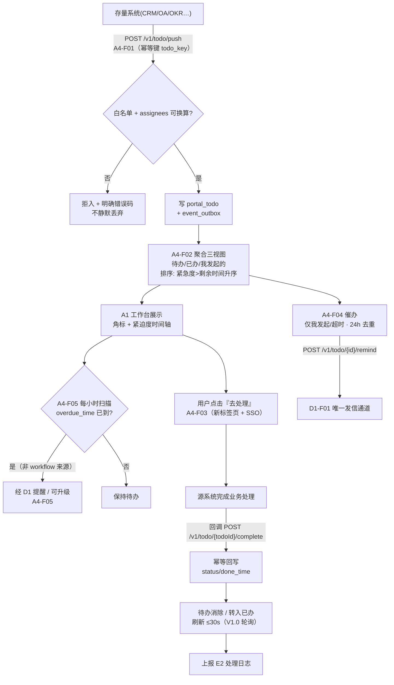
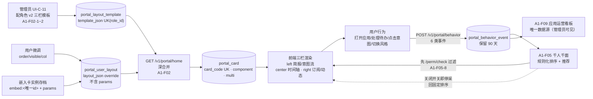
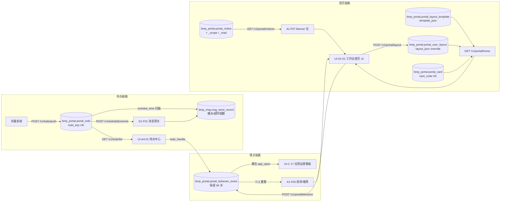
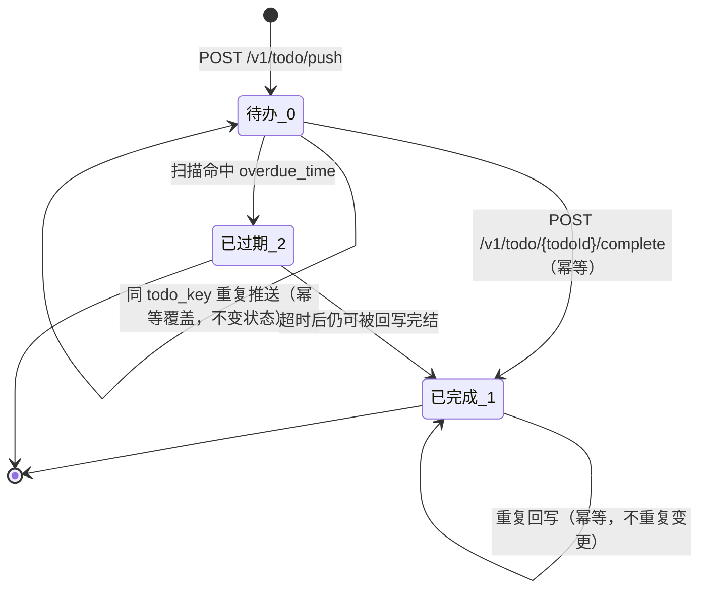
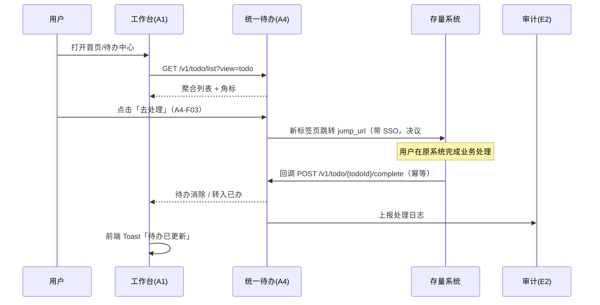

# 04 · 工作台首页配置与使用（流程专项）

> **文档性质**：派生文档（视图层），**非权威源**。功能点编号、表结构、版本归属一律以《麓邦业务中台产品PRD》（下称 PRD）与《麓邦业务中台V1.0基座版详细设计》（下称详设）为准；冲突时以真源为准。
> **生成日期**：2026-10-19 ｜ **覆盖版本**：V1.0（待办/应用导航）+ V1.5（首页体验升级批次）

---

## §0 文档说明

**覆盖范围**（共 14 个功能点）：

| 域 | 功能点 | 版本 |
| --- | --- | --- |
| A1 统一工作台 | `A1-F01 应用导航` | V1.0（子项 `A1-F01-1~2` = V1.5） |
| | `A1-F02 角色化首页（布局引擎）` | V1.0（**v2 三栏重构** + `A1-F02-1~6` = **V1.5**） |
| | `A1-F03 消息聚合` | V1.0 |
| | `A1-F04 公告管理` | V1.0（**Banner 后台增强** `A1-F04-1~5` = **V1.5**） |
| | `A1-F05 千人千面（AI 智能推荐排序）` | **V1.5 起步 / V2.0 完整** |
| | `A1-F06 个人界面风格定制` | **V1.5** |
| | `A1-F07 首页通知 Banner` | **V1.5** |
| | `A1-F08 首页页面嵌入` | **V1.5** |
| | `A1-F09 应用运营看板` | **V1.5**（与 A1-F05 埋点同批） |
| A4 统一待办 | `A4-F01 待办推送接入` / `A4-F02 待办聚合列表` / `A4-F03 统一处理跳转` / `A4-F04 催办` / `A4-F05 超时提醒` | 全部 V1.0 |

**不在范围内**：
- **消息发送机制（`D1` 全域）**归《D1 统一消息网关》，本文只写「待办催办/超时提醒**如何调用** D1」；
- **审批引擎（`C1`）**归《02-工作流配置与集成》，本文只写「待办点开后的处理跳转」及与 C3 审批视图的路由联动；
- **权限判定算法（`B2-F05`）**归《03-用户权限集成》，本文只写「A1-F05 排序**前**调用 `/perm/check` 做前置过滤」这一消费动作；
- `A2` 移动端四屏（`UI-M-05`）仅覆盖「移动首页 v2」相关部分，其余移动端能力归 `A2` 域文档。

**真源索引**：PRD §1.4（北极星）、§4.2（跨系统待办聚合与处理流程）、§6.1（A1/A4 功能点明细：6.1.1~6.1.9）、能力边界表（PRD 骨架 §3.3 B1/B9/B11/B3）；详设 §3.2（`portal_todo`）、§3.4（布局引擎 v2）、§3.5（行为埋点）、§4.8（门户接口）、§4.9（埋点通道）、§4.10（应用使用统计）；UIUX `UI-A1-01/02`、`UI-A4-01`、`UI-M-01/02`、`UI-C-10/11/17`。

**派生方案指针（2026-10-21 · 客户确认）**：流程发布为门户应用（`portal_app.kind=workflow`）、应用中心按 **业务域** 浏览/发起、订阅目录含流程应用 —— 见 `outputs/规范/产品技术方案/流程应用化与分域权限-产品方案.md`（**C1-F01-8** / **A1-F01-3** / **A1-F02-10**）；原型 `apps.html`、`console.html?page=portal-apps`、`workflow-defs`「发布到应用中心」。

**术语表**：

| 术语 | 定义 |
| --- | --- |
| 布局引擎三层 | **模板**（管理员按角色配 `portal_layout_template`）→ **用户布局**（个人覆盖 `portal_user_layout`，仅 `order/visible/col`）→ **卡片**（渲染单元 `portal_card`） |
| `legacy` 区 | 布局 JSON 中保留的 v1 旧 cardId 集合，不参与三栏渲染，仅用于保住 cardId 使老用户 override 能命中（详设 §3.4.2） |
| 诚实降级 | AI 不可用 / 数据不足时不生成判断文案、不显示 AI 徽标，退化为模板句（PRD §6.1.1） |
| 零占位 | Banner 无「已发布+未过期」公告时**不渲染 DOM**（非 `display:none`），页面高度 0（PRD §6.1.5 A1-F07-3） |
| 埋点通道 | `POST /v1/portal/behavior`，6 类行为事件的轻量采集通道，独立于 E2 审计（详设 §4.9） |
| 千人千面 | `A1-F05`：按**本人**行为自动调整排序与推荐，**只调顺序、不改结构**（PRD §6.1.3） |

---

## §1 产品价值

### 1.1 业务痛点

| # | 现状 | 后果 |
| --- | --- | --- |
| 1 | **待办散落多套系统**：CRM 合同审批、招聘 offer 审批、OA、OKR、权限申请各自有自己的「待我处理」，用户需登录 5 套系统逐一查看 | 用户漏办、超期，管理者无法一屏看到团队积压；「我发起的」更是无处追踪（PRD §4.2 开篇即定义「存量系统按标准契约推送待办，A4 聚合展示」） |
| 2 | **首页千篇一律**：V1.0 前首页为「数据罗列」——所有角色看到相同卡片、相同顺序 | 领导看不到经营驾驶舱、销售看不到合同待办，用户要自己去翻应用中心找入口（PRD §6.1.1 设计纲领 G1「首页承担判断」即为此而设） |
| 3 | **功能堆砌、找不到入口**：应用经 I1 注册后自动上架，但缺少分组/排序/常用置顶机制时，20+ 应用平铺一格 | 高频应用与一年用一次的应用混排，到达目标动作需翻页点击（PRD A1-F01 描述「支持分组、排序、常用置顶」） |
| 4 | **待办处理后状态不同步**：在原系统办完，回到工作台待办仍在，用户不确定是否办成功 | 重复处理、重复催办；「待办消除/转入已办」无法闭环（PRD §4.2 时序图末段 `A4-->>W: 待办消除/转入已办`） |

### 1.2 价值主张

**对普通员工（业务用户）**：
- 一屏收拢全部待办，**按紧迫度排序**（紧急度 > 剩余时间升序，临期/超时置顶，PRD A4-F02），「今天必须做」的行高是「知悉即可」的 1.5 倍（PRD §6.1.1 权重检验），无需自己判断先后；
- 首页出现「AI 今日简报」——用一句话说出今天最要紧的 1~3 件事（PRD §6.1.1 三秒检验）；
- 个人可自定义布局（拖拽/显隐/换栏）与界面风格（主题色/密度/圆角），**且可随时关闭智能排序回到固定顺序**（PRD §6.1.3 H3）。

**对管理者（如审批人 / 团队负责人）**：
- 按角色拿到专属默认首页——「管理层首页」预置**经营驾驶舱嵌入卡**（PRD `A1-F02-5`），无需配置即可看到团队口径；
- 「我发起的」视图可追踪进度（处理中/已完成/已撤回），并对超时项**一键催办**（PRD A4-F04，24h 去重防打扰）；
- 待办超时自动提醒并可**升级提醒**（PRD §4.2 业务规则 2 / A4-F05）。

**对管理员（门户运营/研发侧）**：
- 在 UI-C-11 用**同一套 `cardManifest` 物料**按角色配 v2 三栏模板，**后台配一处，前端渲染一致、无二次维护**（PRD `A1-F02-6`）；
- 应用运营看板（`UI-C-17`）以埋点为唯一数据源，看到调用量趋势/活跃排名/能力分布/异常下降告警，**不再依赖人工统计**（PRD §6.1.9 H1）；
- 新卡片 = 注册 `portal_card` + 注册渲染器，**零平台改造**（详设 §3.4.1）。

### 1.3 量化收益

PRD §1.4「产品目标与成功指标（北极星）」共 5 项指标；本流程**直接贡献**其中 2 项、**间接支撑** 1 项：

| 指标（PRD §1.4） | 目标值 | 与本流程关系 |
| --- | --- | --- |
| 工作台日均使用率 | ≥70% | **直接贡献**：首页 v2 + 待办聚合是「用户每天为什么来」的核心载体 |
| 能力复用率（被调用能力数/已发布能力数） | ≥60%（V2.5 起） | **间接支撑**：`A1-F09` 应用运营看板的「中台能力使用分布」为复用率提供分子来源（详设 §4.10） |
| 新系统接入中台周期 | ≤5 人日（V2.5 起） | 不直接贡献（属七步 Checklist 流程） |

**定性收益（无法量化的说明）**：「用户漏办率下降」是本流程最核心的收益，但 PRD/详设**均未定义该指标口径与基线**，故只能定性表述；如需量化，建议以 `portal_behavior_event` 的 `todo_handle` 事件（含 `remainHours`）派生「超时处理占比」，但该口径**未在真源中定义**，属建议新增。

### 1.4 不做会怎样

- **不做待办聚合（A4）**：业务规则 1 明确「待办推送必含：来源系统、业务类型、标题、跳转 URL、回写回调地址、创建时间、紧急度」（PRD §4.2）；缺少聚合层则 5 套系统的待办永远各自为政，**超时提醒（`A4-F05`）与催办（`A4-F04`）均失去承载**——FR 层面「跨系统审批聚合与统一办理入口」直接落空（PRD 增量 §7225 对应「4.2 + 4.4」）。
- **不做布局引擎（A1-F02）**：所有角色共用一套首页，`A1-F05` 的「只调顺序不改结构」**没有结构基线可调**（H1 硬边界以 `layoutTemplate` 的 cards 集合为前提）；`A1-F06` 的风格定制（H3「不改布局与功能」）也失去分治对象。
- **不做埋点通道（`POST /v1/portal/behavior`）**：`A1-F05` 无法获得 S1~S6 信号，`freq` 字段只能停留在原型 MOCK 静态值（CRM=32/OA=28，详设 §4.10），**应用运营看板（`A1-F09`）无数据源**——详设 §4.10 明确「`freq` 由『静态 → 埋点累计』的切换是**排序与看板的共同前置**」。
- **不做「零占位」Banner（`A1-F07-3`）**：首页在无公告时留出空横条，**压缩首屏**，直接破坏 PRD §6.1.1 的「三秒检验」（首屏必须无需滚动可见简报第一句）。

---

## §2 用户故事

**US-1（主流程 · 普通员工看首页）**
作为**普通员工**，我希望登录后首页直接显示 AI 今日简报与按紧迫度排序的待办，以便 3 秒内知道今天最要紧的事。
- **验收标准**：Given 用户有 6 条待办（含 1 条超时），When 打开 `UI-A1-01`，Then ① 首屏无需滚动可见简报第一句；② 简报必说 2~3 件、上限 3 件；③ 「今天必须做」分组行高 ≥ 72px，视觉上高于「知悉即可」的 44px。
- **关联**：`A1-F02`（v2 演进）、`A4-F02`、`A1-F07`

**US-2（主流程 · 待办全链路）**
作为**待办处理人**，我希望在待办中心一点「去处理」就能带 SSO 跳到原系统办完，办完待办自动消失并转已办，以便不用回原系统再确认状态。
- **验收标准**：Given 待办 `todo_key=CRM:contract_approval:CT-2026-0918-001`，When 点击「去处理」，Then ① **新标签页**打开 `jump_url`（决议 #5），工作台上下文不丢失；② 原系统完成回调 `POST /v1/todo/{todoId}/complete` 后，待办自动移除并转已办；③ 前端 Toast「待办已更新」；④ 重复回写**幂等**、状态不重复变更。
- **关联**：`A4-F03`、`A4-F01`、`A4-F02`

**US-3（管理员视角 · 配角色模板）**
作为**门户管理员**，我希望在 UI-C-11 为「管理层」「普通员工」「研发」三类角色分别绑定 v2 三栏布局模板，以便不同角色首次登录即看到各自的默认首页。
- **验收标准**：Given 管理员新建模板并绑定「管理层」角色（含经营驾驶舱嵌入卡 `embed:dashboard-1`），When 该角色新用户首次登录，Then ① 按此模板渲染；② 老用户的 `user_override` 被**安全吸收**（`applyOverride` 按 cardId 精确匹配，命中 `cards` 覆盖 order/visible/col、命中 `legacy` 仅覆盖 visible/order）；③ 后台 `template_json` 与前端 `layoutTemplateV2` 同构。
- **关联**：`A1-F02-1`、`A1-F02-4`、`A1-F02-5`、`A1-F02-6`

**US-4（管理员视角 · 公告与 Banner 运营）**
作为**门户管理员**，我希望新建公告时默认**关闭** Banner 展示开关，只有显式开启且设在有效时段内的公告才出现在首页，以便首页首屏不被运营内容污染。
- **验收标准**：Given 新建公告，When 未打开 `bannerEnabled`，Then 首页**不渲染** Banner DOM；When 开启并设定 `bannerStartTime < bannerEndTime`，Then 时段内首页展示，时段外立即消失但公告在消息中心仍可见；Given 无任何符合条件的公告，Then `querySelector('.notice-banner')===null` 且 `main` 顶部偏移与无 Banner 时**逐像素一致**。
- **关联**：`A1-F04-1`、`A1-F04-2`、`A1-F07-3`、`A1-F07-7`

**US-5（异常场景 · AI 不可用如实降级）**
作为**普通员工**，当 AI 简报服务超时或数据不足时，我希望看到模板句简报且**不显示 AI 徽标**，以便不被伪 AI 内容误导。
- **验收标准**：Given 模拟 AI 不可用（原型 `MOCK.aiBriefAvailable=false`，可点按钮切换），When 首页渲染，Then ① 简报降级为模板句，附小字「AI 暂不可用，已按待办时限排序」+ 「重试」；② **AI 徽标（`.badge-ai`）不出现**；③ 生成中态 3s 未返回即降级；④ 数据不足（有效事件 <20 或使用 <7 天）时同样移除 AI 徽标。
- **关联**：`A1-F02`（演进）、`A1-F05-7`

**US-6（异常场景 · 埋点失败不阻断主流程）**
作为**普通员工**，当埋点上报失败（网络异常/接口不可用）时，我希望首页照常渲染、不弹错，以便使用体验不受影响。
- **验收标准**：Given 断网，When 用户打开首页并点击应用，Then ① 页面**不受埋点失败影响**（不弹错、不阻塞渲染）；② 前端本地队列兜底、恢复后补报；③ 关闭「智能排序」开关后**不再产生任何行为埋点**（`A1-F05-5`「关闭即停止采集」）。
- **关联**：`A1-F05-1`、`A1-F05-5`、详设 §4.9 硬边界 3

**US-7（异常场景 · 用户布局覆盖不越界）**
作为**普通员工**，我希望在个人设置里拖拽调整卡片时只能改顺序/显隐/栏位，不能增删卡片，以便我的微调不会破坏管理员设计的结构、也不会影响他人。
- **验收标准**：Given 用户在某模板下拖动卡片，When 保存布局，Then ① 写入 `POST /v1/portal/layout` 的 payload **仅含** `{cards:[{cardId,order,visible,col}], cols:{left,right}}`，**不含 `params`**；② cardId 集合**不可增删**（决议 #6）；③ 其他用户布局不受影响；④ 「恢复默认风格」只清 `ui_style`，**不清**布局覆盖 `user_override`。
- **关联**：`A1-F02`、`A1-F06-5`

**US-8（异常场景 · 待办回写失败不静默丢失）**
作为**待办处理人**，当原系统回写失败或长时间状态不一致时，我希望待办**保持在待办列表**并可通过刷新兜底，以便我不会漏办。
- **验收标准**：Given 源系统不可达，When 用户点击「去处理」，Then ① 兜底提示（重试 / 复制链接 / 稍后再试），**待办保留不丢失**；② 回写失败 → 重试 + 人工队列；③ 待办保持未办直至刷新（**以原系统为准**），重复回调**幂等**；④ 越权点击非本人待办返回 4xxx 拒绝。
- **关联**：`A4-F03`、`A4-F01`

---

## §3 业务流程

### 3.1 主流程

**流程 A：待办全链路**（存量系统推送 → 聚合 → 展示 → 处理跳转 → 回写 → 消除）

**流程 B：首页个性化解算链路**（管理员配模板 → 用户布局 → 卡片渲染 → 埋点 → 千人千面排序）

### 3.2 角色与职责

| 角色 | 在本流程中的动作 | 涉及界面/接口 |
| --- | --- | --- |
| **普通用户（员工）** | 查看首页/待办；拖拽调整**个人**布局（order/visible/col）；切换界面风格（主题色/密度/圆角）；关闭或开启「智能排序」；点击「去处理」；订阅/隐藏推荐区 | `UI-A1-01`、`UI-A4-01`、`UI-U-01`（个人设置）；`GET /v1/portal/home`、`POST /v1/portal/layout`、`POST /v1/portal/behavior` |
| **审批人 / 管理者** | 处理待办（跳转原系统或站内审批）；对「我发起的」与超时待办发起催办（含批量 ≤50）；接收超时提醒与升级提醒；查看「管理层首页」的嵌入看板卡 | `UI-A4-01`、`UI-C-03`（统一审批视图，属 02 文档）；`POST /v1/todo/{id}/remind`、`POST /v1/todo/{todoId}/complete` |
| **管理员（门户运营）** | 配角色 v2 三栏布局模板（含嵌入卡物料）；绑定角色并发布（`highRisk` 二次确认）；公告发布与 Banner 开关/时段/优先级/预览；查看/管理卡片注册与嵌入页面；**意图项**（`portal-components&tab=intents`，非 AI 助手）；在 **总览 · 运营总览看板** 查看门户运营指标（`UI-C-17` 单页）。**V1.5 产品不配置** B7 多轮助手 / 简报 Prompt（`ai-brief`=规则引擎）；**原型演示**：`console.html?page=portal-ai-assistant`（`bmp_portal_ai_config`）控制首页 FAB。**`watch-list` 关注动态** 仅模板 **显隐/排序**，**无** feed 内容运营 | `UI-C-11`（模板）、`UI-C-10`（**应用管理** + **首页组件管理** 卡片/嵌入/**意图**）、`UI-C-17`（看板）、原型 `portal-ai-assistant`；`POST /v1/portal/card/register`、`POST /v1/portal/notice` |
| **存量系统（应用）** | 推送/更新/完结待办；提供服务端回写回调；提供服务端嵌入页面（须在白名单内） | `POST /v1/todo/push`、`POST /v1/todo/{todoId}/complete`；经 E1 网关鉴权 |
| **中台服务（bmp-server-portal）** | 深合并布局、渲染卡片数据、承接埋点写库、调度超时扫描 | 详设 §3.5 落点、§4.8/§4.9 |

### 3.3 分步说明

**步骤 1 · 待办推送接入（`A4-F01`，V1.0）**
- **触发条件**：存量系统产生新待办（如合同提交待审批）。
- **执行动作**：调用 `POST /v1/todo/push`，携带 `sourceSystem / bizType / bizId / title / summary / jumpUrl / callbackUrl / assignees / urgency / overdueHours`；`assignees` 经 `sys_account_mapping`（bmp_sys）或 `md_employee`（bmp_md）换算为 `account_id`。
- **关键规则**：**BR-1（PRD §4.2 业务规则 1）**——待办推送必含来源系统、业务类型、标题、跳转 URL、回写回调地址、创建时间、紧急度；幂等键 `todo_key` UK，重复推送为**更新语义**（详设 §3.2 `portal_todo`）。
- **异常分支**：`assignees` 无法换算 → 返回明确错误码，**不静默丢弃**；`jumpUrl`/`callbackUrl` 非白名单（`I1-F06` `isWhitelisted`）→ 拒绝（防 SSRF）。

**步骤 2 · 待办聚合与展示（`A4-F02` → `A1`，V1.0）**
- **触发条件**：用户打开工作台 / 前端 30s 角标轮询。
- **执行动作**：`GET /v1/todo/list?view=todo|done|initiated`，按身份聚合 `portal_todo`（+ 工作流 `wf_task` 映射），按视图裁剪并排序。
- **关键规则**：**排序 = 紧急度 > 剩余时间升序**（临期/超时置顶）；`A4-F02` **只聚合与跳转，不决定办理人**（办理人以原系统为准）；**不改写** `wf_task.assignee`（PRD A4-F02 边界 B3）。
- **异常分支**：聚合某来源超时 → 已就绪来源先返回 + 标注「部分来源加载中」，**不整体失败**；结果为空 → 空态「太棒了，暂无待办」+ 引导。

**步骤 3 · 处理跳转与回写（`A4-F03`，V1.0）**
- **触发条件**：用户点击「去处理」。
- **执行动作**：**新标签页**打开 `jump_url`（带 SSO）；源系统完成后回调 `POST /v1/todo/{todoId}/complete`；更新 `portal_todo.status/done_time`。
- **关键规则**：**决议 #5** 新标签页（避免 iframe 会话冲突）；回写**幂等**（重复回写同结果，不重复改状态）；审批类待办默认路由至 C3 统一审批视图（BR-3）。
- **异常分支**：源系统不可达 → 提示重试 / 复制链接 / 稍后再试，**待办保留**；回调丢失/重复 → 待办保持未办直至刷新（以原系统为准）；越权点击非本人待办 → 拒绝（4xxx）。

**步骤 4 · 催办（`A4-F04`，V1.0）**
- **触发条件**：用户在「我发起的」视图或超时待办点击「催办」（或勾选批量 ≤50）。
- **执行动作**：`POST /v1/todo/{id}/remind` → **经 D1-F01** 发送催办消息给当前处理人 → 写 `msg_send_record` + 去重标记。
- **关键规则**：**24h 内同一待办催办去重**（去重键 `{todoId}:{date}`）；**仅「我发起的」与超时待办**可用；`A4-F04` 只发起通知、**不改变办理人**、不自建发信通道。
- **异常分支**：24h 内重复催办 → 提示「今日已催办」不再发送；批量超 50 条 → 前端阻断；D1 发送失败 → 重试 ≤2 次，**失败时回滚去重标记**（允许重试）。

**步骤 5 · 超时提醒与升级（`A4-F05`，V1.0）**
- **触发条件**：超时扫描任务**每小时**调度，命中 `portal_todo.overdue_time`。
- **执行动作**：经 D1 提醒当前处理人，可**升级提醒**；前端配合显示（到期前 2h 变红「剩余 X 小时」，超时后「已超时 Xh」）。
- **关键规则**：**BR-2（PRD §4.2 业务规则 2）**——超时未处理的待办按规则自动提醒，可升级提醒；**边界（B3-b）**：`source_system=workflow` 的超时由 `C1-F05` 主责，**`A4-F05` 不二次提醒**（避免重复打扰）。
- **异常分支**：`overdueHours` 缺省 → 按业务类型映射（合同 24h / offer 24h / 权限申请 48h / 公告 72h，**待确认项**）；D1 失败 → 重试并告警 I4。

**步骤 6 · 布局模板配置（`A1-F02-1~6`，V1.5）**
- **触发条件**：管理员在 UI-C-11 新建/编辑模板。
- **执行动作**：v2 三栏编辑器（物料面板左/中/右分组、画布实时渲染）→ 填名称、选**多角色**、标注布局版本（v1 24 栅格 / v2 三栏）→ 按角色预览（脱敏）→ 保存并发布（`highRisk`）。
- **关键规则**：`template_json` 与前端 `layoutTemplateV2` **同构**；物料来源复用 `cardManifest`；绑定角色后该角色用户**首次登录即用此模板**，用户仍可个人微调。
- **异常分支**：模板未配 → 走默认模板；老用户 override 命中 `legacy` 项时**只吸收 visible/order、不写 col**（避免误改三栏布局）。

**步骤 7 · 首页解算与渲染（`A1-F02` / `A1-F07`，V1.0 + V1.5）**
- **触发条件**：用户请求 `GET /v1/portal/home`。
- **执行动作**：以 `template_json` 为基，`layout_json`（override）逐 cardId 精确匹配覆盖，并与嵌入实例存档**深合并**；渲染三栏；Banner 位按显隐条件插入。
- **关键规则**：**override 不含 `params`**（params 属模板层/实例存档）；`version` 缺失或为 1 → 渲染器按**旧逻辑平铺**，不报错不置灰；Banner **零占位**（`A1-F07-3`，P0 验收项）。
- **异常分支**：单卡片数据接口失败 → **不影响其他卡片**；Banner 无符合条件公告 → 不渲染 DOM，页面高度 0。

**步骤 8 · 千人千面排序与推荐（`A1-F05`，V1.5 起步）**
- **触发条件**：T+1 重算 或 用户手动刷新。
- **执行动作**：取 S1~S6 行为信号 → **先经 `/perm/check` 过滤（`A1-F05-8`）** → 规则化排序（应用前置、推荐区 3 张卡、时间轴**同组内**加权 ≤ 相邻 1 档）。
- **关键规则**：**H1 只调顺序不改结构**；**H2 无权限内容绝不推荐**；**H3 可关闭**（关闭即停采，回固定排序 = 角色模板 `order` + `freq` 降序）；**H4 可解释**（每条推荐附来自真实信号的理由，无理由不得前置）；**H5 冷启动退化**（有效事件 <20 或使用 <7 天 → 退化 + **移除 AI 徽标**）。
- **异常分支**：埋点失败 → **静默失败，不阻断页面主流程**；数据不足 → 推荐区**整块隐藏**（不显示空壳）。

**步骤 9 · 风格定制（`A1-F06`，V1.5）**
- **触发条件**：用户在「个人设置 → 界面风格」切换主题色/密度/圆角。
- **执行动作**：`data-theme` / `data-density` / `data-radius` 落到 `--bmp-*` Token 层，**先应用本地再与服务端对齐（防闪烁）**；持久化 `ui_style_json`（原型 `localStorage: bmp_ui_style`）。
- **关键规则**：**H1 不做暗色**；**H2 语义色不随主题色改变**（紧急语义红 `#C8161D` 固定）；**H3 只改视觉 Token、不改布局与功能**；「恢复默认」**只清 `ui_style`，不清 `user_override`**。
- **异常分支**：离线 → 以本地为准（防闪烁约定）。

**步骤 10 · 埋点采集与看板（`A1-F05-1` / `A1-F09`，V1.5）**
- **触发条件**：用户产生 6 类行为（`app_open`/`todo_handle`/`intent_click`/`content_click`/`subscription_change`/`style_change`）。
- **执行动作**：`POST /v1/portal/behavior`（单条或 ≤50 条批量）→ 写 `portal_behavior_event`（保留 90 天）；看板按 `app_open` 聚合调用量/活跃排名/能力分布/异常告警。
- **关键规则**：**H1 数据源复用同一埋点通道**（不另起采集）；**H2 不与 E2 审计混存**；**H3 无数据态必须显示引导**（不留空白图表）；看板**仅管理员可见**。
- **异常分支**：埋点关闭（`A1-F05-5`）→ 看板对应区间显示「该周期已停止采集」；数据不足 → 显示引导文案（冷启动阈值与 A1-F05 一致）。

### 3.4 异常与边界

| # | 场景 | 系统行为 | 用户可见结果 | 是否阻断 |
| --- | --- | --- | --- | --- |
| 1 | **同 `todo_key` 重复推送** | 幂等覆盖（更新），不重复建单；回执 `accepted=true` | 待办列表中无重复项 | 否 |
| 2 | **`assignees` 无法换算 `account_id`** | 返回明确错误码；**不静默丢弃** | 推送方收到错误，修正后重推 | 是（拒入该次） |
| 3 | **`jumpUrl`/`callbackUrl` 非白名单** | 按 `I1-F06` `isWhitelisted` 拒绝（防 SSRF），错误码 `8002` | 推送被拒 | 是 |
| 4 | **源系统不可达（跳转后）** | 兜底：提示重试 / 复制链接 / 稍后再试；**待办保留** | 待办不丢失，可重试 | 否 |
| 5 | **回写回调丢失或重复** | 重复回调**幂等**；待办保持未办直至刷新（以原系统为准） | 待办可能短暂停留，刷新后一致 | 否 |
| 6 | **越权点击非本人待办** | 服务端二次校验，拒回 4xxx | 操作被拒绝 | 是 |
| 7 | **Banner 无任何符合条件公告** | **不渲染 DOM**（非 `display:none`） | 页面高度 0、无空横条；`main` 顶部偏移与无 Banner 时逐像素一致 | 否 |
| 8 | **AI 简报超时（3s）/ 数据不足** | 强制降级为模板句 + 小字提示；**移除 AI 徽标** | 不显示伪 AI 内容；有「重试」入口 | 否 |
| 9 | **埋点上报失败** | 静默失败 + 本地队列兜底；不弹错、不阻塞渲染 | 页面正常，无感知 | 否 |
| 10 | **嵌入卡 iframe 加载失败/超时（建议 8s）** | 降级卡（标题 + 说明 + 新标签页打开 + 重试）；`sandbox` 不含 `allow-same-origin` | 不白屏，可见骨架与降级卡 | 否 |
| 11 | **聚合来源部分超时** | 已就绪来源先返回 + 标注「部分来源加载中」 | 部分待办可见，有提示 | 否 |
| 12 | **用户布局覆盖引用已删除 cardId** | `applyOverride` 命中不到即跳过，渲染不报错；`legacy` 区保住 v1 cardId | 布局正常，覆盖静默失效但不崩 | 否 |

### 3.5 版本归属

| 步骤 | 功能点 | 版本 | 说明 |
| --- | --- | --- | --- |
| 1 待办推送接入 | `A4-F01` | **V1.0** | PRD §6.1 A4-F01 |
| 2 待办聚合列表 | `A4-F02` | **V1.0** | 三视图 + 角标 |
| 3 统一处理跳转 | `A4-F03` | **V1.0** | 决议 #5 新标签页 |
| 4 催办 | `A4-F04` | **V1.0** | 24h 去重 |
| 5 超时提醒 | `A4-F05` | **V1.0** | 与 C1-F05 边界（B3-b） |
| 6 布局模板配置 | `A1-F02-1~6` | **V1.5** | v2 三栏编辑器、按角色预览（PRD §6.1.2 每行版本列均为 V1.5） |
| 7 首页解算与渲染 | `A1-F02` | **V1.0 基线 / v2 三栏重构 V1.5** | 页面编号 UI-A1-01 不变（仅标注重构版 v2） |
| 7b Banner 位 | `A1-F07`（+ `A1-F04-1~5`） | **V1.5** | 零占位为 **P0 验收项** |
| 7c 公告管理 | `A1-F04` | **V1.0 基线 / Banner 后台增强 V1.5** | —— |
| 7d 应用导航 | `A1-F01` | **V1.0（子项 `A1-F01-1~2` = V1.5）** | 子项为 UI-C-10 应用详情区块 |
| 7e 消息聚合 | `A1-F03` | **V1.0** | 站内信中心 |
| 7f 页面嵌入 | `A1-F08` | **V1.5** | 四约束齐备 |
| 8 千人千面 | `A1-F05` | **V1.5 起步 / V2.0 完整** | PRD §6.1.3 明确两版本 |
| 9 风格定制 | `A1-F06` | **V1.5** | 不做暗色 |
| 10 埋点 + 看板 | `A1-F05-1` / `A1-F09` | **V1.5**（同批） | 一次建设两处受益 |

> **版本口径提醒**：`A1-F02` 的**功能点基线**在 V1.0（P0），但 **v2 三栏重构与 `A1-F02-1~6` 全部落在 V1.5**；V1.0 实际交付的是旧首页（`home.html`，已在原型 `index.html` 归档为「V2 之前的首页实现」）。引用时**不得**把 v2 三栏说成 V1.0 能力。

---

## §4 数据流

### 4.1 数据流图

### 4.2 数据实体清单

| 实体/表名 | 所属库 | 用途 | 读/写 | 关联功能点 |
| --- | --- | --- | --- | --- |
| `portal_todo` | `bmp_portal` | 待办主表（幂等键 `todo_key`） | 读/写 | `A4-F01~F05`（详设 §3.2） |
| `portal_card` | `bmp_portal` | 卡片注册表（`card_code` UK、`params`、`multi`） | 读（管理端写） | `A1-F02`、`A1-F08`（详设 §3.4.1） |
| `portal_layout_template` | `bmp_portal` | 角色默认布局（`template_json`，UK(role_id)） | 读（管理端写） | `A1-F02-1~6`（详设 §3.4.2） |
| `portal_user_layout` | `bmp_portal` | 个人覆盖 override（`layout_json`，UK(account_id)，**不含 params**） | 读/写 | `A1-F02`、`A1-F06`（详设 §3.4.3） |
| `portal_behavior_event` | `bmp_portal` | 行为埋点事件（**v1.1 新增**，保留 90 天） | 写/读 | `A1-F05-1`、`A1-F09`（详设 §3.5） |
| `portal_app` / `portal_app_scope` | `bmp_portal` | 应用上架与可见范围 | 读 | `A1-F01`（详设 §3.3） |
| `portal_notice` / `_scope` / `_read` | `bmp_portal` | 公告正文/可见范围/已读 | 读/写 | `A1-F04`、`A1-F07`（详设 §3.3） |
| `portal_message` | `bmp_portal` | 站内信（未读角标） | 读/写 | `A1-F03` |
| `msg_send_record` | `bmp_msg` | 催办与超时提醒的送达追踪（`msg_key` UK） | 读/写 | `A4-F04`、`A4-F05`（详设 §3.2） |
| `wf_task` | `bmp_wf` | 工作流任务（待办来源之一，`todo_key` 四段式） | 只读映射 | `A4-F02`、`C1-F07`（详设 §3.3） |
| `gov_app_register` | `bmp_gov` | 应用注册 + **`domain_whitelist`**（**建议新增，待实施确认**） | 读 | `A4-F01`、`A1-F08-3`、`I1-F06` |
| `event_outbox` | `bmp_portal` | 待办事件发件箱（J3 简化版） | 写 | `A4-F01`（详设 §3.2） |

> **待确认落表项（原文保留「待确认」标注，不得写成既定事实）**：
> - ① `ui_style_json`（`A1-F06` 风格定制）—— 详设 §3.4.3 标注「待确认落表」，PRD 表清单写作「`portal_user_layout`(ui_style_json，待确认落表)」；
> - ② Banner 已关闭记录 —— PRD 表清单写作「`bmp_banner_closed` / `user_preference.banner_closed`（**待确认落表**）」；
> - ③ 嵌入实例存档 —— 原型走 `localStorage: bmp_embed_cards`，正式由后端按 `account_id` 存实例存档，**表名未在详设定名**。

### 4.3 接口清单

| 接口 | 方法 | 用途 | 调用方 | 详细设计章节 |
| --- | --- | --- | --- | --- |
| `/v1/todo/push` | POST | 存量系统推送待办（幂等键 `todo_key`） | 存量系统 | 详设 §4.5 |
| `/v1/todo/list?view=todo\|done\|initiated` | GET | 三视图聚合列表 + 角标 | 前端 | PRD A4-F02（关联表/接口列） |
| `/v1/todo/{todoId}/complete` | POST | 处理完成回写（幂等） | 源系统回调 | PRD A4-F03 数据逻辑流 |
| `/v1/todo/{id}/remind` | POST | 催办（经 D1-F01） | 前端 | PRD A4-F04 |
| `/v1/portal/home` | GET | 返回「角色模板 + 个人覆盖 + 嵌入实例存档」**深合并结果**（v2 三栏） | 前端 | 详设 §4.8 |
| `/v1/portal/apps` | GET | 我的应用（按 `portal_app_scope` 过滤；`freq` 排序见 §4.10） | 前端 | 详设 §4.8 |
| `/v1/portal/layout` | POST | 保存个性化布局 override（**不含 params**） | 前端 | 详设 §4.8 |
| `/v1/portal/card/register` | POST | 卡片注册（管理端；嵌入卡 `multi:true`，`card_code=embed:<id>`） | 管理端 | 详设 §4.8 |
| `/v1/portal/behavior` | POST | 行为事件上报（6 类，v1.1 新增） | 前端 | 详设 §4.9 |
| `/v1/portal/notice` / `/v1/portal/notices` | POST / GET | 公告发布与列表 | 管理端 / 前端 | 详设 §4.8 |
| `/v1/portal/messages?unread=true` / `/v1/portal/messages/read` | GET / POST | 站内信与已读 | 前端 | 详设 §4.8 |
| `/v1/perm/check` | GET | 排序前权限前置过滤（`A1-F05-8`） | `bmp-server-portal` | 详设 §4.3 |

> **接口一致性提醒（保留待确认）**：回写接口口径有「详设 `/v1/todo/{todoId}/complete` vs UIUX `/todo/done`」的分歧（PRD A4-F03 ⑪ 待确认项 1，建议统一为详设口径）；完成后列表刷新机制 V1.0 为轮询 30s、V1.5 才引入 WebSocket（PRD A4-F03 ⑪ 待确认项 2）。

### 4.4 关键字段与约束

**`portal_todo`**（详设 §3.2）：

| 字段 | 约束/取值 | 语义要点 |
| --- | --- | --- |
| `todo_key` | **UK，VARCHAR(128)** | 幂等键，三段式 `{source_system}:{biz_type}:{biz_id}`；工作流内部推 A4 为**四段式** `{sourceSystem}:{bizType}:{bizId}:{nodeKey}`（前三段 = `bizKey`），**A4 对外契约仍为三段式** |
| `urgency` | TINYINT，1/2/3 | 普通 / 重要 / 紧急 |
| `status` | TINYINT IDX，0/1/2 | 0 待办 / 1 已完成 / 2 已过期 |
| `overdue_time` | DATETIME | 超时时间，`A4-F05` 每小时扫描的依据 |
| `jump_url` / `callback_url` | VARCHAR(500) | 均须过 `I1-F06` 白名单（防 SSRF） |
| `assignee_account_id` | BIGINT IDX | 由 `assignees` 经映射换算；**换算失败不得静默丢弃** |

**布局 JSON**（详设 §3.4.2 / §3.4.3，仅列本流程关键约束，不全量抄表）：

| 键 | 约束 | 语义要点 |
| --- | --- | --- |
| `version` | `2` / 缺失或 `1` | `2` 走三栏；缺失或 1 → **旧逻辑平铺，不报错不置灰** |
| `cols` | `{left,right}`，档位 `s`/`m`/`l` | **中栏（center）弹性自适应，无档位**；对应 `left 252/300/352px`、`right 248/288/336px` |
| `cards[].col` | `left`/`center`/`right` | 三栏语义：left 简报+意图流 / center 紧迫度时间轴 / right 订阅+动态 |
| `cards[].params` | **仅嵌入卡携带** | override **不含 params**（params 属模板层/实例存档，**分治**） |
| `legacy[]` | 数组 | 保住 v1 cardId 以让 `applyOverride` 命中；**override 命中 legacy 项只吸收 visible/order、不写 col** |
| `embed:<唯一id>` | `card_code` 唯一 | 多实例必须唯一，否则拖拽/换栏/显隐互相串改（详设 §3.4.1 专门说明） |

**`portal_behavior_event`**（详设 §3.5）：

| 字段 | 约束/取值 | 语义要点 |
| --- | --- | --- |
| `event_type` | VARCHAR(32) IDX | 6 类：`app_open`/`todo_handle`/`intent_click`/`content_click`/`subscription_change`/`style_change`；非白名单建议新增错误码 `4009` |
| `account_id` | BIGINT IDX | **行为主体仅本人**，不做跨人画像 |
| `ts` | DATETIME IDX | 客户端上报的**发生时刻**（东八区），与写库时间 `create_time` 区分 |
| `payload` | JSON，轻量 | **字段白名单、禁止冗余**（如 `todo_handle` 的 `remainHours`/`action`） |
| 保留期 | 90 天 | 按月分区；**短于审计的 ≥6 个月** |

### 4.5 数据生命周期

**待办数据**：
产生（`POST /v1/todo/push`，同 `todo_key` 幂等覆盖）→ 流转（聚合展示 → 催办/超时提醒写 `msg_send_record`）→ 终态（回写 `status=1` 已完成 / 扫描置 `2` 已过期）→ 归档（**归档策略与保留期未在真源定义**，属未找到项）。

**首页布局数据**：
`portal_card`（卡片注册，长期）→ `portal_layout_template`（管理员发布，版本化，`highRisk` 二次确认）→ `portal_user_layout`（用户覆盖，随保存 upsert，`account_id` UK）→ 运行时深合并（**不落合并结果表**，`GET /v1/portal/home` 实时合成）。

**埋点数据**：
前端本地队列（埋点失败兜底）→ `POST /v1/portal/behavior`（**批量 ≤50 条**）→ `portal_behavior_event`（**幂等键未在真源定义**，属未找到项）→ 聚合消费（T+1 排序重算 / 看板查询）→ **90 天到期归档或清理**。

**幂等键小结**：待办 `todo_key`（三段/四段，详设 §3.2 + §3.3 注）；消息 `msg_key` 默认 `{业务事件键}:{receiver}`；催办去重键 `{todoId}:{date}`（24h 窗口）；事件 `event_id`（UUID）。

---

## §5 技术逻辑方案

### 5.1 架构落点

- **服务**：`bmp-server-portal` 承接 A1 门户域——布局解算（`GET /v1/portal/home`）、卡片数据、**埋点写库**（详设 §3.5：「埋点写库归 `bmp_portal` 库，由 bmp-server-portal 承接」）、待办聚合与超时扫描（A4 归门户域，L1 入口层）。
- **库**：`bmp_portal`（`portal_*` 全表）、`bmp_msg`（催办/提醒送达）、`bmp_wf`（`wf_task` 只读映射）、`bmp_gov`（应用注册与域名白名单）、`bmp_audit`（E2，**与埋点分库分权**）。
- **网关**：一律经 E1 网关（统一鉴权、限流、审计）；埋点通道同样经网关但**写向 `bmp_portal` 而非 `bmp_audit`**。
- **工程结构**见详设 §2；接口与埋点分别见详设 §4.8 / §4.9。

### 5.2 关键机制

**机制 1 · 布局引擎三层分治（模板 / 用户布局 / 卡片）**
- **机制**：管理员配 `portal_layout_template.template_json`（决定「看到哪些卡片」+ `col` + 默认 `order`）→ 用户 `portal_user_layout.layout_json`（仅 `order/visible/col`，**不含 params**，cardId 集合不可增删）→ `portal_card` 提供渲染物料与 `component`；运行时**深合并**后由 `GET /v1/portal/home` 返回。
- **解决什么**：让「管理员统一定默认 + 用户个性微调」共存，同时保证个人改动**不越界、不影响他人**。
- **不做会怎样**：无 `template_json`/`layout_json` 分治则要么每人从零配（管理员无法统管），要么只能全员同一套（回到痛点 2）；若 override 允许带 `params`，改布局时会连带**误改嵌入卡 URL/标题**（详设 §3.4.3 明确分治原因）。

**机制 2 · `legacy` 兼容区（老用户 override 不失配）**
- **机制**：v2 模板中保留 v1 cardId（`todo-list`/`notice-msg`/`birthday`/`data-metrics`/`frequent-apps`/`quick-stats`）于 `legacy[]`，`visible:false`、不参与三栏渲染，仅使 `applyOverride` 能命中。
- **解决什么**：升级 v2 后老用户既有覆盖配置**不静默失效**。
- **不做会怎样**：老用户 layout_json 引用已删除 cardId → 覆盖**静默失效**（用户以为是 bug），且无从排查。

**机制 3 · `A1-F05` 千人千面：规则化排序 + 可解释 + 可关闭 + 可退化**
- **机制**：取 S1~S6 信号做**规则化**排序（非黑盒）；每条推荐/前置附**来自真实信号**的理由（H4）；用户可一键关闭（H3，关闭即停采、回固定排序 = 角色模板 `order` + `freq` 降序）；冷启动阈值（有效事件 <20 或使用 <7 天）触发**退化 + 移除 AI 徽标**（H5）；排序**前**先经 `/perm/check` 过滤（H2/H8）。
- **解决什么**：在「不乱改结构、不越权限」前提下提升达到效率，且用户**可感知、可拒绝、可解释**。
- **不做会怎样**：若做成黑盒/不可关闭 → 违反 H3/H4 硬边界，用户无法理解「为什么这个排第一」，也无法回到稳定顺序（合规与信任风险）。

**机制 4 · `A1-F07` Banner 零占位（逐像素一致）**
- **机制**：满足「已发布 + 未过期 + 开 `bannerEnabled` + 未被用户关闭」才**渲染 DOM**；否则**完全不渲染**（非 `display:none`），页面高度 0、无边框、无底色。
- **解决什么**：保护首屏「最要紧的一件事」不被空横条挤压。
- **不做会怎样**：用 `display:none` 或占位容器 → 仍占高度/留白，`main` 顶部偏移与无 Banner 时不一致，**P0 验收项 `A1-F07-3` 直接失败**（判据：`querySelector('.notice-banner')===null`）。

**机制 5 · `A1-F02` AI 简报诚实降级**
- **机制**：AI 不可用 / 3s 超时 / 数据不足 → **不生成判断文案、不显示 AI 徽标**，降级为模板句 + 小字「AI 暂不可用，已按待办时限排序」+ 「重试」；原型以 `MOCK.aiBriefAvailable`（默认 `true`，可按钮切到 `false`）验证降级态。
- **解决什么**：避免「伪 AI」误导用户判断。
- **不做会怎样**：无 AI 时仍显示徽标与看似智能的文案 → 用户以为系统在分析，实际是兜底数据，**信任一旦破坏难以修复**（PRD §6.1.1 列为「诚实原则（强制）」）。

**机制 6 · 埋点通道独立于 E2 审计 + `freq` 由埋点累计**
- **机制**：`POST /v1/portal/behavior` 写 `bmp_portal.portal_behavior_event`（保留 90 天、仅本人行为、可清理），**审计**留 `bmp_audit`（≥6 个月、不可篡改、组合检索）；`freq = count(app_open WHERE appId=? AND ts >= now-30d)`，由静态值改埋点累计。
- **解决什么**：产品分析需求与合规留痕需求**各得其所**，且 `freq` 一处产出、两处消费（排序 + 看板）。
- **不做会怎样**：混存于 `audit_*` 表 → 违反 B9/H2 硬边界（分库分权）；`freq` 停在 MOCK 静态值则排序与看板**同时失效**（详设 §4.10 明确为「共同前置」）。

**机制 7 · 待办幂等 + 回写幂等 + 超时扫描去重**
- **机制**：`todo_key` UK 保证推送幂等（重复推送=更新）；`POST /v1/todo/{todoId}/complete` 幂等（重复回写不改状态）；`A4-F05` 每小时扫描 + 与 `C1-F05` 边界去重（`source_system=workflow` **不二次提醒**）；催办 `{todoId}:{date}` 24h 去重，**D1 失败时回滚去重标记**。
- **解决什么**：网络重试/并发/多来源均不产生重复数据或重复打扰。
- **不做会怎样**：重复建单、状态反复变更、同一超时被两处提醒 → 用户被重复打扰且状态不可信。

**机制 8 · 越权与白名单双重拦截**
- **机制**：列表/跳转按身份二次校验（非授权返回 `2403`/4xxx，**响应体不含 url**）；`jumpUrl`/`callbackUrl` 过 `I1-F06` `isWhitelisted`（https + 精确域名/受控前缀，**禁 IP 直连与内网网段**）；嵌入 iframe 走 I1 域名白名单 + `sandbox` 不含 `allow-same-origin`。
- **解决什么**：防 SSRF、防越权跳转、防嵌入页劫持。
- **不做会怎样**：门户成为 SSRF 跳板与越权入口（详设 §3.3 明确 `domain_whitelist` 是 `A4-F01`/`C1-F06` 的**唯一白名单来源**）。

### 5.3 时序/状态机

**`portal_todo.status` 状态机**（枚举来自详设 §3.2）：

> 说明：`status` 三值为详设 §3.2 明确定义（0 待办 / 1 已完成 / 2 已过期）；「已过期→已完成」转移为**推断**（详设未显式定义），标注为**待确认**。

**待办处理时序**（对应 PRD §4.2 时序图，含回写与审计）：

### 5.4 性能与容量

| 项 | 要求 | 来源 |
| --- | --- | --- |
| 待办推送响应 | **P95 <500ms**；推送至可见延迟 **≤1 分钟** | PRD A4-F01 ⑦（引用增量 PRD 性能表） |
| 待办列表首屏 | **P95 <1s**；角标刷新 ≤30s（V1.0 轮询，WebSocket V1.5） | PRD A4-F02 ⑦ |
| 跳转与回写 | 跳转无中台侧阻塞；回写后列表刷新 ≤30s（轮询） | PRD A4-F03 ⑦ |
| 催办响应 | **P95 <1s**；消息触达 ≤1 分钟 | PRD A4-F04 ⑦ |
| 应用列表接口 | `GET /v1/portal/apps` **P95 <300ms**，缓存 scope 结果、变更事件失效 | PRD A1-F01 ⑦ |
| 嵌入 iframe 超时 | 建议 **8s** 后降级卡 | PRD `A1-F08-4` |
| AI 简报超时 | **3s** 未返回即降级（逐句 120ms） | 首页重构设计规格 §5.1 |
| 埋点批量 | 单条或 **≤50 条**批量 | 详设 §4.9 |
| 首页布局接口 `/v1/portal/home` | **待定**（真源未给性能指标） | 未找到 |
| 埋点留存 | **90 天**（按月分区） | 详设 §3.5 |

> **未找到项**：`GET /v1/portal/home` 的 P95 目标、`portal_behavior_event` 的写入吞吐/日增量容量、看板聚合的查询性能指标**均未在 PRD / 详设中定义**。检索命令：`grep -n "portal/home" 麓邦业务中台V1.0基座版详细设计.md`（仅出现在接口表，无性能要求）。

### 5.5 安全与合规

- **鉴权**：所有门户接口经 E1 网关，`Authorization: Bearer {access_token}`；无有效令牌拒绝返回（PRD A1-F01 输入表）。
- **越权拦截**：列表按 `portal_app_scope` / 身份二次校验；偷换 `appId`/`todoId` 返回 4xxx，**响应体不含 `url`**（PRD A1-F01 验收 + A4-F03 异常 3）。
- **SSRF 防线**：`domain_whitelist`（https + 精确域名/受控前缀，禁 IP 直连与内网网段）作为 `A4-F01` 与 `C1-F06` 的**唯一白名单来源**，统一 `isWhitelisted(url)` 权威判定（详设 §3.3）。
- **嵌入安全**：iframe `sandbox` **不含 `allow-same-origin`**（正确安全取舍，PRD `A1-F08-4`）；嵌入域名白名单与回调白名单**语义不同、勿混**（详设 §3.3 注）。
- **采集合规**：埋点**先完成员工告知**（用途：优化个人工作台，不用于绩效）再开启；**仅采集本人行为、不做跨人画像**；关闭智能排序开关**即停止采集**（详设 §4.9 硬边界 2/4）。
- **审计留痕**：待办处理上报 E2；Banner 开关切换写审计（E2）（PRD `A1-F04-1`）；模板发布为 `highRisk` 二次确认。
- **分库分权（B9/H2）**：埋点（产品分析，90 天，权限不同）与审计（合规留痕，≥6 个月，不可篡改）**分库分权、不得混存于 `audit_*` 表**；看板**仅管理员可见**（挂 `sys_permission` 菜单权限）。
- **敏感数据**：本流程不涉及 secret 明文；应用密钥（`gov_app_register.app_secret`）AES 加密存储、不回显（详设 §3.3）。

### 5.6 已知限制与技术债

| # | 限制 / 技术债 | 说明 | 标注 |
| --- | --- | --- | --- |
| 1 | **布局引擎 v2 / 埋点通道 / 首页 v2 均在 V1.5** | V1.0 交付的是旧首页（`home.html`，原型 `index.html` 已归档为「V2 之前的首页实现」）；`home-v2.html` 与 `mobile/home-v2.html` 属 V1.5 目标态 | 如实（版本照抄 PRD） |
| 2 | **AI 简报依赖 AI 能力就绪** | 首页重构设计规格 Q3 明确：既有网关路由 `/ai/**` 当前 `enabled:false`，建议由 AI 中台提供 `GET /v1/portal/brief`（**本次原型用 Mock**）；无接口则只能走模板句降级、**不能显示 AI 徽标** | 待确认（Q3） |
| 3 | **`A1-F05` 完整版在 V2.0** | V1.5 为**规则化**起步（推荐区「3 张推荐卡 + 理由」），V2.0 才模型化（PRD `A1-F05-3` 版本列） | 如实 |
| 4 | **`freq` 灰度切点未定** | 「`freq` 由静态值 → 埋点累计」的灰度切点需与冷启动阈值一致（<20 条或 <7 天 → 固定排序） | 待确认（PRD §1810 / §2242 待确认项） |
| 5 | **布局列名口径未统一** | `portal_layout_template` 列名沿用 `layout_json` 还是统一 `template_json`；建议统一，详见详设 §14 待确认项 1 | 待确认 |
| 6 | **嵌入卡 `params` 落表位置未定** | 建议模板层/实例存档承载 params（多实例随实例走），`portal_card.params` 仅作**默认参数模板** | 待确认（详设 §14 待确认项 2） |
| 7 | **`ui_style_json` / Banner 关闭记录 / 嵌入实例存档表未定名** | 三处均为「待确认落表」，**不得写成既定事实** | 待确认 |
| 8 | **回写接口口径分歧** | 详设 `/v1/todo/{todoId}/complete` vs UIUX `/todo/done`，建议统一为详设口径 | 待确认（PRD A4-F03 ⑪-1） |
| 9 | **`todo_key` 四段式与三段式兼容** | 属**评审重点**（PRD A4-F01 ⑪-1）；建议 A4 侧同时支持三段/四段键，对外三段式契约不变 | 待确认 |
| 10 | **`source_system=workflow` 取值约定未定** | 影响 `A4-F05` / `C1-F05` 边界判定与超时提醒去重 | 待确认（PRD A4-F01 ⑪-2） |
| 11 | **列表刷新机制为轮询** | V1.0 角标 30s 轮询、回写后刷新 ≤30s；WebSocket 实时属 V1.5 | 如实（PRD A4-F02/A4-F03 ⑦） |
| 12 | **命令栏与 AI 助手** | **V1.5 方案 A 基线**：`⌘K` + **A1-F02-7**。**客户确认扩展（2026-10-21）**：**A1-F02-9** 首页助手 + **MCP**（查数/搜应用/意图导航），见 `outputs/规范/产品技术方案/首页AI助手-MCP对接-产品技术方案.md`；与规则简报/⌘K **并存**；原型 FAB + **`portal-ai-assistant`** 向产品化配置演进 | PRD §6.1.1a 拟议扩展；§10.4 #10 |
| 13 | **`watch-list` 关注动态（V1.5）** | 管理员仅在 **UI-C-11** 控制卡片 **显隐/栏位**；**无**关注源/feed 运营；原型数据写死 | V2.0 再议 `GET /v1/watch/feed` |

> **原型未实现项（如实记录）**：`A1-F05-5`「智能排序开关」在现有原型（`home-v2.html` / `settings.html`）中**未找到**入口实现。检索命令：`grep -n "智能排序\|ai_rank\|aiRank" prototype/home-v2.html prototype/settings.html`（返回空）。该能力属 V1.5 需求，原型未覆盖，**不影响验收口径**（验收以 PRD `A1-F05-5` 为准）。
>
> **AI 助手**：原型 **FAB + mock 对话**（`mock.js` · `portalAiAssistantDefault`）；**目标产品**为 **A1-F02-9 MCP 助手**（逻辑方案见 `首页AI助手-MCP对接-产品技术方案.md`），管理端 **`portal-ai-assistant`** 演进为启用/降级/MCP allowlist 配置。

---

## §6 验收与度量

### 6.1 功能验收清单

| # | 验收项 | 判据 | 优先级 | 关联功能点 |
| --- | --- | --- | --- | --- |
| 1 | 待办推送幂等 | 同 `todo_key` 重复推送**不产生第二条记录**（更新语义），`portal_todo` 中该键唯一 | **P0** | `A4-F01` |
| 2 | 三段式/四段式键兼容 | 四段式（工作流）与三段式（对外）键均能被唯一性/幂等校验正确处理 | **P0** | `A4-F01` |
| 3 | 待办来源覆盖 | **≥3 类待办来源**接入（如 CRM 合同审批 / 招聘 offer 审批 / OA） | **P0** | `A4-F01`、`A4-F02` |
| 4 | 未换算不静默丢弃 | `assignees` 无法换算 `account_id` → 返回明确错误码，**不静默丢弃** | **P0** | `A4-F01` |
| 5 | 待办排序与角标 | 三视图齐备；排序 = 紧急度 > 剩余时间升序；临期/超时置顶并红色标注；角标未读数正确 | **P0** | `A4-F02` |
| 6 | 新标签页跳转 | 点击「去处理」新窗口 `target=_blank` 打开 `jump_url`，**工作台页面不跳转**（决议 #5） | **P0** | `A4-F03` |
| 7 | 回写闭环 | 源系统完成后回调，待办**自动移除并转已办**，Toast「待办已更新」；重复回写**幂等** | **P0** | `A4-F03` |
| 8 | 越权拦截 | 未授权用户请求未授权 `appId`/`todoId` 返回 4xxx，**响应体不含 `url`** | **P0** | `A1-F01`、`A4-F03` |
| 9 | 催办 24h 去重 | 仅「我发起的」与超时待办显示催办入口；24h 内重复催办提示「今日已催办」；批量 ≤50 超限阻断 | **P0** | `A4-F04` |
| 10 | Banner 零占位 | 无符合条件公告时 `querySelector('.notice-banner')===null`；`main` 顶部偏移与无 Banner 时**逐像素一致** | **P0** | `A1-F07-3` |
| 11 | AI 简报诚实降级 | AI 不可用/超时/数据不足时**不显示 AI 徽标**、降级为模板句 + 小字提示 + 「重试」 | **P0** | `A1-F02`（演进）、`A1-F05-7` |
| 12 | 待办回写不静默丢失 | 源系统不可达时兜底提示且**待办保留**；回写失败进重试 + 人工队列 | **P0** | `A4-F03` |
| 13 | 布局模板按角色生效 | 管理员绑定角色后，该角色**新用户首登**按模板渲染；老用户 override **被安全吸收** | **P1** | `A1-F02-1`、`A1-F02-4` |
| 14 | 个人微调不越界 | `POST /v1/portal/layout` payload **仅含** `{cards:[{cardId,order,visible,col}],cols}`，**不含 params**；cardId 集合不可增删；**不影响他人布局** | **P0** | `A1-F02`、`A1-F06-5` |
| 15 | 模板与前端同构 | UI-C-11 后台 `template_json` 与前端 `layoutTemplateV2` 同构；改一处前端渲染一致、无二次维护 | **P1** | `A1-F02-6` |
| 16 | 预置角色模板 | 至少含「普通员工」「管理层（含经营驾驶舱嵌入卡）」「研发」三套，且各含其嵌入卡 | **P1** | `A1-F02-5` |
| 17 | 千人千面可关闭 | 关闭智能排序 → 立即回固定排序（角色模板 `order` + `freq` 降序）且**不再产生行为埋点** | **P1** | `A1-F05-5` |
| 18 | 排序不越权限 | 无权限账号走查：无权限项 **0 出现**（**非置灰非占位**）；过滤在排序之前 | **P1** | `A1-F05-8` |
| 19 | 推荐理由可解释 | 抽查 10 条推荐/前置，理由 **100% 可追溯到信号**；无理由不得前置 | **P1** | `A1-F05-6` |
| 20 | 冷启动退化 | 有效事件 <20 或使用 <7 天 → 按角色模板排序 + 推荐区隐藏 + **移除 AI 徽标**；新账号走查通过 | **P1** | `A1-F05-7` |
| 21 | 风格三维度生效且互不侵占 | 主题色/密度/圆角切换即时全局生效且刷新保持；**语义色与紧急语义红完全不变**；「恢复默认」**不清** `user_override` | **P1** | `A1-F06-1~5` |
| 22 | 埋点失败不阻断 | 断网/接口不可用时页面正常、不弹错；本地队列兜底；**不与 E2 审计混存** | **P0** | `A1-F05-1`、详设 §4.9 |
| 23 | 看板无数据态有引导 | 埋点未就绪/数据不足时显示引导文案，**禁止渲染空白坐标轴/0 值假图**；埋点关闭区间标「该周期已停止采集」 | **P1** | `A1-F09` |
| 24 | 嵌入卡多实例独立 | 同一首页并存 ≥2 个嵌入卡，各自独立拖拽/换栏/显隐；非白名单域名被拦截且**不渲染 iframe**；失败降级不白屏 | **P1** | `A1-F08-1~4` |
| 25 | 应用上架联动 | 新应用注册后 **10 分钟内**出现在工作台；停用/下线后刷新**不再出现** | **P0** | `A1-F01` |
| 26 | 超时提醒边界 | 非工作流来源待办按 `overdue_time` 每小时提醒、可升级；**`source_system=workflow` 不二次提醒** | **P1** | `A4-F05`、`C1-F05` |

### 6.2 端到端验证场景

**场景 1 · 待办全链路闭环（存量系统 → 聚合 → 处理 → 回写 → 消除）**
- **前置条件**：CRM 已接入（E1 路由 + `client_id`/`secret`）；`jumpUrl`/`callbackUrl` 域名已登记在 `I1-F06` 白名单；测试账号在 `assignees` 内。
- **操作**：① CRM 调 `POST /v1/todo/push`（`sourceSystem=CRM`、`bizType=contract_approval`、`todoKey=CRM:contract_approval:CT-...`）；② 用户打开 `todos.html` 待办中心；③ 点击「去处理」；④ 在 CRM 页面完成审批；⑤ CRM 回调 `/v1/todo/{todoId}/complete`。
- **期望结果**：① 推送响应 P95 <500ms、1 分钟内可见；② 待办出现在列表并按紧迫度排序，角标 +1；③ 新标签页打开、工作台不跳转；④ 待办**自动移除并转已办**，Toast「待办已更新」；⑤ 重复回调**不重复变更状态**；⑥ E2 收到处理日志。

**场景 2 · 管理员配角色首页 → 用户个性化 → 风格定制**
- **前置条件**：管理员持 `portal:app:manage` 权限；`cardManifest` 已注册 v2 新 cardId（`ai-brief`/`intent-stream`/`urgency-stream`/`watch-list`/`my-subscriptions`）与嵌入卡 `embed:<id>`。
- **操作**：① 管理员在 UI-C-11（原型 `console.html?page=layouts`）新建 v2 三栏模板，拖入「管理层首页」卡片 + 经营驾驶舱嵌入卡，绑定「管理层」多角色，按角色预览后发布（`highRisk` 二次确认）；② 管理层用户首次登录 `home-v2.html`；③ 用户拖拽调整某卡 `order` 并隐藏另一卡，保存；④ 进入 `settings.html` → 「界面风格」切主题色/密度/圆角并保存；⑤ 点「恢复默认风格」。
- **期望结果**：① 模板发布后员工端可见；② 新用户首登即按该模板三栏渲染（含嵌入卡）；③ 保存后仅 `order/visible/col` 变化、**cardId 集合未变**、params 未改；④ 三维度全局即时生效、刷新保持、换设备一致；⑤ **只清 `ui_style`，布局覆盖仍在**。

**场景 3 · Banner 零占位 + AI 简报诚实降级 联合走查**
- **前置条件**：① 先确保**无**「已发布 + 未过期 + 开 Banner」的公告；② 存在 ≥1 条 `bannerEnabled=true` 且时段有效的公告作为对照。
- **操作**：① 打开 `home-v2.html` 记录无 Banner 时 `main` 顶部偏移与首屏可见内容；② 开启一条符合条件的公告，刷新；③ 关闭该公告的 Banner 开关，刷新；④ 点击页面上的「模拟 AI 不可用」按钮（原型 `MOCK.aiBriefAvailable=false`）。
- **期望结果**：① 无 Banner 时 `.notice-banner` **不存在于 DOM**，页面高度 0、无边框无底色，`main` 顶部偏移与对照态逐像素一致；② 有 Banner 时正确展示类型标签+标题+摘要+发布时间+查看详情+关闭；③ 关闭后刷新立即消失、**不留白**；④ AI 徽标 `.badge-ai` **消失**，简报降级为模板句 + 小字「AI 暂不可用，已按待办时限排序」+「重试」。

**场景 4 · 埋点链路 → 千人千面 → 应用运营看板（V1.5）**
- **前置条件**：已完成员工告知；`POST /v1/portal/behavior` 可用；管理员持看板菜单权限。
- **操作**：① 用户连续打开 CRM 应用、处理待办、点击意图流；② 次日（T+1）观察首页应用排序与「AI 为你推荐」区；③ 用户在个人设置关闭「智能排序」；④ 管理员打开 **总览 → 运营总览看板**（`console.html?page=dashboard`；旧书签 `app-analytics` 仍 redirect）。
- **期望结果**：① 行为写入 `portal_behavior_event`（仅本人、字段白名单）；② 次日高频/当列宁舍应用前置、推荐卡含**可追溯理由**；③ 关闭后立即回固定排序且**不再产生埋点**；④ 看板四个区块（趋势/排名/能力分布/告警）数据与埋点口径一致；⑤ 关闭采集区间在看板标「该周期已停止采集」；⑥ 埋点与 `audit_*` **分库分权**。

### 6.3 度量指标

| 指标 | 目标值 | 采集方式 | 归属功能点 |
| --- | --- | --- | --- |
| 工作台日均使用率（PRD §1.4 #3） | ≥70% | 平台运营指标（`OPS-F01`）；埋点类复用 `portal_behavior_event` 聚合口径 | `A1-F01`、`A1-F02`、`A4-F02` |
| 待办推送响应 P95 | <500ms | 服务端 APM | `A4-F01` |
| 待办推送至可见延迟 | ≤1 分钟 | 推送时间 ↔ 列表出现时间 | `A4-F01` |
| 待办列表首屏 P95 | <1s | 服务端 APM | `A4-F02` |
| 角标刷新间隔 | ≤30s（V1.0 轮询） | 前端埋点/监控 | `A4-F02`、`A2-F05` |
| 查看与跳转成功率 | ≥99% | 跳转点击 ↔ 回写成功比对 | `A4-F03` |
| 催办响应 P95 / 触达 | <1s / ≤1 分钟 | 服务端 APM + `msg_send_record` | `A4-F04` |
| 应用列表接口 P95 | <300ms | 服务端 APM | `A1-F01` |
| 应用活跃排名（看板） | Top-N 可下钻 | `count(distinct account_id) where event_type='app_open'` | `A1-F09-2` |
| 调用量异常下降告警 | 阈值触发 | 环比/同比监测 | `A1-F09-4` |
| AI 推荐理由可追溯率 | 100%（抽查 10 条） | `portal_behavior_event` 槽位比对 | `A1-F05-6` |

> **无指标项（定性收益）**：「用户漏办率下降」无真源口径与基线（见 §1.3）；「首页三秒检验正确率 ≥4/5」「一句话检验点击数 ≤1」「权重检验行高 ≥1.5 倍」为**走查型判据**（PRD §6.1.1 三纲领），非持续采集指标。

### 6.4 回归红线

| # | 红线 | 理由（不可破坏性） |
| --- | --- | --- |
| 1 | **Banner 无公告时必须零占位** | 无符合条件公告时**不渲染 DOM**；一旦改为 `display:none`/占位容器，会挤压首屏「最要紧的一件事」，破坏 PRD §6.1.1 三秒检验，且 `A1-F07-3` 为 **P0 验收项**（`main` 顶部偏移须逐像素一致） |
| 2 | **AI 数据不足时不得显示伪 AI 徽标** | 「诚实原则（强制）」（PRD §6.1.1）：AI 不可用/超时/数据不足时不得生成判断文案、不得显示 AI 徽标；显示伪 AI 会破坏用户信任且违反 `A1-F05-7` 冷启动退化要求 |
| 3 | **待办回写失败不得静默丢失** | 源系统不可达/回调丢失时待办**必须保留**（以原系统为准），回写失败进重试 + 人工队列；一旦静默丢失，用户会漏办且无法自查（PRD A4-F03 异常 1/2） |
| 4 | **用户布局覆盖不得影响他人** | `portal_user_layout` 按 `account_id` 隔离；override **不得**增删 cardId、**不得**改写模板层；一旦越界则「一人微调、全员变化」或误改嵌入卡 params（决议 #6 + 详设 §3.4.3） |
| 5 | **埋点不得与 E2 审计混存** | B9/H2 硬边界：埋点（产品分析，90 天，可清理）与审计（合规留痕，≥6 个月，不可篡改）**分库分权**；混存于 `audit_*` 会导致审计不可篡改性与合规检索双双失效 |
| 6 | **排序不得推荐无权限内容** | H2 硬边界：`A1-F05-8` 要求**先权限、后排序**，无权限项 **0 出现**（非置灰非占位）；一旦破坏即出现「推荐了但点不开」 |
| 7 | **非白名单 URL 不得跳转/嵌入** | `domain_whitelist`（禁 IP 直连与内网网段）是 `A4-F01`/`C1-F06` 的唯一白名单来源；破坏即形成 SSRF 通道 |
| 8 | **`legacy` cardId 不得删除** | 删除 v1 cardId 会使老用户 `layout_json` 覆盖**静默失效**（详设 §3.4.2 专门说明），且无痕可查 |

---

## §7 附录

### 7.1 关联文档索引

| 类型 | 索引 |
| --- | --- |
| PRD | §1.4（北极星指标）、§4.2（跨系统待办聚合与处理流程 + 3 条业务规则）、§6.1（A1/A4 清单表）、§6.1.1（首页 v2 演进）、§6.1.2（`A1-F02-1~6`）、§6.1.3（`A1-F05` + 5 条硬边界）、§6.1.4（`A1-F06`）、§6.1.5（`A1-F07` + `A1-F04-1~5`）、§6.1.6（`A1-F08`）、§6.1.7（A2-F05）、§6.1.9（`A1-F09` + 三条硬边界）、§A1-F01/F02/F03/F04、§A4-F01~F05；能力边界表（骨架 §3.3 的 B1/B9/B11/B3/B3-b） |
| 详细设计 | §3.2（`portal_todo`）、§3.3（`portal_*` 概览 + `domain_whitelist` 注）、§3.4（布局引擎 v2 数据结构，含 3.4.1/3.4.2/3.4.3）、§3.5（行为埋点事件表）、§4.3（`/v1/perm/check`）、§4.5（`/v1/todo/push`）、§4.8（门户接口 + 布局 JSON）、§4.9（行为事件上报 + 6 类事件 + 4 条硬边界）、§4.10（应用使用统计来源 + `freq` 关系）、§14（本次修订说明 + 待确认项） |
| UIUX | `UI-A1-01`（首页重构版 v2）、`UI-A1-02`（应用中心）、`UI-A4-01`（统一待办中心）、`UI-M-01/02`（移动首页/待办）、`UI-U-01`（个人设置，含「界面风格」Tab）、`UI-C-10`（应用管理 + 首页组件管理三 Tab）、`UI-C-11`（布局模板管理）、`UI-C-17`（应用运营看板） |
| 专项文档 | 《麓邦业务中台首页重构设计规格》（AI 简报/意图流/时间轴流 + Q3 待确认）、《麓邦业务中台个性化与通知PRD》、《个性化与通知-需求裁定简报》 |
| 原型页面 key | `home-v2.html`（PC 首页 v2）、`todos.html`（待办）、`apps.html`（应用中心）、`messages.html`、`notices.html`、`settings.html`（界面风格）、`mobile/home-v2.html`（移动端）；管理端 `console.html?page=portal-apps` / `layouts` / `notices-admin` / **`dashboard`（单页 · UI-C-17 + 平台 KPI）** |

### 7.2 原型操作路径

**入口**：`prototype/index.html`（原型导航台）

- **门户工作台（V2）区**（`index.html` §「🏠 门户工作台（V2）」）：
  - `home-v2.html` → **工作台首页 v2**（`UI-A1-01`）：三栏 + AI 简报 + 意图流 + 紧迫度时间轴；点页面上的「模拟 AI 不可用」按钮可验证**诚实降级**（`MOCK.aiBriefAvailable=false`，AI 徽标消失）；
  - `todos.html` → **待办中心**（`UI-A4-01`）：三视图；待办行「去处理」= 新标签页跳转（`A4-F03`）；已超时项显示「催办」、我发起视图显示「催办」，重复点击提示「今日已催办（A4-F04）」；顶部「批量催办」演示勾选 ≤50；
  - `apps.html` → 应用中心（`UI-A1-02`，`A1-F01`）；`messages.html`（`A1-F03`）；`notices.html`（`A1-F04` + Banner 详情）
- **统一移动端区**：`mobile/home-v2.html` → 移动首页 v2（`UI-M-01`，含底部 Tab，`A1-F07-2` 移动 Banner 位）
- **管理控制台区**（`index.html` §「🛠 管理控制台」，均以 `console.html?page=<key>` 路由）——**门户运营**组：
  - `console.html?page=portal-apps` → **应用管理**（`UI-C-10` · 外链 + 流程应用只读）；`console.html?page=portal-components` → **首页组件管理**（**三 Tab**：卡片 / 嵌入 / **意图**）；嵌入 host 随 **I1 应用注册**（无独立白名单 Tab）；旧书签 `portal-apps&tab=cards|embeds|intents` / `portal-apps-cards|embeds|intents` redirect → **`portal-components&tab=*`**；`portal-apps-whitelist` → `portal-apps`；
  - `console.html?page=layouts` → 布局模板管理（`UI-C-11`）：点「新建模板」→ 弹窗填名称 + **适用角色多选** + 布局版本（v1 24 栅格 / v2 三栏）→ 保存/发布（`highRisk`）；
  - `console.html?page=notices-admin` → 公告管理：新建/编辑公告（含 `bannerEnabled`、展示时段、优先级、预览）、已读明细；
  - `console.html?page=dashboard`（或 alias `app-analytics`）→ **运营总览看板**（`UI-C-17` + 平台 KPI）：**5 项指标卡**（单行）/ 趋势 / 排名 / 能力分布 / 异常告警 + 「口径设置」。
- **个人设置**：`settings.html` → 左侧菜单「**界面风格**」（`A1-F06`）：主题色 5 档 / 内容密度三档 / 圆角三档 + 「保存风格」「恢复默认」；「首页布局」（`A1-F02` 个人覆盖）为相邻 Tab。
- **归档对照页**：`index.html` 底部「归档」区含 V2 之前的首页与移动端实现（`home.html` / 旧移动端），**仅供对照**，非交付态。

> 原型「智能排序开关」（`A1-F05-5`）**未实现**（未找到，检索命令见 §5.6 末注），验收以 PRD 为准。

### 7.3 未决问题

| # | 未决问题 | 建议 owner | 影响 |
| --- | --- | --- | --- |
| 1 | AI 简报数据源与接口（`GET /v1/portal/brief`？）由谁提供；网关路由 `/ai/**` 何时启用 | 架构师 + AI 中台 | 无接口则简报只能走模板句降级、**不能显示 AI 徽标**（首页重构规格 Q3） |
| 2 | `freq` 由静态值切埋点累计的**灰度切点** | 架构师 + 研发 | 与冷启动阈值（<20 条或 <7 天）一致性；影响排序与看板同步上线 |
| 3 | `portal_layout_template` 列名（`layout_json` vs `template_json`）统一 | 架构师 + 研发 | 合并语义等价性（详设 §14-1） |
| 4 | 嵌入卡 `params` 落表位置（`portal_card` vs 实例存档） | 架构师 | 多实例参数独立性（详设 §14-2） |
| 5 | `ui_style_json` / Banner 关闭记录 / 嵌入实例存档的**正式表名** | 架构师 | 落表与迁移脚本（三处仍为「待确认落表」） |
| 6 | 回写接口口径（`/v1/todo/{todoId}/complete` vs UIUX `/todo/done`） | 架构师 + A4 负责人 | 接口一致性（PRD A4-F03 ⑪-1，建议统一为详设口径） |
| 7 | `todo_key` 四段式与对外三段式兼容（**评审重点**） | 架构师 + A4 负责人 | 幂等与唯一键一致性（PRD A4-F01 ⑪-1） |
| 8 | `source_system=workflow` 取值常量约定 | 架构师 + C1/A4 | `A4-F05`/`C1-F05` 边界与超时提醒去重（PRD A4-F01 ⑪-2） |
| 9 | `overdueHours` 缺省时的业务类型映射表（默认 48h） | C1/A4 负责人 | 超时判定（建议沿用 C1-F05-1：合同 24h / offer 24h / 权限申请 48h / 公告 72h） |
| 10 | 密度档是否仅门户生效（管理控制台固定标准档） | 产品 | 表格可读性（PRD §6.1.4 落地位置说明中已标「待确认」） |
| 11 | 移动端 Banner 是否吸顶 | 产品 | 首屏「最要紧的一件事」可见性（PRD §6.1.5 已标「待确认」） |
| 12 | 「紧急」类型 Banner 是否允许用户关闭 | 产品 | 建议紧急类型不可关闭（安全/合规通告不应被屏蔽，PRD §6.1.5 待确认项 3） |
| 13 | `portal_todo` 与 `portal_behavior_event` 的**归档策略/保留期**（除埋点 90 天外均未定义） | 架构师 + 运维 | 数据治理；**本文按「未找到」处理** |
| 14 | `portal_behavior_event` 是否需业务幂等键 | 架构师 | 重复上报去重（现状未定义，**按「未找到」处理**） |
| 15 | `GET /v1/portal/home` 的性能指标（P95） | 架构师 | 容量规划（现状未定义） |